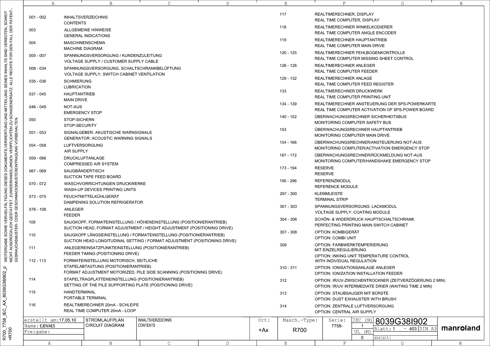

# +Ax — Sheet 1 of 403 — INHALTSVERZEICHNIS

**CONTENTS**

> Part of the manroland **R700** printing press IEC/UL circuit diagrams.
> Drawing class: **Stromlaufplan / Circuit diagram** (DIN A3).
> Document `+Ax` covers the **Central control console** machine section.

## At a glance

| Field | Value |
|---|---|
| Document | `+Ax`  (8039G38I902) |
| Sheet | **1** of 403 |
| Section (DE) | INHALTSVERZEICHNIS |
| Section (EN) | CONTENTS |
| Section type | TOC — Contents |
| Machine type | `R700` |
| Series | `7758` |
| Created | 17.05.10 |
| Replaces | — |
| Columns used | A, B, C, E, F, G |
| Path numbers | — |
| Labels on sheet | 141 |
| Cross-refs out | 0 |
| Cross-refs in | 0 |

**Previous:** [+FB sheet 22](../FB/SHEET_0022.md) · **Next:** [+Ax sheet 2](SHEET_0002.md) · **Document TOC:** [_TOC.md](_TOC.md)  (+Ax) · **Master TOC:** [all sheets](../_MASTER_TOC.md)

## Sheet image (300 DPI, exact vector render)



_Rendered directly from the PDF vector layer at 300 DPI (1-bit), no OCR and no resampling. Use it to confirm anything ambiguous in the text below._

## Cross-references on this sheet

Each entry is a wire leaving this sheet. The printed token is `/sheet.column`; the link resolves to that sheet inside the same document.

_No outgoing cross-references on this sheet._

## Devices on this sheet

_No device designators on this sheet._

## Potentials / nets

_No named potentials on this sheet._

## Wire-end annotations (grouped as printed)

A wire that continues elsewhere is annotated with a small cluster: the destination description, the path/line number `#NN`, and the `/sheet.column` cross reference. Each row below is one such cluster exactly as it is grouped on the drawing.

| Col | Y | Path | Cross-ref | Text on the wire |
|---|---|---|---|---|
| F | 30.4 | — | — | `117 REALTIMERECHNER, DISPLAY REAL TIME COMPUTER, DISPLAY` |
| A | 37.5 | — | — | `001 002 INHALTSVERZEICHNIS CONTENTS` |
| F | 61.5 | — | — | `118 REALTIMERECHNER WINKELKODIERER REAL TIME COMPUTER ANGLE ENCODER` |
| A | 68.6 | — | — | `003 GENERAL INDICATIONS ALLGEMEINE HINWEISE` |
| F | 92.7 | — | — | `119 REALTIMERECHNER HAUPTANTRIEB REAL TIME COMPUTER MAIN DRIVE` |
| A | 99.8 | — | — | `004 MASCHINENSCHEMA MACHINE DIAGRAM` |
| F | 123.9 | — | — | `120 125 REALTIMERECHNER FEHLBOGENKONTROLLE REAL TIME COMPUTER MISSING SHEET CONTROL` |
| B | 131.0 | — | — | `005 007 SPANNUNGSVERSORGUNG / KUNDENZULEITUNG` |
| B | 145.2 | — | — | `VOLTAGE SUPPLY / CUSTOMER SUPPLY CABLE` |
| F | 155.1 | — | — | `126 128 REALTIMERECHNER ANLEGER REAL TIME COMPUTER FEEDER` |
| B | 162.2 | — | — | `008 034 SPANNUNGSVERSORGUNG, SCHALTSCHRANKBELÜFTUNG` |
| B | 176.3 | — | — | `VOLTAGE SUPPLY, SWITCH CABINET VENTILATION` |
| F | 186.3 | — | — | `129 132 REALTIMERECHNER ANLAGE REAL TIME COMPUTER FEED REGISTER` |
| A | 193.4 | — | — | `035 036 LUBRICATION SCHMIERUNG` |
| F | 217.4 | — | — | `133 REALTIMERECHNER DRUCKWERK REAL TIME COMPUTER PRINTING UNIT` |
| A | 224.6 | — | — | `037 045 HAUPTANTRIEB MAIN DRIVE` |
| F | 248.6 | — | — | `134 139 REALTIMERECHNER ANSTEUERUNG DER SPS POWERKARTE REAL TIME COMPUTER ACTIVATION OF SPS POWER BOARD` |
| A | 255.7 | — | — | `046 049 NOT AUS EMERGENCY STOP` |
| F | 279.8 | — | — | `140 152 ÜBERWACHUNGSRECHNER SICHERHEITSBUS MONITORING COMPUTER SAFETY BUS` |
| A | 286.9 | — | — | `050 STOP SICHERN STOP SECURITY` |
| F | 311.0 | — | — | `153 ÜBERWACHUNGSRECHNER HAUPTANTRIEB MONITORING COMPUTER MAIN DRIVE` |
| B | 318.1 | — | — | `051 053 SIGNALGEBER: AKUSTISCHE WARNSIGNALE GENERATOR: ACOUSTIC WARNING SIGNALS` |
| F | 342.2 | — | — | `154 166 ÜBERWACHUNGSRECHNER/ANSTEUERUNG NOT AUS MONITORING COMPUTER/ACTIVATION EMERGENCY STOP` |
| A | 349.3 | — | — | `054 058 LUFTVERSORGUNG` |
| A | 363.4 | — | — | `AIR SUPPLY` |
| F | 373.3 | — | — | `167 172 ÜBERWACHUNGSRECHNER/RÜCKMELDUNG NOT AUS MONITORING COMPUTER/HANDSHAKE EMERGENCY STOP` |
| A | 380.4 | — | — | `059 066 DRUCKLUFTANLAGE COMPRESSED AIR SYSTEM` |
| E | 404.6 | — | — | `173 194 RESERVE RESERVE` |
| A | 411.6 | — | — | `067 069 SAUGBÄNDERTISCH SUCTION TAPE FEED BOARD` |
| F | 435.7 | — | — | `195 296 REFERENZMODUL REFERENCE MODULE` |
| B | 442.8 | — | — | `070 072 WASCHVORRICHTUNGEN DRUCKWERKE WASH UP DEVICES PRINTING UNITS` |
| E | 466.9 | — | — | `297 300 KLEMMLEISTE` |
| B | 474.0 | — | — | `073 075 FEUCHTMITTELKÜHLGERÄT DAMPENING SOLUTION REFRIGERATOR` |
| F | 481.1 | — | — | `TERMINAL STRIP` |
| F | 498.1 | — | — | `301 303 SPANNUNGSVERSORGUNG: LACKMODUL` |
| A | 505.2 | — | — | `076 108 FEEDER ANLEGER` |
| F | 512.3 | — | — | `VOLTAGE SUPPLY: COATING MODULE` |
| F | 529.2 | — | — | `304 306 PERFECTING PRINTING MAIN SWITCH CABINET SCHÖN & WIDERDRUCK HAUPTSCHALTSCHRANK` |
| B | 536.4 | — | — | `109 SAUGKOPF, FORMATEINSTELLUNG / HÖHENEINSTELLUNG (POSITIONIERANTRIEB) SUCTION HEAD, FORMAT ADJUSTMENT / HEIGHT ADJUSTMENT (POSITIONING DRIVE)` |
| F | 560.5 | — | — | `307 308 OPTION: KOMBIGERÄT OPTION: COMBI UNIT` |
| B | 567.5 | — | — | `110 SAUGKOPF LÄNGSEINSTELLUNG / FORMATEINSTELLUNG (POSITIONIERANTRIEB) SUCTION HEAD LONGITUDINAL SETTING / FORMAT ADJUSTMENT (POSITIONING DRIVE)` |
| F | 591.6 | — | — | `309 MIT EINZELREGULIERUNG OPTION: FARBWERKTEMPERIERUNG` |
| B | 598.7 | — | — | `111 FEEDER TIMING (POSITIONING DRIVE) ANLEGEREINSATZPUNKTEINSTELLUNG (POSITIONIERANTRIEB)` |
| F | 618.6 | — | — | `OPTION: INKING UNIT TEMPERATURE CONTROL` |
| B | 629.9 | — | — | `112 113 FORMATEINSTELLUNG MOTORISCH, SEITLICHE FORMAT ADJUSTMENT MOTORIZED, PILE SIDE SCANNING (POSITIONING DRIVE) STAPELABTASTUNG (POSITIONIERANTRIEB)` |
| F | 630.6 | — | — | `WITH INDIVIDUAL REGULATION` |
| F | 646.9 | — | — | `310 311 OPTION: IONISATIONSANLAGE ANLEGER OPTION: IONIZATION INSTALLATION FEEDER` |
| B | 675.3 | — | — | `114 STAPELTRAGPLATTENEINSTELLUNG (POSITIONIERANTRIEB) SETTING OF THE PILE SUPPORTING PLATE (POSITIONING DRIVE)` |
| F | 678.1 | — | — | `312 OPTION: IR/UV ZWISCHENTROCKNER (ZEITVERZÖGERUNG 2 MIN) OPTION: IR/UV INTERMEDIATE DRIER (WAITING TIME 2 MIN)` |
| A | 706.4 | — | — | `115 HANDTERMINAL PORTABLE TERMINAL` |
| F | 709.3 | — | — | `313 OPTION: STAUBSAUGER MIT BÜRSTE OPTION: DUST EXHAUSTER WITH BRUSH` |
| B | 737.6 | — | — | `116 REALTIMERECHNER 20mA SCHLEIFE REAL TIME COMPUTER 20mA LOOP` |
| F | 740.5 | — | — | `314 OPTION: ZENTRALE LUFTVERSORGUNG OPTION: CENTRAL AIR SUPPLY` |


## Notes and free text on this sheet

| Text | Col | Y (pt) |
|---|---|---|
| `INHALTSVERZEICHNIS` | B | 37.48 |
| `CONTENTS` | A | 51.63 |
| `ALLGEMEINE HINWEISE` | B | 68.63 |
| `GENERAL INDICATIONS` | B | 82.83 |
| `MASCHINENSCHEMA` | B | 99.82 |
| `MACHINE DIAGRAM` | B | 114 |
| `SPANNUNGSVERSORGUNG / KUNDENZULEITUNG` | B | 131 |
| `VOLTAGE SUPPLY / CUSTOMER SUPPLY CABLE` | B | 145.17 |
| `SPANNUNGSVERSORGUNG, SCHALTSCHRANKBELÜFTUNG` | B | 162.18 |
| `VOLTAGE SUPPLY, SWITCH CABINET VENTILATION` | B | 176.35 |
| `SCHMIERUNG` | A | 193.37 |
| `LUBRICATION` | A | 207.56 |
| `HAUPTANTRIEB` | A | 224.56 |
| `MAIN DRIVE` | A | 238.73 |
| `NOT AUS` | A | 255.72 |
| `EMERGENCY STOP` | B | 269.89 |
| `STOP SICHERN` | A | 286.91 |
| `STOP SECURITY` | A | 301.09 |
| `SIGNALGEBER: AKUSTISCHE WARNSIGNALE` | B | 318.08 |
| `GENERATOR: ACOUSTIC WARNING SIGNALS` | B | 332.25 |
| `LUFTVERSORGUNG` | B | 349.27 |
| `AIR SUPPLY` | A | 363.45 |
| `DRUCKLUFTANLAGE` | B | 380.46 |
| `COMPRESSED AIR SYSTEM` | B | 394.62 |
| `SAUGBÄNDERTISCH` | B | 411.64 |
| `SUCTION TAPE FEED BOARD` | B | 425.8 |
| `WASCHVORRICHTUNGEN DRUCKWERKE` | B | 442.78 |
| `WASH UP DEVICES PRINTING UNITS` | B | 456.97 |
| `FEUCHTMITTELKÜHLGERÄT` | B | 474.01 |
| `DAMPENING SOLUTION REFRIGERATOR` | B | 488.17 |
| `ANLEGER` | A | 505.18 |
| `FEEDER` | A | 519.35 |
| `SAUGKOPF, FORMATEINSTELLUNG / HÖHENEINSTELLUNG (POSITIONIERANTRIEB)` | C | 536.36 |
| `SUCTION HEAD, FORMAT ADJUSTMENT / HEIGHT ADJUSTMENT (POSITIONING DRIVE)` | C | 550.52 |
| `SAUGKOPF LÄNGSEINSTELLUNG / FORMATEINSTELLUNG (POSITIONIERANTRIEB)` | C | 567.54 |
| `SUCTION HEAD LONGITUDINAL SETTING / FORMAT ADJUSTMENT (POSITIONING DRIVE)` | C | 581.71 |
| `ANLEGEREINSATZPUNKTEINSTELLUNG (POSITIONIERANTRIEB)` | B | 598.73 |
| `FEEDER TIMING (POSITIONING DRIVE)` | B | 612.9 |
| `FORMATEINSTELLUNG MOTORISCH, SEITLICHE` | B | 629.91 |
| `STAPELABTASTUNG (POSITIONIERANTRIEB)` | B | 644.08 |
| `FORMAT ADJUSTMENT MOTORIZED, PILE SIDE SCANNING (POSITIONING DRIVE)` | C | 658.25 |
| `STAPELTRAGPLATTENEINSTELLUNG (POSITIONIERANTRIEB)` | B | 675.27 |
| `SETTING OF THE PILE SUPPORTING PLATE (POSITIONING DRIVE)` | B | 689.43 |
| `HANDTERMINAL` | A | 706.44 |
| `PORTABLE TERMINAL` | B | 720.62 |
| `REALTIMERECHNER 20mA SCHLEIFE` | B | 737.62 |
| `REAL TIME COMPUTER 20mA LOOP` | B | 751.78 |
| `REALTIMERECHNER, DISPLAY` | F | 30.38 |
| `REAL TIME COMPUTER, DISPLAY` | F | 44.55 |
| `REALTIMERECHNER WINKELKODIERER` | F | 61.54 |
| `REAL TIME COMPUTER ANGLE ENCODER` | F | 75.72 |
| `REALTIMERECHNER HAUPTANTRIEB` | F | 92.74 |
| `REAL TIME COMPUTER MAIN DRIVE` | F | 106.91 |
| `REALTIMERECHNER FEHLBOGENKONTROLLE` | F | 123.92 |
| `REAL TIME COMPUTER MISSING SHEET CONTROL` | F | 138.09 |
| `REALTIMERECHNER ANLEGER` | F | 155.1 |
| `REAL TIME COMPUTER FEEDER` | F | 169.27 |
| `REALTIMERECHNER ANLAGE` | F | 186.28 |
| `REAL TIME COMPUTER FEED REGISTER` | F | 200.45 |
| `REALTIMERECHNER DRUCKWERK` | F | 217.44 |
| `REAL TIME COMPUTER PRINTING UNIT` | F | 231.64 |
| `REALTIMERECHNER ANSTEUERUNG DER SPS POWERKARTE` | G | 248.63 |
| `REAL TIME COMPUTER ACTIVATION OF SPS POWER BOARD` | G | 262.8 |
| `ÜBERWACHUNGSRECHNER SICHERHEITSBUS` | F | 279.81 |
| `MONITORING COMPUTER SAFETY BUS` | F | 293.99 |
| `ÜBERWACHUNGSRECHNER HAUPTANTRIEB` | F | 310.99 |
| `MONITORING COMPUTER MAIN DRIVE` | F | 325.18 |
| `ÜBERWACHUNGSRECHNER/ANSTEUERUNG NOT AUS` | F | 342.16 |
| `MONITORING COMPUTER/ACTIVATION EMERGENCY STOP` | F | 356.36 |
| `ÜBERWACHUNGSRECHNER/RÜCKMELDUNG NOT AUS` | F | 373.34 |
| `MONITORING COMPUTER/HANDSHAKE EMERGENCY STOP` | F | 387.53 |
| `RESERVE` | F | 404.55 |
| `REFERENZMODUL` | F | 435.73 |
| `REFERENCE MODULE` | F | 449.9 |
| `KLEMMLEISTE` | F | 466.92 |
| `TERMINAL STRIP` | F | 481.1 |
| `SPANNUNGSVERSORGUNG: LACKMODUL` | F | 498.08 |
| `VOLTAGE SUPPLY: COATING MODULE` | F | 512.26 |
| `SCHÖN & WIDERDRUCK HAUPTSCHALTSCHRANK` | F | 529.25 |
| `PERFECTING PRINTING MAIN SWITCH CABINET` | F | 543.44 |
| `OPTION: KOMBIGERÄT` | F | 560.45 |
| `OPTION: COMBI UNIT` | F | 574.63 |
| `OPTION: FARBWERKTEMPERIERUNG` | F | 591.61 |
| `MIT EINZELREGULIERUNG` | F | 603.65 |
| `OPTION: IONISATIONSANLAGE ANLEGER` | F | 646.92 |
| `OPTION: IONIZATION INSTALLATION FEEDER` | F | 661.1 |
| `OPTION: IR/UV ZWISCHENTROCKNER (ZEITVERZÖGERUNG 2 MIN)` | G | 678.07 |
| `OPTION: IR/UV INTERMEDIATE DRIER (WAITING TIME 2 MIN)` | G | 692.25 |
| `OPTION: STAUBSAUGER MIT BÜRSTE` | F | 709.27 |
| `OPTION: DUST EXHAUSTER WITH BRUSH` | F | 723.42 |
| `OPTION: ZENTRALE LUFTVERSORGUNG` | F | 740.45 |
| `OPTION: CENTRAL AIR SUPPLY` | F | 754.63 |
| `OPTION: INKING UNIT TEMPERATURE CONTROL` | F | 618.56 |
| `WITH INDIVIDUAL REGULATION` | F | 630.56 |

## Complete label inventory (exact text from the drawing)

Every text object inside the drawing area of this sheet, in DIN reading order (column A→H, then top→bottom). This is the authoritative list: if a string is not here it is not printed on this sheet.

| Col | Y | X | Dir | Type | Text |
|---|---|---|---|---|---|
| A | 37.5 | 70.6 | → | number | `001 002` |
| A | 51.6 | 155.3 | → | text | `CONTENTS` |
| A | 68.7 | 70.6 | → | number | `003` |
| A | 99.9 | 70.6 | → | number | `004` |
| A | 131.0 | 70.6 | → | number | `005 007` |
| A | 162.2 | 70.6 | → | number | `008 034` |
| A | 193.4 | 70.6 | → | number | `035 036` |
| A | 193.4 | 155.3 | → | text | `SCHMIERUNG` |
| A | 207.6 | 155.1 | → | text | `LUBRICATION` |
| A | 224.5 | 70.6 | → | number | `037 045` |
| A | 224.6 | 155.1 | → | text | `HAUPTANTRIEB` |
| A | 238.7 | 155.1 | → | text | `MAIN DRIVE` |
| A | 255.7 | 70.6 | → | number | `046 049` |
| A | 255.7 | 155.1 | → | text | `NOT AUS` |
| A | 286.9 | 155.3 | → | text | `STOP SICHERN` |
| A | 287.0 | 70.6 | → | number | `050` |
| A | 301.1 | 155.3 | → | text | `STOP SECURITY` |
| A | 318.1 | 70.6 | → | number | `051 053` |
| A | 349.3 | 70.6 | → | number | `054 058` |
| A | 363.5 | 156.2 | → | text | `AIR SUPPLY` |
| A | 380.5 | 70.6 | → | number | `059 066` |
| A | 411.6 | 70.6 | → | number | `067 069` |
| A | 442.8 | 70.6 | → | number | `070 072` |
| A | 474.0 | 70.6 | → | number | `073 075` |
| A | 505.2 | 70.6 | → | number | `076 108` |
| A | 505.2 | 156.2 | → | text | `ANLEGER` |
| A | 519.4 | 155.1 | → | text | `FEEDER` |
| A | 536.4 | 70.0 | → | number | `109` |
| A | 567.6 | 70.0 | → | number | `110` |
| A | 598.8 | 70.0 | → | number | `111` |
| A | 629.9 | 70.0 | → | number | `112 113` |
| A | 675.3 | 70.0 | → | number | `114` |
| A | 706.4 | 155.1 | → | text | `HANDTERMINAL` |
| A | 706.5 | 70.0 | → | number | `115` |
| A | 737.7 | 70.0 | → | number | `116` |
| B | 37.5 | 155.1 | → | text | `INHALTSVERZEICHNIS` |
| B | 68.6 | 156.2 | → | text | `ALLGEMEINE HINWEISE` |
| B | 82.8 | 155.3 | → | text | `GENERAL INDICATIONS` |
| B | 99.8 | 155.1 | → | text | `MASCHINENSCHEMA` |
| B | 114.0 | 155.1 | → | text | `MACHINE DIAGRAM` |
| B | 131.0 | 155.3 | → | text | `SPANNUNGSVERSORGUNG / KUNDENZULEITUNG` |
| B | 145.2 | 156.2 | → | text | `VOLTAGE SUPPLY / CUSTOMER SUPPLY CABLE` |
| B | 162.2 | 155.3 | → | text | `SPANNUNGSVERSORGUNG, SCHALTSCHRANKBELÜFTUNG` |
| B | 176.4 | 156.2 | → | text | `VOLTAGE SUPPLY, SWITCH CABINET VENTILATION` |
| B | 269.9 | 155.1 | → | text | `EMERGENCY STOP` |
| B | 318.1 | 155.3 | → | text | `SIGNALGEBER: AKUSTISCHE WARNSIGNALE` |
| B | 332.2 | 155.3 | → | text | `GENERATOR: ACOUSTIC WARNING SIGNALS` |
| B | 349.3 | 155.1 | → | text | `LUFTVERSORGUNG` |
| B | 380.5 | 155.1 | → | text | `DRUCKLUFTANLAGE` |
| B | 394.6 | 155.3 | → | text | `COMPRESSED AIR SYSTEM` |
| B | 411.6 | 155.3 | → | text | `SAUGBÄNDERTISCH` |
| B | 425.8 | 155.3 | → | text | `SUCTION TAPE FEED BOARD` |
| B | 442.8 | 155.9 | → | text | `WASCHVORRICHTUNGEN DRUCKWERKE` |
| B | 457.0 | 155.9 | → | text | `WASH UP DEVICES PRINTING UNITS` |
| B | 474.0 | 155.1 | → | text | `FEUCHTMITTELKÜHLGERÄT` |
| B | 488.2 | 155.1 | → | text | `DAMPENING SOLUTION REFRIGERATOR` |
| B | 598.7 | 156.2 | → | text | `ANLEGEREINSATZPUNKTEINSTELLUNG (POSITIONIERANTRIEB)` |
| B | 612.9 | 155.1 | → | text | `FEEDER TIMING (POSITIONING DRIVE)` |
| B | 629.9 | 155.1 | → | text | `FORMATEINSTELLUNG MOTORISCH, SEITLICHE` |
| B | 644.1 | 155.3 | → | text | `STAPELABTASTUNG (POSITIONIERANTRIEB)` |
| B | 675.3 | 155.3 | → | text | `STAPELTRAGPLATTENEINSTELLUNG (POSITIONIERANTRIEB)` |
| B | 689.4 | 155.3 | → | text | `SETTING OF THE PILE SUPPORTING PLATE (POSITIONING DRIVE)` |
| B | 720.6 | 155.1 | → | text | `PORTABLE TERMINAL` |
| B | 737.6 | 155.1 | → | text | `REALTIMERECHNER 20mA SCHLEIFE` |
| B | 751.8 | 155.1 | → | text | `REAL TIME COMPUTER 20mA LOOP` |
| C | 536.4 | 155.3 | → | text | `SAUGKOPF, FORMATEINSTELLUNG / HÖHENEINSTELLUNG (POSITIONIERANTRIEB)` |
| C | 550.5 | 155.3 | → | text | `SUCTION HEAD, FORMAT ADJUSTMENT / HEIGHT ADJUSTMENT (POSITIONING DRIVE)` |
| C | 567.5 | 155.3 | → | text | `SAUGKOPF LÄNGSEINSTELLUNG / FORMATEINSTELLUNG (POSITIONIERANTRIEB)` |
| C | 581.7 | 155.3 | → | text | `SUCTION HEAD LONGITUDINAL SETTING / FORMAT ADJUSTMENT (POSITIONING DRIVE)` |
| C | 658.2 | 155.1 | → | text | `FORMAT ADJUSTMENT MOTORIZED, PILE SIDE SCANNING (POSITIONING DRIVE)` |
| E | 30.4 | 679.5 | → | number | `117` |
| E | 61.6 | 679.5 | → | number | `118` |
| E | 92.8 | 679.5 | → | number | `119` |
| E | 123.9 | 679.5 | → | number | `120 125` |
| E | 155.1 | 679.5 | → | number | `126 128` |
| E | 186.3 | 679.5 | → | number | `129 132` |
| E | 217.5 | 679.5 | → | number | `133` |
| E | 248.6 | 679.5 | → | number | `134 139` |
| E | 279.8 | 679.5 | → | number | `140 152` |
| E | 311.0 | 679.5 | → | number | `153` |
| E | 342.2 | 679.5 | → | number | `154 166` |
| E | 373.4 | 679.5 | → | number | `167 172` |
| E | 404.5 | 679.5 | → | number | `173 194` |
| E | 435.7 | 679.5 | → | number | `195 296` |
| E | 466.9 | 680.0 | → | number | `297 300` |
| E | 498.1 | 680.0 | → | number | `301 303` |
| E | 529.3 | 680.0 | → | number | `304 306` |
| E | 560.5 | 680.0 | → | number | `307 308` |
| E | 591.7 | 680.0 | → | number | `309` |
| E | 646.9 | 680.0 | → | number | `310 311` |
| E | 678.1 | 680.0 | → | number | `312` |
| E | 709.3 | 680.0 | → | number | `313` |
| E | 740.5 | 680.0 | → | number | `314` |
| F | 30.4 | 764.5 | → | text | `REALTIMERECHNER, DISPLAY` |
| F | 44.5 | 764.5 | → | text | `REAL TIME COMPUTER, DISPLAY` |
| F | 61.5 | 764.5 | → | text | `REALTIMERECHNER WINKELKODIERER` |
| F | 75.7 | 764.5 | → | text | `REAL TIME COMPUTER ANGLE ENCODER` |
| F | 92.7 | 764.5 | → | text | `REALTIMERECHNER HAUPTANTRIEB` |
| F | 106.9 | 764.5 | → | text | `REAL TIME COMPUTER MAIN DRIVE` |
| F | 123.9 | 764.5 | → | text | `REALTIMERECHNER FEHLBOGENKONTROLLE` |
| F | 138.1 | 764.5 | → | text | `REAL TIME COMPUTER MISSING SHEET CONTROL` |
| F | 155.1 | 764.5 | → | text | `REALTIMERECHNER ANLEGER` |
| F | 169.3 | 764.5 | → | text | `REAL TIME COMPUTER FEEDER` |
| F | 186.3 | 764.5 | → | text | `REALTIMERECHNER ANLAGE` |
| F | 200.5 | 764.5 | → | text | `REAL TIME COMPUTER FEED REGISTER` |
| F | 217.4 | 764.5 | → | text | `REALTIMERECHNER DRUCKWERK` |
| F | 231.6 | 764.5 | → | text | `REAL TIME COMPUTER PRINTING UNIT` |
| F | 279.8 | 764.5 | → | text | `ÜBERWACHUNGSRECHNER SICHERHEITSBUS` |
| F | 294.0 | 764.5 | → | text | `MONITORING COMPUTER SAFETY BUS` |
| F | 311.0 | 764.5 | → | text | `ÜBERWACHUNGSRECHNER HAUPTANTRIEB` |
| F | 325.2 | 764.5 | → | text | `MONITORING COMPUTER MAIN DRIVE` |
| F | 342.2 | 764.5 | → | text | `ÜBERWACHUNGSRECHNER/ANSTEUERUNG NOT AUS` |
| F | 356.4 | 764.5 | → | text | `MONITORING COMPUTER/ACTIVATION EMERGENCY STOP` |
| F | 373.3 | 764.5 | → | text | `ÜBERWACHUNGSRECHNER/RÜCKMELDUNG NOT AUS` |
| F | 387.5 | 764.5 | → | text | `MONITORING COMPUTER/HANDSHAKE EMERGENCY STOP` |
| F | 404.5 | 764.5 | → | text | `RESERVE` |
| F | 418.7 | 764.5 | → | text | `RESERVE` |
| F | 435.7 | 764.5 | → | text | `REFERENZMODUL` |
| F | 449.9 | 764.5 | → | text | `REFERENCE MODULE` |
| F | 466.9 | 764.5 | → | text | `KLEMMLEISTE` |
| F | 481.1 | 765.1 | → | text | `TERMINAL STRIP` |
| F | 498.1 | 764.8 | → | text | `SPANNUNGSVERSORGUNG: LACKMODUL` |
| F | 512.3 | 765.6 | → | text | `VOLTAGE SUPPLY: COATING MODULE` |
| F | 529.3 | 764.8 | → | text | `SCHÖN & WIDERDRUCK HAUPTSCHALTSCHRANK` |
| F | 543.4 | 764.5 | → | text | `PERFECTING PRINTING MAIN SWITCH CABINET` |
| F | 560.5 | 764.8 | → | text | `OPTION: KOMBIGERÄT` |
| F | 574.6 | 764.8 | → | text | `OPTION: COMBI UNIT` |
| F | 591.6 | 764.8 | → | text | `OPTION: FARBWERKTEMPERIERUNG` |
| F | 603.7 | 764.5 | → | text | `MIT EINZELREGULIERUNG` |
| F | 618.6 | 764.8 | → | text | `OPTION: INKING UNIT TEMPERATURE CONTROL` |
| F | 630.6 | 765.4 | → | text | `WITH INDIVIDUAL REGULATION` |
| F | 646.9 | 764.8 | → | text | `OPTION: IONISATIONSANLAGE ANLEGER` |
| F | 661.1 | 764.8 | → | text | `OPTION: IONIZATION INSTALLATION FEEDER` |
| F | 709.3 | 764.8 | → | text | `OPTION: STAUBSAUGER MIT BÜRSTE` |
| F | 723.4 | 764.8 | → | text | `OPTION: DUST EXHAUSTER WITH BRUSH` |
| F | 740.5 | 764.8 | → | text | `OPTION: ZENTRALE LUFTVERSORGUNG` |
| F | 754.6 | 764.8 | → | text | `OPTION: CENTRAL AIR SUPPLY` |
| G | 248.6 | 764.5 | → | text | `REALTIMERECHNER ANSTEUERUNG DER SPS POWERKARTE` |
| G | 262.8 | 764.5 | → | text | `REAL TIME COMPUTER ACTIVATION OF SPS POWER BOARD` |
| G | 678.1 | 764.8 | → | text | `OPTION: IR/UV ZWISCHENTROCKNER (ZEITVERZÖGERUNG 2 MIN)` |
| G | 692.3 | 764.8 | → | text | `OPTION: IR/UV INTERMEDIATE DRIER (WAITING TIME 2 MIN)` |

## Reading-order text block

The same content as a plain block, grouped by DIN column — convenient to paste or to match against a visual description.

```text
=== Column A ===
  37.5   70.6  numeric      001 002
  51.6  155.3  text         CONTENTS
  68.7   70.6  numeric      003
  99.9   70.6  numeric      004
 131.0   70.6  numeric      005 007
 162.2   70.6  numeric      008 034
 193.4   70.6  numeric      035 036
 193.4  155.3  text         SCHMIERUNG
 207.6  155.1  text         LUBRICATION
 224.5   70.6  numeric      037 045
 224.6  155.1  text         HAUPTANTRIEB
 238.7  155.1  text         MAIN DRIVE
 255.7   70.6  numeric      046 049
 255.7  155.1  text         NOT AUS
 286.9  155.3  text         STOP SICHERN
 287.0   70.6  numeric      050
 301.1  155.3  text         STOP SECURITY
 318.1   70.6  numeric      051 053
 349.3   70.6  numeric      054 058
 363.5  156.2  text         AIR SUPPLY
 380.5   70.6  numeric      059 066
 411.6   70.6  numeric      067 069
 442.8   70.6  numeric      070 072
 474.0   70.6  numeric      073 075
 505.2   70.6  numeric      076 108
 505.2  156.2  text         ANLEGER
 519.4  155.1  text         FEEDER
 536.4   70.0  numeric      109
 567.6   70.0  numeric      110
 598.8   70.0  numeric      111
 629.9   70.0  numeric      112 113
 675.3   70.0  numeric      114
 706.4  155.1  text         HANDTERMINAL
 706.5   70.0  numeric      115
 737.7   70.0  numeric      116
=== Column B ===
  37.5  155.1  text         INHALTSVERZEICHNIS
  68.6  156.2  text         ALLGEMEINE HINWEISE
  82.8  155.3  text         GENERAL INDICATIONS
  99.8  155.1  text         MASCHINENSCHEMA
 114.0  155.1  text         MACHINE DIAGRAM
 131.0  155.3  text         SPANNUNGSVERSORGUNG / KUNDENZULEITUNG
 145.2  156.2  text         VOLTAGE SUPPLY / CUSTOMER SUPPLY CABLE
 162.2  155.3  text         SPANNUNGSVERSORGUNG, SCHALTSCHRANKBELÜFTUNG
 176.4  156.2  text         VOLTAGE SUPPLY, SWITCH CABINET VENTILATION
 269.9  155.1  text         EMERGENCY STOP
 318.1  155.3  text         SIGNALGEBER: AKUSTISCHE WARNSIGNALE
 332.2  155.3  text         GENERATOR: ACOUSTIC WARNING SIGNALS
 349.3  155.1  text         LUFTVERSORGUNG
 380.5  155.1  text         DRUCKLUFTANLAGE
 394.6  155.3  text         COMPRESSED AIR SYSTEM
 411.6  155.3  text         SAUGBÄNDERTISCH
 425.8  155.3  text         SUCTION TAPE FEED BOARD
 442.8  155.9  text         WASCHVORRICHTUNGEN DRUCKWERKE
 457.0  155.9  text         WASH UP DEVICES PRINTING UNITS
 474.0  155.1  text         FEUCHTMITTELKÜHLGERÄT
 488.2  155.1  text         DAMPENING SOLUTION REFRIGERATOR
 598.7  156.2  text         ANLEGEREINSATZPUNKTEINSTELLUNG (POSITIONIERANTRIEB)
 612.9  155.1  text         FEEDER TIMING (POSITIONING DRIVE)
 629.9  155.1  text         FORMATEINSTELLUNG MOTORISCH, SEITLICHE
 644.1  155.3  text         STAPELABTASTUNG (POSITIONIERANTRIEB)
 675.3  155.3  text         STAPELTRAGPLATTENEINSTELLUNG (POSITIONIERANTRIEB)
 689.4  155.3  text         SETTING OF THE PILE SUPPORTING PLATE (POSITIONING DRIVE)
 720.6  155.1  text         PORTABLE TERMINAL
 737.6  155.1  text         REALTIMERECHNER 20mA SCHLEIFE
 751.8  155.1  text         REAL TIME COMPUTER 20mA LOOP
=== Column C ===
 536.4  155.3  text         SAUGKOPF, FORMATEINSTELLUNG / HÖHENEINSTELLUNG (POSITIONIERANTRIEB)
 550.5  155.3  text         SUCTION HEAD, FORMAT ADJUSTMENT / HEIGHT ADJUSTMENT (POSITIONING DRIVE)
 567.5  155.3  text         SAUGKOPF LÄNGSEINSTELLUNG / FORMATEINSTELLUNG (POSITIONIERANTRIEB)
 581.7  155.3  text         SUCTION HEAD LONGITUDINAL SETTING / FORMAT ADJUSTMENT (POSITIONING DRIVE)
 658.2  155.1  text         FORMAT ADJUSTMENT MOTORIZED, PILE SIDE SCANNING (POSITIONING DRIVE)
=== Column E ===
  30.4  679.5  numeric      117
  61.6  679.5  numeric      118
  92.8  679.5  numeric      119
 123.9  679.5  numeric      120 125
 155.1  679.5  numeric      126 128
 186.3  679.5  numeric      129 132
 217.5  679.5  numeric      133
 248.6  679.5  numeric      134 139
 279.8  679.5  numeric      140 152
 311.0  679.5  numeric      153
 342.2  679.5  numeric      154 166
 373.4  679.5  numeric      167 172
 404.5  679.5  numeric      173 194
 435.7  679.5  numeric      195 296
 466.9  680.0  numeric      297 300
 498.1  680.0  numeric      301 303
 529.3  680.0  numeric      304 306
 560.5  680.0  numeric      307 308
 591.7  680.0  numeric      309
 646.9  680.0  numeric      310 311
 678.1  680.0  numeric      312
 709.3  680.0  numeric      313
 740.5  680.0  numeric      314
=== Column F ===
  30.4  764.5  text         REALTIMERECHNER, DISPLAY
  44.5  764.5  text         REAL TIME COMPUTER, DISPLAY
  61.5  764.5  text         REALTIMERECHNER WINKELKODIERER
  75.7  764.5  text         REAL TIME COMPUTER ANGLE ENCODER
  92.7  764.5  text         REALTIMERECHNER HAUPTANTRIEB
 106.9  764.5  text         REAL TIME COMPUTER MAIN DRIVE
 123.9  764.5  text         REALTIMERECHNER FEHLBOGENKONTROLLE
 138.1  764.5  text         REAL TIME COMPUTER MISSING SHEET CONTROL
 155.1  764.5  text         REALTIMERECHNER ANLEGER
 169.3  764.5  text         REAL TIME COMPUTER FEEDER
 186.3  764.5  text         REALTIMERECHNER ANLAGE
 200.5  764.5  text         REAL TIME COMPUTER FEED REGISTER
 217.4  764.5  text         REALTIMERECHNER DRUCKWERK
 231.6  764.5  text         REAL TIME COMPUTER PRINTING UNIT
 279.8  764.5  text         ÜBERWACHUNGSRECHNER SICHERHEITSBUS
 294.0  764.5  text         MONITORING COMPUTER SAFETY BUS
 311.0  764.5  text         ÜBERWACHUNGSRECHNER HAUPTANTRIEB
 325.2  764.5  text         MONITORING COMPUTER MAIN DRIVE
 342.2  764.5  text         ÜBERWACHUNGSRECHNER/ANSTEUERUNG NOT AUS
 356.4  764.5  text         MONITORING COMPUTER/ACTIVATION EMERGENCY STOP
 373.3  764.5  text         ÜBERWACHUNGSRECHNER/RÜCKMELDUNG NOT AUS
 387.5  764.5  text         MONITORING COMPUTER/HANDSHAKE EMERGENCY STOP
 404.5  764.5  text         RESERVE
 418.7  764.5  text         RESERVE
 435.7  764.5  text         REFERENZMODUL
 449.9  764.5  text         REFERENCE MODULE
 466.9  764.5  text         KLEMMLEISTE
 481.1  765.1  text         TERMINAL STRIP
 498.1  764.8  text         SPANNUNGSVERSORGUNG: LACKMODUL
 512.3  765.6  text         VOLTAGE SUPPLY: COATING MODULE
 529.3  764.8  text         SCHÖN & WIDERDRUCK HAUPTSCHALTSCHRANK
 543.4  764.5  text         PERFECTING PRINTING MAIN SWITCH CABINET
 560.5  764.8  text         OPTION: KOMBIGERÄT
 574.6  764.8  text         OPTION: COMBI UNIT
 591.6  764.8  text         OPTION: FARBWERKTEMPERIERUNG
 603.7  764.5  text         MIT EINZELREGULIERUNG
 618.6  764.8  text         OPTION: INKING UNIT TEMPERATURE CONTROL
 630.6  765.4  text         WITH INDIVIDUAL REGULATION
 646.9  764.8  text         OPTION: IONISATIONSANLAGE ANLEGER
 661.1  764.8  text         OPTION: IONIZATION INSTALLATION FEEDER
 709.3  764.8  text         OPTION: STAUBSAUGER MIT BÜRSTE
 723.4  764.8  text         OPTION: DUST EXHAUSTER WITH BRUSH
 740.5  764.8  text         OPTION: ZENTRALE LUFTVERSORGUNG
 754.6  764.8  text         OPTION: CENTRAL AIR SUPPLY
=== Column G ===
 248.6  764.5  text         REALTIMERECHNER ANSTEUERUNG DER SPS POWERKARTE
 262.8  764.5  text         REAL TIME COMPUTER ACTIVATION OF SPS POWER BOARD
 678.1  764.8  text         OPTION: IR/UV ZWISCHENTROCKNER (ZEITVERZÖGERUNG 2 MIN)
 692.3  764.8  text         OPTION: IR/UV INTERMEDIATE DRIER (WAITING TIME 2 MIN)
```

---
_Generated from the PDF vector text layer; no OCR. Source: `R700_7758_IEC_AX_8039G38I902_p`, sheet 1._
