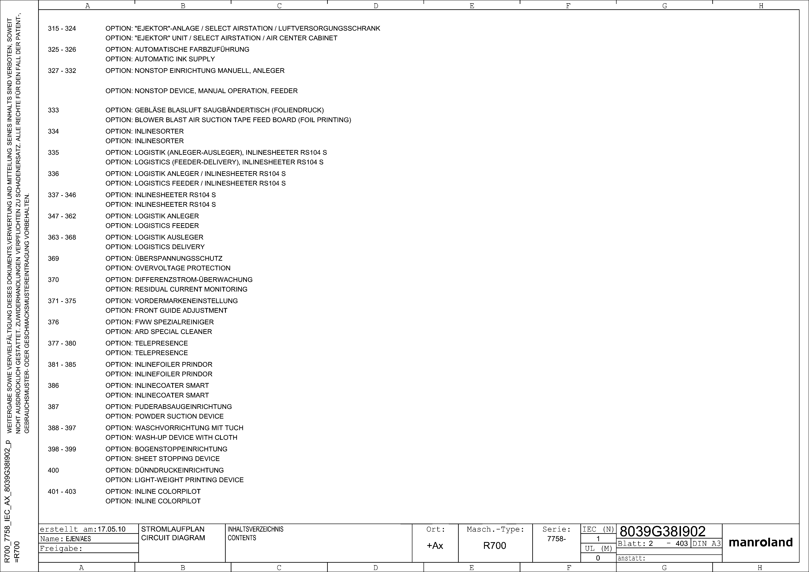

# +Ax — Sheet 2 of 403 — INHALTSVERZEICHNIS

**CONTENTS**

> Part of the manroland **R700** printing press IEC/UL circuit diagrams.
> Drawing class: **Stromlaufplan / Circuit diagram** (DIN A3).
> Document `+Ax` covers the **Central control console** machine section.

## At a glance

| Field | Value |
|---|---|
| Document | `+Ax`  (8039G38I902) |
| Sheet | **2** of 403 |
| Section (DE) | INHALTSVERZEICHNIS |
| Section (EN) | CONTENTS |
| Section type | TOC — Contents |
| Machine type | `R700` |
| Series | `7758` |
| Created | 17.05.10 |
| Replaces | — |
| Columns used | A, B, C |
| Path numbers | — |
| Labels on sheet | 66 |
| Cross-refs out | 0 |
| Cross-refs in | 0 |

**Previous:** [+Ax sheet 1](SHEET_0001.md) · **Next:** [+Ax sheet 3](SHEET_0003.md) · **Document TOC:** [_TOC.md](_TOC.md)  (+Ax) · **Master TOC:** [all sheets](../_MASTER_TOC.md)

## Sheet image (300 DPI, exact vector render)



_Rendered directly from the PDF vector layer at 300 DPI (1-bit), no OCR and no resampling. Use it to confirm anything ambiguous in the text below._

## Cross-references on this sheet

Each entry is a wire leaving this sheet. The printed token is `/sheet.column`; the link resolves to that sheet inside the same document.

_No outgoing cross-references on this sheet._

## Devices on this sheet

_No device designators on this sheet._

## Potentials / nets

_No named potentials on this sheet._

## Wire-end annotations (grouped as printed)

A wire that continues elsewhere is annotated with a small cluster: the destination description, the path/line number `#NN`, and the `/sheet.column` cross reference. Each row below is one such cluster exactly as it is grouped on the drawing.

| Col | Y | Path | Cross-ref | Text on the wire |
|---|---|---|---|---|
| B | 37.5 | — | — | `315 324 OPTION: "EJEKTOR" ANLAGE / SELECT AIRSTATION / LUFTVERSORGUNGSSCHRANK OPTION: "EJEKTOR" UNIT / SELECT AIRSTATION / AIR CENTER CABINET` |
| B | 68.6 | — | — | `325 326 OPTION: AUTOMATISCHE FARBZUFÜHRUNG OPTION: AUTOMATIC INK SUPPLY` |
| B | 99.8 | — | — | `327 332 OPTION: NONSTOP EINRICHTUNG MANUELL, ANLEGER` |
| B | 129.6 | — | — | `OPTION: NONSTOP DEVICE, MANUAL OPERATION, FEEDER` |
| B | 157.9 | — | — | `333 OPTION: GEBLÄSE BLASLUFT SAUGBÄNDERTISCH (FOLIENDRUCK) OPTION: BLOWER BLAST AIR SUCTION TAPE FEED BOARD (FOIL PRINTING)` |
| A | 189.1 | — | — | `334 OPTION: INLINESORTER OPTION: INLINESORTER` |
| B | 220.3 | — | — | `335 OPTION: LOGISTIK (ANLEGER AUSLEGER), INLINESHEETER RS104 S OPTION: LOGISTICS (FEEDER DELIVERY), INLINESHEETER RS104 S` |
| B | 251.5 | — | — | `336 OPTION: LOGISTIK ANLEGER / INLINESHEETER RS104 S OPTION: LOGISTICS FEEDER / INLINESHEETER RS104 S` |
| A | 282.7 | — | — | `337 346 OPTION: INLINESHEETER RS104 S OPTION: INLINESHEETER RS104 S` |
| A | 313.8 | — | — | `347 362 OPTION: LOGISTIK ANLEGER OPTION: LOGISTICS FEEDER` |
| A | 345.0 | — | — | `363 368 OPTION: LOGISTIK AUSLEGER OPTION: LOGISTICS DELIVERY` |
| B | 376.2 | — | — | `369 OPTION: ÜBERSPANNUNGSSCHUTZ OPTION: OVERVOLTAGE PROTECTION` |
| B | 407.4 | — | — | `370 OPTION: DIFFERENZSTROM ÜBERWACHUNG OPTION: RESIDUAL CURRENT MONITORING` |
| B | 438.6 | — | — | `371 375 OPTION: VORDERMARKENEINSTELLUNG OPTION: FRONT GUIDE ADJUSTMENT` |
| A | 469.7 | — | — | `376 OPTION: FWW SPEZIALREINIGER OPTION: ARD SPECIAL CLEANER` |
| A | 500.9 | — | — | `377 380 OPTION: TELEPRESENCE OPTION: TELEPRESENCE` |
| A | 532.1 | — | — | `381 385 OPTION: INLINEFOILER PRINDOR OPTION: INLINEFOILER PRINDOR` |
| A | 563.3 | — | — | `386 OPTION: INLINECOATER SMART OPTION: INLINECOATER SMART` |
| B | 594.5 | — | — | `387 OPTION: PUDERABSAUGEINRICHTUNG OPTION: POWDER SUCTION DEVICE` |
| B | 625.6 | — | — | `388 397 OPTION: WASCHVORRICHTUNG MIT TUCH OPTION: WASH UP DEVICE WITH CLOTH` |
| B | 656.8 | — | — | `398 399 OPTION: BOGENSTOPPEINRICHTUNG OPTION: SHEET STOPPING DEVICE` |
| B | 688.0 | — | — | `400 OPTION: DÜNNDRUCKEINRICHTUNG OPTION: LIGHT WEIGHT PRINTING DEVICE` |
| A | 719.2 | — | — | `401 403 OPTION: INLINE COLORPILOT OPTION: INLINE COLORPILOT` |


## Notes and free text on this sheet

| Text | Col | Y (pt) |
|---|---|---|
| `OPTION: "EJEKTOR" ANLAGE / SELECT AIRSTATION / LUFTVERSORGUNGSSCHRANK` | C | 37.46 |
| `OPTION: "EJEKTOR" UNIT / SELECT AIRSTATION / AIR CENTER CABINET` | B | 51.63 |
| `OPTION: AUTOMATISCHE FARBZUFÜHRUNG` | B | 68.64 |
| `OPTION: AUTOMATIC INK SUPPLY` | B | 82.82 |
| `OPTION: NONSTOP EINRICHTUNG MANUELL, ANLEGER` | B | 99.82 |
| `OPTION: NONSTOP DEVICE, MANUAL OPERATION, FEEDER` | B | 129.58 |
| `OPTION: GEBLÄSE BLASLUFT SAUGBÄNDERTISCH (FOLIENDRUCK)` | B | 157.93 |
| `OPTION: BLOWER BLAST AIR SUCTION TAPE FEED BOARD (FOIL PRINTING)` | B | 172.09 |
| `OPTION: INLINESORTER` | B | 189.12 |
| `OPTION: LOGISTIK (ANLEGER AUSLEGER), INLINESHEETER RS104 S` | B | 220.3 |
| `OPTION: LOGISTICS (FEEDER DELIVERY), INLINESHEETER RS104 S` | B | 234.47 |
| `OPTION: LOGISTIK ANLEGER / INLINESHEETER RS104 S` | B | 251.48 |
| `OPTION: LOGISTICS FEEDER / INLINESHEETER RS104 S` | B | 265.65 |
| `OPTION: INLINESHEETER RS104 S` | B | 282.66 |
| `OPTION: LOGISTIK ANLEGER` | B | 313.84 |
| `OPTION: LOGISTICS FEEDER` | B | 328.02 |
| `OPTION: LOGISTIK AUSLEGER` | B | 345.03 |
| `OPTION: LOGISTICS DELIVERY` | B | 359.2 |
| `OPTION: ÜBERSPANNUNGSSCHUTZ` | B | 376.2 |
| `OPTION: OVERVOLTAGE PROTECTION` | B | 390.37 |
| `OPTION: DIFFERENZSTROM ÜBERWACHUNG` | B | 407.36 |
| `OPTION: RESIDUAL CURRENT MONITORING` | B | 421.56 |
| `OPTION: VORDERMARKENEINSTELLUNG` | B | 438.56 |
| `OPTION: FRONT GUIDE ADJUSTMENT` | B | 452.73 |
| `OPTION: FWW SPEZIALREINIGER` | B | 469.71 |
| `OPTION: ARD SPECIAL CLEANER` | B | 483.92 |
| `OPTION: TELEPRESENCE` | B | 500.93 |
| `OPTION: INLINEFOILER PRINDOR` | B | 532.12 |
| `OPTION: INLINECOATER SMART` | B | 563.29 |
| `OPTION: PUDERABSAUGEINRICHTUNG` | B | 594.47 |
| `OPTION: POWDER SUCTION DEVICE` | B | 608.62 |
| `OPTION: WASCHVORRICHTUNG MIT TUCH` | B | 625.63 |
| `OPTION: WASH UP DEVICE WITH CLOTH` | B | 639.78 |
| `OPTION: BOGENSTOPPEINRICHTUNG` | B | 656.83 |
| `OPTION: SHEET STOPPING DEVICE` | B | 671.01 |
| `OPTION: DÜNNDRUCKEINRICHTUNG` | B | 688.01 |
| `OPTION: LIGHT WEIGHT PRINTING DEVICE` | B | 702.17 |
| `OPTION: INLINE COLORPILOT` | B | 719.2 |

## Complete label inventory (exact text from the drawing)

Every text object inside the drawing area of this sheet, in DIN reading order (column A→H, then top→bottom). This is the authoritative list: if a string is not here it is not printed on this sheet.

| Col | Y | X | Dir | Type | Text |
|---|---|---|---|---|---|
| A | 37.5 | 70.6 | → | number | `315 324` |
| A | 68.6 | 70.6 | → | number | `325 326` |
| A | 99.8 | 70.6 | → | number | `327 332` |
| A | 158.0 | 70.6 | → | number | `333` |
| A | 189.2 | 70.6 | → | number | `334` |
| A | 220.3 | 70.6 | → | number | `335` |
| A | 251.5 | 70.6 | → | number | `336` |
| A | 282.7 | 70.6 | → | number | `337 346` |
| A | 313.8 | 70.6 | → | number | `347 362` |
| A | 345.0 | 70.6 | → | number | `363 368` |
| A | 376.2 | 70.6 | → | number | `369` |
| A | 407.4 | 70.6 | → | number | `370` |
| A | 438.6 | 70.6 | → | number | `371 375` |
| A | 469.8 | 70.6 | → | number | `376` |
| A | 500.9 | 70.6 | → | number | `377 380` |
| A | 532.1 | 70.6 | → | number | `381 385` |
| A | 563.3 | 70.6 | → | number | `386` |
| A | 594.5 | 70.6 | → | number | `387` |
| A | 625.6 | 70.6 | → | number | `388 397` |
| A | 656.8 | 70.6 | → | number | `398 399` |
| A | 688.1 | 70.6 | → | number | `400` |
| A | 719.2 | 70.6 | → | number | `401 403` |
| B | 51.6 | 155.3 | → | text | `OPTION: "EJEKTOR" UNIT / SELECT AIRSTATION / AIR CENTER CABINET` |
| B | 68.6 | 155.3 | → | text | `OPTION: AUTOMATISCHE FARBZUFÜHRUNG` |
| B | 82.8 | 155.3 | → | text | `OPTION: AUTOMATIC INK SUPPLY` |
| B | 99.8 | 155.3 | → | text | `OPTION: NONSTOP EINRICHTUNG MANUELL, ANLEGER` |
| B | 129.6 | 155.3 | → | text | `OPTION: NONSTOP DEVICE, MANUAL OPERATION, FEEDER` |
| B | 157.9 | 155.3 | → | text | `OPTION: GEBLÄSE BLASLUFT SAUGBÄNDERTISCH (FOLIENDRUCK)` |
| B | 172.1 | 155.3 | → | text | `OPTION: BLOWER BLAST AIR SUCTION TAPE FEED BOARD (FOIL PRINTING)` |
| B | 189.1 | 155.3 | → | text | `OPTION: INLINESORTER` |
| B | 203.3 | 155.3 | → | text | `OPTION: INLINESORTER` |
| B | 220.3 | 155.3 | → | text | `OPTION: LOGISTIK (ANLEGER AUSLEGER), INLINESHEETER RS104 S` |
| B | 234.5 | 155.3 | → | text | `OPTION: LOGISTICS (FEEDER DELIVERY), INLINESHEETER RS104 S` |
| B | 251.5 | 155.3 | → | text | `OPTION: LOGISTIK ANLEGER / INLINESHEETER RS104 S` |
| B | 265.7 | 155.3 | → | text | `OPTION: LOGISTICS FEEDER / INLINESHEETER RS104 S` |
| B | 282.7 | 155.3 | → | text | `OPTION: INLINESHEETER RS104 S` |
| B | 296.8 | 155.3 | → | text | `OPTION: INLINESHEETER RS104 S` |
| B | 313.8 | 155.3 | → | text | `OPTION: LOGISTIK ANLEGER` |
| B | 328.0 | 155.3 | → | text | `OPTION: LOGISTICS FEEDER` |
| B | 345.0 | 155.3 | → | text | `OPTION: LOGISTIK AUSLEGER` |
| B | 359.2 | 155.3 | → | text | `OPTION: LOGISTICS DELIVERY` |
| B | 376.2 | 155.3 | → | text | `OPTION: ÜBERSPANNUNGSSCHUTZ` |
| B | 390.4 | 155.3 | → | text | `OPTION: OVERVOLTAGE PROTECTION` |
| B | 407.4 | 155.3 | → | text | `OPTION: DIFFERENZSTROM ÜBERWACHUNG` |
| B | 421.6 | 155.3 | → | text | `OPTION: RESIDUAL CURRENT MONITORING` |
| B | 438.6 | 155.3 | → | text | `OPTION: VORDERMARKENEINSTELLUNG` |
| B | 452.7 | 155.3 | → | text | `OPTION: FRONT GUIDE ADJUSTMENT` |
| B | 469.7 | 155.3 | → | text | `OPTION: FWW SPEZIALREINIGER` |
| B | 483.9 | 155.3 | → | text | `OPTION: ARD SPECIAL CLEANER` |
| B | 500.9 | 155.3 | → | text | `OPTION: TELEPRESENCE` |
| B | 515.1 | 155.3 | → | text | `OPTION: TELEPRESENCE` |
| B | 532.1 | 155.3 | → | text | `OPTION: INLINEFOILER PRINDOR` |
| B | 546.3 | 155.3 | → | text | `OPTION: INLINEFOILER PRINDOR` |
| B | 563.3 | 155.3 | → | text | `OPTION: INLINECOATER SMART` |
| B | 577.5 | 155.3 | → | text | `OPTION: INLINECOATER SMART` |
| B | 594.5 | 155.3 | → | text | `OPTION: PUDERABSAUGEINRICHTUNG` |
| B | 608.6 | 155.3 | → | text | `OPTION: POWDER SUCTION DEVICE` |
| B | 625.6 | 155.3 | → | text | `OPTION: WASCHVORRICHTUNG MIT TUCH` |
| B | 639.8 | 155.3 | → | text | `OPTION: WASH UP DEVICE WITH CLOTH` |
| B | 656.8 | 155.3 | → | text | `OPTION: BOGENSTOPPEINRICHTUNG` |
| B | 671.0 | 155.3 | → | text | `OPTION: SHEET STOPPING DEVICE` |
| B | 688.0 | 155.3 | → | text | `OPTION: DÜNNDRUCKEINRICHTUNG` |
| B | 702.2 | 155.3 | → | text | `OPTION: LIGHT WEIGHT PRINTING DEVICE` |
| B | 719.2 | 155.3 | → | text | `OPTION: INLINE COLORPILOT` |
| B | 733.4 | 155.3 | → | text | `OPTION: INLINE COLORPILOT` |
| C | 37.5 | 155.3 | → | text | `OPTION: "EJEKTOR" ANLAGE / SELECT AIRSTATION / LUFTVERSORGUNGSSCHRANK` |

## Reading-order text block

The same content as a plain block, grouped by DIN column — convenient to paste or to match against a visual description.

```text
=== Column A ===
  37.5   70.6  numeric      315 324
  68.6   70.6  numeric      325 326
  99.8   70.6  numeric      327 332
 158.0   70.6  numeric      333
 189.2   70.6  numeric      334
 220.3   70.6  numeric      335
 251.5   70.6  numeric      336
 282.7   70.6  numeric      337 346
 313.8   70.6  numeric      347 362
 345.0   70.6  numeric      363 368
 376.2   70.6  numeric      369
 407.4   70.6  numeric      370
 438.6   70.6  numeric      371 375
 469.8   70.6  numeric      376
 500.9   70.6  numeric      377 380
 532.1   70.6  numeric      381 385
 563.3   70.6  numeric      386
 594.5   70.6  numeric      387
 625.6   70.6  numeric      388 397
 656.8   70.6  numeric      398 399
 688.1   70.6  numeric      400
 719.2   70.6  numeric      401 403
=== Column B ===
  51.6  155.3  text         OPTION: "EJEKTOR" UNIT / SELECT AIRSTATION / AIR CENTER CABINET
  68.6  155.3  text         OPTION: AUTOMATISCHE FARBZUFÜHRUNG
  82.8  155.3  text         OPTION: AUTOMATIC INK SUPPLY
  99.8  155.3  text         OPTION: NONSTOP EINRICHTUNG MANUELL, ANLEGER
 129.6  155.3  text         OPTION: NONSTOP DEVICE, MANUAL OPERATION, FEEDER
 157.9  155.3  text         OPTION: GEBLÄSE BLASLUFT SAUGBÄNDERTISCH (FOLIENDRUCK)
 172.1  155.3  text         OPTION: BLOWER BLAST AIR SUCTION TAPE FEED BOARD (FOIL PRINTING)
 189.1  155.3  text         OPTION: INLINESORTER
 203.3  155.3  text         OPTION: INLINESORTER
 220.3  155.3  text         OPTION: LOGISTIK (ANLEGER AUSLEGER), INLINESHEETER RS104 S
 234.5  155.3  text         OPTION: LOGISTICS (FEEDER DELIVERY), INLINESHEETER RS104 S
 251.5  155.3  text         OPTION: LOGISTIK ANLEGER / INLINESHEETER RS104 S
 265.7  155.3  text         OPTION: LOGISTICS FEEDER / INLINESHEETER RS104 S
 282.7  155.3  text         OPTION: INLINESHEETER RS104 S
 296.8  155.3  text         OPTION: INLINESHEETER RS104 S
 313.8  155.3  text         OPTION: LOGISTIK ANLEGER
 328.0  155.3  text         OPTION: LOGISTICS FEEDER
 345.0  155.3  text         OPTION: LOGISTIK AUSLEGER
 359.2  155.3  text         OPTION: LOGISTICS DELIVERY
 376.2  155.3  text         OPTION: ÜBERSPANNUNGSSCHUTZ
 390.4  155.3  text         OPTION: OVERVOLTAGE PROTECTION
 407.4  155.3  text         OPTION: DIFFERENZSTROM ÜBERWACHUNG
 421.6  155.3  text         OPTION: RESIDUAL CURRENT MONITORING
 438.6  155.3  text         OPTION: VORDERMARKENEINSTELLUNG
 452.7  155.3  text         OPTION: FRONT GUIDE ADJUSTMENT
 469.7  155.3  text         OPTION: FWW SPEZIALREINIGER
 483.9  155.3  text         OPTION: ARD SPECIAL CLEANER
 500.9  155.3  text         OPTION: TELEPRESENCE
 515.1  155.3  text         OPTION: TELEPRESENCE
 532.1  155.3  text         OPTION: INLINEFOILER PRINDOR
 546.3  155.3  text         OPTION: INLINEFOILER PRINDOR
 563.3  155.3  text         OPTION: INLINECOATER SMART
 577.5  155.3  text         OPTION: INLINECOATER SMART
 594.5  155.3  text         OPTION: PUDERABSAUGEINRICHTUNG
 608.6  155.3  text         OPTION: POWDER SUCTION DEVICE
 625.6  155.3  text         OPTION: WASCHVORRICHTUNG MIT TUCH
 639.8  155.3  text         OPTION: WASH UP DEVICE WITH CLOTH
 656.8  155.3  text         OPTION: BOGENSTOPPEINRICHTUNG
 671.0  155.3  text         OPTION: SHEET STOPPING DEVICE
 688.0  155.3  text         OPTION: DÜNNDRUCKEINRICHTUNG
 702.2  155.3  text         OPTION: LIGHT WEIGHT PRINTING DEVICE
 719.2  155.3  text         OPTION: INLINE COLORPILOT
 733.4  155.3  text         OPTION: INLINE COLORPILOT
=== Column C ===
  37.5  155.3  text         OPTION: "EJEKTOR" ANLAGE / SELECT AIRSTATION / LUFTVERSORGUNGSSCHRANK
```

---
_Generated from the PDF vector text layer; no OCR. Source: `R700_7758_IEC_AX_8039G38I902_p`, sheet 2._
