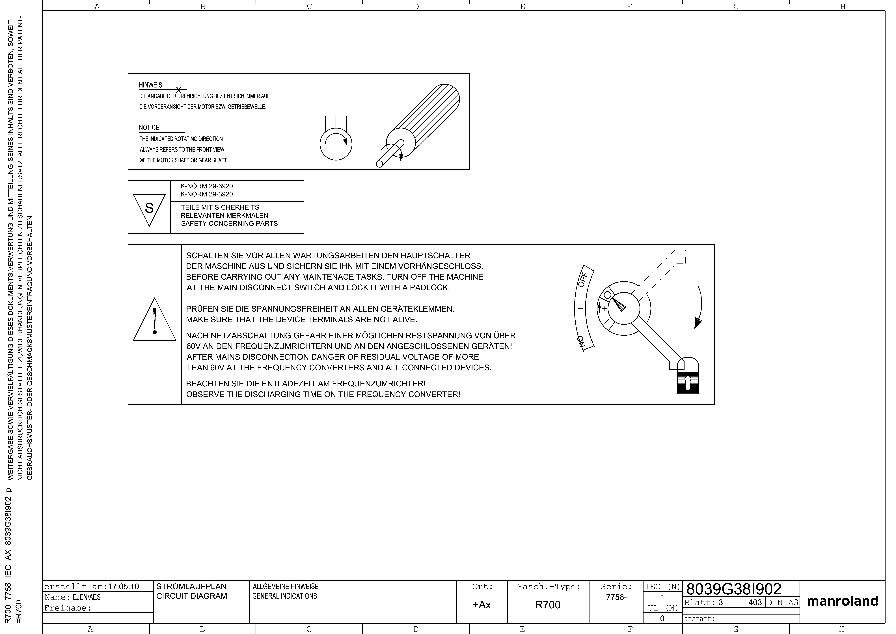

# +Ax — Sheet 3 of 403 — ALLGEMEINE HINWEISE

**GENERAL INDICATIONS**

> Part of the manroland **R700** printing press IEC/UL circuit diagrams.
> Drawing class: **Stromlaufplan / Circuit diagram** (DIN A3).
> Document `+Ax` covers the **Central control console** machine section.

## At a glance

| Field | Value |
|---|---|
| Document | `+Ax`  (8039G38I902) |
| Sheet | **3** of 403 |
| Section (DE) | ALLGEMEINE HINWEISE |
| Section (EN) | GENERAL INDICATIONS |
| Section type | LEGEND — General indications |
| Machine type | `R700` |
| Series | `7758` |
| Created | 17.05.10 |
| Replaces | — |
| Columns used | A, B, C, F |
| Path numbers | — |
| Labels on sheet | 30 |
| Cross-refs out | 0 |
| Cross-refs in | 0 |

**Previous:** [+Ax sheet 2](SHEET_0002.md) · **Next:** [+Ax sheet 4](SHEET_0004.md) · **Document TOC:** [_TOC.md](_TOC.md)  (+Ax) · **Master TOC:** [all sheets](../_MASTER_TOC.md)

## Sheet image (300 DPI, exact vector render)



_Rendered directly from the PDF vector layer at 300 DPI (1-bit), no OCR and no resampling. Use it to confirm anything ambiguous in the text below._

## Cross-references on this sheet

Each entry is a wire leaving this sheet. The printed token is `/sheet.column`; the link resolves to that sheet inside the same document.

_No outgoing cross-references on this sheet._

## Devices on this sheet

_No device designators on this sheet._

## Potentials / nets

_No named potentials on this sheet._

## Wire-end annotations (grouped as printed)

A wire that continues elsewhere is annotated with a small cluster: the destination description, the path/line number `#NN`, and the `/sheet.column` cross reference. Each row below is one such cluster exactly as it is grouped on the drawing.

| Col | Y | Path | Cross-ref | Text on the wire |
|---|---|---|---|---|
| B | 109.7 | — | — | `HINWEIS: X` |
| B | 125.0 | — | — | `DIE ANGABE DER DREHRICHTUNG BEZIEHT SICH IMMER AUF` |
| B | 139.2 | — | — | `DIE VORDERANSICHT DER MOTOR BZW. GETRIEBEWELLE.` |
| A | 166.4 | — | — | `NOTICE:` |
| B | 181.7 | — | — | `THE INDICATED ROTATING DIRECTION` |
| B | 195.9 | — | — | `ALWAYS REFERS TO THE FRONT VIEW` |
| B | 210.1 | — | — | `OF THE MOTOR SHAFT OR GEAR SHAFT.` |
| A | 210.1 | — | — | `X` |
| B | 243.4 | — | — | `K NORM 29 3920 K NORM 29 3920` |
| B | 268.0 | — | — | `S SAFETY CONCERNING PARTS` |
| B | 271.7 | — | — | `RELEVANTEN MERKMALEN TEILE MIT SICHERHEITS` |
| C | 334.8 | — | — | `SCHALTEN SIE VOR ALLEN WARTUNGSARBEITEN DEN HAUPTSCHALTER` |
| C | 349.0 | — | — | `DER MASCHINE AUS UND SICHERN SIE IHN MIT EINEM VORHÄNGESCHLOSS.` |
| F | 360.0 | — | — | `OFF` |
| C | 363.2 | — | — | `BEFORE CARRYING OUT ANY MAINTENACE TASKS, TURN OFF THE MACHINE` |
| C | 377.3 | — | — | `AT THE MAIN DISCONNECT SWITCH AND LOCK IT WITH A PADLOCK.` |
| C | 405.7 | — | — | `PRÜFEN SIE DIE SPANNUNGSFREIHEIT AN ALLEN GERÄTEKLEMMEN. MAKE SURE THAT THE DEVICE TERMINALS ARE NOT ALIVE.` |
| F | 408.3 | — | — | `I` |
| C | 441.1 | — | — | `NACH NETZABSCHALTUNG GEFAHR EINER MÖGLICHEN RESTSPANNUNG VON ÜBER` |
| F | 444.7 | — | — | `ON` |
| C | 455.3 | — | — | `60V AN DEN FREQUENZUMRICHTERN UND AN DEN ANGESCHLOSSENEN GERÄTEN! THAN 60V AT THE FREQUENCY CONVERTERS AND ALL CONNECTED DEVICES. AFTER MAINS DISCONNECTION DANGER OF RESIDUAL VOLTAGE OF MORE` |
| C | 504.9 | — | — | `BEACHTEN SIE DIE ENTLADEZEIT AM FREQUENZUMRICHTER! OBSERVE THE DISCHARGING TIME ON THE FREQUENCY CONVERTER!` |


## Reconstructed tables

This sheet carries tabular content (pin map / terminal assignment / index). The grid below was rebuilt from the drawing's own rule lines, so each row is exactly one physical row of the table.

### Table 1 — 2 data rows × 3 columns (at x=170.1, y=119.1)

| DIE DIE NOTICE: | ANGABE VORDERANSICHT | X DER |
|---|---|---|
| `THE ALWAYS OF THE X` | `INDICATED REFERS MOTOR` |  |
| `S` |  |  |


## Notes and free text on this sheet

| Text | Col | Y (pt) |
|---|---|---|
| `SCHALTEN SIE VOR ALLEN WARTUNGSARBEITEN DEN HAUPTSCHALTER` | C | 334.8 |
| `BEFORE CARRYING OUT ANY MAINTENACE TASKS, TURN OFF THE MACHINE` | C | 363.18 |
| `ON` | F | 444.72 |
| `OFF` | F | 359.96 |
| `I` | F | 408.33 |
| `BEACHTEN SIE DIE ENTLADEZEIT AM FREQUENZUMRICHTER!` | C | 504.9 |
| `OBSERVE THE DISCHARGING TIME ON THE FREQUENCY CONVERTER!` | C | 519.08 |
| `PRÜFEN SIE DIE SPANNUNGSFREIHEIT AN ALLEN GERÄTEKLEMMEN.` | C | 405.69 |
| `MAKE SURE THAT THE DEVICE TERMINALS ARE NOT ALIVE.` | C | 419.86 |
| `NACH NETZABSCHALTUNG GEFAHR EINER MÖGLICHEN RESTSPANNUNG VON ÜBER` | C | 441.11 |
| `60V AN DEN FREQUENZUMRICHTERN UND AN DEN ANGESCHLOSSENEN GERÄTEN!` | C | 455.28 |
| `AFTER MAINS DISCONNECTION DANGER OF RESIDUAL VOLTAGE OF MORE` | C | 469.47 |
| `THAN 60V AT THE FREQUENCY CONVERTERS AND ALL CONNECTED DEVICES.` | C | 483.63 |
| `DER MASCHINE AUS UND SICHERN SIE IHN MIT EINEM VORHÄNGESCHLOSS.` | C | 349.01 |
| `AT THE MAIN DISCONNECT SWITCH AND LOCK IT WITH A PADLOCK.` | C | 377.33 |
| `K NORM 29 3920` | B | 243.39 |
| `TEILE MIT SICHERHEITS` | B | 271.68 |
| `RELEVANTEN MERKMALEN` | B | 282.33 |
| `SAFETY CONCERNING PARTS` | B | 292.95 |
| `S` | A | 268.01 |
| `HINWEIS:` | B | 109.7 |
| `DIE ANGABE DER DREHRICHTUNG BEZIEHT SICH IMMER AUF` | B | 125.05 |
| `DIE VORDERANSICHT DER MOTOR BZW. GETRIEBEWELLE.` | B | 139.19 |
| `NOTICE:` | A | 166.44 |
| `THE INDICATED ROTATING DIRECTION` | B | 181.71 |
| `ALWAYS REFERS TO THE FRONT VIEW` | B | 195.87 |
| `OF THE MOTOR SHAFT OR GEAR SHAFT.` | B | 210.05 |

## Complete label inventory (exact text from the drawing)

Every text object inside the drawing area of this sheet, in DIN reading order (column A→H, then top→bottom). This is the authoritative list: if a string is not here it is not printed on this sheet.

| Col | Y | X | Dir | Type | Text |
|---|---|---|---|---|---|
| A | 166.4 | 184.8 | → | text | `NOTICE:` |
| A | 210.1 | 185.7 | → | not fitted | `X` |
| A | 268.0 | 192.3 | → | text | `S` |
| B | 109.7 | 184.8 | → | text | `HINWEIS:` |
| B | 115.1 | 233.9 | → | not fitted | `X` |
| B | 125.1 | 185.1 | → | text | `DIE ANGABE DER DREHRICHTUNG BEZIEHT SICH IMMER AUF` |
| B | 139.2 | 185.1 | → | text | `DIE VORDERANSICHT DER MOTOR BZW. GETRIEBEWELLE.` |
| B | 181.7 | 185.4 | → | text | `THE INDICATED ROTATING DIRECTION` |
| B | 195.9 | 186.0 | → | text | `ALWAYS REFERS TO THE FRONT VIEW` |
| B | 210.0 | 185.4 | → | text | `OF THE MOTOR SHAFT OR GEAR SHAFT.` |
| B | 243.4 | 240.1 | → | text | `K NORM 29 3920` |
| B | 254.0 | 240.1 | → | text | `K NORM 29 3920` |
| B | 271.7 | 240.7 | → | text | `TEILE MIT SICHERHEITS` |
| B | 282.3 | 240.1 | → | text | `RELEVANTEN MERKMALEN` |
| B | 293.0 | 240.7 | → | text | `SAFETY CONCERNING PARTS` |
| C | 334.8 | 247.5 | → | text | `SCHALTEN SIE VOR ALLEN WARTUNGSARBEITEN DEN HAUPTSCHALTER` |
| C | 349.0 | 247.2 | → | text | `DER MASCHINE AUS UND SICHERN SIE IHN MIT EINEM VORHÄNGESCHLOSS.` |
| C | 363.2 | 247.2 | → | text | `BEFORE CARRYING OUT ANY MAINTENACE TASKS, TURN OFF THE MACHINE` |
| C | 377.3 | 248.3 | → | text | `AT THE MAIN DISCONNECT SWITCH AND LOCK IT WITH A PADLOCK.` |
| C | 405.7 | 247.2 | → | text | `PRÜFEN SIE DIE SPANNUNGSFREIHEIT AN ALLEN GERÄTEKLEMMEN.` |
| C | 419.9 | 247.2 | → | text | `MAKE SURE THAT THE DEVICE TERMINALS ARE NOT ALIVE.` |
| C | 441.1 | 247.2 | → | text | `NACH NETZABSCHALTUNG GEFAHR EINER MÖGLICHEN RESTSPANNUNG VON ÜBER` |
| C | 455.3 | 247.7 | → | text | `60V AN DEN FREQUENZUMRICHTERN UND AN DEN ANGESCHLOSSENEN GERÄTEN!` |
| C | 469.5 | 248.3 | → | text | `AFTER MAINS DISCONNECTION DANGER OF RESIDUAL VOLTAGE OF MORE` |
| C | 483.6 | 247.7 | → | text | `THAN 60V AT THE FREQUENCY CONVERTERS AND ALL CONNECTED DEVICES.` |
| C | 504.9 | 247.2 | → | text | `BEACHTEN SIE DIE ENTLADEZEIT AM FREQUENZUMRICHTER!` |
| C | 519.1 | 247.5 | → | text | `OBSERVE THE DISCHARGING TIME ON THE FREQUENCY CONVERTER!` |
| F | 360.0 | 766.8 | ↕ | text | `OFF` |
| F | 408.3 | 767.7 | ↕ | text | `I` |
| F | 444.7 | 764.1 | ↕ | text | `ON` |

## Reading-order text block

The same content as a plain block, grouped by DIN column — convenient to paste or to match against a visual description.

```text
=== Column A ===
 166.4  184.8  text         NOTICE:
 210.1  185.7  placeholder  X
 268.0  192.3  text         S
=== Column B ===
 109.7  184.8  text         HINWEIS:
 115.1  233.9  placeholder  X
 125.1  185.1  text         DIE ANGABE DER DREHRICHTUNG BEZIEHT SICH IMMER AUF
 139.2  185.1  text         DIE VORDERANSICHT DER MOTOR BZW. GETRIEBEWELLE.
 181.7  185.4  text         THE INDICATED ROTATING DIRECTION
 195.9  186.0  text         ALWAYS REFERS TO THE FRONT VIEW
 210.0  185.4  text         OF THE MOTOR SHAFT OR GEAR SHAFT.
 243.4  240.1  text         K NORM 29 3920
 254.0  240.1  text         K NORM 29 3920
 271.7  240.7  text         TEILE MIT SICHERHEITS
 282.3  240.1  text         RELEVANTEN MERKMALEN
 293.0  240.7  text         SAFETY CONCERNING PARTS
=== Column C ===
 334.8  247.5  text         SCHALTEN SIE VOR ALLEN WARTUNGSARBEITEN DEN HAUPTSCHALTER
 349.0  247.2  text         DER MASCHINE AUS UND SICHERN SIE IHN MIT EINEM VORHÄNGESCHLOSS.
 363.2  247.2  text         BEFORE CARRYING OUT ANY MAINTENACE TASKS, TURN OFF THE MACHINE
 377.3  248.3  text         AT THE MAIN DISCONNECT SWITCH AND LOCK IT WITH A PADLOCK.
 405.7  247.2  text         PRÜFEN SIE DIE SPANNUNGSFREIHEIT AN ALLEN GERÄTEKLEMMEN.
 419.9  247.2  text         MAKE SURE THAT THE DEVICE TERMINALS ARE NOT ALIVE.
 441.1  247.2  text         NACH NETZABSCHALTUNG GEFAHR EINER MÖGLICHEN RESTSPANNUNG VON ÜBER
 455.3  247.7  text         60V AN DEN FREQUENZUMRICHTERN UND AN DEN ANGESCHLOSSENEN GERÄTEN!
 469.5  248.3  text         AFTER MAINS DISCONNECTION DANGER OF RESIDUAL VOLTAGE OF MORE
 483.6  247.7  text         THAN 60V AT THE FREQUENCY CONVERTERS AND ALL CONNECTED DEVICES.
 504.9  247.2  text         BEACHTEN SIE DIE ENTLADEZEIT AM FREQUENZUMRICHTER!
 519.1  247.5  text         OBSERVE THE DISCHARGING TIME ON THE FREQUENCY CONVERTER!
=== Column F ===
 360.0  766.8  text         OFF
 408.3  767.7  text         I
 444.7  764.1  text         ON
```

---
_Generated from the PDF vector text layer; no OCR. Source: `R700_7758_IEC_AX_8039G38I902_p`, sheet 3._
