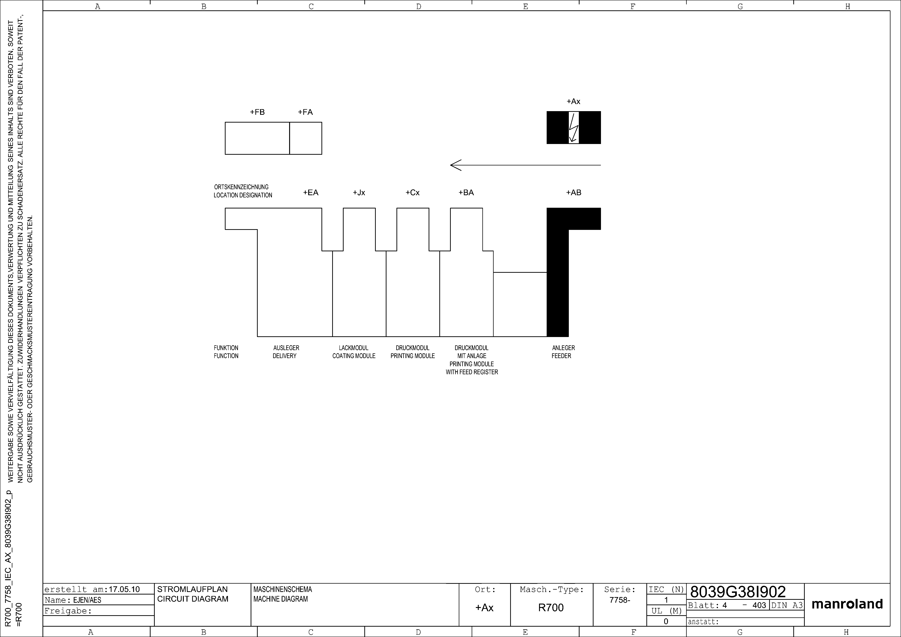

# +Ax — Sheet 4 of 403 — MASCHINENSCHEMA

**MACHINE**

> Part of the manroland **R700** printing press IEC/UL circuit diagrams.
> Drawing class: **Stromlaufplan / Circuit diagram** (DIN A3).
> Document `+Ax` covers the **Central control console** machine section.

## At a glance

| Field | Value |
|---|---|
| Document | `+Ax`  (8039G38I902) |
| Sheet | **4** of 403 |
| Section (DE) | MASCHINENSCHEMA |
| Section (EN) | MACHINE |
| Section type | MACHINE_LAYOUT — Machine diagram |
| Machine type | `R700` |
| Series | `7758` |
| Created | 17.05.10 |
| Replaces | — |
| Columns used | B, C, D, E |
| Path numbers | — |
| Labels on sheet | 24 |
| Cross-refs out | 0 |
| Cross-refs in | 0 |

**Previous:** [+Ax sheet 3](SHEET_0003.md) · **Next:** [+Ax sheet 5](SHEET_0005.md) · **Document TOC:** [_TOC.md](_TOC.md)  (+Ax) · **Master TOC:** [all sheets](../_MASTER_TOC.md)

## Sheet image (300 DPI, exact vector render)



_Rendered directly from the PDF vector layer at 300 DPI (1-bit), no OCR and no resampling. Use it to confirm anything ambiguous in the text below._

## Cross-references on this sheet

Each entry is a wire leaving this sheet. The printed token is `/sheet.column`; the link resolves to that sheet inside the same document.

_No outgoing cross-references on this sheet._

## Devices on this sheet

_No device designators on this sheet._

## Potentials / nets

_No named potentials on this sheet._

## Wire-end annotations (grouped as printed)

A wire that continues elsewhere is annotated with a small cluster: the destination description, the path/line number `#NN`, and the `/sheet.column` cross reference. Each row below is one such cluster exactly as it is grouped on the drawing.

| Col | Y | Path | Cross-ref | Text on the wire |
|---|---|---|---|---|
| E | 129.4 | — | — | `+Ax` |
| C | 143.4 | — | — | `+FB +FA` |
| C | 244.4 | — | — | `LOCATION DESIGNATION ORTSKENNZEICHNUNG +EA` |
| E | 249.7 | — | — | `+Cx +BA +AB` |
| C | 249.8 | — | — | `+Jx` |
| B | 457.0 | — | — | `FUNKTION FUNCTION` |
| C | 457.0 | — | — | `DELIVERY AUSLEGER` |
| D | 457.0 | — | — | `COATING MODULE LACKMODUL PRINTING MODULE DRUCKMODUL` |
| E | 457.0 | — | — | `DRUCKMODUL FEEDER ANLEGER` |
| E | 467.6 | — | — | `WITH FEED REGISTER PRINTING MODULE MIT ANLAGE` |


## Reconstructed tables

This sheet carries tabular content (pin map / terminal assignment / index). The grid below was rebuilt from the drawing's own rule lines, so each row is exactly one physical row of the table.

### Table 1 — 1 data rows × 2 columns (at x=297.6, y=147.4)

| +FB | +FA |
|---|---|
| `ORTSKENNZEICHNUNG LOCATION DESIGNATION` | `+EA` |


## Notes and free text on this sheet

| Text | Col | Y (pt) |
|---|---|---|
| `+FB` | B | 143.44 |
| `+FA` | C | 143.44 |
| `+EA` | C | 249.74 |
| `ORTSKENNZEICHNUNG` | B | 244.42 |
| `LOCATION DESIGNATION` | B | 255.03 |
| `FUNKTION` | B | 456.98 |
| `FUNCTION` | B | 467.63 |
| `+Jx` | C | 249.85 |
| `+Ax` | E | 129.38 |
| `+BA` | D | 249.74 |
| `+AB` | E | 249.74 |
| `+Cx` | D | 249.85 |
| `AUSLEGER` | C | 457.01 |
| `DELIVERY` | C | 467.62 |
| `DRUCKMODUL` | D | 457.04 |
| `PRINTING MODULE` | D | 467.64 |
| `LACKMODUL` | C | 457.02 |
| `COATING MODULE` | C | 467.65 |
| `ANLEGER` | E | 457.01 |
| `FEEDER` | E | 467.61 |
| `MIT ANLAGE` | D | 467.62 |
| `WITH FEED REGISTER` | E | 488.88 |

## Complete label inventory (exact text from the drawing)

Every text object inside the drawing area of this sheet, in DIN reading order (column A→H, then top→bottom). This is the authoritative list: if a string is not here it is not printed on this sheet.

| Col | Y | X | Dir | Type | Text |
|---|---|---|---|---|---|
| B | 143.4 | 330.2 | → | text | `+FB` |
| B | 244.4 | 283.2 | → | text | `ORTSKENNZEICHNUNG` |
| B | 255.0 | 282.6 | → | text | `LOCATION DESIGNATION` |
| B | 457.0 | 282.6 | → | text | `FUNKTION` |
| B | 467.6 | 282.6 | → | text | `FUNCTION` |
| C | 143.4 | 393.6 | → | text | `+FA` |
| C | 249.7 | 400.4 | → | text | `+EA` |
| C | 249.8 | 466.2 | → | text | `+Jx` |
| C | 457.0 | 361.4 | → | text | `AUSLEGER` |
| C | 457.0 | 448.0 | → | text | `LACKMODUL` |
| C | 467.6 | 360.6 | → | text | `DELIVERY` |
| C | 467.7 | 439.5 | → | text | `COATING MODULE` |
| D | 249.7 | 605.9 | → | text | `+BA` |
| D | 249.9 | 535.9 | → | text | `+Cx` |
| D | 457.0 | 523.2 | → | text | `DRUCKMODUL` |
| D | 457.0 | 601.1 | → | text | `DRUCKMODUL` |
| D | 467.6 | 516.3 | → | text | `PRINTING MODULE` |
| D | 467.6 | 604.5 | → | text | `MIT ANLAGE` |
| D | 478.3 | 594.3 | → | text | `PRINTING MODULE` |
| E | 129.4 | 748.8 | → | text | `+Ax` |
| E | 249.7 | 748.1 | → | text | `+AB` |
| E | 457.0 | 729.9 | → | text | `ANLEGER` |
| E | 467.6 | 729.1 | → | text | `FEEDER` |
| E | 488.9 | 589.3 | → | text | `WITH FEED REGISTER` |

## Reading-order text block

The same content as a plain block, grouped by DIN column — convenient to paste or to match against a visual description.

```text
=== Column B ===
 143.4  330.2  text         +FB
 244.4  283.2  text         ORTSKENNZEICHNUNG
 255.0  282.6  text         LOCATION DESIGNATION
 457.0  282.6  text         FUNKTION
 467.6  282.6  text         FUNCTION
=== Column C ===
 143.4  393.6  text         +FA
 249.7  400.4  text         +EA
 249.8  466.2  text         +Jx
 457.0  361.4  text         AUSLEGER
 457.0  448.0  text         LACKMODUL
 467.6  360.6  text         DELIVERY
 467.7  439.5  text         COATING MODULE
=== Column D ===
 249.7  605.9  text         +BA
 249.9  535.9  text         +Cx
 457.0  523.2  text         DRUCKMODUL
 457.0  601.1  text         DRUCKMODUL
 467.6  516.3  text         PRINTING MODULE
 467.6  604.5  text         MIT ANLAGE
 478.3  594.3  text         PRINTING MODULE
=== Column E ===
 129.4  748.8  text         +Ax
 249.7  748.1  text         +AB
 457.0  729.9  text         ANLEGER
 467.6  729.1  text         FEEDER
 488.9  589.3  text         WITH FEED REGISTER
```

---
_Generated from the PDF vector text layer; no OCR. Source: `R700_7758_IEC_AX_8039G38I902_p`, sheet 4._
