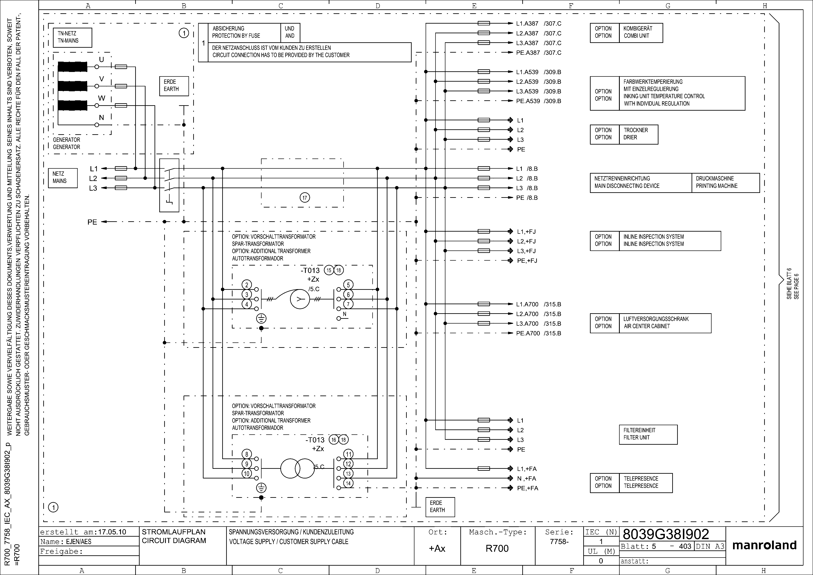

# +Ax — Sheet 5 of 403 — SPANNUNGSVERSORGUNG / KUNDENZULEITUNG

**VOLTAGE SUPPLY / CUSTOMER SUPPLY CABLE**

> Part of the manroland **R700** printing press IEC/UL circuit diagrams.
> Drawing class: **Stromlaufplan / Circuit diagram** (DIN A3).
> Document `+Ax` covers the **Central control console** machine section.

## At a glance

| Field | Value |
|---|---|
| Document | `+Ax`  (8039G38I902) |
| Sheet | **5** of 403 |
| Section (DE) | SPANNUNGSVERSORGUNG / KUNDENZULEITUNG |
| Section (EN) | VOLTAGE SUPPLY / CUSTOMER SUPPLY CABLE |
| Section type | POWER_SUPPLY — Voltage supply |
| Machine type | `R700` |
| Series | `7758` |
| Created | 17.05.10 |
| Replaces | — |
| Columns used | A, B, C, D, E, F, G, H |
| Path numbers | — |
| Labels on sheet | 141 |
| Cross-refs out | 18 |
| Cross-refs in | 18 |

**Previous:** [+Ax sheet 4](SHEET_0004.md) · **Next:** [+Ax sheet 6](SHEET_0006.md) · **Document TOC:** [_TOC.md](_TOC.md)  (+Ax) · **Master TOC:** [all sheets](../_MASTER_TOC.md)

## Sheet image (300 DPI, exact vector render)



_Rendered directly from the PDF vector layer at 300 DPI (1-bit), no OCR and no resampling. Use it to confirm anything ambiguous in the text below._

## Cross-references on this sheet

Each entry is a wire leaving this sheet. The printed token is `/sheet.column`; the link resolves to that sheet inside the same document.

| Ref | Target sheet | Col | Path | Destination on target | Target section | From col |
|---|---|---|---|---|---|---|
| `/307.C` | [+Ax sheet 307](SHEET_0307.md) | C | — | L1.A387 | OPTION: KOMBIGERÄT | F |
| `/307.C` | [+Ax sheet 307](SHEET_0307.md) | C | — | L2.A387 | OPTION: KOMBIGERÄT | F |
| `/307.C` | [+Ax sheet 307](SHEET_0307.md) | C | — | L3.A387 | OPTION: KOMBIGERÄT | F |
| `/307.C` | [+Ax sheet 307](SHEET_0307.md) | C | — | PE.A387 | OPTION: KOMBIGERÄT | F |
| `/309.B` | [+Ax sheet 309](SHEET_0309.md) | B | — | L1.A539 | OPTION: FARBWERKTEMPERIERUNG | F |
| `/309.B` | [+Ax sheet 309](SHEET_0309.md) | B | — | L2.A539 | OPTION: FARBWERKTEMPERIERUNG | F |
| `/309.B` | [+Ax sheet 309](SHEET_0309.md) | B | — | L3.A539 | OPTION: FARBWERKTEMPERIERUNG | F |
| `/309.B` | [+Ax sheet 309](SHEET_0309.md) | B | — | PE.A539 | OPTION: FARBWERKTEMPERIERUNG | F |
| `/8.B` | [+Ax sheet 8](SHEET_0008.md) | B | — | L1 | SPANNUNGSVERSORGUNG, SCHALTSCHRANKBELÜFTUNG | F |
| `/8.B` | [+Ax sheet 8](SHEET_0008.md) | B | — | L2 | SPANNUNGSVERSORGUNG, SCHALTSCHRANKBELÜFTUNG | F |
| `/8.B` | [+Ax sheet 8](SHEET_0008.md) | B | — | L3 | SPANNUNGSVERSORGUNG, SCHALTSCHRANKBELÜFTUNG | F |
| `/8.B` | [+Ax sheet 8](SHEET_0008.md) | B | — | PE | SPANNUNGSVERSORGUNG, SCHALTSCHRANKBELÜFTUNG | F |
| `/5.C` | [+Ax sheet 5](SHEET_0005.md) | C | — | — | SPANNUNGSVERSORGUNG / KUNDENZULEITUNG | C |
| `/315.B` | [+Ax sheet 315](SHEET_0315.md) | B | — | L1.A700 | OPTION: "EJEKTOR" ANLAGE / SELECT AIRSTATION / | F |
| `/315.B` | [+Ax sheet 315](SHEET_0315.md) | B | — | L2.A700 | OPTION: "EJEKTOR" ANLAGE / SELECT AIRSTATION / | F |
| `/315.B` | [+Ax sheet 315](SHEET_0315.md) | B | — | L3.A700 | OPTION: "EJEKTOR" ANLAGE / SELECT AIRSTATION / | F |
| `/315.B` | [+Ax sheet 315](SHEET_0315.md) | B | — | PE.A700 | OPTION: "EJEKTOR" ANLAGE / SELECT AIRSTATION / | F |
| `/5.C` | [+Ax sheet 5](SHEET_0005.md) | C | — | — | SPANNUNGSVERSORGUNG / KUNDENZULEITUNG | C |

### Incoming references (sheets that point here)

Every other sheet that sends a wire to this one. `Back-ref` is the token printed on *that* sheet; `Path` is its line number.

| From sheet | Cols | Back-ref | Path | Refs | What continues there |
|---|---|---|---|---|---|
| [+Ax#5](SHEET_0005.md) | C | `/5.C` | — | 2 | — |
| [+Ax#8](SHEET_0008.md) | B | `/8.B` | — | 4 | L1; L2; L3; PE |
| [+Ax#307](SHEET_0307.md) | C | `/307.C` | — | 4 | L1.A387; L2.A387; L3.A387; PE.A387 |
| [+Ax#309](SHEET_0309.md) | B | `/309.B` | — | 4 | L1.A539; L2.A539; L3.A539; PE.A539 |
| [+Ax#315](SHEET_0315.md) | A | `/315.A` | — | 4 | L1.A700; L2.A700; L3.A700; PE.A700 |


## Devices on this sheet

| Tag | Class | Class meaning (IEC) | Col | Sub | Terminal | Sign |
|---|---|---|---|---|---|---|
| `T013` | T | Transformator / transformer | C | — | — | — |
| `T013` | T | Transformator / transformer | C | — | — | — |

## Potentials / nets

| Potential | Count | Columns | Attached devices | Terminals |
|---|---|---|---|---|
| `L1` | 9 | A, E, F | `A387`, `A539`, `A700` | — |
| `L2` | 8 | A, E, F | `A387`, `A539`, `A700` | — |
| `L3` | 8 | A, E, F | `A387`, `A539`, `A700` | — |
| `N` | 2 | A, D | — | — |
| `PE` | 9 | A, E, F | `A387`, `A539`, `A700` | — |


A potential such as `L24+/4` or `M24+` is a named supply/return rail; every place it appears on this sheet is electrically common.

## Wire-end annotations (grouped as printed)

A wire that continues elsewhere is annotated with a small cluster: the destination description, the path/line number `#NN`, and the `/sheet.column` cross reference. Each row below is one such cluster exactly as it is grouped on the drawing.

| Col | Y | Path | Cross-ref | Text on the wire |
|---|---|---|---|---|
| F | 30.8 | — | `/307.C` | `L1.A387` |
| C | 38.9 | — | — | `PROTECTION BY FUSE ABSICHERUNG` |
| C | 38.9 | — | — | `UND` |
| F | 38.9 | — | — | `OPTION OPTION` |
| G | 38.9 | — | — | `KOMBIGERÄT` |
| F | 44.9 | — | `/307.C` | `L2.A387` |
| B | 45.1 | — | — | `1` |
| A | 46.0 | — | — | `TN NETZ TN MAINS` |
| C | 49.5 | — | — | `1 AND` |
| G | 49.5 | — | — | `COMBI UNIT` |
| F | 59.1 | — | `/307.C` | `L3.A387` |
| C | 67.2 | — | — | `DER NETZANSCHLUSS IST VOM KUNDEN ZU ERSTELLEN` |
| F | 73.2 | — | `/307.C` | `PE.A387` |
| C | 77.9 | — | — | `CIRCUIT CONNECTION HAS TO BE PROVIDED BY THE CUSTOMER` |
| A | 82.5 | — | — | `U` |
| F | 101.6 | — | `/309.B` | `L1.A539` |
| A | 110.8 | — | — | `V` |
| F | 115.8 | — | `/309.B` | `L2.A539` |
| B | 116.8 | — | — | `ERDE EARTH` |
| G | 116.8 | — | — | `FARBWERKTEMPERIERUNG INKING UNIT TEMPERATURE CONTROL MIT EINZELREGULIERUNG` |
| F | 129.9 | — | `/309.B` | `L3.A539` |
| F | 131.0 | — | — | `OPTION OPTION` |
| A | 138.9 | — | — | `W` |
| F | 144.1 | — | `/309.B` | `PE.A539` |
| G | 148.7 | — | — | `WITH INDIVIDUAL REGULATION` |
| A | 167.6 | — | — | `N` |
| E | 172.5 | — | — | `L1` |
| E | 186.7 | — | — | `L2` |
| F | 187.7 | — | — | `OPTION OPTION` |
| G | 187.7 | — | — | `DRIER TROCKNER` |
| E | 200.9 | — | — | `L3` |
| A | 201.9 | — | — | `GENERATOR GENERATOR` |
| E | 214.9 | — | — | `PE` |
| A | 242.6 | — | — | `L2 L3 L1` |
| F | 243.3 | — | `/8.B` | `L1` |
| A | 251.4 | — | — | `NETZ MAINS` |
| F | 257.5 | — | `/8.B` | `L2` |
| G | 258.6 | — | — | `NETZTRENNEINRICHTUNG MAIN DISCONNECTING DEVICE` |
| H | 258.6 | — | — | `DRUCKMASCHINE PRINTING MACHINE` |
| F | 271.6 | — | `/8.B` | `L3` |
| F | 285.8 | — | `/8.B` | `PE` |
| C | 287.0 | — | — | `17` |
| A | 320.6 | — | — | `PE` |
| F | 335.5 | — | — | `L1,+FJ` |
| C | 343.6 | — | — | `OPTION: VORSCHALTTRANSFORMATOR SPAR TRANSFORMATOR OPTION: ADDITIONAL TRANSFORMER AUTOTRANSFORMADOR` |
| G | 343.6 | — | — | `OPTION OPTION INLINE INSPECTION SYSTEM INLINE INSPECTION SYSTEM` |
| F | 349.6 | — | — | `L2,+FJ` |
| F | 363.8 | — | — | `L3,+FJ` |
| F | 377.9 | — | — | `PE,+FJ` |
| C | 391.5 | — | — | `T013` |
| H | 392.6 | — | — | `SIEHE BLATT 6` |
| D | 393.3 | — | — | `15 18` |
| H | 400.8 | — | — | `SEE PAGE 6` |
| C | 404.3 | — | — | `+Zx` |
| C | 414.1 | — | — | `2` |
| D | 414.1 | — | — | `5` |
| C | 419.4 | — | `/5.C` | — |
| C | 428.3 | — | — | `3` |
| D | 428.3 | — | — | `6` |
| F | 441.8 | — | `/315.B` | `L1.A700` |
| C | 442.5 | — | — | `4` |
| D | 442.8 | — | — | `7` |
| F | 455.9 | — | `/315.B` | `L2.A700` |
| D | 456.8 | — | — | `N` |
| F | 464.1 | — | — | `OPTION OPTION` |
| G | 464.1 | — | — | `LUFTVERSORGUNGSSCHRANK` |
| F | 470.1 | — | `/315.B` | `L3.A700` |
| G | 474.7 | — | — | `AIR CENTER CABINET` |
| F | 484.3 | — | `/315.B` | `PE.A700` |
| C | 591.7 | — | — | `OPTION: VORSCHALTTRANSFORMATOR SPAR TRANSFORMATOR OPTION: ADDITIONAL TRANSFORMER AUTOTRANSFORMADOR` |
| E | 611.9 | — | — | `L1` |
| E | 626.1 | — | — | `L2` |
| G | 627.1 | — | — | `FILTEREINHEIT FILTER UNIT` |
| C | 639.5 | — | — | `T013` |
| E | 640.2 | — | — | `L3` |
| D | 641.3 | — | — | `16 18` |
| C | 652.3 | — | — | `+Zx` |
| E | 654.3 | — | — | `PE` |
| D | 662.0 | — | — | `11` |
| C | 662.2 | — | — | `8` |
| C | 676.4 | — | — | `9` |
| D | 676.4 | — | — | `12` |
| C | 679.9 | — | `/5.C` | — |
| F | 682.7 | — | — | `L1,+FA` |
| C | 690.5 | — | — | `10` |
| D | 690.9 | — | — | `13` |
| F | 696.9 | — | — | `N ,+FA` |
| F | 697.9 | — | — | `OPTION OPTION` |
| G | 697.9 | — | — | `TELEPRESENCE TELEPRESENCE` |
| D | 705.1 | — | — | `14` |
| F | 711.0 | — | — | `PE,+FA` |
| E | 733.3 | — | — | `ERDE EARTH` |
| A | 739.6 | — | — | `1` |


## Reconstructed tables

This sheet carries tabular content (pin map / terminal assignment / index). The grid below was rebuilt from the drawing's own rule lines, so each row is exactly one physical row of the table.

### Table 1 — 19 data rows × 7 columns (at x=248.0, y=34.0)

|  |  |  |  | ABSICHERUNG | UND |  |
|---|---|---|---|---|---|---|
|  | `1` |  |  | `PROTECTION BY FUSE` | `AND` |  |
|  |  | `1` | `DER` | `NETZANSCHLUSS` | `IST VOM KUNDEN ZU ERSTELLEN` |  |
|  |  |  | `CIRCUIT` | `CONNECTION` | `HAS TO BE PROVIDED BY THE` | `CUSTOMER` |
| `ERDE EARTH` |  |  |  |  |  |  |
|  |  |  |  |  | `17` |  |
|  |  |  |  | `OPTION:` | `VORSCHALTTRANSFORMATOR` |  |
|  |  |  |  | `SPAR TRANSFORMATOR` |  |  |
|  |  |  |  | `OPTION: AUTOTRANSFORMADOR` | `ADDITIONAL TRANSFORMER` |  |
|  |  |  |  | `2` | `T013 15 +Zx` | `18 5` |
|  |  |  |  | `3` | `/5.C` | `6` |
|  |  |  |  | `4` |  | `7` |
|  |  |  |  |  |  | `N` |
|  |  |  |  | `OPTION: SPAR TRANSFORMATOR` | `VORSCHALTTRANSFORMATOR` |  |
|  |  |  |  | `OPTION: AUTOTRANSFORMADOR` | `ADDITIONAL TRANSFORMER` |  |
|  |  |  |  |  | `T013 16 +Zx` | `18` |
|  |  |  |  | `8` |  | `11` |
|  |  |  |  | `9` | `/5.C` | `12` |
|  |  |  |  | `10` |  | `13` |
|  |  |  |  |  |  | `14` |


## Notes and free text on this sheet

| Text | Col | Y (pt) |
|---|---|---|
| `+Zx` | C | 404.27 |
| `OPTION: VORSCHALTTRANSFORMATOR` | C | 343.63 |
| `SPAR TRANSFORMATOR` | C | 354.27 |
| `OPTION: ADDITIONAL TRANSFORMER` | C | 364.89 |
| `AUTOTRANSFORMADOR` | C | 375.54 |
| `N ,+FA` | F | 696.87 |
| `U` | A | 82.52 |
| `V` | A | 110.85 |
| `W` | A | 138.9 |
| `SIEHE BLATT 6` | H | 392.59 |
| `SEE PAGE 6` | H | 400.84 |
| `NETZTRENNEINRICHTUNG` | G | 258.59 |
| `MAIN DISCONNECTING DEVICE` | G | 269.22 |
| `DRUCKMASCHINE` | G | 258.59 |
| `PRINTING MACHINE` | H | 269.21 |
| `OPTION` | F | 187.68 |
| `TROCKNER` | G | 187.73 |
| `DRIER` | G | 198.32 |
| `KOMBIGERÄT` | G | 38.88 |
| `COMBI UNIT` | G | 49.54 |
| `FARBWERKTEMPERIERUNG` | G | 116.83 |
| `MIT EINZELREGULIERUNG` | G | 127.49 |
| `INKING UNIT TEMPERATURE CONTROL` | G | 138.12 |
| `WITH INDIVIDUAL REGULATION` | G | 148.73 |
| `LUFTVERSORGUNGSSCHRANK` | G | 464.11 |
| `AIR CENTER CABINET` | G | 474.72 |
| `FILTEREINHEIT` | G | 627.07 |
| `FILTER UNIT` | G | 637.7 |
| `INLINE INSPECTION SYSTEM` | G | 343.61 |
| `TELEPRESENCE` | G | 697.94 |
| `ERDE` | E | 733.33 |
| `EARTH` | E | 743.96 |
| `ERDE` | B | 116.8 |
| `EARTH` | B | 127.43 |
| `NETZ` | A | 251.45 |
| `MAINS` | A | 262.1 |
| `GENERATOR` | A | 201.89 |
| `TN NETZ` | A | 45.99 |
| `TN MAINS` | A | 56.62 |
| `DER NETZANSCHLUSS IST VOM KUNDEN ZU ERSTELLEN` | C | 67.24 |
| `CIRCUIT CONNECTION HAS TO BE PROVIDED BY THE CUSTOMER` | C | 77.88 |
| `ABSICHERUNG` | B | 38.9 |
| `PROTECTION BY FUSE` | C | 49.51 |
| `UND` | C | 38.89 |
| `AND` | C | 49.54 |

## Complete label inventory (exact text from the drawing)

Every text object inside the drawing area of this sheet, in DIN reading order (column A→H, then top→bottom). This is the authoritative list: if a string is not here it is not printed on this sheet.

| Col | Y | X | Dir | Type | Text |
|---|---|---|---|---|---|
| A | 46.0 | 84.8 | → | text | `TN NETZ` |
| A | 56.6 | 84.8 | → | text | `TN MAINS` |
| A | 82.5 | 145.0 | → | text | `U` |
| A | 110.9 | 145.3 | → | text | `V` |
| A | 138.9 | 143.6 | → | text | `W` |
| A | 167.6 | 145.0 | → | potential | `N` |
| A | 201.9 | 77.7 | → | text | `GENERATOR` |
| A | 212.5 | 77.7 | → | text | `GENERATOR` |
| A | 242.6 | 131.8 | → | potential | `L1` |
| A | 251.4 | 77.1 | → | text | `NETZ` |
| A | 256.8 | 130.4 | → | potential | `L2` |
| A | 262.1 | 77.4 | → | text | `MAINS` |
| A | 271.0 | 130.4 | → | potential | `L3` |
| A | 320.6 | 128.1 | → | potential | `PE` |
| A | 739.6 | 76.2 | → | number | `1` |
| B | 38.9 | 311.8 | → | text | `ABSICHERUNG` |
| B | 45.1 | 267.5 | → | number | `1` |
| B | 58.4 | 295.1 | → | number | `1` |
| B | 116.8 | 240.1 | → | text | `ERDE` |
| B | 127.4 | 240.1 | → | text | `EARTH` |
| C | 38.9 | 417.3 | → | text | `UND` |
| C | 49.5 | 311.0 | → | text | `PROTECTION BY FUSE` |
| C | 49.5 | 418.1 | → | text | `AND` |
| C | 67.2 | 311.0 | → | text | `DER NETZANSCHLUSS IST VOM KUNDEN ZU ERSTELLEN` |
| C | 77.9 | 311.5 | → | text | `CIRCUIT CONNECTION HAS TO BE PROVIDED BY THE CUSTOMER` |
| C | 287.0 | 442.8 | → | number | `17` |
| C | 343.6 | 339.9 | → | text | `OPTION: VORSCHALTTRANSFORMATOR` |
| C | 354.3 | 339.9 | → | text | `SPAR TRANSFORMATOR` |
| C | 364.9 | 339.9 | → | text | `OPTION: ADDITIONAL TRANSFORMER` |
| C | 375.5 | 340.2 | → | text | `AUTOTRANSFORMADOR` |
| C | 391.5 | 440.5 | → | device tag | `T013` |
| C | 393.3 | 478.2 | → | number | `15` |
| C | 404.3 | 449.9 | → | text | `+Zx` |
| C | 414.2 | 359.4 | → | number | `2` |
| C | 419.4 | 451.8 | → | cross-reference | `/5.C` |
| C | 428.3 | 359.4 | → | number | `3` |
| C | 442.5 | 359.4 | → | number | `4` |
| C | 591.7 | 339.9 | → | text | `OPTION: VORSCHALTTRANSFORMATOR` |
| C | 602.3 | 339.9 | → | text | `SPAR TRANSFORMATOR` |
| C | 612.9 | 339.9 | → | text | `OPTION: ADDITIONAL TRANSFORMER` |
| C | 623.6 | 340.2 | → | text | `AUTOTRANSFORMADOR` |
| C | 639.5 | 447.6 | → | device tag | `T013` |
| C | 652.3 | 456.9 | → | text | `+Zx` |
| C | 662.2 | 359.4 | → | number | `8` |
| C | 676.4 | 359.4 | → | number | `9` |
| C | 679.9 | 458.9 | → | cross-reference | `/5.C` |
| C | 690.5 | 357.1 | → | number | `10` |
| D | 393.3 | 492.4 | → | number | `18` |
| D | 414.2 | 508.2 | → | number | `5` |
| D | 428.3 | 508.2 | → | number | `6` |
| D | 442.8 | 508.4 | → | number | `7` |
| D | 456.8 | 502.3 | → | potential | `N` |
| D | 641.3 | 485.3 | → | number | `16` |
| D | 641.3 | 499.5 | → | number | `18` |
| D | 662.0 | 506.6 | → | number | `11` |
| D | 676.4 | 506.0 | → | number | `12` |
| D | 690.9 | 506.6 | → | number | `13` |
| D | 705.1 | 506.6 | → | number | `14` |
| E | 172.5 | 757.4 | → | potential | `L1` |
| E | 186.7 | 757.4 | → | potential | `L2` |
| E | 200.9 | 757.4 | → | potential | `L3` |
| E | 214.9 | 757.4 | → | potential | `PE` |
| E | 243.4 | 756.0 | → | potential | `L1` |
| E | 257.6 | 756.0 | → | potential | `L2` |
| E | 271.7 | 756.0 | → | potential | `L3` |
| E | 285.8 | 756.0 | → | potential | `PE` |
| E | 611.9 | 757.4 | → | potential | `L1` |
| E | 626.1 | 757.4 | → | potential | `L2` |
| E | 640.2 | 757.4 | → | potential | `L3` |
| E | 654.3 | 757.4 | → | potential | `PE` |
| E | 733.3 | 629.9 | → | text | `ERDE` |
| E | 744.0 | 629.9 | → | text | `EARTH` |
| F | 30.8 | 756.0 | → | potential | `L1.A387` |
| F | 30.8 | 796.5 | → | cross-reference | `/307.C` |
| F | 38.9 | 871.4 | → | text | `OPTION` |
| F | 44.9 | 756.0 | → | potential | `L2.A387` |
| F | 44.9 | 796.5 | → | cross-reference | `/307.C` |
| F | 49.5 | 871.4 | → | text | `OPTION` |
| F | 59.1 | 756.0 | → | potential | `L3.A387` |
| F | 59.1 | 796.5 | → | cross-reference | `/307.C` |
| F | 73.3 | 756.0 | → | potential | `PE.A387` |
| F | 73.3 | 796.5 | → | cross-reference | `/307.C` |
| F | 101.6 | 756.0 | → | potential | `L1.A539` |
| F | 101.6 | 796.5 | → | cross-reference | `/309.B` |
| F | 115.8 | 756.0 | → | potential | `L2.A539` |
| F | 115.8 | 796.5 | → | cross-reference | `/309.B` |
| F | 129.9 | 796.5 | → | cross-reference | `/309.B` |
| F | 130.0 | 756.0 | → | potential | `L3.A539` |
| F | 131.0 | 871.4 | → | text | `OPTION` |
| F | 141.6 | 871.4 | → | text | `OPTION` |
| F | 144.1 | 756.0 | → | potential | `PE.A539` |
| F | 144.1 | 796.5 | → | cross-reference | `/309.B` |
| F | 187.7 | 871.4 | → | text | `OPTION` |
| F | 198.3 | 871.4 | → | text | `OPTION` |
| F | 243.3 | 771.7 | → | cross-reference | `/8.B` |
| F | 257.5 | 771.7 | → | cross-reference | `/8.B` |
| F | 271.6 | 771.7 | → | cross-reference | `/8.B` |
| F | 285.8 | 771.7 | → | cross-reference | `/8.B` |
| F | 335.5 | 757.4 | → | potential | `L1,+FJ` |
| F | 343.6 | 871.4 | → | text | `OPTION` |
| F | 349.6 | 757.4 | → | potential | `L2,+FJ` |
| F | 354.2 | 871.4 | → | text | `OPTION` |
| F | 363.8 | 757.4 | → | potential | `L3,+FJ` |
| F | 377.9 | 757.4 | → | potential | `PE,+FJ` |
| F | 441.8 | 756.0 | → | potential | `L1.A700` |
| F | 441.8 | 796.5 | → | cross-reference | `/315.B` |
| F | 455.9 | 796.5 | → | cross-reference | `/315.B` |
| F | 456.0 | 756.0 | → | potential | `L2.A700` |
| F | 464.1 | 871.4 | → | text | `OPTION` |
| F | 470.1 | 756.0 | → | potential | `L3.A700` |
| F | 470.1 | 796.5 | → | cross-reference | `/315.B` |
| F | 474.7 | 871.4 | → | text | `OPTION` |
| F | 484.3 | 756.0 | → | potential | `PE.A700` |
| F | 484.3 | 796.5 | → | cross-reference | `/315.B` |
| F | 682.7 | 757.4 | → | potential | `L1,+FA` |
| F | 696.9 | 757.4 | → | text | `N ,+FA` |
| F | 697.9 | 871.4 | → | text | `OPTION` |
| F | 708.6 | 871.4 | → | text | `OPTION` |
| F | 711.0 | 757.4 | → | potential | `PE,+FA` |
| G | 38.9 | 913.3 | → | text | `KOMBIGERÄT` |
| G | 49.5 | 913.9 | → | text | `COMBI UNIT` |
| G | 116.8 | 913.3 | → | text | `FARBWERKTEMPERIERUNG` |
| G | 127.5 | 913.6 | → | text | `MIT EINZELREGULIERUNG` |
| G | 138.1 | 913.3 | → | text | `INKING UNIT TEMPERATURE CONTROL` |
| G | 148.7 | 914.2 | → | text | `WITH INDIVIDUAL REGULATION` |
| G | 187.7 | 913.9 | → | text | `TROCKNER` |
| G | 198.3 | 913.3 | → | text | `DRIER` |
| G | 258.6 | 870.8 | → | text | `NETZTRENNEINRICHTUNG` |
| G | 258.6 | 1019.6 | → | text | `DRUCKMASCHINE` |
| G | 269.2 | 871.1 | → | text | `MAIN DISCONNECTING DEVICE` |
| G | 343.6 | 913.3 | → | text | `INLINE INSPECTION SYSTEM` |
| G | 354.2 | 913.3 | → | text | `INLINE INSPECTION SYSTEM` |
| G | 464.1 | 913.3 | → | text | `LUFTVERSORGUNGSSCHRANK` |
| G | 474.7 | 914.2 | → | text | `AIR CENTER CABINET` |
| G | 627.1 | 913.3 | → | text | `FILTEREINHEIT` |
| G | 637.7 | 913.3 | → | text | `FILTER UNIT` |
| G | 697.9 | 913.9 | → | text | `TELEPRESENCE` |
| G | 708.6 | 913.9 | → | text | `TELEPRESENCE` |
| H | 269.2 | 1019.6 | → | text | `PRINTING MACHINE` |
| H | 392.6 | 1152.9 | ↕ | text | `SIEHE BLATT 6` |
| H | 400.8 | 1163.5 | ↕ | text | `SEE PAGE 6` |

## Reading-order text block

The same content as a plain block, grouped by DIN column — convenient to paste or to match against a visual description.

```text
=== Column A ===
  46.0   84.8  text         TN NETZ
  56.6   84.8  text         TN MAINS
  82.5  145.0  text         U
 110.9  145.3  text         V
 138.9  143.6  text         W
 167.6  145.0  net          N
 201.9   77.7  text         GENERATOR
 212.5   77.7  text         GENERATOR
 242.6  131.8  net          L1
 251.4   77.1  text         NETZ
 256.8  130.4  net          L2
 262.1   77.4  text         MAINS
 271.0  130.4  net          L3
 320.6  128.1  net          PE
 739.6   76.2  numeric      1
=== Column B ===
  38.9  311.8  text         ABSICHERUNG
  45.1  267.5  numeric      1
  58.4  295.1  numeric      1
 116.8  240.1  text         ERDE
 127.4  240.1  text         EARTH
=== Column C ===
  38.9  417.3  text         UND
  49.5  311.0  text         PROTECTION BY FUSE
  49.5  418.1  text         AND
  67.2  311.0  text         DER NETZANSCHLUSS IST VOM KUNDEN ZU ERSTELLEN
  77.9  311.5  text         CIRCUIT CONNECTION HAS TO BE PROVIDED BY THE CUSTOMER
 287.0  442.8  numeric      17
 343.6  339.9  text         OPTION: VORSCHALTTRANSFORMATOR
 354.3  339.9  text         SPAR TRANSFORMATOR
 364.9  339.9  text         OPTION: ADDITIONAL TRANSFORMER
 375.5  340.2  text         AUTOTRANSFORMADOR
 391.5  440.5  devtag       T013
 393.3  478.2  numeric      15
 404.3  449.9  text         +Zx
 414.2  359.4  numeric      2
 419.4  451.8  xref         /5.C
 428.3  359.4  numeric      3
 442.5  359.4  numeric      4
 591.7  339.9  text         OPTION: VORSCHALTTRANSFORMATOR
 602.3  339.9  text         SPAR TRANSFORMATOR
 612.9  339.9  text         OPTION: ADDITIONAL TRANSFORMER
 623.6  340.2  text         AUTOTRANSFORMADOR
 639.5  447.6  devtag       T013
 652.3  456.9  text         +Zx
 662.2  359.4  numeric      8
 676.4  359.4  numeric      9
 679.9  458.9  xref         /5.C
 690.5  357.1  numeric      10
=== Column D ===
 393.3  492.4  numeric      18
 414.2  508.2  numeric      5
 428.3  508.2  numeric      6
 442.8  508.4  numeric      7
 456.8  502.3  net          N
 641.3  485.3  numeric      16
 641.3  499.5  numeric      18
 662.0  506.6  numeric      11
 676.4  506.0  numeric      12
 690.9  506.6  numeric      13
 705.1  506.6  numeric      14
=== Column E ===
 172.5  757.4  net          L1
 186.7  757.4  net          L2
 200.9  757.4  net          L3
 214.9  757.4  net          PE
 243.4  756.0  net          L1
 257.6  756.0  net          L2
 271.7  756.0  net          L3
 285.8  756.0  net          PE
 611.9  757.4  net          L1
 626.1  757.4  net          L2
 640.2  757.4  net          L3
 654.3  757.4  net          PE
 733.3  629.9  text         ERDE
 744.0  629.9  text         EARTH
=== Column F ===
  30.8  756.0  net          L1.A387
  30.8  796.5  xref         /307.C
  38.9  871.4  text         OPTION
  44.9  756.0  net          L2.A387
  44.9  796.5  xref         /307.C
  49.5  871.4  text         OPTION
  59.1  756.0  net          L3.A387
  59.1  796.5  xref         /307.C
  73.3  756.0  net          PE.A387
  73.3  796.5  xref         /307.C
 101.6  756.0  net          L1.A539
 101.6  796.5  xref         /309.B
 115.8  756.0  net          L2.A539
 115.8  796.5  xref         /309.B
 129.9  796.5  xref         /309.B
 130.0  756.0  net          L3.A539
 131.0  871.4  text         OPTION
 141.6  871.4  text         OPTION
 144.1  756.0  net          PE.A539
 144.1  796.5  xref         /309.B
 187.7  871.4  text         OPTION
 198.3  871.4  text         OPTION
 243.3  771.7  xref         /8.B
 257.5  771.7  xref         /8.B
 271.6  771.7  xref         /8.B
 285.8  771.7  xref         /8.B
 335.5  757.4  net          L1,+FJ
 343.6  871.4  text         OPTION
 349.6  757.4  net          L2,+FJ
 354.2  871.4  text         OPTION
 363.8  757.4  net          L3,+FJ
 377.9  757.4  net          PE,+FJ
 441.8  756.0  net          L1.A700
 441.8  796.5  xref         /315.B
 455.9  796.5  xref         /315.B
 456.0  756.0  net          L2.A700
 464.1  871.4  text         OPTION
 470.1  756.0  net          L3.A700
 470.1  796.5  xref         /315.B
 474.7  871.4  text         OPTION
 484.3  756.0  net          PE.A700
 484.3  796.5  xref         /315.B
 682.7  757.4  net          L1,+FA
 696.9  757.4  text         N ,+FA
 697.9  871.4  text         OPTION
 708.6  871.4  text         OPTION
 711.0  757.4  net          PE,+FA
=== Column G ===
  38.9  913.3  text         KOMBIGERÄT
  49.5  913.9  text         COMBI UNIT
 116.8  913.3  text         FARBWERKTEMPERIERUNG
 127.5  913.6  text         MIT EINZELREGULIERUNG
 138.1  913.3  text         INKING UNIT TEMPERATURE CONTROL
 148.7  914.2  text         WITH INDIVIDUAL REGULATION
 187.7  913.9  text         TROCKNER
 198.3  913.3  text         DRIER
 258.6  870.8  text         NETZTRENNEINRICHTUNG
 258.6 1019.6  text         DRUCKMASCHINE
 269.2  871.1  text         MAIN DISCONNECTING DEVICE
 343.6  913.3  text         INLINE INSPECTION SYSTEM
 354.2  913.3  text         INLINE INSPECTION SYSTEM
 464.1  913.3  text         LUFTVERSORGUNGSSCHRANK
 474.7  914.2  text         AIR CENTER CABINET
 627.1  913.3  text         FILTEREINHEIT
 637.7  913.3  text         FILTER UNIT
 697.9  913.9  text         TELEPRESENCE
 708.6  913.9  text         TELEPRESENCE
=== Column H ===
 269.2 1019.6  text         PRINTING MACHINE
 392.6 1152.9  text         SIEHE BLATT 6
 400.8 1163.5  text         SEE PAGE 6
```

---
_Generated from the PDF vector text layer; no OCR. Source: `R700_7758_IEC_AX_8039G38I902_p`, sheet 5._
