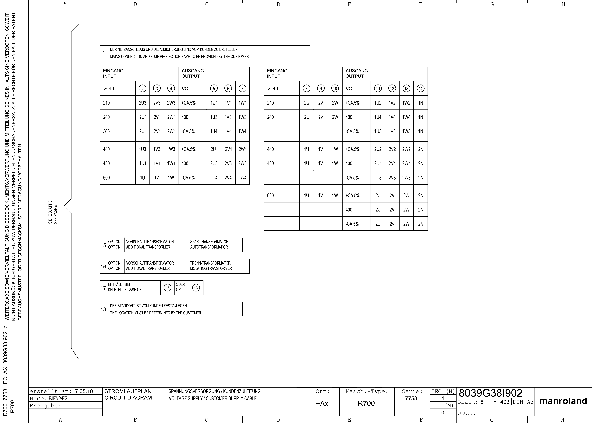

# +Ax — Sheet 6 of 403 — SPANNUNGSVERSORGUNG / KUNDENZULEITUNG

**VOLTAGE SUPPLY / CUSTOMER SUPPLY CABLE**

> Part of the manroland **R700** printing press IEC/UL circuit diagrams.
> Drawing class: **Stromlaufplan / Circuit diagram** (DIN A3).
> Document `+Ax` covers the **Central control console** machine section.

## At a glance

| Field | Value |
|---|---|
| Document | `+Ax`  (8039G38I902) |
| Sheet | **6** of 403 |
| Section (DE) | SPANNUNGSVERSORGUNG / KUNDENZULEITUNG |
| Section (EN) | VOLTAGE SUPPLY / CUSTOMER SUPPLY CABLE |
| Section type | POWER_SUPPLY — Voltage supply |
| Machine type | `R700` |
| Series | `7758` |
| Created | 17.05.10 |
| Replaces | — |
| Columns used | A, B, C, D, E, F |
| Path numbers | — |
| Labels on sheet | 167 |
| Cross-refs out | 0 |
| Cross-refs in | 0 |

**Previous:** [+Ax sheet 5](SHEET_0005.md) · **Next:** [+Ax sheet 7](SHEET_0007.md) · **Document TOC:** [_TOC.md](_TOC.md)  (+Ax) · **Master TOC:** [all sheets](../_MASTER_TOC.md)

## Sheet image (300 DPI, exact vector render)



_Rendered directly from the PDF vector layer at 300 DPI (1-bit), no OCR and no resampling. Use it to confirm anything ambiguous in the text below._

## Cross-references on this sheet

Each entry is a wire leaving this sheet. The printed token is `/sheet.column`; the link resolves to that sheet inside the same document.

_No outgoing cross-references on this sheet._

## Devices on this sheet

_No device designators on this sheet._

## Potentials / nets

| Potential | Count | Columns | Attached devices | Terminals |
|---|---|---|---|---|
| `1V` | 4 | B, E | — | — |
| `2V` | 5 | E, F | — | — |


A potential such as `L24+/4` or `M24+` is a named supply/return rail; every place it appears on this sheet is electrically common.

## Wire-end annotations (grouped as printed)

A wire that continues elsewhere is annotated with a small cluster: the destination description, the path/line number `#NN`, and the `/sheet.column` cross reference. Each row below is one such cluster exactly as it is grouped on the drawing.

| Col | Y | Path | Cross-ref | Text on the wire |
|---|---|---|---|---|
| C | 95.6 | — | — | `DER NETZANSCHLUSS UND DIE ABSICHERUNG SIND VOM KUNDEN ZU ERSTELLEN` |
| C | 100.9 | — | — | `1 MAINS CONNECTION AND FUSE PROTECTION HAVE TO BE PROVIDED BY THE CUSTOMER` |
| B | 137.1 | — | — | `EINGANG INPUT` |
| C | 137.1 | — | — | `OUTPUT AUSGANG` |
| D | 137.1 | — | — | `EINGANG INPUT` |
| E | 137.1 | — | — | `OUTPUT AUSGANG` |
| B | 172.5 | — | — | `VOLT 3 4` |
| C | 172.5 | — | — | `VOLT` |
| D | 172.5 | — | — | `VOLT 9 10` |
| E | 172.5 | — | — | `VOLT` |
| E | 173.0 | — | — | `11` |
| B | 173.2 | — | — | `2` |
| C | 173.2 | — | — | `5` |
| C | 173.2 | — | — | `6 7` |
| D | 173.2 | — | — | `8` |
| F | 173.2 | — | — | `12 13` |
| F | 173.2 | — | — | `14` |
| C | 201.1 | — | — | `1U1 1V1 1W1` |
| B | 201.2 | — | — | `2U3 2V3 2W3` |
| E | 201.2 | — | — | `2U 2V 2W` |
| F | 201.2 | — | — | `1U2 1V2 1W2` |
| F | 201.2 | — | — | `1N` |
| B | 201.3 | — | — | `210` |
| D | 201.3 | — | — | `210` |
| C | 201.4 | — | — | `+CA.5%` |
| E | 201.4 | — | — | `+CA.5%` |
| B | 229.5 | — | — | `2U1 2V1 2W1` |
| C | 229.5 | — | — | `1U3 1V3 1W3` |
| F | 229.5 | — | — | `1U4 1V4 1W4` |
| E | 229.6 | — | — | `2U 2V 2W` |
| F | 229.6 | — | — | `1N` |
| B | 229.7 | — | — | `240` |
| C | 229.7 | — | — | `400` |
| D | 229.7 | — | — | `240` |
| E | 229.7 | — | — | `400` |
| B | 257.9 | — | — | `360 2U1 2V1 2W1` |
| C | 257.9 | — | — | `1U4 1V4 1W4` |
| F | 257.9 | — | — | `1U3 1V3 1W3` |
| F | 257.9 | — | — | `1N` |
| C | 258.1 | — | — | `CA.5%` |
| E | 258.1 | — | — | `CA.5%` |
| B | 293.3 | — | — | `440 1U3 1V3 1W3` |
| C | 293.3 | — | — | `2U1 2V1 2W1` |
| D | 293.3 | — | — | `440 1U 1V 1W` |
| F | 293.4 | — | — | `2U2 2V2 2W2` |
| F | 293.4 | — | — | `2N` |
| C | 293.5 | — | — | `+CA.5%` |
| E | 293.5 | — | — | `+CA.5%` |
| B | 321.6 | — | — | `1U1 1V1 1W1` |
| E | 321.6 | — | — | `1U 1V 1W` |
| C | 321.7 | — | — | `2U3 2V3 2W3` |
| F | 321.7 | — | — | `2U4 2V4 2W4` |
| B | 321.8 | — | — | `480` |
| C | 321.8 | — | — | `400` |
| D | 321.8 | — | — | `480` |
| E | 321.8 | — | — | `400` |
| F | 321.8 | — | — | `2N` |
| B | 350.0 | — | — | `600 1U 1V 1W` |
| C | 350.1 | — | — | `2U4 2V4 2W4` |
| F | 350.1 | — | — | `2U3 2V3 2W3` |
| F | 350.1 | — | — | `2N` |
| C | 350.2 | — | — | `CA.5%` |
| E | 350.2 | — | — | `CA.5%` |
| D | 385.4 | — | — | `600 1U 1V 1W +CA.5%` |
| F | 385.5 | — | — | `2U 2V 2W` |
| F | 385.6 | — | — | `2N` |
| A | 399.7 | — | — | `SIEHE BLATT 5` |
| A | 407.9 | — | — | `SEE PAGE 5` |
| F | 413.8 | — | — | `2U 2V 2W` |
| E | 413.9 | — | — | `400` |
| F | 413.9 | — | — | `2N` |
| F | 442.2 | — | — | `2U 2V 2W` |
| F | 442.3 | — | — | `2N` |
| E | 442.4 | — | — | `CA.5%` |
| B | 478.2 | — | — | `15 OPTION OPTION` |
| B | 478.3 | — | — | `VORSCHALTTRANSFORMATOR ADDITIONAL TRANSFORMER` |
| C | 478.3 | — | — | `SPAR TRANSFORMATOR AUTOTRANSFORMADOR` |
| B | 520.8 | — | — | `16 OPTION OPTION` |
| B | 520.8 | — | — | `VORSCHALTTRANSFORMATOR ADDITIONAL TRANSFORMER` |
| C | 520.8 | — | — | `ISOLATING TRANSFORMER TRENN TRANSFORMATOR` |
| B | 563.3 | — | — | `17 ENTFÄLLT BEI DELETED IN CASE OF 15 ODER OR 16` |
| B | 605.8 | — | — | `DER STANDORT IST VOM KUNDEN FESTZULEGEN` |
| B | 611.1 | — | — | `18 THE LOCATION MUST BE DETERMINED BY THE CUSTOMER` |


## Reconstructed tables

This sheet carries tabular content (pin map / terminal assignment / index). The grid below was rebuilt from the drawing's own rule lines, so each row is exactly one physical row of the table.

### Table 1 — 6 data rows × 8 columns (at x=198.4, y=161.6)

| VOLT | 2 | 3 | 4 | VOLT | 5 | 6 | 7 |
|---|---|---|---|---|---|---|---|
| `210` | `2U3` | `2V3` | `2W3` | `+CA.5%` | `1U1` | `1V1` | `1W1` |
| `240` | `2U1` | `2V1` | `2W1` | `400` | `1U3` | `1V3` | `1W3` |
| `360` | `2U1` | `2V1` | `2W1` | `CA.5%` | `1U4` | `1V4` | `1W4` |
| `440` | `1U3` | `1V3` | `1W3` | `+CA.5%` | `2U1` | `2V1` | `2W1` |
| `480` | `1U1` | `1V1` | `1W1` | `400` | `2U3` | `2V3` | `2W3` |
| `600` | `1U` | `1V` | `1W` | `CA.5%` | `2U4` | `2V4` | `2W4` |


### Table 2 — 9 data rows × 9 columns (at x=524.4, y=161.6)

| VOLT | 8 | 9 | 10 | VOLT | 11 | 12 | 13 | 14 |
|---|---|---|---|---|---|---|---|---|
| `210` | `2U` | `2V` | `2W` | `+CA.5%` | `1U2` | `1V2` | `1W2` | `1N` |
| `240` | `2U` | `2V` | `2W` | `400` | `1U4` | `1V4` | `1W4` | `1N` |
|  |  |  |  | `CA.5%` | `1U3` | `1V3` | `1W3` | `1N` |
| `440` | `1U` | `1V` | `1W` | `+CA.5%` | `2U2` | `2V2` | `2W2` | `2N` |
| `480` | `1U` | `1V` | `1W` | `400` | `2U4` | `2V4` | `2W4` | `2N` |
|  |  |  |  | `CA.5%` | `2U3` | `2V3` | `2W3` | `2N` |
| `600` | `1U` | `1V` | `1W` | `+CA.5%` | `2U` | `2V` | `2W` | `2N` |
|  |  |  |  | `400` | `2U` | `2V` | `2W` | `2N` |
|  |  |  |  | `CA.5%` | `2U` | `2V` | `2W` | `2N` |


## Notes and free text on this sheet

| Text | Col | Y (pt) |
|---|---|---|
| `DER NETZANSCHLUSS UND DIE ABSICHERUNG SIND VOM KUNDEN ZU ERSTELLEN` | C | 95.6 |
| `MAINS CONNECTION AND FUSE PROTECTION HAVE TO BE PROVIDED BY THE CUSTOMER` | C | 109.77 |
| `EINGANG` | B | 137.05 |
| `INPUT` | B | 147.68 |
| `VOLT` | B | 172.48 |
| `2U3` | B | 201.36 |
| `2V3` | B | 201.36 |
| `2W3` | B | 201.25 |
| `2U1` | B | 229.61 |
| `2V1` | B | 229.6 |
| `2W1` | C | 229.51 |
| `+CA.5%` | C | 201.41 |
| `AUSGANG` | C | 137.05 |
| `OUTPUT` | C | 147.69 |
| `VOLT` | C | 172.48 |
| `CA.5%` | C | 258.13 |
| `1U1` | C | 201.2 |
| `1V1` | C | 201.19 |
| `1W1` | D | 201.11 |
| `1U3` | C | 229.65 |
| `1V3` | C | 229.64 |
| `1W3` | C | 229.54 |
| `1U4` | C | 257.99 |
| `1V4` | C | 257.99 |
| `1W4` | C | 257.89 |
| `1U3` | B | 293.43 |
| `1V3` | B | 293.42 |
| `1W3` | B | 293.32 |
| `1U1` | B | 321.67 |
| `1V1` | B | 321.66 |
| `1W1` | C | 321.58 |
| `2U1` | C | 293.39 |
| `2V1` | C | 293.38 |
| `2W1` | D | 293.29 |
| `2U3` | C | 321.83 |
| `2V3` | C | 321.83 |
| `2W3` | C | 321.72 |
| `2U4` | C | 350.18 |
| `2V4` | C | 350.17 |
| `2W4` | C | 350.07 |
| `1U` | B | 350.04 |
| `1W` | B | 349.96 |
| `EINGANG` | D | 137.05 |
| `INPUT` | D | 147.68 |
| `VOLT` | D | 172.48 |
| `2U` | D | 201.31 |
| `2W` | E | 201.22 |
| `+CA.5%` | E | 201.41 |
| `AUSGANG` | E | 137.05 |
| `OUTPUT` | E | 147.69 |
| `VOLT` | E | 172.48 |
| `CA.5%` | E | 258.13 |
| `1U2` | E | 201.3 |
| `1V2` | F | 201.29 |
| `1W2` | F | 201.2 |
| `1U4` | E | 229.65 |
| `1V4` | F | 229.64 |
| `1W4` | F | 229.54 |
| `1U3` | E | 257.99 |
| `1V3` | F | 257.99 |
| `1W3` | F | 257.89 |
| `1N` | F | 201.23 |
| `1U` | D | 293.35 |
| `1W` | E | 293.27 |
| `2U2` | E | 293.49 |
| `2V2` | F | 293.48 |
| `2W2` | F | 293.38 |
| `2U4` | E | 321.83 |
| `2V4` | F | 321.83 |
| `2W4` | F | 321.72 |
| `2U3` | E | 350.18 |
| `2V3` | F | 350.17 |
| `2W3` | F | 350.07 |
| `2N` | F | 293.44 |
| `2U` | E | 385.56 |
| `2W` | F | 385.47 |
| `SIEHE BLATT 5` | A | 399.67 |
| `SEE PAGE 5` | A | 407.93 |
| `ENTFÄLLT BEI` | B | 563.27 |
| `DELETED IN CASE OF` | B | 573.92 |
| `ODER` | C | 563.31 |
| `OR` | C | 573.93 |
| `OPTION` | B | 478.24 |
| `VORSCHALTTRANSFORMATOR` | B | 478.29 |
| `ADDITIONAL TRANSFORMER` | B | 488.92 |
| `SPAR TRANSFORMATOR` | C | 478.28 |
| `AUTOTRANSFORMADOR` | C | 488.92 |
| `TRENN TRANSFORMATOR` | C | 520.81 |
| `ISOLATING TRANSFORMER` | C | 531.42 |
| `DER STANDORT IST VOM KUNDEN FESTZULEGEN` | B | 605.83 |
| `THE LOCATION MUST BE DETERMINED BY THE CUSTOMER` | B | 620.01 |

## Complete label inventory (exact text from the drawing)

Every text object inside the drawing area of this sheet, in DIN reading order (column A→H, then top→bottom). This is the authoritative list: if a string is not here it is not printed on this sheet.

| Col | Y | X | Dir | Type | Text |
|---|---|---|---|---|---|
| A | 399.7 | 97.0 | ↕ | text | `SIEHE BLATT 5` |
| A | 407.9 | 107.6 | ↕ | text | `SEE PAGE 5` |
| B | 100.9 | 203.0 | → | number | `1` |
| B | 137.0 | 204.7 | → | text | `EINGANG` |
| B | 147.7 | 204.7 | → | text | `INPUT` |
| B | 172.5 | 205.5 | → | text | `VOLT` |
| B | 173.2 | 281.5 | → | number | `2` |
| B | 173.2 | 309.8 | → | number | `3` |
| B | 173.2 | 338.2 | → | number | `4` |
| B | 201.3 | 205.2 | → | number | `210` |
| B | 201.3 | 332.1 | → | text | `2W3` |
| B | 201.4 | 276.5 | → | text | `2U3` |
| B | 201.4 | 305.1 | → | text | `2V3` |
| B | 229.6 | 277.0 | → | text | `2U1` |
| B | 229.6 | 305.6 | → | text | `2V1` |
| B | 229.7 | 205.2 | → | number | `240` |
| B | 257.9 | 305.6 | → | text | `2V1` |
| B | 258.0 | 204.9 | → | number | `360` |
| B | 258.0 | 277.0 | → | text | `2U1` |
| B | 293.3 | 331.6 | → | text | `1W3` |
| B | 293.4 | 276.0 | → | text | `1U3` |
| B | 293.4 | 304.5 | → | text | `1V3` |
| B | 293.5 | 205.2 | → | number | `440` |
| B | 321.7 | 276.5 | → | text | `1U1` |
| B | 321.7 | 305.0 | → | text | `1V1` |
| B | 321.8 | 205.2 | → | number | `480` |
| B | 350.0 | 278.2 | → | text | `1U` |
| B | 350.0 | 333.6 | → | text | `1W` |
| B | 350.1 | 306.5 | → | potential | `1V` |
| B | 350.2 | 205.2 | → | number | `600` |
| B | 478.2 | 215.1 | → | text | `OPTION` |
| B | 478.3 | 250.9 | → | text | `VORSCHALTTRANSFORMATOR` |
| B | 483.6 | 199.3 | → | number | `15` |
| B | 488.9 | 215.1 | → | text | `OPTION` |
| B | 488.9 | 250.9 | → | text | `ADDITIONAL TRANSFORMER` |
| B | 520.8 | 215.1 | → | text | `OPTION` |
| B | 520.8 | 250.9 | → | text | `VORSCHALTTRANSFORMATOR` |
| B | 526.1 | 199.3 | → | number | `16` |
| B | 531.4 | 215.1 | → | text | `OPTION` |
| B | 531.4 | 250.9 | → | text | `ADDITIONAL TRANSFORMER` |
| B | 563.3 | 214.6 | → | text | `ENTFÄLLT BEI` |
| B | 568.6 | 199.3 | → | number | `17` |
| B | 570.4 | 329.4 | → | number | `15` |
| B | 573.9 | 214.6 | → | text | `DELETED IN CASE OF` |
| B | 605.8 | 218.8 | → | text | `DER STANDORT IST VOM KUNDEN FESTZULEGEN` |
| B | 611.1 | 199.3 | → | number | `18` |
| B | 620.0 | 219.4 | → | text | `THE LOCATION MUST BE DETERMINED BY THE CUSTOMER` |
| C | 95.6 | 218.8 | → | text | `DER NETZANSCHLUSS UND DIE ABSICHERUNG SIND VOM KUNDEN ZU ERSTELLEN` |
| C | 109.8 | 219.1 | → | text | `MAINS CONNECTION AND FUSE PROTECTION HAVE TO BE PROVIDED BY THE CUSTOMER` |
| C | 137.0 | 361.4 | → | text | `AUSGANG` |
| C | 147.7 | 361.1 | → | text | `OUTPUT` |
| C | 172.5 | 361.4 | → | text | `VOLT` |
| C | 173.2 | 423.2 | → | number | `5` |
| C | 173.2 | 451.5 | → | number | `6` |
| C | 173.2 | 479.9 | → | number | `7` |
| C | 201.2 | 418.2 | → | text | `1U1` |
| C | 201.2 | 446.8 | → | text | `1V1` |
| C | 201.4 | 360.9 | → | text | `+CA.5%` |
| C | 229.5 | 332.6 | → | text | `2W1` |
| C | 229.5 | 473.3 | → | text | `1W3` |
| C | 229.6 | 417.7 | → | text | `1U3` |
| C | 229.6 | 446.3 | → | text | `1V3` |
| C | 229.7 | 361.1 | → | number | `400` |
| C | 257.9 | 332.6 | → | text | `2W1` |
| C | 257.9 | 473.3 | → | text | `1W4` |
| C | 258.0 | 417.7 | → | text | `1U4` |
| C | 258.0 | 446.3 | → | text | `1V4` |
| C | 258.1 | 361.1 | → | text | `CA.5%` |
| C | 293.4 | 418.8 | → | text | `2U1` |
| C | 293.4 | 447.3 | → | text | `2V1` |
| C | 293.5 | 360.9 | → | text | `+CA.5%` |
| C | 321.6 | 332.1 | → | text | `1W1` |
| C | 321.7 | 473.9 | → | text | `2W3` |
| C | 321.8 | 361.1 | → | number | `400` |
| C | 321.8 | 418.3 | → | text | `2U3` |
| C | 321.8 | 446.8 | → | text | `2V3` |
| C | 350.1 | 473.9 | → | text | `2W4` |
| C | 350.2 | 418.3 | → | text | `2U4` |
| C | 350.2 | 446.8 | → | text | `2V4` |
| C | 350.3 | 361.1 | → | text | `CA.5%` |
| C | 478.3 | 378.1 | → | text | `SPAR TRANSFORMATOR` |
| C | 488.9 | 378.4 | → | text | `AUTOTRANSFORMADOR` |
| C | 520.8 | 378.1 | → | text | `TRENN TRANSFORMATOR` |
| C | 531.4 | 377.6 | → | text | `ISOLATING TRANSFORMER` |
| C | 563.3 | 349.8 | → | text | `ODER` |
| C | 570.4 | 386.1 | → | number | `16` |
| C | 573.9 | 349.8 | → | text | `OR` |
| D | 137.0 | 530.6 | → | text | `EINGANG` |
| D | 147.7 | 530.6 | → | text | `INPUT` |
| D | 172.5 | 531.5 | → | text | `VOLT` |
| D | 173.2 | 607.5 | → | number | `8` |
| D | 201.1 | 473.8 | → | text | `1W1` |
| D | 201.3 | 531.2 | → | number | `210` |
| D | 201.3 | 604.7 | → | text | `2U` |
| D | 229.7 | 531.2 | → | number | `240` |
| D | 229.7 | 604.7 | → | text | `2U` |
| D | 293.3 | 474.4 | → | text | `2W1` |
| D | 293.4 | 604.2 | → | text | `1U` |
| D | 293.5 | 531.2 | → | number | `440` |
| D | 321.7 | 604.2 | → | text | `1U` |
| D | 321.8 | 531.2 | → | number | `480` |
| D | 385.5 | 604.2 | → | text | `1U` |
| D | 385.6 | 531.2 | → | number | `600` |
| E | 137.0 | 687.4 | → | text | `AUSGANG` |
| E | 147.7 | 687.1 | → | text | `OUTPUT` |
| E | 172.5 | 687.4 | → | text | `VOLT` |
| E | 173.0 | 747.5 | → | number | `11` |
| E | 173.2 | 635.8 | → | number | `9` |
| E | 173.2 | 661.9 | → | number | `10` |
| E | 201.2 | 660.1 | → | text | `2W` |
| E | 201.3 | 743.7 | → | text | `1U2` |
| E | 201.4 | 633.0 | → | potential | `2V` |
| E | 201.4 | 686.8 | → | text | `+CA.5%` |
| E | 229.6 | 660.1 | → | text | `2W` |
| E | 229.6 | 743.7 | → | text | `1U4` |
| E | 229.7 | 633.0 | → | potential | `2V` |
| E | 229.7 | 687.1 | → | number | `400` |
| E | 258.0 | 743.7 | → | text | `1U3` |
| E | 258.1 | 687.1 | → | text | `CA.5%` |
| E | 293.3 | 659.6 | → | text | `1W` |
| E | 293.4 | 632.4 | → | potential | `1V` |
| E | 293.5 | 686.8 | → | text | `+CA.5%` |
| E | 293.5 | 744.3 | → | text | `2U2` |
| E | 321.6 | 659.6 | → | text | `1W` |
| E | 321.8 | 632.4 | → | potential | `1V` |
| E | 321.8 | 687.1 | → | number | `400` |
| E | 321.8 | 744.3 | → | text | `2U4` |
| E | 350.2 | 744.3 | → | text | `2U3` |
| E | 350.3 | 687.1 | → | text | `CA.5%` |
| E | 385.4 | 659.6 | → | text | `1W` |
| E | 385.6 | 632.4 | → | potential | `1V` |
| E | 385.6 | 746.5 | → | text | `2U` |
| E | 385.7 | 686.8 | → | text | `+CA.5%` |
| E | 413.9 | 687.1 | → | number | `400` |
| E | 413.9 | 746.5 | → | text | `2U` |
| E | 442.3 | 746.5 | → | text | `2U` |
| E | 442.4 | 687.1 | → | text | `CA.5%` |
| F | 173.2 | 775.3 | → | number | `12` |
| F | 173.2 | 803.6 | → | number | `13` |
| F | 173.2 | 831.9 | → | number | `14` |
| F | 201.2 | 799.3 | → | text | `1W2` |
| F | 201.2 | 831.0 | → | text | `1N` |
| F | 201.3 | 772.3 | → | text | `1V2` |
| F | 229.5 | 799.3 | → | text | `1W4` |
| F | 229.6 | 772.3 | → | text | `1V4` |
| F | 229.6 | 831.0 | → | text | `1N` |
| F | 257.9 | 799.3 | → | text | `1W3` |
| F | 257.9 | 831.0 | → | text | `1N` |
| F | 258.0 | 772.3 | → | text | `1V3` |
| F | 293.4 | 799.8 | → | text | `2W2` |
| F | 293.4 | 831.5 | → | text | `2N` |
| F | 293.5 | 772.8 | → | text | `2V2` |
| F | 321.7 | 799.8 | → | text | `2W4` |
| F | 321.8 | 772.8 | → | text | `2V4` |
| F | 321.8 | 831.5 | → | text | `2N` |
| F | 350.1 | 799.8 | → | text | `2W3` |
| F | 350.1 | 831.5 | → | text | `2N` |
| F | 350.2 | 772.8 | → | text | `2V3` |
| F | 385.5 | 801.9 | → | text | `2W` |
| F | 385.6 | 774.7 | → | potential | `2V` |
| F | 385.6 | 831.5 | → | text | `2N` |
| F | 413.8 | 801.9 | → | text | `2W` |
| F | 413.9 | 831.5 | → | text | `2N` |
| F | 414.0 | 774.7 | → | potential | `2V` |
| F | 442.2 | 801.9 | → | text | `2W` |
| F | 442.3 | 774.7 | → | potential | `2V` |
| F | 442.3 | 831.5 | → | text | `2N` |

## Reading-order text block

The same content as a plain block, grouped by DIN column — convenient to paste or to match against a visual description.

```text
=== Column A ===
 399.7   97.0  text         SIEHE BLATT 5
 407.9  107.6  text         SEE PAGE 5
=== Column B ===
 100.9  203.0  numeric      1
 137.0  204.7  text         EINGANG
 147.7  204.7  text         INPUT
 172.5  205.5  text         VOLT
 173.2  281.5  numeric      2
 173.2  309.8  numeric      3
 173.2  338.2  numeric      4
 201.3  205.2  numeric      210
 201.3  332.1  text         2W3
 201.4  276.5  text         2U3
 201.4  305.1  text         2V3
 229.6  277.0  text         2U1
 229.6  305.6  text         2V1
 229.7  205.2  numeric      240
 257.9  305.6  text         2V1
 258.0  204.9  numeric      360
 258.0  277.0  text         2U1
 293.3  331.6  text         1W3
 293.4  276.0  text         1U3
 293.4  304.5  text         1V3
 293.5  205.2  numeric      440
 321.7  276.5  text         1U1
 321.7  305.0  text         1V1
 321.8  205.2  numeric      480
 350.0  278.2  text         1U
 350.0  333.6  text         1W
 350.1  306.5  net          1V
 350.2  205.2  numeric      600
 478.2  215.1  text         OPTION
 478.3  250.9  text         VORSCHALTTRANSFORMATOR
 483.6  199.3  numeric      15
 488.9  215.1  text         OPTION
 488.9  250.9  text         ADDITIONAL TRANSFORMER
 520.8  215.1  text         OPTION
 520.8  250.9  text         VORSCHALTTRANSFORMATOR
 526.1  199.3  numeric      16
 531.4  215.1  text         OPTION
 531.4  250.9  text         ADDITIONAL TRANSFORMER
 563.3  214.6  text         ENTFÄLLT BEI
 568.6  199.3  numeric      17
 570.4  329.4  numeric      15
 573.9  214.6  text         DELETED IN CASE OF
 605.8  218.8  text         DER STANDORT IST VOM KUNDEN FESTZULEGEN
 611.1  199.3  numeric      18
 620.0  219.4  text         THE LOCATION MUST BE DETERMINED BY THE CUSTOMER
=== Column C ===
  95.6  218.8  text         DER NETZANSCHLUSS UND DIE ABSICHERUNG SIND VOM KUNDEN ZU ERSTELLEN
 109.8  219.1  text         MAINS CONNECTION AND FUSE PROTECTION HAVE TO BE PROVIDED BY THE CUSTOMER
 137.0  361.4  text         AUSGANG
 147.7  361.1  text         OUTPUT
 172.5  361.4  text         VOLT
 173.2  423.2  numeric      5
 173.2  451.5  numeric      6
 173.2  479.9  numeric      7
 201.2  418.2  text         1U1
 201.2  446.8  text         1V1
 201.4  360.9  text         +CA.5%
 229.5  332.6  text         2W1
 229.5  473.3  text         1W3
 229.6  417.7  text         1U3
 229.6  446.3  text         1V3
 229.7  361.1  numeric      400
 257.9  332.6  text         2W1
 257.9  473.3  text         1W4
 258.0  417.7  text         1U4
 258.0  446.3  text         1V4
 258.1  361.1  text         CA.5%
 293.4  418.8  text         2U1
 293.4  447.3  text         2V1
 293.5  360.9  text         +CA.5%
 321.6  332.1  text         1W1
 321.7  473.9  text         2W3
 321.8  361.1  numeric      400
 321.8  418.3  text         2U3
 321.8  446.8  text         2V3
 350.1  473.9  text         2W4
 350.2  418.3  text         2U4
 350.2  446.8  text         2V4
 350.3  361.1  text         CA.5%
 478.3  378.1  text         SPAR TRANSFORMATOR
 488.9  378.4  text         AUTOTRANSFORMADOR
 520.8  378.1  text         TRENN TRANSFORMATOR
 531.4  377.6  text         ISOLATING TRANSFORMER
 563.3  349.8  text         ODER
 570.4  386.1  numeric      16
 573.9  349.8  text         OR
=== Column D ===
 137.0  530.6  text         EINGANG
 147.7  530.6  text         INPUT
 172.5  531.5  text         VOLT
 173.2  607.5  numeric      8
 201.1  473.8  text         1W1
 201.3  531.2  numeric      210
 201.3  604.7  text         2U
 229.7  531.2  numeric      240
 229.7  604.7  text         2U
 293.3  474.4  text         2W1
 293.4  604.2  text         1U
 293.5  531.2  numeric      440
 321.7  604.2  text         1U
 321.8  531.2  numeric      480
 385.5  604.2  text         1U
 385.6  531.2  numeric      600
=== Column E ===
 137.0  687.4  text         AUSGANG
 147.7  687.1  text         OUTPUT
 172.5  687.4  text         VOLT
 173.0  747.5  numeric      11
 173.2  635.8  numeric      9
 173.2  661.9  numeric      10
 201.2  660.1  text         2W
 201.3  743.7  text         1U2
 201.4  633.0  net          2V
 201.4  686.8  text         +CA.5%
 229.6  660.1  text         2W
 229.6  743.7  text         1U4
 229.7  633.0  net          2V
 229.7  687.1  numeric      400
 258.0  743.7  text         1U3
 258.1  687.1  text         CA.5%
 293.3  659.6  text         1W
 293.4  632.4  net          1V
 293.5  686.8  text         +CA.5%
 293.5  744.3  text         2U2
 321.6  659.6  text         1W
 321.8  632.4  net          1V
 321.8  687.1  numeric      400
 321.8  744.3  text         2U4
 350.2  744.3  text         2U3
 350.3  687.1  text         CA.5%
 385.4  659.6  text         1W
 385.6  632.4  net          1V
 385.6  746.5  text         2U
 385.7  686.8  text         +CA.5%
 413.9  687.1  numeric      400
 413.9  746.5  text         2U
 442.3  746.5  text         2U
 442.4  687.1  text         CA.5%
=== Column F ===
 173.2  775.3  numeric      12
 173.2  803.6  numeric      13
 173.2  831.9  numeric      14
 201.2  799.3  text         1W2
 201.2  831.0  text         1N
 201.3  772.3  text         1V2
 229.5  799.3  text         1W4
 229.6  772.3  text         1V4
 229.6  831.0  text         1N
 257.9  799.3  text         1W3
 257.9  831.0  text         1N
 258.0  772.3  text         1V3
 293.4  799.8  text         2W2
 293.4  831.5  text         2N
 293.5  772.8  text         2V2
 321.7  799.8  text         2W4
 321.8  772.8  text         2V4
 321.8  831.5  text         2N
 350.1  799.8  text         2W3
 350.1  831.5  text         2N
 350.2  772.8  text         2V3
 385.5  801.9  text         2W
 385.6  774.7  net          2V
 385.6  831.5  text         2N
 413.8  801.9  text         2W
 413.9  831.5  text         2N
 414.0  774.7  net          2V
 442.2  801.9  text         2W
 442.3  774.7  net          2V
 442.3  831.5  text         2N
```

---
_Generated from the PDF vector text layer; no OCR. Source: `R700_7758_IEC_AX_8039G38I902_p`, sheet 6._
