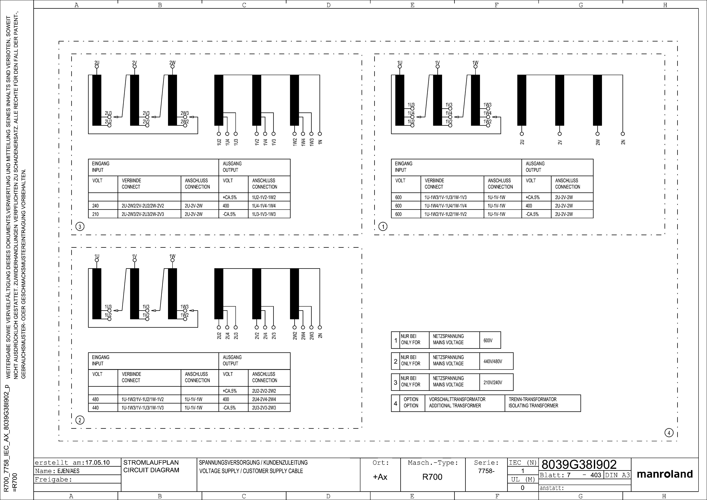

# +Ax — Sheet 7 of 403 — SPANNUNGSVERSORGUNG / KUNDENZULEITUNG

**VOLTAGE SUPPLY / CUSTOMER SUPPLY CABLE**

> Part of the manroland **R700** printing press IEC/UL circuit diagrams.
> Drawing class: **Stromlaufplan / Circuit diagram** (DIN A3).
> Document `+Ax` covers the **Central control console** machine section.

## At a glance

| Field | Value |
|---|---|
| Document | `+Ax`  (8039G38I902) |
| Sheet | **7** of 403 |
| Section (DE) | SPANNUNGSVERSORGUNG / KUNDENZULEITUNG |
| Section (EN) | VOLTAGE SUPPLY / CUSTOMER SUPPLY CABLE |
| Section type | POWER_SUPPLY — Voltage supply |
| Machine type | `R700` |
| Series | `7758` |
| Created | 17.05.10 |
| Replaces | — |
| Columns used | A, B, C, D, E, F, G, H |
| Path numbers | — |
| Labels on sheet | 158 |
| Cross-refs out | 0 |
| Cross-refs in | 0 |

**Previous:** [+Ax sheet 6](SHEET_0006.md) · **Next:** [+Ax sheet 8](SHEET_0008.md) · **Document TOC:** [_TOC.md](_TOC.md)  (+Ax) · **Master TOC:** [all sheets](../_MASTER_TOC.md)

## Sheet image (300 DPI, exact vector render)



_Rendered directly from the PDF vector layer at 300 DPI (1-bit), no OCR and no resampling. Use it to confirm anything ambiguous in the text below._

## Cross-references on this sheet

Each entry is a wire leaving this sheet. The printed token is `/sheet.column`; the link resolves to that sheet inside the same document.

_No outgoing cross-references on this sheet._

## Devices on this sheet

_No device designators on this sheet._

## Potentials / nets

| Potential | Count | Columns | Attached devices | Terminals |
|---|---|---|---|---|
| `1V` | 2 | B, E | — | — |
| `2V` | 2 | B, G | — | — |
| `600V` | 1 | F | — | — |


A potential such as `L24+/4` or `M24+` is a named supply/return rail; every place it appears on this sheet is electrically common.

## Wire-end annotations (grouped as printed)

A wire that continues elsewhere is annotated with a small cluster: the destination description, the path/line number `#NN`, and the `/sheet.column` cross reference. Each row below is one such cluster exactly as it is grouped on the drawing.

| Col | Y | Path | Cross-ref | Text on the wire |
|---|---|---|---|---|
| E | 102.4 | — | — | `1U 1V 1W` |
| B | 102.5 | — | — | `2U 2V 2W` |
| E | 173.4 | — | — | `1U3 1V3 1W3` |
| B | 187.6 | — | — | `2W3` |
| F | 187.6 | — | — | `1W4` |
| A | 187.7 | — | — | `2U3` |
| B | 187.7 | — | — | `2V3` |
| E | 187.7 | — | — | `1U4` |
| E | 187.7 | — | — | `1V4` |
| F | 201.7 | — | — | `1W2` |
| B | 201.8 | — | — | `2V2` |
| B | 201.8 | — | — | `2W2` |
| E | 201.8 | — | — | `1U2` |
| E | 201.8 | — | — | `1V2` |
| A | 201.9 | — | — | `2U2` |
| D | 232.8 | — | — | `1W2` |
| D | 233.0 | — | — | `1W4` |
| D | 233.0 | — | — | `1W3` |
| C | 233.8 | — | — | `1U2` |
| C | 233.9 | — | — | `1V2` |
| C | 234.0 | — | — | `1U4` |
| C | 234.0 | — | — | `1U3` |
| C | 234.1 | — | — | `1V4` |
| C | 234.1 | — | — | `1V3` |
| G | 234.5 | — | — | `2W` |
| F | 235.2 | — | — | `2U` |
| H | 235.2 | — | — | `2N` |
| D | 235.4 | — | — | `1N` |
| G | 235.8 | — | — | `2V` |
| A | 272.7 | — | — | `EINGANG INPUT` |
| E | 272.7 | — | — | `EINGANG INPUT` |
| C | 272.8 | — | — | `OUTPUT AUSGANG` |
| F | 272.8 | — | — | `OUTPUT AUSGANG` |
| A | 301.1 | — | — | `VOLT CONNECT VERBINDE` |
| B | 301.1 | — | — | `CONNECTION ANSCHLUSS` |
| C | 301.1 | — | — | `VOLT` |
| C | 301.1 | — | — | `CONNECTION ANSCHLUSS` |
| E | 301.1 | — | — | `VOLT CONNECT VERBINDE` |
| F | 301.1 | — | — | `CONNECTION ANSCHLUSS` |
| F | 301.1 | — | — | `VOLT` |
| G | 301.1 | — | — | `CONNECTION ANSCHLUSS` |
| C | 329.4 | — | — | `+CA.5%` |
| C | 329.4 | — | — | `1U2 1V2 1W2` |
| E | 329.4 | — | — | `600 1U 1W3/1V 1U3/1W 1V3 1U 1V 1W` |
| F | 329.4 | — | — | `+CA.5%` |
| G | 329.4 | — | — | `2U 2V 2W` |
| A | 343.6 | — | — | `240` |
| B | 343.6 | — | — | `2U 2W2/2V 2U2/2W 2V2` |
| B | 343.6 | — | — | `2U 2V 2W` |
| C | 343.6 | — | — | `400` |
| C | 343.6 | — | — | `1U4 1V4 1W4` |
| E | 343.6 | — | — | `600` |
| E | 343.6 | — | — | `1U 1W4/1V 1U4/1W 1V4` |
| F | 343.6 | — | — | `1U 1V 1W` |
| F | 343.6 | — | — | `400` |
| G | 343.6 | — | — | `2U 2V 2W` |
| A | 357.8 | — | — | `210` |
| B | 357.8 | — | — | `2U 2W3/2V 2U3/2W 2V3` |
| B | 357.8 | — | — | `2U 2V 2W` |
| C | 357.8 | — | — | `CA.5%` |
| C | 357.8 | — | — | `1U3 1V3 1W3` |
| E | 357.8 | — | — | `600` |
| E | 357.8 | — | — | `1U 1W2/1V 1U2/1W 1V2` |
| F | 357.8 | — | — | `1U 1V 1W` |
| F | 357.8 | — | — | `CA.5%` |
| G | 357.8 | — | — | `2U 2V 2W` |
| E | 378.2 | — | — | `1` |
| A | 378.7 | — | — | `3` |
| B | 428.4 | — | — | `1U 1V 1W` |
| B | 513.5 | — | — | `1W3` |
| B | 513.6 | — | — | `1V3` |
| A | 513.7 | — | — | `1U3` |
| B | 527.7 | — | — | `1W2` |
| A | 527.8 | — | — | `1U2` |
| B | 527.8 | — | — | `1V2` |
| D | 558.6 | — | — | `2W2` |
| D | 558.8 | — | — | `2W4` |
| D | 558.8 | — | — | `2W3` |
| C | 559.6 | — | — | `2U2` |
| C | 559.7 | — | — | `2V2` |
| C | 559.8 | — | — | `2U4` |
| C | 559.8 | — | — | `2U3` |
| C | 559.9 | — | — | `2V4` |
| C | 559.9 | — | — | `2V3` |
| D | 561.1 | — | — | `2N` |
| E | 563.3 | — | — | `1 NUR BEI` |
| F | 563.3 | — | — | `NETZSPANNUNG MAINS VOLTAGE 600V` |
| E | 573.9 | — | — | `ONLY FOR` |
| A | 598.7 | — | — | `EINGANG INPUT` |
| C | 598.7 | — | — | `OUTPUT AUSGANG` |
| E | 598.7 | — | — | `2 NUR BEI` |
| F | 598.7 | — | — | `NETZSPANNUNG MAINS VOLTAGE 440V/480V` |
| E | 609.4 | — | — | `ONLY FOR` |
| A | 627.1 | — | — | `VOLT CONNECT VERBINDE` |
| B | 627.1 | — | — | `CONNECTION ANSCHLUSS` |
| C | 627.1 | — | — | `VOLT` |
| C | 627.1 | — | — | `CONNECTION ANSCHLUSS` |
| E | 634.1 | — | — | `3 NUR BEI` |
| F | 634.2 | — | — | `NETZSPANNUNG MAINS VOLTAGE 210V/240V` |
| E | 644.8 | — | — | `ONLY FOR` |
| C | 655.4 | — | — | `+CA.5%` |
| C | 655.4 | — | — | `2U2 2V2 2W2` |
| A | 669.6 | — | — | `480` |
| B | 669.6 | — | — | `1U 1W2/1V 1U2/1W 1V2` |
| B | 669.6 | — | — | `1U 1V 1W` |
| C | 669.6 | — | — | `400` |
| C | 669.6 | — | — | `2U4 2V4 2W4` |
| E | 669.6 | — | — | `OPTION OPTION` |
| F | 669.6 | — | — | `VORSCHALTTRANSFORMATOR ADDITIONAL TRANSFORMER` |
| F | 669.6 | — | — | `ISOLATING TRANSFORMER TRENN TRANSFORMATOR` |
| E | 674.9 | — | — | `4` |
| B | 683.7 | — | — | `1U 1V 1W` |
| A | 683.8 | — | — | `440` |
| B | 683.8 | — | — | `1U 1W3/1V 1U3/1W 1V3` |
| C | 683.8 | — | — | `CA.5%` |
| C | 683.8 | — | — | `2U3 2V3 2W3` |
| A | 704.7 | — | — | `2` |
| H | 726.0 | — | — | `4` |


## Reconstructed tables

This sheet carries tabular content (pin map / terminal assignment / index). The grid below was rebuilt from the drawing's own rule lines, so each row is exactly one physical row of the table.

### Table 1 — 6 data rows × 6 columns (at x=155.9, y=126.1)

|  | 2U3 2U2 |  | 2V3 2V2 |  | 2W3 2W2 |
|---|---|---|---|---|---|
| `EINGANG INPUT VOLT` |  | `VERBINDE CONNECT` |  |  | `ANSCHLUSS CONNECTION` |
| `240` |  |  | `2U 2W2/2V 2U2/2W 2V2` |  | `2U 2V 2W` |
| `210 1U` |  | `1V` | `2U 2W3/2V 2U3/2W 2V3` | `1W` | `2U 2V 2W` |
|  | `1U3 1U2` |  | `1V3 1V2` |  | `1W3 1W2` |
| `EINGANG INPUT VOLT` |  | `VERBINDE CONNECT` |  |  | `ANSCHLUSS CONNECTION` |
| `480` |  |  | `1U 1W2/1V 1U2/1W 1V2` |  | `1U 1V 1W` |


### Table 2 — 4 data rows × 9 columns (at x=361.4, y=126.1)

| 1U2 | 1U4 AUSGANG OUTPUT VOLT +CA.5% | 1U3 | 1V2 | 1V4 ANSCHLUSS CONNECTION 1U2 1V2 1W2 | 1V3 | 1W2 | 1W4 | 1W3 |
|---|---|---|---|---|---|---|---|---|
|  | `400` |  |  | `1U4 1V4 1W4` |  |  |  |  |
|  | `CA.5%` |  |  | `1U3 1V3 1W3` |  |  |  |  |
| `2U2` | `2U4 AUSGANG OUTPUT VOLT +CA.5%` | `2U3` | `2V2` | `2V4 ANSCHLUSS CONNECTION 2U2 2V2 2W2` | `2V3` | `2W2` | `2W4` | `2W3` |
|  | `400` |  |  | `2U4 2V4 2W4` |  |  |  |  |


### Table 3 — 2 data rows × 4 columns (at x=666.1, y=126.1)

|  | 1U3 1U4 1U2 |  | 1V3 1V4 1V2 |
|---|---|---|---|
| `EINGANG INPUT VOLT 600` |  | `VERBINDE CONNECT` | `1U 1W3/1V 1U3/1W 1V3` |
| `600` |  |  | `1U 1W4/1V 1U4/1W 1V4` |


### Table 4 — 3 data rows × 1 columns (at x=807.9, y=126.1)

| C1 |
|---|
| `1W3 1W4 1W2` |
| `ANSCHLUSS CONNECTION 1U 1V 1W` |
| `1U 1V 1W` |


### Table 5 — 1 data rows × 5 columns (at x=871.7, y=126.1)

| 2U | AUSGANG OUTPUT VOLT +CA.5% | 2V | ANSCHLUSS CONNECTION 2U 2V 2W | 2W |
|---|---|---|---|---|
|  | `400` |  | `2U 2V 2W` |  |


## Notes and free text on this sheet

| Text | Col | Y (pt) |
|---|---|---|
| `EINGANG` | A | 272.73 |
| `INPUT` | A | 283.35 |
| `VOLT` | A | 301.1 |
| `VERBINDE` | B | 301.09 |
| `CONNECT` | B | 311.75 |
| `ANSCHLUSS` | B | 301.11 |
| `CONNECTION` | B | 311.74 |
| `AUSGANG` | C | 272.75 |
| `OUTPUT` | C | 283.39 |
| `VOLT` | C | 301.1 |
| `+CA.5%` | C | 329.42 |
| `CA.5%` | C | 357.77 |
| `2U` | A | 102.61 |
| `2W` | B | 102.49 |
| `2U3` | A | 187.73 |
| `2U2` | A | 201.88 |
| `2V3` | B | 187.69 |
| `2V2` | B | 201.84 |
| `2W3` | B | 187.59 |
| `2W2` | B | 201.75 |
| `1U2` | C | 233.83 |
| `1U4` | C | 234.01 |
| `1U3` | C | 234.01 |
| `1V2` | C | 233.93 |
| `1V4` | C | 234.11 |
| `1V3` | C | 234.11 |
| `1W2` | D | 232.82 |
| `1W4` | D | 233.01 |
| `1W3` | D | 233.01 |
| `1N` | D | 235.36 |
| `1U` | A | 428.54 |
| `1W` | B | 428.42 |
| `1U3` | A | 513.67 |
| `1U2` | A | 527.82 |
| `1V3` | B | 513.63 |
| `1V2` | B | 527.79 |
| `1W3` | B | 513.54 |
| `1W2` | B | 527.69 |
| `2U2` | C | 559.61 |
| `2U4` | C | 559.79 |
| `2U3` | C | 559.79 |
| `2V2` | C | 559.71 |
| `2V4` | C | 559.9 |
| `2V3` | C | 559.9 |
| `2W2` | D | 558.61 |
| `2W4` | D | 558.79 |
| `2W3` | D | 558.79 |
| `2N` | D | 561.14 |
| `ANSCHLUSS` | C | 301.11 |
| `CONNECTION` | C | 311.74 |
| `2U 2W2/2V 2U2/2W 2V2` | B | 343.6 |
| `2U 2W3/2V 2U3/2W 2V3` | B | 357.77 |
| `2U 2V 2W` | B | 343.59 |
| `1U2 1V2 1W2` | C | 329.42 |
| `1U4 1V4 1W4` | C | 343.6 |
| `1U3 1V3 1W3` | C | 357.77 |
| `1U 1W2/1V 1U2/1W 1V2` | B | 669.58 |
| `1U 1W3/1V 1U3/1W 1V3` | B | 683.75 |
| `1U 1V 1W` | B | 669.56 |
| `2U2 2V2 2W2` | C | 655.42 |
| `2U4 2V4 2W4` | C | 669.6 |
| `2U3 2V3 2W3` | C | 683.77 |
| `EINGANG` | E | 272.73 |
| `INPUT` | E | 283.35 |
| `VOLT` | E | 301.1 |
| `VERBINDE` | E | 301.09 |
| `CONNECT` | E | 311.75 |
| `ANSCHLUSS` | F | 301.11 |
| `CONNECTION` | F | 311.74 |
| `AUSGANG` | F | 272.75 |
| `OUTPUT` | F | 283.39 |
| `VOLT` | F | 301.1 |
| `+CA.5%` | F | 329.42 |
| `CA.5%` | F | 357.77 |
| `1U` | E | 102.56 |
| `1W` | F | 102.44 |
| `1U4` | E | 187.69 |
| `1U2` | E | 201.84 |
| `1V4` | E | 187.65 |
| `1V2` | E | 201.8 |
| `1W4` | F | 187.55 |
| `1W2` | F | 201.71 |
| `2U` | F | 235.16 |
| `2W` | G | 234.52 |
| `2N` | H | 235.16 |
| `ANSCHLUSS` | G | 301.11 |
| `CONNECTION` | G | 311.74 |
| `1U 1W4/1V 1U4/1W 1V4` | E | 343.59 |
| `1U 1W2/1V 1U2/1W 1V2` | E | 357.76 |
| `1U 1V 1W` | F | 343.57 |
| `2U 2V 2W` | G | 329.42 |
| `1U3` | E | 173.51 |
| `1V3` | E | 173.48 |
| `1W3` | F | 173.38 |
| `1U 1W3/1V 1U3/1W 1V3` | E | 329.42 |
| `NUR BEI` | E | 563.26 |
| `ONLY FOR` | E | 573.94 |
| `NETZSPANNUNG` | E | 563.3 |
| `MAINS VOLTAGE` | E | 573.92 |
| `440V/480V` | F | 605.84 |
| `210V/240V` | F | 641.27 |
| `OPTION` | E | 669.57 |
| `VORSCHALTTRANSFORMATOR` | F | 669.63 |
| `ADDITIONAL TRANSFORMER` | F | 680.25 |
| `TRENN TRANSFORMATOR` | F | 669.63 |
| `ISOLATING TRANSFORMER` | F | 680.24 |

## Complete label inventory (exact text from the drawing)

Every text object inside the drawing area of this sheet, in DIN reading order (column A→H, then top→bottom). This is the authoritative list: if a string is not here it is not printed on this sheet.

| Col | Y | X | Dir | Type | Text |
|---|---|---|---|---|---|
| A | 102.6 | 159.2 | → | text | `2U` |
| A | 187.7 | 176.9 | → | text | `2U3` |
| A | 201.9 | 176.9 | → | text | `2U2` |
| A | 272.7 | 155.1 | → | text | `EINGANG` |
| A | 283.3 | 155.1 | → | text | `INPUT` |
| A | 301.1 | 155.9 | → | text | `VOLT` |
| A | 343.6 | 155.6 | → | number | `240` |
| A | 357.8 | 155.6 | → | number | `210` |
| A | 378.7 | 132.7 | → | number | `3` |
| A | 428.5 | 158.8 | → | text | `1U` |
| A | 513.7 | 176.3 | → | text | `1U3` |
| A | 527.8 | 176.3 | → | text | `1U2` |
| A | 598.7 | 155.1 | → | text | `EINGANG` |
| A | 609.3 | 155.1 | → | text | `INPUT` |
| A | 627.1 | 155.9 | → | text | `VOLT` |
| A | 669.6 | 155.6 | → | number | `480` |
| A | 683.8 | 155.6 | → | number | `440` |
| A | 704.7 | 132.7 | → | number | `2` |
| B | 102.5 | 285.5 | → | text | `2W` |
| B | 102.7 | 222.8 | → | potential | `2V` |
| B | 187.6 | 304.4 | → | text | `2W3` |
| B | 187.7 | 240.7 | → | text | `2V3` |
| B | 201.7 | 304.4 | → | text | `2W2` |
| B | 201.8 | 240.7 | → | text | `2V2` |
| B | 301.1 | 205.5 | → | text | `VERBINDE` |
| B | 301.1 | 311.8 | → | text | `ANSCHLUSS` |
| B | 311.7 | 311.5 | → | text | `CONNECTION` |
| B | 311.8 | 205.2 | → | text | `CONNECT` |
| B | 343.6 | 205.2 | → | text | `2U 2W2/2V 2U2/2W 2V2` |
| B | 343.6 | 311.5 | → | text | `2U 2V 2W` |
| B | 357.8 | 205.2 | → | text | `2U 2W3/2V 2U3/2W 2V3` |
| B | 357.8 | 311.5 | → | text | `2U 2V 2W` |
| B | 428.4 | 285.2 | → | text | `1W` |
| B | 428.6 | 222.4 | → | potential | `1V` |
| B | 513.5 | 303.9 | → | text | `1W3` |
| B | 513.6 | 240.1 | → | text | `1V3` |
| B | 527.7 | 303.9 | → | text | `1W2` |
| B | 527.8 | 240.1 | → | text | `1V2` |
| B | 627.1 | 205.5 | → | text | `VERBINDE` |
| B | 627.1 | 311.8 | → | text | `ANSCHLUSS` |
| B | 637.7 | 205.2 | → | text | `CONNECT` |
| B | 637.7 | 311.5 | → | text | `CONNECTION` |
| B | 669.6 | 204.7 | → | text | `1U 1W2/1V 1U2/1W 1V2` |
| B | 669.6 | 311.0 | → | text | `1U 1V 1W` |
| B | 683.7 | 311.0 | → | text | `1U 1V 1W` |
| B | 683.8 | 204.7 | → | text | `1U 1W3/1V 1U3/1W 1V3` |
| C | 233.8 | 366.3 | ↕ | text | `1U2` |
| C | 233.9 | 430.0 | ↕ | text | `1V2` |
| C | 234.0 | 380.4 | ↕ | text | `1U4` |
| C | 234.0 | 394.6 | ↕ | text | `1U3` |
| C | 234.1 | 444.2 | ↕ | text | `1V4` |
| C | 234.1 | 458.4 | ↕ | text | `1V3` |
| C | 272.8 | 375.6 | → | text | `AUSGANG` |
| C | 283.4 | 375.3 | → | text | `OUTPUT` |
| C | 301.1 | 375.6 | → | text | `VOLT` |
| C | 301.1 | 425.2 | → | text | `ANSCHLUSS` |
| C | 311.7 | 424.9 | → | text | `CONNECTION` |
| C | 329.4 | 375.3 | → | text | `+CA.5%` |
| C | 329.4 | 424.3 | → | text | `1U2 1V2 1W2` |
| C | 343.6 | 375.3 | → | number | `400` |
| C | 343.6 | 424.3 | → | text | `1U4 1V4 1W4` |
| C | 357.8 | 375.3 | → | text | `CA.5%` |
| C | 357.8 | 424.3 | → | text | `1U3 1V3 1W3` |
| C | 559.6 | 366.3 | ↕ | text | `2U2` |
| C | 559.7 | 430.0 | ↕ | text | `2V2` |
| C | 559.8 | 380.5 | ↕ | text | `2U4` |
| C | 559.8 | 394.7 | ↕ | text | `2U3` |
| C | 559.9 | 444.2 | ↕ | text | `2V4` |
| C | 559.9 | 458.4 | ↕ | text | `2V3` |
| C | 598.7 | 375.6 | → | text | `AUSGANG` |
| C | 609.4 | 375.3 | → | text | `OUTPUT` |
| C | 627.1 | 375.6 | → | text | `VOLT` |
| C | 627.1 | 425.2 | → | text | `ANSCHLUSS` |
| C | 637.7 | 424.9 | → | text | `CONNECTION` |
| C | 655.4 | 375.3 | → | text | `+CA.5%` |
| C | 655.4 | 424.9 | → | text | `2U2 2V2 2W2` |
| C | 669.6 | 375.3 | → | number | `400` |
| C | 669.6 | 424.9 | → | text | `2U4 2V4 2W4` |
| C | 683.8 | 375.3 | → | text | `CA.5%` |
| C | 683.8 | 424.9 | → | text | `2U3 2V3 2W3` |
| D | 232.8 | 493.7 | ↕ | text | `1W2` |
| D | 233.0 | 507.9 | ↕ | text | `1W4` |
| D | 233.0 | 522.0 | ↕ | text | `1W3` |
| D | 235.4 | 536.3 | ↕ | text | `1N` |
| D | 558.6 | 493.7 | ↕ | text | `2W2` |
| D | 558.8 | 507.9 | ↕ | text | `2W4` |
| D | 558.8 | 522.1 | ↕ | text | `2W3` |
| D | 561.1 | 536.3 | ↕ | text | `2N` |
| E | 102.6 | 669.1 | → | text | `1U` |
| E | 102.6 | 732.6 | → | potential | `1V` |
| E | 173.5 | 686.6 | → | text | `1U3` |
| E | 173.5 | 750.3 | → | text | `1V3` |
| E | 187.7 | 686.6 | → | text | `1U4` |
| E | 187.7 | 750.3 | → | text | `1V4` |
| E | 201.8 | 686.6 | → | text | `1U2` |
| E | 201.8 | 750.3 | → | text | `1V2` |
| E | 272.7 | 665.3 | → | text | `EINGANG` |
| E | 283.3 | 665.3 | → | text | `INPUT` |
| E | 301.1 | 666.1 | → | text | `VOLT` |
| E | 301.1 | 715.7 | → | text | `VERBINDE` |
| E | 311.8 | 715.5 | → | text | `CONNECT` |
| E | 329.4 | 714.9 | → | text | `1U 1W3/1V 1U3/1W 1V3` |
| E | 329.5 | 665.9 | → | number | `600` |
| E | 343.6 | 665.9 | → | number | `600` |
| E | 343.6 | 714.9 | → | text | `1U 1W4/1V 1U4/1W 1V4` |
| E | 357.8 | 665.9 | → | number | `600` |
| E | 357.8 | 714.9 | → | text | `1U 1W2/1V 1U2/1W 1V2` |
| E | 378.2 | 643.1 | → | number | `1` |
| E | 563.3 | 675.2 | → | text | `NUR BEI` |
| E | 563.3 | 729.1 | → | text | `NETZSPANNUNG` |
| E | 568.6 | 663.6 | → | number | `1` |
| E | 573.9 | 675.8 | → | text | `ONLY FOR` |
| E | 573.9 | 729.4 | → | text | `MAINS VOLTAGE` |
| E | 598.7 | 675.2 | → | text | `NUR BEI` |
| E | 598.7 | 729.1 | → | text | `NETZSPANNUNG` |
| E | 604.1 | 663.3 | → | number | `2` |
| E | 609.4 | 675.8 | → | text | `ONLY FOR` |
| E | 609.4 | 729.4 | → | text | `MAINS VOLTAGE` |
| E | 634.1 | 675.2 | → | text | `NUR BEI` |
| E | 634.2 | 729.1 | → | text | `NETZSPANNUNG` |
| E | 639.5 | 663.2 | → | number | `3` |
| E | 644.8 | 675.8 | → | text | `ONLY FOR` |
| E | 644.8 | 729.4 | → | text | `MAINS VOLTAGE` |
| E | 669.6 | 680.0 | → | text | `OPTION` |
| E | 674.9 | 663.3 | → | number | `4` |
| E | 680.2 | 680.0 | → | text | `OPTION` |
| F | 102.4 | 795.4 | → | text | `1W` |
| F | 173.4 | 814.1 | → | text | `1W3` |
| F | 187.6 | 814.1 | → | text | `1W4` |
| F | 201.7 | 814.1 | → | text | `1W2` |
| F | 235.2 | 876.5 | ↕ | text | `2U` |
| F | 272.8 | 885.8 | → | text | `AUSGANG` |
| F | 283.4 | 885.5 | → | text | `OUTPUT` |
| F | 301.1 | 822.0 | → | text | `ANSCHLUSS` |
| F | 301.1 | 885.8 | → | text | `VOLT` |
| F | 311.7 | 821.8 | → | text | `CONNECTION` |
| F | 329.4 | 821.2 | → | text | `1U 1V 1W` |
| F | 329.4 | 885.5 | → | text | `+CA.5%` |
| F | 343.6 | 821.2 | → | text | `1U 1V 1W` |
| F | 343.6 | 885.5 | → | number | `400` |
| F | 357.7 | 821.2 | → | text | `1U 1V 1W` |
| F | 357.8 | 885.5 | → | text | `CA.5%` |
| F | 570.4 | 814.7 | → | potential | `600V` |
| F | 605.8 | 814.7 | → | text | `440V/480V` |
| F | 641.3 | 814.7 | → | text | `210V/240V` |
| F | 669.6 | 722.8 | → | text | `VORSCHALTTRANSFORMATOR` |
| F | 669.6 | 857.2 | → | text | `TRENN TRANSFORMATOR` |
| F | 680.2 | 856.6 | → | text | `ISOLATING TRANSFORMER` |
| F | 680.3 | 722.8 | → | text | `ADDITIONAL TRANSFORMER` |
| G | 234.5 | 1003.9 | ↕ | text | `2W` |
| G | 235.8 | 940.3 | ↕ | potential | `2V` |
| G | 301.1 | 935.4 | → | text | `ANSCHLUSS` |
| G | 311.7 | 935.1 | → | text | `CONNECTION` |
| G | 329.4 | 935.1 | → | text | `2U 2V 2W` |
| G | 343.6 | 935.1 | → | text | `2U 2V 2W` |
| G | 357.8 | 935.1 | → | text | `2U 2V 2W` |
| H | 235.2 | 1046.6 | ↕ | text | `2N` |
| H | 726.0 | 1124.8 | → | number | `4` |

## Reading-order text block

The same content as a plain block, grouped by DIN column — convenient to paste or to match against a visual description.

```text
=== Column A ===
 102.6  159.2  text         2U
 187.7  176.9  text         2U3
 201.9  176.9  text         2U2
 272.7  155.1  text         EINGANG
 283.3  155.1  text         INPUT
 301.1  155.9  text         VOLT
 343.6  155.6  numeric      240
 357.8  155.6  numeric      210
 378.7  132.7  numeric      3
 428.5  158.8  text         1U
 513.7  176.3  text         1U3
 527.8  176.3  text         1U2
 598.7  155.1  text         EINGANG
 609.3  155.1  text         INPUT
 627.1  155.9  text         VOLT
 669.6  155.6  numeric      480
 683.8  155.6  numeric      440
 704.7  132.7  numeric      2
=== Column B ===
 102.5  285.5  text         2W
 102.7  222.8  net          2V
 187.6  304.4  text         2W3
 187.7  240.7  text         2V3
 201.7  304.4  text         2W2
 201.8  240.7  text         2V2
 301.1  205.5  text         VERBINDE
 301.1  311.8  text         ANSCHLUSS
 311.7  311.5  text         CONNECTION
 311.8  205.2  text         CONNECT
 343.6  205.2  text         2U 2W2/2V 2U2/2W 2V2
 343.6  311.5  text         2U 2V 2W
 357.8  205.2  text         2U 2W3/2V 2U3/2W 2V3
 357.8  311.5  text         2U 2V 2W
 428.4  285.2  text         1W
 428.6  222.4  net          1V
 513.5  303.9  text         1W3
 513.6  240.1  text         1V3
 527.7  303.9  text         1W2
 527.8  240.1  text         1V2
 627.1  205.5  text         VERBINDE
 627.1  311.8  text         ANSCHLUSS
 637.7  205.2  text         CONNECT
 637.7  311.5  text         CONNECTION
 669.6  204.7  text         1U 1W2/1V 1U2/1W 1V2
 669.6  311.0  text         1U 1V 1W
 683.7  311.0  text         1U 1V 1W
 683.8  204.7  text         1U 1W3/1V 1U3/1W 1V3
=== Column C ===
 233.8  366.3  text         1U2
 233.9  430.0  text         1V2
 234.0  380.4  text         1U4
 234.0  394.6  text         1U3
 234.1  444.2  text         1V4
 234.1  458.4  text         1V3
 272.8  375.6  text         AUSGANG
 283.4  375.3  text         OUTPUT
 301.1  375.6  text         VOLT
 301.1  425.2  text         ANSCHLUSS
 311.7  424.9  text         CONNECTION
 329.4  375.3  text         +CA.5%
 329.4  424.3  text         1U2 1V2 1W2
 343.6  375.3  numeric      400
 343.6  424.3  text         1U4 1V4 1W4
 357.8  375.3  text         CA.5%
 357.8  424.3  text         1U3 1V3 1W3
 559.6  366.3  text         2U2
 559.7  430.0  text         2V2
 559.8  380.5  text         2U4
 559.8  394.7  text         2U3
 559.9  444.2  text         2V4
 559.9  458.4  text         2V3
 598.7  375.6  text         AUSGANG
 609.4  375.3  text         OUTPUT
 627.1  375.6  text         VOLT
 627.1  425.2  text         ANSCHLUSS
 637.7  424.9  text         CONNECTION
 655.4  375.3  text         +CA.5%
 655.4  424.9  text         2U2 2V2 2W2
 669.6  375.3  numeric      400
 669.6  424.9  text         2U4 2V4 2W4
 683.8  375.3  text         CA.5%
 683.8  424.9  text         2U3 2V3 2W3
=== Column D ===
 232.8  493.7  text         1W2
 233.0  507.9  text         1W4
 233.0  522.0  text         1W3
 235.4  536.3  text         1N
 558.6  493.7  text         2W2
 558.8  507.9  text         2W4
 558.8  522.1  text         2W3
 561.1  536.3  text         2N
=== Column E ===
 102.6  669.1  text         1U
 102.6  732.6  net          1V
 173.5  686.6  text         1U3
 173.5  750.3  text         1V3
 187.7  686.6  text         1U4
 187.7  750.3  text         1V4
 201.8  686.6  text         1U2
 201.8  750.3  text         1V2
 272.7  665.3  text         EINGANG
 283.3  665.3  text         INPUT
 301.1  666.1  text         VOLT
 301.1  715.7  text         VERBINDE
 311.8  715.5  text         CONNECT
 329.4  714.9  text         1U 1W3/1V 1U3/1W 1V3
 329.5  665.9  numeric      600
 343.6  665.9  numeric      600
 343.6  714.9  text         1U 1W4/1V 1U4/1W 1V4
 357.8  665.9  numeric      600
 357.8  714.9  text         1U 1W2/1V 1U2/1W 1V2
 378.2  643.1  numeric      1
 563.3  675.2  text         NUR BEI
 563.3  729.1  text         NETZSPANNUNG
 568.6  663.6  numeric      1
 573.9  675.8  text         ONLY FOR
 573.9  729.4  text         MAINS VOLTAGE
 598.7  675.2  text         NUR BEI
 598.7  729.1  text         NETZSPANNUNG
 604.1  663.3  numeric      2
 609.4  675.8  text         ONLY FOR
 609.4  729.4  text         MAINS VOLTAGE
 634.1  675.2  text         NUR BEI
 634.2  729.1  text         NETZSPANNUNG
 639.5  663.2  numeric      3
 644.8  675.8  text         ONLY FOR
 644.8  729.4  text         MAINS VOLTAGE
 669.6  680.0  text         OPTION
 674.9  663.3  numeric      4
 680.2  680.0  text         OPTION
=== Column F ===
 102.4  795.4  text         1W
 173.4  814.1  text         1W3
 187.6  814.1  text         1W4
 201.7  814.1  text         1W2
 235.2  876.5  text         2U
 272.8  885.8  text         AUSGANG
 283.4  885.5  text         OUTPUT
 301.1  822.0  text         ANSCHLUSS
 301.1  885.8  text         VOLT
 311.7  821.8  text         CONNECTION
 329.4  821.2  text         1U 1V 1W
 329.4  885.5  text         +CA.5%
 343.6  821.2  text         1U 1V 1W
 343.6  885.5  numeric      400
 357.7  821.2  text         1U 1V 1W
 357.8  885.5  text         CA.5%
 570.4  814.7  net          600V
 605.8  814.7  text         440V/480V
 641.3  814.7  text         210V/240V
 669.6  722.8  text         VORSCHALTTRANSFORMATOR
 669.6  857.2  text         TRENN TRANSFORMATOR
 680.2  856.6  text         ISOLATING TRANSFORMER
 680.3  722.8  text         ADDITIONAL TRANSFORMER
=== Column G ===
 234.5 1003.9  text         2W
 235.8  940.3  net          2V
 301.1  935.4  text         ANSCHLUSS
 311.7  935.1  text         CONNECTION
 329.4  935.1  text         2U 2V 2W
 343.6  935.1  text         2U 2V 2W
 357.8  935.1  text         2U 2V 2W
=== Column H ===
 235.2 1046.6  text         2N
 726.0 1124.8  numeric      4
```

---
_Generated from the PDF vector text layer; no OCR. Source: `R700_7758_IEC_AX_8039G38I902_p`, sheet 7._
