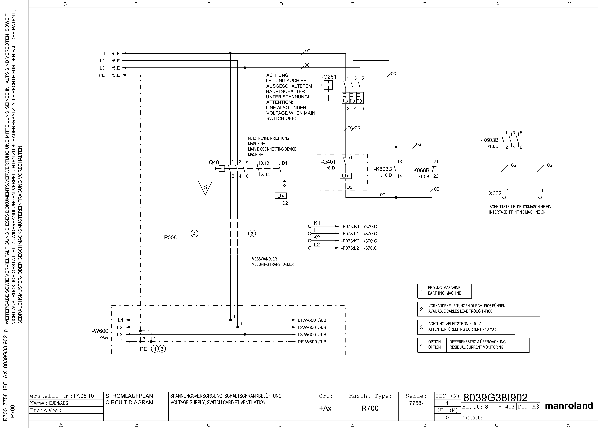

# +Ax — Sheet 8 of 403 — SPANNUNGSVERSORGUNG, SCHALTSCHRANKBELÜFTUNG

**VOLTAGE SUPPLY, SWITCH CABINET VENTILATION**

> Part of the manroland **R700** printing press IEC/UL circuit diagrams.
> Drawing class: **Stromlaufplan / Circuit diagram** (DIN A3).
> Document `+Ax` covers the **Central control console** machine section.

## At a glance

| Field | Value |
|---|---|
| Document | `+Ax`  (8039G38I902) |
| Sheet | **8** of 403 |
| Section (DE) | SPANNUNGSVERSORGUNG, SCHALTSCHRANKBELÜFTUNG |
| Section (EN) | VOLTAGE SUPPLY, SWITCH CABINET VENTILATION |
| Section type | POWER_SUPPLY — Voltage supply |
| Machine type | `R700` |
| Series | `7758` |
| Created | 17.05.10 |
| Replaces | — |
| Columns used | A, B, C, D, E, F, G, H |
| Path numbers | — |
| Labels on sheet | 130 |
| Cross-refs out | 18 |
| Cross-refs in | 17 |

**Previous:** [+Ax sheet 7](SHEET_0007.md) · **Next:** [+Ax sheet 9](SHEET_0009.md) · **Document TOC:** [_TOC.md](_TOC.md)  (+Ax) · **Master TOC:** [all sheets](../_MASTER_TOC.md)

## Sheet image (300 DPI, exact vector render)



_Rendered directly from the PDF vector layer at 300 DPI (1-bit), no OCR and no resampling. Use it to confirm anything ambiguous in the text below._

## Cross-references on this sheet

Each entry is a wire leaving this sheet. The printed token is `/sheet.column`; the link resolves to that sheet inside the same document.

| Ref | Target sheet | Col | Path | Destination on target | Target section | From col |
|---|---|---|---|---|---|---|
| `/5.E` | [+Ax sheet 5](SHEET_0005.md) | E | — | L1 | SPANNUNGSVERSORGUNG / KUNDENZULEITUNG | B |
| `/5.E` | [+Ax sheet 5](SHEET_0005.md) | E | — | L2 | SPANNUNGSVERSORGUNG / KUNDENZULEITUNG | B |
| `/5.E` | [+Ax sheet 5](SHEET_0005.md) | E | — | L3 | SPANNUNGSVERSORGUNG / KUNDENZULEITUNG | B |
| `/5.E` | [+Ax sheet 5](SHEET_0005.md) | E | — | PE | SPANNUNGSVERSORGUNG / KUNDENZULEITUNG | B |
| `/10.D` | [+Ax sheet 10](SHEET_0010.md) | D | — | — | SPANNUNGSVERSORGUNG, SCHALTSCHRANKBELÜFTUNG | G |
| `/8.D` | [+Ax sheet 8](SHEET_0008.md) | D | — | — | SPANNUNGSVERSORGUNG, SCHALTSCHRANKBELÜFTUNG | E |
| `/10.D` | [+Ax sheet 10](SHEET_0010.md) | D | — | — | SPANNUNGSVERSORGUNG, SCHALTSCHRANKBELÜFTUNG | E |
| `/10.B` | [+Ax sheet 10](SHEET_0010.md) | B | — | — | SPANNUNGSVERSORGUNG, SCHALTSCHRANKBELÜFTUNG | F |
| `/8.E` | [+Ax sheet 8](SHEET_0008.md) | E | — | — | SPANNUNGSVERSORGUNG, SCHALTSCHRANKBELÜFTUNG | D |
| `/370.C` | [+Ax sheet 370](SHEET_0370.md) | C | — | F073:K1 | OPTION: DIFFERENZSTROM ÜBERWACHUNG | E |
| `/370.C` | [+Ax sheet 370](SHEET_0370.md) | C | — | F073:L1 | OPTION: DIFFERENZSTROM ÜBERWACHUNG | E |
| `/370.C` | [+Ax sheet 370](SHEET_0370.md) | C | — | F073:K2 | OPTION: DIFFERENZSTROM ÜBERWACHUNG | E |
| `/370.C` | [+Ax sheet 370](SHEET_0370.md) | C | — | F073:L2 | OPTION: DIFFERENZSTROM ÜBERWACHUNG | E |
| `/9.B` | [+Ax sheet 9](SHEET_0009.md) | B | — | L1.W600 | SPANNUNGSVERSORGUNG, SCHALTSCHRANKBELÜFTUNG | D |
| `/9.B` | [+Ax sheet 9](SHEET_0009.md) | B | — | L2.W600 | SPANNUNGSVERSORGUNG, SCHALTSCHRANKBELÜFTUNG | D |
| `/9.B` | [+Ax sheet 9](SHEET_0009.md) | B | — | L3.W600 | SPANNUNGSVERSORGUNG, SCHALTSCHRANKBELÜFTUNG | D |
| `/9.A` | [+Ax sheet 9](SHEET_0009.md) | A | — | — | SPANNUNGSVERSORGUNG, SCHALTSCHRANKBELÜFTUNG | B |
| `/9.B` | [+Ax sheet 9](SHEET_0009.md) | B | — | PE.W600 | SPANNUNGSVERSORGUNG, SCHALTSCHRANKBELÜFTUNG | D |

### Incoming references (sheets that point here)

Every other sheet that sends a wire to this one. `Back-ref` is the token printed on *that* sheet; `Path` is its line number.

| From sheet | Cols | Back-ref | Path | Refs | What continues there |
|---|---|---|---|---|---|
| [+Ax#5](SHEET_0005.md) | F | `/5.F` | — | 4 | L1; L2; L3; PE |
| [+Ax#8](SHEET_0008.md) | D, E | `/8.D`, `/8.E` | — | 2 | — |
| [+Ax#9](SHEET_0009.md) | A, B | `/9.A`, `/9.B` | — | 5 | L1.W600; L2.W600; L3.W600; PE.W600 |
| [+Ax#10](SHEET_0010.md) | D | `/10.D` | — | 2 | — |
| [+Ax#370](SHEET_0370.md) | C | `/370.C` | — | 4 | F073:K1; F073:K2; F073:L1; F073:L2 |


## Devices on this sheet

| Tag | Class | Class meaning (IEC) | Col | Sub | Terminal | Sign |
|---|---|---|---|---|---|---|
| `D1` | D | Digital / binary element | D | — | — | — |
| `D2` | D | Digital / binary element | D | — | — | — |
| `Q401` | Q | Leistungsschalter / power switching device | C | — | — | — |
| `Q261` | Q | Leistungsschalter / power switching device | E | — | — | — |
| `D1` | D | Digital / binary element | E | — | — | — |
| `D2` | D | Digital / binary element | E | — | — | — |
| `Q401` | Q | Leistungsschalter / power switching device | E | — | — | — |
| `P008` | P | Messgeraet / measuring instrument, meter | B | — | — | — |
| `K1` | K | Relais / relay, contactor | E | — | — | — |
| `K2` | K | Relais / relay, contactor | D | — | — | — |
| `W600` | W | Kabel / cable, line, bus | A | — | — | — |
| `X002` | X | Klemme / terminal, plug connector | G | — | — | — |
| `F073:K2` | F | Schutz / protection device (fuse, circuit breaker) | E | — | K2 | — |
| `F073:K1` | F | Schutz / protection device (fuse, circuit breaker) | E | — | K1 | — |
| `F073:L1` | F | Schutz / protection device (fuse, circuit breaker) | E | — | L1 | — |
| `F073:L2` | F | Schutz / protection device (fuse, circuit breaker) | E | — | L2 | — |
| `3.13` | — | cross-device reference | D | — | — | — |
| `3.14` | — | cross-device reference | D | — | — | — |

## Potentials / nets

| Potential | Count | Columns | Attached devices | Terminals |
|---|---|---|---|---|
| `L1` | 4 | B, D, E | `W600` | — |
| `L2` | 4 | B, D | `W600` | — |
| `L3` | 3 | B, D | `W600` | — |
| `PE` | 5 | B, D | `W600` | — |


A potential such as `L24+/4` or `M24+` is a named supply/return rail; every place it appears on this sheet is electrically common.

## Wire-end annotations (grouped as printed)

A wire that continues elsewhere is annotated with a small cluster: the destination description, the path/line number `#NN`, and the `/sheet.column` cross reference. Each row below is one such cluster exactly as it is grouped on the drawing.

| Col | Y | Path | Cross-ref | Text on the wire |
|---|---|---|---|---|
| D | 97.0 | — | — | `OG` |
| B | 101.6 | — | `/5.E` | `L1` |
| B | 115.7 | — | `/5.E` | `L2` |
| D | 125.3 | — | — | `OG` |
| B | 129.9 | — | `/5.E` | `L3` |
| F | 142.3 | — | — | `OG` |
| B | 144.1 | — | `/5.E` | `PE` |
| D | 144.2 | — | — | `LEITUNG AUCH BEI ACHTUNG:` |
| E | 146.3 | — | — | `Q261` |
| E | 149.8 | — | — | `1 3 5` |
| D | 165.4 | — | — | `HAUPTSCHALTER UNTER SPANNUNG! AUSGESCHALTETEM` |
| D | 197.3 | — | — | `LINE ALSO UNDER ATTENTION:` |
| E | 209.4 | — | — | `2 4 6` |
| D | 218.5 | — | — | `SWITCH OFF! VOLTAGE WHEN MAIN` |
| E | 248.6 | — | — | `OG OG` |
| G | 257.6 | — | — | `1` |
| G | 257.6 | — | — | `3` |
| G | 257.6 | — | — | `5` |
| D | 269.2 | — | — | `NETZTRENNEINRICHTUNG: MASCHINE MAIN DISCONNECTING DEVICE: MACHINE` |
| G | 271.0 | — | — | `K603B 6` |
| F | 281.2 | — | — | `OG` |
| G | 284.1 | — | `/10.D` | — |
| G | 285.9 | — | — | `2` |
| G | 285.9 | — | — | `4` |
| E | 306.5 | — | — | `D1` |
| E | 313.5 | — | — | `Q401` |
| C | 314.3 | — | — | `1` |
| C | 314.3 | — | — | `3` |
| D | 314.3 | — | — | `5` |
| F | 314.3 | — | — | `13` |
| F | 314.3 | — | — | `21` |
| C | 314.9 | — | — | `Q401` |
| D | 317.1 | — | — | `3.13` |
| D | 317.1 | — | — | `D1` |
| G | 322.3 | — | — | `OG OG` |
| E | 326.6 | — | `/8.D` | — |
| E | 327.7 | — | — | `K603B 14` |
| F | 330.5 | — | — | `K068B 22` |
| D | 339.8 | — | — | `3.14` |
| E | 340.8 | — | `/10.D` | — |
| E | 341.9 | — | — | `U<` |
| C | 342.6 | — | — | `2` |
| C | 342.6 | — | — | `4` |
| D | 342.6 | — | — | `6` |
| F | 343.6 | — | `/10.B` | — |
| D | 352.4 | — | `/8.E` | — |
| C | 362.5 | — | — | `S` |
| E | 364.6 | — | — | `D2` |
| F | 369.1 | — | — | `OG` |
| G | 370.9 | — | — | `X002 2 1` |
| E | 380.4 | — | — | `OG` |
| D | 380.9 | — | — | `U< D2` |
| G | 403.9 | — | — | `INTERFACE: PRINTING MACHINE ON SCHNITTSTELLE: DRUCKMASCHINE EIN` |
| E | 434.0 | — | — | `K1` |
| E | 441.8 | — | `/370.C` | `F073:K1` |
| D | 448.1 | — | — | `K2 L1` |
| E | 456.0 | — | `/370.C` | `F073:L1` |
| C | 456.7 | — | — | `4 2` |
| B | 462.4 | — | — | `P008` |
| E | 470.1 | — | `/370.C` | `F073:K2` |
| D | 476.5 | — | — | `L2` |
| E | 484.3 | — | `/370.C` | `F073:L2` |
| D | 506.6 | — | — | `MESSWANDLER MESURING TRANSFORMER` |
| F | 563.3 | — | — | `1 ERDUNG: MASCHINE EARTHING: MACHINE` |
| G | 598.8 | — | — | `2 VORHANDENE LEITUNGEN DURCH P008 FÜHREN AVAILABLE CABLES LEAD TROUGH P008` |
| C | 619.5 | — | — | `1` |
| B | 625.7 | — | — | `L2 L3 L1` |
| D | 626.0 | — | `/9.B` | `L1.W600` |
| C | 633.7 | — | — | `1` |
| F | 634.2 | — | — | `3 ACHTUNG: ABLEITSTROM > 10 mA ! ATTENTION: CREEPING CURRENT > 10 mA !` |
| D | 640.1 | — | `/9.B` | `L2.W600` |
| A | 646.5 | — | — | `W600` |
| D | 647.9 | — | — | `1` |
| D | 654.3 | — | `/9.B` | `L3.W600` |
| B | 659.6 | — | `/9.A` | — |
| B | 662.0 | — | — | `PE PE` |
| B | 667.4 | — | — | `'` |
| D | 668.5 | — | `/9.B` | `PE.W600` |
| F | 669.6 | — | — | `4 OPTION OPTION` |
| G | 669.6 | — | — | `DIFFERENZSTROM ÜBERWACHUNG RESIDUAL CURRENT MONITORING` |
| B | 682.0 | — | — | `PE 1 3` |


## Reconstructed tables

This sheet carries tabular content (pin map / terminal assignment / index). The grid below was rebuilt from the drawing's own rule lines, so each row is exactly one physical row of the table.

### Table 1 — 13 data rows × 7 columns (at x=453.5, y=104.9) — **OG**

|  |  | ACHTUNG: LEITUNG | AUCH BEI |  |  | Q261 |
|---|---|---|---|---|---|---|
|  |  |  | `AUSGESCHALTETEM HAUPTSCHALTER` |  |  |  |
|  |  | `UNTER` | `SPANNUNG!` |  |  |  |
|  |  | `ATTENTION:` |  |  |  |  |
|  |  | `LINE VOLTAGE` | `ALSO UNDER WHEN MAIN` |  |  |  |
|  |  | `SWITCH NETZTRENNEINRICHTUNG: MASCHINE` | `OFF!` |  |  |  |
|  |  | `MAIN DISCONNECTING` | `DEVICE:` |  |  |  |
| `1` | `3` | `MACHINE 5 3.13` | `D1` |  | `Q401` | `/8.D` |
| `2` | `4` | `3.14 6` | `/8.E` |  |  |  |
|  |  | `U<` |  |  |  |  |
| `1` |  | `2 MESSWANDLER MESURING` | `D2 K2 L2 TRANSFORMER` | `K1 L1` |  |  |
|  | `1` |  | `L1.W600` | `/9.B` |  |  |
|  |  | `1` | `L2.W600` | `/9.B` |  |  |
|  |  |  | `L3.W600` | `/9.B` |  |  |


### Table 2 — 5 data rows × 5 columns (at x=673.2, y=104.9)

|  | 1 |  | 3 | 5 |
|---|---|---|---|---|
|  | `2` |  | `4` | `6` |
|  |  | `OG` |  | `OG` |
|  |  | `D1` |  |  |
| `U<` |  | `D2` |  |  |
|  |  | `F073:K1 F073:L1 F073:K2 F073:L2` |  |  |


### Table 3 — 3 data rows × 3 columns (at x=722.8, y=104.9) — **OG 13**

| K603B /10.D |  | K068B 14 /10.B |
|---|---|---|
| `OG` |  |  |
| `/370.C /370.C /370.C /370.C` |  | `1 2` |
|  |  | `3` |


## Notes and free text on this sheet

| Text | Col | Y (pt) |
|---|---|---|
| `U<` | D | 380.85 |
| `NETZTRENNEINRICHTUNG:` | D | 269.22 |
| `MASCHINE` | D | 279.84 |
| `MAIN DISCONNECTING DEVICE:` | D | 290.48 |
| `MACHINE` | D | 301.11 |
| `U<` | E | 341.87 |
| `K068B` | F | 330.54 |
| `K603B` | E | 327.7 |
| `MESSWANDLER` | D | 506.58 |
| `MESURING TRANSFORMER` | D | 517.26 |
| `K603B` | G | 271.01 |
| `S` | C | 362.51 |
| `ACHTUNG:` | D | 144.15 |
| `LEITUNG AUCH BEI` | D | 154.76 |
| `AUSGESCHALTETEM` | D | 165.4 |
| `HAUPTSCHALTER` | D | 176.04 |
| `UNTER SPANNUNG!` | D | 186.67 |
| `ATTENTION:` | D | 197.29 |
| `LINE ALSO UNDER` | D | 207.93 |
| `VOLTAGE WHEN MAIN` | D | 218.53 |
| `SWITCH OFF!` | D | 229.14 |
| `OG` | F | 142.31 |
| `OG OG` | E | 248.61 |
| `OG` | D | 96.96 |
| `OG` | E | 380.42 |
| `VORHANDENE LEITUNGEN DURCH P008 FÜHREN` | G | 598.76 |
| `AVAILABLE CABLES LEAD TROUGH P008` | F | 609.37 |
| `ERDUNG: MASCHINE` | F | 563.31 |
| `EARTHING: MACHINE` | F | 573.94 |
| `ACHTUNG: ABLEITSTROM > 10 mA !` | F | 634.16 |
| `ATTENTION: CREEPING CURRENT > 10 mA !` | G | 644.8 |
| `OPTION` | F | 669.57 |
| `DIFFERENZSTROM ÜBERWACHUNG` | G | 669.61 |
| `RESIDUAL CURRENT MONITORING` | G | 680.25 |
| `OG` | G | 322.31 |
| `OG` | H | 322.31 |
| `SCHNITTSTELLE: DRUCKMASCHINE EIN` | G | 403.86 |
| `INTERFACE: PRINTING MACHINE ON` | G | 414.49 |

## Complete label inventory (exact text from the drawing)

Every text object inside the drawing area of this sheet, in DIN reading order (column A→H, then top→bottom). This is the authoritative list: if a string is not here it is not printed on this sheet.

| Col | Y | X | Dir | Type | Text |
|---|---|---|---|---|---|
| A | 646.5 | 181.1 | → | device tag | `W600` |
| B | 101.6 | 220.0 | → | cross-reference | `/5.E` |
| B | 101.7 | 197.6 | → | potential | `L1` |
| B | 115.7 | 220.0 | → | cross-reference | `/5.E` |
| B | 115.8 | 196.4 | → | potential | `L2` |
| B | 129.9 | 220.0 | → | cross-reference | `/5.E` |
| B | 130.0 | 196.2 | → | potential | `L3` |
| B | 144.1 | 194.2 | → | potential | `PE` |
| B | 144.1 | 220.0 | → | cross-reference | `/5.E` |
| B | 462.3 | 319.5 | → | device tag | `P008` |
| B | 625.7 | 232.2 | → | potential | `L1` |
| B | 639.9 | 230.5 | → | potential | `L2` |
| B | 654.0 | 230.5 | → | potential | `L3` |
| B | 659.6 | 196.7 | → | cross-reference | `/9.A` |
| B | 662.0 | 278.5 | → | potential | `PE` |
| B | 662.0 | 299.8 | → | potential | `PE` |
| B | 667.4 | 238.1 | → | other | `'` |
| B | 682.0 | 275.5 | → | potential | `PE` |
| B | 682.9 | 303.0 | → | number | `1` |
| B | 683.4 | 316.9 | → | number | `3` |
| C | 314.3 | 455.5 | → | number | `1` |
| C | 314.3 | 470.3 | → | number | `3` |
| C | 315.0 | 407.6 | → | device tag | `Q401` |
| C | 342.6 | 456.1 | → | number | `2` |
| C | 342.6 | 470.3 | → | number | `4` |
| C | 362.5 | 399.8 | → | text | `S` |
| C | 456.7 | 380.7 | → | number | `4` |
| C | 619.6 | 459.1 | → | number | `1` |
| C | 633.7 | 473.2 | → | number | `1` |
| D | 97.0 | 600.7 | → | text | `OG` |
| D | 125.3 | 599.2 | → | text | `OG` |
| D | 144.2 | 524.4 | → | text | `ACHTUNG:` |
| D | 154.8 | 523.6 | → | text | `LEITUNG AUCH BEI` |
| D | 165.4 | 524.4 | → | text | `AUSGESCHALTETEM` |
| D | 176.0 | 523.6 | → | text | `HAUPTSCHALTER` |
| D | 186.7 | 523.6 | → | text | `UNTER SPANNUNG!` |
| D | 197.3 | 524.4 | → | text | `ATTENTION:` |
| D | 207.9 | 523.6 | → | text | `LINE ALSO UNDER` |
| D | 218.5 | 524.4 | → | text | `VOLTAGE WHEN MAIN` |
| D | 229.1 | 524.1 | → | text | `SWITCH OFF!` |
| D | 269.2 | 488.1 | → | text | `NETZTRENNEINRICHTUNG:` |
| D | 279.8 | 488.4 | → | text | `MASCHINE` |
| D | 290.5 | 488.4 | → | text | `MAIN DISCONNECTING DEVICE:` |
| D | 301.1 | 488.4 | → | text | `MACHINE` |
| D | 314.3 | 484.4 | → | number | `5` |
| D | 317.1 | 512.8 | → | device ref | `3.13` |
| D | 317.1 | 554.7 | → | device tag | `D1` |
| D | 339.7 | 514.2 | → | device ref | `3.14` |
| D | 342.6 | 484.4 | → | number | `6` |
| D | 352.3 | 556.5 | ↕ | cross-reference | `/8.E` |
| D | 380.8 | 545.7 | → | text | `U<` |
| D | 395.8 | 555.4 | → | device tag | `D2` |
| D | 456.7 | 494.1 | → | number | `2` |
| D | 462.3 | 617.0 | → | device tag | `K2` |
| D | 476.5 | 617.5 | → | potential | `L2` |
| D | 506.6 | 495.5 | → | text | `MESSWANDLER` |
| D | 517.3 | 495.5 | → | text | `MESURING TRANSFORMER` |
| D | 626.0 | 585.9 | → | potential | `L1.W600` |
| D | 640.1 | 585.9 | → | potential | `L2.W600` |
| D | 647.9 | 487.4 | → | number | `1` |
| D | 654.3 | 585.9 | → | potential | `L3.W600` |
| D | 668.5 | 585.9 | → | potential | `PE.W600` |
| E | 146.3 | 633.0 | → | device tag | `Q261` |
| E | 149.9 | 682.3 | → | number | `1` |
| E | 149.9 | 697.0 | → | number | `3` |
| E | 149.9 | 711.2 | → | number | `5` |
| E | 209.4 | 682.9 | → | number | `2` |
| E | 209.4 | 697.0 | → | number | `4` |
| E | 209.4 | 711.2 | → | number | `6` |
| E | 248.6 | 684.3 | → | text | `OG OG` |
| E | 306.5 | 682.3 | → | device tag | `D1` |
| E | 313.5 | 631.6 | → | device tag | `Q401` |
| E | 326.6 | 643.2 | → | cross-reference | `/8.D` |
| E | 327.7 | 736.2 | → | text | `K603B` |
| E | 340.8 | 750.3 | → | cross-reference | `/10.D` |
| E | 341.9 | 673.2 | → | text | `U<` |
| E | 364.6 | 682.3 | → | device tag | `D2` |
| E | 380.4 | 748.1 | → | text | `OG` |
| E | 434.0 | 617.7 | → | device tag | `K1` |
| E | 441.8 | 671.5 | → | device tag | `F073:K1` |
| E | 441.8 | 716.5 | → | cross-reference | `/370.C` |
| E | 448.1 | 618.2 | → | potential | `L1` |
| E | 456.0 | 671.5 | → | device tag | `F073:L1` |
| E | 456.0 | 716.5 | → | cross-reference | `/370.C` |
| E | 470.1 | 671.5 | → | device tag | `F073:K2` |
| E | 470.1 | 716.5 | → | cross-reference | `/370.C` |
| E | 484.3 | 671.5 | → | device tag | `F073:L2` |
| E | 484.3 | 716.5 | → | cross-reference | `/370.C` |
| E | 626.0 | 626.5 | → | cross-reference | `/9.B` |
| E | 640.1 | 626.5 | → | cross-reference | `/9.B` |
| E | 654.3 | 626.5 | → | cross-reference | `/9.B` |
| E | 668.5 | 626.5 | → | cross-reference | `/9.B` |
| F | 142.3 | 769.3 | → | text | `OG` |
| F | 281.2 | 818.9 | → | text | `OG` |
| F | 314.3 | 781.5 | → | number | `13` |
| F | 314.3 | 852.9 | → | number | `21` |
| F | 330.5 | 809.9 | → | text | `K068B` |
| F | 342.6 | 781.5 | → | number | `14` |
| F | 342.6 | 852.9 | → | number | `22` |
| F | 343.6 | 824.3 | → | cross-reference | `/10.B` |
| F | 369.1 | 854.4 | → | text | `OG` |
| F | 563.3 | 842.5 | → | text | `ERDUNG: MASCHINE` |
| F | 568.6 | 826.6 | → | number | `1` |
| F | 573.9 | 842.5 | → | text | `EARTHING: MACHINE` |
| F | 604.1 | 826.3 | → | number | `2` |
| F | 609.4 | 843.3 | → | text | `AVAILABLE CABLES LEAD TROUGH P008` |
| F | 634.2 | 843.3 | → | text | `ACHTUNG: ABLEITSTROM > 10 mA !` |
| F | 639.5 | 826.2 | → | number | `3` |
| F | 669.6 | 843.0 | → | text | `OPTION` |
| F | 674.9 | 826.3 | → | number | `4` |
| F | 680.2 | 843.0 | → | text | `OPTION` |
| G | 257.6 | 994.1 | → | number | `1` |
| G | 257.6 | 1008.9 | → | number | `3` |
| G | 257.6 | 1023.0 | → | number | `5` |
| G | 271.0 | 945.9 | → | text | `K603B` |
| G | 284.1 | 960.1 | → | cross-reference | `/10.D` |
| G | 285.9 | 994.7 | → | number | `2` |
| G | 285.9 | 1008.9 | → | number | `4` |
| G | 285.9 | 1023.0 | → | number | `6` |
| G | 322.3 | 1006.0 | → | text | `OG` |
| G | 371.0 | 994.7 | → | number | `2` |
| G | 375.9 | 958.7 | → | device tag | `X002` |
| G | 403.9 | 963.5 | → | text | `SCHNITTSTELLE: DRUCKMASCHINE EIN` |
| G | 414.5 | 962.9 | → | text | `INTERFACE: PRINTING MACHINE ON` |
| G | 598.8 | 843.3 | → | text | `VORHANDENE LEITUNGEN DURCH P008 FÜHREN` |
| G | 644.8 | 843.3 | → | text | `ATTENTION: CREEPING CURRENT > 10 mA !` |
| G | 669.6 | 885.0 | → | text | `DIFFERENZSTROM ÜBERWACHUNG` |
| G | 680.3 | 885.0 | → | text | `RESIDUAL CURRENT MONITORING` |
| H | 322.3 | 1076.9 | → | text | `OG` |
| H | 371.0 | 1065.0 | → | number | `1` |

## Reading-order text block

The same content as a plain block, grouped by DIN column — convenient to paste or to match against a visual description.

```text
=== Column A ===
 646.5  181.1  devtag       W600
=== Column B ===
 101.6  220.0  xref         /5.E
 101.7  197.6  net          L1
 115.7  220.0  xref         /5.E
 115.8  196.4  net          L2
 129.9  220.0  xref         /5.E
 130.0  196.2  net          L3
 144.1  194.2  net          PE
 144.1  220.0  xref         /5.E
 462.3  319.5  devtag       P008
 625.7  232.2  net          L1
 639.9  230.5  net          L2
 654.0  230.5  net          L3
 659.6  196.7  xref         /9.A
 662.0  278.5  net          PE
 662.0  299.8  net          PE
 667.4  238.1  other        `
 682.0  275.5  net          PE
 682.9  303.0  numeric      1
 683.4  316.9  numeric      3
=== Column C ===
 314.3  455.5  numeric      1
 314.3  470.3  numeric      3
 315.0  407.6  devtag       Q401
 342.6  456.1  numeric      2
 342.6  470.3  numeric      4
 362.5  399.8  text         S
 456.7  380.7  numeric      4
 619.6  459.1  numeric      1
 633.7  473.2  numeric      1
=== Column D ===
  97.0  600.7  text         OG
 125.3  599.2  text         OG
 144.2  524.4  text         ACHTUNG:
 154.8  523.6  text         LEITUNG AUCH BEI
 165.4  524.4  text         AUSGESCHALTETEM
 176.0  523.6  text         HAUPTSCHALTER
 186.7  523.6  text         UNTER SPANNUNG!
 197.3  524.4  text         ATTENTION:
 207.9  523.6  text         LINE ALSO UNDER
 218.5  524.4  text         VOLTAGE WHEN MAIN
 229.1  524.1  text         SWITCH OFF!
 269.2  488.1  text         NETZTRENNEINRICHTUNG:
 279.8  488.4  text         MASCHINE
 290.5  488.4  text         MAIN DISCONNECTING DEVICE:
 301.1  488.4  text         MACHINE
 314.3  484.4  numeric      5
 317.1  512.8  devref       3.13
 317.1  554.7  devtag       D1
 339.7  514.2  devref       3.14
 342.6  484.4  numeric      6
 352.3  556.5  xref         /8.E
 380.8  545.7  text         U<
 395.8  555.4  devtag       D2
 456.7  494.1  numeric      2
 462.3  617.0  devtag       K2
 476.5  617.5  net          L2
 506.6  495.5  text         MESSWANDLER
 517.3  495.5  text         MESURING TRANSFORMER
 626.0  585.9  net          L1.W600
 640.1  585.9  net          L2.W600
 647.9  487.4  numeric      1
 654.3  585.9  net          L3.W600
 668.5  585.9  net          PE.W600
=== Column E ===
 146.3  633.0  devtag       Q261
 149.9  682.3  numeric      1
 149.9  697.0  numeric      3
 149.9  711.2  numeric      5
 209.4  682.9  numeric      2
 209.4  697.0  numeric      4
 209.4  711.2  numeric      6
 248.6  684.3  text         OG OG
 306.5  682.3  devtag       D1
 313.5  631.6  devtag       Q401
 326.6  643.2  xref         /8.D
 327.7  736.2  text         K603B
 340.8  750.3  xref         /10.D
 341.9  673.2  text         U<
 364.6  682.3  devtag       D2
 380.4  748.1  text         OG
 434.0  617.7  devtag       K1
 441.8  671.5  devtag       F073:K1
 441.8  716.5  xref         /370.C
 448.1  618.2  net          L1
 456.0  671.5  devtag       F073:L1
 456.0  716.5  xref         /370.C
 470.1  671.5  devtag       F073:K2
 470.1  716.5  xref         /370.C
 484.3  671.5  devtag       F073:L2
 484.3  716.5  xref         /370.C
 626.0  626.5  xref         /9.B
 640.1  626.5  xref         /9.B
 654.3  626.5  xref         /9.B
 668.5  626.5  xref         /9.B
=== Column F ===
 142.3  769.3  text         OG
 281.2  818.9  text         OG
 314.3  781.5  numeric      13
 314.3  852.9  numeric      21
 330.5  809.9  text         K068B
 342.6  781.5  numeric      14
 342.6  852.9  numeric      22
 343.6  824.3  xref         /10.B
 369.1  854.4  text         OG
 563.3  842.5  text         ERDUNG: MASCHINE
 568.6  826.6  numeric      1
 573.9  842.5  text         EARTHING: MACHINE
 604.1  826.3  numeric      2
 609.4  843.3  text         AVAILABLE CABLES LEAD TROUGH P008
 634.2  843.3  text         ACHTUNG: ABLEITSTROM > 10 mA !
 639.5  826.2  numeric      3
 669.6  843.0  text         OPTION
 674.9  826.3  numeric      4
 680.2  843.0  text         OPTION
=== Column G ===
 257.6  994.1  numeric      1
 257.6 1008.9  numeric      3
 257.6 1023.0  numeric      5
 271.0  945.9  text         K603B
 284.1  960.1  xref         /10.D
 285.9  994.7  numeric      2
 285.9 1008.9  numeric      4
 285.9 1023.0  numeric      6
 322.3 1006.0  text         OG
 371.0  994.7  numeric      2
 375.9  958.7  devtag       X002
 403.9  963.5  text         SCHNITTSTELLE: DRUCKMASCHINE EIN
 414.5  962.9  text         INTERFACE: PRINTING MACHINE ON
 598.8  843.3  text         VORHANDENE LEITUNGEN DURCH P008 FÜHREN
 644.8  843.3  text         ATTENTION: CREEPING CURRENT > 10 mA !
 669.6  885.0  text         DIFFERENZSTROM ÜBERWACHUNG
 680.3  885.0  text         RESIDUAL CURRENT MONITORING
=== Column H ===
 322.3 1076.9  text         OG
 371.0 1065.0  numeric      1
```

---
_Generated from the PDF vector text layer; no OCR. Source: `R700_7758_IEC_AX_8039G38I902_p`, sheet 8._
