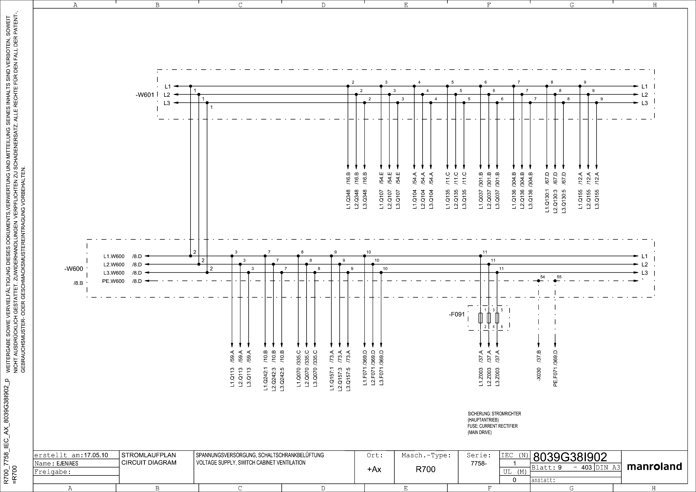

# +Ax — Sheet 9 of 403 — SPANNUNGSVERSORGUNG, SCHALTSCHRANKBELÜFTUNG

**VOLTAGE SUPPLY, SWITCH CABINET VENTILATION**

> Part of the manroland **R700** printing press IEC/UL circuit diagrams.
> Drawing class: **Stromlaufplan / Circuit diagram** (DIN A3).
> Document `+Ax` covers the **Central control console** machine section.

## At a glance

| Field | Value |
|---|---|
| Document | `+Ax`  (8039G38I902) |
| Sheet | **9** of 403 |
| Section (DE) | SPANNUNGSVERSORGUNG, SCHALTSCHRANKBELÜFTUNG |
| Section (EN) | VOLTAGE SUPPLY, SWITCH CABINET VENTILATION |
| Section type | POWER_SUPPLY — Voltage supply |
| Machine type | `R700` |
| Series | `7758` |
| Created | 17.05.10 |
| Replaces | — |
| Columns used | A, B, C, D, E, F, G, H |
| Path numbers | — |
| Labels on sheet | 170 |
| Cross-refs out | 49 |
| Cross-refs in | 49 |

**Previous:** [+Ax sheet 8](SHEET_0008.md) · **Next:** [+Ax sheet 10](SHEET_0010.md) · **Document TOC:** [_TOC.md](_TOC.md)  (+Ax) · **Master TOC:** [all sheets](../_MASTER_TOC.md)

## Sheet image (300 DPI, exact vector render)



_Rendered directly from the PDF vector layer at 300 DPI (1-bit), no OCR and no resampling. Use it to confirm anything ambiguous in the text below._

## Cross-references on this sheet

Each entry is a wire leaving this sheet. The printed token is `/sheet.column`; the link resolves to that sheet inside the same document.

| Ref | Target sheet | Col | Path | Destination on target | Target section | From col |
|---|---|---|---|---|---|---|
| `/54.E` | [+Ax sheet 54](SHEET_0054.md) | E | — | L1.Q107 | LUFTVERSORGUNG | E |
| `/54.E` | [+Ax sheet 54](SHEET_0054.md) | E | — | L2.Q107 | LUFTVERSORGUNG | E |
| `/54.E` | [+Ax sheet 54](SHEET_0054.md) | E | — | L3.Q107 | LUFTVERSORGUNG | E |
| `/16.B` | [+Ax sheet 16](SHEET_0016.md) | B | — | L1.Q348 | SPANNUNGSVERSORGUNG, SCHALTSCHRANKBELÜFTUNG | D |
| `/16.B` | [+Ax sheet 16](SHEET_0016.md) | B | — | L2.Q348 | SPANNUNGSVERSORGUNG, SCHALTSCHRANKBELÜFTUNG | D |
| `/16.B` | [+Ax sheet 16](SHEET_0016.md) | B | — | L3.Q348 | SPANNUNGSVERSORGUNG, SCHALTSCHRANKBELÜFTUNG | E |
| `/11.C` | [+Ax sheet 11](SHEET_0011.md) | C | — | L1.Q135 | SPANNUNGSVERSORGUNG, SCHALTSCHRANKBELÜFTUNG | F |
| `/11.C` | [+Ax sheet 11](SHEET_0011.md) | C | — | L2.Q135 | SPANNUNGSVERSORGUNG, SCHALTSCHRANKBELÜFTUNG | F |
| `/11.C` | [+Ax sheet 11](SHEET_0011.md) | C | — | L3.Q135 | SPANNUNGSVERSORGUNG, SCHALTSCHRANKBELÜFTUNG | F |
| `/301.B` | [+Ax sheet 301](SHEET_0301.md) | B | — | L1.Q037 | SPANNUNGSVERSORGUNG: LACKMODUL | F |
| `/301.B` | [+Ax sheet 301](SHEET_0301.md) | B | — | L2.Q037 | SPANNUNGSVERSORGUNG: LACKMODUL | F |
| `/301.B` | [+Ax sheet 301](SHEET_0301.md) | B | — | L3.Q037 | SPANNUNGSVERSORGUNG: LACKMODUL | F |
| `/304.B` | [+Ax sheet 304](SHEET_0304.md) | B | — | L1.Q136 | SCHÖN & WIDERDRUCK HAUPTSCHALTSCHRANK | F |
| `/304.B` | [+Ax sheet 304](SHEET_0304.md) | B | — | L2.Q136 | SCHÖN & WIDERDRUCK HAUPTSCHALTSCHRANK | F |
| `/304.B` | [+Ax sheet 304](SHEET_0304.md) | B | — | L3.Q136 | SCHÖN & WIDERDRUCK HAUPTSCHALTSCHRANK | G |
| `/67.D` | [+Ax sheet 67](SHEET_0067.md) | D | — | L1.Q130:1 | SAUGBÄNDERTISCH | G |
| `/67.D` | [+Ax sheet 67](SHEET_0067.md) | D | — | L2.Q130:3 | SAUGBÄNDERTISCH | G |
| `/67.D` | [+Ax sheet 67](SHEET_0067.md) | D | — | L3.Q130:5 | SAUGBÄNDERTISCH | G |
| `/54.A` | [+Ax sheet 54](SHEET_0054.md) | A | — | L1.Q104 | LUFTVERSORGUNG | E |
| `/54.A` | [+Ax sheet 54](SHEET_0054.md) | A | — | L2.Q104 | LUFTVERSORGUNG | E |
| `/54.A` | [+Ax sheet 54](SHEET_0054.md) | A | — | L3.Q104 | LUFTVERSORGUNG | E |
| `/12.A` | [+Ax sheet 12](SHEET_0012.md) | A | — | L1.Q155 | SPANNUNGSVERSORGUNG, SCHALTSCHRANKBELÜFTUNG | G |
| `/12.A` | [+Ax sheet 12](SHEET_0012.md) | A | — | L2.Q155 | SPANNUNGSVERSORGUNG, SCHALTSCHRANKBELÜFTUNG | G |
| `/12.A` | [+Ax sheet 12](SHEET_0012.md) | A | — | L3.Q155 | SPANNUNGSVERSORGUNG, SCHALTSCHRANKBELÜFTUNG | G |
| `/8.D` | [+Ax sheet 8](SHEET_0008.md) | D | — | L1.W600 | SPANNUNGSVERSORGUNG, SCHALTSCHRANKBELÜFTUNG | B |
| `/8.D` | [+Ax sheet 8](SHEET_0008.md) | D | — | L2.W600 | SPANNUNGSVERSORGUNG, SCHALTSCHRANKBELÜFTUNG | B |
| `/8.D` | [+Ax sheet 8](SHEET_0008.md) | D | — | L3.W600 | SPANNUNGSVERSORGUNG, SCHALTSCHRANKBELÜFTUNG | B |
| `/8.D` | [+Ax sheet 8](SHEET_0008.md) | D | — | PE.W600 | SPANNUNGSVERSORGUNG, SCHALTSCHRANKBELÜFTUNG | B |
| `/8.B` | [+Ax sheet 8](SHEET_0008.md) | B | — | — | SPANNUNGSVERSORGUNG, SCHALTSCHRANKBELÜFTUNG | A |
| `/10.B` | [+Ax sheet 10](SHEET_0010.md) | B | — | L1.Q242:1 | SPANNUNGSVERSORGUNG, SCHALTSCHRANKBELÜFTUNG | C |
| `/10.B` | [+Ax sheet 10](SHEET_0010.md) | B | — | L2.Q242:3 | SPANNUNGSVERSORGUNG, SCHALTSCHRANKBELÜFTUNG | C |
| `/10.B` | [+Ax sheet 10](SHEET_0010.md) | B | — | L3.Q242:5 | SPANNUNGSVERSORGUNG, SCHALTSCHRANKBELÜFTUNG | D |
| `/37.B` | [+Ax sheet 37](SHEET_0037.md) | B | — | X030 | HAUPTANTRIEB | G |
| `/335.C` | [+Ax sheet 335](SHEET_0335.md) | C | — | L1.Q070 | 1 OPTION: LOGISTIK (ANLEGER AUSLEGER) | D |
| `/335.C` | [+Ax sheet 335](SHEET_0335.md) | C | — | L2.Q070 | 1 OPTION: LOGISTIK (ANLEGER AUSLEGER) | D |
| `/335.C` | [+Ax sheet 335](SHEET_0335.md) | C | — | L3.Q070 | 1 OPTION: LOGISTIK (ANLEGER AUSLEGER) | D |
| `/369.D` | [+Ax sheet 369](SHEET_0369.md) | D | — | L1.F071 | OPTION: ÜBERSPANNUNGSSCHUTZ | E |
| `/369.D` | [+Ax sheet 369](SHEET_0369.md) | D | — | L2.F071 | OPTION: ÜBERSPANNUNGSSCHUTZ | E |
| `/369.D` | [+Ax sheet 369](SHEET_0369.md) | D | — | L3.F071 | OPTION: ÜBERSPANNUNGSSCHUTZ | E |
| `/369.D` | [+Ax sheet 369](SHEET_0369.md) | D | — | PE.F071 | OPTION: ÜBERSPANNUNGSSCHUTZ | G |
| `/59.A` | [+Ax sheet 59](SHEET_0059.md) | A | — | L1.Q113 | DRUCKLUFTANLAGE | C |
| `/59.A` | [+Ax sheet 59](SHEET_0059.md) | A | — | L2.Q113 | DRUCKLUFTANLAGE | C |
| `/59.A` | [+Ax sheet 59](SHEET_0059.md) | A | — | L3.Q113 | DRUCKLUFTANLAGE | C |
| `/73.A` | [+Ax sheet 73](SHEET_0073.md) | A | — | L1.Q157:1 | FEUCHTMITTELKÜHLGERÄT | D |
| `/73.A` | [+Ax sheet 73](SHEET_0073.md) | A | — | L2.Q157:3 | FEUCHTMITTELKÜHLGERÄT | D |
| `/73.A` | [+Ax sheet 73](SHEET_0073.md) | A | — | L3.Q157:5 | FEUCHTMITTELKÜHLGERÄT | D |
| `/37.A` | [+Ax sheet 37](SHEET_0037.md) | A | — | L1.Z003 | HAUPTANTRIEB | F |
| `/37.A` | [+Ax sheet 37](SHEET_0037.md) | A | — | L2.Z003 | HAUPTANTRIEB | F |
| `/37.A` | [+Ax sheet 37](SHEET_0037.md) | A | — | L3.Z003 | HAUPTANTRIEB | F |

### Incoming references (sheets that point here)

Every other sheet that sends a wire to this one. `Back-ref` is the token printed on *that* sheet; `Path` is its line number.

| From sheet | Cols | Back-ref | Path | Refs | What continues there |
|---|---|---|---|---|---|
| [+Ax#8](SHEET_0008.md) | B, D | `/8.B`, `/8.D` | — | 5 | L1.W600; L2.W600; L3.W600; PE.W600 |
| [+Ax#10](SHEET_0010.md) | B | `/10.B` | — | 3 | L1.Q242:1; L2.Q242:3; L3.Q242:5 |
| [+Ax#11](SHEET_0011.md) | C | `/11.C` | — | 3 | L1.Q135; L2.Q135; L3.Q135 |
| [+Ax#12](SHEET_0012.md) | A, D | `/12.A`, `/12.D` | — | 3 | L1.Q155; L2.Q275:3 L2.Q155; L3.Q155 |
| [+Ax#16](SHEET_0016.md) | B | `/16.B` | — | 3 | L1.Q348; L2.Q348; L3.Q348 |
| [+Ax#37](SHEET_0037.md) | A, B, C | `/37.A`, `/37.B`, `/37.C` | — | 4 | L1.Z003 L3.Q115; L2.Z003; L3.Z003; X030 |
| [+Ax#54](SHEET_0054.md) | C | `/54.C` | — | 6 | L1.Q104 L1.Q103 L1.Q107; L2.Q104 L2.Q103 L2.Q107; L3.Q104 L3.Q103 L3.Q107 |
| [+Ax#59](SHEET_0059.md) | A | `/59.A` | — | 3 | L1.Q113; L2.Q113; L3.Q113 |
| [+Ax#67](SHEET_0067.md) | C | `/67.C` | — | 3 | L1.Q130:1; L2.Q130:3; L3.Q130:5 |
| [+Ax#73](SHEET_0073.md) | B | `/73.B` | — | 3 | L1.Q157:1 L1.Q157; L2.Q157:3 L2.Q157; L3.Q157:5 L3.Q157 |
| [+Ax#301](SHEET_0301.md) | A | `/301.A` | — | 3 | L1.Q037; L2.Q037; L3.Q037 |
| [+Ax#304](SHEET_0304.md) | A | `/304.A` | — | 3 | L1.Q136; L2.Q136; L3.Q136 |
| [+Ax#335](SHEET_0335.md) | C | `/335.C` | — | 3 | L1.Q070; L2.Q070; L3.Q070 |
| [+Ax#369](SHEET_0369.md) | C | `/369.C` | — | 4 | L1.F071; L2.F071; L3.F071; PE.F071 |


## Devices on this sheet

| Tag | Class | Class meaning (IEC) | Col | Sub | Terminal | Sign |
|---|---|---|---|---|---|---|
| `W601` | W | Kabel / cable, line, bus | B | — | — | — |
| `W600` | W | Kabel / cable, line, bus | A | — | — | — |
| `F091` | F | Schutz / protection device (fuse, circuit breaker) | F | — | — | — |
| `X030` | X | Klemme / terminal, plug connector | G | — | — | — |

## Potentials / nets

| Potential | Count | Columns | Attached devices | Terminals |
|---|---|---|---|---|
| `L1` | 18 | A, B, C, D, E, F, G, H | `F071`, `Q037`, `Q070`, `Q104`, `Q107`, `Q113`, `Q130`, `Q135`, `Q136`, `Q155`, `Q157`, `Q242`, `Q348`, `W600`, `Z003` | `1` |
| `L2` | 18 | A, B, C, D, E, F, G, H | `F071`, `Q037`, `Q070`, `Q104`, `Q107`, `Q113`, `Q130`, `Q135`, `Q136`, `Q155`, `Q157`, `Q242`, `Q348`, `W600`, `Z003` | `3` |
| `L3` | 18 | A, B, C, D, E, F, G, H | `F071`, `Q037`, `Q070`, `Q104`, `Q107`, `Q113`, `Q130`, `Q135`, `Q136`, `Q155`, `Q157`, `Q242`, `Q348`, `W600`, `Z003` | `5` |
| `PE` | 2 | A, G | `F071`, `W600` | — |


A potential such as `L24+/4` or `M24+` is a named supply/return rail; every place it appears on this sheet is electrically common.

## Wire-end annotations (grouped as printed)

A wire that continues elsewhere is annotated with a small cluster: the destination description, the path/line number `#NN`, and the `/sheet.column` cross reference. Each row below is one such cluster exactly as it is grouped on the drawing.

| Col | Y | Path | Cross-ref | Text on the wire |
|---|---|---|---|---|
| D | 137.7 | — | — | `2` |
| E | 137.7 | — | — | `3` |
| E | 137.7 | — | — | `4` |
| F | 137.7 | — | — | `5` |
| F | 137.7 | — | — | `6` |
| F | 137.7 | — | — | `7` |
| G | 137.7 | — | — | `8` |
| G | 137.7 | — | — | `9` |
| B | 143.8 | — | — | `L2 L3 L1` |
| H | 143.8 | — | — | `L1 L2 L3` |
| B | 151.3 | — | — | `1` |
| D | 151.8 | — | — | `2` |
| E | 151.8 | — | — | `3` |
| E | 151.8 | — | — | `4` |
| F | 151.8 | — | — | `5` |
| F | 151.8 | — | — | `6` |
| F | 151.8 | — | — | `7` |
| G | 151.8 | — | — | `8` |
| G | 151.8 | — | — | `9` |
| B | 157.5 | — | — | `W601` |
| C | 165.4 | — | — | `1` |
| E | 166.0 | — | — | `2` |
| E | 166.0 | — | — | `3` |
| E | 166.0 | — | — | `4` |
| F | 166.0 | — | — | `5` |
| F | 166.0 | — | — | `6` |
| G | 166.0 | — | — | `7` |
| G | 166.0 | — | — | `8` |
| G | 166.0 | — | — | `9` |
| C | 179.6 | — | — | `1` |
| E | 294.2 | — | `/54.E` | `L1.Q107` |
| E | 294.2 | — | `/54.E` | `L2.Q107` |
| E | 294.2 | — | `/54.E` | `L3.Q107` |
| D | 294.5 | — | `/16.B` | `L1.Q348` |
| D | 294.5 | — | `/16.B` | `L2.Q348` |
| E | 294.5 | — | `/16.B` | `L3.Q348` |
| F | 294.5 | — | `/11.C` | `L1.Q135` |
| F | 294.5 | — | `/11.C` | `L2.Q135` |
| F | 294.5 | — | `/11.C` | `L3.Q135` |
| F | 294.5 | — | `/301.B` | `L1.Q037` |
| F | 294.5 | — | `/301.B` | `L2.Q037` |
| F | 294.5 | — | `/301.B` | `L3.Q037` |
| F | 294.5 | — | `/304.B` | `L1.Q136` |
| F | 294.5 | — | `/304.B` | `L2.Q136` |
| G | 294.5 | — | `/304.B` | `L3.Q136` |
| G | 294.5 | — | `/67.D` | `L1.Q130:1` |
| G | 294.5 | — | `/67.D` | `L2.Q130:3` |
| G | 294.5 | — | `/67.D` | `L3.Q130:5` |
| E | 294.8 | — | `/54.A` | `L1.Q104` |
| E | 294.8 | — | `/54.A` | `L2.Q104` |
| E | 294.8 | — | `/54.A` | `L3.Q104` |
| G | 294.8 | — | `/12.A` | `L1.Q155` |
| G | 294.8 | — | `/12.A` | `L2.Q155` |
| G | 294.8 | — | `/12.A` | `L3.Q155` |
| B | 427.6 | — | — | `2` |
| C | 428.2 | — | — | `3` |
| C | 428.2 | — | — | `7` |
| D | 428.2 | — | — | `8` |
| D | 428.2 | — | — | `9` |
| E | 428.2 | — | — | `10` |
| F | 428.2 | — | — | `11` |
| H | 434.4 | — | — | `L1 L2 L3 '` |
| B | 434.6 | — | `/8.D` | `L1.W600` |
| C | 441.8 | — | — | `2` |
| C | 442.4 | — | — | `3` |
| C | 442.4 | — | — | `7` |
| D | 442.4 | — | — | `8` |
| D | 442.4 | — | — | `9` |
| E | 442.4 | — | — | `10` |
| F | 442.4 | — | — | `11` |
| B | 448.8 | — | `/8.D` | `L2.W600` |
| A | 455.2 | — | — | `W600` |
| C | 456.0 | — | — | `2` |
| C | 456.6 | — | — | `3` |
| D | 456.6 | — | — | `7` |
| D | 456.6 | — | — | `8` |
| D | 456.6 | — | — | `9` |
| E | 456.6 | — | — | `10` |
| F | 456.6 | — | — | `11` |
| B | 463.0 | — | `/8.D` | `L3.W600` |
| G | 470.7 | — | — | `54 55` |
| B | 477.1 | — | `/8.D` | `PE.W600` |
| A | 480.7 | — | `/8.B` | — |
| F | 527.8 | — | — | `1` |
| F | 528.2 | — | — | `3` |
| F | 528.2 | — | — | `5` |
| F | 533.2 | — | — | `F091` |
| F | 556.5 | — | — | `2` |
| F | 556.5 | — | — | `4` |
| F | 556.5 | — | — | `6` |
| C | 599.2 | — | `/10.B` | `L1.Q242:1` |
| C | 599.2 | — | `/10.B` | `L2.Q242:3` |
| D | 599.2 | — | `/10.B` | `L3.Q242:5` |
| D | 599.2 | — | `/335.C` | `L1.Q070` |
| D | 599.2 | — | `/335.C` | `L2.Q070` |
| D | 599.2 | — | `/335.C` | `L3.Q070` |
| E | 599.2 | — | `/369.D` | `L1.F071` |
| E | 599.2 | — | `/369.D` | `L2.F071` |
| E | 599.2 | — | `/369.D` | `L3.F071` |
| G | 599.2 | — | `/37.B` | `X030` |
| G | 599.2 | — | `/369.D` | `PE.F071` |
| C | 599.5 | — | `/59.A` | `L1.Q113` |
| C | 599.5 | — | `/59.A` | `L2.Q113` |
| C | 599.5 | — | `/59.A` | `L3.Q113` |
| D | 599.5 | — | `/73.A` | `L1.Q157:1` |
| D | 599.5 | — | `/73.A` | `L2.Q157:3` |
| D | 599.5 | — | `/73.A` | `L3.Q157:5` |
| F | 599.5 | — | `/37.A` | `L1.Z003` |
| F | 599.5 | — | `/37.A` | `L2.Z003` |
| F | 599.5 | — | `/37.A` | `L3.Z003` |
| F | 705.1 | — | — | `FUSE: CURRENT RECTIFIER (HAUPTANTRIEB) (MAIN DRIVE) SICHERUNG: STROMRICHTER` |


## Reconstructed tables

This sheet carries tabular content (pin map / terminal assignment / index). The grid below was rebuilt from the drawing's own rule lines, so each row is exactly one physical row of the table.

### Table 1 — 5 data rows × 39 columns (at x=326.0, y=147.4)

| 1 |  |  |  |  |  |  |  |  |  |  |  |  |  |  | 2 |  |  |  | 3 |  |  | 4 |  |  | 5 |  |  | 6 |  |  | 7 |  |  |  | 8 |  |  | 9 |
|---|---|---|---|---|---|---|---|---|---|---|---|---|---|---|---|---|---|---|---|---|---|---|---|---|---|---|---|---|---|---|---|---|---|---|---|---|---|---|
|  | `1` |  |  |  |  |  |  |  |  |  |  |  |  |  |  | `2` |  |  |  | `3` |  |  | `4` |  |  | `5` |  |  | `6` |  |  | `7` |  |  |  | `8` |  |  |
| `2` |  | `1` | `3` |  |  | `7` |  |  | `8` |  |  | `9` |  | `/16.B L1.Q348` | `/16.B L2.Q348` | `/16.B L3.Q348 10` |  | `/54.E L1.Q107` | `/54.E L2.Q107` | `/54.E L3.Q107` | `/54.A L1.Q104` | `/54.A L2.Q104` | `/54.A L3.Q104` | `/11.C L1.Q135` | `/11.C L2.Q135` | `/11.C L3.Q135` | `11` |  |  | `/304.B L1.Q136` | `/304.B L2.Q136` | `/304.B L3.Q136` |  | `/67.D L1.Q130:1` | `/67.D L2.Q130:3` | `/67.D L3.Q130:5` | `/12.A L1.Q155` | `/12.A L2.Q155` |
|  | `2` |  |  | `3` |  |  | `7` |  |  | `8` |  |  | `9` |  |  |  | `10` |  |  |  |  |  |  |  |  |  |  | `11` |  |  |  |  |  |  |  |  |  |  |
|  |  | `2` |  |  | `3` |  |  | `7` |  |  | `8` |  |  | `9` |  |  |  | `10` |  |  |  |  |  |  |  |  |  |  | `11` |  |  |  |  |  |  |  |  |  |
|  |  |  |  |  |  |  |  |  |  |  |  |  |  |  |  |  |  |  |  |  |  |  |  |  |  |  |  |  |  |  |  |  | `54` |  | `55` |  |  |  |


## Notes and free text on this sheet

| Text | Col | Y (pt) |
|---|---|---|
| `SICHERUNG: STROMRICHTER` | F | 705.06 |
| `(HAUPTANTRIEB)` | F | 715.67 |
| `FUSE: CURRENT RECTIFIER` | F | 726.3 |
| `(MAIN DRIVE)` | F | 736.93 |

## Complete label inventory (exact text from the drawing)

Every text object inside the drawing area of this sheet, in DIN reading order (column A→H, then top→bottom). This is the authoritative list: if a string is not here it is not printed on this sheet.

| Col | Y | X | Dir | Type | Text |
|---|---|---|---|---|---|
| A | 434.6 | 177.2 | → | potential | `L1.W600` |
| A | 448.8 | 177.2 | → | potential | `L2.W600` |
| A | 455.2 | 110.3 | → | device tag | `W600` |
| A | 463.0 | 177.2 | → | potential | `L3.W600` |
| A | 477.1 | 174.9 | → | potential | `PE.W600` |
| A | 480.7 | 126.1 | → | cross-reference | `/8.B` |
| B | 143.8 | 281.8 | → | potential | `L1` |
| B | 151.3 | 331.1 | → | number | `1` |
| B | 157.5 | 232.2 | → | device tag | `W601` |
| B | 158.0 | 280.1 | → | potential | `L2` |
| B | 172.2 | 280.1 | → | potential | `L3` |
| B | 427.6 | 330.8 | → | number | `2` |
| B | 434.7 | 226.5 | → | cross-reference | `/8.D` |
| B | 448.9 | 226.5 | → | cross-reference | `/8.D` |
| B | 463.0 | 226.5 | → | cross-reference | `/8.D` |
| B | 477.2 | 226.5 | → | cross-reference | `/8.D` |
| C | 165.4 | 345.3 | → | number | `1` |
| C | 179.6 | 359.4 | → | number | `1` |
| C | 428.2 | 402.0 | → | number | `3` |
| C | 428.2 | 458.6 | → | number | `7` |
| C | 441.8 | 345.0 | → | number | `2` |
| C | 442.4 | 416.1 | → | number | `3` |
| C | 442.4 | 472.8 | → | number | `7` |
| C | 456.0 | 359.1 | → | number | `2` |
| C | 456.6 | 430.3 | → | number | `3` |
| C | 599.2 | 450.2 | ↕ | cross-reference | `/10.B` |
| C | 599.2 | 464.4 | ↕ | cross-reference | `/10.B` |
| C | 599.5 | 393.6 | ↕ | cross-reference | `/59.A` |
| C | 599.5 | 407.7 | ↕ | cross-reference | `/59.A` |
| C | 599.5 | 421.9 | ↕ | cross-reference | `/59.A` |
| C | 627.6 | 450.3 | ↕ | potential | `L1.Q242:1` |
| C | 629.0 | 393.6 | ↕ | potential | `L1.Q113` |
| C | 629.0 | 407.8 | ↕ | potential | `L2.Q113` |
| C | 629.0 | 422.0 | ↕ | potential | `L3.Q113` |
| C | 629.0 | 464.5 | ↕ | potential | `L2.Q242:3` |
| D | 137.7 | 602.1 | → | number | `2` |
| D | 151.8 | 616.3 | → | number | `2` |
| D | 294.5 | 592.0 | ↕ | cross-reference | `/16.B` |
| D | 294.5 | 606.2 | ↕ | cross-reference | `/16.B` |
| D | 324.3 | 592.0 | ↕ | potential | `L1.Q348` |
| D | 324.3 | 606.2 | ↕ | potential | `L2.Q348` |
| D | 428.2 | 515.3 | → | number | `8` |
| D | 428.2 | 572.0 | → | number | `9` |
| D | 442.4 | 529.5 | → | number | `8` |
| D | 442.4 | 586.2 | → | number | `9` |
| D | 456.6 | 487.0 | → | number | `7` |
| D | 456.6 | 543.7 | → | number | `8` |
| D | 456.6 | 600.4 | → | number | `9` |
| D | 599.2 | 478.6 | ↕ | cross-reference | `/10.B` |
| D | 599.2 | 507.0 | ↕ | cross-reference | `/335.C` |
| D | 599.2 | 521.2 | ↕ | cross-reference | `/335.C` |
| D | 599.2 | 535.3 | ↕ | cross-reference | `/335.C` |
| D | 599.5 | 563.6 | ↕ | cross-reference | `/73.A` |
| D | 599.5 | 577.8 | ↕ | cross-reference | `/73.A` |
| D | 599.5 | 592.0 | ↕ | cross-reference | `/73.A` |
| D | 627.6 | 563.7 | ↕ | potential | `L1.Q157:1` |
| D | 629.0 | 478.6 | ↕ | potential | `L3.Q242:5` |
| D | 629.0 | 507.0 | ↕ | potential | `L1.Q070` |
| D | 629.0 | 521.2 | ↕ | potential | `L2.Q070` |
| D | 629.0 | 535.3 | ↕ | potential | `L3.Q070` |
| D | 629.0 | 577.9 | ↕ | potential | `L2.Q157:3` |
| D | 629.0 | 592.0 | ↕ | potential | `L3.Q157:5` |
| E | 137.7 | 658.8 | → | number | `3` |
| E | 137.7 | 715.5 | → | number | `4` |
| E | 151.8 | 672.9 | → | number | `3` |
| E | 151.8 | 729.6 | → | number | `4` |
| E | 166.0 | 630.4 | → | number | `2` |
| E | 166.0 | 687.1 | → | number | `3` |
| E | 166.0 | 743.8 | → | number | `4` |
| E | 294.2 | 648.7 | ↕ | cross-reference | `/54.E` |
| E | 294.2 | 662.8 | ↕ | cross-reference | `/54.E` |
| E | 294.2 | 677.0 | ↕ | cross-reference | `/54.E` |
| E | 294.5 | 620.3 | ↕ | cross-reference | `/16.B` |
| E | 294.8 | 705.4 | ↕ | cross-reference | `/54.A` |
| E | 294.8 | 719.5 | ↕ | cross-reference | `/54.A` |
| E | 294.8 | 733.7 | ↕ | cross-reference | `/54.A` |
| E | 324.3 | 620.4 | ↕ | potential | `L3.Q348` |
| E | 324.3 | 648.7 | ↕ | potential | `L1.Q107` |
| E | 324.3 | 662.9 | ↕ | potential | `L2.Q107` |
| E | 324.3 | 677.1 | ↕ | potential | `L3.Q107` |
| E | 324.3 | 705.4 | ↕ | potential | `L1.Q104` |
| E | 324.3 | 719.6 | ↕ | potential | `L2.Q104` |
| E | 324.3 | 733.8 | ↕ | potential | `L3.Q104` |
| E | 428.2 | 626.6 | → | number | `10` |
| E | 442.4 | 640.8 | → | number | `10` |
| E | 456.6 | 654.9 | → | number | `10` |
| E | 599.2 | 620.4 | ↕ | cross-reference | `/369.D` |
| E | 599.2 | 634.5 | ↕ | cross-reference | `/369.D` |
| E | 599.2 | 648.7 | ↕ | cross-reference | `/369.D` |
| E | 627.6 | 620.4 | ↕ | potential | `L1.F071` |
| E | 627.6 | 634.6 | ↕ | potential | `L2.F071` |
| E | 627.6 | 648.7 | ↕ | potential | `L3.F071` |
| F | 137.7 | 772.2 | → | number | `5` |
| F | 137.7 | 828.9 | → | number | `6` |
| F | 137.7 | 885.5 | → | number | `7` |
| F | 151.8 | 786.3 | → | number | `5` |
| F | 151.8 | 843.0 | → | number | `6` |
| F | 151.8 | 899.7 | → | number | `7` |
| F | 166.0 | 800.5 | → | number | `5` |
| F | 166.0 | 857.2 | → | number | `6` |
| F | 294.5 | 762.1 | ↕ | cross-reference | `/11.C` |
| F | 294.5 | 776.3 | ↕ | cross-reference | `/11.C` |
| F | 294.5 | 790.4 | ↕ | cross-reference | `/11.C` |
| F | 294.5 | 818.8 | ↕ | cross-reference | `/301.B` |
| F | 294.5 | 832.9 | ↕ | cross-reference | `/301.B` |
| F | 294.5 | 847.1 | ↕ | cross-reference | `/301.B` |
| F | 294.5 | 875.5 | ↕ | cross-reference | `/304.B` |
| F | 294.5 | 889.6 | ↕ | cross-reference | `/304.B` |
| F | 324.3 | 762.1 | ↕ | potential | `L1.Q135` |
| F | 324.3 | 776.3 | ↕ | potential | `L2.Q135` |
| F | 324.3 | 790.5 | ↕ | potential | `L3.Q135` |
| F | 324.3 | 818.8 | ↕ | potential | `L1.Q037` |
| F | 324.3 | 833.0 | ↕ | potential | `L2.Q037` |
| F | 324.3 | 847.2 | ↕ | potential | `L3.Q037` |
| F | 324.3 | 875.5 | ↕ | potential | `L1.Q136` |
| F | 324.3 | 889.7 | ↕ | potential | `L2.Q136` |
| F | 428.2 | 825.6 | → | number | `11` |
| F | 442.4 | 839.8 | → | number | `11` |
| F | 456.6 | 853.9 | → | number | `11` |
| F | 527.8 | 828.6 | → | number | `1` |
| F | 528.2 | 843.0 | → | number | `3` |
| F | 528.2 | 857.2 | → | number | `5` |
| F | 533.2 | 767.9 | → | device tag | `F091` |
| F | 556.5 | 828.9 | → | number | `2` |
| F | 556.5 | 843.0 | → | number | `4` |
| F | 556.5 | 857.2 | → | number | `6` |
| F | 599.5 | 818.8 | ↕ | cross-reference | `/37.A` |
| F | 599.5 | 832.9 | ↕ | cross-reference | `/37.A` |
| F | 599.5 | 847.1 | ↕ | cross-reference | `/37.A` |
| F | 629.0 | 818.8 | ↕ | potential | `L1.Z003` |
| F | 629.0 | 833.0 | ↕ | potential | `L2.Z003` |
| F | 629.0 | 847.2 | ↕ | potential | `L3.Z003` |
| F | 705.1 | 800.5 | → | text | `SICHERUNG: STROMRICHTER` |
| F | 715.7 | 800.2 | → | text | `(HAUPTANTRIEB)` |
| F | 726.3 | 799.9 | → | text | `FUSE: CURRENT RECTIFIER` |
| F | 736.9 | 800.2 | → | text | `(MAIN DRIVE)` |
| G | 137.7 | 942.2 | → | number | `8` |
| G | 137.7 | 998.9 | → | number | `9` |
| G | 151.8 | 956.4 | → | number | `8` |
| G | 151.8 | 1013.1 | → | number | `9` |
| G | 166.0 | 913.9 | → | number | `7` |
| G | 166.0 | 970.6 | → | number | `8` |
| G | 166.0 | 1027.3 | → | number | `9` |
| G | 294.5 | 903.8 | ↕ | cross-reference | `/304.B` |
| G | 294.5 | 932.2 | ↕ | cross-reference | `/67.D` |
| G | 294.5 | 946.3 | ↕ | cross-reference | `/67.D` |
| G | 294.5 | 960.5 | ↕ | cross-reference | `/67.D` |
| G | 294.8 | 988.8 | ↕ | cross-reference | `/12.A` |
| G | 294.8 | 1003.0 | ↕ | cross-reference | `/12.A` |
| G | 294.8 | 1017.2 | ↕ | cross-reference | `/12.A` |
| G | 322.9 | 932.2 | ↕ | potential | `L1.Q130:1` |
| G | 324.3 | 903.8 | ↕ | potential | `L3.Q136` |
| G | 324.3 | 946.4 | ↕ | potential | `L2.Q130:3` |
| G | 324.3 | 960.5 | ↕ | potential | `L3.Q130:5` |
| G | 324.3 | 988.9 | ↕ | potential | `L1.Q155` |
| G | 324.3 | 1003.1 | ↕ | potential | `L2.Q155` |
| G | 324.3 | 1017.2 | ↕ | potential | `L3.Q155` |
| G | 470.7 | 924.4 | → | number | `54` |
| G | 470.7 | 952.7 | → | number | `55` |
| G | 599.2 | 918.0 | ↕ | cross-reference | `/37.B` |
| G | 599.2 | 946.4 | ↕ | cross-reference | `/369.D` |
| G | 627.6 | 946.3 | ↕ | potential | `PE.F071` |
| G | 629.0 | 918.0 | ↕ | device tag | `X030` |
| H | 143.8 | 1097.6 | → | potential | `L1` |
| H | 158.0 | 1097.6 | → | potential | `L2` |
| H | 172.2 | 1097.6 | → | potential | `L3` |
| H | 434.4 | 1097.6 | → | potential | `L1` |
| H | 448.5 | 1097.6 | → | potential | `L2` |
| H | 462.7 | 1097.6 | → | potential | `L3` |
| H | 476.1 | 1097.9 | → | other | `'` |

## Reading-order text block

The same content as a plain block, grouped by DIN column — convenient to paste or to match against a visual description.

```text
=== Column A ===
 434.6  177.2  net          L1.W600
 448.8  177.2  net          L2.W600
 455.2  110.3  devtag       W600
 463.0  177.2  net          L3.W600
 477.1  174.9  net          PE.W600
 480.7  126.1  xref         /8.B
=== Column B ===
 143.8  281.8  net          L1
 151.3  331.1  numeric      1
 157.5  232.2  devtag       W601
 158.0  280.1  net          L2
 172.2  280.1  net          L3
 427.6  330.8  numeric      2
 434.7  226.5  xref         /8.D
 448.9  226.5  xref         /8.D
 463.0  226.5  xref         /8.D
 477.2  226.5  xref         /8.D
=== Column C ===
 165.4  345.3  numeric      1
 179.6  359.4  numeric      1
 428.2  402.0  numeric      3
 428.2  458.6  numeric      7
 441.8  345.0  numeric      2
 442.4  416.1  numeric      3
 442.4  472.8  numeric      7
 456.0  359.1  numeric      2
 456.6  430.3  numeric      3
 599.2  450.2  xref         /10.B
 599.2  464.4  xref         /10.B
 599.5  393.6  xref         /59.A
 599.5  407.7  xref         /59.A
 599.5  421.9  xref         /59.A
 627.6  450.3  net          L1.Q242:1
 629.0  393.6  net          L1.Q113
 629.0  407.8  net          L2.Q113
 629.0  422.0  net          L3.Q113
 629.0  464.5  net          L2.Q242:3
=== Column D ===
 137.7  602.1  numeric      2
 151.8  616.3  numeric      2
 294.5  592.0  xref         /16.B
 294.5  606.2  xref         /16.B
 324.3  592.0  net          L1.Q348
 324.3  606.2  net          L2.Q348
 428.2  515.3  numeric      8
 428.2  572.0  numeric      9
 442.4  529.5  numeric      8
 442.4  586.2  numeric      9
 456.6  487.0  numeric      7
 456.6  543.7  numeric      8
 456.6  600.4  numeric      9
 599.2  478.6  xref         /10.B
 599.2  507.0  xref         /335.C
 599.2  521.2  xref         /335.C
 599.2  535.3  xref         /335.C
 599.5  563.6  xref         /73.A
 599.5  577.8  xref         /73.A
 599.5  592.0  xref         /73.A
 627.6  563.7  net          L1.Q157:1
 629.0  478.6  net          L3.Q242:5
 629.0  507.0  net          L1.Q070
 629.0  521.2  net          L2.Q070
 629.0  535.3  net          L3.Q070
 629.0  577.9  net          L2.Q157:3
 629.0  592.0  net          L3.Q157:5
=== Column E ===
 137.7  658.8  numeric      3
 137.7  715.5  numeric      4
 151.8  672.9  numeric      3
 151.8  729.6  numeric      4
 166.0  630.4  numeric      2
 166.0  687.1  numeric      3
 166.0  743.8  numeric      4
 294.2  648.7  xref         /54.E
 294.2  662.8  xref         /54.E
 294.2  677.0  xref         /54.E
 294.5  620.3  xref         /16.B
 294.8  705.4  xref         /54.A
 294.8  719.5  xref         /54.A
 294.8  733.7  xref         /54.A
 324.3  620.4  net          L3.Q348
 324.3  648.7  net          L1.Q107
 324.3  662.9  net          L2.Q107
 324.3  677.1  net          L3.Q107
 324.3  705.4  net          L1.Q104
 324.3  719.6  net          L2.Q104
 324.3  733.8  net          L3.Q104
 428.2  626.6  numeric      10
 442.4  640.8  numeric      10
 456.6  654.9  numeric      10
 599.2  620.4  xref         /369.D
 599.2  634.5  xref         /369.D
 599.2  648.7  xref         /369.D
 627.6  620.4  net          L1.F071
 627.6  634.6  net          L2.F071
 627.6  648.7  net          L3.F071
=== Column F ===
 137.7  772.2  numeric      5
 137.7  828.9  numeric      6
 137.7  885.5  numeric      7
 151.8  786.3  numeric      5
 151.8  843.0  numeric      6
 151.8  899.7  numeric      7
 166.0  800.5  numeric      5
 166.0  857.2  numeric      6
 294.5  762.1  xref         /11.C
 294.5  776.3  xref         /11.C
 294.5  790.4  xref         /11.C
 294.5  818.8  xref         /301.B
 294.5  832.9  xref         /301.B
 294.5  847.1  xref         /301.B
 294.5  875.5  xref         /304.B
 294.5  889.6  xref         /304.B
 324.3  762.1  net          L1.Q135
 324.3  776.3  net          L2.Q135
 324.3  790.5  net          L3.Q135
 324.3  818.8  net          L1.Q037
 324.3  833.0  net          L2.Q037
 324.3  847.2  net          L3.Q037
 324.3  875.5  net          L1.Q136
 324.3  889.7  net          L2.Q136
 428.2  825.6  numeric      11
 442.4  839.8  numeric      11
 456.6  853.9  numeric      11
 527.8  828.6  numeric      1
 528.2  843.0  numeric      3
 528.2  857.2  numeric      5
 533.2  767.9  devtag       F091
 556.5  828.9  numeric      2
 556.5  843.0  numeric      4
 556.5  857.2  numeric      6
 599.5  818.8  xref         /37.A
 599.5  832.9  xref         /37.A
 599.5  847.1  xref         /37.A
 629.0  818.8  net          L1.Z003
 629.0  833.0  net          L2.Z003
 629.0  847.2  net          L3.Z003
 705.1  800.5  text         SICHERUNG: STROMRICHTER
 715.7  800.2  text         (HAUPTANTRIEB)
 726.3  799.9  text         FUSE: CURRENT RECTIFIER
 736.9  800.2  text         (MAIN DRIVE)
=== Column G ===
 137.7  942.2  numeric      8
 137.7  998.9  numeric      9
 151.8  956.4  numeric      8
 151.8 1013.1  numeric      9
 166.0  913.9  numeric      7
 166.0  970.6  numeric      8
 166.0 1027.3  numeric      9
 294.5  903.8  xref         /304.B
 294.5  932.2  xref         /67.D
 294.5  946.3  xref         /67.D
 294.5  960.5  xref         /67.D
 294.8  988.8  xref         /12.A
 294.8 1003.0  xref         /12.A
 294.8 1017.2  xref         /12.A
 322.9  932.2  net          L1.Q130:1
 324.3  903.8  net          L3.Q136
 324.3  946.4  net          L2.Q130:3
 324.3  960.5  net          L3.Q130:5
 324.3  988.9  net          L1.Q155
 324.3 1003.1  net          L2.Q155
 324.3 1017.2  net          L3.Q155
 470.7  924.4  numeric      54
 470.7  952.7  numeric      55
 599.2  918.0  xref         /37.B
 599.2  946.4  xref         /369.D
 627.6  946.3  net          PE.F071
 629.0  918.0  devtag       X030
=== Column H ===
 143.8 1097.6  net          L1
 158.0 1097.6  net          L2
 172.2 1097.6  net          L3
 434.4 1097.6  net          L1
 448.5 1097.6  net          L2
 462.7 1097.6  net          L3
 476.1 1097.9  other        `
```

---
_Generated from the PDF vector text layer; no OCR. Source: `R700_7758_IEC_AX_8039G38I902_p`, sheet 9._
