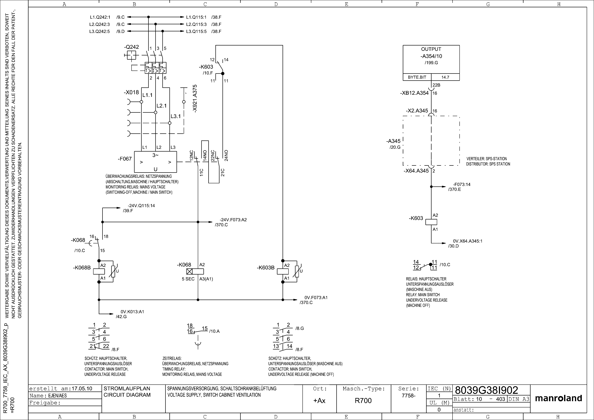

# +Ax — Sheet 10 of 403 — SPANNUNGSVERSORGUNG, SCHALTSCHRANKBELÜFTUNG

**VOLTAGE SUPPLY, SWITCH CABINET VENTILATION**

> Part of the manroland **R700** printing press IEC/UL circuit diagrams.
> Drawing class: **Stromlaufplan / Circuit diagram** (DIN A3).
> Document `+Ax` covers the **Central control console** machine section.

## At a glance

| Field | Value |
|---|---|
| Document | `+Ax`  (8039G38I902) |
| Sheet | **10** of 403 |
| Section (DE) | SPANNUNGSVERSORGUNG, SCHALTSCHRANKBELÜFTUNG |
| Section (EN) | VOLTAGE SUPPLY, SWITCH CABINET VENTILATION |
| Section type | POWER_SUPPLY — Voltage supply |
| Machine type | `R700` |
| Series | `7758` |
| Created | 17.05.10 |
| Replaces | — |
| Columns used | A, B, C, D, E, F, G |
| Path numbers | — |
| Labels on sheet | 140 |
| Cross-refs out | 18 |
| Cross-refs in | 22 |

**Previous:** [+Ax sheet 9](SHEET_0009.md) · **Next:** [+Ax sheet 11](SHEET_0011.md) · **Document TOC:** [_TOC.md](_TOC.md)  (+Ax) · **Master TOC:** [all sheets](../_MASTER_TOC.md)

## Sheet image (300 DPI, exact vector render)



_Rendered directly from the PDF vector layer at 300 DPI (1-bit), no OCR and no resampling. Use it to confirm anything ambiguous in the text below._

## Cross-references on this sheet

Each entry is a wire leaving this sheet. The printed token is `/sheet.column`; the link resolves to that sheet inside the same document.

| Ref | Target sheet | Col | Path | Destination on target | Target section | From col |
|---|---|---|---|---|---|---|
| `/38.F` | [+Ax sheet 38](SHEET_0038.md) | F | — | L1.Q115:1 | HAUPTANTRIEB | C |
| `/9.C` | [+Ax sheet 9](SHEET_0009.md) | C | — | L1.Q242:1 | SPANNUNGSVERSORGUNG, SCHALTSCHRANKBELÜFTUNG | B |
| `/9.C` | [+Ax sheet 9](SHEET_0009.md) | C | — | L2.Q242:3 | SPANNUNGSVERSORGUNG, SCHALTSCHRANKBELÜFTUNG | B |
| `/38.F` | [+Ax sheet 38](SHEET_0038.md) | F | — | L2.Q115:3 | HAUPTANTRIEB | C |
| `/38.F` | [+Ax sheet 38](SHEET_0038.md) | F | — | L3.Q115:5 | HAUPTANTRIEB | C |
| `/9.D` | [+Ax sheet 9](SHEET_0009.md) | D | — | L3.Q242:5 | SPANNUNGSVERSORGUNG, SCHALTSCHRANKBELÜFTUNG | B |
| `/199.G` | [+Ax sheet 199](SHEET_0199.md) | G | — | — | REFERENZMODUL | F |
| `/10.F` | [+Ax sheet 10](SHEET_0010.md) | F | — | — | SPANNUNGSVERSORGUNG, SCHALTSCHRANKBELÜFTUNG | C |
| `/20.G` | [+Ax sheet 20](SHEET_0020.md) | G | — | — | SPANNUNGSVERSORGUNG, SCHALTSCHRANKBELÜFTUNG | F |
| `/370.E` | [+Ax sheet 370](SHEET_0370.md) | E | — | — | OPTION: DIFFERENZSTROM ÜBERWACHUNG | G |
| `/39.F` | [+Ax sheet 39](SHEET_0039.md) | F | — | — | HAUPTANTRIEB | B |
| `/370.C` | [+Ax sheet 370](SHEET_0370.md) | C | — | — | OPTION: DIFFERENZSTROM ÜBERWACHUNG | C |
| `/30.D` | [+Ax sheet 30](SHEET_0030.md) | D | — | — | SPANNUNGSVERSORGUNG, SCHALTSCHRANKBELÜFTUNG | G |
| `/10.C` | [+Ax sheet 10](SHEET_0010.md) | C | — | — | SPANNUNGSVERSORGUNG, SCHALTSCHRANKBELÜFTUNG | A |
| `/370.C` | [+Ax sheet 370](SHEET_0370.md) | C | — | — | OPTION: DIFFERENZSTROM ÜBERWACHUNG | D |
| `/42.G` | [+Ax sheet 42](SHEET_0042.md) | G | — | — | HAUPTANTRIEB | B |
| `/8.G` | [+Ax sheet 8](SHEET_0008.md) | G | — | — | SPANNUNGSVERSORGUNG, SCHALTSCHRANKBELÜFTUNG | D |
| `/8.F` | [+Ax sheet 8](SHEET_0008.md) | F | — | — | SPANNUNGSVERSORGUNG, SCHALTSCHRANKBELÜFTUNG | D |

### Incoming references (sheets that point here)

Every other sheet that sends a wire to this one. `Back-ref` is the token printed on *that* sheet; `Path` is its line number.

| From sheet | Cols | Back-ref | Path | Refs | What continues there |
|---|---|---|---|---|---|
| [+Ax#8](SHEET_0008.md) | E, F, G | `/8.E`, `/8.F`, `/8.G` | — | 3 | — |
| [+Ax#9](SHEET_0009.md) | C, D | `/9.C`, `/9.D` | — | 3 | L1.Q242:1; L2.Q242:3; L3.Q242:5 |
| [+Ax#10](SHEET_0010.md) | A, C | `/10.A`, `/10.C` | — | 2 | — |
| [+Ax#20](SHEET_0020.md) | G | `/20.G` | — | 1 | — |
| [+Ax#30](SHEET_0030.md) | D | `/30.D` | — | 1 | 0V.X64.A345:1 |
| [+Ax#38](SHEET_0038.md) | D, F | `/38.D`, `/38.F` | — | 3 | L1.Q149:1 L1.Q131:1 L1.Q115:1; L2.Q115:3; L3.Q115:5 |
| [+Ax#39](SHEET_0039.md) | F | `/39.F` | — | 1 | 24V.Q115:14 |
| [+Ax#42](SHEET_0042.md) | G | `/42.G` | — | 1 | 0V.K013:A1 |
| [+Ax#199](SHEET_0199.md) | G | `/199.G` | — | 1 | — |
| [+Ax#217](SHEET_0217.md) | H | `/217.H` | — | 1 | — |
| [+Ax#248](SHEET_0248.md) | F | `/248.F` | — | 1 | — |
| [+Ax#284](SHEET_0284.md) | H | `/284.H` | — | 1 | — |
| [+Ax#370](SHEET_0370.md) | C, E | `/370.C`, `/370.E` | — | 3 | 0V.F073:A1; 24V.F073:A2; F073:14 |


## Devices on this sheet

| Tag | Class | Class meaning (IEC) | Col | Sub | Terminal | Sign |
|---|---|---|---|---|---|---|
| `K603` | K | Relais / relay, contactor | C | — | — | — |
| `F067` | F | Schutz / protection device (fuse, circuit breaker) | B | — | — | — |
| `K068` | K | Relais / relay, contactor | A | — | — | — |
| `A2` | A | Baugruppe / assembly, module, PC board | C | — | — | — |
| `K068` | K | Relais / relay, contactor | C | — | — | — |
| `A2` | A | Baugruppe / assembly, module, PC board | B | — | — | — |
| `A1` | A | Baugruppe / assembly, module, PC board | B | — | — | — |
| `A2` | A | Baugruppe / assembly, module, PC board | D | — | — | — |
| `A1` | A | Baugruppe / assembly, module, PC board | D | — | — | — |
| `Q242` | Q | Leistungsschalter / power switching device | B | — | — | — |
| `X018` | X | Klemme / terminal, plug connector | B | — | — | — |
| `A345` | A | Baugruppe / assembly, module, PC board | F | — | — | — |
| `A354/10` | A | Baugruppe / assembly, module, PC board | F | 10 | — | — |
| `A2` | A | Baugruppe / assembly, module, PC board | F | — | — | — |
| `A1` | A | Baugruppe / assembly, module, PC board | F | — | — | — |
| `K603` | K | Relais / relay, contactor | F | — | — | — |
| `F073:14` | F | Schutz / protection device (fuse, circuit breaker) | G | — | 14 | — |
| `X2.A345` | — | cross-device reference | F | — | — | — |
| `X64.A345` | — | cross-device reference | F | — | — | — |
| `XB12.A354` | — | cross-device reference | F | — | — | — |
| `14.7` | — | cross-device reference | F | — | — | — |
| `X921.A375` | — | cross-device reference | C | — | — | — |

## Potentials / nets

| Potential | Count | Columns | Attached devices | Terminals |
|---|---|---|---|---|
| `0V` | 3 | B, E, G | `A345`, `F073`, `K013`, `X64` | `1`, `A1` |
| `24V` | 2 | B, C | `F073`, `Q115` | `14`, `A2` |
| `L1` | 4 | B, C | `1`, `Q115`, `Q242` | `1` |
| `L2` | 4 | B, C | `1`, `Q115`, `Q242` | `3` |
| `L3` | 4 | B, C | `1`, `Q115`, `Q242` | `5` |


A potential such as `L24+/4` or `M24+` is a named supply/return rail; every place it appears on this sheet is electrically common.

## Wire-end annotations (grouped as printed)

A wire that continues elsewhere is annotated with a small cluster: the destination description, the path/line number `#NN`, and the `/sheet.column` cross reference. Each row below is one such cluster exactly as it is grouped on the drawing.

| Col | Y | Path | Cross-ref | Text on the wire |
|---|---|---|---|---|
| B | 30.7 | — | `/9.C` | `L1.Q242:1` |
| C | 30.7 | — | `/38.F` | `L1.Q115:1` |
| B | 44.9 | — | `/9.C` | `L2.Q242:3` |
| C | 44.9 | — | `/38.F` | `L2.Q115:3` |
| B | 59.1 | — | `/9.D` | `L3.Q242:5` |
| C | 59.1 | — | `/38.F` | `L3.Q115:5` |
| B | 89.6 | — | — | `Q242` |
| B | 93.2 | — | — | `1 3 5` |
| F | 94.2 | — | — | `OUTPUT` |
| F | 108.0 | — | — | `A354/10` |
| C | 115.8 | — | — | `K603 14` |
| C | 115.8 | — | — | `12` |
| F | 121.8 | — | `/199.G` | — |
| C | 142.3 | — | `/10.F` | — |
| F | 151.4 | — | — | `BYTE.BIT 14.7` |
| B | 152.7 | — | — | `2 4 6` |
| C | 158.4 | — | — | `11 11` |
| F | 166.8 | — | — | `22B` |
| C | 169.5 | — | — | `X921.A375` |
| B | 180.1 | — | — | `X018 L1.1 '` |
| F | 181.7 | — | — | `XB12.A354 16` |
| B | 207.2 | — | — | `L2.1` |
| F | 217.2 | — | — | `X2.A345 16` |
| C | 228.5 | — | — | `L3.1` |
| F | 278.1 | — | — | `A345` |
| F | 291.2 | — | `/20.G` | — |
| B | 291.6 | — | — | `L1 L2 L3` |
| C | 300.5 | — | — | `21C 24NO` |
| C | 300.8 | — | — | `11C 14NO` |
| C | 300.8 | — | — | `22NC` |
| C | 301.0 | — | — | `12NC` |
| B | 306.4 | — | — | `F067 > 3~ >` |
| G | 315.3 | — | — | `DISTRIBUTOR: SPS STATION VERTEILER: SPS STATION` |
| B | 334.8 | — | — | `U` |
| F | 337.6 | — | — | `X64.A345 2` |
| B | 350.7 | — | — | `ÜBERWACHUNGSRELAIS: NETZSPANNUNG (ABSCHALTUNG,MASCHINE / HAUPTSCHALTER) MONITORING RELAIS: MAINS VOLTAGE (SWITCHING OFF,MACHINE / MAIN SWITCH)` |
| G | 366.0 | — | — | `F073:14` |
| G | 375.9 | — | `/370.E` | — |
| B | 408.5 | — | — | `24V.Q115:14` |
| B | 418.4 | — | `/39.F` | — |
| F | 427.6 | — | — | `A2` |
| F | 432.6 | — | — | `K603` |
| C | 436.8 | — | — | `24V.F073:A2` |
| C | 446.8 | — | `/370.C` | — |
| F | 455.9 | — | — | `A1` |
| A | 470.2 | — | — | `K068 18` |
| A | 470.2 | — | — | `16` |
| G | 479.3 | — | — | `0V.X64.A345:1` |
| G | 489.3 | — | `/30.D` | — |
| A | 498.5 | — | `/10.C` | — |
| B | 498.5 | — | — | `15` |
| F | 520.4 | — | — | `14 12 11 11 /10.C` |
| C | 526.1 | — | — | `K068` |
| C | 526.8 | — | — | `A2` |
| B | 528.2 | — | — | `A2` |
| D | 528.2 | — | — | `A2` |
| A | 531.8 | — | — | `K068B U` |
| D | 531.8 | — | — | `K603B U` |
| B | 553.7 | — | — | `A1` |
| D | 553.7 | — | — | `A1` |
| C | 555.1 | — | — | `5 SEC` |
| C | 555.2 | — | — | `A3(A1)` |
| F | 556.2 | — | — | `RELAIS: HAUPTSCHALTER UNTERSPANNUNGSAUSLÖSER RELAY: MAIN SWITCH UNDERVOLTAGE RELEASE (MASCHINE AUS) (MACHINE OFF)` |
| E | 592.7 | — | — | `0V.F073:A1` |
| D | 602.6 | — | `/370.C` | — |
| B | 621.0 | — | — | `0V.K013:A1` |
| B | 631.0 | — | `/42.G` | — |
| A | 646.6 | — | — | `21 3 5 1` |
| B | 646.6 | — | — | `2 4 6 22 /8.F` |
| D | 646.6 | — | — | `13 3 5 1` |
| D | 646.6 | — | — | `14 2 4 6` |
| C | 648.0 | — | — | `18 16 15 /10.A` |
| D | 654.4 | — | `/8.G` | — |
| D | 696.9 | — | `/8.F` | — |
| C | 715.6 | — | — | `ÜBERWACHUNGSRELAIS, NETZSPANNUNG ZEITRELAIS:` |
| B | 715.7 | — | — | `UNTERSPANNUNGSAUSLÖSER SCHÜTZ: HAUPTSCHALTER,` |
| D | 715.7 | — | — | `UNTERSPANNUNGSAUSLÖSER (MASCHINE AUS) SCHÜTZ: HAUPTSCHALTER,` |
| B | 736.9 | — | — | `UNDERVOLTAGE RELEASE CONTACTOR: MAIN SWITCH,` |
| C | 736.9 | — | — | `MONITORING RELAIS, MAINS VOLTAGE TIMING RELAY:` |
| D | 736.9 | — | — | `UNDERVOLTAGE RELEASE (MACHINE OFF) CONTACTOR: MAIN SWITCH,` |


## Reconstructed tables

This sheet carries tabular content (pin map / terminal assignment / index). The grid below was rebuilt from the drawing's own rule lines, so each row is exactly one physical row of the table.

### Table 1 — 0 data rows × 2 columns (at x=198.4, y=34.0) — **L1.Q242:1 L2.Q242:3 L3.Q242:5**

_none_


### Table 2 — 9 data rows × 15 columns (at x=230.2, y=34.0)

| /9.C |  |  |  |  |  |  |  |  |  |  |  |  |  | L1.Q115:1 |
|---|---|---|---|---|---|---|---|---|---|---|---|---|---|---|
| `/9.C` |  |  |  |  |  |  |  |  |  |  |  |  |  | `L2.Q115:3` |
| `/9.D` |  |  |  |  |  |  |  |  |  |  |  |  |  | `L3.Q115:5` |
|  |  | `Q242` |  |  |  | `1` |  | `3` |  | `5` |  |  |  |  |
|  | `X018` |  |  |  | `L1.1` | `2` |  | `4` | `L2.1` | `6` |  | `L3.1` |  | `X921.A375 '` |
|  |  |  |  | `L1` |  |  |  | `L2` |  |  |  | `L3` |  |  |
| `F067` |  |  |  |  |  |  | `3~` |  |  |  |  |  |  | `12NC` |
|  |  |  | `>` |  |  |  |  | `U` |  |  | `>` |  |  |  |
| `ÜBERWACHUNGSRELAIS: (ABSCHALTUNG,MASCHINE MONITORING (SWITCHING OFF,MACHINE` | `/39.F` | `RELAIS:` | `24V.Q115:14` | `MAINS` |  | `/ /` | `MAIN` | `NETZSPANNUNG VOLTAGE` |  | `HAUPTSCHALTER) SWITCH)` |  |  |  |  |
| `U` |  |  |  |  |  |  |  |  |  |  |  |  | `5` | `K068 SEC` |


### Table 3 — 10 data rows × 4 columns (at x=403.9, y=34.0)

| C1 | C2 | C3 | C4 |
|---|---|---|---|
|  |  | `/38.F` |  |
|  |  | `/38.F` |  |
|  |  | `/38.F` |  |
|  | `12` |  |  |
| `K603` |  |  |  |
| `/10.F` |  |  |  |
|  | `11` |  |  |
| `14NO` | `22NC` |  |  |
| `11C` |  |  |  |
| `A2 A3(A1)` |  |  | `/370.C` |


### Table 4 — 1 data rows × 2 columns (at x=807.9, y=90.7)

| OUTPUT | A354/10 /199.G |
|---|---|
| `BYTE.BIT` | `14.7` |


## Notes and free text on this sheet

| Text | Col | Y (pt) |
|---|---|---|
| `12NC` | C | 301.04 |
| `14NO` | C | 300.76 |
| `11C` | C | 338.17 |
| `22NC` | C | 300.76 |
| `24NO` | C | 300.47 |
| `21C` | C | 337.89 |
| `U` | B | 334.8 |
| `ÜBERWACHUNGSRELAIS: NETZSPANNUNG` | B | 350.7 |
| `(ABSCHALTUNG,MASCHINE / HAUPTSCHALTER)` | B | 361.35 |
| `MONITORING RELAIS: MAINS VOLTAGE` | B | 371.97 |
| `(SWITCHING OFF,MACHINE / MAIN SWITCH)` | B | 382.59 |
| `15 /10.A` | C | 653.66 |
| `A3(A1)` | C | 555.18 |
| `ZEITRELAIS:` | C | 715.63 |
| `ÜBERWACHUNGSRELAIS, NETZSPANNUNG` | C | 726.29 |
| `TIMING RELAY:` | C | 736.92 |
| `MONITORING RELAIS, MAINS VOLTAGE` | C | 747.56 |
| `22 /8.F` | B | 689.09 |
| `K068B` | A | 531.8 |
| `SCHÜTZ: HAUPTSCHALTER,` | B | 715.67 |
| `UNTERSPANNUNGSAUSLÖSER` | B | 726.31 |
| `CONTACTOR: MAIN SWITCH,` | B | 736.92 |
| `UNDERVOLTAGE RELEASE` | B | 747.56 |
| `U` | D | 539.77 |
| `K603B` | D | 531.8 |
| `SCHÜTZ: HAUPTSCHALTER,` | D | 715.67 |
| `UNTERSPANNUNGSAUSLÖSER (MASCHINE AUS)` | D | 726.31 |
| `CONTACTOR: MAIN SWITCH,` | D | 736.92 |
| `UNDERVOLTAGE RELEASE (MACHINE OFF)` | D | 747.57 |
| `VERTEILER: SPS STATION` | G | 315.26 |
| `DISTRIBUTOR: SPS STATION` | G | 325.89 |
| `22B` | F | 166.82 |
| `OUTPUT` | F | 94.16 |
| `BYTE.BIT` | F | 151.43 |
| `11 /10.C` | F | 526.82 |
| `RELAIS: HAUPTSCHALTER` | F | 556.21 |
| `UNTERSPANNUNGSAUSLÖSER` | F | 566.86 |
| `(MASCHINE AUS)` | F | 577.49 |
| `RELAY: MAIN SWITCH` | F | 588.08 |
| `UNDERVOLTAGE RELEASE` | F | 598.74 |
| `(MACHINE OFF)` | F | 609.39 |
| `5 SEC` | C | 555.14 |

## Complete label inventory (exact text from the drawing)

Every text object inside the drawing area of this sheet, in DIN reading order (column A→H, then top→bottom). This is the authoritative list: if a string is not here it is not printed on this sheet.

| Col | Y | X | Dir | Type | Text |
|---|---|---|---|---|---|
| A | 470.2 | 179.1 | → | number | `16` |
| A | 476.5 | 142.3 | → | device tag | `K068` |
| A | 498.5 | 149.4 | → | cross-reference | `/10.C` |
| A | 531.8 | 146.6 | → | text | `K068B` |
| A | 646.6 | 186.0 | → | number | `1` |
| A | 660.7 | 184.5 | → | number | `3` |
| A | 674.9 | 184.5 | → | number | `5` |
| A | 689.1 | 180.0 | → | number | `21` |
| B | 30.7 | 233.6 | → | cross-reference | `/9.C` |
| B | 30.8 | 180.6 | → | potential | `L1.Q242:1` |
| B | 44.9 | 179.1 | → | potential | `L2.Q242:3` |
| B | 44.9 | 233.6 | → | cross-reference | `/9.C` |
| B | 59.1 | 179.1 | → | potential | `L3.Q242:5` |
| B | 59.1 | 233.6 | → | cross-reference | `/9.D` |
| B | 89.6 | 248.9 | → | device tag | `Q242` |
| B | 93.2 | 299.6 | → | number | `1` |
| B | 93.2 | 314.4 | → | number | `3` |
| B | 93.2 | 328.5 | → | number | `5` |
| B | 152.7 | 300.2 | → | number | `2` |
| B | 152.7 | 314.4 | → | number | `4` |
| B | 152.7 | 328.5 | → | number | `6` |
| B | 180.1 | 248.3 | → | device tag | `X018` |
| B | 186.0 | 285.4 | → | potential | `L1.1` |
| B | 207.2 | 313.8 | → | potential | `L2.1` |
| B | 291.6 | 285.4 | → | potential | `L1` |
| B | 291.6 | 313.8 | → | potential | `L2` |
| B | 306.4 | 305.6 | → | other | `3~` |
| B | 313.5 | 236.4 | → | device tag | `F067` |
| B | 320.6 | 280.3 | → | other | `>` |
| B | 320.6 | 337.0 | → | other | `>` |
| B | 334.8 | 308.0 | → | text | `U` |
| B | 350.7 | 211.7 | → | text | `ÜBERWACHUNGSRELAIS: NETZSPANNUNG` |
| B | 361.3 | 212.0 | → | text | `(ABSCHALTUNG,MASCHINE / HAUPTSCHALTER)` |
| B | 372.0 | 212.0 | → | text | `MONITORING RELAIS: MAINS VOLTAGE` |
| B | 382.6 | 212.0 | → | text | `(SWITCHING OFF,MACHINE / MAIN SWITCH)` |
| B | 408.5 | 256.3 | → | potential | `24V.Q115:14` |
| B | 418.4 | 246.6 | → | cross-reference | `/39.F` |
| B | 470.2 | 207.5 | → | number | `18` |
| B | 498.5 | 200.4 | → | number | `15` |
| B | 528.2 | 201.3 | → | device tag | `A2` |
| B | 539.8 | 232.3 | → | text | `U` |
| B | 553.7 | 201.3 | → | device tag | `A1` |
| B | 621.1 | 242.1 | → | potential | `0V.K013:A1` |
| B | 631.0 | 232.4 | → | cross-reference | `/42.G` |
| B | 646.6 | 206.6 | → | number | `2` |
| B | 660.7 | 206.6 | → | number | `4` |
| B | 674.9 | 206.6 | → | number | `6` |
| B | 689.1 | 206.6 | → | text | `22 /8.F` |
| B | 715.7 | 169.8 | → | text | `SCHÜTZ: HAUPTSCHALTER,` |
| B | 726.3 | 169.2 | → | text | `UNTERSPANNUNGSAUSLÖSER` |
| B | 736.9 | 169.8 | → | text | `CONTACTOR: MAIN SWITCH,` |
| B | 747.6 | 169.2 | → | text | `UNDERVOLTAGE RELEASE` |
| C | 30.7 | 423.8 | → | cross-reference | `/38.F` |
| C | 30.8 | 373.3 | → | potential | `L1.Q115:1` |
| C | 44.9 | 373.3 | → | potential | `L2.Q115:3` |
| C | 44.9 | 423.8 | → | cross-reference | `/38.F` |
| C | 59.1 | 373.3 | → | potential | `L3.Q115:5` |
| C | 59.1 | 423.8 | → | cross-reference | `/38.F` |
| C | 115.8 | 420.4 | → | number | `12` |
| C | 115.8 | 448.4 | → | number | `14` |
| C | 129.3 | 398.8 | → | device tag | `K603` |
| C | 142.3 | 406.8 | → | cross-reference | `/10.F` |
| C | 158.4 | 421.5 | → | number | `11` |
| C | 158.4 | 448.4 | → | number | `11` |
| C | 169.5 | 385.8 | ↕ | device ref | `X921.A375` |
| C | 185.5 | 370.8 | → | other | `'` |
| C | 228.5 | 342.1 | → | potential | `L3.1` |
| C | 291.6 | 342.1 | → | potential | `L3` |
| C | 300.5 | 449.6 | ↕ | text | `24NO` |
| C | 300.8 | 407.1 | ↕ | text | `14NO` |
| C | 300.8 | 422.7 | ↕ | text | `22NC` |
| C | 301.0 | 380.2 | ↕ | text | `12NC` |
| C | 337.9 | 442.5 | ↕ | text | `21C` |
| C | 338.2 | 400.0 | ↕ | text | `11C` |
| C | 436.8 | 440.5 | → | potential | `24V.F073:A2` |
| C | 446.7 | 430.9 | → | cross-reference | `/370.C` |
| C | 526.1 | 354.9 | → | device tag | `K068` |
| C | 526.8 | 399.7 | → | device tag | `A2` |
| C | 555.1 | 364.5 | → | text | `5 SEC` |
| C | 555.2 | 399.7 | → | text | `A3(A1)` |
| C | 648.0 | 374.2 | → | number | `18` |
| C | 653.7 | 404.2 | → | text | `15 /10.A` |
| C | 659.3 | 374.2 | → | number | `16` |
| C | 715.6 | 326.0 | → | text | `ZEITRELAIS:` |
| C | 726.3 | 325.1 | → | text | `ÜBERWACHUNGSRELAIS, NETZSPANNUNG` |
| C | 736.9 | 325.7 | → | text | `TIMING RELAY:` |
| C | 747.6 | 325.4 | → | text | `MONITORING RELAIS, MAINS VOLTAGE` |
| D | 528.2 | 569.8 | → | device tag | `A2` |
| D | 531.8 | 515.1 | → | text | `K603B` |
| D | 539.8 | 600.8 | → | text | `U` |
| D | 553.7 | 569.8 | → | device tag | `A1` |
| D | 602.7 | 600.9 | → | cross-reference | `/370.C` |
| D | 646.6 | 554.5 | → | number | `1` |
| D | 646.6 | 575.1 | → | number | `2` |
| D | 654.3 | 592.4 | → | cross-reference | `/8.G` |
| D | 660.7 | 553.0 | → | number | `3` |
| D | 660.7 | 575.1 | → | number | `4` |
| D | 674.9 | 553.0 | → | number | `5` |
| D | 674.9 | 575.1 | → | number | `6` |
| D | 689.1 | 547.1 | → | number | `13` |
| D | 689.1 | 574.3 | → | number | `14` |
| D | 696.9 | 592.4 | → | cross-reference | `/8.F` |
| D | 715.7 | 538.3 | → | text | `SCHÜTZ: HAUPTSCHALTER,` |
| D | 726.3 | 537.7 | → | text | `UNTERSPANNUNGSAUSLÖSER (MASCHINE AUS)` |
| D | 736.9 | 538.3 | → | text | `CONTACTOR: MAIN SWITCH,` |
| D | 747.6 | 537.7 | → | text | `UNDERVOLTAGE RELEASE (MACHINE OFF)` |
| E | 592.7 | 610.6 | → | potential | `0V.F073:A1` |
| F | 94.2 | 844.3 | → | text | `OUTPUT` |
| F | 108.0 | 843.2 | → | device tag | `A354/10` |
| F | 121.8 | 851.7 | → | cross-reference | `/199.G` |
| F | 151.4 | 817.8 | → | text | `BYTE.BIT` |
| F | 151.5 | 884.7 | → | device ref | `14.7` |
| F | 166.8 | 867.1 | → | text | `22B` |
| F | 181.7 | 802.2 | → | device ref | `XB12.A354` |
| F | 183.2 | 866.6 | → | number | `16` |
| F | 217.2 | 813.8 | → | device ref | `X2.A345` |
| F | 218.6 | 866.6 | → | number | `16` |
| F | 278.1 | 774.4 | → | device tag | `A345` |
| F | 291.2 | 781.2 | → | cross-reference | `/20.G` |
| F | 337.6 | 809.3 | → | device ref | `X64.A345` |
| F | 339.1 | 867.1 | → | number | `2` |
| F | 427.6 | 867.4 | → | device tag | `A2` |
| F | 432.6 | 819.8 | → | device tag | `K603` |
| F | 455.9 | 867.4 | → | device tag | `A1` |
| F | 520.4 | 827.7 | → | number | `14` |
| F | 520.4 | 864.9 | → | number | `11` |
| F | 526.8 | 864.9 | → | text | `11 /10.C` |
| F | 531.8 | 827.7 | → | number | `12` |
| F | 556.2 | 814.1 | → | text | `RELAIS: HAUPTSCHALTER` |
| F | 566.9 | 814.1 | → | text | `UNTERSPANNUNGSAUSLÖSER` |
| F | 577.5 | 814.4 | → | text | `(MASCHINE AUS)` |
| F | 588.1 | 814.1 | → | text | `RELAY: MAIN SWITCH` |
| F | 598.7 | 814.1 | → | text | `UNDERVOLTAGE RELEASE` |
| F | 609.4 | 814.4 | → | text | `(MACHINE OFF)` |
| G | 315.3 | 935.4 | → | text | `VERTEILER: SPS STATION` |
| G | 325.9 | 934.6 | → | text | `DISTRIBUTOR: SPS STATION` |
| G | 366.0 | 908.2 | → | device tag | `F073:14` |
| G | 375.9 | 898.6 | → | cross-reference | `/370.E` |
| G | 479.3 | 908.2 | → | potential | `0V.X64.A345:1` |
| G | 489.3 | 898.6 | → | cross-reference | `/30.D` |

## Reading-order text block

The same content as a plain block, grouped by DIN column — convenient to paste or to match against a visual description.

```text
=== Column A ===
 470.2  179.1  numeric      16
 476.5  142.3  devtag       K068
 498.5  149.4  xref         /10.C
 531.8  146.6  text         K068B
 646.6  186.0  numeric      1
 660.7  184.5  numeric      3
 674.9  184.5  numeric      5
 689.1  180.0  numeric      21
=== Column B ===
  30.7  233.6  xref         /9.C
  30.8  180.6  net          L1.Q242:1
  44.9  179.1  net          L2.Q242:3
  44.9  233.6  xref         /9.C
  59.1  179.1  net          L3.Q242:5
  59.1  233.6  xref         /9.D
  89.6  248.9  devtag       Q242
  93.2  299.6  numeric      1
  93.2  314.4  numeric      3
  93.2  328.5  numeric      5
 152.7  300.2  numeric      2
 152.7  314.4  numeric      4
 152.7  328.5  numeric      6
 180.1  248.3  devtag       X018
 186.0  285.4  net          L1.1
 207.2  313.8  net          L2.1
 291.6  285.4  net          L1
 291.6  313.8  net          L2
 306.4  305.6  other        3~
 313.5  236.4  devtag       F067
 320.6  280.3  other        >
 320.6  337.0  other        >
 334.8  308.0  text         U
 350.7  211.7  text         ÜBERWACHUNGSRELAIS: NETZSPANNUNG
 361.3  212.0  text         (ABSCHALTUNG,MASCHINE / HAUPTSCHALTER)
 372.0  212.0  text         MONITORING RELAIS: MAINS VOLTAGE
 382.6  212.0  text         (SWITCHING OFF,MACHINE / MAIN SWITCH)
 408.5  256.3  net          24V.Q115:14
 418.4  246.6  xref         /39.F
 470.2  207.5  numeric      18
 498.5  200.4  numeric      15
 528.2  201.3  devtag       A2
 539.8  232.3  text         U
 553.7  201.3  devtag       A1
 621.1  242.1  net          0V.K013:A1
 631.0  232.4  xref         /42.G
 646.6  206.6  numeric      2
 660.7  206.6  numeric      4
 674.9  206.6  numeric      6
 689.1  206.6  text         22 /8.F
 715.7  169.8  text         SCHÜTZ: HAUPTSCHALTER,
 726.3  169.2  text         UNTERSPANNUNGSAUSLÖSER
 736.9  169.8  text         CONTACTOR: MAIN SWITCH,
 747.6  169.2  text         UNDERVOLTAGE RELEASE
=== Column C ===
  30.7  423.8  xref         /38.F
  30.8  373.3  net          L1.Q115:1
  44.9  373.3  net          L2.Q115:3
  44.9  423.8  xref         /38.F
  59.1  373.3  net          L3.Q115:5
  59.1  423.8  xref         /38.F
 115.8  420.4  numeric      12
 115.8  448.4  numeric      14
 129.3  398.8  devtag       K603
 142.3  406.8  xref         /10.F
 158.4  421.5  numeric      11
 158.4  448.4  numeric      11
 169.5  385.8  devref       X921.A375
 185.5  370.8  other        `
 228.5  342.1  net          L3.1
 291.6  342.1  net          L3
 300.5  449.6  text         24NO
 300.8  407.1  text         14NO
 300.8  422.7  text         22NC
 301.0  380.2  text         12NC
 337.9  442.5  text         21C
 338.2  400.0  text         11C
 436.8  440.5  net          24V.F073:A2
 446.7  430.9  xref         /370.C
 526.1  354.9  devtag       K068
 526.8  399.7  devtag       A2
 555.1  364.5  text         5 SEC
 555.2  399.7  text         A3(A1)
 648.0  374.2  numeric      18
 653.7  404.2  text         15 /10.A
 659.3  374.2  numeric      16
 715.6  326.0  text         ZEITRELAIS:
 726.3  325.1  text         ÜBERWACHUNGSRELAIS, NETZSPANNUNG
 736.9  325.7  text         TIMING RELAY:
 747.6  325.4  text         MONITORING RELAIS, MAINS VOLTAGE
=== Column D ===
 528.2  569.8  devtag       A2
 531.8  515.1  text         K603B
 539.8  600.8  text         U
 553.7  569.8  devtag       A1
 602.7  600.9  xref         /370.C
 646.6  554.5  numeric      1
 646.6  575.1  numeric      2
 654.3  592.4  xref         /8.G
 660.7  553.0  numeric      3
 660.7  575.1  numeric      4
 674.9  553.0  numeric      5
 674.9  575.1  numeric      6
 689.1  547.1  numeric      13
 689.1  574.3  numeric      14
 696.9  592.4  xref         /8.F
 715.7  538.3  text         SCHÜTZ: HAUPTSCHALTER,
 726.3  537.7  text         UNTERSPANNUNGSAUSLÖSER (MASCHINE AUS)
 736.9  538.3  text         CONTACTOR: MAIN SWITCH,
 747.6  537.7  text         UNDERVOLTAGE RELEASE (MACHINE OFF)
=== Column E ===
 592.7  610.6  net          0V.F073:A1
=== Column F ===
  94.2  844.3  text         OUTPUT
 108.0  843.2  devtag       A354/10
 121.8  851.7  xref         /199.G
 151.4  817.8  text         BYTE.BIT
 151.5  884.7  devref       14.7
 166.8  867.1  text         22B
 181.7  802.2  devref       XB12.A354
 183.2  866.6  numeric      16
 217.2  813.8  devref       X2.A345
 218.6  866.6  numeric      16
 278.1  774.4  devtag       A345
 291.2  781.2  xref         /20.G
 337.6  809.3  devref       X64.A345
 339.1  867.1  numeric      2
 427.6  867.4  devtag       A2
 432.6  819.8  devtag       K603
 455.9  867.4  devtag       A1
 520.4  827.7  numeric      14
 520.4  864.9  numeric      11
 526.8  864.9  text         11 /10.C
 531.8  827.7  numeric      12
 556.2  814.1  text         RELAIS: HAUPTSCHALTER
 566.9  814.1  text         UNTERSPANNUNGSAUSLÖSER
 577.5  814.4  text         (MASCHINE AUS)
 588.1  814.1  text         RELAY: MAIN SWITCH
 598.7  814.1  text         UNDERVOLTAGE RELEASE
 609.4  814.4  text         (MACHINE OFF)
=== Column G ===
 315.3  935.4  text         VERTEILER: SPS STATION
 325.9  934.6  text         DISTRIBUTOR: SPS STATION
 366.0  908.2  devtag       F073:14
 375.9  898.6  xref         /370.E
 479.3  908.2  net          0V.X64.A345:1
 489.3  898.6  xref         /30.D
```

---
_Generated from the PDF vector text layer; no OCR. Source: `R700_7758_IEC_AX_8039G38I902_p`, sheet 10._
