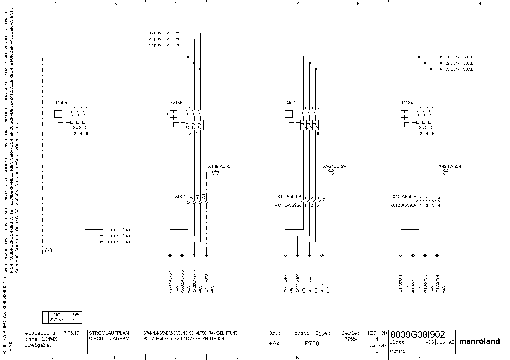

# +Ax — Sheet 11 of 403 — SPANNUNGSVERSORGUNG, SCHALTSCHRANKBELÜFTUNG

**VOLTAGE SUPPLY, SWITCH CABINET VENTILATION**

> Part of the manroland **R700** printing press IEC/UL circuit diagrams.
> Drawing class: **Stromlaufplan / Circuit diagram** (DIN A3).
> Document `+Ax` covers the **Central control console** machine section.

## At a glance

| Field | Value |
|---|---|
| Document | `+Ax`  (8039G38I902) |
| Sheet | **11** of 403 |
| Section (DE) | SPANNUNGSVERSORGUNG, SCHALTSCHRANKBELÜFTUNG |
| Section (EN) | VOLTAGE SUPPLY, SWITCH CABINET VENTILATION |
| Section type | POWER_SUPPLY — Voltage supply |
| Machine type | `R700` |
| Series | `7758` |
| Created | 17.05.10 |
| Replaces | — |
| Columns used | A, B, C, D, E, F, G, H |
| Path numbers | — |
| Labels on sheet | 104 |
| Cross-refs out | 9 |
| Cross-refs in | 25 |

**Previous:** [+Ax sheet 10](SHEET_0010.md) · **Next:** [+Ax sheet 12](SHEET_0012.md) · **Document TOC:** [_TOC.md](_TOC.md)  (+Ax) · **Master TOC:** [all sheets](../_MASTER_TOC.md)

## Sheet image (300 DPI, exact vector render)



_Rendered directly from the PDF vector layer at 300 DPI (1-bit), no OCR and no resampling. Use it to confirm anything ambiguous in the text below._

## Cross-references on this sheet

Each entry is a wire leaving this sheet. The printed token is `/sheet.column`; the link resolves to that sheet inside the same document.

| Ref | Target sheet | Col | Path | Destination on target | Target section | From col |
|---|---|---|---|---|---|---|
| `/9.F` | [+Ax sheet 9](SHEET_0009.md) | F | — | L3.Q135 | SPANNUNGSVERSORGUNG, SCHALTSCHRANKBELÜFTUNG | C |
| `/9.F` | [+Ax sheet 9](SHEET_0009.md) | F | — | L2.Q135 | SPANNUNGSVERSORGUNG, SCHALTSCHRANKBELÜFTUNG | C |
| `/9.F` | [+Ax sheet 9](SHEET_0009.md) | F | — | L1.Q135 | SPANNUNGSVERSORGUNG, SCHALTSCHRANKBELÜFTUNG | C |
| `/387.B` | [+Ax sheet 387](SHEET_0387.md) | B | — | L1.Q347 | OPTION: PUDERABSAUGEINRICHTUNG | H |
| `/387.B` | [+Ax sheet 387](SHEET_0387.md) | B | — | L2.Q347 | OPTION: PUDERABSAUGEINRICHTUNG | H |
| `/387.B` | [+Ax sheet 387](SHEET_0387.md) | B | — | L3.Q347 | OPTION: PUDERABSAUGEINRICHTUNG | H |
| `/14.B` | [+Ax sheet 14](SHEET_0014.md) | B | — | L3.T011 | SPANNUNGSVERSORGUNG, SCHALTSCHRANKBELÜFTUNG | B |
| `/14.B` | [+Ax sheet 14](SHEET_0014.md) | B | — | L2.T011 | SPANNUNGSVERSORGUNG, SCHALTSCHRANKBELÜFTUNG | B |
| `/14.B` | [+Ax sheet 14](SHEET_0014.md) | B | — | L1.T011 | SPANNUNGSVERSORGUNG, SCHALTSCHRANKBELÜFTUNG | B |

### Incoming references (sheets that point here)

Every other sheet that sends a wire to this one. `Back-ref` is the token printed on *that* sheet; `Path` is its line number.

| From sheet | Cols | Back-ref | Path | Refs | What continues there |
|---|---|---|---|---|---|
| [+Ax#9](SHEET_0009.md) | F | `/9.F` | — | 3 | L1.Q135; L2.Q135; L3.Q135 |
| [+Ax#14](SHEET_0014.md) | B | `/14.B` | — | 3 | L1.T011; L2.T011; L3.T011 |
| [+Ax#247](SHEET_0247.md) | G | `/247.G` | — | 8 | — |
| [+Ax#249](SHEET_0249.md) | B | `/249.B` | — | 8 | — |
| [+Ax#387](SHEET_0387.md) | B | `/387.B` | — | 3 | L1.Q347; L2.Q347; L3.Q347 |


## Devices on this sheet

| Tag | Class | Class meaning (IEC) | Col | Sub | Terminal | Sign |
|---|---|---|---|---|---|---|
| `Q005` | Q | Leistungsschalter / power switching device | A | — | — | — |
| `U1` | U | Umrichter / frequency converter | C | — | — | — |
| `X001` | X | Klemme / terminal, plug connector | C | — | — | — |
| `V1` | V | Diode / semiconductor valve | C | — | — | — |
| `W1` | W | Kabel / cable, line, bus | C | — | — | — |
| `Q135` | Q | Leistungsschalter / power switching device | C | — | — | — |
| `X002:W400` | X | Klemme / terminal, plug connector | E | — | W400 | — |
| `X002:V400` | X | Klemme / terminal, plug connector | E | — | V400 | — |
| `X002:U400` | X | Klemme / terminal, plug connector | E | — | U400 | — |
| `Q002` | Q | Leistungsschalter / power switching device | E | — | — | — |
| `Q134` | Q | Leistungsschalter / power switching device | G | — | — | — |
| `X941.A373` | — | cross-device reference | D | — | — | — |
| `Q302.A373:5` | — | cross-device reference | C | — | 5 | — |
| `Q302.A373:3` | — | cross-device reference | C | — | 3 | — |
| `Q302.A373:1` | — | cross-device reference | C | — | 1 | — |
| `X11.A559.A` | — | cross-device reference | E | — | — | — |
| `X11.A559.B` | — | cross-device reference | E | — | — | — |
| `X12.A559.B` | — | cross-device reference | G | — | — | — |
| `X12.A559.A` | — | cross-device reference | G | — | — | — |
| `X1.A573:4` | — | cross-device reference | G | — | 4 | — |
| `X1.A573:3` | — | cross-device reference | G | — | 3 | — |
| `X1.A573:2` | — | cross-device reference | G | — | 2 | — |
| `X1.A573:1` | — | cross-device reference | G | — | 1 | — |
| `X924.A559` | — | cross-device reference | F | — | — | — |
| `X924.A559` | — | cross-device reference | G | — | — | — |
| `X489.A055` | — | cross-device reference | D | — | — | — |

## Potentials / nets

| Potential | Count | Columns | Attached devices | Terminals |
|---|---|---|---|---|
| `L1` | 3 | B, C, H | `Q135`, `Q347`, `T011` | — |
| `L2` | 3 | B, C, H | `Q135`, `Q347`, `T011` | — |
| `L3` | 3 | B, C, H | `Q135`, `Q347`, `T011` | — |


A potential such as `L24+/4` or `M24+` is a named supply/return rail; every place it appears on this sheet is electrically common.

## Wire-end annotations (grouped as printed)

A wire that continues elsewhere is annotated with a small cluster: the destination description, the path/line number `#NN`, and the `/sheet.column` cross reference. Each row below is one such cluster exactly as it is grouped on the drawing.

| Col | Y | Path | Cross-ref | Text on the wire |
|---|---|---|---|---|
| C | 73.2 | — | `/9.F` | `L3.Q135` |
| C | 87.4 | — | `/9.F` | `L2.Q135` |
| C | 101.6 | — | `/9.F` | `L1.Q135` |
| H | 129.9 | — | `/387.B` | `L1.Q347` |
| H | 144.1 | — | `/387.B` | `L2.Q347` |
| H | 158.3 | — | `/387.B` | `L3.Q347` |
| A | 235.6 | — | — | `Q005` |
| C | 235.6 | — | — | `Q135` |
| E | 235.6 | — | — | `Q002` |
| G | 235.6 | — | — | `Q134` |
| A | 249.1 | — | — | `1 3 5` |
| C | 249.1 | — | — | `1 3 5` |
| E | 249.1 | — | — | `1 3 5` |
| G | 249.1 | — | — | `1 3 5` |
| A | 308.6 | — | — | `2 4 6` |
| C | 308.6 | — | — | `2 4 6` |
| E | 308.6 | — | — | `2 4 6` |
| G | 308.6 | — | — | `2 4 6` |
| F | 384.4 | — | — | `X489.A055 X924.A559 X924.A559` |
| C | 452.4 | — | — | `W1` |
| C | 455.0 | — | — | `X001` |
| E | 455.3 | — | — | `X11.A559.B 1` |
| G | 455.3 | — | — | `X12.A559.B 1 2 3 4` |
| C | 455.5 | — | — | `V1` |
| C | 456.1 | — | — | `U1` |
| E | 459.5 | — | — | `2 3` |
| E | 459.5 | — | — | `4` |
| D | 462.9 | — | — | `'` |
| E | 475.1 | — | — | `X11.A559.A 1` |
| G | 475.1 | — | — | `X12.A559.A 1 2 3 4` |
| E | 476.5 | — | — | `2 3` |
| E | 476.5 | — | — | `4` |
| B | 533.9 | — | `/14.B` | `L3.T011` |
| B | 548.0 | — | `/14.B` | `L2.T011` |
| B | 562.2 | — | `/14.B` | `L1.T011` |
| A | 583.7 | — | — | `1` |
| C | 631.8 | — | — | `Q302.A373:1` |
| C | 631.8 | — | — | `Q302.A373:3` |
| C | 631.8 | — | — | `Q302.A373:5` |
| E | 637.0 | — | — | `X002:W400` |
| E | 639.8 | — | — | `X002:U400` |
| D | 640.1 | — | — | `X941.A373` |
| E | 640.1 | — | — | `X002:V400` |
| G | 642.3 | — | — | `X1.A573:1` |
| G | 642.3 | — | — | `X1.A573:2` |
| G | 642.3 | — | — | `X1.A573:3` |
| G | 642.3 | — | — | `X1.A573:4` |
| E | 657.6 | — | — | `X002:'` |
| C | 669.3 | — | — | `+EA` |
| C | 669.3 | — | — | `+EA` |
| C | 669.3 | — | — | `+EA` |
| D | 669.3 | — | — | `+EA` |
| G | 669.3 | — | — | `+BA` |
| G | 669.3 | — | — | `+BA` |
| G | 669.3 | — | — | `+BA` |
| G | 669.3 | — | — | `+BA` |
| E | 671.8 | — | — | `+Fx` |
| E | 671.8 | — | — | `+Fx` |
| E | 671.8 | — | — | `+Fx` |
| F | 671.8 | — | — | `+Fx` |
| A | 733.2 | — | — | `PP S+W` |
| A | 733.3 | — | — | `1 NUR BEI` |
| A | 744.0 | — | — | `ONLY FOR` |


## Reconstructed tables

This sheet carries tabular content (pin map / terminal assignment / index). The grid below was rebuilt from the drawing's own rule lines, so each row is exactly one physical row of the table.

### Table 1 — 2 data rows × 1 columns (at x=170.1, y=133.2)

| C1 |
|---|
| `1` |
| `2` |


### Table 2 — 2 data rows × 1 columns (at x=184.3, y=133.2)

| C1 |
|---|
| `3` |
| `4` |


### Table 3 — 2 data rows × 1 columns (at x=198.4, y=133.2)

| C1 |
|---|
| `5` |
| `6` |


### Table 4 — 3 data rows × 3 columns (at x=396.9, y=76.5)

| C1 | C2 | C3 |
|---|---|---|
| `/9.F /9.F /9.F` |  |  |
|  | `Q135` |  |
|  |  | `X001` |


### Table 5 — 1 data rows × 6 columns (at x=439.4, y=76.5)

| 1 |  | 3 |  | 5 |  |
|---|---|---|---|---|---|
| `2` | `U1` | `4` | `V1` | `6` | `W1` |


### Table 6 — 2 data rows × 2 columns (at x=666.1, y=133.2)

| C1 | C2 |
|---|---|
|  | `Q002` |
| `X11.A559.B X11.A559.A` |  |


### Table 7 — 2 data rows × 1 columns (at x=708.7, y=133.2)

| C1 |
|---|
| `1` |
| `2 1 1` |


### Table 8 — 2 data rows × 1 columns (at x=722.8, y=133.2)

| C1 |
|---|
| `3` |
| `4 2 2` |


### Table 9 — 2 data rows × 1 columns (at x=737.0, y=133.2)

| C1 |
|---|
| `5` |
| `6 3 3` |


### Table 10 — 2 data rows × 2 columns (at x=935.4, y=133.2)

| C1 | C2 |
|---|---|
|  | `Q134` |
| `X12.A559.B X12.A559.A` |  |


### Table 11 — 2 data rows × 1 columns (at x=978.0, y=133.2)

| C1 |
|---|
| `1` |
| `2 1 1` |


### Table 12 — 2 data rows × 1 columns (at x=992.1, y=133.2)

| C1 |
|---|
| `3` |
| `4 2 2` |


### Table 13 — 2 data rows × 1 columns (at x=1006.3, y=133.2)

| C1 |
|---|
| `5` |
| `6 3 3` |


## Notes and free text on this sheet

| Text | Col | Y (pt) |
|---|---|---|
| `+EA` | D | 669.26 |
| `+EA` | C | 669.26 |
| `X002:'` | E | 657.64 |
| `+Fx` | F | 671.81 |
| `+Fx` | E | 671.81 |
| `+BA` | G | 669.26 |
| `NUR BEI` | A | 733.33 |
| `ONLY FOR` | A | 744.02 |
| `S+W` | A | 733.24 |
| `PP` | A | 743.87 |

## Complete label inventory (exact text from the drawing)

Every text object inside the drawing area of this sheet, in DIN reading order (column A→H, then top→bottom). This is the authoritative list: if a string is not here it is not printed on this sheet.

| Col | Y | X | Dir | Type | Text |
|---|---|---|---|---|---|
| A | 235.6 | 127.0 | → | device tag | `Q005` |
| A | 249.1 | 172.1 | → | number | `1` |
| A | 249.1 | 186.8 | → | number | `3` |
| A | 308.6 | 172.6 | → | number | `2` |
| A | 308.6 | 186.8 | → | number | `4` |
| A | 583.7 | 111.6 | → | number | `1` |
| A | 733.2 | 169.8 | → | text | `S+W` |
| A | 733.3 | 115.4 | → | text | `NUR BEI` |
| A | 738.7 | 103.7 | → | number | `1` |
| A | 743.9 | 169.2 | → | text | `PP` |
| A | 744.0 | 115.9 | → | text | `ONLY FOR` |
| B | 249.1 | 201.0 | → | number | `5` |
| B | 308.6 | 201.0 | → | number | `6` |
| B | 533.9 | 245.8 | → | potential | `L3.T011` |
| B | 533.9 | 286.3 | → | cross-reference | `/14.B` |
| B | 548.0 | 286.3 | → | cross-reference | `/14.B` |
| B | 548.1 | 245.8 | → | potential | `L2.T011` |
| B | 562.2 | 286.3 | → | cross-reference | `/14.B` |
| B | 562.3 | 245.8 | → | potential | `L1.T011` |
| C | 73.2 | 390.3 | → | cross-reference | `/9.F` |
| C | 73.3 | 342.4 | → | potential | `L3.Q135` |
| C | 87.4 | 390.3 | → | cross-reference | `/9.F` |
| C | 87.5 | 342.4 | → | potential | `L2.Q135` |
| C | 101.6 | 342.4 | → | potential | `L1.Q135` |
| C | 101.6 | 390.3 | → | cross-reference | `/9.F` |
| C | 235.6 | 396.3 | → | device tag | `Q135` |
| C | 249.1 | 441.4 | → | number | `1` |
| C | 249.1 | 456.1 | → | number | `3` |
| C | 249.1 | 470.3 | → | number | `5` |
| C | 308.6 | 441.9 | → | number | `2` |
| C | 308.6 | 456.1 | → | number | `4` |
| C | 308.6 | 470.3 | → | number | `6` |
| C | 452.4 | 471.4 | ↕ | device tag | `W1` |
| C | 455.0 | 404.5 | → | device tag | `X001` |
| C | 455.5 | 457.4 | ↕ | device tag | `V1` |
| C | 456.1 | 443.2 | ↕ | device tag | `U1` |
| C | 631.8 | 393.6 | ↕ | device ref | `Q302.A373:1` |
| C | 631.8 | 421.9 | ↕ | device ref | `Q302.A373:3` |
| C | 631.8 | 450.3 | ↕ | device ref | `Q302.A373:5` |
| C | 669.3 | 407.7 | ↕ | text | `+EA` |
| C | 669.3 | 436.1 | ↕ | text | `+EA` |
| C | 669.3 | 464.4 | ↕ | text | `+EA` |
| D | 384.4 | 481.6 | → | device ref | `X489.A055` |
| D | 462.9 | 484.6 | ↕ | other | `'` |
| D | 640.1 | 478.6 | ↕ | device ref | `X941.A373` |
| D | 669.3 | 492.8 | ↕ | text | `+EA` |
| E | 235.6 | 665.6 | → | device tag | `Q002` |
| E | 249.1 | 710.6 | → | number | `1` |
| E | 249.1 | 725.4 | → | number | `3` |
| E | 249.1 | 739.6 | → | number | `5` |
| E | 308.6 | 711.2 | → | number | `2` |
| E | 308.6 | 725.4 | → | number | `4` |
| E | 308.6 | 739.6 | → | number | `6` |
| E | 455.3 | 643.5 | → | device ref | `X11.A559.B` |
| E | 459.5 | 710.6 | → | number | `1` |
| E | 459.5 | 725.4 | → | number | `2` |
| E | 459.5 | 739.6 | → | number | `3` |
| E | 459.5 | 753.7 | → | number | `4` |
| E | 475.1 | 642.6 | → | device ref | `X11.A559.A` |
| E | 476.5 | 710.6 | → | number | `1` |
| E | 476.5 | 725.4 | → | number | `2` |
| E | 476.5 | 739.6 | → | number | `3` |
| E | 476.5 | 753.7 | → | number | `4` |
| E | 636.9 | 719.5 | ↕ | device tag | `X002:W400` |
| E | 639.8 | 662.9 | ↕ | device tag | `X002:U400` |
| E | 640.1 | 691.2 | ↕ | device tag | `X002:V400` |
| E | 657.6 | 747.9 | ↕ | text | `X002:'` |
| E | 671.8 | 677.1 | ↕ | text | `+Fx` |
| E | 671.8 | 705.5 | ↕ | text | `+Fx` |
| E | 671.8 | 733.8 | ↕ | text | `+Fx` |
| F | 384.4 | 750.9 | → | device ref | `X924.A559` |
| F | 671.8 | 762.2 | ↕ | text | `+Fx` |
| G | 235.6 | 934.9 | → | device tag | `Q134` |
| G | 249.1 | 979.9 | → | number | `1` |
| G | 249.1 | 994.7 | → | number | `3` |
| G | 249.1 | 1008.9 | → | number | `5` |
| G | 308.6 | 980.5 | → | number | `2` |
| G | 308.6 | 994.7 | → | number | `4` |
| G | 308.6 | 1008.9 | → | number | `6` |
| G | 384.4 | 1020.2 | → | device ref | `X924.A559` |
| G | 455.3 | 912.8 | → | device ref | `X12.A559.B` |
| G | 459.5 | 979.9 | → | number | `1` |
| G | 459.5 | 994.7 | → | number | `2` |
| G | 459.5 | 1008.9 | → | number | `3` |
| G | 459.5 | 1023.0 | → | number | `4` |
| G | 475.1 | 911.9 | → | device ref | `X12.A559.A` |
| G | 476.5 | 979.9 | → | number | `1` |
| G | 476.5 | 994.7 | → | number | `2` |
| G | 476.5 | 1008.9 | → | number | `3` |
| G | 476.5 | 1023.0 | → | number | `4` |
| G | 642.3 | 932.2 | ↕ | device ref | `X1.A573:1` |
| G | 642.3 | 960.5 | ↕ | device ref | `X1.A573:2` |
| G | 642.3 | 988.9 | ↕ | device ref | `X1.A573:3` |
| G | 642.3 | 1017.2 | ↕ | device ref | `X1.A573:4` |
| G | 669.3 | 946.3 | ↕ | text | `+BA` |
| G | 669.3 | 974.7 | ↕ | text | `+BA` |
| G | 669.3 | 1003.0 | ↕ | text | `+BA` |
| G | 669.3 | 1031.3 | ↕ | text | `+BA` |
| H | 129.9 | 1080.0 | → | cross-reference | `/387.B` |
| H | 130.0 | 1039.5 | → | potential | `L1.Q347` |
| H | 144.1 | 1080.0 | → | cross-reference | `/387.B` |
| H | 144.2 | 1039.5 | → | potential | `L2.Q347` |
| H | 158.3 | 1039.5 | → | potential | `L3.Q347` |
| H | 158.3 | 1080.0 | → | cross-reference | `/387.B` |

## Reading-order text block

The same content as a plain block, grouped by DIN column — convenient to paste or to match against a visual description.

```text
=== Column A ===
 235.6  127.0  devtag       Q005
 249.1  172.1  numeric      1
 249.1  186.8  numeric      3
 308.6  172.6  numeric      2
 308.6  186.8  numeric      4
 583.7  111.6  numeric      1
 733.2  169.8  text         S+W
 733.3  115.4  text         NUR BEI
 738.7  103.7  numeric      1
 743.9  169.2  text         PP
 744.0  115.9  text         ONLY FOR
=== Column B ===
 249.1  201.0  numeric      5
 308.6  201.0  numeric      6
 533.9  245.8  net          L3.T011
 533.9  286.3  xref         /14.B
 548.0  286.3  xref         /14.B
 548.1  245.8  net          L2.T011
 562.2  286.3  xref         /14.B
 562.3  245.8  net          L1.T011
=== Column C ===
  73.2  390.3  xref         /9.F
  73.3  342.4  net          L3.Q135
  87.4  390.3  xref         /9.F
  87.5  342.4  net          L2.Q135
 101.6  342.4  net          L1.Q135
 101.6  390.3  xref         /9.F
 235.6  396.3  devtag       Q135
 249.1  441.4  numeric      1
 249.1  456.1  numeric      3
 249.1  470.3  numeric      5
 308.6  441.9  numeric      2
 308.6  456.1  numeric      4
 308.6  470.3  numeric      6
 452.4  471.4  devtag       W1
 455.0  404.5  devtag       X001
 455.5  457.4  devtag       V1
 456.1  443.2  devtag       U1
 631.8  393.6  devref       Q302.A373:1
 631.8  421.9  devref       Q302.A373:3
 631.8  450.3  devref       Q302.A373:5
 669.3  407.7  text         +EA
 669.3  436.1  text         +EA
 669.3  464.4  text         +EA
=== Column D ===
 384.4  481.6  devref       X489.A055
 462.9  484.6  other        `
 640.1  478.6  devref       X941.A373
 669.3  492.8  text         +EA
=== Column E ===
 235.6  665.6  devtag       Q002
 249.1  710.6  numeric      1
 249.1  725.4  numeric      3
 249.1  739.6  numeric      5
 308.6  711.2  numeric      2
 308.6  725.4  numeric      4
 308.6  739.6  numeric      6
 455.3  643.5  devref       X11.A559.B
 459.5  710.6  numeric      1
 459.5  725.4  numeric      2
 459.5  739.6  numeric      3
 459.5  753.7  numeric      4
 475.1  642.6  devref       X11.A559.A
 476.5  710.6  numeric      1
 476.5  725.4  numeric      2
 476.5  739.6  numeric      3
 476.5  753.7  numeric      4
 636.9  719.5  devtag       X002:W400
 639.8  662.9  devtag       X002:U400
 640.1  691.2  devtag       X002:V400
 657.6  747.9  text         X002:`
 671.8  677.1  text         +Fx
 671.8  705.5  text         +Fx
 671.8  733.8  text         +Fx
=== Column F ===
 384.4  750.9  devref       X924.A559
 671.8  762.2  text         +Fx
=== Column G ===
 235.6  934.9  devtag       Q134
 249.1  979.9  numeric      1
 249.1  994.7  numeric      3
 249.1 1008.9  numeric      5
 308.6  980.5  numeric      2
 308.6  994.7  numeric      4
 308.6 1008.9  numeric      6
 384.4 1020.2  devref       X924.A559
 455.3  912.8  devref       X12.A559.B
 459.5  979.9  numeric      1
 459.5  994.7  numeric      2
 459.5 1008.9  numeric      3
 459.5 1023.0  numeric      4
 475.1  911.9  devref       X12.A559.A
 476.5  979.9  numeric      1
 476.5  994.7  numeric      2
 476.5 1008.9  numeric      3
 476.5 1023.0  numeric      4
 642.3  932.2  devref       X1.A573:1
 642.3  960.5  devref       X1.A573:2
 642.3  988.9  devref       X1.A573:3
 642.3 1017.2  devref       X1.A573:4
 669.3  946.3  text         +BA
 669.3  974.7  text         +BA
 669.3 1003.0  text         +BA
 669.3 1031.3  text         +BA
=== Column H ===
 129.9 1080.0  xref         /387.B
 130.0 1039.5  net          L1.Q347
 144.1 1080.0  xref         /387.B
 144.2 1039.5  net          L2.Q347
 158.3 1039.5  net          L3.Q347
 158.3 1080.0  xref         /387.B
```

---
_Generated from the PDF vector text layer; no OCR. Source: `R700_7758_IEC_AX_8039G38I902_p`, sheet 11._
