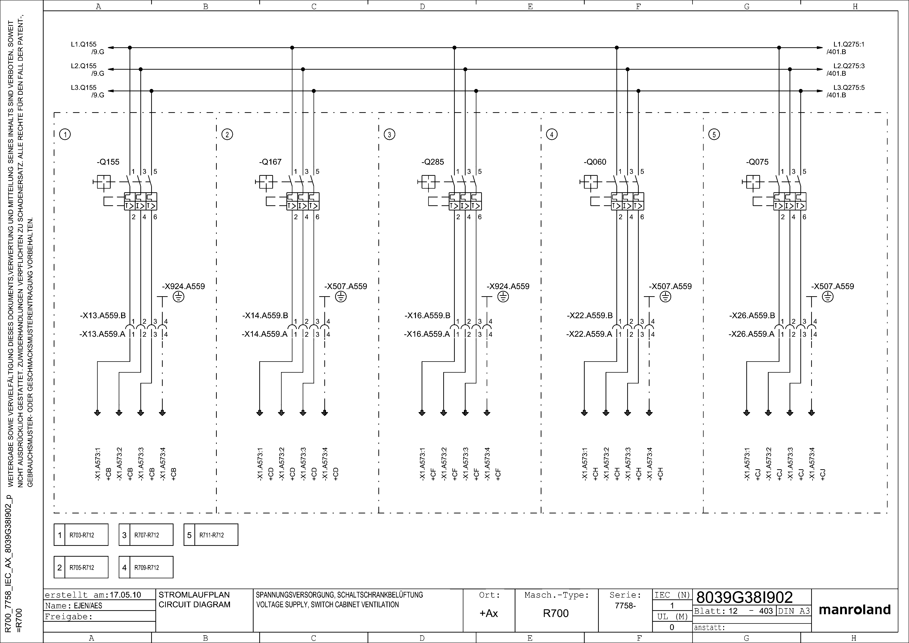

# +Ax — Sheet 12 of 403 — SPANNUNGSVERSORGUNG, SCHALTSCHRANKBELÜFTUNG

**VOLTAGE SUPPLY, SWITCH CABINET VENTILATION**

> Part of the manroland **R700** printing press IEC/UL circuit diagrams.
> Drawing class: **Stromlaufplan / Circuit diagram** (DIN A3).
> Document `+Ax` covers the **Central control console** machine section.

## At a glance

| Field | Value |
|---|---|
| Document | `+Ax`  (8039G38I902) |
| Sheet | **12** of 403 |
| Section (DE) | SPANNUNGSVERSORGUNG, SCHALTSCHRANKBELÜFTUNG |
| Section (EN) | VOLTAGE SUPPLY, SWITCH CABINET VENTILATION |
| Section type | POWER_SUPPLY — Voltage supply |
| Machine type | `R700` |
| Series | `7758` |
| Created | 17.05.10 |
| Replaces | — |
| Columns used | A, B, C, D, E, F, G, H |
| Path numbers | — |
| Labels on sheet | 157 |
| Cross-refs out | 6 |
| Cross-refs in | 46 |

**Previous:** [+Ax sheet 11](SHEET_0011.md) · **Next:** [+Ax sheet 13](SHEET_0013.md) · **Document TOC:** [_TOC.md](_TOC.md)  (+Ax) · **Master TOC:** [all sheets](../_MASTER_TOC.md)

## Sheet image (300 DPI, exact vector render)



_Rendered directly from the PDF vector layer at 300 DPI (1-bit), no OCR and no resampling. Use it to confirm anything ambiguous in the text below._

## Cross-references on this sheet

Each entry is a wire leaving this sheet. The printed token is `/sheet.column`; the link resolves to that sheet inside the same document.

| Ref | Target sheet | Col | Path | Destination on target | Target section | From col |
|---|---|---|---|---|---|---|
| `/9.G` | [+Ax sheet 9](SHEET_0009.md) | G | — | L1.Q155 | SPANNUNGSVERSORGUNG, SCHALTSCHRANKBELÜFTUNG | A |
| `/401.B` | [+Ax sheet 401](SHEET_0401.md) | B | — | — | OPTION: INLINE COLORPILOT | H |
| `/9.G` | [+Ax sheet 9](SHEET_0009.md) | G | — | L2.Q275:3 L2.Q155 | SPANNUNGSVERSORGUNG, SCHALTSCHRANKBELÜFTUNG | D |
| `/401.B` | [+Ax sheet 401](SHEET_0401.md) | B | — | — | OPTION: INLINE COLORPILOT | H |
| `/9.G` | [+Ax sheet 9](SHEET_0009.md) | G | — | L3.Q155 | SPANNUNGSVERSORGUNG, SCHALTSCHRANKBELÜFTUNG | A |
| `/401.B` | [+Ax sheet 401](SHEET_0401.md) | B | — | — | OPTION: INLINE COLORPILOT | H |

### Incoming references (sheets that point here)

Every other sheet that sends a wire to this one. `Back-ref` is the token printed on *that* sheet; `Path` is its line number.

| From sheet | Cols | Back-ref | Path | Refs | What continues there |
|---|---|---|---|---|---|
| [+Ax#9](SHEET_0009.md) | G | `/9.G` | — | 3 | L1.Q155; L2.Q155; L3.Q155 |
| [+Ax#250](SHEET_0250.md) | E | `/250.E` | — | 8 | — |
| [+Ax#251](SHEET_0251.md) | G | `/251.G` | — | 8 | — |
| [+Ax#254](SHEET_0254.md) | H | `/254.H` | — | 8 | — |
| [+Ax#263](SHEET_0263.md) | E | `/263.E` | — | 8 | — |
| [+Ax#269](SHEET_0269.md) | C | `/269.C` | — | 8 | — |
| [+Ax#401](SHEET_0401.md) | B, C | `/401.B`, `/401.C` | — | 3 | 24V.Q275:14 L1.Q275:1; L2.Q275:3; L3.Q275:5 |


## Devices on this sheet

| Tag | Class | Class meaning (IEC) | Col | Sub | Terminal | Sign |
|---|---|---|---|---|---|---|
| `Q155` | Q | Leistungsschalter / power switching device | A | — | — | — |
| `Q167` | Q | Leistungsschalter / power switching device | C | — | — | — |
| `Q285` | Q | Leistungsschalter / power switching device | D | — | — | — |
| `Q060` | Q | Leistungsschalter / power switching device | F | — | — | — |
| `Q075` | Q | Leistungsschalter / power switching device | G | — | — | — |
| `X13.A559.B` | — | cross-device reference | A | — | — | — |
| `X13.A559.A` | — | cross-device reference | A | — | — | — |
| `X14.A559.B` | — | cross-device reference | C | — | — | — |
| `X14.A559.A` | — | cross-device reference | C | — | — | — |
| `X16.A559.B` | — | cross-device reference | D | — | — | — |
| `X16.A559.A` | — | cross-device reference | D | — | — | — |
| `X22.A559.B` | — | cross-device reference | F | — | — | — |
| `X22.A559.A` | — | cross-device reference | F | — | — | — |
| `X26.A559.B` | — | cross-device reference | G | — | — | — |
| `X26.A559.A` | — | cross-device reference | G | — | — | — |
| `X1.A573:4` | — | cross-device reference | B | — | 4 | — |
| `X1.A573:3` | — | cross-device reference | A | — | 3 | — |
| `X1.A573:2` | — | cross-device reference | A | — | 2 | — |
| `X1.A573:1` | — | cross-device reference | A | — | 1 | — |
| `X1.A573:4` | — | cross-device reference | C | — | 4 | — |
| `X1.A573:3` | — | cross-device reference | C | — | 3 | — |
| `X1.A573:2` | — | cross-device reference | C | — | 2 | — |
| `X1.A573:1` | — | cross-device reference | C | — | 1 | — |
| `X1.A573:4` | — | cross-device reference | E | — | 4 | — |
| `X1.A573:3` | — | cross-device reference | D | — | 3 | — |
| `X1.A573:2` | — | cross-device reference | D | — | 2 | — |
| `X1.A573:1` | — | cross-device reference | D | — | 1 | — |
| `X1.A573:4` | — | cross-device reference | F | — | 4 | — |
| `X1.A573:3` | — | cross-device reference | F | — | 3 | — |
| `X1.A573:2` | — | cross-device reference | F | — | 2 | — |
| `X1.A573:1` | — | cross-device reference | F | — | 1 | — |
| `X1.A573:4` | — | cross-device reference | H | — | 4 | — |
| `X1.A573:3` | — | cross-device reference | G | — | 3 | — |
| `X1.A573:2` | — | cross-device reference | G | — | 2 | — |
| `X1.A573:1` | — | cross-device reference | G | — | 1 | — |
| `X924.A559` | — | cross-device reference | B | — | — | — |
| `X507.A559` | — | cross-device reference | C | — | — | — |
| `X924.A559` | — | cross-device reference | E | — | — | — |
| `X507.A559` | — | cross-device reference | F | — | — | — |
| `X507.A559` | — | cross-device reference | H | — | — | — |

## Potentials / nets

| Potential | Count | Columns | Attached devices | Terminals |
|---|---|---|---|---|
| `L1` | 2 | A, H | `Q155`, `Q275` | `1` |
| `L2` | 2 | A, H | `Q155`, `Q275` | `3` |
| `L3` | 2 | A, H | `Q155`, `Q275` | `5` |


A potential such as `L24+/4` or `M24+` is a named supply/return rail; every place it appears on this sheet is electrically common.

## Wire-end annotations (grouped as printed)

A wire that continues elsewhere is annotated with a small cluster: the destination description, the path/line number `#NN`, and the `/sheet.column` cross reference. Each row below is one such cluster exactly as it is grouped on the drawing.

| Col | Y | Path | Cross-ref | Text on the wire |
|---|---|---|---|---|
| H | 54.1 | — | — | `L1.Q275:1` |
| A | 54.2 | — | `/9.G` | `L1.Q155` |
| H | 64.0 | — | `/401.B` | — |
| D | 82.5 | — | `/9.G` | `L2.Q155 L2.Q275:3` |
| H | 92.4 | — | `/401.B` | — |
| A | 110.8 | — | `/9.G` | `L3.Q155` |
| H | 110.8 | — | — | `L3.Q275:5` |
| H | 120.7 | — | `/401.B` | — |
| A | 172.7 | — | — | `1` |
| B | 173.2 | — | — | `2` |
| D | 173.2 | — | — | `3` |
| E | 173.2 | — | — | `4` |
| G | 173.2 | — | — | `5` |
| A | 207.2 | — | — | `Q155` |
| C | 207.2 | — | — | `Q167` |
| D | 207.2 | — | — | `Q285` |
| F | 207.2 | — | — | `Q060` |
| G | 207.2 | — | — | `Q075` |
| A | 220.7 | — | — | `1 3 5` |
| C | 220.7 | — | — | `1 3 5` |
| D | 220.7 | — | — | `1 3 5` |
| F | 220.7 | — | — | `1 3 5` |
| G | 220.7 | — | — | `1 3 5` |
| A | 280.2 | — | — | `2 4 6` |
| C | 280.2 | — | — | `2 4 6` |
| D | 280.2 | — | — | `2 4 6` |
| F | 280.2 | — | — | `2 4 6` |
| G | 280.2 | — | — | `2 4 6` |
| B | 370.2 | — | — | `X924.A559` |
| C | 370.2 | — | — | `X507.A559` |
| E | 370.2 | — | — | `X924.A559` |
| F | 370.2 | — | — | `X507.A559` |
| H | 370.2 | — | — | `X507.A559` |
| A | 408.5 | — | — | `X13.A559.B 1 2` |
| C | 408.5 | — | — | `X14.A559.B 1 2` |
| D | 408.5 | — | — | `X16.A559.B 1` |
| F | 408.5 | — | — | `X22.A559.B 1` |
| G | 408.5 | — | — | `X26.A559.B 1` |
| B | 417.0 | — | — | `3 4` |
| C | 417.0 | — | — | `3` |
| C | 417.0 | — | — | `4` |
| D | 417.0 | — | — | `2 3` |
| E | 417.0 | — | — | `4` |
| F | 417.0 | — | — | `2 3` |
| F | 417.0 | — | — | `4` |
| G | 417.0 | — | — | `2 3` |
| H | 417.0 | — | — | `4` |
| A | 432.6 | — | — | `X13.A559.A 1 2 3 4` |
| C | 432.6 | — | — | `X14.A559.A 1 2 3` |
| D | 432.6 | — | — | `X16.A559.A 1 2 3` |
| F | 432.6 | — | — | `X22.A559.A 1 2 3` |
| G | 432.6 | — | — | `X26.A559.A 1 2 3` |
| C | 434.0 | — | — | `4` |
| E | 434.0 | — | — | `4` |
| F | 434.0 | — | — | `4` |
| H | 434.0 | — | — | `4` |
| A | 585.6 | — | — | `X1.A573:1` |
| A | 585.6 | — | — | `X1.A573:2` |
| A | 585.6 | — | — | `X1.A573:3` |
| B | 585.6 | — | — | `X1.A573:4` |
| C | 585.6 | — | — | `X1.A573:1` |
| C | 585.6 | — | — | `X1.A573:2` |
| C | 585.6 | — | — | `X1.A573:3` |
| C | 585.6 | — | — | `X1.A573:4` |
| D | 585.6 | — | — | `X1.A573:1` |
| D | 585.6 | — | — | `X1.A573:2` |
| D | 585.6 | — | — | `X1.A573:3` |
| E | 585.6 | — | — | `X1.A573:4` |
| F | 585.6 | — | — | `X1.A573:1` |
| F | 585.6 | — | — | `X1.A573:2` |
| F | 585.6 | — | — | `X1.A573:3` |
| F | 585.6 | — | — | `X1.A573:4` |
| G | 585.6 | — | — | `X1.A573:1` |
| G | 585.6 | — | — | `X1.A573:2` |
| G | 585.6 | — | — | `X1.A573:3` |
| H | 585.6 | — | — | `X1.A573:4` |
| C | 612.0 | — | — | `+CD` |
| C | 612.0 | — | — | `+CD` |
| C | 612.0 | — | — | `+CD` |
| C | 612.0 | — | — | `+CD` |
| F | 612.0 | — | — | `+CH` |
| F | 612.0 | — | — | `+CH` |
| F | 612.0 | — | — | `+CH` |
| F | 612.0 | — | — | `+CH` |
| A | 612.3 | — | — | `+CB` |
| A | 612.3 | — | — | `+CB` |
| B | 612.3 | — | — | `+CB` |
| B | 612.3 | — | — | `+CB` |
| D | 612.9 | — | — | `+CF` |
| D | 612.9 | — | — | `+CF` |
| E | 612.9 | — | — | `+CF` |
| E | 612.9 | — | — | `+CF` |
| G | 613.7 | — | — | `+CJ` |
| G | 613.7 | — | — | `+CJ` |
| H | 613.7 | — | — | `+CJ` |
| H | 613.7 | — | — | `+CJ` |
| A | 696.2 | — | — | `1 R703 R712` |
| A | 696.2 | — | — | `3 R707 R712` |
| B | 696.2 | — | — | `5 R711 R712` |
| A | 738.7 | — | — | `2` |
| A | 738.7 | — | — | `R705 R712 4` |
| A | 740.5 | — | — | `R709 R712` |


## Reconstructed tables

This sheet carries tabular content (pin map / terminal assignment / index). The grid below was rebuilt from the drawing's own rule lines, so each row is exactly one physical row of the table.

### Table 1 — 1 data rows × 2 columns (at x=127.6, y=62.4) — **/9.G**

| /9.G | Q155 |
|---|---|
| `X13.A559.B X13.A559.A` |  |


### Table 2 — 2 data rows × 1 columns (at x=170.1, y=62.4)

| C1 |
|---|
| `1` |
| `2 1 1` |


### Table 3 — 2 data rows × 1 columns (at x=184.3, y=62.4)

| C1 |
|---|
| `3` |
| `4 2 2` |


### Table 4 — 2 data rows × 1 columns (at x=198.4, y=62.4)

| C1 |
|---|
| `5` |
| `6 3 3` |


### Table 5 — 1 data rows × 4 columns (at x=212.6, y=62.4)

|  | 2 |  | Q167 |
|---|---|---|---|
| `X924.A559 4 4` |  | `X14.A559.B X14.A559.A` |  |


### Table 6 — 2 data rows × 1 columns (at x=382.7, y=62.4)

| C1 |
|---|
| `1` |
| `2 1 1` |


### Table 7 — 2 data rows × 1 columns (at x=396.9, y=62.4)

| C1 |
|---|
| `3` |
| `4 2 2` |


### Table 8 — 2 data rows × 1 columns (at x=411.0, y=62.4)

| C1 |
|---|
| `5` |
| `6 3 3` |


### Table 9 — 1 data rows × 4 columns (at x=425.2, y=62.4)

|  | 3 |  | Q285 |
|---|---|---|---|
| `X507.A559 4 4` |  | `X16.A559.B X16.A559.A` |  |


### Table 10 — 2 data rows × 1 columns (at x=595.3, y=62.4)

| C1 |
|---|
| `1` |
| `2 1 1` |


### Table 11 — 2 data rows × 1 columns (at x=609.4, y=62.4)

| C1 |
|---|
| `3` |
| `4 2 2` |


### Table 12 — 2 data rows × 1 columns (at x=623.6, y=62.4)

| C1 |
|---|
| `5` |
| `6 3 3` |


### Table 13 — 1 data rows × 4 columns (at x=637.8, y=62.4)

|  | 4 |  | Q060 |
|---|---|---|---|
| `X924.A559 4 4` |  | `X22.A559.B X22.A559.A` |  |


### Table 14 — 2 data rows × 1 columns (at x=807.9, y=62.4)

| C1 |
|---|
| `1` |
| `2 1 1` |


### Table 15 — 2 data rows × 1 columns (at x=822.0, y=62.4)

| C1 |
|---|
| `3` |
| `4 2 2` |


### Table 16 — 2 data rows × 1 columns (at x=836.2, y=62.4)

| C1 |
|---|
| `5` |
| `6 3 3` |


### Table 17 — 1 data rows × 4 columns (at x=850.4, y=62.4)

|  | 5 |  | Q075 |
|---|---|---|---|
| `X507.A559 4 4` |  | `X26.A559.B X26.A559.A` |  |


### Table 18 — 2 data rows × 1 columns (at x=1020.5, y=62.4)

| C1 |
|---|
| `1` |
| `2 1 1` |


### Table 19 — 2 data rows × 1 columns (at x=1034.6, y=62.4)

| C1 |
|---|
| `3` |
| `4 2 2` |


### Table 20 — 2 data rows × 1 columns (at x=1048.8, y=62.4)

| C1 |
|---|
| `5` |
| `6 3 3` |


## Notes and free text on this sheet

| Text | Col | Y (pt) |
|---|---|---|
| `+CB` | B | 612.29 |
| `+CB` | A | 612.29 |
| `+CD` | C | 612 |
| `+CF` | E | 612.85 |
| `+CF` | D | 612.85 |
| `+CH` | F | 612 |
| `+CJ` | H | 613.7 |
| `+CJ` | G | 613.7 |
| `R703 R712` | A | 697.97 |
| `R705 R712` | A | 740.49 |
| `R707 R712` | A | 697.97 |
| `R709 R712` | A | 740.49 |
| `R711 R712` | B | 697.97 |

## Complete label inventory (exact text from the drawing)

Every text object inside the drawing area of this sheet, in DIN reading order (column A→H, then top→bottom). This is the authoritative list: if a string is not here it is not printed on this sheet.

| Col | Y | X | Dir | Type | Text |
|---|---|---|---|---|---|
| A | 54.2 | 93.0 | → | potential | `L1.Q155` |
| A | 64.0 | 119.9 | → | cross-reference | `/9.G` |
| A | 82.5 | 93.0 | → | potential | `L2.Q155` |
| A | 92.4 | 119.9 | → | cross-reference | `/9.G` |
| A | 110.9 | 93.0 | → | potential | `L3.Q155` |
| A | 120.7 | 119.9 | → | cross-reference | `/9.G` |
| A | 172.7 | 83.3 | → | number | `1` |
| A | 207.2 | 127.0 | → | device tag | `Q155` |
| A | 220.7 | 172.1 | → | number | `1` |
| A | 220.7 | 186.8 | → | number | `3` |
| A | 280.2 | 172.6 | → | number | `2` |
| A | 280.2 | 186.8 | → | number | `4` |
| A | 408.5 | 104.9 | → | device ref | `X13.A559.B` |
| A | 417.0 | 172.1 | → | number | `1` |
| A | 417.0 | 186.8 | → | number | `2` |
| A | 432.6 | 104.0 | → | device ref | `X13.A559.A` |
| A | 434.0 | 172.1 | → | number | `1` |
| A | 434.0 | 186.8 | → | number | `2` |
| A | 585.6 | 124.3 | ↕ | device ref | `X1.A573:1` |
| A | 585.6 | 152.6 | ↕ | device ref | `X1.A573:2` |
| A | 585.6 | 181.0 | ↕ | device ref | `X1.A573:3` |
| A | 612.3 | 138.5 | ↕ | text | `+CB` |
| A | 612.3 | 166.8 | ↕ | text | `+CB` |
| A | 696.2 | 75.4 | → | number | `1` |
| A | 696.2 | 160.0 | → | number | `3` |
| A | 698.0 | 91.3 | → | text | `R703 R712` |
| A | 698.0 | 176.3 | → | text | `R707 R712` |
| A | 738.7 | 75.1 | → | number | `2` |
| A | 738.7 | 160.2 | → | number | `4` |
| A | 740.5 | 91.3 | → | text | `R705 R712` |
| A | 740.5 | 176.3 | → | text | `R709 R712` |
| B | 173.2 | 295.6 | → | number | `2` |
| B | 220.7 | 201.0 | → | number | `5` |
| B | 280.2 | 201.0 | → | number | `6` |
| B | 370.2 | 212.3 | → | device ref | `X924.A559` |
| B | 417.0 | 201.0 | → | number | `3` |
| B | 417.0 | 215.1 | → | number | `4` |
| B | 434.0 | 201.0 | → | number | `3` |
| B | 434.0 | 215.1 | → | number | `4` |
| B | 585.6 | 209.3 | ↕ | device ref | `X1.A573:4` |
| B | 612.3 | 195.2 | ↕ | text | `+CB` |
| B | 612.3 | 223.5 | ↕ | text | `+CB` |
| B | 696.2 | 245.1 | → | number | `5` |
| B | 698.0 | 261.4 | → | text | `R711 R712` |
| C | 207.2 | 339.6 | → | device tag | `Q167` |
| C | 220.7 | 384.7 | → | number | `1` |
| C | 220.7 | 399.4 | → | number | `3` |
| C | 220.7 | 413.6 | → | number | `5` |
| C | 280.2 | 385.2 | → | number | `2` |
| C | 280.2 | 399.4 | → | number | `4` |
| C | 280.2 | 413.6 | → | number | `6` |
| C | 370.2 | 424.9 | → | device ref | `X507.A559` |
| C | 408.5 | 317.5 | → | device ref | `X14.A559.B` |
| C | 417.0 | 384.7 | → | number | `1` |
| C | 417.0 | 399.4 | → | number | `2` |
| C | 417.0 | 413.6 | → | number | `3` |
| C | 417.0 | 427.7 | → | number | `4` |
| C | 432.6 | 316.6 | → | device ref | `X14.A559.A` |
| C | 434.0 | 384.7 | → | number | `1` |
| C | 434.0 | 399.4 | → | number | `2` |
| C | 434.0 | 413.6 | → | number | `3` |
| C | 434.0 | 427.7 | → | number | `4` |
| C | 585.6 | 336.9 | ↕ | device ref | `X1.A573:1` |
| C | 585.6 | 365.2 | ↕ | device ref | `X1.A573:2` |
| C | 585.6 | 393.6 | ↕ | device ref | `X1.A573:3` |
| C | 585.6 | 421.9 | ↕ | device ref | `X1.A573:4` |
| C | 612.0 | 351.1 | ↕ | text | `+CD` |
| C | 612.0 | 379.5 | ↕ | text | `+CD` |
| C | 612.0 | 407.8 | ↕ | text | `+CD` |
| C | 612.0 | 436.2 | ↕ | text | `+CD` |
| D | 173.2 | 508.2 | → | number | `3` |
| D | 207.2 | 552.2 | → | device tag | `Q285` |
| D | 220.7 | 597.3 | → | number | `1` |
| D | 220.7 | 612.0 | → | number | `3` |
| D | 280.2 | 597.8 | → | number | `2` |
| D | 280.2 | 612.0 | → | number | `4` |
| D | 408.5 | 530.1 | → | device ref | `X16.A559.B` |
| D | 417.0 | 597.3 | → | number | `1` |
| D | 417.0 | 612.0 | → | number | `2` |
| D | 432.6 | 529.2 | → | device ref | `X16.A559.A` |
| D | 434.0 | 597.3 | → | number | `1` |
| D | 434.0 | 612.0 | → | number | `2` |
| D | 585.6 | 549.5 | ↕ | device ref | `X1.A573:1` |
| D | 585.6 | 577.8 | ↕ | device ref | `X1.A573:2` |
| D | 585.6 | 606.2 | ↕ | device ref | `X1.A573:3` |
| D | 612.9 | 563.7 | ↕ | text | `+CF` |
| D | 612.9 | 592.0 | ↕ | text | `+CF` |
| E | 173.2 | 720.8 | → | number | `4` |
| E | 220.7 | 626.2 | → | number | `5` |
| E | 280.2 | 626.2 | → | number | `6` |
| E | 370.2 | 637.5 | → | device ref | `X924.A559` |
| E | 417.0 | 626.2 | → | number | `3` |
| E | 417.0 | 640.3 | → | number | `4` |
| E | 434.0 | 626.2 | → | number | `3` |
| E | 434.0 | 640.3 | → | number | `4` |
| E | 585.6 | 634.5 | ↕ | device ref | `X1.A573:4` |
| E | 612.9 | 620.4 | ↕ | text | `+CF` |
| E | 612.9 | 648.7 | ↕ | text | `+CF` |
| F | 207.2 | 764.8 | → | device tag | `Q060` |
| F | 220.7 | 809.9 | → | number | `1` |
| F | 220.7 | 824.6 | → | number | `3` |
| F | 220.7 | 838.8 | → | number | `5` |
| F | 280.2 | 810.4 | → | number | `2` |
| F | 280.2 | 824.6 | → | number | `4` |
| F | 280.2 | 838.8 | → | number | `6` |
| F | 370.2 | 850.1 | → | device ref | `X507.A559` |
| F | 408.5 | 742.7 | → | device ref | `X22.A559.B` |
| F | 417.0 | 809.9 | → | number | `1` |
| F | 417.0 | 824.6 | → | number | `2` |
| F | 417.0 | 838.8 | → | number | `3` |
| F | 417.0 | 852.9 | → | number | `4` |
| F | 432.6 | 741.8 | → | device ref | `X22.A559.A` |
| F | 434.0 | 809.9 | → | number | `1` |
| F | 434.0 | 824.6 | → | number | `2` |
| F | 434.0 | 838.8 | → | number | `3` |
| F | 434.0 | 852.9 | → | number | `4` |
| F | 585.6 | 762.1 | ↕ | device ref | `X1.A573:1` |
| F | 585.6 | 790.4 | ↕ | device ref | `X1.A573:2` |
| F | 585.6 | 818.8 | ↕ | device ref | `X1.A573:3` |
| F | 585.6 | 847.1 | ↕ | device ref | `X1.A573:4` |
| F | 612.0 | 776.3 | ↕ | text | `+CH` |
| F | 612.0 | 804.7 | ↕ | text | `+CH` |
| F | 612.0 | 833.0 | ↕ | text | `+CH` |
| F | 612.0 | 861.3 | ↕ | text | `+CH` |
| G | 173.2 | 933.4 | → | number | `5` |
| G | 207.2 | 977.4 | → | device tag | `Q075` |
| G | 220.7 | 1022.5 | → | number | `1` |
| G | 220.7 | 1037.2 | → | number | `3` |
| G | 280.2 | 1023.0 | → | number | `2` |
| G | 280.2 | 1037.2 | → | number | `4` |
| G | 408.5 | 955.3 | → | device ref | `X26.A559.B` |
| G | 417.0 | 1022.5 | → | number | `1` |
| G | 417.0 | 1037.2 | → | number | `2` |
| G | 432.6 | 954.4 | → | device ref | `X26.A559.A` |
| G | 434.0 | 1022.5 | → | number | `1` |
| G | 434.0 | 1037.2 | → | number | `2` |
| G | 585.6 | 974.7 | ↕ | device ref | `X1.A573:1` |
| G | 585.6 | 1003.0 | ↕ | device ref | `X1.A573:2` |
| G | 585.6 | 1031.4 | ↕ | device ref | `X1.A573:3` |
| G | 613.7 | 988.9 | ↕ | text | `+CJ` |
| G | 613.7 | 1017.2 | ↕ | text | `+CJ` |
| H | 54.2 | 1091.9 | → | potential | `L1.Q275:1` |
| H | 64.0 | 1082.8 | → | cross-reference | `/401.B` |
| H | 82.5 | 1091.9 | → | potential | `L2.Q275:3` |
| H | 92.4 | 1082.8 | → | cross-reference | `/401.B` |
| H | 110.8 | 1091.9 | → | potential | `L3.Q275:5` |
| H | 120.7 | 1082.8 | → | cross-reference | `/401.B` |
| H | 220.7 | 1051.4 | → | number | `5` |
| H | 280.2 | 1051.4 | → | number | `6` |
| H | 370.2 | 1062.7 | → | device ref | `X507.A559` |
| H | 417.0 | 1051.4 | → | number | `3` |
| H | 417.0 | 1065.5 | → | number | `4` |
| H | 434.0 | 1051.4 | → | number | `3` |
| H | 434.0 | 1065.5 | → | number | `4` |
| H | 585.6 | 1059.7 | ↕ | device ref | `X1.A573:4` |
| H | 613.7 | 1045.6 | ↕ | text | `+CJ` |
| H | 613.7 | 1073.9 | ↕ | text | `+CJ` |

## Reading-order text block

The same content as a plain block, grouped by DIN column — convenient to paste or to match against a visual description.

```text
=== Column A ===
  54.2   93.0  net          L1.Q155
  64.0  119.9  xref         /9.G
  82.5   93.0  net          L2.Q155
  92.4  119.9  xref         /9.G
 110.9   93.0  net          L3.Q155
 120.7  119.9  xref         /9.G
 172.7   83.3  numeric      1
 207.2  127.0  devtag       Q155
 220.7  172.1  numeric      1
 220.7  186.8  numeric      3
 280.2  172.6  numeric      2
 280.2  186.8  numeric      4
 408.5  104.9  devref       X13.A559.B
 417.0  172.1  numeric      1
 417.0  186.8  numeric      2
 432.6  104.0  devref       X13.A559.A
 434.0  172.1  numeric      1
 434.0  186.8  numeric      2
 585.6  124.3  devref       X1.A573:1
 585.6  152.6  devref       X1.A573:2
 585.6  181.0  devref       X1.A573:3
 612.3  138.5  text         +CB
 612.3  166.8  text         +CB
 696.2   75.4  numeric      1
 696.2  160.0  numeric      3
 698.0   91.3  text         R703 R712
 698.0  176.3  text         R707 R712
 738.7   75.1  numeric      2
 738.7  160.2  numeric      4
 740.5   91.3  text         R705 R712
 740.5  176.3  text         R709 R712
=== Column B ===
 173.2  295.6  numeric      2
 220.7  201.0  numeric      5
 280.2  201.0  numeric      6
 370.2  212.3  devref       X924.A559
 417.0  201.0  numeric      3
 417.0  215.1  numeric      4
 434.0  201.0  numeric      3
 434.0  215.1  numeric      4
 585.6  209.3  devref       X1.A573:4
 612.3  195.2  text         +CB
 612.3  223.5  text         +CB
 696.2  245.1  numeric      5
 698.0  261.4  text         R711 R712
=== Column C ===
 207.2  339.6  devtag       Q167
 220.7  384.7  numeric      1
 220.7  399.4  numeric      3
 220.7  413.6  numeric      5
 280.2  385.2  numeric      2
 280.2  399.4  numeric      4
 280.2  413.6  numeric      6
 370.2  424.9  devref       X507.A559
 408.5  317.5  devref       X14.A559.B
 417.0  384.7  numeric      1
 417.0  399.4  numeric      2
 417.0  413.6  numeric      3
 417.0  427.7  numeric      4
 432.6  316.6  devref       X14.A559.A
 434.0  384.7  numeric      1
 434.0  399.4  numeric      2
 434.0  413.6  numeric      3
 434.0  427.7  numeric      4
 585.6  336.9  devref       X1.A573:1
 585.6  365.2  devref       X1.A573:2
 585.6  393.6  devref       X1.A573:3
 585.6  421.9  devref       X1.A573:4
 612.0  351.1  text         +CD
 612.0  379.5  text         +CD
 612.0  407.8  text         +CD
 612.0  436.2  text         +CD
=== Column D ===
 173.2  508.2  numeric      3
 207.2  552.2  devtag       Q285
 220.7  597.3  numeric      1
 220.7  612.0  numeric      3
 280.2  597.8  numeric      2
 280.2  612.0  numeric      4
 408.5  530.1  devref       X16.A559.B
 417.0  597.3  numeric      1
 417.0  612.0  numeric      2
 432.6  529.2  devref       X16.A559.A
 434.0  597.3  numeric      1
 434.0  612.0  numeric      2
 585.6  549.5  devref       X1.A573:1
 585.6  577.8  devref       X1.A573:2
 585.6  606.2  devref       X1.A573:3
 612.9  563.7  text         +CF
 612.9  592.0  text         +CF
=== Column E ===
 173.2  720.8  numeric      4
 220.7  626.2  numeric      5
 280.2  626.2  numeric      6
 370.2  637.5  devref       X924.A559
 417.0  626.2  numeric      3
 417.0  640.3  numeric      4
 434.0  626.2  numeric      3
 434.0  640.3  numeric      4
 585.6  634.5  devref       X1.A573:4
 612.9  620.4  text         +CF
 612.9  648.7  text         +CF
=== Column F ===
 207.2  764.8  devtag       Q060
 220.7  809.9  numeric      1
 220.7  824.6  numeric      3
 220.7  838.8  numeric      5
 280.2  810.4  numeric      2
 280.2  824.6  numeric      4
 280.2  838.8  numeric      6
 370.2  850.1  devref       X507.A559
 408.5  742.7  devref       X22.A559.B
 417.0  809.9  numeric      1
 417.0  824.6  numeric      2
 417.0  838.8  numeric      3
 417.0  852.9  numeric      4
 432.6  741.8  devref       X22.A559.A
 434.0  809.9  numeric      1
 434.0  824.6  numeric      2
 434.0  838.8  numeric      3
 434.0  852.9  numeric      4
 585.6  762.1  devref       X1.A573:1
 585.6  790.4  devref       X1.A573:2
 585.6  818.8  devref       X1.A573:3
 585.6  847.1  devref       X1.A573:4
 612.0  776.3  text         +CH
 612.0  804.7  text         +CH
 612.0  833.0  text         +CH
 612.0  861.3  text         +CH
=== Column G ===
 173.2  933.4  numeric      5
 207.2  977.4  devtag       Q075
 220.7 1022.5  numeric      1
 220.7 1037.2  numeric      3
 280.2 1023.0  numeric      2
 280.2 1037.2  numeric      4
 408.5  955.3  devref       X26.A559.B
 417.0 1022.5  numeric      1
 417.0 1037.2  numeric      2
 432.6  954.4  devref       X26.A559.A
 434.0 1022.5  numeric      1
 434.0 1037.2  numeric      2
 585.6  974.7  devref       X1.A573:1
 585.6 1003.0  devref       X1.A573:2
 585.6 1031.4  devref       X1.A573:3
 613.7  988.9  text         +CJ
 613.7 1017.2  text         +CJ
=== Column H ===
  54.2 1091.9  net          L1.Q275:1
  64.0 1082.8  xref         /401.B
  82.5 1091.9  net          L2.Q275:3
  92.4 1082.8  xref         /401.B
 110.8 1091.9  net          L3.Q275:5
 120.7 1082.8  xref         /401.B
 220.7 1051.4  numeric      5
 280.2 1051.4  numeric      6
 370.2 1062.7  devref       X507.A559
 417.0 1051.4  numeric      3
 417.0 1065.5  numeric      4
 434.0 1051.4  numeric      3
 434.0 1065.5  numeric      4
 585.6 1059.7  devref       X1.A573:4
 613.7 1045.6  text         +CJ
 613.7 1073.9  text         +CJ
```

---
_Generated from the PDF vector text layer; no OCR. Source: `R700_7758_IEC_AX_8039G38I902_p`, sheet 12._
