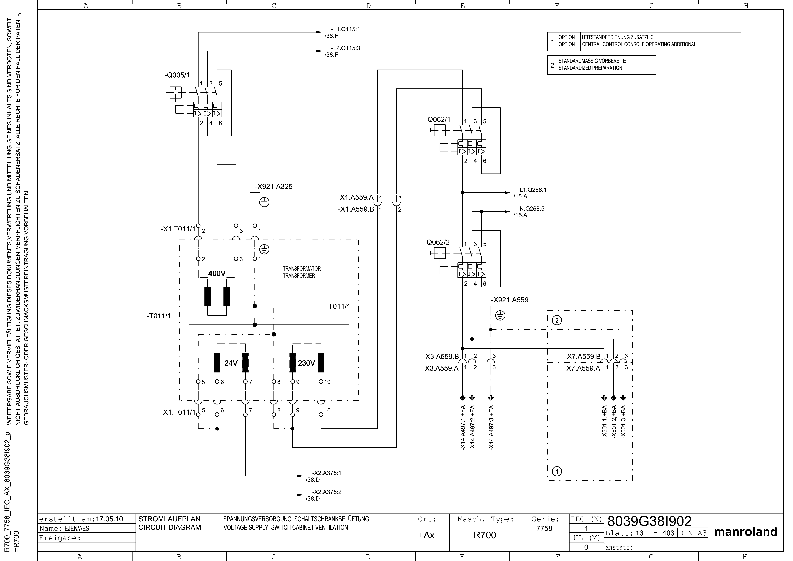

# +Ax — Sheet 13 of 403 — SPANNUNGSVERSORGUNG, SCHALTSCHRANKBELÜFTUNG

**VOLTAGE SUPPLY, SWITCH CABINET VENTILATION**

> Part of the manroland **R700** printing press IEC/UL circuit diagrams.
> Drawing class: **Stromlaufplan / Circuit diagram** (DIN A3).
> Document `+Ax` covers the **Central control console** machine section.

## At a glance

| Field | Value |
|---|---|
| Document | `+Ax`  (8039G38I902) |
| Sheet | **13** of 403 |
| Section (DE) | SPANNUNGSVERSORGUNG, SCHALTSCHRANKBELÜFTUNG |
| Section (EN) | VOLTAGE SUPPLY, SWITCH CABINET VENTILATION |
| Section type | POWER_SUPPLY — Voltage supply |
| Machine type | `R700` |
| Series | `7758` |
| Created | 17.05.10 |
| Replaces | — |
| Columns used | B, C, D, E, F, G |
| Path numbers | — |
| Labels on sheet | 103 |
| Cross-refs out | 6 |
| Cross-refs in | 31 |

**Previous:** [+Ax sheet 12](SHEET_0012.md) · **Next:** [+Ax sheet 14](SHEET_0014.md) · **Document TOC:** [_TOC.md](_TOC.md)  (+Ax) · **Master TOC:** [all sheets](../_MASTER_TOC.md)

## Sheet image (300 DPI, exact vector render)



_Rendered directly from the PDF vector layer at 300 DPI (1-bit), no OCR and no resampling. Use it to confirm anything ambiguous in the text below._

## Cross-references on this sheet

Each entry is a wire leaving this sheet. The printed token is `/sheet.column`; the link resolves to that sheet inside the same document.

| Ref | Target sheet | Col | Path | Destination on target | Target section | From col |
|---|---|---|---|---|---|---|
| `/38.F` | [+Ax sheet 38](SHEET_0038.md) | F | — | — | HAUPTANTRIEB | D |
| `/38.F` | [+Ax sheet 38](SHEET_0038.md) | F | — | — | HAUPTANTRIEB | D |
| `/15.A` | [+Ax sheet 15](SHEET_0015.md) | A | — | — | SPANNUNGSVERSORGUNG, SCHALTSCHRANKBELÜFTUNG | F |
| `/15.A` | [+Ax sheet 15](SHEET_0015.md) | A | — | — | SPANNUNGSVERSORGUNG, SCHALTSCHRANKBELÜFTUNG | F |
| `/38.D` | [+Ax sheet 38](SHEET_0038.md) | D | — | — | HAUPTANTRIEB | C |
| `/38.D` | [+Ax sheet 38](SHEET_0038.md) | D | — | — | HAUPTANTRIEB | C |

### Incoming references (sheets that point here)

Every other sheet that sends a wire to this one. `Back-ref` is the token printed on *that* sheet; `Path` is its line number.

| From sheet | Cols | Back-ref | Path | Refs | What continues there |
|---|---|---|---|---|---|
| [+Ax#15](SHEET_0015.md) | A, C | `/15.A`, `/15.C` | — | 2 | L1.Q268:1; N.Q268:5 N.Q149:5 |
| [+Ax#38](SHEET_0038.md) | D, F | `/38.D`, `/38.F` | — | 4 | L1.Q115:1; L2.Q115:3; X2.A375:1; X2.A375:2 |
| [+Ax#209](SHEET_0209.md) | C | `/209.C` | — | 4 | — |
| [+Ax#216](SHEET_0216.md) | A | `/216.A` | — | 9 | — |
| [+Ax#225](SHEET_0225.md) | F | `/225.F` | — | 6 | — |
| [+Ax#236](SHEET_0236.md) | H | `/236.H` | — | 6 | — |


## Devices on this sheet

| Tag | Class | Class meaning (IEC) | Col | Sub | Terminal | Sign |
|---|---|---|---|---|---|---|
| `T011/1` | T | Transformator / transformer | B | 1 | — | — |
| `T011/1` | T | Transformator / transformer | D | 1 | — | — |
| `Q005/1` | Q | Leistungsschalter / power switching device | B | 1 | — | — |
| `Q062/1` | Q | Leistungsschalter / power switching device | E | 1 | — | — |
| `Q062/2` | Q | Leistungsschalter / power switching device | E | 2 | — | — |
| `X1.A559.B` | — | cross-device reference | D | — | — | — |
| `X1.A559.A` | — | cross-device reference | D | — | — | — |
| `X3.A559.B` | — | cross-device reference | E | — | — | — |
| `X3.A559.A` | — | cross-device reference | E | — | — | — |
| `X7.A559.B` | — | cross-device reference | F | — | — | — |
| `X7.A559.A` | — | cross-device reference | F | — | — | — |
| `X2.A375:2` | — | cross-device reference | D | — | 2 | — |
| `X2.A375:1` | — | cross-device reference | D | — | 1 | — |
| `X921.A325` | — | cross-device reference | C | — | — | — |
| `X921.A559` | — | cross-device reference | F | — | — | — |

## Potentials / nets

| Potential | Count | Columns | Attached devices | Terminals |
|---|---|---|---|---|
| `230V` | 2 | C | — | — |
| `24V` | 2 | C | — | — |
| `400V` | 2 | B | — | — |
| `L1` | 2 | D, F | `Q115`, `Q268` | `1` |
| `L2` | 1 | D | `Q115` | `3` |
| `N` | 1 | F | `Q268` | `5` |


A potential such as `L24+/4` or `M24+` is a named supply/return rail; every place it appears on this sheet is electrically common.

## Wire-end annotations (grouped as printed)

A wire that continues elsewhere is annotated with a small cluster: the destination description, the path/line number `#NN`, and the `/sheet.column` cross reference. Each row below is one such cluster exactly as it is grouped on the drawing.

| Col | Y | Path | Cross-ref | Text on the wire |
|---|---|---|---|---|
| D | 40.0 | — | — | `L1.Q115:1` |
| D | 49.9 | — | `/38.F` | — |
| F | 53.0 | — | — | `1 OPTION OPTION` |
| G | 53.1 | — | — | `LEITSTANDBEDIENUNG ZUSÄTZLICH` |
| G | 63.7 | — | — | `CENTRAL CONTROL CONSOLE OPERATING ADDITIONAL` |
| D | 68.3 | — | — | `L2.Q115:3` |
| D | 78.2 | — | `/38.F` | — |
| F | 88.5 | — | — | `2 STANDARDMÄSSIG VORBEREITET STANDARDIZED PREPARATION` |
| B | 108.0 | — | — | `Q005/1` |
| B | 121.5 | — | — | `1 3 5` |
| E | 174.7 | — | — | `Q062/1` |
| E | 178.2 | — | — | `1 3 5` |
| B | 181.0 | — | — | `2 4 6` |
| E | 237.7 | — | — | `2 4 6` |
| C | 275.3 | — | — | `X921.A325` |
| F | 280.9 | — | — | `L1.Q268:1` |
| F | 290.8 | — | `/15.A` | — |
| D | 291.6 | — | — | `X1.A559.A 1` |
| D | 293.7 | — | — | `2` |
| D | 309.3 | — | — | `X1.A559.B 1` |
| F | 309.3 | — | — | `N.Q268:5` |
| D | 310.7 | — | — | `2` |
| F | 319.1 | — | `/15.A` | — |
| B | 339.1 | — | — | `X1.T011/1 2 3 1` |
| E | 358.9 | — | — | `Q062/2` |
| E | 362.4 | — | — | `1 3 5` |
| C | 385.1 | — | — | `2 3 1` |
| C | 400.3 | — | — | `TRANSFORMATOR TRANSFORMER` |
| B | 405.4 | — | — | `400V` |
| B | 405.6 | — | — | `400V` |
| E | 422.0 | — | — | `2 4 6` |
| F | 445.3 | — | — | `X921.A559` |
| D | 455.3 | — | — | `T011/1` |
| B | 469.4 | — | — | `T011/1` |
| F | 477.9 | — | — | `2` |
| E | 530.4 | — | — | `X3.A559.B 1 2 3` |
| F | 530.4 | — | — | `X7.A559.B 1 2` |
| G | 530.4 | — | — | `3` |
| C | 540.0 | — | — | `24V 230V` |
| C | 540.3 | — | — | `24V 230V` |
| E | 547.4 | — | — | `X3.A559.A 1 2 3` |
| F | 547.4 | — | — | `X7.A559.A 1 2` |
| G | 547.4 | — | — | `3` |
| C | 569.4 | — | — | `5 6 7 8 9 10` |
| E | 608.0 | — | — | `X14.A497:1 +FA` |
| E | 608.0 | — | — | `X14.A497:2 +FA` |
| E | 608.0 | — | — | `X14.A497:3 +FA` |
| G | 608.0 | — | — | `X501:1,+BA` |
| G | 608.0 | — | — | `X501:2,+BA` |
| G | 608.0 | — | — | `X501:3,+BA` |
| B | 611.9 | — | — | `X1.T011/1 5` |
| C | 611.9 | — | — | `6 7 8 9 10` |
| F | 704.2 | — | — | `1` |
| D | 706.1 | — | — | `X2.A375:1` |
| C | 716.0 | — | `/38.D` | — |
| D | 734.5 | — | — | `X2.A375:2` |
| C | 744.4 | — | `/38.D` | — |


## Reconstructed tables

This sheet carries tabular content (pin map / terminal assignment / index). The grid below was rebuilt from the drawing's own rule lines, so each row is exactly one physical row of the table.

### Table 1 — 3 data rows × 1 columns (at x=263.6, y=48.2)

| C1 |
|---|
| `Q005/1` |
| `X1.T011/1` |
| `X1.T011/1` |


### Table 2 — 2 data rows × 1 columns (at x=297.6, y=48.2)

| C1 |
|---|
| `1` |
| `2` |


### Table 3 — 2 data rows × 1 columns (at x=354.3, y=48.2)

| C1 |
|---|
| `3` |
| `3` |


### Table 4 — 1 data rows × 3 columns (at x=372.8, y=48.2) — **X921.A325 1**

| 7 |  | 8 |
|---|---|---|
| `7` |  | `8` |


### Table 5 — 5 data rows × 1 columns (at x=443.6, y=48.2)

| C1 |
|---|
| `TRANSFORMATOR` |
| `TRANSFORMER` |
| `230V 230V 9` |
| `9` |
| `/38.D` |


### Table 6 — 8 data rows × 1 columns (at x=486.1, y=48.2)

| C1 |
|---|
| `/38.F L2.Q115:3` |
| `/38.F` |
| `X1.A559.A X1.A559.B` |
| `T011/1` |
| `10` |
| `10` |
| `X2.A375:1` |
| `X2.A375:2` |


### Table 7 — 2 data rows × 4 columns (at x=566.9, y=48.2) — **Q062/1**

| 1 1 | 2 2 |  |  |
|---|---|---|---|
|  |  | `Q062/2` |  |
|  |  |  | `X3.A559.B X3.A559.A` |


### Table 8 — 7 data rows × 1 columns (at x=694.5, y=48.2)

| C1 |
|---|
| `1` |
| `2` |
| `1` |
| `2` |
| `1 1` |
| `+FA` |
| `X14.A497:1` |


### Table 9 — 7 data rows × 1 columns (at x=708.7, y=48.2)

| C1 |
|---|
| `3` |
| `4` |
| `3` |
| `4` |
| `2 2` |
| `+FA` |
| `X14.A497:2` |


### Table 10 — 4 data rows × 1 columns (at x=722.8, y=48.2)

| C1 |
|---|
| `5` |
| `6` |
| `5` |
| `6` |


### Table 11 — 3 data rows × 1 columns (at x=737.0, y=48.2)

| C1 |
|---|
| `3 3` |
| `+FA` |
| `X14.A497:3` |


## Notes and free text on this sheet

| Text | Col | Y (pt) |
|---|---|---|
| `X1.T011/1` | B | 614.01 |
| `TRANSFORMATOR` | C | 400.33 |
| `TRANSFORMER` | C | 410.96 |
| `X14.A497:1 +FA` | E | 608.03 |
| `X14.A497:2 +FA` | E | 608.03 |
| `X14.A497:3 +FA` | E | 608.03 |
| `X501:3,+BA` | G | 608.03 |
| `X501:1,+BA` | G | 608.03 |
| `X501:2,+BA` | G | 608.03 |
| `OPTION` | F | 53.04 |
| `LEITSTANDBEDIENUNG ZUSÄTZLICH` | G | 53.07 |
| `CENTRAL CONTROL CONSOLE OPERATING ADDITIONAL` | G | 63.71 |
| `STANDARDMÄSSIG VORBEREITET` | F | 88.5 |
| `STANDARDIZED PREPARATION` | F | 99.13 |

## Complete label inventory (exact text from the drawing)

Every text object inside the drawing area of this sheet, in DIN reading order (column A→H, then top→bottom). This is the authoritative list: if a string is not here it is not printed on this sheet.

| Col | Y | X | Dir | Type | Text |
|---|---|---|---|---|---|
| B | 108.0 | 247.2 | → | device tag | `Q005/1` |
| B | 121.5 | 299.6 | → | number | `1` |
| B | 121.5 | 314.4 | → | number | `3` |
| B | 121.5 | 328.5 | → | number | `5` |
| B | 181.0 | 300.2 | → | number | `2` |
| B | 181.0 | 314.4 | → | number | `4` |
| B | 181.0 | 328.5 | → | number | `6` |
| B | 339.1 | 241.5 | → | text | `X1.T011/1` |
| B | 342.6 | 303.0 | → | number | `2` |
| B | 385.1 | 303.0 | → | number | `2` |
| B | 405.4 | 312.5 | → | potential | `400V` |
| B | 405.6 | 313.4 | → | potential | `400V` |
| B | 469.4 | 220.5 | → | device tag | `T011/1` |
| B | 569.4 | 303.0 | → | number | `5` |
| B | 569.4 | 331.4 | → | number | `6` |
| B | 611.9 | 303.0 | → | number | `5` |
| B | 611.9 | 331.4 | → | number | `6` |
| B | 614.0 | 241.5 | → | text | `X1.T011/1` |
| C | 275.3 | 383.1 | → | device ref | `X921.A325` |
| C | 342.6 | 359.7 | → | number | `3` |
| C | 342.6 | 387.5 | → | number | `1` |
| C | 385.1 | 359.7 | → | number | `3` |
| C | 385.1 | 387.5 | → | number | `1` |
| C | 400.3 | 424.9 | → | text | `TRANSFORMATOR` |
| C | 411.0 | 424.9 | → | text | `TRANSFORMER` |
| C | 540.0 | 336.9 | → | potential | `24V` |
| C | 540.1 | 447.2 | → | potential | `230V` |
| C | 540.3 | 337.6 | → | potential | `24V` |
| C | 540.3 | 448.0 | → | potential | `230V` |
| C | 569.4 | 373.9 | → | number | `7` |
| C | 569.4 | 416.4 | → | number | `8` |
| C | 569.4 | 444.8 | → | number | `9` |
| C | 611.9 | 373.9 | → | number | `7` |
| C | 611.9 | 416.4 | → | number | `8` |
| C | 611.9 | 444.8 | → | number | `9` |
| C | 716.0 | 459.2 | → | cross-reference | `/38.D` |
| C | 744.4 | 459.2 | → | cross-reference | `/38.D` |
| D | 40.0 | 497.2 | → | potential | `L1.Q115:1` |
| D | 49.9 | 487.6 | → | cross-reference | `/38.F` |
| D | 68.3 | 497.2 | → | potential | `L2.Q115:3` |
| D | 78.2 | 487.6 | → | cross-reference | `/38.F` |
| D | 291.6 | 506.8 | → | device ref | `X1.A559.A` |
| D | 293.7 | 568.9 | → | number | `1` |
| D | 293.7 | 597.8 | → | number | `2` |
| D | 309.3 | 507.7 | → | device ref | `X1.A559.B` |
| D | 310.7 | 568.9 | → | number | `1` |
| D | 310.7 | 597.8 | → | number | `2` |
| D | 455.3 | 489.8 | → | device tag | `T011/1` |
| D | 569.4 | 486.7 | → | number | `10` |
| D | 611.9 | 486.7 | → | number | `10` |
| D | 706.1 | 468.9 | → | device ref | `X2.A375:1` |
| D | 734.5 | 468.9 | → | device ref | `X2.A375:2` |
| E | 174.6 | 638.4 | → | device tag | `Q062/1` |
| E | 178.2 | 696.5 | → | number | `1` |
| E | 178.2 | 711.2 | → | number | `3` |
| E | 178.2 | 725.4 | → | number | `5` |
| E | 237.7 | 697.0 | → | number | `2` |
| E | 237.7 | 711.2 | → | number | `4` |
| E | 237.7 | 725.4 | → | number | `6` |
| E | 358.9 | 636.9 | → | device tag | `Q062/2` |
| E | 362.5 | 696.5 | → | number | `1` |
| E | 362.5 | 711.2 | → | number | `3` |
| E | 362.5 | 725.4 | → | number | `5` |
| E | 422.0 | 697.0 | → | number | `2` |
| E | 422.0 | 711.2 | → | number | `4` |
| E | 422.0 | 725.4 | → | number | `6` |
| E | 530.4 | 635.2 | → | device ref | `X3.A559.B` |
| E | 530.4 | 696.5 | → | number | `1` |
| E | 530.4 | 711.2 | → | number | `2` |
| E | 530.4 | 739.6 | → | number | `3` |
| E | 547.4 | 696.5 | → | number | `1` |
| E | 547.4 | 711.2 | → | number | `2` |
| E | 547.4 | 739.6 | → | number | `3` |
| E | 548.1 | 634.4 | → | device ref | `X3.A559.A` |
| E | 608.0 | 691.2 | ↕ | text | `X14.A497:1 +FA` |
| E | 608.0 | 705.4 | ↕ | text | `X14.A497:2 +FA` |
| E | 608.0 | 733.7 | ↕ | text | `X14.A497:3 +FA` |
| F | 53.0 | 838.8 | → | text | `OPTION` |
| F | 58.4 | 826.6 | → | number | `1` |
| F | 63.7 | 838.8 | → | text | `OPTION` |
| F | 88.5 | 838.8 | → | text | `STANDARDMÄSSIG VORBEREITET` |
| F | 93.8 | 826.3 | → | number | `2` |
| F | 99.1 | 838.8 | → | text | `STANDARDIZED PREPARATION` |
| F | 280.9 | 780.1 | → | potential | `L1.Q268:1` |
| F | 290.8 | 771.0 | → | cross-reference | `/15.A` |
| F | 309.3 | 780.1 | → | potential | `N.Q268:5` |
| F | 319.1 | 771.0 | → | cross-reference | `/15.A` |
| F | 445.3 | 737.4 | → | device ref | `X921.A559` |
| F | 477.9 | 834.2 | → | number | `2` |
| F | 530.4 | 847.8 | → | device ref | `X7.A559.B` |
| F | 548.1 | 847.0 | → | device ref | `X7.A559.A` |
| F | 704.2 | 834.5 | → | number | `1` |
| G | 53.1 | 873.6 | → | text | `LEITSTANDBEDIENUNG ZUSÄTZLICH` |
| G | 63.7 | 874.2 | → | text | `CENTRAL CONTROL CONSOLE OPERATING ADDITIONAL` |
| G | 530.4 | 909.1 | → | number | `1` |
| G | 530.4 | 923.8 | → | number | `2` |
| G | 530.4 | 938.0 | → | number | `3` |
| G | 547.4 | 909.1 | → | number | `1` |
| G | 547.4 | 923.8 | → | number | `2` |
| G | 547.4 | 938.0 | → | number | `3` |
| G | 608.0 | 903.8 | ↕ | text | `X501:1,+BA` |
| G | 608.0 | 918.0 | ↕ | text | `X501:2,+BA` |
| G | 608.0 | 932.2 | ↕ | text | `X501:3,+BA` |

## Reading-order text block

The same content as a plain block, grouped by DIN column — convenient to paste or to match against a visual description.

```text
=== Column B ===
 108.0  247.2  devtag       Q005/1
 121.5  299.6  numeric      1
 121.5  314.4  numeric      3
 121.5  328.5  numeric      5
 181.0  300.2  numeric      2
 181.0  314.4  numeric      4
 181.0  328.5  numeric      6
 339.1  241.5  text         X1.T011/1
 342.6  303.0  numeric      2
 385.1  303.0  numeric      2
 405.4  312.5  net          400V
 405.6  313.4  net          400V
 469.4  220.5  devtag       T011/1
 569.4  303.0  numeric      5
 569.4  331.4  numeric      6
 611.9  303.0  numeric      5
 611.9  331.4  numeric      6
 614.0  241.5  text         X1.T011/1
=== Column C ===
 275.3  383.1  devref       X921.A325
 342.6  359.7  numeric      3
 342.6  387.5  numeric      1
 385.1  359.7  numeric      3
 385.1  387.5  numeric      1
 400.3  424.9  text         TRANSFORMATOR
 411.0  424.9  text         TRANSFORMER
 540.0  336.9  net          24V
 540.1  447.2  net          230V
 540.3  337.6  net          24V
 540.3  448.0  net          230V
 569.4  373.9  numeric      7
 569.4  416.4  numeric      8
 569.4  444.8  numeric      9
 611.9  373.9  numeric      7
 611.9  416.4  numeric      8
 611.9  444.8  numeric      9
 716.0  459.2  xref         /38.D
 744.4  459.2  xref         /38.D
=== Column D ===
  40.0  497.2  net          L1.Q115:1
  49.9  487.6  xref         /38.F
  68.3  497.2  net          L2.Q115:3
  78.2  487.6  xref         /38.F
 291.6  506.8  devref       X1.A559.A
 293.7  568.9  numeric      1
 293.7  597.8  numeric      2
 309.3  507.7  devref       X1.A559.B
 310.7  568.9  numeric      1
 310.7  597.8  numeric      2
 455.3  489.8  devtag       T011/1
 569.4  486.7  numeric      10
 611.9  486.7  numeric      10
 706.1  468.9  devref       X2.A375:1
 734.5  468.9  devref       X2.A375:2
=== Column E ===
 174.6  638.4  devtag       Q062/1
 178.2  696.5  numeric      1
 178.2  711.2  numeric      3
 178.2  725.4  numeric      5
 237.7  697.0  numeric      2
 237.7  711.2  numeric      4
 237.7  725.4  numeric      6
 358.9  636.9  devtag       Q062/2
 362.5  696.5  numeric      1
 362.5  711.2  numeric      3
 362.5  725.4  numeric      5
 422.0  697.0  numeric      2
 422.0  711.2  numeric      4
 422.0  725.4  numeric      6
 530.4  635.2  devref       X3.A559.B
 530.4  696.5  numeric      1
 530.4  711.2  numeric      2
 530.4  739.6  numeric      3
 547.4  696.5  numeric      1
 547.4  711.2  numeric      2
 547.4  739.6  numeric      3
 548.1  634.4  devref       X3.A559.A
 608.0  691.2  text         X14.A497:1 +FA
 608.0  705.4  text         X14.A497:2 +FA
 608.0  733.7  text         X14.A497:3 +FA
=== Column F ===
  53.0  838.8  text         OPTION
  58.4  826.6  numeric      1
  63.7  838.8  text         OPTION
  88.5  838.8  text         STANDARDMÄSSIG VORBEREITET
  93.8  826.3  numeric      2
  99.1  838.8  text         STANDARDIZED PREPARATION
 280.9  780.1  net          L1.Q268:1
 290.8  771.0  xref         /15.A
 309.3  780.1  net          N.Q268:5
 319.1  771.0  xref         /15.A
 445.3  737.4  devref       X921.A559
 477.9  834.2  numeric      2
 530.4  847.8  devref       X7.A559.B
 548.1  847.0  devref       X7.A559.A
 704.2  834.5  numeric      1
=== Column G ===
  53.1  873.6  text         LEITSTANDBEDIENUNG ZUSÄTZLICH
  63.7  874.2  text         CENTRAL CONTROL CONSOLE OPERATING ADDITIONAL
 530.4  909.1  numeric      1
 530.4  923.8  numeric      2
 530.4  938.0  numeric      3
 547.4  909.1  numeric      1
 547.4  923.8  numeric      2
 547.4  938.0  numeric      3
 608.0  903.8  text         X501:1,+BA
 608.0  918.0  text         X501:2,+BA
 608.0  932.2  text         X501:3,+BA
```

---
_Generated from the PDF vector text layer; no OCR. Source: `R700_7758_IEC_AX_8039G38I902_p`, sheet 13._
