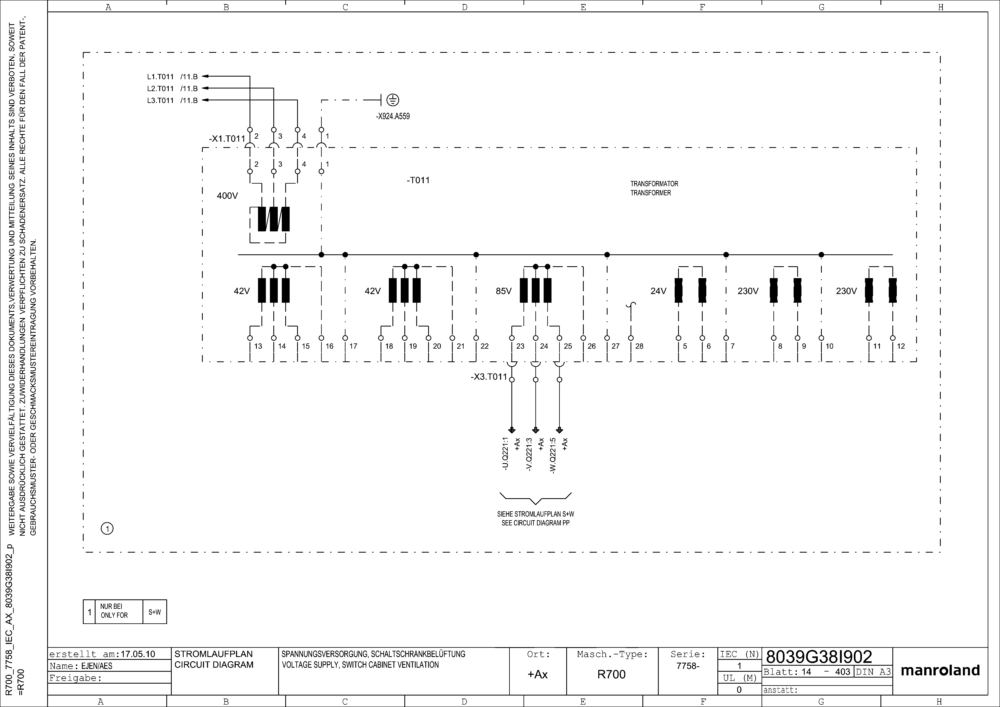

# +Ax — Sheet 14 of 403 — SPANNUNGSVERSORGUNG, SCHALTSCHRANKBELÜFTUNG

**VOLTAGE SUPPLY, SWITCH CABINET VENTILATION**

> Part of the manroland **R700** printing press IEC/UL circuit diagrams.
> Drawing class: **Stromlaufplan / Circuit diagram** (DIN A3).
> Document `+Ax` covers the **Central control console** machine section.

## At a glance

| Field | Value |
|---|---|
| Document | `+Ax`  (8039G38I902) |
| Sheet | **14** of 403 |
| Section (DE) | SPANNUNGSVERSORGUNG, SCHALTSCHRANKBELÜFTUNG |
| Section (EN) | VOLTAGE SUPPLY, SWITCH CABINET VENTILATION |
| Section type | POWER_SUPPLY — Voltage supply |
| Machine type | `R700` |
| Series | `7758` |
| Created | 17.05.10 |
| Replaces | — |
| Columns used | A, B, C, D, E, F, G, H |
| Path numbers | — |
| Labels on sheet | 64 |
| Cross-refs out | 3 |
| Cross-refs in | 10 |

**Previous:** [+Ax sheet 13](SHEET_0013.md) · **Next:** [+Ax sheet 15](SHEET_0015.md) · **Document TOC:** [_TOC.md](_TOC.md)  (+Ax) · **Master TOC:** [all sheets](../_MASTER_TOC.md)

## Sheet image (300 DPI, exact vector render)



_Rendered directly from the PDF vector layer at 300 DPI (1-bit), no OCR and no resampling. Use it to confirm anything ambiguous in the text below._

## Cross-references on this sheet

Each entry is a wire leaving this sheet. The printed token is `/sheet.column`; the link resolves to that sheet inside the same document.

| Ref | Target sheet | Col | Path | Destination on target | Target section | From col |
|---|---|---|---|---|---|---|
| `/11.B` | [+Ax sheet 11](SHEET_0011.md) | B | — | L1.T011 | SPANNUNGSVERSORGUNG, SCHALTSCHRANKBELÜFTUNG | B |
| `/11.B` | [+Ax sheet 11](SHEET_0011.md) | B | — | L2.T011 | SPANNUNGSVERSORGUNG, SCHALTSCHRANKBELÜFTUNG | B |
| `/11.B` | [+Ax sheet 11](SHEET_0011.md) | B | — | L3.T011 | SPANNUNGSVERSORGUNG, SCHALTSCHRANKBELÜFTUNG | B |

### Incoming references (sheets that point here)

Every other sheet that sends a wire to this one. `Back-ref` is the token printed on *that* sheet; `Path` is its line number.

| From sheet | Cols | Back-ref | Path | Refs | What continues there |
|---|---|---|---|---|---|
| [+Ax#11](SHEET_0011.md) | B | `/11.B` | — | 3 | L1.T011; L2.T011; L3.T011 |
| [+Ax#216](SHEET_0216.md) | A | `/216.A` | — | 4 | — |
| [+Ax#225](SHEET_0225.md) | H | `/225.H` | — | 3 | — |


## Devices on this sheet

| Tag | Class | Class meaning (IEC) | Col | Sub | Terminal | Sign |
|---|---|---|---|---|---|---|
| `T011` | T | Transformator / transformer | D | — | — | — |
| `X1.T011` | — | cross-device reference | B | — | — | — |
| `U.Q221:1` | — | cross-device reference | D | — | 1 | — |
| `V.Q221:3` | — | cross-device reference | E | — | 3 | — |
| `W.Q221:5` | — | cross-device reference | E | — | 5 | — |
| `X3.T011` | — | cross-device reference | D | — | — | — |
| `X924.A559` | — | cross-device reference | C | — | — | — |

## Potentials / nets

| Potential | Count | Columns | Attached devices | Terminals |
|---|---|---|---|---|
| `230V` | 2 | F, G | — | — |
| `24V` | 1 | F | — | — |
| `400V` | 1 | B | — | — |
| `42V` | 2 | B, C | — | — |
| `85V` | 1 | D | — | — |
| `L1` | 1 | A | `T011` | — |
| `L2` | 1 | A | `T011` | — |
| `L3` | 1 | A | `T011` | — |


A potential such as `L24+/4` or `M24+` is a named supply/return rail; every place it appears on this sheet is electrically common.

## Wire-end annotations (grouped as printed)

A wire that continues elsewhere is annotated with a small cluster: the destination description, the path/line number `#NN`, and the `/sheet.column` cross reference. Each row below is one such cluster exactly as it is grouped on the drawing.

| Col | Y | Path | Cross-ref | Text on the wire |
|---|---|---|---|---|
| B | 87.4 | — | `/11.B` | `L1.T011` |
| B | 101.6 | — | `/11.B` | `L2.T011` |
| B | 115.8 | — | `/11.B` | `L3.T011` |
| C | 134.8 | — | — | `X924.A559` |
| B | 158.4 | — | — | `X1.T011 2 3 4` |
| C | 158.4 | — | — | `1` |
| C | 191.7 | — | — | `2 3 4 1` |
| E | 210.1 | — | — | `T011 TRANSFORMATOR TRANSFORMER` |
| B | 228.5 | — | — | `400V` |
| B | 341.9 | — | — | `42V` |
| E | 341.9 | — | — | `42V 85V 24V 230V 230V` |
| E | 408.5 | — | — | `13 14 15 16 17 18 19 20 21 22 23 24 25 26 27 28 5 6 7 8 9 10 11 12` |
| D | 443.9 | — | — | `X3.T011` |
| D | 519.9 | — | — | `U.Q221:1` |
| E | 521.3 | — | — | `V.Q221:3` |
| E | 521.3 | — | — | `W.Q221:5` |
| D | 521.6 | — | — | `+Ax` |
| E | 521.6 | — | — | `+Ax` |
| E | 521.6 | — | — | `+Ax` |
| E | 609.4 | — | — | `SIEHE STROMLAUFPLAN S+W` |
| C | 620.0 | — | — | `1 SEE CIRCUIT DIAGRAM PP` |
| A | 719.2 | — | — | `NUR BEI` |
| A | 724.5 | — | — | `1 ONLY FOR S+W` |


## Reconstructed tables

This sheet carries tabular content (pin map / terminal assignment / index). The grid below was rebuilt from the drawing's own rule lines, so each row is exactly one physical row of the table.

### Table 1 — 2 data rows × 2 columns (at x=240.9, y=90.7)

| X1.T011 | 2 |
|---|---|
| `400V` | `2` |
| `42V` | `13` |


### Table 2 — 3 data rows × 1 columns (at x=330.2, y=90.7)

| C1 |
|---|
| `3` |
| `3` |
| `14` |


### Table 3 — 2 data rows × 3 columns (at x=354.3, y=90.7)

| 4 | 1 |  |
|---|---|---|
| `4` | `1` |  |
| `15` | `16` | `42V 17 18` |


### Table 4 — 0 data rows × 4 columns (at x=496.1, y=90.7) — **T011**

_none_


### Table 5 — 0 data rows × 4 columns (at x=666.1, y=90.7) — **TRANSFORMATOR TRANSFORMER**

_none_


## Notes and free text on this sheet

| Text | Col | Y (pt) |
|---|---|---|
| `TRANSFORMATOR` | F | 216.08 |
| `TRANSFORMER` | F | 226.71 |
| `+Ax` | D | 521.58 |
| `+Ax` | E | 521.58 |
| `SIEHE STROMLAUFPLAN S+W` | E | 609.35 |
| `SEE CIRCUIT DIAGRAM PP` | E | 620 |
| `NUR BEI` | A | 719.16 |
| `ONLY FOR` | A | 729.85 |
| `S+W` | A | 726.15 |

## Complete label inventory (exact text from the drawing)

Every text object inside the drawing area of this sheet, in DIN reading order (column A→H, then top→bottom). This is the authoritative list: if a string is not here it is not printed on this sheet.

| Col | Y | X | Dir | Type | Text |
|---|---|---|---|---|---|
| A | 87.5 | 175.2 | → | potential | `L1.T011` |
| A | 101.6 | 175.2 | → | potential | `L2.T011` |
| A | 115.8 | 175.2 | → | potential | `L3.T011` |
| A | 626.2 | 125.8 | → | number | `1` |
| A | 719.2 | 119.6 | → | text | `NUR BEI` |
| A | 724.5 | 103.7 | → | number | `1` |
| A | 726.2 | 177.0 | → | text | `S+W` |
| A | 729.8 | 120.2 | → | text | `ONLY FOR` |
| B | 87.4 | 214.9 | → | cross-reference | `/11.B` |
| B | 101.6 | 214.9 | → | cross-reference | `/11.B` |
| B | 115.8 | 214.9 | → | cross-reference | `/11.B` |
| B | 158.4 | 303.0 | → | number | `2` |
| B | 158.4 | 331.4 | → | number | `3` |
| B | 160.5 | 248.9 | → | device ref | `X1.T011` |
| B | 191.7 | 303.0 | → | number | `2` |
| B | 191.7 | 331.4 | → | number | `3` |
| B | 228.5 | 258.5 | → | potential | `400V` |
| B | 341.9 | 278.6 | → | potential | `42V` |
| B | 408.5 | 302.5 | → | number | `13` |
| B | 408.5 | 330.8 | → | number | `14` |
| C | 134.8 | 447.8 | → | device ref | `X924.A559` |
| C | 158.4 | 359.7 | → | number | `4` |
| C | 158.4 | 387.5 | → | number | `1` |
| C | 191.7 | 359.7 | → | number | `4` |
| C | 191.7 | 387.5 | → | number | `1` |
| C | 341.9 | 434.6 | → | potential | `42V` |
| C | 408.5 | 359.1 | → | number | `15` |
| C | 408.5 | 387.5 | → | number | `16` |
| C | 408.5 | 415.8 | → | number | `17` |
| C | 408.5 | 458.4 | → | number | `18` |
| D | 210.1 | 484.4 | → | device tag | `T011` |
| D | 341.9 | 590.5 | → | potential | `85V` |
| D | 408.5 | 486.7 | → | number | `19` |
| D | 408.5 | 515.6 | → | number | `20` |
| D | 408.5 | 544.0 | → | number | `21` |
| D | 408.5 | 572.3 | → | number | `22` |
| D | 408.5 | 614.8 | → | number | `23` |
| D | 443.9 | 560.7 | → | device ref | `X3.T011` |
| D | 519.9 | 597.7 | ↕ | device ref | `U.Q221:1` |
| D | 521.6 | 611.9 | ↕ | text | `+Ax` |
| E | 408.5 | 643.2 | → | number | `24` |
| E | 408.5 | 671.5 | → | number | `25` |
| E | 408.5 | 699.9 | → | number | `26` |
| E | 408.5 | 728.2 | → | number | `27` |
| E | 408.5 | 756.6 | → | number | `28` |
| E | 521.3 | 626.0 | ↕ | device ref | `V.Q221:3` |
| E | 521.3 | 654.3 | ↕ | device ref | `W.Q221:5` |
| E | 521.6 | 640.3 | ↕ | text | `+Ax` |
| E | 521.6 | 668.6 | ↕ | text | `+Ax` |
| E | 609.4 | 592.0 | → | text | `SIEHE STROMLAUFPLAN S+W` |
| E | 620.0 | 597.4 | → | text | `SEE CIRCUIT DIAGRAM PP` |
| F | 216.1 | 750.9 | → | text | `TRANSFORMATOR` |
| F | 226.7 | 750.9 | → | text | `TRANSFORMER` |
| F | 341.9 | 774.7 | → | potential | `24V` |
| F | 341.9 | 878.5 | → | potential | `230V` |
| F | 408.5 | 813.3 | → | number | `5` |
| F | 408.5 | 841.6 | → | number | `6` |
| F | 408.5 | 870.0 | → | number | `7` |
| G | 341.9 | 995.5 | → | potential | `230V` |
| G | 408.5 | 926.6 | → | number | `8` |
| G | 408.5 | 955.0 | → | number | `9` |
| G | 408.5 | 982.8 | → | number | `10` |
| G | 408.5 | 1039.5 | → | number | `11` |
| H | 408.5 | 1067.8 | → | number | `12` |

## Reading-order text block

The same content as a plain block, grouped by DIN column — convenient to paste or to match against a visual description.

```text
=== Column A ===
  87.5  175.2  net          L1.T011
 101.6  175.2  net          L2.T011
 115.8  175.2  net          L3.T011
 626.2  125.8  numeric      1
 719.2  119.6  text         NUR BEI
 724.5  103.7  numeric      1
 726.2  177.0  text         S+W
 729.8  120.2  text         ONLY FOR
=== Column B ===
  87.4  214.9  xref         /11.B
 101.6  214.9  xref         /11.B
 115.8  214.9  xref         /11.B
 158.4  303.0  numeric      2
 158.4  331.4  numeric      3
 160.5  248.9  devref       X1.T011
 191.7  303.0  numeric      2
 191.7  331.4  numeric      3
 228.5  258.5  net          400V
 341.9  278.6  net          42V
 408.5  302.5  numeric      13
 408.5  330.8  numeric      14
=== Column C ===
 134.8  447.8  devref       X924.A559
 158.4  359.7  numeric      4
 158.4  387.5  numeric      1
 191.7  359.7  numeric      4
 191.7  387.5  numeric      1
 341.9  434.6  net          42V
 408.5  359.1  numeric      15
 408.5  387.5  numeric      16
 408.5  415.8  numeric      17
 408.5  458.4  numeric      18
=== Column D ===
 210.1  484.4  devtag       T011
 341.9  590.5  net          85V
 408.5  486.7  numeric      19
 408.5  515.6  numeric      20
 408.5  544.0  numeric      21
 408.5  572.3  numeric      22
 408.5  614.8  numeric      23
 443.9  560.7  devref       X3.T011
 519.9  597.7  devref       U.Q221:1
 521.6  611.9  text         +Ax
=== Column E ===
 408.5  643.2  numeric      24
 408.5  671.5  numeric      25
 408.5  699.9  numeric      26
 408.5  728.2  numeric      27
 408.5  756.6  numeric      28
 521.3  626.0  devref       V.Q221:3
 521.3  654.3  devref       W.Q221:5
 521.6  640.3  text         +Ax
 521.6  668.6  text         +Ax
 609.4  592.0  text         SIEHE STROMLAUFPLAN S+W
 620.0  597.4  text         SEE CIRCUIT DIAGRAM PP
=== Column F ===
 216.1  750.9  text         TRANSFORMATOR
 226.7  750.9  text         TRANSFORMER
 341.9  774.7  net          24V
 341.9  878.5  net          230V
 408.5  813.3  numeric      5
 408.5  841.6  numeric      6
 408.5  870.0  numeric      7
=== Column G ===
 341.9  995.5  net          230V
 408.5  926.6  numeric      8
 408.5  955.0  numeric      9
 408.5  982.8  numeric      10
 408.5 1039.5  numeric      11
=== Column H ===
 408.5 1067.8  numeric      12
```

---
_Generated from the PDF vector text layer; no OCR. Source: `R700_7758_IEC_AX_8039G38I902_p`, sheet 14._
