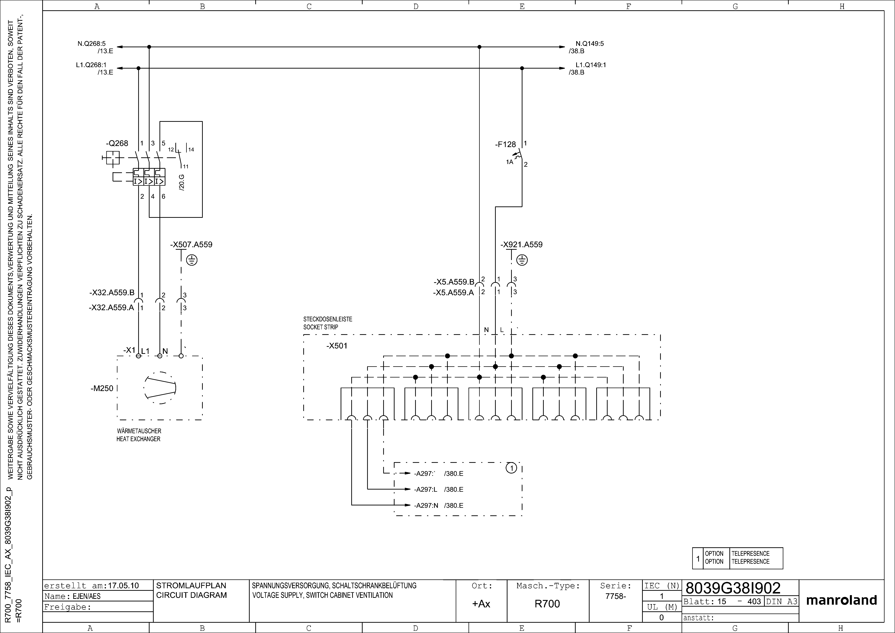

# +Ax — Sheet 15 of 403 — SPANNUNGSVERSORGUNG, SCHALTSCHRANKBELÜFTUNG

**VOLTAGE SUPPLY, SWITCH CABINET VENTILATION**

> Part of the manroland **R700** printing press IEC/UL circuit diagrams.
> Drawing class: **Stromlaufplan / Circuit diagram** (DIN A3).
> Document `+Ax` covers the **Central control console** machine section.

## At a glance

| Field | Value |
|---|---|
| Document | `+Ax`  (8039G38I902) |
| Sheet | **15** of 403 |
| Section (DE) | SPANNUNGSVERSORGUNG, SCHALTSCHRANKBELÜFTUNG |
| Section (EN) | VOLTAGE SUPPLY, SWITCH CABINET VENTILATION |
| Section type | POWER_SUPPLY — Voltage supply |
| Machine type | `R700` |
| Series | `7758` |
| Created | 17.05.10 |
| Replaces | — |
| Columns used | A, B, C, D, E, F, G |
| Path numbers | — |
| Labels on sheet | 66 |
| Cross-refs out | 8 |
| Cross-refs in | 20 |

**Previous:** [+Ax sheet 14](SHEET_0014.md) · **Next:** [+Ax sheet 16](SHEET_0016.md) · **Document TOC:** [_TOC.md](_TOC.md)  (+Ax) · **Master TOC:** [all sheets](../_MASTER_TOC.md)

## Sheet image (300 DPI, exact vector render)



_Rendered directly from the PDF vector layer at 300 DPI (1-bit), no OCR and no resampling. Use it to confirm anything ambiguous in the text below._

## Cross-references on this sheet

Each entry is a wire leaving this sheet. The printed token is `/sheet.column`; the link resolves to that sheet inside the same document.

| Ref | Target sheet | Col | Path | Destination on target | Target section | From col |
|---|---|---|---|---|---|---|
| `/13.E` | [+Ax sheet 13](SHEET_0013.md) | E | — | N.Q268:5 N.Q149:5 | SPANNUNGSVERSORGUNG, SCHALTSCHRANKBELÜFTUNG | C |
| `/38.B` | [+Ax sheet 38](SHEET_0038.md) | B | — | — | HAUPTANTRIEB | F |
| `/13.E` | [+Ax sheet 13](SHEET_0013.md) | E | — | L1.Q268:1 | SPANNUNGSVERSORGUNG, SCHALTSCHRANKBELÜFTUNG | A |
| `/38.B` | [+Ax sheet 38](SHEET_0038.md) | B | — | — | HAUPTANTRIEB | F |
| `/20.G` | [+Ax sheet 20](SHEET_0020.md) | G | — | — | SPANNUNGSVERSORGUNG, SCHALTSCHRANKBELÜFTUNG | B |
| `/380.E` | [+Ax sheet 380](SHEET_0380.md) | E | — | A297:` | OPTION: TELEPRESENCE | D |
| `/380.E` | [+Ax sheet 380](SHEET_0380.md) | E | — | A297:L | OPTION: TELEPRESENCE | D |
| `/380.E` | [+Ax sheet 380](SHEET_0380.md) | E | — | A297:N | OPTION: TELEPRESENCE | D |

### Incoming references (sheets that point here)

Every other sheet that sends a wire to this one. `Back-ref` is the token printed on *that* sheet; `Path` is its line number.

| From sheet | Cols | Back-ref | Path | Refs | What continues there |
|---|---|---|---|---|---|
| [+Ax#13](SHEET_0013.md) | F | `/13.F` | — | 2 | — |
| [+Ax#20](SHEET_0020.md) | G | `/20.G` | — | 1 | — |
| [+Ax#38](SHEET_0038.md) | B, D | `/38.B`, `/38.D` | — | 2 | L1.Q149:1 L1.Q131:1 L1.Q115:1; N.Q149:5 N.Q131:5 |
| [+Ax#232](SHEET_0232.md) | F | `/232.F` | — | 6 | — |
| [+Ax#275](SHEET_0275.md) | D | `/275.D` | — | 6 | — |
| [+Ax#380](SHEET_0380.md) | E | `/380.E` | — | 3 | A297:L; A297:N; A297:` |


## Devices on this sheet

| Tag | Class | Class meaning (IEC) | Col | Sub | Terminal | Sign |
|---|---|---|---|---|---|---|
| `Q268` | Q | Leistungsschalter / power switching device | A | — | — | — |
| `X1` | X | Klemme / terminal, plug connector | A | — | — | — |
| `X501` | X | Klemme / terminal, plug connector | C | — | — | — |
| `F128` | F | Schutz / protection device (fuse, circuit breaker) | E | — | — | — |
| `A297:L` | A | Baugruppe / assembly, module, PC board | D | — | L | — |
| `A297:N` | A | Baugruppe / assembly, module, PC board | D | — | N | — |
| `X32.A559.B` | — | cross-device reference | A | — | — | — |
| `X32.A559.A` | — | cross-device reference | A | — | — | — |
| `X5.A559.A` | — | cross-device reference | D | — | — | — |
| `X5.A559.B` | — | cross-device reference | D | — | — | — |
| `X507.A559` | — | cross-device reference | B | — | — | — |
| `X921.A559` | — | cross-device reference | E | — | — | — |

## Potentials / nets

| Potential | Count | Columns | Attached devices | Terminals |
|---|---|---|---|---|
| `L1` | 3 | A, F | `Q149`, `Q268` | `1` |
| `M250` | 1 | A | — | — |
| `N` | 4 | A, B, E, F | `Q149`, `Q268` | `5` |


A potential such as `L24+/4` or `M24+` is a named supply/return rail; every place it appears on this sheet is electrically common.

## Wire-end annotations (grouped as printed)

A wire that continues elsewhere is annotated with a small cluster: the destination description, the path/line number `#NN`, and the `/sheet.column` cross reference. Each row below is one such cluster exactly as it is grouped on the drawing.

| Col | Y | Path | Cross-ref | Text on the wire |
|---|---|---|---|---|
| C | 54.1 | — | `/13.E` | `N.Q268:5 N.Q149:5` |
| F | 64.0 | — | `/38.B` | — |
| A | 82.5 | — | `/13.E` | `L1.Q268:1` |
| F | 82.5 | — | — | `L1.Q149:1` |
| F | 92.4 | — | `/38.B` | — |
| A | 186.0 | — | — | `Q268` |
| A | 186.7 | — | — | `1` |
| B | 186.7 | — | — | `3` |
| B | 186.7 | — | — | `5` |
| E | 186.7 | — | — | `1` |
| E | 187.4 | — | — | `F128` |
| B | 195.8 | — | — | `12 14` |
| E | 211.9 | — | — | `1A 2` |
| B | 218.4 | — | — | `11` |
| B | 231.9 | — | `/20.G` | — |
| A | 257.6 | — | — | `2` |
| B | 257.6 | — | — | `4` |
| B | 257.6 | — | — | `6` |
| B | 320.6 | — | — | `X507.A559` |
| E | 320.6 | — | — | `X921.A559` |
| E | 367.4 | — | — | `X5.A559.B 2 1 3` |
| A | 384.4 | — | — | `X32.A559.B 1 2 3` |
| E | 384.4 | — | — | `X5.A559.A 2 1 3` |
| A | 404.2 | — | — | `X32.A559.A 1 2 3` |
| D | 421.6 | — | — | `STECKDOSENLEISTE SOCKET STRIP N L '` |
| B | 455.3 | — | — | `X1 L1 N ' X501` |
| A | 512.0 | — | — | `M250` |
| A | 570.4 | — | — | `HEAT EXCHANGER WÄRMETAUSCHER` |
| E | 619.1 | — | — | `1` |
| D | 626.0 | — | `/380.E` | `A297:'` |
| D | 647.3 | — | `/380.E` | `A297:L` |
| D | 668.5 | — | `/380.E` | `A297:N` |
| G | 733.4 | — | — | `1 OPTION OPTION` |
| G | 733.4 | — | — | `TELEPRESENCE TELEPRESENCE` |


## Reconstructed tables

This sheet carries tabular content (pin map / terminal assignment / index). The grid below was rebuilt from the drawing's own rule lines, so each row is exactly one physical row of the table.

### Table 1 — 2 data rows × 1 columns (at x=184.3, y=62.4)

| C1 |
|---|
| `1` |
| `2` |


### Table 2 — 2 data rows × 1 columns (at x=198.4, y=62.4)

| C1 |
|---|
| `3` |
| `4` |


### Table 3 — 3 data rows × 3 columns (at x=212.6, y=62.4)

| 5 | 12 | 14 |
|---|---|---|
|  |  | `11` |
|  |  | `/20.G` |
| `6` |  |  |


### Table 4 — 2 data rows × 1 columns (at x=552.8, y=62.4)

| C1 |
|---|
| `A297:'` |
| `A297:L` |


### Table 5 — 3 data rows × 1 columns (at x=595.3, y=62.4)

| C1 |
|---|
| `X5.A559.B X5.A559.A` |
| `/380.E` |
| `/380.E` |


### Table 6 — 1 data rows × 4 columns (at x=637.8, y=62.4)

| 2 2 N | F128 1A 1 1 L | X921.A559 3 3 ` | 1 2 |
|---|---|---|---|
|  |  | `1` |  |


### Table 7 — 1 data rows × 2 columns (at x=765.4, y=62.4)

| /38.B | L1.Q149:1 |
|---|---|
| `/38.B` |  |


## Notes and free text on this sheet

| Text | Col | Y (pt) |
|---|---|---|
| `WÄRMETAUSCHER` | A | 570.38 |
| `HEAT EXCHANGER` | A | 581.02 |
| `STECKDOSENLEISTE` | C | 421.56 |
| `SOCKET STRIP` | C | 432.19 |
| `L` | E | 434.73 |
| `1A` | E | 211.95 |
| `A297:'` | D | 626.05 |
| `OPTION` | G | 733.35 |
| `TELEPRESENCE` | G | 733.37 |

## Complete label inventory (exact text from the drawing)

Every text object inside the drawing area of this sheet, in DIN reading order (column A→H, then top→bottom). This is the authoritative list: if a string is not here it is not printed on this sheet.

| Col | Y | X | Dir | Type | Text |
|---|---|---|---|---|---|
| A | 54.2 | 103.2 | → | potential | `N.Q268:5` |
| A | 64.0 | 130.1 | → | cross-reference | `/13.E` |
| A | 82.5 | 101.2 | → | potential | `L1.Q268:1` |
| A | 92.4 | 130.1 | → | cross-reference | `/13.E` |
| A | 186.0 | 141.2 | → | device tag | `Q268` |
| A | 186.7 | 186.2 | → | number | `1` |
| A | 257.6 | 186.8 | → | number | `2` |
| A | 384.4 | 119.1 | → | device ref | `X32.A559.B` |
| A | 388.7 | 186.2 | → | number | `1` |
| A | 404.2 | 118.2 | → | device ref | `X32.A559.A` |
| A | 405.7 | 186.2 | → | number | `1` |
| A | 461.0 | 164.1 | → | device tag | `X1` |
| A | 462.3 | 187.7 | → | potential | `L1` |
| A | 512.0 | 120.8 | → | potential | `M250` |
| A | 570.4 | 155.9 | → | text | `WÄRMETAUSCHER` |
| A | 581.0 | 155.1 | → | text | `HEAT EXCHANGER` |
| B | 186.7 | 201.0 | → | number | `3` |
| B | 186.7 | 215.1 | → | number | `5` |
| B | 195.8 | 223.4 | → | number | `12` |
| B | 195.8 | 250.3 | → | number | `14` |
| B | 218.4 | 243.2 | → | number | `11` |
| B | 231.9 | 237.7 | ↕ | cross-reference | `/20.G` |
| B | 257.6 | 201.0 | → | number | `4` |
| B | 257.6 | 215.1 | → | number | `6` |
| B | 320.6 | 226.5 | → | device ref | `X507.A559` |
| B | 388.7 | 215.1 | → | number | `2` |
| B | 388.7 | 243.5 | → | number | `3` |
| B | 405.7 | 215.1 | → | number | `2` |
| B | 405.7 | 243.5 | → | number | `3` |
| B | 460.5 | 244.6 | → | other | `'` |
| B | 462.4 | 216.0 | → | potential | `N` |
| C | 421.6 | 403.7 | → | text | `STECKDOSENLEISTE` |
| C | 432.2 | 403.7 | → | text | `SOCKET STRIP` |
| C | 455.3 | 434.3 | → | device tag | `X501` |
| D | 370.2 | 577.1 | → | device ref | `X5.A559.B` |
| D | 384.4 | 576.3 | → | device ref | `X5.A559.A` |
| D | 626.0 | 551.1 | → | text | `A297:'` |
| D | 626.0 | 591.0 | → | cross-reference | `/380.E` |
| D | 647.3 | 551.1 | → | device tag | `A297:L` |
| D | 647.3 | 591.0 | → | cross-reference | `/380.E` |
| D | 668.5 | 591.0 | → | cross-reference | `/380.E` |
| D | 668.6 | 551.1 | → | device tag | `A297:N` |
| E | 186.7 | 696.5 | → | number | `1` |
| E | 187.4 | 658.8 | → | device tag | `F128` |
| E | 211.9 | 672.9 | → | text | `1A` |
| E | 215.0 | 697.0 | → | number | `2` |
| E | 320.6 | 665.9 | → | device ref | `X921.A559` |
| E | 367.4 | 640.3 | → | number | `2` |
| E | 367.4 | 661.0 | → | number | `1` |
| E | 367.4 | 682.9 | → | number | `3` |
| E | 384.4 | 640.3 | → | number | `2` |
| E | 384.4 | 661.0 | → | number | `1` |
| E | 384.4 | 682.9 | → | number | `3` |
| E | 434.7 | 644.0 | → | potential | `N` |
| E | 434.7 | 665.3 | → | text | `L` |
| E | 434.8 | 687.1 | → | other | `'` |
| E | 619.1 | 678.6 | → | number | `1` |
| F | 54.2 | 765.9 | → | potential | `N.Q149:5` |
| F | 64.0 | 756.9 | → | cross-reference | `/38.B` |
| F | 82.5 | 765.9 | → | potential | `L1.Q149:1` |
| F | 92.4 | 756.9 | → | cross-reference | `/38.B` |
| G | 733.4 | 938.0 | → | text | `OPTION` |
| G | 733.4 | 973.4 | → | text | `TELEPRESENCE` |
| G | 738.7 | 925.8 | → | number | `1` |
| G | 744.0 | 938.0 | → | text | `OPTION` |
| G | 744.0 | 973.4 | → | text | `TELEPRESENCE` |

## Reading-order text block

The same content as a plain block, grouped by DIN column — convenient to paste or to match against a visual description.

```text
=== Column A ===
  54.2  103.2  net          N.Q268:5
  64.0  130.1  xref         /13.E
  82.5  101.2  net          L1.Q268:1
  92.4  130.1  xref         /13.E
 186.0  141.2  devtag       Q268
 186.7  186.2  numeric      1
 257.6  186.8  numeric      2
 384.4  119.1  devref       X32.A559.B
 388.7  186.2  numeric      1
 404.2  118.2  devref       X32.A559.A
 405.7  186.2  numeric      1
 461.0  164.1  devtag       X1
 462.3  187.7  net          L1
 512.0  120.8  net          M250
 570.4  155.9  text         WÄRMETAUSCHER
 581.0  155.1  text         HEAT EXCHANGER
=== Column B ===
 186.7  201.0  numeric      3
 186.7  215.1  numeric      5
 195.8  223.4  numeric      12
 195.8  250.3  numeric      14
 218.4  243.2  numeric      11
 231.9  237.7  xref         /20.G
 257.6  201.0  numeric      4
 257.6  215.1  numeric      6
 320.6  226.5  devref       X507.A559
 388.7  215.1  numeric      2
 388.7  243.5  numeric      3
 405.7  215.1  numeric      2
 405.7  243.5  numeric      3
 460.5  244.6  other        `
 462.4  216.0  net          N
=== Column C ===
 421.6  403.7  text         STECKDOSENLEISTE
 432.2  403.7  text         SOCKET STRIP
 455.3  434.3  devtag       X501
=== Column D ===
 370.2  577.1  devref       X5.A559.B
 384.4  576.3  devref       X5.A559.A
 626.0  551.1  text         A297:`
 626.0  591.0  xref         /380.E
 647.3  551.1  devtag       A297:L
 647.3  591.0  xref         /380.E
 668.5  591.0  xref         /380.E
 668.6  551.1  devtag       A297:N
=== Column E ===
 186.7  696.5  numeric      1
 187.4  658.8  devtag       F128
 211.9  672.9  text         1A
 215.0  697.0  numeric      2
 320.6  665.9  devref       X921.A559
 367.4  640.3  numeric      2
 367.4  661.0  numeric      1
 367.4  682.9  numeric      3
 384.4  640.3  numeric      2
 384.4  661.0  numeric      1
 384.4  682.9  numeric      3
 434.7  644.0  net          N
 434.7  665.3  text         L
 434.8  687.1  other        `
 619.1  678.6  numeric      1
=== Column F ===
  54.2  765.9  net          N.Q149:5
  64.0  756.9  xref         /38.B
  82.5  765.9  net          L1.Q149:1
  92.4  756.9  xref         /38.B
=== Column G ===
 733.4  938.0  text         OPTION
 733.4  973.4  text         TELEPRESENCE
 738.7  925.8  numeric      1
 744.0  938.0  text         OPTION
 744.0  973.4  text         TELEPRESENCE
```

---
_Generated from the PDF vector text layer; no OCR. Source: `R700_7758_IEC_AX_8039G38I902_p`, sheet 15._
