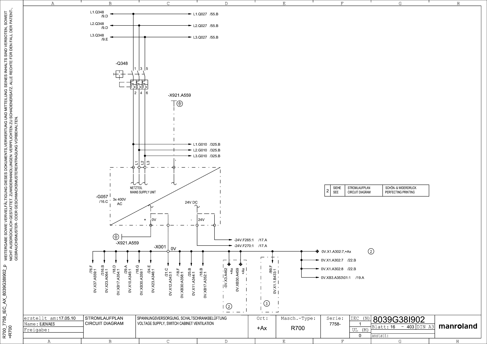

# +Ax — Sheet 16 of 403 — SPANNUNGSVERSORGUNG, SCHALTSCHRANKBELÜFTUNG

**VOLTAGE SUPPLY, SWITCH CABINET VENTILATION**

> Part of the manroland **R700** printing press IEC/UL circuit diagrams.
> Drawing class: **Stromlaufplan / Circuit diagram** (DIN A3).
> Document `+Ax` covers the **Central control console** machine section.

## At a glance

| Field | Value |
|---|---|
| Document | `+Ax`  (8039G38I902) |
| Sheet | **16** of 403 |
| Section (DE) | SPANNUNGSVERSORGUNG, SCHALTSCHRANKBELÜFTUNG |
| Section (EN) | VOLTAGE SUPPLY, SWITCH CABINET VENTILATION |
| Section type | POWER_SUPPLY — Voltage supply |
| Machine type | `R700` |
| Series | `7758` |
| Created | 17.05.10 |
| Replaces | — |
| Columns used | B, C, D, E, F, G |
| Path numbers | — |
| Labels on sheet | 90 |
| Cross-refs out | 26 |
| Cross-refs in | 26 |

**Previous:** [+Ax sheet 15](SHEET_0015.md) · **Next:** [+Ax sheet 17](SHEET_0017.md) · **Document TOC:** [_TOC.md](_TOC.md)  (+Ax) · **Master TOC:** [all sheets](../_MASTER_TOC.md)

## Sheet image (300 DPI, exact vector render)



_Rendered directly from the PDF vector layer at 300 DPI (1-bit), no OCR and no resampling. Use it to confirm anything ambiguous in the text below._

## Cross-references on this sheet

Each entry is a wire leaving this sheet. The printed token is `/sheet.column`; the link resolves to that sheet inside the same document.

| Ref | Target sheet | Col | Path | Destination on target | Target section | From col |
|---|---|---|---|---|---|---|
| `/9.D` | [+Ax sheet 9](SHEET_0009.md) | D | — | L1.Q348 | SPANNUNGSVERSORGUNG, SCHALTSCHRANKBELÜFTUNG | B |
| `/55.B` | [+Ax sheet 55](SHEET_0055.md) | B | — | L1.Q027 | LUFTVERSORGUNG | D |
| `/9.D` | [+Ax sheet 9](SHEET_0009.md) | D | — | L2.Q348 | SPANNUNGSVERSORGUNG, SCHALTSCHRANKBELÜFTUNG | B |
| `/55.B` | [+Ax sheet 55](SHEET_0055.md) | B | — | L2.Q027 | LUFTVERSORGUNG | D |
| `/9.E` | [+Ax sheet 9](SHEET_0009.md) | E | — | L3.Q348 | SPANNUNGSVERSORGUNG, SCHALTSCHRANKBELÜFTUNG | B |
| `/55.B` | [+Ax sheet 55](SHEET_0055.md) | B | — | L3.Q027 | LUFTVERSORGUNG | D |
| `/325.B` | [+Ax sheet 325](SHEET_0325.md) | B | — | L1.G010 | OPTION: AUTOMATISCHE FARBZUFÜHRUNG | D |
| `/325.B` | [+Ax sheet 325](SHEET_0325.md) | B | — | L2.G010 | OPTION: AUTOMATISCHE FARBZUFÜHRUNG | D |
| `/325.B` | [+Ax sheet 325](SHEET_0325.md) | B | — | L3.G010 | OPTION: AUTOMATISCHE FARBZUFÜHRUNG | D |
| `/16.C` | [+Ax sheet 16](SHEET_0016.md) | C | — | — | SPANNUNGSVERSORGUNG, SCHALTSCHRANKBELÜFTUNG | B |
| `/17.A` | [+Ax sheet 17](SHEET_0017.md) | A | — | 24V.F265:1 | SPANNUNGSVERSORGUNG, SCHALTSCHRANKBELÜFTUNG | D |
| `/17.A` | [+Ax sheet 17](SHEET_0017.md) | A | — | 24V.F270:1 | SPANNUNGSVERSORGUNG, SCHALTSCHRANKBELÜFTUNG | D |
| `/22.B` | [+Ax sheet 22](SHEET_0022.md) | B | — | 0V.X1.A302:7 | SPANNUNGSVERSORGUNG, SCHALTSCHRANKBELÜFTUNG | F |
| `/18.G` | [+Ax sheet 18](SHEET_0018.md) | G | — | — | SPANNUNGSVERSORGUNG, SCHALTSCHRANKBELÜFTUNG | B |
| `/24.E` | [+Ax sheet 24](SHEET_0024.md) | E | — | — | SPANNUNGSVERSORGUNG, SCHALTSCHRANKBELÜFTUNG | C |
| `/76.F` | [+Ax sheet 76](SHEET_0076.md) | F | — | — | ANLEGER | B |
| `/316.B` | [+Ax sheet 316](SHEET_0316.md) | B | — | — | OPTION: "EJEKTOR" ANLAGE / SELECT AIRSTATION / | B |
| `/18.D` | [+Ax sheet 18](SHEET_0018.md) | D | — | — | SPANNUNGSVERSORGUNG, SCHALTSCHRANKBELÜFTUNG | B |
| `/89.F` | [+Ax sheet 89](SHEET_0089.md) | F | — | — | ANLEGER | E |
| `/29.A` | [+Ax sheet 29](SHEET_0029.md) | A | — | — | SPANNUNGSVERSORGUNG, SCHALTSCHRANKBELÜFTUNG | B |
| `/22.B` | [+Ax sheet 22](SHEET_0022.md) | B | — | 0V.X1.A302:8 | SPANNUNGSVERSORGUNG, SCHALTSCHRANKBELÜFTUNG | F |
| `/21.C` | [+Ax sheet 21](SHEET_0021.md) | C | — | — | SPANNUNGSVERSORGUNG, SCHALTSCHRANKBELÜFTUNG | C |
| `/18.F` | [+Ax sheet 18](SHEET_0018.md) | F | — | — | SPANNUNGSVERSORGUNG, SCHALTSCHRANKBELÜFTUNG | C |
| `/25.B` | [+Ax sheet 25](SHEET_0025.md) | B | — | — | SPANNUNGSVERSORGUNG, SCHALTSCHRANKBELÜFTUNG | C |
| `/18.B` | [+Ax sheet 18](SHEET_0018.md) | B | — | — | SPANNUNGSVERSORGUNG, SCHALTSCHRANKBELÜFTUNG | D |
| `/19.A` | [+Ax sheet 19](SHEET_0019.md) | A | — | 0V.XB3.A353\01:1 | SPANNUNGSVERSORGUNG, SCHALTSCHRANKBELÜFTUNG | F |

### Incoming references (sheets that point here)

Every other sheet that sends a wire to this one. `Back-ref` is the token printed on *that* sheet; `Path` is its line number.

| From sheet | Cols | Back-ref | Path | Refs | What continues there |
|---|---|---|---|---|---|
| [+Ax#9](SHEET_0009.md) | D, E | `/9.D`, `/9.E` | — | 3 | L1.Q348; L2.Q348; L3.Q348 |
| [+Ax#16](SHEET_0016.md) | B | `/16.B` | — | 1 | — |
| [+Ax#17](SHEET_0017.md) | A | `/17.A` | — | 2 | 24V.F265:1; 24V.F270:1 |
| [+Ax#18](SHEET_0018.md) | B, D, E, G | `/18.B`, `/18.D`, `/18.E`, `/18.G` | — | 4 | 0V.XB17.A352:1; 0V.XB17.A354:1; 0V.XB30.A359:1; 0V.XB30:A358:1 |
| [+Ax#19](SHEET_0019.md) | A | `/19.A` | — | 1 | 0V.XB3.A353\01:1 |
| [+Ax#21](SHEET_0021.md) | C | `/21.C` | — | 1 | 0V.X12.A343:1 |
| [+Ax#22](SHEET_0022.md) | A | `/22.A` | — | 2 | 0V.X1.A302:7; 0V.X1.A302:8 |
| [+Ax#24](SHEET_0024.md) | E | `/24.E` | — | 1 | 0V.X23.A346:1 |
| [+Ax#25](SHEET_0025.md) | A | `/25.A` | — | 1 | 0V.X11.A344:1 |
| [+Ax#29](SHEET_0029.md) | A | `/29.A` | — | 1 | 0V.X10.A345:1 0V.X9.A345:1 |
| [+Ax#55](SHEET_0055.md) | B | `/55.B` | — | 3 | L1.Q027; L2.Q027; L3.Q027 |
| [+Ax#76](SHEET_0076.md) | E | `/76.E` | — | 1 | 0V.X37.A559:1 |
| [+Ax#89](SHEET_0089.md) | F | `/89.F` | — | 1 | — |
| [+Ax#316](SHEET_0316.md) | A | `/316.A` | — | 1 | 0V.X23.A064:1 |
| [+Ax#325](SHEET_0325.md) | A, C | `/325.A`, `/325.C` | — | 3 | 24V.X60.1.A376:1 L1.G010; L2.G010; L3.G010 |


## Devices on this sheet

| Tag | Class | Class meaning (IEC) | Col | Sub | Terminal | Sign |
|---|---|---|---|---|---|---|
| `G057` | G | Stromversorgung / power supply | B | — | — | — |
| `Q348` | Q | Leistungsschalter / power switching device | B | — | — | — |
| `X001` | X | Klemme / terminal, plug connector | C | — | — | — |
| `X921.A559` | — | cross-device reference | C | — | — | — |
| `X921.A559` | — | cross-device reference | B | — | — | — |

## Potentials / nets

| Potential | Count | Columns | Attached devices | Terminals |
|---|---|---|---|---|
| `0V` | 17 | B, C, D, E, F | `1`, `A064`, `A302`, `A343`, `A344`, `A345`, `A346`, `A352`, `A353\01`, `A354`, `A359`, `A459`, `A462`, `A559`, `B433`, `X1`, `X10`, `X11`, `X12`, `X23`, `X3`, `X37`, `XB17`, `XB3`, `XB30` | `1`, `7`, `8` |
| `24V` | 4 | C, D | `F265`, `F270` | `1` |
| `L1` | 4 | B, D | `G010`, `Q027`, `Q348` | — |
| `L2` | 4 | B, C, D | `G010`, `Q027`, `Q348` | — |
| `L3` | 4 | B, C, D | `G010`, `Q027`, `Q348` | — |


A potential such as `L24+/4` or `M24+` is a named supply/return rail; every place it appears on this sheet is electrically common.

## Wire-end annotations (grouped as printed)

A wire that continues elsewhere is annotated with a small cluster: the destination description, the path/line number `#NN`, and the `/sheet.column` cross reference. Each row below is one such cluster exactly as it is grouped on the drawing.

| Col | Y | Path | Cross-ref | Text on the wire |
|---|---|---|---|---|
| B | 25.8 | — | `/9.D` | `L1.Q348` |
| D | 30.7 | — | `/55.B` | `L1.Q027` |
| B | 54.2 | — | `/9.D` | `L2.Q348` |
| D | 59.1 | — | `/55.B` | `L2.Q027` |
| B | 82.5 | — | `/9.E` | `L3.Q348` |
| D | 87.4 | — | `/55.B` | `L3.Q027` |
| B | 150.5 | — | — | `Q348` |
| C | 164.0 | — | — | `1 3 5` |
| C | 223.6 | — | — | `2 4 6` |
| C | 228.5 | — | — | `X921.A559` |
| D | 349.6 | — | `/325.B` | `L1.G010` |
| D | 363.8 | — | `/325.B` | `L2.G010` |
| D | 378.0 | — | `/325.B` | `L3.G010` |
| C | 391.0 | — | — | `'` |
| B | 393.7 | — | — | `L1` |
| C | 393.7 | — | — | `L2` |
| C | 393.7 | — | — | `L3` |
| F | 456.9 | — | — | `2 SIEHE SEE STROMLAUFPLAN CIRCUIT DIAGRAM` |
| C | 457.0 | — | — | `NETZTEIL MAINS SUPPLY UNIT` |
| G | 457.0 | — | — | `PERFECTING PRINTING SCHÖN & WIDERDRUCK` |
| B | 476.5 | — | — | `G057` |
| C | 484.4 | — | — | `3x 400V AC 24V DC` |
| B | 489.6 | — | `/16.C` | — |
| C | 533.9 | — | — | `+` |
| C | 533.9 | — | — | `0V 24V` |
| D | 583.5 | — | `/17.A` | `24V.F265:1` |
| B | 589.9 | — | — | `X921.A559` |
| D | 597.6 | — | `/17.A` | `24V.F270:1` |
| C | 599.3 | — | — | `X001 0V` |
| F | 611.9 | — | — | `0V.X1.A302:7,+Ax` |
| F | 612.6 | — | — | `2` |
| F | 633.1 | — | `/22.B` | `0V.X1.A302:7` |
| B | 648.6 | — | `/18.G` | — |
| C | 648.6 | — | `/24.E` | — |
| B | 648.9 | — | `/76.F` | — |
| B | 648.9 | — | `/316.B` | — |
| B | 648.9 | — | `/18.D` | — |
| E | 648.9 | — | `/89.F` | — |
| B | 649.1 | — | `/29.A` | — |
| F | 654.3 | — | `/22.B` | `0V.X1.A302:8` |
| D | 655.7 | — | — | `0V.X3.A462` |
| C | 655.9 | — | `/21.C` | — |
| C | 655.9 | — | `/18.F` | — |
| C | 655.9 | — | `/25.B` | — |
| D | 655.9 | — | `/18.B` | — |
| D | 655.9 | — | — | `0V.XB30.A459` |
| D | 656.2 | — | — | `+Ax` |
| D | 656.2 | — | — | `+Ax` |
| B | 657.4 | — | — | `0V.X37.A559:1` |
| B | 657.4 | — | — | `0V.X23.A064:1` |
| B | 657.4 | — | — | `0V.XB17.A354:1` |
| B | 657.4 | — | — | `0V.X10.A345:1` |
| C | 657.4 | — | — | `0V.XB30.A359:1` |
| C | 657.4 | — | — | `0V.X23.A346:1` |
| E | 657.4 | — | — | `0V.X1.1.B433:1` |
| C | 664.4 | — | — | `0V.X12.A343:1` |
| C | 664.4 | — | — | `0V.XB30:A358:1` |
| C | 664.4 | — | — | `0V.X11.A344:1` |
| D | 664.4 | — | — | `0V.XB17.A352:1` |
| F | 675.6 | — | `/19.A` | `0V.XB3.A353\01:1` |
| E | 740.1 | — | — | `3` |
| D | 747.2 | — | — | `2` |


## Reconstructed tables

This sheet carries tabular content (pin map / terminal assignment / index). The grid below was rebuilt from the drawing's own rule lines, so each row is exactly one physical row of the table.

### Table 1 — 3 data rows × 2 columns (at x=292.0, y=34.0)

| C1 | C2 |
|---|---|
| `Q348` |  |
| `400V AC` |  |
|  | `X921.A559` |


### Table 2 — 8 data rows × 14 columns (at x=326.0, y=34.0)

|  |  |  |  |  |  |  |  |  |  |  | L1.Q027 | /55.B |  |
|---|---|---|---|---|---|---|---|---|---|---|---|---|---|
|  |  |  |  |  |  |  |  |  |  |  | `L2.Q027` | `/55.B` |  |
| `1` |  | `3` |  | `5` |  |  |  |  |  |  | `L3.Q027` | `/55.B` |  |
| `2` |  | `4` |  | `6` |  |  |  | `X921.A559` |  |  |  |  |  |
|  |  |  |  |  |  |  |  |  |  |  | `L1.G010` |  | `/325.B` |
|  |  |  |  |  |  |  |  |  |  |  | `L2.G010` |  | `/325.B` |
| `NETZTEIL MAINS` | `L1` |  | `L2 SUPPLY` |  | `L3` | `UNIT` |  | `'` | `24V` | `DC` | `L3.G010` |  | `/325.B` |
|  |  |  |  | `+` |  | `0V` |  |  |  |  | `24V` |  |  |
|  |  |  |  |  |  | `X001` | `0V` |  |  |  |  |  |  |


## Notes and free text on this sheet

| Text | Col | Y (pt) |
|---|---|---|
| `NETZTEIL` | B | 456.98 |
| `MAINS SUPPLY UNIT` | C | 467.63 |
| `+Ax` | D | 656.22 |
| `0V.X1.A302:7,+Ax` | F | 611.86 |
| `0V.XB30:A358:1` | C | 664.44 |
| `SIEHE` | F | 456.95 |
| `SEE` | F | 467.55 |
| `STROMLAUFPLAN` | F | 457.01 |
| `CIRCUIT DIAGRAM` | F | 467.65 |
| `SCHÖN & WIDERDRUCK` | G | 457.01 |
| `PERFECTING PRINTING` | G | 467.63 |
| `3x 400V` | B | 484.35 |
| `AC` | B | 494.86 |

## Complete label inventory (exact text from the drawing)

Every text object inside the drawing area of this sheet, in DIN reading order (column A→H, then top→bottom). This is the authoritative list: if a string is not here it is not printed on this sheet.

| Col | Y | X | Dir | Type | Text |
|---|---|---|---|---|---|
| B | 25.8 | 220.5 | → | potential | `L1.Q348` |
| B | 35.7 | 247.7 | → | cross-reference | `/9.D` |
| B | 54.2 | 220.5 | → | potential | `L2.Q348` |
| B | 64.0 | 247.7 | → | cross-reference | `/9.D` |
| B | 82.5 | 220.5 | → | potential | `L3.Q348` |
| B | 92.4 | 248.3 | → | cross-reference | `/9.E` |
| B | 150.5 | 282.9 | → | device tag | `Q348` |
| B | 164.0 | 328.0 | → | number | `1` |
| B | 223.6 | 328.5 | → | number | `2` |
| B | 393.7 | 329.9 | ↕ | potential | `L1` |
| B | 457.0 | 318.0 | → | text | `NETZTEIL` |
| B | 476.5 | 234.7 | → | device tag | `G057` |
| B | 484.3 | 276.1 | → | text | `3x 400V` |
| B | 489.6 | 242.9 | → | cross-reference | `/16.C` |
| B | 494.9 | 276.4 | → | text | `AC` |
| B | 589.9 | 283.2 | → | device ref | `X921.A559` |
| B | 648.6 | 331.9 | ↕ | cross-reference | `/18.G` |
| B | 648.9 | 218.5 | ↕ | cross-reference | `/76.F` |
| B | 648.9 | 246.9 | ↕ | cross-reference | `/316.B` |
| B | 648.9 | 275.2 | ↕ | cross-reference | `/18.D` |
| B | 649.1 | 303.6 | ↕ | cross-reference | `/29.A` |
| B | 657.4 | 228.5 | ↕ | potential | `0V.X37.A559:1` |
| B | 657.4 | 256.8 | ↕ | potential | `0V.X23.A064:1` |
| B | 657.4 | 285.1 | ↕ | potential | `0V.XB17.A354:1` |
| B | 657.4 | 313.5 | ↕ | potential | `0V.X10.A345:1` |
| C | 164.0 | 342.7 | → | number | `3` |
| C | 164.0 | 356.9 | → | number | `5` |
| C | 223.6 | 342.7 | → | number | `4` |
| C | 223.6 | 356.9 | → | number | `6` |
| C | 228.5 | 410.7 | → | device ref | `X921.A559` |
| C | 391.0 | 427.5 | → | other | `'` |
| C | 393.7 | 344.0 | ↕ | potential | `L2` |
| C | 393.7 | 358.2 | ↕ | potential | `L3` |
| C | 467.6 | 318.3 | → | text | `MAINS SUPPLY UNIT` |
| C | 491.4 | 452.4 | → | potential | `24V DC` |
| C | 533.9 | 351.9 | → | number | `+` |
| C | 533.9 | 371.1 | → | potential | `0V` |
| C | 599.3 | 376.2 | → | device tag | `X001` |
| C | 604.1 | 417.5 | → | potential | `0V` |
| C | 648.6 | 360.2 | ↕ | cross-reference | `/24.E` |
| C | 655.9 | 402.8 | ↕ | cross-reference | `/21.C` |
| C | 655.9 | 431.1 | ↕ | cross-reference | `/18.F` |
| C | 655.9 | 459.5 | ↕ | cross-reference | `/25.B` |
| C | 657.4 | 341.8 | ↕ | potential | `0V.XB30.A359:1` |
| C | 657.4 | 370.2 | ↕ | potential | `0V.X23.A346:1` |
| C | 664.4 | 412.7 | ↕ | potential | `0V.X12.A343:1` |
| C | 664.4 | 441.1 | ↕ | text | `0V.XB30:A358:1` |
| C | 664.4 | 469.4 | ↕ | potential | `0V.X11.A344:1` |
| D | 30.7 | 513.1 | → | cross-reference | `/55.B` |
| D | 30.8 | 472.5 | → | potential | `L1.Q027` |
| D | 59.1 | 472.5 | → | potential | `L2.Q027` |
| D | 59.1 | 513.1 | → | cross-reference | `/55.B` |
| D | 87.4 | 513.1 | → | cross-reference | `/55.B` |
| D | 87.5 | 472.5 | → | potential | `L3.Q027` |
| D | 349.6 | 513.1 | → | cross-reference | `/325.B` |
| D | 349.7 | 472.5 | → | potential | `L1.G010` |
| D | 363.8 | 472.5 | → | potential | `L2.G010` |
| D | 363.8 | 513.1 | → | cross-reference | `/325.B` |
| D | 378.0 | 472.5 | → | potential | `L3.G010` |
| D | 378.0 | 513.1 | → | cross-reference | `/325.B` |
| D | 533.9 | 484.4 | → | potential | `24V` |
| D | 583.5 | 572.3 | → | potential | `24V.F265:1` |
| D | 597.7 | 572.3 | → | potential | `24V.F270:1` |
| D | 655.7 | 548.1 | ↕ | potential | `0V.X3.A462` |
| D | 655.9 | 487.8 | ↕ | cross-reference | `/18.B` |
| D | 655.9 | 576.4 | ↕ | potential | `0V.XB30.A459` |
| D | 656.2 | 562.3 | ↕ | text | `+Ax` |
| D | 656.2 | 590.7 | ↕ | text | `+Ax` |
| D | 664.4 | 497.7 | ↕ | potential | `0V.XB17.A352:1` |
| D | 747.2 | 557.8 | → | number | `2` |
| E | 583.5 | 632.1 | → | cross-reference | `/17.A` |
| E | 597.7 | 632.1 | → | cross-reference | `/17.A` |
| E | 648.9 | 657.9 | ↕ | cross-reference | `/89.F` |
| E | 657.4 | 667.8 | ↕ | potential | `0V.X1.1.B433:1` |
| E | 740.1 | 650.0 | → | number | `3` |
| F | 457.0 | 814.7 | → | text | `SIEHE` |
| F | 457.0 | 850.1 | → | text | `STROMLAUFPLAN` |
| F | 462.3 | 798.0 | → | number | `2` |
| F | 467.6 | 814.7 | → | text | `SEE` |
| F | 467.6 | 850.1 | → | text | `CIRCUIT DIAGRAM` |
| F | 611.9 | 786.3 | → | text | `0V.X1.A302:7,+Ax` |
| F | 612.6 | 905.1 | → | number | `2` |
| F | 633.1 | 784.9 | → | potential | `0V.X1.A302:7` |
| F | 633.1 | 849.7 | → | cross-reference | `/22.B` |
| F | 654.3 | 849.7 | → | cross-reference | `/22.B` |
| F | 654.4 | 784.9 | → | potential | `0V.X1.A302:8` |
| F | 675.6 | 784.9 | → | potential | `0V.XB3.A353\01:1` |
| F | 675.6 | 869.5 | → | cross-reference | `/19.A` |
| G | 457.0 | 942.2 | → | text | `SCHÖN & WIDERDRUCK` |
| G | 467.6 | 941.7 | → | text | `PERFECTING PRINTING` |

## Reading-order text block

The same content as a plain block, grouped by DIN column — convenient to paste or to match against a visual description.

```text
=== Column B ===
  25.8  220.5  net          L1.Q348
  35.7  247.7  xref         /9.D
  54.2  220.5  net          L2.Q348
  64.0  247.7  xref         /9.D
  82.5  220.5  net          L3.Q348
  92.4  248.3  xref         /9.E
 150.5  282.9  devtag       Q348
 164.0  328.0  numeric      1
 223.6  328.5  numeric      2
 393.7  329.9  net          L1
 457.0  318.0  text         NETZTEIL
 476.5  234.7  devtag       G057
 484.3  276.1  text         3x 400V
 489.6  242.9  xref         /16.C
 494.9  276.4  text         AC
 589.9  283.2  devref       X921.A559
 648.6  331.9  xref         /18.G
 648.9  218.5  xref         /76.F
 648.9  246.9  xref         /316.B
 648.9  275.2  xref         /18.D
 649.1  303.6  xref         /29.A
 657.4  228.5  net          0V.X37.A559:1
 657.4  256.8  net          0V.X23.A064:1
 657.4  285.1  net          0V.XB17.A354:1
 657.4  313.5  net          0V.X10.A345:1
=== Column C ===
 164.0  342.7  numeric      3
 164.0  356.9  numeric      5
 223.6  342.7  numeric      4
 223.6  356.9  numeric      6
 228.5  410.7  devref       X921.A559
 391.0  427.5  other        `
 393.7  344.0  net          L2
 393.7  358.2  net          L3
 467.6  318.3  text         MAINS SUPPLY UNIT
 491.4  452.4  net          24V DC
 533.9  351.9  numeric      +
 533.9  371.1  net          0V
 599.3  376.2  devtag       X001
 604.1  417.5  net          0V
 648.6  360.2  xref         /24.E
 655.9  402.8  xref         /21.C
 655.9  431.1  xref         /18.F
 655.9  459.5  xref         /25.B
 657.4  341.8  net          0V.XB30.A359:1
 657.4  370.2  net          0V.X23.A346:1
 664.4  412.7  net          0V.X12.A343:1
 664.4  441.1  text         0V.XB30:A358:1
 664.4  469.4  net          0V.X11.A344:1
=== Column D ===
  30.7  513.1  xref         /55.B
  30.8  472.5  net          L1.Q027
  59.1  472.5  net          L2.Q027
  59.1  513.1  xref         /55.B
  87.4  513.1  xref         /55.B
  87.5  472.5  net          L3.Q027
 349.6  513.1  xref         /325.B
 349.7  472.5  net          L1.G010
 363.8  472.5  net          L2.G010
 363.8  513.1  xref         /325.B
 378.0  472.5  net          L3.G010
 378.0  513.1  xref         /325.B
 533.9  484.4  net          24V
 583.5  572.3  net          24V.F265:1
 597.7  572.3  net          24V.F270:1
 655.7  548.1  net          0V.X3.A462
 655.9  487.8  xref         /18.B
 655.9  576.4  net          0V.XB30.A459
 656.2  562.3  text         +Ax
 656.2  590.7  text         +Ax
 664.4  497.7  net          0V.XB17.A352:1
 747.2  557.8  numeric      2
=== Column E ===
 583.5  632.1  xref         /17.A
 597.7  632.1  xref         /17.A
 648.9  657.9  xref         /89.F
 657.4  667.8  net          0V.X1.1.B433:1
 740.1  650.0  numeric      3
=== Column F ===
 457.0  814.7  text         SIEHE
 457.0  850.1  text         STROMLAUFPLAN
 462.3  798.0  numeric      2
 467.6  814.7  text         SEE
 467.6  850.1  text         CIRCUIT DIAGRAM
 611.9  786.3  text         0V.X1.A302:7,+Ax
 612.6  905.1  numeric      2
 633.1  784.9  net          0V.X1.A302:7
 633.1  849.7  xref         /22.B
 654.3  849.7  xref         /22.B
 654.4  784.9  net          0V.X1.A302:8
 675.6  784.9  net          0V.XB3.A353\01:1
 675.6  869.5  xref         /19.A
=== Column G ===
 457.0  942.2  text         SCHÖN & WIDERDRUCK
 467.6  941.7  text         PERFECTING PRINTING
```

---
_Generated from the PDF vector text layer; no OCR. Source: `R700_7758_IEC_AX_8039G38I902_p`, sheet 16._
