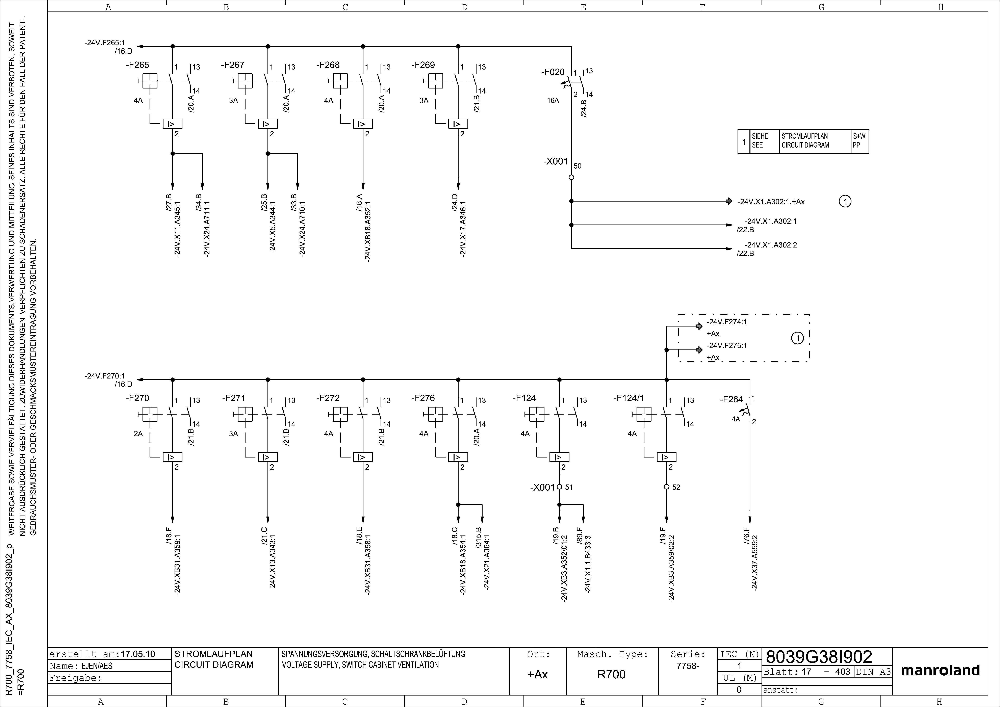

# +Ax — Sheet 17 of 403 — SPANNUNGSVERSORGUNG, SCHALTSCHRANKBELÜFTUNG

**VOLTAGE SUPPLY, SWITCH CABINET VENTILATION**

> Part of the manroland **R700** printing press IEC/UL circuit diagrams.
> Drawing class: **Stromlaufplan / Circuit diagram** (DIN A3).
> Document `+Ax` covers the **Central control console** machine section.

## At a glance

| Field | Value |
|---|---|
| Document | `+Ax`  (8039G38I902) |
| Sheet | **17** of 403 |
| Section (DE) | SPANNUNGSVERSORGUNG, SCHALTSCHRANKBELÜFTUNG |
| Section (EN) | VOLTAGE SUPPLY, SWITCH CABINET VENTILATION |
| Section type | POWER_SUPPLY — Voltage supply |
| Machine type | `R700` |
| Series | `7758` |
| Created | 17.05.10 |
| Replaces | — |
| Columns used | A, B, C, D, E, F, G |
| Path numbers | — |
| Labels on sheet | 148 |
| Cross-refs out | 28 |
| Cross-refs in | 28 |

**Previous:** [+Ax sheet 16](SHEET_0016.md) · **Next:** [+Ax sheet 18](SHEET_0018.md) · **Document TOC:** [_TOC.md](_TOC.md)  (+Ax) · **Master TOC:** [all sheets](../_MASTER_TOC.md)

## Sheet image (300 DPI, exact vector render)



_Rendered directly from the PDF vector layer at 300 DPI (1-bit), no OCR and no resampling. Use it to confirm anything ambiguous in the text below._

## Cross-references on this sheet

Each entry is a wire leaving this sheet. The printed token is `/sheet.column`; the link resolves to that sheet inside the same document.

| Ref | Target sheet | Col | Path | Destination on target | Target section | From col |
|---|---|---|---|---|---|---|
| `/16.D` | [+Ax sheet 16](SHEET_0016.md) | D | — | 24V.F265:1 | SPANNUNGSVERSORGUNG, SCHALTSCHRANKBELÜFTUNG | A |
| `/21.B` | [+Ax sheet 21](SHEET_0021.md) | B | — | — | SPANNUNGSVERSORGUNG, SCHALTSCHRANKBELÜFTUNG | D |
| `/20.A` | [+Ax sheet 20](SHEET_0020.md) | A | — | — | SPANNUNGSVERSORGUNG, SCHALTSCHRANKBELÜFTUNG | B |
| `/20.A` | [+Ax sheet 20](SHEET_0020.md) | A | — | — | SPANNUNGSVERSORGUNG, SCHALTSCHRANKBELÜFTUNG | C |
| `/20.A` | [+Ax sheet 20](SHEET_0020.md) | A | — | — | SPANNUNGSVERSORGUNG, SCHALTSCHRANKBELÜFTUNG | C |
| `/24.B` | [+Ax sheet 24](SHEET_0024.md) | B | — | — | SPANNUNGSVERSORGUNG, SCHALTSCHRANKBELÜFTUNG | E |
| `/27.B` | [+Ax sheet 27](SHEET_0027.md) | B | — | — | SPANNUNGSVERSORGUNG, SCHALTSCHRANKBELÜFTUNG | B |
| `/34.B` | [+Ax sheet 34](SHEET_0034.md) | B | — | — | SPANNUNGSVERSORGUNG, SCHALTSCHRANKBELÜFTUNG | B |
| `/25.B` | [+Ax sheet 25](SHEET_0025.md) | B | — | — | SPANNUNGSVERSORGUNG, SCHALTSCHRANKBELÜFTUNG | B |
| `/33.B` | [+Ax sheet 33](SHEET_0033.md) | B | — | — | SPANNUNGSVERSORGUNG, SCHALTSCHRANKBELÜFTUNG | C |
| `/24.D` | [+Ax sheet 24](SHEET_0024.md) | D | — | — | SPANNUNGSVERSORGUNG, SCHALTSCHRANKBELÜFTUNG | D |
| `/18.A` | [+Ax sheet 18](SHEET_0018.md) | A | — | — | SPANNUNGSVERSORGUNG, SCHALTSCHRANKBELÜFTUNG | C |
| `/18.E` | [+Ax sheet 18](SHEET_0018.md) | E | — | 24V.XB18.A352:1 | SPANNUNGSVERSORGUNG, SCHALTSCHRANKBELÜFTUNG | C |
| `/22.B` | [+Ax sheet 22](SHEET_0022.md) | B | — | — | SPANNUNGSVERSORGUNG, SCHALTSCHRANKBELÜFTUNG | F |
| `/22.B` | [+Ax sheet 22](SHEET_0022.md) | B | — | — | SPANNUNGSVERSORGUNG, SCHALTSCHRANKBELÜFTUNG | F |
| `/16.D` | [+Ax sheet 16](SHEET_0016.md) | D | — | 24V.F270:1 | SPANNUNGSVERSORGUNG, SCHALTSCHRANKBELÜFTUNG | A |
| `/21.B` | [+Ax sheet 21](SHEET_0021.md) | B | — | — | SPANNUNGSVERSORGUNG, SCHALTSCHRANKBELÜFTUNG | B |
| `/21.B` | [+Ax sheet 21](SHEET_0021.md) | B | — | — | SPANNUNGSVERSORGUNG, SCHALTSCHRANKBELÜFTUNG | C |
| `/21.B` | [+Ax sheet 21](SHEET_0021.md) | B | — | — | SPANNUNGSVERSORGUNG, SCHALTSCHRANKBELÜFTUNG | C |
| `/20.A` | [+Ax sheet 20](SHEET_0020.md) | A | — | — | SPANNUNGSVERSORGUNG, SCHALTSCHRANKBELÜFTUNG | D |
| `/18.F` | [+Ax sheet 18](SHEET_0018.md) | F | — | — | SPANNUNGSVERSORGUNG, SCHALTSCHRANKBELÜFTUNG | B |
| `/21.C` | [+Ax sheet 21](SHEET_0021.md) | C | — | — | SPANNUNGSVERSORGUNG, SCHALTSCHRANKBELÜFTUNG | B |
| `/18.C` | [+Ax sheet 18](SHEET_0018.md) | C | — | — | SPANNUNGSVERSORGUNG, SCHALTSCHRANKBELÜFTUNG | D |
| `/315.B` | [+Ax sheet 315](SHEET_0315.md) | B | — | — | OPTION: "EJEKTOR" ANLAGE / SELECT AIRSTATION / | D |
| `/19.B` | [+Ax sheet 19](SHEET_0019.md) | B | — | — | SPANNUNGSVERSORGUNG, SCHALTSCHRANKBELÜFTUNG | E |
| `/89.F` | [+Ax sheet 89](SHEET_0089.md) | F | — | — | ANLEGER | E |
| `/19.F` | [+Ax sheet 19](SHEET_0019.md) | F | — | — | SPANNUNGSVERSORGUNG, SCHALTSCHRANKBELÜFTUNG | F |
| `/76.F` | [+Ax sheet 76](SHEET_0076.md) | F | — | — | ANLEGER | F |

### Incoming references (sheets that point here)

Every other sheet that sends a wire to this one. `Back-ref` is the token printed on *that* sheet; `Path` is its line number.

| From sheet | Cols | Back-ref | Path | Refs | What continues there |
|---|---|---|---|---|---|
| [+Ax#16](SHEET_0016.md) | D | `/16.D` | — | 2 | 24V.F265:1; 24V.F270:1 |
| [+Ax#18](SHEET_0018.md) | A, C, E, F | `/18.A`, `/18.C`, `/18.E`, `/18.F` | — | 4 | 24V.XB18.A352:1; 24V.XB18.A354:1; 24V.XB31.A358:1; 24V.XB31.A359:1 |
| [+Ax#19](SHEET_0019.md) | B, F | `/19.B`, `/19.F` | — | 2 | 24V.XB3.A352\01:2; 24V.XB3.A359\02:2 |
| [+Ax#20](SHEET_0020.md) | A | `/20.A` | — | 4 | — |
| [+Ax#21](SHEET_0021.md) | B, C | `/21.B`, `/21.C` | — | 5 | 24V.X13.A343:1 |
| [+Ax#22](SHEET_0022.md) | A | `/22.A` | — | 2 | 24V.X1.A302:1; 24V.X1.A302:2 |
| [+Ax#24](SHEET_0024.md) | A, D | `/24.A`, `/24.D` | — | 2 | 24V.X17.A346:1 |
| [+Ax#25](SHEET_0025.md) | A | `/25.A` | — | 1 | 24V.X5.A344:1 |
| [+Ax#27](SHEET_0027.md) | A | `/27.A` | — | 1 | 24V.X11.A345:1 |
| [+Ax#33](SHEET_0033.md) | A | `/33.A` | — | 1 | 24V.X24.A710:1 |
| [+Ax#34](SHEET_0034.md) | B | `/34.B` | — | 1 | 24V.X24.A711:1 |
| [+Ax#76](SHEET_0076.md) | E | `/76.E` | — | 1 | 24V.X37.A559:2 |
| [+Ax#89](SHEET_0089.md) | F | `/89.F` | — | 1 | 0V.X1.1.B433:1 |
| [+Ax#315](SHEET_0315.md) | A | `/315.A` | — | 1 | 24V.X21.A064:1 |


## Devices on this sheet

| Tag | Class | Class meaning (IEC) | Col | Sub | Terminal | Sign |
|---|---|---|---|---|---|---|
| `F267` | F | Schutz / protection device (fuse, circuit breaker) | B | — | — | — |
| `F020` | F | Schutz / protection device (fuse, circuit breaker) | E | — | — | — |
| `X001` | X | Klemme / terminal, plug connector | E | — | — | — |
| `F124` | F | Schutz / protection device (fuse, circuit breaker) | E | — | — | — |
| `F124/1` | F | Schutz / protection device (fuse, circuit breaker) | E | 1 | — | — |
| `F270` | F | Schutz / protection device (fuse, circuit breaker) | A | — | — | — |
| `F271` | F | Schutz / protection device (fuse, circuit breaker) | B | — | — | — |
| `F272` | F | Schutz / protection device (fuse, circuit breaker) | C | — | — | — |
| `F268` | F | Schutz / protection device (fuse, circuit breaker) | C | — | — | — |
| `F265` | F | Schutz / protection device (fuse, circuit breaker) | A | — | — | — |
| `F269` | F | Schutz / protection device (fuse, circuit breaker) | D | — | — | — |
| `F276` | F | Schutz / protection device (fuse, circuit breaker) | D | — | — | — |
| `F264` | F | Schutz / protection device (fuse, circuit breaker) | F | — | — | — |
| `X001` | X | Klemme / terminal, plug connector | E | — | — | — |

## Potentials / nets

| Potential | Count | Columns | Attached devices | Terminals |
|---|---|---|---|---|
| `24V` | 21 | A, B, C, D, E, F, G | `1`, `A064`, `A302`, `A343`, `A344`, `A345`, `A346`, `A352`, `A352\01`, `A354`, `A358`, `A359`, `A359\02`, `A559`, `A710`, `A711`, `B433`, `F265`, `F270`, `F274`, `F275`, `X1`, `X11`, `X13`, `X17`, `X21`, `X24`, `X37`, `X5`, `XB18`, `XB3`, `XB31` | `1`, `2`, `3` |


A potential such as `L24+/4` or `M24+` is a named supply/return rail; every place it appears on this sheet is electrically common.

## Wire-end annotations (grouped as printed)

A wire that continues elsewhere is annotated with a small cluster: the destination description, the path/line number `#NN`, and the `/sheet.column` cross reference. Each row below is one such cluster exactly as it is grouped on the drawing.

| Col | Y | Path | Cross-ref | Text on the wire |
|---|---|---|---|---|
| A | 47.1 | — | `/16.D` | `24V.F265:1` |
| A | 72.6 | — | — | `F265` |
| B | 72.6 | — | — | `F267` |
| C | 72.6 | — | — | `F268` |
| D | 72.6 | — | — | `F269` |
| B | 76.2 | — | — | `1` |
| B | 76.2 | — | — | `13` |
| B | 76.2 | — | — | `1` |
| C | 76.2 | — | — | `13` |
| C | 76.2 | — | — | `1` |
| C | 76.2 | — | — | `13` |
| D | 76.2 | — | — | `1` |
| D | 76.2 | — | — | `13` |
| E | 80.4 | — | — | `13` |
| E | 81.1 | — | — | `F020` |
| E | 83.2 | — | — | `1` |
| B | 104.5 | — | — | `14` |
| C | 104.5 | — | — | `14` |
| C | 104.5 | — | — | `14` |
| D | 104.5 | — | — | `14` |
| E | 108.8 | — | — | `16A 2` |
| E | 108.8 | — | — | `14` |
| D | 113.1 | — | `/21.B` | — |
| B | 113.4 | — | `/20.A` | — |
| C | 113.4 | — | `/20.A` | — |
| C | 113.4 | — | `/20.A` | — |
| B | 115.8 | — | — | `4A 3A` |
| B | 115.8 | — | — | `4A 4A 4A 3A` |
| E | 118.8 | — | `/24.B` | — |
| B | 143.6 | — | — | `I> 2` |
| B | 143.6 | — | — | `I> 2` |
| C | 143.6 | — | — | `I> 2` |
| D | 143.6 | — | — | `I> 2` |
| G | 159.2 | — | — | `PP S+W` |
| F | 159.3 | — | — | `1 SIEHE SEE` |
| G | 159.4 | — | — | `STROMLAUFPLAN CIRCUIT DIAGRAM` |
| E | 187.2 | — | — | `X001 50` |
| B | 230.7 | — | `/27.B` | — |
| B | 230.7 | — | `/34.B` | — |
| B | 230.7 | — | `/25.B` | — |
| C | 230.7 | — | `/33.B` | — |
| D | 230.7 | — | `/24.D` | — |
| C | 231.0 | — | `/18.A` | — |
| G | 236.3 | — | — | `24V.X1.A302:1,+Ax` |
| G | 236.5 | — | — | `1` |
| B | 239.2 | — | — | `24V.X11.A345:1` |
| B | 239.2 | — | — | `24V.X24.A711:1` |
| B | 239.2 | — | — | `24V.X5.A344:1` |
| C | 239.2 | — | — | `24V.X24.A710:1` |
| C | 239.2 | — | `/18.E` | `24V.XB18.A352:1` |
| D | 239.2 | — | — | `24V.X17.A346:1` |
| G | 259.6 | — | — | `24V.X1.A302:1` |
| F | 269.5 | — | `/22.B` | — |
| G | 288.0 | — | — | `24V.X1.A302:2` |
| F | 297.9 | — | `/22.B` | — |
| F | 379.4 | — | — | `24V.F274:1` |
| F | 393.7 | — | — | `+Ax` |
| G | 399.5 | — | — | `1` |
| F | 407.8 | — | — | `24V.F275:1` |
| F | 422.0 | — | — | `+Ax` |
| A | 443.9 | — | `/16.D` | `24V.F270:1` |
| A | 469.4 | — | — | `F270` |
| B | 469.4 | — | — | `F271` |
| C | 469.4 | — | — | `F272` |
| E | 469.4 | — | — | `F276 1` |
| E | 469.4 | — | — | `F124 1` |
| E | 469.4 | — | — | `F124/1` |
| F | 470.9 | — | — | `F264` |
| B | 473.0 | — | — | `1` |
| B | 473.0 | — | — | `13` |
| B | 473.0 | — | — | `1` |
| C | 473.0 | — | — | `13` |
| C | 473.0 | — | — | `1` |
| C | 473.0 | — | — | `13` |
| D | 473.0 | — | — | `1` |
| D | 473.0 | — | — | `13` |
| E | 473.0 | — | — | `1` |
| E | 473.0 | — | — | `13` |
| F | 473.0 | — | — | `13` |
| F | 495.4 | — | — | `4A 2` |
| B | 501.4 | — | — | `14` |
| C | 501.4 | — | — | `14` |
| C | 501.4 | — | — | `14` |
| D | 501.4 | — | — | `14` |
| E | 501.4 | — | — | `14` |
| F | 501.4 | — | — | `14` |
| B | 509.9 | — | `/21.B` | — |
| C | 509.9 | — | `/21.B` | — |
| C | 509.9 | — | `/21.B` | — |
| D | 510.2 | — | `/20.A` | — |
| A | 512.6 | — | — | `2A` |
| B | 512.6 | — | — | `3A` |
| C | 512.6 | — | — | `4A 4A` |
| E | 512.6 | — | — | `4A 4A` |
| B | 540.5 | — | — | `I> 2` |
| B | 540.5 | — | — | `I> 2` |
| C | 540.5 | — | — | `I> 2` |
| D | 540.5 | — | — | `I> 2` |
| E | 540.5 | — | — | `I> 2` |
| F | 540.5 | — | — | `I> 2` |
| E | 575.5 | — | — | `X001 51 52` |
| B | 627.6 | — | `/18.F` | — |
| B | 627.6 | — | `/21.C` | — |
| D | 627.6 | — | `/18.C` | — |
| D | 627.6 | — | `/315.B` | — |
| E | 627.6 | — | `/19.B` | — |
| E | 627.6 | — | `/89.F` | — |
| F | 627.6 | — | `/19.F` | — |
| F | 627.6 | — | `/76.F` | — |
| B | 636.1 | — | — | `24V.XB31.A359:1` |
| B | 636.1 | — | — | `24V.X13.A343:1` |
| C | 636.1 | — | — | `24V.XB31.A358:1` |
| D | 636.1 | — | — | `24V.XB18.A354:1` |
| D | 636.1 | — | — | `24V.X21.A064:1` |
| E | 637.2 | — | — | `24V.XB3.A352\01:2` |
| F | 637.2 | — | — | `24V.XB3.A359\02:2` |
| F | 637.2 | — | — | `24V.X37.A559:2` |
| E | 637.5 | — | — | `24V.X1.1.B433:3` |


## Reconstructed tables

This sheet carries tabular content (pin map / terminal assignment / index). The grid below was rebuilt from the drawing's own rule lines, so each row is exactly one physical row of the table.

### Table 1 — 4 data rows × 3 columns (at x=187.1, y=55.3)

|  | 1 13 | F267 |
|---|---|---|
| `I>` | `14 /20.A 2` | `3A` |
| `/27.B` | `/34.B` |  |
|  | `24V.X11.A345:1` | `24V.X24.A711:1` |
|  | `1 13` | `F271` |


### Table 2 — 4 data rows × 3 columns (at x=300.5, y=55.3)

|  | 1 13 | F268 |
|---|---|---|
| `I>` | `14 /20.A 2` | `4A 4A` |
| `/25.B` | `/33.B` |  |
|  | `24V.X5.A344:1` | `24V.X24.A710:1` |
|  | `1 13` | `F272` |


### Table 3 — 3 data rows × 2 columns (at x=413.9, y=55.3) — **F269 1 13**

| I> | 14 /20.A 3A 2 |
|---|---|
| `/18.A` |  |
|  | `24V.XB18.A352:1` |
|  | `F276 1 13` |


### Table 4 — 3 data rows × 2 columns (at x=527.2, y=55.3) — **1 13**

| I> | 14 /21.B 2 |
|---|---|
| `/24.D` |  |
|  | `24V.X17.A346:1` |
|  | `F124 1 13` |


### Table 5 — 2 data rows × 3 columns (at x=647.7, y=55.3)

| F020 |  | 13 1 |
|---|---|---|
| `16A X001` |  | `2 14 /24.B 50` |
|  | `1` | `F124/1 13` |


### Table 6 — 4 data rows × 1 columns (at x=793.7, y=55.3)

| C1 |
|---|
| `1` |
| `/22.B` |
| `/22.B 24V.F274:1 +Ax 24V.F275:1 +Ax` |
| `F264 1 13` |


## Notes and free text on this sheet

| Text | Col | Y (pt) |
|---|---|---|
| `I>` | B | 143.62 |
| `24V.X1.A302:1,+Ax` | G | 236.27 |
| `16A` | E | 116.04 |
| `I>` | E | 540.47 |
| `I>` | F | 540.47 |
| `+Ax` | F | 393.67 |
| `I>` | C | 540.47 |
| `I>` | D | 143.62 |
| `4A` | F | 495.41 |
| `2A` | A | 512.63 |
| `4A` | A | 115.78 |
| `3A` | B | 115.78 |
| `4A` | E | 512.63 |
| `3A` | D | 115.78 |
| `4A` | C | 115.78 |
| `4A` | D | 512.63 |
| `SIEHE` | F | 159.31 |
| `SEE` | F | 169.91 |
| `STROMLAUFPLAN` | G | 159.38 |
| `CIRCUIT DIAGRAM` | G | 170.01 |
| `S+W` | G | 159.22 |
| `PP` | G | 169.86 |

## Complete label inventory (exact text from the drawing)

Every text object inside the drawing area of this sheet, in DIN reading order (column A→H, then top→bottom). This is the authoritative list: if a string is not here it is not printed on this sheet.

| Col | Y | X | Dir | Type | Text |
|---|---|---|---|---|---|
| A | 47.1 | 100.9 | → | potential | `24V.F265:1` |
| A | 57.0 | 136.6 | → | cross-reference | `/16.D` |
| A | 72.6 | 150.0 | → | device tag | `F265` |
| A | 115.8 | 159.3 | → | text | `4A` |
| A | 115.8 | 159.3 | → | text | `4A` |
| A | 443.9 | 100.9 | → | potential | `24V.F270:1` |
| A | 453.8 | 136.6 | → | cross-reference | `/16.D` |
| A | 469.4 | 150.0 | → | device tag | `F270` |
| A | 512.6 | 159.3 | → | text | `2A` |
| B | 72.6 | 263.3 | → | device tag | `F267` |
| B | 76.2 | 207.5 | → | number | `1` |
| B | 76.2 | 228.8 | → | number | `13` |
| B | 76.2 | 320.9 | → | number | `1` |
| B | 104.5 | 228.8 | → | number | `14` |
| B | 113.4 | 223.5 | ↕ | cross-reference | `/20.A` |
| B | 115.8 | 272.7 | → | text | `3A` |
| B | 143.6 | 199.0 | → | text | `I>` |
| B | 143.6 | 312.4 | → | text | `I>` |
| B | 155.5 | 208.1 | → | number | `2` |
| B | 155.5 | 321.4 | → | number | `2` |
| B | 230.7 | 197.3 | ↕ | cross-reference | `/27.B` |
| B | 230.7 | 232.7 | ↕ | cross-reference | `/34.B` |
| B | 230.7 | 310.6 | ↕ | cross-reference | `/25.B` |
| B | 239.2 | 207.2 | ↕ | potential | `24V.X11.A345:1` |
| B | 239.2 | 242.6 | ↕ | potential | `24V.X24.A711:1` |
| B | 239.2 | 320.6 | ↕ | potential | `24V.X5.A344:1` |
| B | 469.4 | 264.8 | → | device tag | `F271` |
| B | 473.0 | 207.5 | → | number | `1` |
| B | 473.0 | 228.8 | → | number | `13` |
| B | 473.0 | 320.9 | → | number | `1` |
| B | 501.3 | 228.8 | → | number | `14` |
| B | 510.0 | 223.5 | ↕ | cross-reference | `/21.B` |
| B | 512.6 | 272.7 | → | text | `3A` |
| B | 540.5 | 199.0 | → | text | `I>` |
| B | 540.5 | 312.4 | → | text | `I>` |
| B | 552.4 | 208.1 | → | number | `2` |
| B | 552.4 | 321.4 | → | number | `2` |
| B | 627.6 | 197.3 | ↕ | cross-reference | `/18.F` |
| B | 627.6 | 310.7 | ↕ | cross-reference | `/21.C` |
| B | 636.1 | 207.2 | ↕ | potential | `24V.XB31.A359:1` |
| B | 636.1 | 320.6 | ↕ | potential | `24V.X13.A343:1` |
| C | 72.6 | 376.7 | → | device tag | `F268` |
| C | 76.2 | 342.1 | → | number | `13` |
| C | 76.2 | 434.3 | → | number | `1` |
| C | 76.2 | 455.5 | → | number | `13` |
| C | 104.5 | 342.1 | → | number | `14` |
| C | 104.5 | 455.5 | → | number | `14` |
| C | 113.4 | 336.9 | ↕ | cross-reference | `/20.A` |
| C | 113.4 | 450.2 | ↕ | cross-reference | `/20.A` |
| C | 115.8 | 386.1 | → | text | `4A` |
| C | 115.8 | 386.1 | → | text | `4A` |
| C | 143.6 | 425.8 | → | text | `I>` |
| C | 155.5 | 434.8 | → | number | `2` |
| C | 230.7 | 346.1 | ↕ | cross-reference | `/33.B` |
| C | 231.0 | 424.0 | ↕ | cross-reference | `/18.A` |
| C | 239.2 | 356.0 | ↕ | potential | `24V.X24.A710:1` |
| C | 239.2 | 434.0 | ↕ | potential | `24V.XB18.A352:1` |
| C | 469.4 | 376.7 | → | device tag | `F272` |
| C | 473.0 | 342.1 | → | number | `13` |
| C | 473.0 | 434.3 | → | number | `1` |
| C | 473.0 | 455.5 | → | number | `13` |
| C | 501.3 | 342.1 | → | number | `14` |
| C | 501.3 | 455.5 | → | number | `14` |
| C | 510.0 | 336.9 | ↕ | cross-reference | `/21.B` |
| C | 510.0 | 450.2 | ↕ | cross-reference | `/21.B` |
| C | 512.6 | 386.1 | → | text | `4A` |
| C | 540.5 | 425.8 | → | text | `I>` |
| C | 552.4 | 434.8 | → | number | `2` |
| C | 627.3 | 424.0 | ↕ | cross-reference | `/18.E` |
| C | 636.1 | 434.0 | ↕ | potential | `24V.XB31.A358:1` |
| D | 72.6 | 490.1 | → | device tag | `F269` |
| D | 76.2 | 547.7 | → | number | `1` |
| D | 76.2 | 568.9 | → | number | `13` |
| D | 104.5 | 568.9 | → | number | `14` |
| D | 113.1 | 563.6 | ↕ | cross-reference | `/21.B` |
| D | 115.8 | 499.5 | → | text | `3A` |
| D | 143.6 | 539.1 | → | text | `I>` |
| D | 155.5 | 548.2 | → | number | `2` |
| D | 230.7 | 537.4 | ↕ | cross-reference | `/24.D` |
| D | 239.2 | 547.4 | ↕ | potential | `24V.X17.A346:1` |
| D | 469.4 | 490.1 | → | device tag | `F276` |
| D | 473.0 | 547.7 | → | number | `1` |
| D | 473.0 | 568.9 | → | number | `13` |
| D | 501.3 | 568.9 | → | number | `14` |
| D | 510.2 | 563.6 | ↕ | cross-reference | `/20.A` |
| D | 512.6 | 499.5 | → | text | `4A` |
| D | 540.5 | 539.1 | → | text | `I>` |
| D | 552.4 | 548.2 | → | number | `2` |
| D | 627.6 | 537.4 | ↕ | cross-reference | `/18.C` |
| D | 627.6 | 565.8 | ↕ | cross-reference | `/315.B` |
| D | 636.1 | 547.4 | ↕ | potential | `24V.XB18.A354:1` |
| D | 636.1 | 575.7 | ↕ | potential | `24V.X21.A064:1` |
| E | 80.4 | 696.5 | → | number | `13` |
| E | 81.1 | 644.6 | → | device tag | `F020` |
| E | 83.2 | 682.3 | → | number | `1` |
| E | 108.7 | 682.9 | → | number | `2` |
| E | 108.7 | 696.5 | → | number | `14` |
| E | 116.0 | 651.1 | → | text | `16A` |
| E | 118.8 | 691.2 | ↕ | cross-reference | `/24.B` |
| E | 187.2 | 646.9 | → | device tag | `X001` |
| E | 193.8 | 682.9 | → | number | `50` |
| E | 469.4 | 610.6 | → | device tag | `F124` |
| E | 469.4 | 730.8 | → | device tag | `F124/1` |
| E | 473.0 | 668.1 | → | number | `1` |
| E | 473.0 | 689.4 | → | number | `13` |
| E | 501.3 | 689.4 | → | number | `14` |
| E | 512.6 | 619.9 | → | text | `4A` |
| E | 512.6 | 747.5 | → | text | `4A` |
| E | 540.5 | 659.6 | → | text | `I>` |
| E | 552.4 | 668.7 | → | number | `2` |
| E | 575.5 | 631.3 | → | device tag | `X001` |
| E | 576.5 | 672.9 | → | number | `51` |
| E | 627.6 | 657.9 | ↕ | cross-reference | `/19.B` |
| E | 627.6 | 686.2 | ↕ | cross-reference | `/89.F` |
| E | 637.2 | 667.8 | ↕ | potential | `24V.XB3.A352\01:2` |
| E | 637.5 | 696.2 | ↕ | potential | `24V.X1.1.B433:3` |
| F | 159.3 | 895.5 | → | text | `SIEHE` |
| F | 164.7 | 883.3 | → | number | `1` |
| F | 169.9 | 895.5 | → | text | `SEE` |
| F | 269.5 | 877.3 | → | cross-reference | `/22.B` |
| F | 297.9 | 877.3 | → | cross-reference | `/22.B` |
| F | 379.4 | 841.6 | → | potential | `24V.F274:1` |
| F | 393.7 | 841.6 | → | text | `+Ax` |
| F | 407.8 | 841.6 | → | potential | `24V.F275:1` |
| F | 422.0 | 841.6 | → | text | `+Ax` |
| F | 470.2 | 894.9 | → | number | `1` |
| F | 470.8 | 857.2 | → | device tag | `F264` |
| F | 473.0 | 795.7 | → | number | `1` |
| F | 473.0 | 816.9 | → | number | `13` |
| F | 495.4 | 871.4 | → | text | `4A` |
| F | 498.5 | 895.5 | → | number | `2` |
| F | 501.3 | 816.9 | → | number | `14` |
| F | 540.5 | 787.2 | → | text | `I>` |
| F | 552.4 | 796.3 | → | number | `2` |
| F | 576.5 | 800.5 | → | number | `52` |
| F | 627.6 | 785.5 | ↕ | cross-reference | `/19.F` |
| F | 627.6 | 884.7 | ↕ | cross-reference | `/76.F` |
| F | 637.2 | 795.4 | ↕ | potential | `24V.XB3.A359\02:2` |
| F | 637.2 | 894.6 | ↕ | potential | `24V.X37.A559:2` |
| G | 159.2 | 1015.9 | → | text | `S+W` |
| G | 159.4 | 930.9 | → | text | `STROMLAUFPLAN` |
| G | 169.9 | 1015.4 | → | text | `PP` |
| G | 170.0 | 930.9 | → | text | `CIRCUIT DIAGRAM` |
| G | 236.3 | 878.5 | → | text | `24V.X1.A302:1,+Ax` |
| G | 236.5 | 1004.5 | → | number | `1` |
| G | 259.6 | 887.0 | → | potential | `24V.X1.A302:1` |
| G | 288.0 | 887.0 | → | potential | `24V.X1.A302:2` |
| G | 399.5 | 947.9 | → | number | `1` |

## Reading-order text block

The same content as a plain block, grouped by DIN column — convenient to paste or to match against a visual description.

```text
=== Column A ===
  47.1  100.9  net          24V.F265:1
  57.0  136.6  xref         /16.D
  72.6  150.0  devtag       F265
 115.8  159.3  text         4A
 115.8  159.3  text         4A
 443.9  100.9  net          24V.F270:1
 453.8  136.6  xref         /16.D
 469.4  150.0  devtag       F270
 512.6  159.3  text         2A
=== Column B ===
  72.6  263.3  devtag       F267
  76.2  207.5  numeric      1
  76.2  228.8  numeric      13
  76.2  320.9  numeric      1
 104.5  228.8  numeric      14
 113.4  223.5  xref         /20.A
 115.8  272.7  text         3A
 143.6  199.0  text         I>
 143.6  312.4  text         I>
 155.5  208.1  numeric      2
 155.5  321.4  numeric      2
 230.7  197.3  xref         /27.B
 230.7  232.7  xref         /34.B
 230.7  310.6  xref         /25.B
 239.2  207.2  net          24V.X11.A345:1
 239.2  242.6  net          24V.X24.A711:1
 239.2  320.6  net          24V.X5.A344:1
 469.4  264.8  devtag       F271
 473.0  207.5  numeric      1
 473.0  228.8  numeric      13
 473.0  320.9  numeric      1
 501.3  228.8  numeric      14
 510.0  223.5  xref         /21.B
 512.6  272.7  text         3A
 540.5  199.0  text         I>
 540.5  312.4  text         I>
 552.4  208.1  numeric      2
 552.4  321.4  numeric      2
 627.6  197.3  xref         /18.F
 627.6  310.7  xref         /21.C
 636.1  207.2  net          24V.XB31.A359:1
 636.1  320.6  net          24V.X13.A343:1
=== Column C ===
  72.6  376.7  devtag       F268
  76.2  342.1  numeric      13
  76.2  434.3  numeric      1
  76.2  455.5  numeric      13
 104.5  342.1  numeric      14
 104.5  455.5  numeric      14
 113.4  336.9  xref         /20.A
 113.4  450.2  xref         /20.A
 115.8  386.1  text         4A
 115.8  386.1  text         4A
 143.6  425.8  text         I>
 155.5  434.8  numeric      2
 230.7  346.1  xref         /33.B
 231.0  424.0  xref         /18.A
 239.2  356.0  net          24V.X24.A710:1
 239.2  434.0  net          24V.XB18.A352:1
 469.4  376.7  devtag       F272
 473.0  342.1  numeric      13
 473.0  434.3  numeric      1
 473.0  455.5  numeric      13
 501.3  342.1  numeric      14
 501.3  455.5  numeric      14
 510.0  336.9  xref         /21.B
 510.0  450.2  xref         /21.B
 512.6  386.1  text         4A
 540.5  425.8  text         I>
 552.4  434.8  numeric      2
 627.3  424.0  xref         /18.E
 636.1  434.0  net          24V.XB31.A358:1
=== Column D ===
  72.6  490.1  devtag       F269
  76.2  547.7  numeric      1
  76.2  568.9  numeric      13
 104.5  568.9  numeric      14
 113.1  563.6  xref         /21.B
 115.8  499.5  text         3A
 143.6  539.1  text         I>
 155.5  548.2  numeric      2
 230.7  537.4  xref         /24.D
 239.2  547.4  net          24V.X17.A346:1
 469.4  490.1  devtag       F276
 473.0  547.7  numeric      1
 473.0  568.9  numeric      13
 501.3  568.9  numeric      14
 510.2  563.6  xref         /20.A
 512.6  499.5  text         4A
 540.5  539.1  text         I>
 552.4  548.2  numeric      2
 627.6  537.4  xref         /18.C
 627.6  565.8  xref         /315.B
 636.1  547.4  net          24V.XB18.A354:1
 636.1  575.7  net          24V.X21.A064:1
=== Column E ===
  80.4  696.5  numeric      13
  81.1  644.6  devtag       F020
  83.2  682.3  numeric      1
 108.7  682.9  numeric      2
 108.7  696.5  numeric      14
 116.0  651.1  text         16A
 118.8  691.2  xref         /24.B
 187.2  646.9  devtag       X001
 193.8  682.9  numeric      50
 469.4  610.6  devtag       F124
 469.4  730.8  devtag       F124/1
 473.0  668.1  numeric      1
 473.0  689.4  numeric      13
 501.3  689.4  numeric      14
 512.6  619.9  text         4A
 512.6  747.5  text         4A
 540.5  659.6  text         I>
 552.4  668.7  numeric      2
 575.5  631.3  devtag       X001
 576.5  672.9  numeric      51
 627.6  657.9  xref         /19.B
 627.6  686.2  xref         /89.F
 637.2  667.8  net          24V.XB3.A352\01:2
 637.5  696.2  net          24V.X1.1.B433:3
=== Column F ===
 159.3  895.5  text         SIEHE
 164.7  883.3  numeric      1
 169.9  895.5  text         SEE
 269.5  877.3  xref         /22.B
 297.9  877.3  xref         /22.B
 379.4  841.6  net          24V.F274:1
 393.7  841.6  text         +Ax
 407.8  841.6  net          24V.F275:1
 422.0  841.6  text         +Ax
 470.2  894.9  numeric      1
 470.8  857.2  devtag       F264
 473.0  795.7  numeric      1
 473.0  816.9  numeric      13
 495.4  871.4  text         4A
 498.5  895.5  numeric      2
 501.3  816.9  numeric      14
 540.5  787.2  text         I>
 552.4  796.3  numeric      2
 576.5  800.5  numeric      52
 627.6  785.5  xref         /19.F
 627.6  884.7  xref         /76.F
 637.2  795.4  net          24V.XB3.A359\02:2
 637.2  894.6  net          24V.X37.A559:2
=== Column G ===
 159.2 1015.9  text         S+W
 159.4  930.9  text         STROMLAUFPLAN
 169.9 1015.4  text         PP
 170.0  930.9  text         CIRCUIT DIAGRAM
 236.3  878.5  text         24V.X1.A302:1,+Ax
 236.5 1004.5  numeric      1
 259.6  887.0  net          24V.X1.A302:1
 288.0  887.0  net          24V.X1.A302:2
 399.5  947.9  numeric      1
```

---
_Generated from the PDF vector text layer; no OCR. Source: `R700_7758_IEC_AX_8039G38I902_p`, sheet 17._
