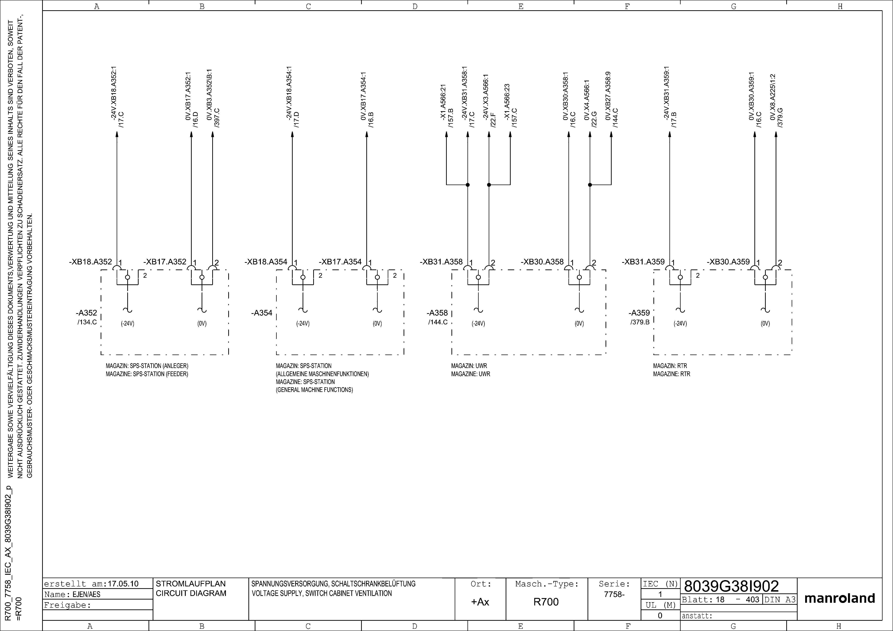

# +Ax — Sheet 18 of 403 — SPANNUNGSVERSORGUNG, SCHALTSCHRANKBELÜFTUNG

**VOLTAGE SUPPLY, SWITCH CABINET VENTILATION**

> Part of the manroland **R700** printing press IEC/UL circuit diagrams.
> Drawing class: **Stromlaufplan / Circuit diagram** (DIN A3).
> Document `+Ax` covers the **Central control console** machine section.

## At a glance

| Field | Value |
|---|---|
| Document | `+Ax`  (8039G38I902) |
| Sheet | **18** of 403 |
| Section (DE) | SPANNUNGSVERSORGUNG, SCHALTSCHRANKBELÜFTUNG |
| Section (EN) | VOLTAGE SUPPLY, SWITCH CABINET VENTILATION |
| Section type | POWER_SUPPLY — Voltage supply |
| Machine type | `R700` |
| Series | `7758` |
| Created | 17.05.10 |
| Replaces | — |
| Columns used | A, B, C, D, E, F, G |
| Path numbers | — |
| Labels on sheet | 79 |
| Cross-refs out | 18 |
| Cross-refs in | 18 |

**Previous:** [+Ax sheet 17](SHEET_0017.md) · **Next:** [+Ax sheet 19](SHEET_0019.md) · **Document TOC:** [_TOC.md](_TOC.md)  (+Ax) · **Master TOC:** [all sheets](../_MASTER_TOC.md)

## Sheet image (300 DPI, exact vector render)



_Rendered directly from the PDF vector layer at 300 DPI (1-bit), no OCR and no resampling. Use it to confirm anything ambiguous in the text below._

## Cross-references on this sheet

Each entry is a wire leaving this sheet. The printed token is `/sheet.column`; the link resolves to that sheet inside the same document.

| Ref | Target sheet | Col | Path | Destination on target | Target section | From col |
|---|---|---|---|---|---|---|
| `/17.C` | [+Ax sheet 17](SHEET_0017.md) | C | — | 24V.XB18.A352:1 | SPANNUNGSVERSORGUNG, SCHALTSCHRANKBELÜFTUNG | A |
| `/17.D` | [+Ax sheet 17](SHEET_0017.md) | D | — | 24V.XB18.A354:1 | SPANNUNGSVERSORGUNG, SCHALTSCHRANKBELÜFTUNG | C |
| `/17.C` | [+Ax sheet 17](SHEET_0017.md) | C | — | 24V.XB31.A358:1 | SPANNUNGSVERSORGUNG, SCHALTSCHRANKBELÜFTUNG | E |
| `/17.B` | [+Ax sheet 17](SHEET_0017.md) | B | — | 24V.XB31.A359:1 | SPANNUNGSVERSORGUNG, SCHALTSCHRANKBELÜFTUNG | F |
| `/397.C` | [+Ax sheet 397](SHEET_0397.md) | C | — | 0V.XB3.A352\B:1 | OPTION: WASCHVORRICHTUNG MIT TUCH | B |
| `/16.D` | [+Ax sheet 16](SHEET_0016.md) | D | — | 0V.XB17.A352:1 | SPANNUNGSVERSORGUNG, SCHALTSCHRANKBELÜFTUNG | B |
| `/16.B` | [+Ax sheet 16](SHEET_0016.md) | B | — | 0V.XB17.A354:1 | SPANNUNGSVERSORGUNG, SCHALTSCHRANKBELÜFTUNG | D |
| `/16.C` | [+Ax sheet 16](SHEET_0016.md) | C | — | 0V.XB30:A358:1 | SPANNUNGSVERSORGUNG, SCHALTSCHRANKBELÜFTUNG | E |
| `/144.C` | [+Ax sheet 144](SHEET_0144.md) | C | — | 0V.XB27.A358:9 | ÜBERWACHUNGSRECHNER SICHERHEITSBUS | F |
| `/16.C` | [+Ax sheet 16](SHEET_0016.md) | C | — | 0V.XB30.A359:1 | SPANNUNGSVERSORGUNG, SCHALTSCHRANKBELÜFTUNG | G |
| `/22.F` | [+Ax sheet 22](SHEET_0022.md) | F | — | 24V.X3.A566:1 | SPANNUNGSVERSORGUNG, SCHALTSCHRANKBELÜFTUNG | E |
| `/379.G` | [+Ax sheet 379](SHEET_0379.md) | G | — | 0V.X8.A225\1:2 | OPTION: TELEPRESENCE | G |
| `/22.G` | [+Ax sheet 22](SHEET_0022.md) | G | — | 0V.X4.A566:1 | SPANNUNGSVERSORGUNG, SCHALTSCHRANKBELÜFTUNG | F |
| `/157.B` | [+Ax sheet 157](SHEET_0157.md) | B | — | X1.A566:21 | ÜBERWACHUNGSRECHNER/ANSTEUERUNG NOT AUS | D |
| `/157.C` | [+Ax sheet 157](SHEET_0157.md) | C | — | X1.A566:23 | ÜBERWACHUNGSRECHNER/ANSTEUERUNG NOT AUS | E |
| `/379.B` | [+Ax sheet 379](SHEET_0379.md) | B | — | — | OPTION: TELEPRESENCE | F |
| `/134.C` | [+Ax sheet 134](SHEET_0134.md) | C | — | — | REALTIMERECHNER ANSTEUERUNG DER SPS POWERKARTE | A |
| `/144.C` | [+Ax sheet 144](SHEET_0144.md) | C | — | — | ÜBERWACHUNGSRECHNER SICHERHEITSBUS | D |

### Incoming references (sheets that point here)

Every other sheet that sends a wire to this one. `Back-ref` is the token printed on *that* sheet; `Path` is its line number.

| From sheet | Cols | Back-ref | Path | Refs | What continues there |
|---|---|---|---|---|---|
| [+Ax#16](SHEET_0016.md) | B, C, D | `/16.B`, `/16.C`, `/16.D` | — | 4 | — |
| [+Ax#17](SHEET_0017.md) | B, C, D | `/17.B`, `/17.C`, `/17.D` | — | 4 | 24V.XB18.A352:1 |
| [+Ax#22](SHEET_0022.md) | F, G | `/22.F`, `/22.G` | — | 2 | 0V.X4.A566:1; 24V.X3.A566:1 |
| [+Ax#134](SHEET_0134.md) | C | `/134.C` | — | 1 | — |
| [+Ax#144](SHEET_0144.md) | B, C | `/144.B`, `/144.C` | — | 2 | 0V.XB27.A358:9 |
| [+Ax#157](SHEET_0157.md) | A, C | `/157.A`, `/157.C` | — | 2 | X1.A566:21; X1.A566:23 |
| [+Ax#379](SHEET_0379.md) | A, F | `/379.A`, `/379.F` | — | 2 | 0V.X8.A225\1:2 |
| [+Ax#397](SHEET_0397.md) | C | `/397.C` | — | 1 | 0V.XB3.A352\B:1 |


## Devices on this sheet

| Tag | Class | Class meaning (IEC) | Col | Sub | Terminal | Sign |
|---|---|---|---|---|---|---|
| `A352` | A | Baugruppe / assembly, module, PC board | A | — | — | — |
| `A358` | A | Baugruppe / assembly, module, PC board | D | — | — | — |
| `A354` | A | Baugruppe / assembly, module, PC board | C | — | — | — |
| `A359` | A | Baugruppe / assembly, module, PC board | F | — | — | — |
| `XB18.A352` | — | cross-device reference | A | — | — | — |
| `XB17.A352` | — | cross-device reference | B | — | — | — |
| `XB31.A358` | — | cross-device reference | D | — | — | — |
| `XB18.A354` | — | cross-device reference | C | — | — | — |
| `XB17.A354` | — | cross-device reference | C | — | — | — |
| `XB30.A358` | — | cross-device reference | E | — | — | — |
| `XB31.A359` | — | cross-device reference | F | — | — | — |
| `XB30.A359` | — | cross-device reference | G | — | — | — |
| `X1.A566:21` | — | cross-device reference | D | — | 21 | — |
| `X1.A566:23` | — | cross-device reference | E | — | 23 | — |

## Potentials / nets

| Potential | Count | Columns | Attached devices | Terminals |
|---|---|---|---|---|
| `0V` | 6 | B, D, F, G | `A225\1`, `A352`, `A354`, `A358`, `A359`, `A566`, `X4`, `X8`, `XB17`, `XB27`, `XB30` | `1`, `2`, `9` |
| `24V` | 5 | A, C, D, E, F | `A352`, `A354`, `A358`, `A359`, `A566`, `X3`, `XB18`, `XB31` | `1` |


A potential such as `L24+/4` or `M24+` is a named supply/return rail; every place it appears on this sheet is electrically common.

## Wire-end annotations (grouped as printed)

A wire that continues elsewhere is annotated with a small cluster: the destination description, the path/line number `#NN`, and the `/sheet.column` cross reference. Each row below is one such cluster exactly as it is grouped on the drawing.

| Col | Y | Path | Cross-ref | Text on the wire |
|---|---|---|---|---|
| A | 87.6 | — | `/17.C` | `24V.XB18.A352:1` |
| C | 87.6 | — | `/17.D` | `24V.XB18.A354:1` |
| E | 87.6 | — | `/17.C` | `24V.XB31.A358:1` |
| F | 87.6 | — | `/17.B` | `24V.XB31.A359:1` |
| B | 91.6 | — | `/397.C` | `0V.XB3.A352\B:1` |
| B | 95.2 | — | `/16.D` | `0V.XB17.A352:1` |
| D | 95.2 | — | `/16.B` | `0V.XB17.A354:1` |
| E | 95.2 | — | `/16.C` | `0V.XB30:A358:1` |
| F | 95.2 | — | `/144.C` | `0V.XB27.A358:9` |
| G | 95.2 | — | `/16.C` | `0V.XB30.A359:1` |
| E | 98.4 | — | `/22.F` | `24V.X3.A566:1` |
| G | 98.7 | — | `/379.G` | `0V.X8.A225\1:2` |
| F | 106.0 | — | `/22.G` | `0V.X4.A566:1` |
| D | 111.7 | — | `/157.B` | `X1.A566:21` |
| E | 111.7 | — | `/157.C` | `X1.A566:23` |
| A | 344.7 | — | — | `XB18.A352 1 XB17.A352 1` |
| E | 344.7 | — | — | `2 XB30.A359 1 2` |
| C | 344.7 | — | — | `XB18.A354 1 XB17.A354 1` |
| D | 344.7 | — | — | `XB31.A358 1` |
| F | 344.7 | — | — | `2 XB30.A358 1 2 XB31.A359 1` |
| D | 363.9 | — | — | `2 2 2 2` |
| A | 412.7 | — | — | `A352` |
| C | 412.7 | — | — | `A354` |
| D | 412.7 | — | — | `A358` |
| F | 412.7 | — | — | `A359` |
| A | 425.8 | — | `/134.C` | — |
| D | 425.8 | — | `/144.C` | — |
| F | 425.8 | — | `/379.B` | — |
| D | 428.6 | — | — | `( 24V) (0V) ( 24V) (0V) ( 24V) (0V) ( 24V) (0V)` |
| C | 485.3 | — | — | `MAGAZIN: SPS STATION (ALLGEMEINE MASCHINENFUNKTIONEN) MAGAZINE: SPS STATION (GENERAL MACHINE FUNCTIONS)` |
| E | 485.3 | — | — | `MAGAZIN: UWR MAGAZINE: UWR` |
| A | 485.4 | — | — | `MAGAZIN: SPS STATION (ANLEGER) MAGAZINE: SPS STATION (FEEDER)` |
| F | 485.4 | — | — | `MAGAZIN: RTR MAGAZINE: RTR` |


## Notes and free text on this sheet

| Text | Col | Y (pt) |
|---|---|---|
| `MAGAZIN: SPS STATION (ANLEGER)` | A | 485.35 |
| `MAGAZINE: SPS STATION (FEEDER)` | A | 495.98 |
| `MAGAZIN: UWR` | E | 485.32 |
| `MAGAZINE: UWR` | E | 495.95 |
| `MAGAZIN: SPS STATION` | C | 485.33 |
| `(ALLGEMEINE MASCHINENFUNKTIONEN)` | C | 496 |
| `MAGAZINE: SPS STATION` | C | 506.6 |
| `(GENERAL MACHINE FUNCTIONS)` | C | 517.26 |
| `MAGAZIN: RTR` | F | 485.35 |
| `MAGAZINE: RTR` | F | 495.98 |
| `0V.XB3.A352\B:1` | B | 91.56 |
| `0V.XB30:A358:1` | E | 95.25 |
| `( 24V)` | A | 428.65 |
| `( 24V)` | C | 428.65 |
| `( 24V)` | E | 428.65 |
| `( 24V)` | F | 428.65 |
| `(0V)` | B | 428.62 |
| `(0V)` | D | 428.62 |
| `(0V)` | F | 428.62 |
| `(0V)` | G | 428.62 |

## Complete label inventory (exact text from the drawing)

Every text object inside the drawing area of this sheet, in DIN reading order (column A→H, then top→bottom). This is the authoritative list: if a string is not here it is not printed on this sheet.

| Col | Y | X | Dir | Type | Text |
|---|---|---|---|---|---|
| A | 87.6 | 147.7 | ↕ | potential | `24V.XB18.A352:1` |
| A | 149.1 | 157.6 | ↕ | cross-reference | `/17.C` |
| A | 344.7 | 92.1 | → | device ref | `XB18.A352` |
| A | 346.1 | 157.6 | → | number | `1` |
| A | 363.9 | 191.1 | → | number | `2` |
| A | 412.7 | 101.2 | → | device tag | `A352` |
| A | 425.8 | 103.5 | → | cross-reference | `/134.C` |
| A | 428.7 | 161.4 | → | text | `( 24V)` |
| A | 485.3 | 141.2 | → | text | `MAGAZIN: SPS STATION (ANLEGER)` |
| A | 496.0 | 141.2 | → | text | `MAGAZINE: SPS STATION (FEEDER)` |
| B | 91.6 | 275.2 | ↕ | text | `0V.XB3.A352\B:1` |
| B | 95.2 | 246.9 | ↕ | potential | `0V.XB17.A352:1` |
| B | 144.3 | 285.2 | ↕ | cross-reference | `/397.C` |
| B | 149.1 | 256.8 | ↕ | cross-reference | `/16.D` |
| B | 344.7 | 191.3 | → | device ref | `XB17.A352` |
| B | 346.1 | 256.8 | → | number | `1` |
| B | 346.1 | 286.0 | → | number | `2` |
| B | 428.6 | 263.3 | → | text | `(0V)` |
| C | 87.6 | 381.5 | ↕ | potential | `24V.XB18.A354:1` |
| C | 149.1 | 391.5 | ↕ | cross-reference | `/17.D` |
| C | 344.7 | 326.0 | → | device ref | `XB18.A354` |
| C | 344.7 | 425.2 | → | device ref | `XB17.A354` |
| C | 346.1 | 391.5 | → | number | `1` |
| C | 363.9 | 424.9 | → | number | `2` |
| C | 412.7 | 335.1 | → | device tag | `A354` |
| C | 428.7 | 395.2 | → | text | `( 24V)` |
| C | 485.3 | 367.9 | → | text | `MAGAZIN: SPS STATION` |
| C | 496.0 | 367.9 | → | text | `(ALLGEMEINE MASCHINENFUNKTIONEN)` |
| C | 506.6 | 367.9 | → | text | `MAGAZINE: SPS STATION` |
| C | 517.3 | 367.9 | → | text | `(GENERAL MACHINE FUNCTIONS)` |
| D | 87.6 | 615.4 | ↕ | potential | `24V.XB31.A358:1` |
| D | 95.2 | 480.7 | ↕ | potential | `0V.XB17.A354:1` |
| D | 111.7 | 587.1 | ↕ | device ref | `X1.A566:21` |
| D | 144.6 | 597.0 | ↕ | cross-reference | `/157.B` |
| D | 149.4 | 490.6 | ↕ | cross-reference | `/16.B` |
| D | 344.7 | 559.8 | → | device ref | `XB31.A358` |
| D | 346.1 | 490.7 | → | number | `1` |
| D | 363.9 | 524.1 | → | number | `2` |
| D | 412.7 | 568.9 | → | device tag | `A358` |
| D | 425.8 | 571.2 | → | cross-reference | `/144.C` |
| D | 428.6 | 497.1 | → | text | `(0V)` |
| E | 95.2 | 750.0 | ↕ | text | `0V.XB30:A358:1` |
| E | 98.4 | 643.7 | ↕ | potential | `24V.X3.A566:1` |
| E | 111.7 | 672.1 | ↕ | device ref | `X1.A566:23` |
| E | 144.3 | 682.0 | ↕ | cross-reference | `/157.C` |
| E | 149.1 | 625.3 | ↕ | cross-reference | `/17.C` |
| E | 149.1 | 760.0 | ↕ | cross-reference | `/16.C` |
| E | 150.0 | 653.6 | ↕ | cross-reference | `/22.F` |
| E | 344.7 | 694.5 | → | device ref | `XB30.A358` |
| E | 346.1 | 625.3 | → | number | `1` |
| E | 346.1 | 654.5 | → | number | `2` |
| E | 346.1 | 760.0 | → | number | `1` |
| E | 428.7 | 629.1 | → | text | `( 24V)` |
| E | 485.3 | 601.8 | → | text | `MAGAZIN: UWR` |
| E | 496.0 | 601.8 | → | text | `MAGAZINE: UWR` |
| F | 87.6 | 884.7 | ↕ | potential | `24V.XB31.A359:1` |
| F | 95.2 | 806.7 | ↕ | potential | `0V.XB27.A358:9` |
| F | 106.0 | 778.4 | ↕ | potential | `0V.X4.A566:1` |
| F | 144.3 | 816.7 | ↕ | cross-reference | `/144.C` |
| F | 148.5 | 788.3 | ↕ | cross-reference | `/22.G` |
| F | 149.4 | 894.6 | ↕ | cross-reference | `/17.B` |
| F | 344.7 | 829.1 | → | device ref | `XB31.A359` |
| F | 346.1 | 789.2 | → | number | `2` |
| F | 346.1 | 894.6 | → | number | `1` |
| F | 412.7 | 838.2 | → | device tag | `A359` |
| F | 425.8 | 840.8 | → | cross-reference | `/379.B` |
| F | 428.6 | 766.4 | → | text | `(0V)` |
| F | 428.7 | 898.4 | → | text | `( 24V)` |
| F | 485.4 | 871.1 | → | text | `MAGAZIN: RTR` |
| F | 496.0 | 871.1 | → | text | `MAGAZINE: RTR` |
| G | 95.2 | 998.1 | ↕ | potential | `0V.XB30.A359:1` |
| G | 98.6 | 1026.4 | ↕ | potential | `0V.X8.A225\1:2` |
| G | 143.7 | 1036.3 | ↕ | cross-reference | `/379.G` |
| G | 149.1 | 1008.0 | ↕ | cross-reference | `/16.C` |
| G | 344.7 | 942.5 | → | device ref | `XB30.A359` |
| G | 346.1 | 1008.0 | → | number | `1` |
| G | 346.1 | 1037.2 | → | number | `2` |
| G | 363.9 | 928.1 | → | number | `2` |
| G | 428.6 | 1014.5 | → | text | `(0V)` |

## Reading-order text block

The same content as a plain block, grouped by DIN column — convenient to paste or to match against a visual description.

```text
=== Column A ===
  87.6  147.7  net          24V.XB18.A352:1
 149.1  157.6  xref         /17.C
 344.7   92.1  devref       XB18.A352
 346.1  157.6  numeric      1
 363.9  191.1  numeric      2
 412.7  101.2  devtag       A352
 425.8  103.5  xref         /134.C
 428.7  161.4  text         ( 24V)
 485.3  141.2  text         MAGAZIN: SPS STATION (ANLEGER)
 496.0  141.2  text         MAGAZINE: SPS STATION (FEEDER)
=== Column B ===
  91.6  275.2  text         0V.XB3.A352\B:1
  95.2  246.9  net          0V.XB17.A352:1
 144.3  285.2  xref         /397.C
 149.1  256.8  xref         /16.D
 344.7  191.3  devref       XB17.A352
 346.1  256.8  numeric      1
 346.1  286.0  numeric      2
 428.6  263.3  text         (0V)
=== Column C ===
  87.6  381.5  net          24V.XB18.A354:1
 149.1  391.5  xref         /17.D
 344.7  326.0  devref       XB18.A354
 344.7  425.2  devref       XB17.A354
 346.1  391.5  numeric      1
 363.9  424.9  numeric      2
 412.7  335.1  devtag       A354
 428.7  395.2  text         ( 24V)
 485.3  367.9  text         MAGAZIN: SPS STATION
 496.0  367.9  text         (ALLGEMEINE MASCHINENFUNKTIONEN)
 506.6  367.9  text         MAGAZINE: SPS STATION
 517.3  367.9  text         (GENERAL MACHINE FUNCTIONS)
=== Column D ===
  87.6  615.4  net          24V.XB31.A358:1
  95.2  480.7  net          0V.XB17.A354:1
 111.7  587.1  devref       X1.A566:21
 144.6  597.0  xref         /157.B
 149.4  490.6  xref         /16.B
 344.7  559.8  devref       XB31.A358
 346.1  490.7  numeric      1
 363.9  524.1  numeric      2
 412.7  568.9  devtag       A358
 425.8  571.2  xref         /144.C
 428.6  497.1  text         (0V)
=== Column E ===
  95.2  750.0  text         0V.XB30:A358:1
  98.4  643.7  net          24V.X3.A566:1
 111.7  672.1  devref       X1.A566:23
 144.3  682.0  xref         /157.C
 149.1  625.3  xref         /17.C
 149.1  760.0  xref         /16.C
 150.0  653.6  xref         /22.F
 344.7  694.5  devref       XB30.A358
 346.1  625.3  numeric      1
 346.1  654.5  numeric      2
 346.1  760.0  numeric      1
 428.7  629.1  text         ( 24V)
 485.3  601.8  text         MAGAZIN: UWR
 496.0  601.8  text         MAGAZINE: UWR
=== Column F ===
  87.6  884.7  net          24V.XB31.A359:1
  95.2  806.7  net          0V.XB27.A358:9
 106.0  778.4  net          0V.X4.A566:1
 144.3  816.7  xref         /144.C
 148.5  788.3  xref         /22.G
 149.4  894.6  xref         /17.B
 344.7  829.1  devref       XB31.A359
 346.1  789.2  numeric      2
 346.1  894.6  numeric      1
 412.7  838.2  devtag       A359
 425.8  840.8  xref         /379.B
 428.6  766.4  text         (0V)
 428.7  898.4  text         ( 24V)
 485.4  871.1  text         MAGAZIN: RTR
 496.0  871.1  text         MAGAZINE: RTR
=== Column G ===
  95.2  998.1  net          0V.XB30.A359:1
  98.6 1026.4  net          0V.X8.A225\1:2
 143.7 1036.3  xref         /379.G
 149.1 1008.0  xref         /16.C
 344.7  942.5  devref       XB30.A359
 346.1 1008.0  numeric      1
 346.1 1037.2  numeric      2
 363.9  928.1  numeric      2
 428.6 1014.5  text         (0V)
```

---
_Generated from the PDF vector text layer; no OCR. Source: `R700_7758_IEC_AX_8039G38I902_p`, sheet 18._
