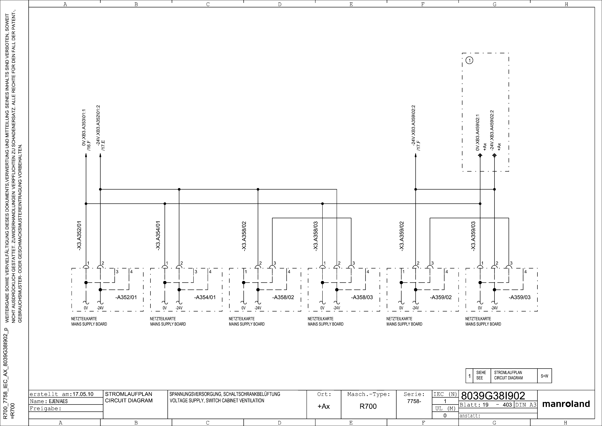

# +Ax — Sheet 19 of 403 — SPANNUNGSVERSORGUNG, SCHALTSCHRANKBELÜFTUNG

**VOLTAGE SUPPLY, SWITCH CABINET VENTILATION**

> Part of the manroland **R700** printing press IEC/UL circuit diagrams.
> Drawing class: **Stromlaufplan / Circuit diagram** (DIN A3).
> Document `+Ax` covers the **Central control console** machine section.

## At a glance

| Field | Value |
|---|---|
| Document | `+Ax`  (8039G38I902) |
| Sheet | **19** of 403 |
| Section (DE) | SPANNUNGSVERSORGUNG, SCHALTSCHRANKBELÜFTUNG |
| Section (EN) | VOLTAGE SUPPLY, SWITCH CABINET VENTILATION |
| Section type | POWER_SUPPLY — Voltage supply |
| Machine type | `R700` |
| Series | `7758` |
| Created | 17.05.10 |
| Replaces | — |
| Columns used | A, B, C, D, E, F, G, H |
| Path numbers | — |
| Labels on sheet | 77 |
| Cross-refs out | 3 |
| Cross-refs in | 17 |

**Previous:** [+Ax sheet 18](SHEET_0018.md) · **Next:** [+Ax sheet 20](SHEET_0020.md) · **Document TOC:** [_TOC.md](_TOC.md)  (+Ax) · **Master TOC:** [all sheets](../_MASTER_TOC.md)

## Sheet image (300 DPI, exact vector render)



_Rendered directly from the PDF vector layer at 300 DPI (1-bit), no OCR and no resampling. Use it to confirm anything ambiguous in the text below._

## Cross-references on this sheet

Each entry is a wire leaving this sheet. The printed token is `/sheet.column`; the link resolves to that sheet inside the same document.

| Ref | Target sheet | Col | Path | Destination on target | Target section | From col |
|---|---|---|---|---|---|---|
| `/17.E` | [+Ax sheet 17](SHEET_0017.md) | E | — | 24V.XB3.A352\01:2 | SPANNUNGSVERSORGUNG, SCHALTSCHRANKBELÜFTUNG | B |
| `/17.F` | [+Ax sheet 17](SHEET_0017.md) | F | — | 24V.XB3.A359\02:2 | SPANNUNGSVERSORGUNG, SCHALTSCHRANKBELÜFTUNG | F |
| `/16.F` | [+Ax sheet 16](SHEET_0016.md) | F | — | 0V.XB3.A353\01:1 | SPANNUNGSVERSORGUNG, SCHALTSCHRANKBELÜFTUNG | A |

### Incoming references (sheets that point here)

Every other sheet that sends a wire to this one. `Back-ref` is the token printed on *that* sheet; `Path` is its line number.

| From sheet | Cols | Back-ref | Path | Refs | What continues there |
|---|---|---|---|---|---|
| [+Ax#16](SHEET_0016.md) | F | `/16.F` | — | 1 | 0V.XB3.A353\01:1 |
| [+Ax#17](SHEET_0017.md) | E, F | `/17.E`, `/17.F` | — | 2 | — |
| [+Ax#225](SHEET_0225.md) | C, D | `/225.C`, `/225.D` | — | 14 | — |


## Devices on this sheet

| Tag | Class | Class meaning (IEC) | Col | Sub | Terminal | Sign |
|---|---|---|---|---|---|---|
| `A352/01` | A | Baugruppe / assembly, module, PC board | B | 01 | — | — |
| `A354/01` | A | Baugruppe / assembly, module, PC board | C | 01 | — | — |
| `A358/02` | A | Baugruppe / assembly, module, PC board | D | 02 | — | — |
| `A358/03` | A | Baugruppe / assembly, module, PC board | E | 03 | — | — |
| `A359/02` | A | Baugruppe / assembly, module, PC board | F | 02 | — | — |
| `A359/03` | A | Baugruppe / assembly, module, PC board | G | 03 | — | — |

## Potentials / nets

| Potential | Count | Columns | Attached devices | Terminals |
|---|---|---|---|---|
| `0V` | 8 | A, B, C, E, F, G | `A353\01`, `A459\02`, `XB3` | `1` |
| `24V` | 9 | A, C, D, E, F, G | `A352\01`, `A359\02`, `A459\02`, `XB3` | `2` |


A potential such as `L24+/4` or `M24+` is a named supply/return rail; every place it appears on this sheet is electrically common.

## Wire-end annotations (grouped as printed)

A wire that continues elsewhere is annotated with a small cluster: the destination description, the path/line number `#NN`, and the `/sheet.column` cross reference. Each row below is one such cluster exactly as it is grouped on the drawing.

| Col | Y | Path | Cross-ref | Text on the wire |
|---|---|---|---|---|
| G | 116.0 | — | — | `1` |
| B | 207.8 | — | `/17.E` | `24V.XB3.A352\01:2` |
| F | 207.8 | — | `/17.F` | `24V.XB3.A359\02:2` |
| A | 215.4 | — | `/16.F` | `0V.XB3.A353\01:1` |
| G | 217.7 | — | — | `24V.XB3.A459\02:2` |
| G | 225.4 | — | — | `0V.XB3.A459\02:1` |
| G | 282.9 | — | — | `+Ax` |
| G | 282.9 | — | — | `+Ax` |
| A | 436.0 | — | — | `X3.A352/01` |
| B | 436.0 | — | — | `X3.A354/01` |
| D | 437.4 | — | — | `X3.A358/02` |
| E | 437.4 | — | — | `X3.A358/03` |
| F | 437.4 | — | — | `X3.A359/02` |
| G | 437.4 | — | — | `X3.A359/03` |
| A | 516.2 | — | — | `1` |
| B | 516.2 | — | — | `2` |
| B | 516.2 | — | — | `1` |
| C | 516.2 | — | — | `2` |
| D | 516.2 | — | — | `2` |
| F | 516.2 | — | — | `3 3 3 3` |
| E | 516.2 | — | — | `1` |
| E | 516.2 | — | — | `2` |
| F | 516.2 | — | — | `2` |
| G | 516.2 | — | — | `1` |
| G | 516.2 | — | — | `2` |
| B | 533.2 | — | — | `3 4` |
| C | 533.2 | — | — | `3 4` |
| D | 533.2 | — | — | `1` |
| D | 533.2 | — | — | `4` |
| E | 533.2 | — | — | `4` |
| F | 533.2 | — | — | `1` |
| F | 533.2 | — | — | `4` |
| G | 533.2 | — | — | `4` |
| B | 582.8 | — | — | `A352/01` |
| C | 582.8 | — | — | `A354/01` |
| D | 582.8 | — | — | `A358/02` |
| E | 582.8 | — | — | `A358/03` |
| F | 582.8 | — | — | `A359/02` |
| G | 582.8 | — | — | `A359/03` |
| D | 605.8 | — | — | `0V 24V 0V 24V 0V 24V 0V 24V 0V 24V 0V 24V` |
| A | 627.1 | — | — | `NETZTEILKARTE MAINS SUPPLY BOARD` |
| B | 627.1 | — | — | `NETZTEILKARTE MAINS SUPPLY BOARD` |
| D | 627.1 | — | — | `NETZTEILKARTE MAINS SUPPLY BOARD` |
| E | 627.1 | — | — | `NETZTEILKARTE MAINS SUPPLY BOARD` |
| F | 627.1 | — | — | `NETZTEILKARTE MAINS SUPPLY BOARD` |
| G | 627.1 | — | — | `NETZTEILKARTE MAINS SUPPLY BOARD` |
| G | 733.3 | — | — | `1 SIEHE SEE STROMLAUFPLAN CIRCUIT DIAGRAM S+W` |


## Notes and free text on this sheet

| Text | Col | Y (pt) |
|---|---|---|
| `NETZTEILKARTE` | A | 627.06 |
| `MAINS SUPPLY BOARD` | A | 637.71 |
| `X3.A352/01` | A | 435.97 |
| `NETZTEILKARTE` | B | 627.06 |
| `MAINS SUPPLY BOARD` | B | 637.71 |
| `X3.A354/01` | B | 435.97 |
| `NETZTEILKARTE` | C | 627.06 |
| `MAINS SUPPLY BOARD` | D | 637.71 |
| `X3.A358/02` | D | 437.39 |
| `NETZTEILKARTE` | E | 627.06 |
| `MAINS SUPPLY BOARD` | E | 637.71 |
| `X3.A358/03` | E | 437.39 |
| `NETZTEILKARTE` | F | 627.06 |
| `MAINS SUPPLY BOARD` | F | 637.71 |
| `X3.A359/02` | F | 437.39 |
| `NETZTEILKARTE` | G | 627.06 |
| `MAINS SUPPLY BOARD` | G | 637.71 |
| `X3.A359/03` | G | 437.39 |
| `+Ax` | G | 282.9 |
| `SIEHE` | G | 733.33 |
| `SEE` | G | 743.93 |
| `STROMLAUFPLAN` | G | 733.39 |
| `CIRCUIT DIAGRAM` | G | 744.03 |
| `S+W` | H | 740.33 |

## Complete label inventory (exact text from the drawing)

Every text object inside the drawing area of this sheet, in DIN reading order (column A→H, then top→bottom). This is the authoritative list: if a string is not here it is not printed on this sheet.

| Col | Y | X | Dir | Type | Text |
|---|---|---|---|---|---|
| A | 207.8 | 190.2 | ↕ | potential | `24V.XB3.A352\01:2` |
| A | 215.4 | 161.8 | ↕ | potential | `0V.XB3.A353\01:1` |
| A | 277.5 | 171.8 | ↕ | cross-reference | `/16.F` |
| A | 436.0 | 152.0 | ↕ | text | `X3.A352/01` |
| A | 516.2 | 172.1 | → | number | `1` |
| A | 605.8 | 166.1 | → | potential | `0V` |
| A | 605.8 | 191.7 | → | potential | `24V` |
| A | 627.1 | 140.9 | → | text | `NETZTEILKARTE` |
| A | 637.7 | 141.2 | → | text | `MAINS SUPPLY BOARD` |
| B | 276.9 | 200.1 | ↕ | cross-reference | `/17.E` |
| B | 436.0 | 307.9 | ↕ | text | `X3.A354/01` |
| B | 516.2 | 201.0 | → | number | `2` |
| B | 516.2 | 328.0 | → | number | `1` |
| B | 533.2 | 229.3 | → | number | `3` |
| B | 533.2 | 257.7 | → | number | `4` |
| B | 582.8 | 228.2 | → | device tag | `A352/01` |
| B | 605.8 | 322.0 | → | potential | `0V` |
| B | 627.1 | 296.8 | → | text | `NETZTEILKARTE` |
| B | 637.7 | 297.1 | → | text | `MAINS SUPPLY BOARD` |
| C | 516.2 | 356.9 | → | number | `2` |
| C | 533.2 | 385.2 | → | number | `3` |
| C | 533.2 | 413.6 | → | number | `4` |
| C | 582.8 | 384.1 | → | device tag | `A354/01` |
| C | 605.8 | 347.6 | → | potential | `24V` |
| C | 605.8 | 477.9 | → | potential | `0V` |
| C | 627.1 | 452.7 | → | text | `NETZTEILKARTE` |
| D | 437.4 | 477.9 | ↕ | text | `X3.A358/02` |
| D | 516.2 | 512.8 | → | number | `2` |
| D | 516.2 | 541.1 | → | number | `3` |
| D | 533.2 | 483.9 | → | number | `1` |
| D | 533.2 | 569.5 | → | number | `4` |
| D | 582.8 | 538.6 | → | device tag | `A358/02` |
| D | 605.8 | 503.5 | → | potential | `24V` |
| D | 637.7 | 453.0 | → | text | `MAINS SUPPLY BOARD` |
| E | 437.4 | 619.7 | ↕ | text | `X3.A358/03` |
| E | 516.2 | 639.8 | → | number | `1` |
| E | 516.2 | 668.7 | → | number | `2` |
| E | 516.2 | 697.0 | → | number | `3` |
| E | 533.2 | 725.4 | → | number | `4` |
| E | 582.8 | 694.5 | → | device tag | `A358/03` |
| E | 605.8 | 633.8 | → | potential | `0V` |
| E | 605.8 | 659.4 | → | potential | `24V` |
| E | 627.1 | 608.6 | → | text | `NETZTEILKARTE` |
| E | 637.7 | 608.9 | → | text | `MAINS SUPPLY BOARD` |
| F | 207.8 | 813.8 | ↕ | potential | `24V.XB3.A359\02:2` |
| F | 277.5 | 823.7 | ↕ | cross-reference | `/17.F` |
| F | 437.4 | 789.8 | ↕ | text | `X3.A359/02` |
| F | 516.2 | 824.6 | → | number | `2` |
| F | 516.2 | 852.9 | → | number | `3` |
| F | 533.2 | 795.7 | → | number | `1` |
| F | 533.2 | 881.3 | → | number | `4` |
| F | 582.8 | 850.4 | → | device tag | `A359/02` |
| F | 605.8 | 789.7 | → | potential | `0V` |
| F | 605.8 | 815.3 | → | potential | `24V` |
| F | 627.1 | 764.5 | → | text | `NETZTEILKARTE` |
| F | 637.7 | 764.8 | → | text | `MAINS SUPPLY BOARD` |
| G | 116.0 | 926.6 | → | number | `1` |
| G | 217.7 | 969.0 | ↕ | potential | `24V.XB3.A459\02:2` |
| G | 225.4 | 940.7 | ↕ | potential | `0V.XB3.A459\02:1` |
| G | 282.9 | 954.9 | ↕ | text | `+Ax` |
| G | 282.9 | 983.3 | ↕ | text | `+Ax` |
| G | 437.4 | 931.5 | ↕ | text | `X3.A359/03` |
| G | 516.2 | 951.6 | → | number | `1` |
| G | 516.2 | 980.5 | → | number | `2` |
| G | 516.2 | 1008.9 | → | number | `3` |
| G | 533.2 | 1037.2 | → | number | `4` |
| G | 582.8 | 1006.3 | → | device tag | `A359/03` |
| G | 605.8 | 945.6 | → | potential | `0V` |
| G | 605.8 | 971.2 | → | potential | `24V` |
| G | 627.1 | 920.4 | → | text | `NETZTEILKARTE` |
| G | 637.7 | 920.7 | → | text | `MAINS SUPPLY BOARD` |
| G | 733.3 | 942.2 | → | text | `SIEHE` |
| G | 733.4 | 977.7 | → | text | `STROMLAUFPLAN` |
| G | 738.7 | 925.8 | → | number | `1` |
| G | 743.9 | 942.2 | → | text | `SEE` |
| G | 744.0 | 977.7 | → | text | `CIRCUIT DIAGRAM` |
| H | 740.3 | 1069.8 | → | text | `S+W` |

## Reading-order text block

The same content as a plain block, grouped by DIN column — convenient to paste or to match against a visual description.

```text
=== Column A ===
 207.8  190.2  net          24V.XB3.A352\01:2
 215.4  161.8  net          0V.XB3.A353\01:1
 277.5  171.8  xref         /16.F
 436.0  152.0  text         X3.A352/01
 516.2  172.1  numeric      1
 605.8  166.1  net          0V
 605.8  191.7  net          24V
 627.1  140.9  text         NETZTEILKARTE
 637.7  141.2  text         MAINS SUPPLY BOARD
=== Column B ===
 276.9  200.1  xref         /17.E
 436.0  307.9  text         X3.A354/01
 516.2  201.0  numeric      2
 516.2  328.0  numeric      1
 533.2  229.3  numeric      3
 533.2  257.7  numeric      4
 582.8  228.2  devtag       A352/01
 605.8  322.0  net          0V
 627.1  296.8  text         NETZTEILKARTE
 637.7  297.1  text         MAINS SUPPLY BOARD
=== Column C ===
 516.2  356.9  numeric      2
 533.2  385.2  numeric      3
 533.2  413.6  numeric      4
 582.8  384.1  devtag       A354/01
 605.8  347.6  net          24V
 605.8  477.9  net          0V
 627.1  452.7  text         NETZTEILKARTE
=== Column D ===
 437.4  477.9  text         X3.A358/02
 516.2  512.8  numeric      2
 516.2  541.1  numeric      3
 533.2  483.9  numeric      1
 533.2  569.5  numeric      4
 582.8  538.6  devtag       A358/02
 605.8  503.5  net          24V
 637.7  453.0  text         MAINS SUPPLY BOARD
=== Column E ===
 437.4  619.7  text         X3.A358/03
 516.2  639.8  numeric      1
 516.2  668.7  numeric      2
 516.2  697.0  numeric      3
 533.2  725.4  numeric      4
 582.8  694.5  devtag       A358/03
 605.8  633.8  net          0V
 605.8  659.4  net          24V
 627.1  608.6  text         NETZTEILKARTE
 637.7  608.9  text         MAINS SUPPLY BOARD
=== Column F ===
 207.8  813.8  net          24V.XB3.A359\02:2
 277.5  823.7  xref         /17.F
 437.4  789.8  text         X3.A359/02
 516.2  824.6  numeric      2
 516.2  852.9  numeric      3
 533.2  795.7  numeric      1
 533.2  881.3  numeric      4
 582.8  850.4  devtag       A359/02
 605.8  789.7  net          0V
 605.8  815.3  net          24V
 627.1  764.5  text         NETZTEILKARTE
 637.7  764.8  text         MAINS SUPPLY BOARD
=== Column G ===
 116.0  926.6  numeric      1
 217.7  969.0  net          24V.XB3.A459\02:2
 225.4  940.7  net          0V.XB3.A459\02:1
 282.9  954.9  text         +Ax
 282.9  983.3  text         +Ax
 437.4  931.5  text         X3.A359/03
 516.2  951.6  numeric      1
 516.2  980.5  numeric      2
 516.2 1008.9  numeric      3
 533.2 1037.2  numeric      4
 582.8 1006.3  devtag       A359/03
 605.8  945.6  net          0V
 605.8  971.2  net          24V
 627.1  920.4  text         NETZTEILKARTE
 637.7  920.7  text         MAINS SUPPLY BOARD
 733.3  942.2  text         SIEHE
 733.4  977.7  text         STROMLAUFPLAN
 738.7  925.8  numeric      1
 743.9  942.2  text         SEE
 744.0  977.7  text         CIRCUIT DIAGRAM
=== Column H ===
 740.3 1069.8  text         S+W
```

---
_Generated from the PDF vector text layer; no OCR. Source: `R700_7758_IEC_AX_8039G38I902_p`, sheet 19._
