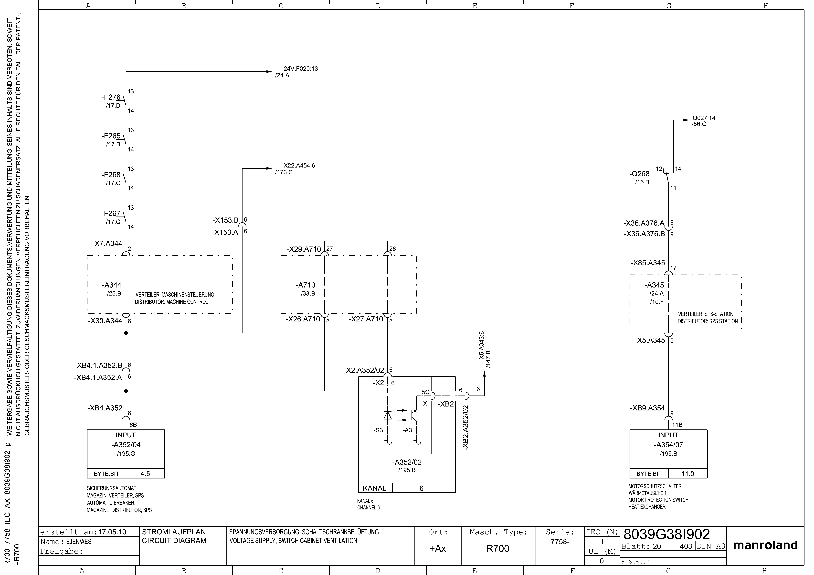

# +Ax — Sheet 20 of 403 — SPANNUNGSVERSORGUNG, SCHALTSCHRANKBELÜFTUNG

**VOLTAGE SUPPLY, SWITCH CABINET VENTILATION**

> Part of the manroland **R700** printing press IEC/UL circuit diagrams.
> Drawing class: **Stromlaufplan / Circuit diagram** (DIN A3).
> Document `+Ax` covers the **Central control console** machine section.

## At a glance

| Field | Value |
|---|---|
| Document | `+Ax`  (8039G38I902) |
| Sheet | **20** of 403 |
| Section (DE) | SPANNUNGSVERSORGUNG, SCHALTSCHRANKBELÜFTUNG |
| Section (EN) | VOLTAGE SUPPLY, SWITCH CABINET VENTILATION |
| Section type | POWER_SUPPLY — Voltage supply |
| Machine type | `R700` |
| Series | `7758` |
| Created | 17.05.10 |
| Replaces | — |
| Columns used | A, B, C, D, E, G |
| Path numbers | — |
| Labels on sheet | 109 |
| Cross-refs out | 16 |
| Cross-refs in | 34 |

**Previous:** [+Ax sheet 19](SHEET_0019.md) · **Next:** [+Ax sheet 21](SHEET_0021.md) · **Document TOC:** [_TOC.md](_TOC.md)  (+Ax) · **Master TOC:** [all sheets](../_MASTER_TOC.md)

## Sheet image (300 DPI, exact vector render)



_Rendered directly from the PDF vector layer at 300 DPI (1-bit), no OCR and no resampling. Use it to confirm anything ambiguous in the text below._

## Cross-references on this sheet

Each entry is a wire leaving this sheet. The printed token is `/sheet.column`; the link resolves to that sheet inside the same document.

| Ref | Target sheet | Col | Path | Destination on target | Target section | From col |
|---|---|---|---|---|---|---|
| `/24.A` | [+Ax sheet 24](SHEET_0024.md) | A | — | — | SPANNUNGSVERSORGUNG, SCHALTSCHRANKBELÜFTUNG | C |
| `/17.D` | [+Ax sheet 17](SHEET_0017.md) | D | — | — | SPANNUNGSVERSORGUNG, SCHALTSCHRANKBELÜFTUNG | A |
| `/56.G` | [+Ax sheet 56](SHEET_0056.md) | G | — | — | LUFTVERSORGUNG | G |
| `/17.B` | [+Ax sheet 17](SHEET_0017.md) | B | — | — | SPANNUNGSVERSORGUNG, SCHALTSCHRANKBELÜFTUNG | A |
| `/173.C` | [+Ax sheet 173](SHEET_0173.md) | C | — | — | RESERVE | C |
| `/15.B` | [+Ax sheet 15](SHEET_0015.md) | B | — | — | SPANNUNGSVERSORGUNG, SCHALTSCHRANKBELÜFTUNG | G |
| `/17.C` | [+Ax sheet 17](SHEET_0017.md) | C | — | — | SPANNUNGSVERSORGUNG, SCHALTSCHRANKBELÜFTUNG | A |
| `/17.C` | [+Ax sheet 17](SHEET_0017.md) | C | — | — | SPANNUNGSVERSORGUNG, SCHALTSCHRANKBELÜFTUNG | A |
| `/25.B` | [+Ax sheet 25](SHEET_0025.md) | B | — | VERTEILER: MASCHINENSTEUERUNG DISTRIBUTOR: MACHINE CONTROL | SPANNUNGSVERSORGUNG, SCHALTSCHRANKBELÜFTUNG | B |
| `/33.B` | [+Ax sheet 33](SHEET_0033.md) | B | — | — | SPANNUNGSVERSORGUNG, SCHALTSCHRANKBELÜFTUNG | C |
| `/24.A` | [+Ax sheet 24](SHEET_0024.md) | A | — | — | SPANNUNGSVERSORGUNG, SCHALTSCHRANKBELÜFTUNG | G |
| `/10.F` | [+Ax sheet 10](SHEET_0010.md) | F | — | — | SPANNUNGSVERSORGUNG, SCHALTSCHRANKBELÜFTUNG | G |
| `/147.B` | [+Ax sheet 147](SHEET_0147.md) | B | — | X5.A343:6 | ÜBERWACHUNGSRECHNER SICHERHEITSBUS | E |
| `/199.B` | [+Ax sheet 199](SHEET_0199.md) | B | — | — | REFERENZMODUL | G |
| `/195.G` | [+Ax sheet 195](SHEET_0195.md) | G | — | — | REFERENZMODUL | A |
| `/195.B` | [+Ax sheet 195](SHEET_0195.md) | B | — | — | REFERENZMODUL | D |

### Incoming references (sheets that point here)

Every other sheet that sends a wire to this one. `Back-ref` is the token printed on *that* sheet; `Path` is its line number.

| From sheet | Cols | Back-ref | Path | Refs | What continues there |
|---|---|---|---|---|---|
| [+Ax#10](SHEET_0010.md) | F | `/10.F` | — | 1 | — |
| [+Ax#15](SHEET_0015.md) | B | `/15.B` | — | 1 | — |
| [+Ax#17](SHEET_0017.md) | B, C, D | `/17.B`, `/17.C`, `/17.D` | — | 4 | — |
| [+Ax#24](SHEET_0024.md) | A | `/24.A` | — | 2 | 24V.F020:13 |
| [+Ax#25](SHEET_0025.md) | B | `/25.B` | — | 1 | — |
| [+Ax#33](SHEET_0033.md) | B | `/33.B` | — | 1 | — |
| [+Ax#56](SHEET_0056.md) | G | `/56.G` | — | 1 | Q027:14 |
| [+Ax#147](SHEET_0147.md) | B | `/147.B` | — | 1 | X5.A343:6 |
| [+Ax#173](SHEET_0173.md) | C | `/173.C` | — | 1 | X22.A454:6 |
| [+Ax#195](SHEET_0195.md) | B, G | `/195.B`, `/195.G` | — | 2 | — |
| [+Ax#199](SHEET_0199.md) | B | `/199.B` | — | 1 | — |
| [+Ax#218](SHEET_0218.md) | G | `/218.G` | — | 1 | — |
| [+Ax#219](SHEET_0219.md) | A | `/219.A` | — | 1 | — |
| [+Ax#227](SHEET_0227.md) | E, F, G | `/227.E`, `/227.F`, `/227.G` | — | 3 | — |
| [+Ax#231](SHEET_0231.md) | A | `/231.A` | — | 1 | — |
| [+Ax#235](SHEET_0235.md) | G | `/235.G` | — | 1 | — |
| [+Ax#242](SHEET_0242.md) | A | `/242.A` | — | 1 | — |
| [+Ax#269](SHEET_0269.md) | G | `/269.G` | — | 1 | — |
| [+Ax#270](SHEET_0270.md) | G | `/270.G` | — | 1 | — |
| [+Ax#273](SHEET_0273.md) | H | `/273.H` | — | 2 | — |
| [+Ax#274](SHEET_0274.md) | F | `/274.F` | — | 1 | — |
| [+Ax#279](SHEET_0279.md) | A, B | `/279.A`, `/279.B` | — | 2 | — |
| [+Ax#287](SHEET_0287.md) | C | `/287.C` | — | 1 | — |
| [+Ax#290](SHEET_0290.md) | C, E | `/290.C`, `/290.E` | — | 2 | — |


## Devices on this sheet

| Tag | Class | Class meaning (IEC) | Col | Sub | Terminal | Sign |
|---|---|---|---|---|---|---|
| `A352/04` | A | Baugruppe / assembly, module, PC board | A | 04 | — | — |
| `A354/07` | A | Baugruppe / assembly, module, PC board | G | 07 | — | — |
| `Q268` | Q | Leistungsschalter / power switching device | G | — | — | — |
| `A345` | A | Baugruppe / assembly, module, PC board | G | — | — | — |
| `S3` | S | Schalter / switch | D | — | — | — |
| `A3` | A | Baugruppe / assembly, module, PC board | D | — | — | — |
| `X1` | X | Klemme / terminal, plug connector | D | — | — | — |
| `X2` | X | Klemme / terminal, plug connector | D | — | — | — |
| `XB2` | XB |  | E | — | — | — |
| `A352/02` | A | Baugruppe / assembly, module, PC board | D | 02 | — | — |
| `F276` | F | Schutz / protection device (fuse, circuit breaker) | A | — | — | — |
| `F265` | F | Schutz / protection device (fuse, circuit breaker) | A | — | — | — |
| `F268` | F | Schutz / protection device (fuse, circuit breaker) | A | — | — | — |
| `F267` | F | Schutz / protection device (fuse, circuit breaker) | A | — | — | — |
| `A344` | A | Baugruppe / assembly, module, PC board | A | — | — | — |
| `A710` | A | Baugruppe / assembly, module, PC board | C | — | — | — |
| `Q027:14` | Q | Leistungsschalter / power switching device | G | — | 14 | — |
| `4.5` | — | cross-device reference | B | — | — | — |
| `XB4.A352` | — | cross-device reference | A | — | — | — |
| `11.0` | — | cross-device reference | G | — | — | — |
| `XB9.A354` | — | cross-device reference | G | — | — | — |
| `X36.A376.B` | — | cross-device reference | G | — | — | — |
| `X36.A376.A` | — | cross-device reference | G | — | — | — |
| `X5.A345` | — | cross-device reference | G | — | — | — |
| `X85.A345` | — | cross-device reference | G | — | — | — |
| `XB4.1.A352.B` | — | cross-device reference | A | — | — | — |
| `XB4.1.A352.A` | — | cross-device reference | A | — | — | — |
| `X30.A344` | — | cross-device reference | A | — | — | — |
| `X7.A344` | — | cross-device reference | A | — | — | — |
| `X153.A` | — | cross-device reference | B | — | — | — |
| `X153.B` | — | cross-device reference | B | — | — | — |
| `X29.A710` | — | cross-device reference | C | — | — | — |
| `X27.A710` | — | cross-device reference | D | — | — | — |
| `X26.A710` | — | cross-device reference | C | — | — | — |
| `X22.A454:6` | — | cross-device reference | C | — | 6 | — |
| `X5.A343:6` | — | cross-device reference | E | — | 6 | — |

## Potentials / nets

| Potential | Count | Columns | Attached devices | Terminals |
|---|---|---|---|---|
| `24V` | 1 | C | `F020` | `13` |


A potential such as `L24+/4` or `M24+` is a named supply/return rail; every place it appears on this sheet is electrically common.

## Wire-end annotations (grouped as printed)

A wire that continues elsewhere is annotated with a small cluster: the destination description, the path/line number `#NN`, and the `/sheet.column` cross reference. Each row below is one such cluster exactly as it is grouped on the drawing.

| Col | Y | Path | Cross-ref | Text on the wire |
|---|---|---|---|---|
| C | 96.7 | — | — | `24V.F020:13` |
| C | 106.5 | — | `/24.A` | — |
| A | 130.0 | — | — | `13` |
| A | 137.8 | — | — | `F276` |
| A | 150.9 | — | `/17.D` | — |
| A | 158.4 | — | — | `14` |
| G | 169.0 | — | — | `Q027:14` |
| G | 177.4 | — | `/56.G` | — |
| A | 186.7 | — | — | `13` |
| A | 194.5 | — | — | `F265` |
| A | 207.5 | — | `/17.B` | — |
| A | 215.1 | — | — | `14` |
| C | 238.4 | — | — | `X22.A454:6` |
| A | 243.4 | — | — | `13` |
| G | 243.4 | — | — | `Q268 14` |
| G | 243.4 | — | — | `12` |
| C | 248.3 | — | `/173.C` | — |
| A | 251.2 | — | — | `F268` |
| G | 262.8 | — | `/15.B` | — |
| A | 264.3 | — | `/17.C` | — |
| A | 271.7 | — | — | `14` |
| G | 271.7 | — | — | `11` |
| A | 300.1 | — | — | `13` |
| A | 307.9 | — | — | `F267` |
| B | 317.8 | — | — | `X153.B 6` |
| A | 320.9 | — | `/17.C` | — |
| G | 322.0 | — | — | `X36.A376.A 9` |
| A | 328.4 | — | — | `14` |
| B | 334.8 | — | — | `X153.A 6` |
| G | 337.6 | — | — | `X36.A376.B 9` |
| A | 351.8 | — | — | `X7.A344 2` |
| D | 360.3 | — | — | `X29.A710 27 28` |
| G | 380.1 | — | — | `X85.A345 17` |
| A | 412.7 | — | — | `A344` |
| C | 412.7 | — | — | `A710` |
| G | 412.7 | — | — | `A345` |
| B | 425.8 | — | `/25.B` | `DISTRIBUTOR: MACHINE CONTROL VERTEILER: MASCHINENSTEUERUNG` |
| C | 425.8 | — | `/33.B` | — |
| G | 425.8 | — | `/24.A` | — |
| G | 438.2 | — | `/10.F` | — |
| G | 457.0 | — | — | `DISTRIBUTOR: SPS STATION VERTEILER: SPS STATION` |
| D | 462.4 | — | — | `X26.A710 6 X27.A710 6` |
| A | 465.2 | — | — | `X30.A344 6` |
| E | 485.0 | — | `/147.B` | `X5.A343:6` |
| G | 493.5 | — | — | `X5.A345 9` |
| A | 530.4 | — | — | `XB4.1.A352.B 6` |
| D | 537.5 | — | — | `X2.A352/02 6` |
| A | 547.4 | — | — | `XB4.1.A352.A 6` |
| D | 555.9 | — | — | `X2` |
| E | 557.3 | — | — | `6 6` |
| E | 565.8 | — | — | `6` |
| D | 570.1 | — | — | `5C` |
| D | 587.1 | — | — | `X1` |
| E | 587.1 | — | — | `XB2` |
| A | 592.8 | — | — | `XB4.A352 6` |
| G | 592.8 | — | — | `XB9.A354 9` |
| E | 593.3 | — | — | `XB2.A352/02` |
| A | 618.2 | — | — | `8B` |
| G | 618.2 | — | — | `11B` |
| D | 626.0 | — | — | `S3 A3` |
| A | 632.8 | — | — | `INPUT` |
| G | 632.8 | — | — | `INPUT` |
| A | 646.6 | — | — | `A352/04` |
| G | 646.6 | — | — | `A354/07` |
| A | 660.4 | — | `/195.G` | — |
| G | 660.4 | — | `/199.B` | — |
| D | 672.1 | — | — | `A352/02` |
| D | 684.5 | — | `/195.B` | — |
| A | 689.4 | — | — | `BYTE.BIT 4.5` |
| G | 689.5 | — | — | `BYTE.BIT 11.0` |
| G | 709.4 | — | — | `HEAT EXCHANGER MOTORSCHUTZSCHALTER: MOTOR PROTECTION SWITCH: WÄRMETAUSCHER` |
| D | 710.4 | — | — | `KANAL 6` |
| A | 712.1 | — | — | `MAGAZIN, VERTEILER, SPS SICHERUNGSAUTOMAT:` |
| D | 730.7 | — | — | `KANAL 6 CHANNEL 6` |
| A | 733.4 | — | — | `MAGAZINE, DISTRIBUTOR, SPS AUTOMATIC BREAKER:` |


## Reconstructed tables

This sheet carries tabular content (pin map / terminal assignment / index). The grid below was rebuilt from the drawing's own rule lines, so each row is exactly one physical row of the table.

### Table 1 — 4 data rows × 2 columns (at x=127.6, y=104.9)

| F276 /17.D F265 /17.B F268 /17.C F267 /17.C X7.A344 A344 /25.B X30.A344 | 13 14 13 14 13 14 13 14 2 VERTEILER: DISTRIBUTOR: 6 |
|---|---|
| `XB4.1.A352.B XB4.1.A352.A` | `6 6` |
| `XB4.A352` | `6 8B` |
| `INPUT` | `A352/04 /195.G` |
| `BYTE.BIT` | `4.5` |


### Table 2 — 4 data rows × 6 columns (at x=474.8, y=352.9)

| 27 6 | X27.A710 X2.A352/02 | 28 6 6 |  |  | X5.A343:6 |
|---|---|---|---|---|---|
|  | `X2` | `6` |  |  | `6 6` |
|  | `S3` | `A3` | `5C X1` | `XB2` | `XB2.A352/02` |
|  |  | `A352/02 /195.B` |  |  |  |
|  | `KANAL` |  | `6` |  |  |


### Table 3 — 1 data rows × 3 columns (at x=921.3, y=629.3)

| INPUT | A354/07 /199.B |  |
|---|---|---|
| `BYTE.BIT` |  | `11.0` |


## Notes and free text on this sheet

| Text | Col | Y (pt) |
|---|---|---|
| `8B` | A | 618.22 |
| `INPUT` | A | 632.76 |
| `BYTE.BIT` | A | 690.01 |
| `SICHERUNGSAUTOMAT:` | A | 712.13 |
| `MAGAZIN, VERTEILER, SPS` | A | 722.74 |
| `AUTOMATIC BREAKER:` | A | 733.38 |
| `MAGAZINE, DISTRIBUTOR, SPS` | A | 744.01 |
| `11B` | G | 618.24 |
| `INPUT` | G | 632.76 |
| `BYTE.BIT` | G | 690.01 |
| `MOTORSCHUTZSCHALTER:` | G | 709.41 |
| `WÄRMETAUSCHER` | G | 719.38 |
| `MOTOR PROTECTION SWITCH:` | G | 729.3 |
| `HEAT EXCHANGER` | G | 739.28 |
| `VERTEILER: SPS STATION` | G | 456.99 |
| `DISTRIBUTOR: SPS STATION` | G | 467.62 |
| `KANAL 6` | D | 730.7 |
| `CHANNEL 6` | D | 740.65 |
| `5C` | D | 570.09 |
| `KANAL` | D | 710.38 |
| `X2.A352/02` | D | 537.47 |
| `XB2.A352/02` | E | 593.29 |
| `VERTEILER: MASCHINENSTEUERUNG` | B | 428.67 |
| `DISTRIBUTOR: MACHINE CONTROL` | B | 439.3 |

## Complete label inventory (exact text from the drawing)

Every text object inside the drawing area of this sheet, in DIN reading order (column A→H, then top→bottom). This is the authoritative list: if a string is not here it is not printed on this sheet.

| Col | Y | X | Dir | Type | Text |
|---|---|---|---|---|---|
| A | 130.0 | 186.2 | → | number | `13` |
| A | 137.8 | 148.5 | → | device tag | `F276` |
| A | 150.9 | 155.1 | → | cross-reference | `/17.D` |
| A | 158.4 | 186.2 | → | number | `14` |
| A | 186.7 | 186.2 | → | number | `13` |
| A | 194.5 | 148.5 | → | device tag | `F265` |
| A | 207.5 | 155.3 | → | cross-reference | `/17.B` |
| A | 215.0 | 186.2 | → | number | `14` |
| A | 243.4 | 186.2 | → | number | `13` |
| A | 251.2 | 148.5 | → | device tag | `F268` |
| A | 264.3 | 155.1 | → | cross-reference | `/17.C` |
| A | 271.7 | 186.2 | → | number | `14` |
| A | 300.1 | 186.2 | → | number | `13` |
| A | 307.9 | 148.5 | → | device tag | `F267` |
| A | 321.0 | 155.1 | → | cross-reference | `/17.C` |
| A | 328.4 | 186.2 | → | number | `14` |
| A | 351.8 | 134.9 | → | device ref | `X7.A344` |
| A | 360.3 | 186.8 | → | number | `2` |
| A | 412.7 | 149.4 | → | device tag | `A344` |
| A | 425.8 | 156.8 | → | cross-reference | `/25.B` |
| A | 465.2 | 129.0 | → | device ref | `X30.A344` |
| A | 466.6 | 186.8 | → | number | `6` |
| A | 530.4 | 109.1 | → | device ref | `XB4.1.A352.B` |
| A | 530.4 | 186.8 | → | number | `6` |
| A | 547.4 | 186.8 | → | number | `6` |
| A | 548.1 | 108.3 | → | device ref | `XB4.1.A352.A` |
| A | 592.7 | 127.8 | → | device ref | `XB4.A352` |
| A | 601.3 | 186.8 | → | number | `6` |
| A | 618.2 | 189.6 | → | text | `8B` |
| A | 632.8 | 169.4 | → | text | `INPUT` |
| A | 646.6 | 162.9 | → | device tag | `A352/04` |
| A | 660.4 | 171.4 | → | cross-reference | `/195.G` |
| A | 690.0 | 137.5 | → | text | `BYTE.BIT` |
| A | 712.1 | 127.3 | → | text | `SICHERUNGSAUTOMAT:` |
| A | 722.7 | 127.0 | → | text | `MAGAZIN, VERTEILER, SPS` |
| A | 733.4 | 127.6 | → | text | `AUTOMATIC BREAKER:` |
| A | 744.0 | 127.0 | → | text | `MAGAZINE, DISTRIBUTOR, SPS` |
| B | 317.8 | 311.0 | → | device ref | `X153.B` |
| B | 335.5 | 310.1 | → | device ref | `X153.A` |
| B | 428.7 | 198.4 | → | text | `VERTEILER: MASCHINENSTEUERUNG` |
| B | 439.3 | 197.6 | → | text | `DISTRIBUTOR: MACHINE CONTROL` |
| B | 689.4 | 205.8 | → | device ref | `4.5` |
| C | 96.7 | 412.2 | → | potential | `24V.F020:13` |
| C | 106.5 | 402.5 | → | cross-reference | `/24.A` |
| C | 238.4 | 412.2 | → | device ref | `X22.A454:6` |
| C | 248.3 | 402.5 | → | cross-reference | `/173.C` |
| C | 317.8 | 356.9 | → | number | `6` |
| C | 334.8 | 356.9 | → | number | `6` |
| C | 360.3 | 419.5 | → | device ref | `X29.A710` |
| C | 412.7 | 432.9 | → | device tag | `A710` |
| C | 425.8 | 440.2 | → | cross-reference | `/33.B` |
| C | 462.4 | 418.1 | → | device ref | `X26.A710` |
| C | 466.6 | 477.4 | → | number | `6` |
| D | 360.3 | 477.4 | → | number | `27` |
| D | 360.3 | 569.5 | → | number | `28` |
| D | 462.4 | 510.2 | → | device ref | `X27.A710` |
| D | 466.6 | 569.5 | → | number | `6` |
| D | 537.5 | 502.9 | → | text | `X2.A352/02` |
| D | 537.5 | 569.5 | → | number | `6` |
| D | 555.9 | 545.4 | → | device tag | `X2` |
| D | 557.3 | 572.3 | → | number | `6` |
| D | 570.1 | 617.1 | → | text | `5C` |
| D | 587.1 | 616.0 | → | device tag | `X1` |
| D | 626.0 | 546.5 | → | device tag | `S3` |
| D | 626.0 | 589.0 | → | device tag | `A3` |
| D | 672.1 | 573.9 | → | device tag | `A352/02` |
| D | 684.5 | 582.7 | → | cross-reference | `/195.B` |
| D | 710.3 | 613.7 | → | number | `6` |
| D | 710.4 | 530.6 | → | text | `KANAL` |
| D | 730.7 | 522.4 | → | text | `KANAL 6` |
| D | 740.6 | 522.7 | → | text | `CHANNEL 6` |
| E | 485.0 | 700.4 | ↕ | device ref | `X5.A343:6` |
| E | 513.1 | 710.3 | ↕ | cross-reference | `/147.B` |
| E | 565.8 | 697.0 | → | number | `6` |
| E | 567.3 | 671.5 | → | number | `6` |
| E | 587.1 | 640.3 | → | device tag | `XB2` |
| E | 593.3 | 676.4 | ↕ | text | `XB2.A352/02` |
| G | 169.0 | 1013.1 | → | device tag | `Q027:14` |
| G | 177.4 | 1012.0 | → | cross-reference | `/56.G` |
| G | 243.4 | 959.0 | → | number | `12` |
| G | 243.4 | 987.0 | → | number | `14` |
| G | 249.8 | 920.7 | → | device tag | `Q268` |
| G | 262.8 | 929.2 | → | cross-reference | `/15.B` |
| G | 271.7 | 979.9 | → | number | `11` |
| G | 322.0 | 911.9 | → | device ref | `X36.A376.A` |
| G | 322.1 | 980.5 | → | number | `9` |
| G | 337.6 | 912.8 | → | device ref | `X36.A376.B` |
| G | 339.1 | 980.5 | → | number | `9` |
| G | 380.1 | 922.7 | → | device ref | `X85.A345` |
| G | 388.7 | 979.9 | → | number | `17` |
| G | 412.7 | 943.1 | → | device tag | `A345` |
| G | 425.8 | 950.2 | → | cross-reference | `/24.A` |
| G | 438.2 | 951.0 | → | cross-reference | `/10.F` |
| G | 457.0 | 992.1 | → | text | `VERTEILER: SPS STATION` |
| G | 467.6 | 991.3 | → | text | `DISTRIBUTOR: SPS STATION` |
| G | 493.5 | 928.6 | → | device ref | `X5.A345` |
| G | 495.0 | 980.5 | → | number | `9` |
| G | 592.7 | 921.5 | → | device ref | `XB9.A354` |
| G | 601.3 | 980.5 | → | number | `9` |
| G | 618.2 | 982.8 | → | text | `11B` |
| G | 632.8 | 963.1 | → | text | `INPUT` |
| G | 646.6 | 956.6 | → | device tag | `A354/07` |
| G | 660.4 | 965.3 | → | cross-reference | `/199.B` |
| G | 689.4 | 996.5 | → | device ref | `11.0` |
| G | 690.0 | 931.2 | → | text | `BYTE.BIT` |
| G | 709.4 | 919.6 | → | text | `MOTORSCHUTZSCHALTER:` |
| G | 719.4 | 919.8 | → | text | `WÄRMETAUSCHER` |
| G | 729.3 | 919.6 | → | text | `MOTOR PROTECTION SWITCH:` |
| G | 739.3 | 919.3 | → | text | `HEAT EXCHANGER` |

## Reading-order text block

The same content as a plain block, grouped by DIN column — convenient to paste or to match against a visual description.

```text
=== Column A ===
 130.0  186.2  numeric      13
 137.8  148.5  devtag       F276
 150.9  155.1  xref         /17.D
 158.4  186.2  numeric      14
 186.7  186.2  numeric      13
 194.5  148.5  devtag       F265
 207.5  155.3  xref         /17.B
 215.0  186.2  numeric      14
 243.4  186.2  numeric      13
 251.2  148.5  devtag       F268
 264.3  155.1  xref         /17.C
 271.7  186.2  numeric      14
 300.1  186.2  numeric      13
 307.9  148.5  devtag       F267
 321.0  155.1  xref         /17.C
 328.4  186.2  numeric      14
 351.8  134.9  devref       X7.A344
 360.3  186.8  numeric      2
 412.7  149.4  devtag       A344
 425.8  156.8  xref         /25.B
 465.2  129.0  devref       X30.A344
 466.6  186.8  numeric      6
 530.4  109.1  devref       XB4.1.A352.B
 530.4  186.8  numeric      6
 547.4  186.8  numeric      6
 548.1  108.3  devref       XB4.1.A352.A
 592.7  127.8  devref       XB4.A352
 601.3  186.8  numeric      6
 618.2  189.6  text         8B
 632.8  169.4  text         INPUT
 646.6  162.9  devtag       A352/04
 660.4  171.4  xref         /195.G
 690.0  137.5  text         BYTE.BIT
 712.1  127.3  text         SICHERUNGSAUTOMAT:
 722.7  127.0  text         MAGAZIN, VERTEILER, SPS
 733.4  127.6  text         AUTOMATIC BREAKER:
 744.0  127.0  text         MAGAZINE, DISTRIBUTOR, SPS
=== Column B ===
 317.8  311.0  devref       X153.B
 335.5  310.1  devref       X153.A
 428.7  198.4  text         VERTEILER: MASCHINENSTEUERUNG
 439.3  197.6  text         DISTRIBUTOR: MACHINE CONTROL
 689.4  205.8  devref       4.5
=== Column C ===
  96.7  412.2  net          24V.F020:13
 106.5  402.5  xref         /24.A
 238.4  412.2  devref       X22.A454:6
 248.3  402.5  xref         /173.C
 317.8  356.9  numeric      6
 334.8  356.9  numeric      6
 360.3  419.5  devref       X29.A710
 412.7  432.9  devtag       A710
 425.8  440.2  xref         /33.B
 462.4  418.1  devref       X26.A710
 466.6  477.4  numeric      6
=== Column D ===
 360.3  477.4  numeric      27
 360.3  569.5  numeric      28
 462.4  510.2  devref       X27.A710
 466.6  569.5  numeric      6
 537.5  502.9  text         X2.A352/02
 537.5  569.5  numeric      6
 555.9  545.4  devtag       X2
 557.3  572.3  numeric      6
 570.1  617.1  text         5C
 587.1  616.0  devtag       X1
 626.0  546.5  devtag       S3
 626.0  589.0  devtag       A3
 672.1  573.9  devtag       A352/02
 684.5  582.7  xref         /195.B
 710.3  613.7  numeric      6
 710.4  530.6  text         KANAL
 730.7  522.4  text         KANAL 6
 740.6  522.7  text         CHANNEL 6
=== Column E ===
 485.0  700.4  devref       X5.A343:6
 513.1  710.3  xref         /147.B
 565.8  697.0  numeric      6
 567.3  671.5  numeric      6
 587.1  640.3  devtag       XB2
 593.3  676.4  text         XB2.A352/02
=== Column G ===
 169.0 1013.1  devtag       Q027:14
 177.4 1012.0  xref         /56.G
 243.4  959.0  numeric      12
 243.4  987.0  numeric      14
 249.8  920.7  devtag       Q268
 262.8  929.2  xref         /15.B
 271.7  979.9  numeric      11
 322.0  911.9  devref       X36.A376.A
 322.1  980.5  numeric      9
 337.6  912.8  devref       X36.A376.B
 339.1  980.5  numeric      9
 380.1  922.7  devref       X85.A345
 388.7  979.9  numeric      17
 412.7  943.1  devtag       A345
 425.8  950.2  xref         /24.A
 438.2  951.0  xref         /10.F
 457.0  992.1  text         VERTEILER: SPS STATION
 467.6  991.3  text         DISTRIBUTOR: SPS STATION
 493.5  928.6  devref       X5.A345
 495.0  980.5  numeric      9
 592.7  921.5  devref       XB9.A354
 601.3  980.5  numeric      9
 618.2  982.8  text         11B
 632.8  963.1  text         INPUT
 646.6  956.6  devtag       A354/07
 660.4  965.3  xref         /199.B
 689.4  996.5  devref       11.0
 690.0  931.2  text         BYTE.BIT
 709.4  919.6  text         MOTORSCHUTZSCHALTER:
 719.4  919.8  text         WÄRMETAUSCHER
 729.3  919.6  text         MOTOR PROTECTION SWITCH:
 739.3  919.3  text         HEAT EXCHANGER
```

---
_Generated from the PDF vector text layer; no OCR. Source: `R700_7758_IEC_AX_8039G38I902_p`, sheet 20._
