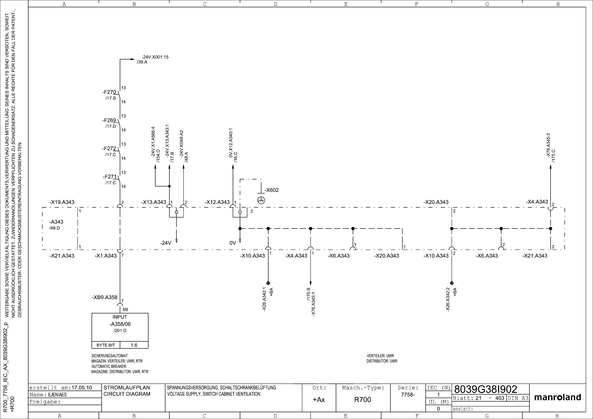

# +Ax — Sheet 21 of 403 — SPANNUNGSVERSORGUNG, SCHALTSCHRANKBELÜFTUNG

**VOLTAGE SUPPLY, SWITCH CABINET VENTILATION**

> Part of the manroland **R700** printing press IEC/UL circuit diagrams.
> Drawing class: **Stromlaufplan / Circuit diagram** (DIN A3).
> Document `+Ax` covers the **Central control console** machine section.

## At a glance

| Field | Value |
|---|---|
| Document | `+Ax`  (8039G38I902) |
| Sheet | **21** of 403 |
| Section (DE) | SPANNUNGSVERSORGUNG, SCHALTSCHRANKBELÜFTUNG |
| Section (EN) | VOLTAGE SUPPLY, SWITCH CABINET VENTILATION |
| Section type | POWER_SUPPLY — Voltage supply |
| Machine type | `R700` |
| Series | `7758` |
| Created | 17.05.10 |
| Replaces | — |
| Columns used | A, B, C, D, E, F, G, H |
| Path numbers | — |
| Labels on sheet | 84 |
| Cross-refs out | 13 |
| Cross-refs in | 27 |

**Previous:** [+Ax sheet 20](SHEET_0020.md) · **Next:** [+Ax sheet 22](SHEET_0022.md) · **Document TOC:** [_TOC.md](_TOC.md)  (+Ax) · **Master TOC:** [all sheets](../_MASTER_TOC.md)

## Sheet image (300 DPI, exact vector render)



_Rendered directly from the PDF vector layer at 300 DPI (1-bit), no OCR and no resampling. Use it to confirm anything ambiguous in the text below._

## Cross-references on this sheet

Each entry is a wire leaving this sheet. The printed token is `/sheet.column`; the link resolves to that sheet inside the same document.

| Ref | Target sheet | Col | Path | Destination on target | Target section | From col |
|---|---|---|---|---|---|---|
| `/39.A` | [+Ax sheet 39](SHEET_0039.md) | A | — | — | HAUPTANTRIEB | B |
| `/17.B` | [+Ax sheet 17](SHEET_0017.md) | B | — | — | SPANNUNGSVERSORGUNG, SCHALTSCHRANKBELÜFTUNG | B |
| `/17.B` | [+Ax sheet 17](SHEET_0017.md) | B | — | 24V.X13.A343:1 | SPANNUNGSVERSORGUNG, SCHALTSCHRANKBELÜFTUNG | C |
| `/17.D` | [+Ax sheet 17](SHEET_0017.md) | D | — | — | SPANNUNGSVERSORGUNG, SCHALTSCHRANKBELÜFTUNG | B |
| `/154.D` | [+Ax sheet 154](SHEET_0154.md) | D | — | 24V.X1.A566:4 | ÜBERWACHUNGSRECHNER/ANSTEUERUNG NOT AUS | B |
| `/16.C` | [+Ax sheet 16](SHEET_0016.md) | C | — | 0V.X12.A343:1 | SPANNUNGSVERSORGUNG, SCHALTSCHRANKBELÜFTUNG | C |
| `/48.A` | [+Ax sheet 48](SHEET_0048.md) | A | — | 24V.K048:A2 | NOT AUS | C |
| `/175.C` | [+Ax sheet 175](SHEET_0175.md) | C | — | X76.A345:3 | RESERVE | H |
| `/17.C` | [+Ax sheet 17](SHEET_0017.md) | C | — | — | SPANNUNGSVERSORGUNG, SCHALTSCHRANKBELÜFTUNG | B |
| `/17.C` | [+Ax sheet 17](SHEET_0017.md) | C | — | — | SPANNUNGSVERSORGUNG, SCHALTSCHRANKBELÜFTUNG | B |
| `/48.D` | [+Ax sheet 48](SHEET_0048.md) | D | — | A343 | NOT AUS | A |
| `/175.B` | [+Ax sheet 175](SHEET_0175.md) | B | — | — | RESERVE | D |
| `/201.D` | [+Ax sheet 201](SHEET_0201.md) | D | — | — | REFERENZMODUL | B |

### Incoming references (sheets that point here)

Every other sheet that sends a wire to this one. `Back-ref` is the token printed on *that* sheet; `Path` is its line number.

| From sheet | Cols | Back-ref | Path | Refs | What continues there |
|---|---|---|---|---|---|
| [+Ax#16](SHEET_0016.md) | C | `/16.C` | — | 1 | — |
| [+Ax#17](SHEET_0017.md) | B, C, D | `/17.B`, `/17.C`, `/17.D` | — | 5 | — |
| [+Ax#39](SHEET_0039.md) | A | `/39.A` | — | 1 | 24V.X001:15 |
| [+Ax#48](SHEET_0048.md) | A, D | `/48.A`, `/48.D` | — | 2 | 24V.K048:A2 |
| [+Ax#154](SHEET_0154.md) | D | `/154.D` | — | 1 | 24V.X1.A566:4 |
| [+Ax#175](SHEET_0175.md) | A, B | `/175.A`, `/175.B` | — | 2 | X76.A345:1; X76.A345:3 |
| [+Ax#201](SHEET_0201.md) | D | `/201.D` | — | 1 | — |
| [+Ax#207](SHEET_0207.md) | E | `/207.E` | — | 1 | — |
| [+Ax#226](SHEET_0226.md) | G | `/226.G` | — | 2 | — |
| [+Ax#233](SHEET_0233.md) | E | `/233.E` | — | 2 | — |
| [+Ax#242](SHEET_0242.md) | B | `/242.B` | — | 1 | — |
| [+Ax#243](SHEET_0243.md) | H | `/243.H` | — | 2 | — |
| [+Ax#258](SHEET_0258.md) | F | `/258.F` | — | 2 | — |
| [+Ax#260](SHEET_0260.md) | B | `/260.B` | — | 2 | — |
| [+Ax#261](SHEET_0261.md) | A | `/261.A` | — | 2 | — |


## Devices on this sheet

| Tag | Class | Class meaning (IEC) | Col | Sub | Terminal | Sign |
|---|---|---|---|---|---|---|
| `F271` | F | Schutz / protection device (fuse, circuit breaker) | B | — | — | — |
| `F272` | F | Schutz / protection device (fuse, circuit breaker) | B | — | — | — |
| `F269` | F | Schutz / protection device (fuse, circuit breaker) | B | — | — | — |
| `F270` | F | Schutz / protection device (fuse, circuit breaker) | B | — | — | — |
| `A358/06` | A | Baugruppe / assembly, module, PC board | B | 06 | — | — |
| `A343` | A | Baugruppe / assembly, module, PC board | A | — | — | — |
| `X602` | X | Klemme / terminal, plug connector | D | — | — | — |
| `X10.A343` | — | cross-device reference | F | — | — | — |
| `X26.A342:2` | — | cross-device reference | F | — | 2 | — |
| `X4.A343` | — | cross-device reference | H | — | — | — |
| `X1.A343` | — | cross-device reference | B | — | — | — |
| `X13.A343` | — | cross-device reference | B | — | — | — |
| `1.6` | — | cross-device reference | B | — | — | — |
| `XB9.A358` | — | cross-device reference | B | — | — | — |
| `X12.A343` | — | cross-device reference | C | — | — | — |
| `X10.A343` | — | cross-device reference | D | — | — | — |
| `X26.A342:1` | — | cross-device reference | D | — | 1 | — |
| `X4.A343` | — | cross-device reference | D | — | — | — |
| `X76.A345:3` | — | cross-device reference | H | — | 3 | — |
| `X76.A345:1` | — | cross-device reference | E | — | 1 | — |
| `X20.A343` | — | cross-device reference | F | — | — | — |
| `X20.A343` | — | cross-device reference | F | — | — | — |
| `X6.A343` | — | cross-device reference | G | — | — | — |
| `X21.A343` | — | cross-device reference | H | — | — | — |
| `X19.A343` | — | cross-device reference | A | — | — | — |
| `X21.A343` | — | cross-device reference | A | — | — | — |
| `X6.A343` | — | cross-device reference | E | — | — | — |

## Potentials / nets

| Potential | Count | Columns | Attached devices | Terminals |
|---|---|---|---|---|
| `0V` | 2 | C | `A343`, `X12` | `1` |
| `24V` | 5 | B, C | `A343`, `A566`, `K048`, `X001`, `X1`, `X13` | `1`, `15`, `4`, `A2` |


A potential such as `L24+/4` or `M24+` is a named supply/return rail; every place it appears on this sheet is electrically common.

## Wire-end annotations (grouped as printed)

A wire that continues elsewhere is annotated with a small cluster: the destination description, the path/line number `#NN`, and the `/sheet.column` cross reference. Each row below is one such cluster exactly as it is grouped on the drawing.

| Col | Y | Path | Cross-ref | Text on the wire |
|---|---|---|---|---|
| B | 110.8 | — | — | `24V.X001:15` |
| B | 120.7 | — | `/39.A` | — |
| B | 172.5 | — | — | `13` |
| B | 180.3 | — | — | `F270` |
| B | 193.4 | — | `/17.B` | — |
| B | 200.9 | — | — | `14` |
| B | 229.2 | — | — | `13` |
| B | 237.0 | — | — | `F269` |
| C | 249.4 | — | `/17.B` | `24V.X13.A343:1` |
| B | 250.1 | — | `/17.D` | — |
| B | 254.3 | — | `/154.D` | `24V.X1.A566:4` |
| C | 257.1 | — | `/16.C` | `0V.X12.A343:1` |
| B | 257.6 | — | — | `14` |
| C | 261.6 | — | `/48.A` | `24V.K048:A2` |
| H | 267.6 | — | `/175.C` | `X76.A345:3` |
| B | 285.9 | — | — | `13` |
| B | 293.7 | — | — | `F272` |
| B | 306.8 | — | `/17.C` | — |
| B | 314.3 | — | — | `14` |
| B | 342.6 | — | — | `13` |
| B | 350.4 | — | — | `F271` |
| B | 363.5 | — | `/17.C` | — |
| B | 370.9 | — | — | `14` |
| D | 377.3 | — | — | `X602` |
| H | 400.7 | — | — | `X4.A343 2` |
| A | 401.4 | — | — | `X19.A343` |
| B | 401.4 | — | — | `X13.A343 1` |
| C | 401.4 | — | — | `2 X12.A343 1` |
| F | 401.4 | — | — | `X20.A343` |
| B | 402.8 | — | — | `2` |
| A | 419.9 | — | — | `1` |
| G | 419.9 | — | — | `2` |
| D | 420.6 | — | — | `2` |
| A | 441.1 | — | `/48.D` | `A343` |
| C | 483.6 | — | — | `24V 0V` |
| E | 487.9 | — | — | `1 1` |
| G | 487.9 | — | — | `2` |
| A | 492.1 | — | — | `1` |
| H | 492.1 | — | — | `2` |
| D | 504.9 | — | — | `X10.A343 1` |
| D | 504.9 | — | — | `X4.A343 1` |
| F | 504.9 | — | — | `X10.A343 2` |
| A | 509.1 | — | — | `X21.A343` |
| B | 509.1 | — | — | `X1.A343 7` |
| E | 509.1 | — | — | `X6.A343` |
| F | 509.1 | — | — | `X20.A343` |
| G | 509.1 | — | — | `X6.A343 X21.A343` |
| D | 576.6 | — | — | `X26.A342:1` |
| F | 577.7 | — | — | `X26.A342:2` |
| D | 578.0 | — | `/175.B` | — |
| D | 578.3 | — | — | `+BA` |
| G | 578.3 | — | — | `+BA` |
| E | 586.5 | — | — | `X76.A345:1` |
| B | 592.8 | — | — | `XB9.A358 7` |
| B | 618.2 | — | — | `9B` |
| B | 632.8 | — | — | `INPUT` |
| B | 646.6 | — | — | `A358/06` |
| B | 660.4 | — | `/201.D` | — |
| B | 689.4 | — | — | `BYTE.BIT 1.6` |
| B | 712.1 | — | — | `MAGAZIN, VERTEILER: UWR, RTR SICHERUNGSAUTOMAT:` |
| F | 712.1 | — | — | `DISTRIBUTOR: UWR VERTEILER: UWR` |
| B | 733.4 | — | — | `MAGAZINE, DISTRIBUTOR: UWR, RTR AUTOMATIC BREAKER:` |


## Reconstructed tables

This sheet carries tabular content (pin map / terminal assignment / index). The grid below was rebuilt from the drawing's own rule lines, so each row is exactly one physical row of the table.

### Table 1 — 3 data rows × 6 columns (at x=155.9, y=360.0)

| 1 | /17.C | 14 2 | X13.A343 |  | 1 |
|---|---|---|---|---|---|
| `1` | `X1.A343 XB9.A358` | `7 7 9B` |  | `24V` |  |
|  | `INPUT` | `A358/06 /201.D` |  |  |  |
|  | `BYTE.BIT` | `1.6` |  |  |  |


### Table 2 — 1 data rows × 9 columns (at x=368.5, y=360.0)

| X12.A343 2 | 1 | 2 | X602 |  |  | X20.A343 | 2 | X4.A343 |
|---|---|---|---|---|---|---|---|---|
| `0V` |  | `X10.A343 X26.A342:1` | `1 X4.A343 /175.B +BA` | `1 X6.A343 X76.A345:1` | `1 X20.A343` | `1 X10.A343 X26.A342:2` | `2 X6.A343 +BA` | `2 X21.A343` |


## Notes and free text on this sheet

| Text | Col | Y (pt) |
|---|---|---|
| `+BA` | G | 578.27 |
| `9B` | B | 618.22 |
| `INPUT` | B | 632.76 |
| `BYTE.BIT` | B | 690.01 |
| `SICHERUNGSAUTOMAT:` | B | 712.13 |
| `MAGAZIN, VERTEILER: UWR, RTR` | B | 722.74 |
| `AUTOMATIC BREAKER:` | B | 733.38 |
| `MAGAZINE, DISTRIBUTOR: UWR, RTR` | B | 744.01 |
| `VERTEILER: UWR` | E | 712.09 |
| `DISTRIBUTOR: UWR` | F | 722.73 |
| `+BA` | D | 578.27 |

## Complete label inventory (exact text from the drawing)

Every text object inside the drawing area of this sheet, in DIN reading order (column A→H, then top→bottom). This is the authoritative list: if a string is not here it is not printed on this sheet.

| Col | Y | X | Dir | Type | Text |
|---|---|---|---|---|---|
| A | 401.4 | 99.2 | → | device ref | `X19.A343` |
| A | 419.9 | 157.9 | → | number | `1` |
| A | 441.1 | 98.9 | → | device tag | `A343` |
| A | 454.2 | 99.2 | → | cross-reference | `/48.D` |
| A | 492.1 | 157.9 | → | number | `1` |
| A | 509.1 | 99.2 | → | device ref | `X21.A343` |
| B | 110.8 | 284.6 | → | potential | `24V.X001:15` |
| B | 120.7 | 275.0 | → | cross-reference | `/39.A` |
| B | 172.5 | 242.9 | → | number | `13` |
| B | 180.3 | 205.2 | → | device tag | `F270` |
| B | 193.4 | 212.0 | → | cross-reference | `/17.B` |
| B | 200.9 | 242.9 | → | number | `14` |
| B | 229.2 | 242.9 | → | number | `13` |
| B | 237.0 | 205.2 | → | device tag | `F269` |
| B | 249.4 | 331.9 | ↕ | potential | `24V.X13.A343:1` |
| B | 250.1 | 211.7 | → | cross-reference | `/17.D` |
| B | 254.3 | 303.6 | ↕ | potential | `24V.X1.A566:4` |
| B | 257.6 | 242.9 | → | number | `14` |
| B | 285.9 | 242.9 | → | number | `13` |
| B | 293.7 | 205.2 | → | device tag | `F272` |
| B | 300.2 | 313.5 | ↕ | cross-reference | `/154.D` |
| B | 306.8 | 211.7 | → | cross-reference | `/17.C` |
| B | 314.3 | 242.9 | → | number | `14` |
| B | 342.6 | 242.9 | → | number | `13` |
| B | 350.4 | 206.6 | → | device tag | `F271` |
| B | 363.5 | 211.7 | → | cross-reference | `/17.C` |
| B | 371.0 | 242.9 | → | number | `14` |
| B | 401.4 | 283.5 | → | device ref | `X13.A343` |
| B | 402.8 | 243.5 | → | number | `2` |
| B | 483.6 | 321.7 | → | potential | `24V` |
| B | 509.1 | 190.2 | → | device ref | `X1.A343` |
| B | 509.1 | 243.5 | → | number | `7` |
| B | 592.7 | 184.5 | → | device ref | `XB9.A358` |
| B | 601.3 | 243.5 | → | number | `7` |
| B | 618.2 | 246.3 | → | text | `9B` |
| B | 632.8 | 226.1 | → | text | `INPUT` |
| B | 646.6 | 219.5 | → | device tag | `A358/06` |
| B | 660.4 | 228.2 | → | cross-reference | `/201.D` |
| B | 689.4 | 262.2 | → | device ref | `1.6` |
| B | 690.0 | 194.2 | → | text | `BYTE.BIT` |
| B | 712.1 | 184.0 | → | text | `SICHERUNGSAUTOMAT:` |
| B | 722.7 | 183.7 | → | text | `MAGAZIN, VERTEILER: UWR, RTR` |
| B | 733.4 | 184.3 | → | text | `AUTOMATIC BREAKER:` |
| B | 744.0 | 183.7 | → | text | `MAGAZINE, DISTRIBUTOR: UWR, RTR` |
| C | 257.1 | 459.5 | ↕ | potential | `0V.X12.A343:1` |
| C | 261.6 | 360.3 | ↕ | potential | `24V.K048:A2` |
| C | 305.0 | 469.4 | ↕ | cross-reference | `/16.C` |
| C | 305.3 | 341.8 | ↕ | cross-reference | `/17.B` |
| C | 305.3 | 370.2 | ↕ | cross-reference | `/48.A` |
| C | 401.4 | 411.0 | → | device ref | `X12.A343` |
| C | 402.8 | 342.1 | → | number | `1` |
| C | 402.8 | 371.1 | → | number | `2` |
| C | 402.8 | 469.7 | → | number | `1` |
| C | 483.6 | 460.9 | → | potential | `0V` |
| D | 377.3 | 531.2 | → | device tag | `X602` |
| D | 420.6 | 502.9 | → | number | `2` |
| D | 504.9 | 540.6 | → | number | `1` |
| D | 509.1 | 481.9 | → | device ref | `X10.A343` |
| D | 509.1 | 572.9 | → | device ref | `X4.A343` |
| D | 576.6 | 526.8 | ↕ | device ref | `X26.A342:1` |
| D | 578.0 | 615.4 | ↕ | cross-reference | `/175.B` |
| D | 578.3 | 541.0 | ↕ | text | `+BA` |
| E | 487.9 | 710.6 | → | number | `1` |
| E | 504.9 | 625.6 | → | number | `1` |
| E | 509.1 | 657.9 | → | device ref | `X6.A343` |
| E | 586.5 | 625.3 | ↕ | device ref | `X76.A345:1` |
| E | 712.1 | 737.0 | → | text | `VERTEILER: UWR` |
| F | 401.4 | 850.4 | → | device ref | `X20.A343` |
| F | 492.1 | 809.9 | → | number | `1` |
| F | 509.1 | 751.2 | → | device ref | `X20.A343` |
| F | 509.1 | 850.4 | → | device ref | `X10.A343` |
| F | 577.7 | 895.3 | ↕ | device ref | `X26.A342:2` |
| F | 722.7 | 736.2 | → | text | `DISTRIBUTOR: UWR` |
| G | 419.9 | 909.6 | → | number | `2` |
| G | 487.9 | 1008.9 | → | number | `2` |
| G | 504.9 | 909.6 | → | number | `2` |
| G | 509.1 | 955.6 | → | device ref | `X6.A343` |
| G | 578.3 | 909.5 | ↕ | text | `+BA` |
| H | 267.6 | 1097.3 | ↕ | device ref | `X76.A345:3` |
| H | 300.2 | 1107.2 | ↕ | cross-reference | `/175.C` |
| H | 400.7 | 1056.2 | → | device ref | `X4.A343` |
| H | 407.1 | 1108.1 | → | number | `2` |
| H | 492.1 | 1108.1 | → | number | `2` |
| H | 509.1 | 1048.8 | → | device ref | `X21.A343` |

## Reading-order text block

The same content as a plain block, grouped by DIN column — convenient to paste or to match against a visual description.

```text
=== Column A ===
 401.4   99.2  devref       X19.A343
 419.9  157.9  numeric      1
 441.1   98.9  devtag       A343
 454.2   99.2  xref         /48.D
 492.1  157.9  numeric      1
 509.1   99.2  devref       X21.A343
=== Column B ===
 110.8  284.6  net          24V.X001:15
 120.7  275.0  xref         /39.A
 172.5  242.9  numeric      13
 180.3  205.2  devtag       F270
 193.4  212.0  xref         /17.B
 200.9  242.9  numeric      14
 229.2  242.9  numeric      13
 237.0  205.2  devtag       F269
 249.4  331.9  net          24V.X13.A343:1
 250.1  211.7  xref         /17.D
 254.3  303.6  net          24V.X1.A566:4
 257.6  242.9  numeric      14
 285.9  242.9  numeric      13
 293.7  205.2  devtag       F272
 300.2  313.5  xref         /154.D
 306.8  211.7  xref         /17.C
 314.3  242.9  numeric      14
 342.6  242.9  numeric      13
 350.4  206.6  devtag       F271
 363.5  211.7  xref         /17.C
 371.0  242.9  numeric      14
 401.4  283.5  devref       X13.A343
 402.8  243.5  numeric      2
 483.6  321.7  net          24V
 509.1  190.2  devref       X1.A343
 509.1  243.5  numeric      7
 592.7  184.5  devref       XB9.A358
 601.3  243.5  numeric      7
 618.2  246.3  text         9B
 632.8  226.1  text         INPUT
 646.6  219.5  devtag       A358/06
 660.4  228.2  xref         /201.D
 689.4  262.2  devref       1.6
 690.0  194.2  text         BYTE.BIT
 712.1  184.0  text         SICHERUNGSAUTOMAT:
 722.7  183.7  text         MAGAZIN, VERTEILER: UWR, RTR
 733.4  184.3  text         AUTOMATIC BREAKER:
 744.0  183.7  text         MAGAZINE, DISTRIBUTOR: UWR, RTR
=== Column C ===
 257.1  459.5  net          0V.X12.A343:1
 261.6  360.3  net          24V.K048:A2
 305.0  469.4  xref         /16.C
 305.3  341.8  xref         /17.B
 305.3  370.2  xref         /48.A
 401.4  411.0  devref       X12.A343
 402.8  342.1  numeric      1
 402.8  371.1  numeric      2
 402.8  469.7  numeric      1
 483.6  460.9  net          0V
=== Column D ===
 377.3  531.2  devtag       X602
 420.6  502.9  numeric      2
 504.9  540.6  numeric      1
 509.1  481.9  devref       X10.A343
 509.1  572.9  devref       X4.A343
 576.6  526.8  devref       X26.A342:1
 578.0  615.4  xref         /175.B
 578.3  541.0  text         +BA
=== Column E ===
 487.9  710.6  numeric      1
 504.9  625.6  numeric      1
 509.1  657.9  devref       X6.A343
 586.5  625.3  devref       X76.A345:1
 712.1  737.0  text         VERTEILER: UWR
=== Column F ===
 401.4  850.4  devref       X20.A343
 492.1  809.9  numeric      1
 509.1  751.2  devref       X20.A343
 509.1  850.4  devref       X10.A343
 577.7  895.3  devref       X26.A342:2
 722.7  736.2  text         DISTRIBUTOR: UWR
=== Column G ===
 419.9  909.6  numeric      2
 487.9 1008.9  numeric      2
 504.9  909.6  numeric      2
 509.1  955.6  devref       X6.A343
 578.3  909.5  text         +BA
=== Column H ===
 267.6 1097.3  devref       X76.A345:3
 300.2 1107.2  xref         /175.C
 400.7 1056.2  devref       X4.A343
 407.1 1108.1  numeric      2
 492.1 1108.1  numeric      2
 509.1 1048.8  devref       X21.A343
```

---
_Generated from the PDF vector text layer; no OCR. Source: `R700_7758_IEC_AX_8039G38I902_p`, sheet 21._
