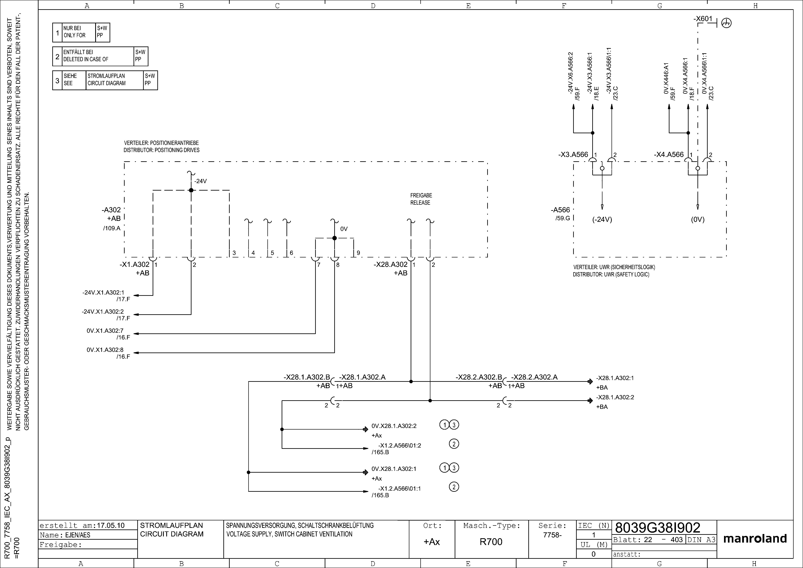

# +Ax — Sheet 22 of 403 — SPANNUNGSVERSORGUNG, SCHALTSCHRANKBELÜFTUNG

**VOLTAGE SUPPLY, SWITCH CABINET VENTILATION**

> Part of the manroland **R700** printing press IEC/UL circuit diagrams.
> Drawing class: **Stromlaufplan / Circuit diagram** (DIN A3).
> Document `+Ax` covers the **Central control console** machine section.

## At a glance

| Field | Value |
|---|---|
| Document | `+Ax`  (8039G38I902) |
| Sheet | **22** of 403 |
| Section (DE) | SPANNUNGSVERSORGUNG, SCHALTSCHRANKBELÜFTUNG |
| Section (EN) | VOLTAGE SUPPLY, SWITCH CABINET VENTILATION |
| Section type | POWER_SUPPLY — Voltage supply |
| Machine type | `R700` |
| Series | `7758` |
| Created | 17.05.10 |
| Replaces | — |
| Columns used | A, B, C, D, E, F, G, H |
| Path numbers | — |
| Labels on sheet | 108 |
| Cross-refs out | 14 |
| Cross-refs in | 33 |

**Previous:** [+Ax sheet 21](SHEET_0021.md) · **Next:** [+Ax sheet 23](SHEET_0023.md) · **Document TOC:** [_TOC.md](_TOC.md)  (+Ax) · **Master TOC:** [all sheets](../_MASTER_TOC.md)

## Sheet image (300 DPI, exact vector render)



_Rendered directly from the PDF vector layer at 300 DPI (1-bit), no OCR and no resampling. Use it to confirm anything ambiguous in the text below._

## Cross-references on this sheet

Each entry is a wire leaving this sheet. The printed token is `/sheet.column`; the link resolves to that sheet inside the same document.

| Ref | Target sheet | Col | Path | Destination on target | Target section | From col |
|---|---|---|---|---|---|---|
| `/23.C` | [+Ax sheet 23](SHEET_0023.md) | C | — | 24V.X3.A566\1:1 | SPANNUNGSVERSORGUNG, SCHALTSCHRANKBELÜFTUNG | G |
| `/59.F` | [+Ax sheet 59](SHEET_0059.md) | F | — | 24V.X6.A566:2 | DRUCKLUFTANLAGE | F |
| `/18.E` | [+Ax sheet 18](SHEET_0018.md) | E | — | 24V.X3.A566:1 | SPANNUNGSVERSORGUNG, SCHALTSCHRANKBELÜFTUNG | F |
| `/23.C` | [+Ax sheet 23](SHEET_0023.md) | C | — | 0V.X4.A566\1:1 | SPANNUNGSVERSORGUNG, SCHALTSCHRANKBELÜFTUNG | H |
| `/18.F` | [+Ax sheet 18](SHEET_0018.md) | F | — | 0V.X4.A566:1 | SPANNUNGSVERSORGUNG, SCHALTSCHRANKBELÜFTUNG | G |
| `/59.F` | [+Ax sheet 59](SHEET_0059.md) | F | — | 0V.K446:A1 | DRUCKLUFTANLAGE | G |
| `/59.G` | [+Ax sheet 59](SHEET_0059.md) | G | — | — | DRUCKLUFTANLAGE | F |
| `/109.A` | [+Ax sheet 109](SHEET_0109.md) | A | — | — | SAUGKOPF, FORMATEINSTELLUNG / | A |
| `/17.F` | [+Ax sheet 17](SHEET_0017.md) | F | — | 24V.X1.A302:1 | SPANNUNGSVERSORGUNG, SCHALTSCHRANKBELÜFTUNG | A |
| `/17.F` | [+Ax sheet 17](SHEET_0017.md) | F | — | 24V.X1.A302:2 | SPANNUNGSVERSORGUNG, SCHALTSCHRANKBELÜFTUNG | A |
| `/16.F` | [+Ax sheet 16](SHEET_0016.md) | F | — | 0V.X1.A302:7 | SPANNUNGSVERSORGUNG, SCHALTSCHRANKBELÜFTUNG | A |
| `/16.F` | [+Ax sheet 16](SHEET_0016.md) | F | — | 0V.X1.A302:8 | SPANNUNGSVERSORGUNG, SCHALTSCHRANKBELÜFTUNG | A |
| `/165.B` | [+Ax sheet 165](SHEET_0165.md) | B | — | — | ÜBERWACHUNGSRECHNER/ANSTEUERUNG NOT AUS | D |
| `/165.B` | [+Ax sheet 165](SHEET_0165.md) | B | — | — | ÜBERWACHUNGSRECHNER/ANSTEUERUNG NOT AUS | D |

### Incoming references (sheets that point here)

Every other sheet that sends a wire to this one. `Back-ref` is the token printed on *that* sheet; `Path` is its line number.

| From sheet | Cols | Back-ref | Path | Refs | What continues there |
|---|---|---|---|---|---|
| [+Ax#16](SHEET_0016.md) | F | `/16.F` | — | 2 | 0V.X1.A302:7; 0V.X1.A302:8 |
| [+Ax#17](SHEET_0017.md) | F | `/17.F` | — | 2 | — |
| [+Ax#18](SHEET_0018.md) | E, F | `/18.E`, `/18.F` | — | 2 | 0V.X4.A566:1; 24V.X3.A566:1 |
| [+Ax#23](SHEET_0023.md) | C | `/23.C` | — | 2 | 0V.X4.A566\1:1; 24V.X3.A566\1:1 |
| [+Ax#59](SHEET_0059.md) | E, F | `/59.E`, `/59.F` | — | 3 | 0V.K446:A1; 24V.X6.A566:2 |
| [+Ax#109](SHEET_0109.md) | A | `/109.A` | — | 1 | — |
| [+Ax#165](SHEET_0165.md) | B | `/165.B` | — | 2 | X1.2.A566\01:1; X1.2.A566\01:2 |
| [+Ax#207](SHEET_0207.md) | A | `/207.A` | — | 9 | — |
| [+Ax#271](SHEET_0271.md) | F, G | `/271.F`, `/271.G` | — | 10 | — |


## Devices on this sheet

| Tag | Class | Class meaning (IEC) | Col | Sub | Terminal | Sign |
|---|---|---|---|---|---|---|
| `A302` | A | Baugruppe / assembly, module, PC board | A | — | — | — |
| `A566` | A | Baugruppe / assembly, module, PC board | F | — | — | — |
| `X601` | X | Klemme / terminal, plug connector | G | — | — | — |
| `X1.A302` | — | cross-device reference | B | — | — | — |
| `X3.A566` | — | cross-device reference | F | — | — | — |
| `X4.A566` | — | cross-device reference | G | — | — | — |
| `X28.A302` | — | cross-device reference | D | — | — | — |
| `X28.1.A302:1` | — | cross-device reference | G | — | 1 | — |
| `X28.1.A302:2` | — | cross-device reference | G | — | 2 | — |
| `X28.2.A302.A` | — | cross-device reference | F | — | — | — |
| `X28.2.A302.B` | — | cross-device reference | E | — | — | — |
| `X28.1.A302.A` | — | cross-device reference | D | — | — | — |
| `X28.1.A302.B` | — | cross-device reference | C | — | — | — |
| `X1.2.A566\01:1` | — | cross-device reference | D | — | 1 | — |
| `X1.2.A566\01:2` | — | cross-device reference | D | — | 2 | — |

## Potentials / nets

| Potential | Count | Columns | Attached devices | Terminals |
|---|---|---|---|---|
| `0V` | 8 | A, D, G | `1`, `A302`, `A566`, `A566\1`, `K446`, `X1`, `X28`, `X4` | `1`, `2`, `7`, `8`, `A1` |
| `24V` | 6 | A, B, F | `A302`, `A566`, `A566\1`, `X1`, `X3`, `X6` | `1`, `2` |


A potential such as `L24+/4` or `M24+` is a named supply/return rail; every place it appears on this sheet is electrically common.

## Wire-end annotations (grouped as printed)

A wire that continues elsewhere is annotated with a small cluster: the destination description, the path/line number `#NN`, and the `/sheet.column` cross reference. Each row below is one such cluster exactly as it is grouped on the drawing.

| Col | Y | Path | Cross-ref | Text on the wire |
|---|---|---|---|---|
| G | 23.0 | — | — | `X601` |
| A | 38.8 | — | — | `PP S+W` |
| A | 38.9 | — | — | `1 NUR BEI` |
| A | 49.5 | — | — | `ONLY FOR` |
| G | 69.7 | — | `/23.C` | `24V.X3.A566\1:1` |
| B | 74.2 | — | — | `PP S+W` |
| A | 74.3 | — | — | `2 ENTFÄLLT BEI DELETED IN CASE OF` |
| F | 77.1 | — | `/59.F` | `24V.X6.A566:2` |
| F | 77.1 | — | `/18.E` | `24V.X3.A566:1` |
| H | 77.4 | — | `/23.C` | `0V.X4.A566\1:1` |
| G | 84.8 | — | `/18.F` | `0V.X4.A566:1` |
| G | 92.1 | — | `/59.F` | `0V.K446:A1` |
| B | 109.6 | — | — | `PP S+W` |
| A | 109.7 | — | — | `3 SIEHE SEE` |
| A | 109.8 | — | — | `STROMLAUFPLAN CIRCUIT DIAGRAM` |
| B | 209.0 | — | — | `DISTRIBUTOR: POSITIONING DRIVES VERTEILER: POSITIONIERANTRIEBE` |
| F | 224.2 | — | — | `X3.A566 1` |
| G | 224.2 | — | — | `2 X4.A566 1 2` |
| B | 264.6 | — | — | `24V` |
| E | 286.9 | — | — | `FREIGABE RELEASE` |
| A | 306.4 | — | — | `A302` |
| F | 306.4 | — | — | `A566` |
| A | 319.1 | — | — | `+AB` |
| F | 319.5 | — | `/59.G` | — |
| G | 320.7 | — | — | `( 24V) (0V)` |
| A | 334.4 | — | `/109.A` | — |
| D | 335.5 | — | — | `0V` |
| C | 370.9 | — | — | `3 4 5 6` |
| D | 370.9 | — | — | `9` |
| B | 387.2 | — | — | `X1.A302 1` |
| D | 387.2 | — | — | `X28.A302 1` |
| C | 388.7 | — | — | `2 7 8` |
| E | 388.7 | — | — | `2` |
| G | 393.2 | — | — | `DISTRIBUTOR: UWR (SAFETY LOGIC) VERTEILER: UWR (SICHERHEITSLOGIK)` |
| B | 399.9 | — | — | `+AB` |
| D | 399.9 | — | — | `+AB` |
| A | 429.7 | — | `/17.F` | `24V.X1.A302:1` |
| A | 458.1 | — | `/17.F` | `24V.X1.A302:2` |
| A | 486.4 | — | `/16.F` | `0V.X1.A302:7` |
| A | 514.8 | — | `/16.F` | `0V.X1.A302:8` |
| D | 554.5 | — | — | `X28.1.A302.B 1 1 +AB X28.1.A302.A +AB` |
| E | 554.5 | — | — | `X28.2.A302.B 1 1 +AB X28.2.A302.A` |
| G | 556.6 | — | — | `X28.1.A302:1` |
| C | 567.2 | — | — | `+AB` |
| F | 570.7 | — | — | `+BA` |
| G | 584.9 | — | — | `X28.1.A302:2` |
| D | 597.0 | — | — | `2 2 2 2` |
| F | 599.1 | — | — | `+BA` |
| E | 626.2 | — | — | `1 3` |
| D | 627.4 | — | — | `0V.X28.1.A302:2` |
| D | 641.7 | — | — | `+Ax` |
| E | 655.1 | — | — | `2` |
| D | 656.5 | — | — | `X1.2.A566\01:2` |
| D | 666.4 | — | `/165.B` | — |
| E | 690.0 | — | — | `1` |
| E | 690.5 | — | — | `3` |
| D | 691.2 | — | — | `0V.X28.1.A302:1` |
| D | 705.5 | — | — | `+Ax` |
| E | 718.9 | — | — | `2` |
| D | 720.3 | — | — | `X1.2.A566\01:1` |
| D | 730.2 | — | `/165.B` | — |


## Reconstructed tables

This sheet carries tabular content (pin map / terminal assignment / index). The grid below was rebuilt from the drawing's own rule lines, so each row is exactly one physical row of the table.

### Table 1 — 3 data rows × 2 columns (at x=425.2, y=282.0)

| 6 | 7 |
|---|---|
| `X28.1.A302.B` |  |
|  | `+AB 1` |
|  | `2` |


## Notes and free text on this sheet

| Text | Col | Y (pt) |
|---|---|---|
| `+AB` | A | 319.13 |
| `VERTEILER: POSITIONIERANTRIEBE` | B | 208.96 |
| `DISTRIBUTOR: POSITIONING DRIVES` | B | 219.6 |
| `+AB` | B | 399.92 |
| `VERTEILER: UWR (SICHERHEITSLOGIK)` | G | 393.22 |
| `DISTRIBUTOR: UWR (SAFETY LOGIC)` | F | 403.84 |
| `+AB` | D | 399.92 |
| `+BA` | F | 570.72 |
| `+Ax` | D | 705.48 |
| `+AB` | F | 567.16 |
| `+AB` | E | 567.16 |
| `+AB` | C | 567.16 |
| `( 24V)` | F | 320.66 |
| `(0V)` | G | 320.66 |
| `NUR BEI` | A | 38.85 |
| `ONLY FOR` | A | 49.53 |
| `ENTFÄLLT BEI` | A | 74.29 |
| `DELETED IN CASE OF` | A | 84.94 |
| `S+W` | A | 38.75 |
| `PP` | A | 49.38 |
| `S+W` | B | 74.18 |
| `PP` | B | 84.82 |
| `SIEHE` | A | 109.71 |
| `SEE` | A | 120.31 |
| `STROMLAUFPLAN` | A | 109.77 |
| `CIRCUIT DIAGRAM` | A | 120.4 |
| `FREIGABE` | E | 286.88 |
| `RELEASE` | D | 297.51 |

## Complete label inventory (exact text from the drawing)

Every text object inside the drawing area of this sheet, in DIN reading order (column A→H, then top→bottom). This is the authoritative list: if a string is not here it is not printed on this sheet.

| Col | Y | X | Dir | Type | Text |
|---|---|---|---|---|---|
| A | 38.8 | 94.1 | → | text | `NUR BEI` |
| A | 38.8 | 144.3 | → | text | `S+W` |
| A | 44.2 | 82.5 | → | number | `1` |
| A | 49.4 | 143.7 | → | text | `PP` |
| A | 49.5 | 94.7 | → | text | `ONLY FOR` |
| A | 74.3 | 94.1 | → | text | `ENTFÄLLT BEI` |
| A | 79.6 | 82.2 | → | number | `2` |
| A | 84.9 | 94.1 | → | text | `DELETED IN CASE OF` |
| A | 109.7 | 94.7 | → | text | `SIEHE` |
| A | 109.8 | 130.1 | → | text | `STROMLAUFPLAN` |
| A | 115.1 | 82.1 | → | number | `3` |
| A | 120.3 | 94.7 | → | text | `SEE` |
| A | 120.4 | 130.1 | → | text | `CIRCUIT DIAGRAM` |
| A | 306.4 | 150.8 | → | device tag | `A302` |
| A | 319.1 | 158.7 | → | text | `+AB` |
| A | 334.4 | 153.1 | → | cross-reference | `/109.A` |
| A | 429.7 | 122.5 | → | potential | `24V.X1.A302:1` |
| A | 439.6 | 172.9 | → | cross-reference | `/17.F` |
| A | 458.1 | 121.3 | → | potential | `24V.X1.A302:2` |
| A | 468.0 | 172.9 | → | cross-reference | `/17.F` |
| A | 486.4 | 128.7 | → | potential | `0V.X1.A302:7` |
| A | 496.3 | 172.9 | → | cross-reference | `/16.F` |
| A | 514.8 | 128.7 | → | potential | `0V.X1.A302:8` |
| A | 524.7 | 172.9 | → | cross-reference | `/16.F` |
| B | 74.2 | 201.0 | → | text | `S+W` |
| B | 84.8 | 200.4 | → | text | `PP` |
| B | 109.6 | 215.1 | → | text | `S+W` |
| B | 120.3 | 214.6 | → | text | `PP` |
| B | 209.0 | 184.3 | → | text | `VERTEILER: POSITIONIERANTRIEBE` |
| B | 219.6 | 183.4 | → | text | `DISTRIBUTOR: POSITIONING DRIVES` |
| B | 264.6 | 288.3 | → | potential | `24V` |
| B | 387.2 | 177.4 | → | device ref | `X1.A302` |
| B | 388.7 | 228.8 | → | number | `1` |
| B | 388.7 | 286.0 | → | number | `2` |
| B | 399.9 | 201.3 | → | text | `+AB` |
| C | 371.0 | 344.8 | → | number | `3` |
| C | 371.0 | 373.2 | → | number | `4` |
| C | 371.0 | 401.5 | → | number | `5` |
| C | 371.0 | 429.9 | → | number | `6` |
| C | 388.7 | 470.3 | → | number | `7` |
| C | 554.5 | 420.7 | → | device ref | `X28.1.A302.B` |
| C | 567.2 | 469.1 | → | text | `+AB` |
| D | 297.5 | 608.6 | → | text | `RELEASE` |
| D | 335.5 | 504.7 | → | potential | `0V` |
| D | 371.0 | 529.1 | → | number | `9` |
| D | 387.2 | 554.2 | → | device ref | `X28.A302` |
| D | 388.7 | 498.6 | → | number | `8` |
| D | 388.7 | 611.4 | → | number | `1` |
| D | 399.9 | 583.9 | → | text | `+AB` |
| D | 554.5 | 502.9 | → | device ref | `X28.1.A302.A` |
| D | 567.2 | 502.6 | → | text | `+AB` |
| D | 568.7 | 481.0 | → | number | `1` |
| D | 568.7 | 498.0 | → | number | `1` |
| D | 597.0 | 481.6 | → | number | `2` |
| D | 597.0 | 498.6 | → | number | `2` |
| D | 627.4 | 551.1 | → | potential | `0V.X28.1.A302:2` |
| D | 641.7 | 551.1 | → | text | `+Ax` |
| D | 656.5 | 561.0 | → | device ref | `X1.2.A566\01:2` |
| D | 666.4 | 551.3 | → | cross-reference | `/165.B` |
| D | 691.2 | 551.1 | → | potential | `0V.X28.1.A302:1` |
| D | 705.5 | 551.1 | → | text | `+Ax` |
| D | 720.3 | 561.0 | → | device ref | `X1.2.A566\01:1` |
| D | 730.2 | 551.3 | → | cross-reference | `/165.B` |
| E | 286.9 | 608.6 | → | text | `FREIGABE` |
| E | 388.7 | 640.3 | → | number | `2` |
| E | 554.5 | 675.8 | → | device ref | `X28.2.A302.B` |
| E | 567.2 | 724.3 | → | text | `+AB` |
| E | 568.7 | 736.2 | → | number | `1` |
| E | 568.7 | 753.2 | → | number | `1` |
| E | 597.0 | 736.7 | → | number | `2` |
| E | 597.0 | 753.7 | → | number | `2` |
| E | 626.2 | 657.3 | → | number | `1` |
| E | 626.7 | 671.2 | → | number | `3` |
| E | 655.1 | 671.2 | → | number | `2` |
| E | 690.0 | 657.3 | → | number | `1` |
| E | 690.5 | 671.2 | → | number | `3` |
| E | 718.9 | 671.2 | → | number | `2` |
| F | 69.7 | 898.9 | ↕ | potential | `24V.X3.A566\1:1` |
| F | 77.1 | 842.2 | ↕ | potential | `24V.X6.A566:2` |
| F | 77.1 | 870.5 | ↕ | potential | `24V.X3.A566:1` |
| F | 128.1 | 880.4 | ↕ | cross-reference | `/18.E` |
| F | 128.7 | 852.1 | ↕ | cross-reference | `/59.F` |
| F | 224.2 | 828.0 | → | device ref | `X3.A566` |
| F | 225.7 | 880.7 | → | number | `1` |
| F | 306.4 | 816.9 | → | device tag | `A566` |
| F | 319.5 | 823.7 | → | cross-reference | `/59.G` |
| F | 320.7 | 878.3 | → | text | `( 24V)` |
| F | 403.8 | 849.5 | → | text | `DISTRIBUTOR: UWR (SAFETY LOGIC)` |
| F | 554.5 | 758.0 | → | device ref | `X28.2.A302.A` |
| F | 567.2 | 757.7 | → | text | `+AB` |
| F | 570.7 | 884.1 | → | text | `+BA` |
| F | 599.1 | 884.1 | → | text | `+BA` |
| G | 23.0 | 1028.4 | → | device tag | `X601` |
| G | 77.4 | 1040.6 | ↕ | potential | `0V.X4.A566\1:1` |
| G | 84.8 | 1012.2 | ↕ | potential | `0V.X4.A566:1` |
| G | 92.1 | 983.9 | ↕ | potential | `0V.K446:A1` |
| G | 127.8 | 908.8 | ↕ | cross-reference | `/23.C` |
| G | 128.7 | 993.8 | ↕ | cross-reference | `/59.F` |
| G | 128.7 | 1022.2 | ↕ | cross-reference | `/18.F` |
| G | 224.2 | 969.7 | → | device ref | `X4.A566` |
| G | 225.7 | 909.6 | → | number | `2` |
| G | 225.7 | 1022.5 | → | number | `1` |
| G | 320.7 | 1024.7 | → | text | `(0V)` |
| G | 393.2 | 850.4 | → | text | `VERTEILER: UWR (SICHERHEITSLOGIK)` |
| G | 556.6 | 884.1 | → | device ref | `X28.1.A302:1` |
| G | 584.9 | 884.1 | → | device ref | `X28.1.A302:2` |
| H | 127.8 | 1050.5 | ↕ | cross-reference | `/23.C` |
| H | 225.7 | 1051.4 | → | number | `2` |

## Reading-order text block

The same content as a plain block, grouped by DIN column — convenient to paste or to match against a visual description.

```text
=== Column A ===
  38.8   94.1  text         NUR BEI
  38.8  144.3  text         S+W
  44.2   82.5  numeric      1
  49.4  143.7  text         PP
  49.5   94.7  text         ONLY FOR
  74.3   94.1  text         ENTFÄLLT BEI
  79.6   82.2  numeric      2
  84.9   94.1  text         DELETED IN CASE OF
 109.7   94.7  text         SIEHE
 109.8  130.1  text         STROMLAUFPLAN
 115.1   82.1  numeric      3
 120.3   94.7  text         SEE
 120.4  130.1  text         CIRCUIT DIAGRAM
 306.4  150.8  devtag       A302
 319.1  158.7  text         +AB
 334.4  153.1  xref         /109.A
 429.7  122.5  net          24V.X1.A302:1
 439.6  172.9  xref         /17.F
 458.1  121.3  net          24V.X1.A302:2
 468.0  172.9  xref         /17.F
 486.4  128.7  net          0V.X1.A302:7
 496.3  172.9  xref         /16.F
 514.8  128.7  net          0V.X1.A302:8
 524.7  172.9  xref         /16.F
=== Column B ===
  74.2  201.0  text         S+W
  84.8  200.4  text         PP
 109.6  215.1  text         S+W
 120.3  214.6  text         PP
 209.0  184.3  text         VERTEILER: POSITIONIERANTRIEBE
 219.6  183.4  text         DISTRIBUTOR: POSITIONING DRIVES
 264.6  288.3  net          24V
 387.2  177.4  devref       X1.A302
 388.7  228.8  numeric      1
 388.7  286.0  numeric      2
 399.9  201.3  text         +AB
=== Column C ===
 371.0  344.8  numeric      3
 371.0  373.2  numeric      4
 371.0  401.5  numeric      5
 371.0  429.9  numeric      6
 388.7  470.3  numeric      7
 554.5  420.7  devref       X28.1.A302.B
 567.2  469.1  text         +AB
=== Column D ===
 297.5  608.6  text         RELEASE
 335.5  504.7  net          0V
 371.0  529.1  numeric      9
 387.2  554.2  devref       X28.A302
 388.7  498.6  numeric      8
 388.7  611.4  numeric      1
 399.9  583.9  text         +AB
 554.5  502.9  devref       X28.1.A302.A
 567.2  502.6  text         +AB
 568.7  481.0  numeric      1
 568.7  498.0  numeric      1
 597.0  481.6  numeric      2
 597.0  498.6  numeric      2
 627.4  551.1  net          0V.X28.1.A302:2
 641.7  551.1  text         +Ax
 656.5  561.0  devref       X1.2.A566\01:2
 666.4  551.3  xref         /165.B
 691.2  551.1  net          0V.X28.1.A302:1
 705.5  551.1  text         +Ax
 720.3  561.0  devref       X1.2.A566\01:1
 730.2  551.3  xref         /165.B
=== Column E ===
 286.9  608.6  text         FREIGABE
 388.7  640.3  numeric      2
 554.5  675.8  devref       X28.2.A302.B
 567.2  724.3  text         +AB
 568.7  736.2  numeric      1
 568.7  753.2  numeric      1
 597.0  736.7  numeric      2
 597.0  753.7  numeric      2
 626.2  657.3  numeric      1
 626.7  671.2  numeric      3
 655.1  671.2  numeric      2
 690.0  657.3  numeric      1
 690.5  671.2  numeric      3
 718.9  671.2  numeric      2
=== Column F ===
  69.7  898.9  net          24V.X3.A566\1:1
  77.1  842.2  net          24V.X6.A566:2
  77.1  870.5  net          24V.X3.A566:1
 128.1  880.4  xref         /18.E
 128.7  852.1  xref         /59.F
 224.2  828.0  devref       X3.A566
 225.7  880.7  numeric      1
 306.4  816.9  devtag       A566
 319.5  823.7  xref         /59.G
 320.7  878.3  text         ( 24V)
 403.8  849.5  text         DISTRIBUTOR: UWR (SAFETY LOGIC)
 554.5  758.0  devref       X28.2.A302.A
 567.2  757.7  text         +AB
 570.7  884.1  text         +BA
 599.1  884.1  text         +BA
=== Column G ===
  23.0 1028.4  devtag       X601
  77.4 1040.6  net          0V.X4.A566\1:1
  84.8 1012.2  net          0V.X4.A566:1
  92.1  983.9  net          0V.K446:A1
 127.8  908.8  xref         /23.C
 128.7  993.8  xref         /59.F
 128.7 1022.2  xref         /18.F
 224.2  969.7  devref       X4.A566
 225.7  909.6  numeric      2
 225.7 1022.5  numeric      1
 320.7 1024.7  text         (0V)
 393.2  850.4  text         VERTEILER: UWR (SICHERHEITSLOGIK)
 556.6  884.1  devref       X28.1.A302:1
 584.9  884.1  devref       X28.1.A302:2
=== Column H ===
 127.8 1050.5  xref         /23.C
 225.7 1051.4  numeric      2
```

---
_Generated from the PDF vector text layer; no OCR. Source: `R700_7758_IEC_AX_8039G38I902_p`, sheet 22._
