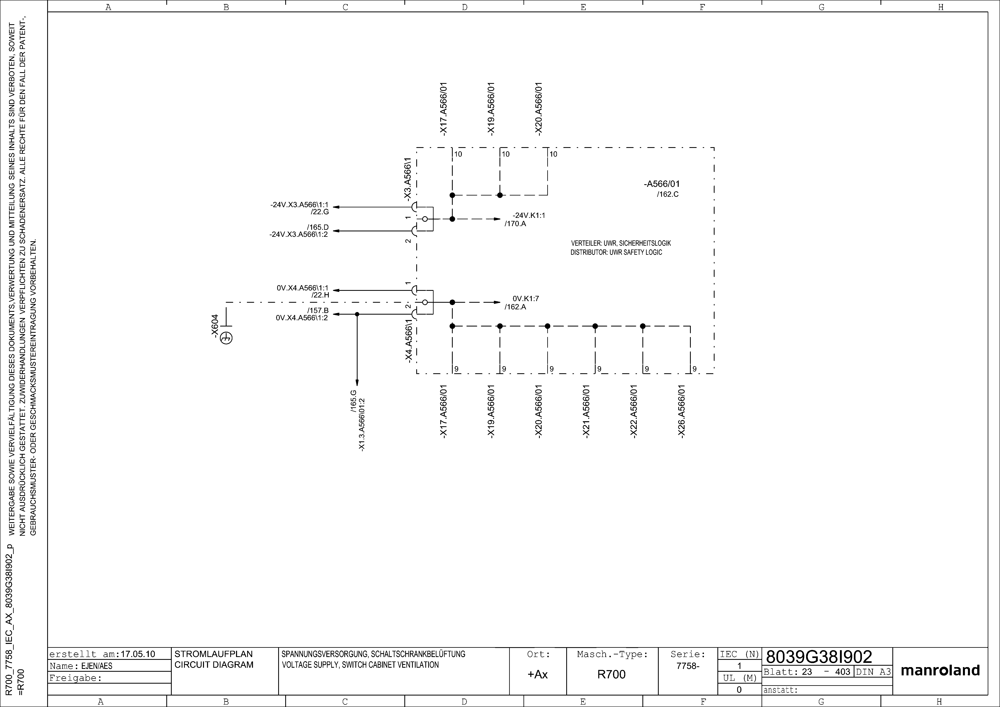

# +Ax — Sheet 23 of 403 — SPANNUNGSVERSORGUNG, SCHALTSCHRANKBELÜFTUNG

**VOLTAGE SUPPLY, SWITCH CABINET VENTILATION**

> Part of the manroland **R700** printing press IEC/UL circuit diagrams.
> Drawing class: **Stromlaufplan / Circuit diagram** (DIN A3).
> Document `+Ax` covers the **Central control console** machine section.

## At a glance

| Field | Value |
|---|---|
| Document | `+Ax`  (8039G38I902) |
| Sheet | **23** of 403 |
| Section (DE) | SPANNUNGSVERSORGUNG, SCHALTSCHRANKBELÜFTUNG |
| Section (EN) | VOLTAGE SUPPLY, SWITCH CABINET VENTILATION |
| Section type | POWER_SUPPLY — Voltage supply |
| Machine type | `R700` |
| Series | `7758` |
| Created | 17.05.10 |
| Replaces | — |
| Columns used | B, C, D, E, F |
| Path numbers | — |
| Labels on sheet | 43 |
| Cross-refs out | 8 |
| Cross-refs in | 17 |

**Previous:** [+Ax sheet 22](SHEET_0022.md) · **Next:** [+Ax sheet 24](SHEET_0024.md) · **Document TOC:** [_TOC.md](_TOC.md)  (+Ax) · **Master TOC:** [all sheets](../_MASTER_TOC.md)

## Sheet image (300 DPI, exact vector render)



_Rendered directly from the PDF vector layer at 300 DPI (1-bit), no OCR and no resampling. Use it to confirm anything ambiguous in the text below._

## Cross-references on this sheet

Each entry is a wire leaving this sheet. The printed token is `/sheet.column`; the link resolves to that sheet inside the same document.

| Ref | Target sheet | Col | Path | Destination on target | Target section | From col |
|---|---|---|---|---|---|---|
| `/162.C` | [+Ax sheet 162](SHEET_0162.md) | C | — | — | ÜBERWACHUNGSRECHNER/ANSTEUERUNG NOT AUS | F |
| `/22.G` | [+Ax sheet 22](SHEET_0022.md) | G | — | 24V.X3.A566\1:1 | SPANNUNGSVERSORGUNG, SCHALTSCHRANKBELÜFTUNG | C |
| `/170.A` | [+Ax sheet 170](SHEET_0170.md) | A | — | — | ÜBERWACHUNGSRECHNER/RÜCKMELDUNG NOT AUS | D |
| `/165.D` | [+Ax sheet 165](SHEET_0165.md) | D | — | 24V.X3.A566\1:2 | ÜBERWACHUNGSRECHNER/ANSTEUERUNG NOT AUS | C |
| `/22.H` | [+Ax sheet 22](SHEET_0022.md) | H | — | 0V.X4.A566\1:1 | SPANNUNGSVERSORGUNG, SCHALTSCHRANKBELÜFTUNG | C |
| `/162.A` | [+Ax sheet 162](SHEET_0162.md) | A | — | — | ÜBERWACHUNGSRECHNER/ANSTEUERUNG NOT AUS | D |
| `/157.B` | [+Ax sheet 157](SHEET_0157.md) | B | — | 0V.X4.A566\1:2 | ÜBERWACHUNGSRECHNER/ANSTEUERUNG NOT AUS | C |
| `/165.G` | [+Ax sheet 165](SHEET_0165.md) | G | — | — | ÜBERWACHUNGSRECHNER/ANSTEUERUNG NOT AUS | C |

### Incoming references (sheets that point here)

Every other sheet that sends a wire to this one. `Back-ref` is the token printed on *that* sheet; `Path` is its line number.

| From sheet | Cols | Back-ref | Path | Refs | What continues there |
|---|---|---|---|---|---|
| [+Ax#22](SHEET_0022.md) | G, H | `/22.G`, `/22.H` | — | 2 | 0V.X4.A566\1:1; 24V.X3.A566\1:1 |
| [+Ax#157](SHEET_0157.md) | B | `/157.B` | — | 1 | 0V.X4.A566\1:2 X1.A566\1:6 |
| [+Ax#162](SHEET_0162.md) | A, C | `/162.A`, `/162.C` | — | 2 | — |
| [+Ax#165](SHEET_0165.md) | D, G | `/165.D`, `/165.G` | — | 2 | X1.3.A566\01:2 |
| [+Ax#170](SHEET_0170.md) | A | `/170.A` | — | 1 | — |
| [+Ax#255](SHEET_0255.md) | H | `/255.H` | — | 2 | — |
| [+Ax#259](SHEET_0259.md) | E | `/259.E` | — | 2 | — |
| [+Ax#260](SHEET_0260.md) | H | `/260.H` | — | 2 | — |
| [+Ax#261](SHEET_0261.md) | F | `/261.F` | — | 1 | — |
| [+Ax#263](SHEET_0263.md) | C | `/263.C` | — | 1 | — |
| [+Ax#269](SHEET_0269.md) | F | `/269.F` | — | 1 | — |


## Devices on this sheet

| Tag | Class | Class meaning (IEC) | Col | Sub | Terminal | Sign |
|---|---|---|---|---|---|---|
| `A566/01` | A | Baugruppe / assembly, module, PC board | F | 01 | — | — |
| `X604` | X | Klemme / terminal, plug connector | B | — | — | — |
| `X3.A566\1` | — | cross-device reference | D | — | — | — |
| `X4.A566\1` | — | cross-device reference | D | — | — | — |
| `X1.3.A566\01:2` | — | cross-device reference | C | — | 2 | — |

## Potentials / nets

| Potential | Count | Columns | Attached devices | Terminals |
|---|---|---|---|---|
| `0V` | 3 | C, E | `A566\1`, `K1`, `X4` | `1`, `2`, `7` |
| `24V` | 3 | C, E | `A566\1`, `K1`, `X3` | `1`, `2` |


A potential such as `L24+/4` or `M24+` is a named supply/return rail; every place it appears on this sheet is electrically common.

## Wire-end annotations (grouped as printed)

A wire that continues elsewhere is annotated with a small cluster: the destination description, the path/line number `#NN`, and the `/sheet.column` cross reference. Each row below is one such cluster exactly as it is grouped on the drawing.

| Col | Y | Path | Cross-ref | Text on the wire |
|---|---|---|---|---|
| D | 96.9 | — | — | `X17.A566/01` |
| D | 96.9 | — | — | `X19.A566/01` |
| E | 96.9 | — | — | `X20.A566/01` |
| D | 179.6 | — | — | `10 10 10` |
| D | 186.8 | — | — | `X3.A566\1 X4.A566\1 1 2 1 2` |
| F | 214.3 | — | — | `A566/01` |
| F | 227.4 | — | `/162.C` | — |
| C | 239.8 | — | `/22.G` | `24V.X3.A566\1:1` |
| E | 252.6 | — | — | `24V.K1:1` |
| D | 262.5 | — | `/170.A` | — |
| C | 266.8 | — | `/165.D` | `24V.X3.A566\1:2` |
| E | 286.9 | — | — | `DISTRIBUTOR: UWR SAFETY LOGIC VERTEILER: UWR, SICHERHEITSLOGIK` |
| C | 339.0 | — | `/22.H` | `0V.X4.A566\1:1` |
| E | 351.8 | — | — | `0V.K1:7` |
| D | 361.7 | — | `/162.A` | — |
| C | 365.9 | — | `/157.B` | `0V.X4.A566\1:2` |
| B | 374.0 | — | — | `X604` |
| E | 435.4 | — | — | `9 9 9 9 9 9` |
| D | 457.2 | — | — | `X17.A566/01` |
| D | 457.2 | — | — | `X19.A566/01` |
| E | 457.2 | — | — | `X20.A566/01` |
| E | 457.2 | — | — | `X21.A566/01` |
| E | 457.2 | — | — | `X22.A566/01` |
| F | 457.2 | — | — | `X26.A566/01` |
| C | 464.3 | — | `/165.G` | — |
| C | 474.2 | — | — | `X1.3.A566\01:2` |


## Reconstructed tables

This sheet carries tabular content (pin map / terminal assignment / index). The grid below was rebuilt from the drawing's own rule lines, so each row is exactly one physical row of the table.

### Table 1 — 3 data rows × 1 columns (at x=425.2, y=232.4)

| C1 |
|---|
| `1` |
| `2 1` |
| `2` |


### Table 2 — 2 data rows × 4 columns (at x=595.3, y=232.4) — **24V.K1:1 /170.A**

|  | VERTEILER: DISTRIBUTOR: | UWR, UWR SAFETY | SICHERHEITSLOGIK LOGIC |
|---|---|---|---|
| `0V.K1:7` |  |  |  |
| `/162.A` |  |  |  |


## Notes and free text on this sheet

| Text | Col | Y (pt) |
|---|---|---|
| `VERTEILER: UWR, SICHERHEITSLOGIK` | E | 286.91 |
| `DISTRIBUTOR: UWR SAFETY LOGIC` | E | 297.54 |
| `X17.A566/01` | D | 96.94 |
| `X19.A566/01` | D | 96.94 |
| `X20.A566/01` | E | 96.94 |
| `X21.A566/01` | E | 457.23 |
| `X22.A566/01` | E | 457.23 |
| `X26.A566/01` | F | 457.23 |

## Complete label inventory (exact text from the drawing)

Every text object inside the drawing area of this sheet, in DIN reading order (column A→H, then top→bottom). This is the authoritative list: if a string is not here it is not printed on this sheet.

| Col | Y | X | Dir | Type | Text |
|---|---|---|---|---|---|
| B | 374.0 | 251.2 | ↕ | device tag | `X604` |
| C | 239.8 | 322.0 | → | potential | `24V.X3.A566\1:1` |
| C | 248.3 | 370.2 | → | cross-reference | `/22.G` |
| C | 266.7 | 365.7 | → | cross-reference | `/165.D` |
| C | 275.2 | 320.9 | → | potential | `24V.X3.A566\1:2` |
| C | 339.0 | 329.7 | → | potential | `0V.X4.A566\1:1` |
| C | 347.5 | 371.1 | → | cross-reference | `/22.H` |
| C | 365.9 | 366.0 | → | cross-reference | `/157.B` |
| C | 374.4 | 328.5 | → | potential | `0V.X4.A566\1:2` |
| C | 464.3 | 417.0 | ↕ | cross-reference | `/165.G` |
| C | 474.2 | 426.9 | ↕ | device ref | `X1.3.A566\01:2` |
| D | 96.9 | 523.3 | ↕ | text | `X17.A566/01` |
| D | 96.9 | 580.0 | ↕ | text | `X19.A566/01` |
| D | 179.6 | 540.6 | → | number | `10` |
| D | 179.6 | 597.3 | → | number | `10` |
| D | 186.8 | 480.8 | ↕ | device ref | `X3.A566\1` |
| D | 256.8 | 482.2 | ↕ | number | `1` |
| D | 262.5 | 600.9 | → | cross-reference | `/170.A` |
| D | 284.6 | 482.2 | ↕ | number | `2` |
| D | 334.8 | 482.2 | ↕ | number | `1` |
| D | 361.7 | 600.9 | → | cross-reference | `/162.A` |
| D | 362.6 | 482.2 | ↕ | number | `2` |
| D | 379.3 | 482.2 | ↕ | device ref | `X4.A566\1` |
| D | 435.4 | 541.1 | → | number | `9` |
| D | 435.4 | 597.8 | → | number | `9` |
| D | 457.2 | 523.3 | ↕ | text | `X17.A566/01` |
| D | 457.2 | 580.0 | ↕ | text | `X19.A566/01` |
| E | 96.9 | 636.7 | ↕ | text | `X20.A566/01` |
| E | 179.6 | 654.0 | → | number | `10` |
| E | 252.6 | 610.6 | → | potential | `24V.K1:1` |
| E | 286.9 | 680.3 | → | text | `VERTEILER: UWR, SICHERHEITSLOGIK` |
| E | 297.5 | 679.5 | → | text | `DISTRIBUTOR: UWR SAFETY LOGIC` |
| E | 351.8 | 610.6 | → | potential | `0V.K1:7` |
| E | 435.4 | 654.5 | → | number | `9` |
| E | 435.4 | 711.2 | → | number | `9` |
| E | 457.2 | 636.7 | ↕ | text | `X20.A566/01` |
| E | 457.2 | 693.4 | ↕ | text | `X21.A566/01` |
| E | 457.2 | 750.1 | ↕ | text | `X22.A566/01` |
| F | 214.3 | 766.8 | → | device tag | `A566/01` |
| F | 227.4 | 782.4 | → | cross-reference | `/162.C` |
| F | 435.4 | 767.9 | → | number | `9` |
| F | 435.4 | 824.6 | → | number | `9` |
| F | 457.2 | 806.8 | ↕ | text | `X26.A566/01` |

## Reading-order text block

The same content as a plain block, grouped by DIN column — convenient to paste or to match against a visual description.

```text
=== Column B ===
 374.0  251.2  devtag       X604
=== Column C ===
 239.8  322.0  net          24V.X3.A566\1:1
 248.3  370.2  xref         /22.G
 266.7  365.7  xref         /165.D
 275.2  320.9  net          24V.X3.A566\1:2
 339.0  329.7  net          0V.X4.A566\1:1
 347.5  371.1  xref         /22.H
 365.9  366.0  xref         /157.B
 374.4  328.5  net          0V.X4.A566\1:2
 464.3  417.0  xref         /165.G
 474.2  426.9  devref       X1.3.A566\01:2
=== Column D ===
  96.9  523.3  text         X17.A566/01
  96.9  580.0  text         X19.A566/01
 179.6  540.6  numeric      10
 179.6  597.3  numeric      10
 186.8  480.8  devref       X3.A566\1
 256.8  482.2  numeric      1
 262.5  600.9  xref         /170.A
 284.6  482.2  numeric      2
 334.8  482.2  numeric      1
 361.7  600.9  xref         /162.A
 362.6  482.2  numeric      2
 379.3  482.2  devref       X4.A566\1
 435.4  541.1  numeric      9
 435.4  597.8  numeric      9
 457.2  523.3  text         X17.A566/01
 457.2  580.0  text         X19.A566/01
=== Column E ===
  96.9  636.7  text         X20.A566/01
 179.6  654.0  numeric      10
 252.6  610.6  net          24V.K1:1
 286.9  680.3  text         VERTEILER: UWR, SICHERHEITSLOGIK
 297.5  679.5  text         DISTRIBUTOR: UWR SAFETY LOGIC
 351.8  610.6  net          0V.K1:7
 435.4  654.5  numeric      9
 435.4  711.2  numeric      9
 457.2  636.7  text         X20.A566/01
 457.2  693.4  text         X21.A566/01
 457.2  750.1  text         X22.A566/01
=== Column F ===
 214.3  766.8  devtag       A566/01
 227.4  782.4  xref         /162.C
 435.4  767.9  numeric      9
 435.4  824.6  numeric      9
 457.2  806.8  text         X26.A566/01
```

---
_Generated from the PDF vector text layer; no OCR. Source: `R700_7758_IEC_AX_8039G38I902_p`, sheet 23._
