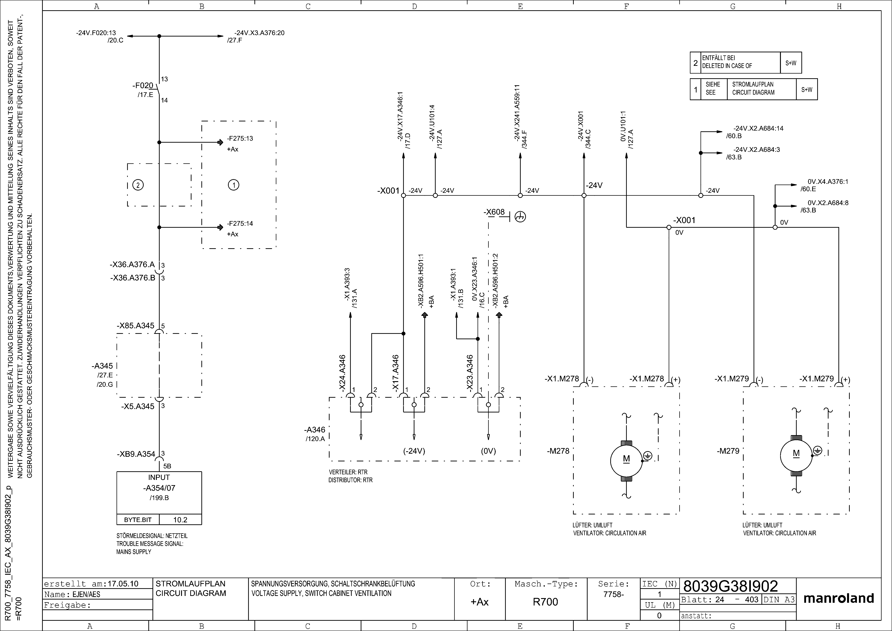

# +Ax — Sheet 24 of 403 — SPANNUNGSVERSORGUNG, SCHALTSCHRANKBELÜFTUNG

**VOLTAGE SUPPLY, SWITCH CABINET VENTILATION**

> Part of the manroland **R700** printing press IEC/UL circuit diagrams.
> Drawing class: **Stromlaufplan / Circuit diagram** (DIN A3).
> Document `+Ax` covers the **Central control console** machine section.

## At a glance

| Field | Value |
|---|---|
| Document | `+Ax`  (8039G38I902) |
| Sheet | **24** of 403 |
| Section (DE) | SPANNUNGSVERSORGUNG, SCHALTSCHRANKBELÜFTUNG |
| Section (EN) | VOLTAGE SUPPLY, SWITCH CABINET VENTILATION |
| Section type | POWER_SUPPLY — Voltage supply |
| Machine type | `R700` |
| Series | `7758` |
| Created | 17.05.10 |
| Replaces | — |
| Columns used | A, B, C, D, E, F, G, H |
| Path numbers | — |
| Labels on sheet | 115 |
| Cross-refs out | 19 |
| Cross-refs in | 24 |

**Previous:** [+Ax sheet 23](SHEET_0023.md) · **Next:** [+Ax sheet 25](SHEET_0025.md) · **Document TOC:** [_TOC.md](_TOC.md)  (+Ax) · **Master TOC:** [all sheets](../_MASTER_TOC.md)

## Sheet image (300 DPI, exact vector render)



_Rendered directly from the PDF vector layer at 300 DPI (1-bit), no OCR and no resampling. Use it to confirm anything ambiguous in the text below._

## Cross-references on this sheet

Each entry is a wire leaving this sheet. The printed token is `/sheet.column`; the link resolves to that sheet inside the same document.

| Ref | Target sheet | Col | Path | Destination on target | Target section | From col |
|---|---|---|---|---|---|---|
| `/20.C` | [+Ax sheet 20](SHEET_0020.md) | C | — | 24V.F020:13 | SPANNUNGSVERSORGUNG, SCHALTSCHRANKBELÜFTUNG | A |
| `/27.F` | [+Ax sheet 27](SHEET_0027.md) | F | — | — | SPANNUNGSVERSORGUNG, SCHALTSCHRANKBELÜFTUNG | B |
| `/344.F` | [+Ax sheet 344](SHEET_0344.md) | F | — | 24V.X241.A559:11 | OPTION: INLINESHEETER RS104 S | E |
| `/17.D` | [+Ax sheet 17](SHEET_0017.md) | D | — | 24V.X17.A346:1 | SPANNUNGSVERSORGUNG, SCHALTSCHRANKBELÜFTUNG | D |
| `/17.E` | [+Ax sheet 17](SHEET_0017.md) | E | — | — | SPANNUNGSVERSORGUNG, SCHALTSCHRANKBELÜFTUNG | A |
| `/127.A` | [+Ax sheet 127](SHEET_0127.md) | A | — | 24V.U101:4 | REALTIMERECHNER ANLEGER | D |
| `/344.C` | [+Ax sheet 344](SHEET_0344.md) | C | — | 24V.X001 | OPTION: INLINESHEETER RS104 S | F |
| `/127.A` | [+Ax sheet 127](SHEET_0127.md) | A | — | 0V.U101:1 | REALTIMERECHNER ANLEGER | F |
| `/60.B` | [+Ax sheet 60](SHEET_0060.md) | B | — | — | DRUCKLUFTANLAGE | G |
| `/63.B` | [+Ax sheet 63](SHEET_0063.md) | B | — | — | DRUCKLUFTANLAGE | G |
| `/60.E` | [+Ax sheet 60](SHEET_0060.md) | E | — | — | DRUCKLUFTANLAGE | H |
| `/63.B` | [+Ax sheet 63](SHEET_0063.md) | B | — | — | DRUCKLUFTANLAGE | H |
| `/16.C` | [+Ax sheet 16](SHEET_0016.md) | C | — | 0V.X23.A346:1 | SPANNUNGSVERSORGUNG, SCHALTSCHRANKBELÜFTUNG | E |
| `/131.A` | [+Ax sheet 131](SHEET_0131.md) | A | — | X1.A393:3 | REALTIMERECHNER ANLAGE | C |
| `/131.B` | [+Ax sheet 131](SHEET_0131.md) | B | — | X1.A393:1 | REALTIMERECHNER ANLAGE | D |
| `/27.E` | [+Ax sheet 27](SHEET_0027.md) | E | — | — | SPANNUNGSVERSORGUNG, SCHALTSCHRANKBELÜFTUNG | A |
| `/20.G` | [+Ax sheet 20](SHEET_0020.md) | G | — | — | SPANNUNGSVERSORGUNG, SCHALTSCHRANKBELÜFTUNG | A |
| `/120.A` | [+Ax sheet 120](SHEET_0120.md) | A | — | — | REALTIMERECHNER FEHLBOGENKONTROLLE | C |
| `/199.B` | [+Ax sheet 199](SHEET_0199.md) | B | — | — | REFERENZMODUL | B |

### Incoming references (sheets that point here)

Every other sheet that sends a wire to this one. `Back-ref` is the token printed on *that* sheet; `Path` is its line number.

| From sheet | Cols | Back-ref | Path | Refs | What continues there |
|---|---|---|---|---|---|
| [+Ax#16](SHEET_0016.md) | C | `/16.C` | — | 1 | — |
| [+Ax#17](SHEET_0017.md) | D, E | `/17.D`, `/17.E` | — | 2 | — |
| [+Ax#20](SHEET_0020.md) | C, G | `/20.C`, `/20.G` | — | 2 | — |
| [+Ax#27](SHEET_0027.md) | D, F | `/27.D`, `/27.F` | — | 2 | — |
| [+Ax#60](SHEET_0060.md) | A, E | `/60.A`, `/60.E` | — | 2 | 0V.X4.A376:1; 24V.X2.A684:14 |
| [+Ax#63](SHEET_0063.md) | B | `/63.B` | — | 2 | 0V.X2.A684:8; 24V.X2.A684:3 |
| [+Ax#120](SHEET_0120.md) | A | `/120.A` | — | 1 | — |
| [+Ax#127](SHEET_0127.md) | A | `/127.A` | — | 2 | 0V.U101:1; 24V.U101:4 |
| [+Ax#131](SHEET_0131.md) | A, B | `/131.A`, `/131.B` | — | 2 | X1.A393:1; X1.A393:3 |
| [+Ax#199](SHEET_0199.md) | B | `/199.B` | — | 1 | — |
| [+Ax#231](SHEET_0231.md) | A | `/231.A` | — | 1 | — |
| [+Ax#242](SHEET_0242.md) | A | `/242.A` | — | 1 | — |
| [+Ax#279](SHEET_0279.md) | A, B | `/279.A`, `/279.B` | — | 2 | — |
| [+Ax#287](SHEET_0287.md) | C | `/287.C` | — | 1 | — |
| [+Ax#344](SHEET_0344.md) | E, F | `/344.E`, `/344.F` | — | 2 | 24V.X001 K564:12; 24V.X241.A559:11 |


## Devices on this sheet

| Tag | Class | Class meaning (IEC) | Col | Sub | Terminal | Sign |
|---|---|---|---|---|---|---|
| `A346` | A | Baugruppe / assembly, module, PC board | C | — | — | — |
| `X001` | X | Klemme / terminal, plug connector | G | — | — | — |
| `A345` | A | Baugruppe / assembly, module, PC board | A | — | — | — |
| `A354/07` | A | Baugruppe / assembly, module, PC board | B | 07 | — | — |
| `F020` | F | Schutz / protection device (fuse, circuit breaker) | A | — | — | — |
| `F275:13` | F | Schutz / protection device (fuse, circuit breaker) | B | — | 13 | — |
| `F275:14` | F | Schutz / protection device (fuse, circuit breaker) | B | — | 14 | — |
| `X001` | X | Klemme / terminal, plug connector | D | — | — | — |
| `X608` | X | Klemme / terminal, plug connector | E | — | — | — |
| `X24.A346` | — | cross-device reference | C | — | — | — |
| `XB2.A596.H501:1` | — | cross-device reference | D | — | 1 | — |
| `X17.A346` | — | cross-device reference | D | — | — | — |
| `XB2.A596.H501:2` | — | cross-device reference | E | — | 2 | — |
| `X23.A346` | — | cross-device reference | E | — | — | — |
| `X1.M279` | — | cross-device reference | G | — | — | — |
| `X1.M278` | — | cross-device reference | E | — | — | — |
| `X1.M278` | — | cross-device reference | F | — | — | — |
| `X1.M279` | — | cross-device reference | H | — | — | — |
| `X36.A376.B` | — | cross-device reference | A | — | — | — |
| `X5.A345` | — | cross-device reference | A | — | — | — |
| `X85.A345` | — | cross-device reference | A | — | — | — |
| `10.2` | — | cross-device reference | B | — | — | — |
| `XB9.A354` | — | cross-device reference | A | — | — | — |
| `X36.A376.A` | — | cross-device reference | A | — | — | — |
| `X1.A393:1` | — | cross-device reference | D | — | 1 | — |
| `X1.A393:3` | — | cross-device reference | C | — | 3 | — |

## Potentials / nets

| Potential | Count | Columns | Attached devices | Terminals |
|---|---|---|---|---|
| `0V` | 6 | E, F, G, H | `A346`, `A376`, `A684`, `U101`, `X2`, `X23`, `X4` | `1`, `8` |
| `24V` | 13 | A, C, D, E, F, G | `A346`, `A376`, `A559`, `A684`, `F020`, `U101`, `X001`, `X17`, `X2`, `X241`, `X3` | `1`, `11`, `13`, `14`, `20`, `3`, `4` |
| `M278` | 1 | E | — | — |
| `M279` | 1 | G | — | — |


A potential such as `L24+/4` or `M24+` is a named supply/return rail; every place it appears on this sheet is electrically common.

## Wire-end annotations (grouped as printed)

A wire that continues elsewhere is annotated with a small cluster: the destination description, the path/line number `#NN`, and the `/sheet.column` cross reference. Each row below is one such cluster exactly as it is grouped on the drawing.

| Col | Y | Path | Cross-ref | Text on the wire |
|---|---|---|---|---|
| A | 40.0 | — | `/20.C` | `24V.F020:13` |
| C | 40.0 | — | — | `24V.X3.A376:20` |
| B | 49.9 | — | `/27.F` | — |
| G | 74.3 | — | — | `2 ENTFÄLLT BEI DELETED IN CASE OF S+W` |
| B | 101.7 | — | — | `13` |
| A | 109.4 | — | — | `F020` |
| G | 109.7 | — | — | `1 SIEHE SEE STROMLAUFPLAN CIRCUIT DIAGRAM S+W` |
| E | 112.2 | — | `/344.F` | `24V.X241.A559:11` |
| D | 121.9 | — | `/17.D` | `24V.X17.A346:1` |
| A | 122.5 | — | `/17.E` | — |
| B | 130.0 | — | — | `14` |
| D | 139.8 | — | `/127.A` | `24V.U101:4` |
| F | 147.4 | — | `/344.C` | `24V.X001` |
| F | 147.4 | — | `/127.A` | `0V.U101:1` |
| G | 167.5 | — | — | `24V.X2.A684:14` |
| G | 177.4 | — | `/60.B` | — |
| B | 181.0 | — | — | `F275:13` |
| B | 195.2 | — | — | `+Ax` |
| G | 195.9 | — | — | `24V.X2.A684:3` |
| G | 205.8 | — | `/63.B` | — |
| H | 238.4 | — | — | `0V.X4.A376:1` |
| E | 242.7 | — | — | `X001 24V 24V 24V 24V 24V` |
| B | 243.6 | — | — | `2 1` |
| H | 248.3 | — | `/60.E` | — |
| H | 266.7 | — | — | `0V.X2.A684:8` |
| H | 276.6 | — | `/63.B` | — |
| E | 278.1 | — | — | `X608` |
| G | 288.9 | — | — | `X001 0V` |
| G | 292.9 | — | — | `0V` |
| B | 294.4 | — | — | `F275:14` |
| B | 308.6 | — | — | `+Ax` |
| D | 338.2 | — | — | `XB2.A596.H501:1` |
| E | 338.2 | — | — | `XB2.A596.H501:2` |
| E | 342.1 | — | `/16.C` | `0V.X23.A346:1` |
| A | 348.3 | — | — | `X36.A376.A 3` |
| C | 357.4 | — | `/131.A` | `X1.A393:3` |
| D | 357.4 | — | `/131.B` | `X1.A393:1` |
| A | 366.0 | — | — | `X36.A376.B 3` |
| D | 394.3 | — | — | `+BA` |
| E | 394.3 | — | — | `+BA` |
| A | 429.8 | — | — | `X85.A345 5` |
| C | 473.1 | — | — | `X24.A346` |
| D | 473.1 | — | — | `X17.A346` |
| E | 473.1 | — | — | `X23.A346` |
| A | 483.6 | — | — | `A345` |
| A | 496.7 | — | `/27.E`, `/20.G` | — |
| F | 500.6 | — | — | `2 X1.M279 ( )` |
| E | 500.6 | — | — | `X1.M278 ( )` |
| G | 500.6 | — | — | `X1.M278 (+) X1.M279 (+)` |
| C | 516.2 | — | — | `1` |
| D | 516.2 | — | — | `2` |
| D | 516.2 | — | — | `1` |
| D | 516.2 | — | — | `2` |
| E | 516.2 | — | — | `1` |
| A | 537.5 | — | — | `X5.A345 3` |
| C | 568.6 | — | — | `A346` |
| C | 581.7 | — | `/120.A` | — |
| D | 597.0 | — | — | `( 24V) (0V)` |
| E | 597.0 | — | — | `M278` |
| G | 597.0 | — | — | `M279` |
| H | 599.6 | — | — | `M` |
| A | 601.2 | — | — | `XB9.A354 3` |
| F | 606.7 | — | — | `M` |
| B | 618.2 | — | — | `5B` |
| C | 627.1 | — | — | `DISTRIBUTOR: RTR VERTEILER: RTR` |
| B | 632.8 | — | — | `INPUT` |
| B | 646.6 | — | — | `A354/07` |
| B | 660.4 | — | `/199.B` | — |
| B | 689.5 | — | — | `BYTE.BIT 10.2` |
| F | 698.0 | — | — | `LÜFTER: UMLUFT` |
| G | 698.0 | — | — | `LÜFTER: UMLUFT` |
| F | 708.6 | — | — | `VENTILATOR: CIRCULATION AIR` |
| G | 708.6 | — | — | `VENTILATOR: CIRCULATION AIR` |
| B | 712.1 | — | — | `MAINS SUPPLY STÖRMELDESIGNAL: NETZTEIL TROUBLE MESSAGE SIGNAL:` |


## Reconstructed tables

This sheet carries tabular content (pin map / terminal assignment / index). The grid below was rebuilt from the drawing's own rule lines, so each row is exactly one physical row of the table.

### Table 1 — 4 data rows × 2 columns (at x=155.9, y=48.2)

| F020 /17.E | 13 14 |
|---|---|
| `2` |  |
| `X36.A376.A X36.A376.B X85.A345 X5.A345 XB9.A354` | `3 3 5 3 3 5B` |
| `INPUT` | `A354/07 /199.B` |
| `BYTE.BIT` | `10.2` |


### Table 2 — 0 data rows × 7 columns (at x=552.8, y=260.8) — **X608**

_none_


### Table 3 — 2 data rows × 1 columns (at x=892.9, y=260.8)

| C1 |
|---|
| `X001` |
| `0V` |


## Notes and free text on this sheet

| Text | Col | Y (pt) |
|---|---|---|
| `VERTEILER: RTR` | C | 627.08 |
| `DISTRIBUTOR: RTR` | C | 637.71 |
| `+BA` | D | 394.3 |
| `+BA` | E | 394.3 |
| `LÜFTER: UMLUFT` | G | 697.96 |
| `VENTILATOR: CIRCULATION AIR` | G | 708.59 |
| `M` | F | 606.7 |
| `LÜFTER: UMLUFT` | F | 697.96 |
| `VENTILATOR: CIRCULATION AIR` | F | 708.59 |
| `M` | H | 599.61 |
| `5B` | B | 618.22 |
| `INPUT` | B | 632.76 |
| `BYTE.BIT` | A | 690.01 |
| `STÖRMELDESIGNAL: NETZTEIL` | B | 712.13 |
| `TROUBLE MESSAGE SIGNAL:` | B | 722.75 |
| `MAINS SUPPLY` | A | 733.38 |
| `+Ax` | B | 195.24 |
| `( 24V)` | D | 597.04 |
| `(0V)` | E | 597.04 |
| `SIEHE` | G | 109.71 |
| `SEE` | G | 120.31 |
| `STROMLAUFPLAN` | G | 109.77 |
| `CIRCUIT DIAGRAM` | G | 120.4 |
| `S+W` | H | 116.7 |
| `ENTFÄLLT BEI` | G | 74.29 |
| `DELETED IN CASE OF` | G | 84.94 |

## Complete label inventory (exact text from the drawing)

Every text object inside the drawing area of this sheet, in DIN reading order (column A→H, then top→bottom). This is the authoritative list: if a string is not here it is not printed on this sheet.

| Col | Y | X | Dir | Type | Text |
|---|---|---|---|---|---|
| A | 40.0 | 101.8 | → | potential | `24V.F020:13` |
| A | 49.9 | 143.7 | → | cross-reference | `/20.C` |
| A | 109.4 | 176.9 | → | device tag | `F020` |
| A | 122.5 | 184.0 | → | cross-reference | `/17.E` |
| A | 244.1 | 182.3 | → | number | `2` |
| A | 348.3 | 146.6 | → | device ref | `X36.A376.A` |
| A | 366.0 | 147.4 | → | device ref | `X36.A376.B` |
| A | 429.8 | 155.9 | → | device ref | `X85.A345` |
| A | 483.6 | 122.5 | → | device tag | `A345` |
| A | 496.7 | 130.1 | → | cross-reference | `/27.E` |
| A | 509.1 | 129.3 | → | cross-reference | `/20.G` |
| A | 537.5 | 161.9 | → | device ref | `X5.A345` |
| A | 601.3 | 156.2 | → | device ref | `XB9.A354` |
| A | 690.0 | 165.8 | → | text | `BYTE.BIT` |
| A | 733.4 | 155.3 | → | text | `MAINS SUPPLY` |
| B | 49.9 | 303.3 | → | cross-reference | `/27.F` |
| B | 101.7 | 214.6 | → | number | `13` |
| B | 130.0 | 214.6 | → | number | `14` |
| B | 181.0 | 303.0 | → | device tag | `F275:13` |
| B | 195.2 | 303.0 | → | text | `+Ax` |
| B | 243.6 | 310.1 | → | number | `1` |
| B | 294.4 | 303.0 | → | device tag | `F275:14` |
| B | 308.6 | 303.0 | → | text | `+Ax` |
| B | 350.4 | 215.1 | → | number | `3` |
| B | 367.4 | 215.1 | → | number | `3` |
| B | 431.2 | 215.1 | → | number | `5` |
| B | 537.5 | 215.1 | → | number | `3` |
| B | 601.3 | 215.1 | → | number | `3` |
| B | 618.2 | 218.0 | → | text | `5B` |
| B | 632.8 | 197.7 | → | text | `INPUT` |
| B | 646.6 | 191.2 | → | device tag | `A354/07` |
| B | 660.4 | 200.0 | → | cross-reference | `/199.B` |
| B | 689.4 | 231.2 | → | device ref | `10.2` |
| B | 712.1 | 155.6 | → | text | `STÖRMELDESIGNAL: NETZTEIL` |
| B | 722.7 | 155.6 | → | text | `TROUBLE MESSAGE SIGNAL:` |
| C | 40.0 | 312.9 | → | potential | `24V.X3.A376:20` |
| C | 357.4 | 459.5 | ↕ | device ref | `X1.A393:3` |
| C | 385.5 | 469.4 | ↕ | cross-reference | `/131.A` |
| C | 473.1 | 452.4 | ↕ | device ref | `X24.A346` |
| C | 516.2 | 469.7 | → | number | `1` |
| C | 568.6 | 405.9 | → | device tag | `A346` |
| C | 581.7 | 408.2 | → | cross-reference | `/120.A` |
| C | 627.1 | 439.4 | → | text | `VERTEILER: RTR` |
| C | 637.7 | 438.5 | → | text | `DISTRIBUTOR: RTR` |
| D | 121.9 | 530.4 | ↕ | potential | `24V.X17.A346:1` |
| D | 139.8 | 572.9 | ↕ | potential | `24V.U101:4` |
| D | 172.9 | 582.8 | ↕ | cross-reference | `/127.A` |
| D | 177.5 | 540.3 | ↕ | cross-reference | `/17.D` |
| D | 249.5 | 503.7 | → | device tag | `X001` |
| D | 250.5 | 545.4 | → | potential | `24V` |
| D | 250.5 | 587.9 | → | potential | `24V` |
| D | 338.2 | 558.0 | ↕ | device ref | `XB2.A596.H501:1` |
| D | 357.4 | 601.2 | ↕ | device ref | `X1.A393:1` |
| D | 385.5 | 611.1 | ↕ | cross-reference | `/131.B` |
| D | 394.3 | 572.1 | ↕ | text | `+BA` |
| D | 473.1 | 523.3 | ↕ | device ref | `X17.A346` |
| D | 516.2 | 498.6 | → | number | `2` |
| D | 516.2 | 540.6 | → | number | `1` |
| D | 516.2 | 569.5 | → | number | `2` |
| D | 597.0 | 538.2 | → | text | `( 24V)` |
| E | 112.3 | 686.3 | ↕ | potential | `24V.X241.A559:11` |
| E | 173.5 | 696.2 | ↕ | cross-reference | `/344.F` |
| E | 250.5 | 701.3 | → | potential | `24V` |
| E | 278.1 | 645.4 | → | device tag | `X608` |
| E | 338.2 | 657.2 | ↕ | device ref | `XB2.A596.H501:2` |
| E | 342.1 | 629.6 | ↕ | potential | `0V.X23.A346:1` |
| E | 390.0 | 639.5 | ↕ | cross-reference | `/16.C` |
| E | 394.3 | 671.3 | ↕ | text | `+BA` |
| E | 473.1 | 622.5 | ↕ | device ref | `X23.A346` |
| E | 500.6 | 727.1 | → | device ref | `X1.M278` |
| E | 516.2 | 639.8 | → | number | `1` |
| E | 516.2 | 668.7 | → | number | `2` |
| E | 597.0 | 642.0 | → | text | `(0V)` |
| E | 597.0 | 730.2 | → | potential | `M278` |
| F | 147.4 | 771.3 | ↕ | potential | `24V.X001` |
| F | 147.4 | 828.0 | ↕ | potential | `0V.U101:1` |
| F | 172.6 | 781.2 | ↕ | cross-reference | `/344.C` |
| F | 172.9 | 837.9 | ↕ | cross-reference | `/127.A` |
| F | 242.7 | 782.1 | → | potential | `24V` |
| F | 306.4 | 901.6 | → | potential | `0V` |
| F | 500.6 | 840.5 | → | device ref | `X1.M278` |
| F | 502.1 | 895.2 | → | other | `(+)` |
| F | 502.2 | 781.8 | → | other | `( )` |
| F | 606.7 | 831.5 | → | text | `M` |
| F | 698.0 | 764.5 | → | text | `LÜFTER: UMLUFT` |
| F | 708.6 | 765.4 | → | text | `VENTILATOR: CIRCULATION AIR` |
| G | 74.3 | 937.4 | → | text | `ENTFÄLLT BEI` |
| G | 79.6 | 925.5 | → | number | `2` |
| G | 84.9 | 937.4 | → | text | `DELETED IN CASE OF` |
| G | 109.7 | 942.2 | → | text | `SIEHE` |
| G | 109.8 | 977.7 | → | text | `STROMLAUFPLAN` |
| G | 115.1 | 925.8 | → | number | `1` |
| G | 120.3 | 942.2 | → | text | `SEE` |
| G | 120.4 | 977.7 | → | text | `CIRCUIT DIAGRAM` |
| G | 167.5 | 979.1 | → | potential | `24V.X2.A684:14` |
| G | 177.4 | 969.4 | → | cross-reference | `/60.B` |
| G | 195.9 | 979.1 | → | potential | `24V.X2.A684:3` |
| G | 205.8 | 969.4 | → | cross-reference | `/63.B` |
| G | 250.5 | 942.2 | → | potential | `24V` |
| G | 288.9 | 898.7 | → | device tag | `X001` |
| G | 292.9 | 1041.4 | → | potential | `0V` |
| G | 500.6 | 953.9 | → | device ref | `X1.M279` |
| G | 502.2 | 1008.6 | → | other | `( )` |
| G | 597.0 | 957.0 | → | potential | `M279` |
| G | 698.0 | 991.3 | → | text | `LÜFTER: UMLUFT` |
| G | 708.6 | 992.1 | → | text | `VENTILATOR: CIRCULATION AIR` |
| H | 81.3 | 1048.5 | → | text | `S+W` |
| H | 116.7 | 1069.8 | → | text | `S+W` |
| H | 238.4 | 1078.3 | → | potential | `0V.X4.A376:1` |
| H | 248.3 | 1068.7 | → | cross-reference | `/60.E` |
| H | 266.7 | 1078.3 | → | potential | `0V.X2.A684:8` |
| H | 276.6 | 1068.7 | → | cross-reference | `/63.B` |
| H | 500.6 | 1067.2 | → | device ref | `X1.M279` |
| H | 502.1 | 1122.0 | → | other | `(+)` |
| H | 599.6 | 1058.3 | → | text | `M` |

## Reading-order text block

The same content as a plain block, grouped by DIN column — convenient to paste or to match against a visual description.

```text
=== Column A ===
  40.0  101.8  net          24V.F020:13
  49.9  143.7  xref         /20.C
 109.4  176.9  devtag       F020
 122.5  184.0  xref         /17.E
 244.1  182.3  numeric      2
 348.3  146.6  devref       X36.A376.A
 366.0  147.4  devref       X36.A376.B
 429.8  155.9  devref       X85.A345
 483.6  122.5  devtag       A345
 496.7  130.1  xref         /27.E
 509.1  129.3  xref         /20.G
 537.5  161.9  devref       X5.A345
 601.3  156.2  devref       XB9.A354
 690.0  165.8  text         BYTE.BIT
 733.4  155.3  text         MAINS SUPPLY
=== Column B ===
  49.9  303.3  xref         /27.F
 101.7  214.6  numeric      13
 130.0  214.6  numeric      14
 181.0  303.0  devtag       F275:13
 195.2  303.0  text         +Ax
 243.6  310.1  numeric      1
 294.4  303.0  devtag       F275:14
 308.6  303.0  text         +Ax
 350.4  215.1  numeric      3
 367.4  215.1  numeric      3
 431.2  215.1  numeric      5
 537.5  215.1  numeric      3
 601.3  215.1  numeric      3
 618.2  218.0  text         5B
 632.8  197.7  text         INPUT
 646.6  191.2  devtag       A354/07
 660.4  200.0  xref         /199.B
 689.4  231.2  devref       10.2
 712.1  155.6  text         STÖRMELDESIGNAL: NETZTEIL
 722.7  155.6  text         TROUBLE MESSAGE SIGNAL:
=== Column C ===
  40.0  312.9  net          24V.X3.A376:20
 357.4  459.5  devref       X1.A393:3
 385.5  469.4  xref         /131.A
 473.1  452.4  devref       X24.A346
 516.2  469.7  numeric      1
 568.6  405.9  devtag       A346
 581.7  408.2  xref         /120.A
 627.1  439.4  text         VERTEILER: RTR
 637.7  438.5  text         DISTRIBUTOR: RTR
=== Column D ===
 121.9  530.4  net          24V.X17.A346:1
 139.8  572.9  net          24V.U101:4
 172.9  582.8  xref         /127.A
 177.5  540.3  xref         /17.D
 249.5  503.7  devtag       X001
 250.5  545.4  net          24V
 250.5  587.9  net          24V
 338.2  558.0  devref       XB2.A596.H501:1
 357.4  601.2  devref       X1.A393:1
 385.5  611.1  xref         /131.B
 394.3  572.1  text         +BA
 473.1  523.3  devref       X17.A346
 516.2  498.6  numeric      2
 516.2  540.6  numeric      1
 516.2  569.5  numeric      2
 597.0  538.2  text         ( 24V)
=== Column E ===
 112.3  686.3  net          24V.X241.A559:11
 173.5  696.2  xref         /344.F
 250.5  701.3  net          24V
 278.1  645.4  devtag       X608
 338.2  657.2  devref       XB2.A596.H501:2
 342.1  629.6  net          0V.X23.A346:1
 390.0  639.5  xref         /16.C
 394.3  671.3  text         +BA
 473.1  622.5  devref       X23.A346
 500.6  727.1  devref       X1.M278
 516.2  639.8  numeric      1
 516.2  668.7  numeric      2
 597.0  642.0  text         (0V)
 597.0  730.2  net          M278
=== Column F ===
 147.4  771.3  net          24V.X001
 147.4  828.0  net          0V.U101:1
 172.6  781.2  xref         /344.C
 172.9  837.9  xref         /127.A
 242.7  782.1  net          24V
 306.4  901.6  net          0V
 500.6  840.5  devref       X1.M278
 502.1  895.2  other        (+)
 502.2  781.8  other        ( )
 606.7  831.5  text         M
 698.0  764.5  text         LÜFTER: UMLUFT
 708.6  765.4  text         VENTILATOR: CIRCULATION AIR
=== Column G ===
  74.3  937.4  text         ENTFÄLLT BEI
  79.6  925.5  numeric      2
  84.9  937.4  text         DELETED IN CASE OF
 109.7  942.2  text         SIEHE
 109.8  977.7  text         STROMLAUFPLAN
 115.1  925.8  numeric      1
 120.3  942.2  text         SEE
 120.4  977.7  text         CIRCUIT DIAGRAM
 167.5  979.1  net          24V.X2.A684:14
 177.4  969.4  xref         /60.B
 195.9  979.1  net          24V.X2.A684:3
 205.8  969.4  xref         /63.B
 250.5  942.2  net          24V
 288.9  898.7  devtag       X001
 292.9 1041.4  net          0V
 500.6  953.9  devref       X1.M279
 502.2 1008.6  other        ( )
 597.0  957.0  net          M279
 698.0  991.3  text         LÜFTER: UMLUFT
 708.6  992.1  text         VENTILATOR: CIRCULATION AIR
=== Column H ===
  81.3 1048.5  text         S+W
 116.7 1069.8  text         S+W
 238.4 1078.3  net          0V.X4.A376:1
 248.3 1068.7  xref         /60.E
 266.7 1078.3  net          0V.X2.A684:8
 276.6 1068.7  xref         /63.B
 500.6 1067.2  devref       X1.M279
 502.1 1122.0  other        (+)
 599.6 1058.3  text         M
```

---
_Generated from the PDF vector text layer; no OCR. Source: `R700_7758_IEC_AX_8039G38I902_p`, sheet 24._
