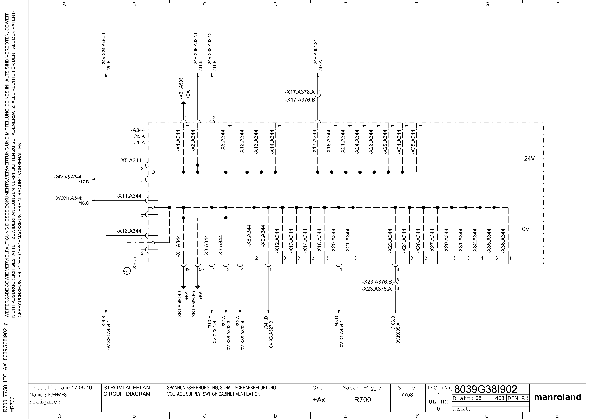

# +Ax — Sheet 25 of 403 — SPANNUNGSVERSORGUNG, SCHALTSCHRANKBELÜFTUNG

**VOLTAGE SUPPLY, SWITCH CABINET VENTILATION**

> Part of the manroland **R700** printing press IEC/UL circuit diagrams.
> Drawing class: **Stromlaufplan / Circuit diagram** (DIN A3).
> Document `+Ax` covers the **Central control console** machine section.

## At a glance

| Field | Value |
|---|---|
| Document | `+Ax`  (8039G38I902) |
| Sheet | **25** of 403 |
| Section (DE) | SPANNUNGSVERSORGUNG, SCHALTSCHRANKBELÜFTUNG |
| Section (EN) | VOLTAGE SUPPLY, SWITCH CABINET VENTILATION |
| Section type | POWER_SUPPLY — Voltage supply |
| Machine type | `R700` |
| Series | `7758` |
| Created | 17.05.10 |
| Replaces | — |
| Columns used | A, B, C, D, E, F, G, H |
| Path numbers | — |
| Labels on sheet | 125 |
| Cross-refs out | 15 |
| Cross-refs in | 56 |

**Previous:** [+Ax sheet 24](SHEET_0024.md) · **Next:** [+Ax sheet 26](SHEET_0026.md) · **Document TOC:** [_TOC.md](_TOC.md)  (+Ax) · **Master TOC:** [all sheets](../_MASTER_TOC.md)

## Sheet image (300 DPI, exact vector render)



_Rendered directly from the PDF vector layer at 300 DPI (1-bit), no OCR and no resampling. Use it to confirm anything ambiguous in the text below._

## Cross-references on this sheet

Each entry is a wire leaving this sheet. The printed token is `/sheet.column`; the link resolves to that sheet inside the same document.

| Ref | Target sheet | Col | Path | Destination on target | Target section | From col |
|---|---|---|---|---|---|---|
| `/26.B` | [+Ax sheet 26](SHEET_0026.md) | B | — | 24V.X24.A454:1 | SPANNUNGSVERSORGUNG, SCHALTSCHRANKBELÜFTUNG | B |
| `/31.B` | [+Ax sheet 31](SHEET_0031.md) | B | — | 24V.X38.A332:1 | SPANNUNGSVERSORGUNG, SCHALTSCHRANKBELÜFTUNG | C |
| `/31.B` | [+Ax sheet 31](SHEET_0031.md) | B | — | 24V.X38.A332:2 | SPANNUNGSVERSORGUNG, SCHALTSCHRANKBELÜFTUNG | C |
| `/87.A` | [+Ax sheet 87](SHEET_0087.md) | A | — | 24V.K001:21 | ANLEGER | E |
| `/45.A` | [+Ax sheet 45](SHEET_0045.md) | A | — | — | HAUPTANTRIEB | B |
| `/20.A` | [+Ax sheet 20](SHEET_0020.md) | A | — | — | SPANNUNGSVERSORGUNG, SCHALTSCHRANKBELÜFTUNG | B |
| `/17.B` | [+Ax sheet 17](SHEET_0017.md) | B | — | 24V.X5.A344:1 | SPANNUNGSVERSORGUNG, SCHALTSCHRANKBELÜFTUNG | A |
| `/16.C` | [+Ax sheet 16](SHEET_0016.md) | C | — | 0V.X11.A344:1 | SPANNUNGSVERSORGUNG, SCHALTSCHRANKBELÜFTUNG | A |
| `/310.E` | [+Ax sheet 310](SHEET_0310.md) | E | — | — | OPTION: IONISATIONSANLAGE ANLEGER | C |
| `/26.B` | [+Ax sheet 26](SHEET_0026.md) | B | — | — | SPANNUNGSVERSORGUNG, SCHALTSCHRANKBELÜFTUNG | B |
| `/341.D` | [+Ax sheet 341](SHEET_0341.md) | D | — | — | OPTION: INLINESHEETER RS104 S | D |
| `/45.D` | [+Ax sheet 45](SHEET_0045.md) | D | — | — | HAUPTANTRIEB | E |
| `/106.B` | [+Ax sheet 106](SHEET_0106.md) | B | — | — | ANLEGER | F |
| `/32.A` | [+Ax sheet 32](SHEET_0032.md) | A | — | — | SPANNUNGSVERSORGUNG, SCHALTSCHRANKBELÜFTUNG | C |
| `/32.A` | [+Ax sheet 32](SHEET_0032.md) | A | — | — | SPANNUNGSVERSORGUNG, SCHALTSCHRANKBELÜFTUNG | C |

### Incoming references (sheets that point here)

Every other sheet that sends a wire to this one. `Back-ref` is the token printed on *that* sheet; `Path` is its line number.

| From sheet | Cols | Back-ref | Path | Refs | What continues there |
|---|---|---|---|---|---|
| [+Ax#16](SHEET_0016.md) | C | `/16.C` | — | 1 | — |
| [+Ax#17](SHEET_0017.md) | B | `/17.B` | — | 1 | — |
| [+Ax#20](SHEET_0020.md) | B | `/20.B` | — | 1 | VERTEILER: MASCHINENSTEUERUNG DISTRIBUTOR: MACHINE CONTROL |
| [+Ax#26](SHEET_0026.md) | A, B | `/26.A`, `/26.B` | — | 2 | 0V.X26.A454:1; 24V.X24.A454:1 |
| [+Ax#31](SHEET_0031.md) | B | `/31.B` | — | 2 | — |
| [+Ax#32](SHEET_0032.md) | A | `/32.A` | — | 2 | — |
| [+Ax#45](SHEET_0045.md) | A, D | `/45.A`, `/45.D` | — | 2 | 0V.X1.A454:1 |
| [+Ax#87](SHEET_0087.md) | C | `/87.C` | — | 1 | 24V.K001:21 K004:21 |
| [+Ax#106](SHEET_0106.md) | A | `/106.A` | — | 1 | 0V.K005:A1 |
| [+Ax#207](SHEET_0207.md) | F, G | `/207.F`, `/207.G` | — | 3 | — |
| [+Ax#223](SHEET_0223.md) | A | `/223.A` | — | 1 | — |
| [+Ax#233](SHEET_0233.md) | F | `/233.F` | — | 4 | — |
| [+Ax#237](SHEET_0237.md) | H | `/237.H` | — | 2 | — |
| [+Ax#240](SHEET_0240.md) | H | `/240.H` | — | 1 | — |
| [+Ax#248](SHEET_0248.md) | C | `/248.C` | — | 2 | — |
| [+Ax#249](SHEET_0249.md) | F | `/249.F` | — | 2 | — |
| [+Ax#251](SHEET_0251.md) | B | `/251.B` | — | 2 | — |
| [+Ax#255](SHEET_0255.md) | B, E, F | `/255.B`, `/255.E`, `/255.F` | — | 3 | — |
| [+Ax#256](SHEET_0256.md) | E | `/256.E` | — | 2 | — |
| [+Ax#260](SHEET_0260.md) | B | `/260.B` | — | 1 | — |
| [+Ax#261](SHEET_0261.md) | B | `/261.B` | — | 2 | — |
| [+Ax#264](SHEET_0264.md) | A, B, E | `/264.A`, `/264.B`, `/264.E` | — | 3 | — |
| [+Ax#266](SHEET_0266.md) | A | `/266.A` | — | 2 | — |
| [+Ax#268](SHEET_0268.md) | E | `/268.E` | — | 2 | — |
| [+Ax#270](SHEET_0270.md) | B | `/270.B` | — | 1 | — |
| [+Ax#273](SHEET_0273.md) | C | `/273.C` | — | 2 | — |
| [+Ax#275](SHEET_0275.md) | A, D | `/275.A`, `/275.D` | — | 3 | — |
| [+Ax#278](SHEET_0278.md) | E | `/278.E` | — | 2 | — |
| [+Ax#279](SHEET_0279.md) | C | `/279.C` | — | 1 | STROMPFAD PIN 1 2 3 4 |
| [+Ax#310](SHEET_0310.md) | E | `/310.E` | — | 1 | 0V.X23.1.B |
| [+Ax#341](SHEET_0341.md) | D | `/341.D` | — | 1 | — |


## Devices on this sheet

| Tag | Class | Class meaning (IEC) | Col | Sub | Terminal | Sign |
|---|---|---|---|---|---|---|
| `A344` | A | Baugruppe / assembly, module, PC board | B | — | — | — |
| `X605` | X | Klemme / terminal, plug connector | B | — | — | — |
| `X5.A344` | — | cross-device reference | B | — | — | — |
| `X11.A344` | — | cross-device reference | B | — | — | — |
| `X16.A344` | — | cross-device reference | B | — | — | — |
| `X1.A344` | — | cross-device reference | C | — | — | — |
| `X1.A344` | — | cross-device reference | C | — | — | — |
| `X6.A344` | — | cross-device reference | C | — | — | — |
| `X17.A376.A` | — | cross-device reference | D | — | — | — |
| `X17.A344` | — | cross-device reference | E | — | — | — |
| `X17.A376.B` | — | cross-device reference | D | — | — | — |
| `X3.A344` | — | cross-device reference | C | — | — | — |
| `X6.A344` | — | cross-device reference | C | — | — | — |
| `X9.A344` | — | cross-device reference | D | — | — | — |
| `X20.A344` | — | cross-device reference | E | — | — | — |
| `X23.A376.B` | — | cross-device reference | E | — | — | — |
| `X23.A376.A` | — | cross-device reference | E | — | — | — |
| `X23.A344` | — | cross-device reference | F | — | — | — |
| `XB1.A596:50` | — | cross-device reference | C | — | 50 | — |
| `XB1.A596:49` | — | cross-device reference | C | — | 49 | — |
| `XB1.A596:1` | — | cross-device reference | C | — | 1 | — |
| `X14.A344` | — | cross-device reference | D | — | — | — |
| `X8.A344` | — | cross-device reference | C | — | — | — |
| `X12.A344` | — | cross-device reference | D | — | — | — |
| `X13.A344` | — | cross-device reference | D | — | — | — |
| `X18.A344` | — | cross-device reference | E | — | — | — |
| `X21.A344` | — | cross-device reference | E | — | — | — |
| `X24.A344` | — | cross-device reference | E | — | — | — |
| `X26.A344` | — | cross-device reference | E | — | — | — |
| `X29.A344` | — | cross-device reference | F | — | — | — |
| `X31.A344` | — | cross-device reference | F | — | — | — |
| `X35.A344` | — | cross-device reference | F | — | — | — |
| `X8.A344` | — | cross-device reference | D | — | — | — |
| `X12.A344` | — | cross-device reference | D | — | — | — |
| `X13.A344` | — | cross-device reference | D | — | — | — |
| `X14.A344` | — | cross-device reference | D | — | — | — |
| `X18.A344` | — | cross-device reference | E | — | — | — |
| `X21.A344` | — | cross-device reference | E | — | — | — |
| `X24.A344` | — | cross-device reference | F | — | — | — |
| `X26.A344` | — | cross-device reference | F | — | — | — |
| `X29.A344` | — | cross-device reference | F | — | — | — |
| `X27.A344` | — | cross-device reference | F | — | — | — |
| `X31.A344` | — | cross-device reference | G | — | — | — |
| `X32.A344` | — | cross-device reference | G | — | — | — |
| `X35.A344` | — | cross-device reference | G | — | — | — |
| `X36.A344` | — | cross-device reference | G | — | — | — |

## Potentials / nets

| Potential | Count | Columns | Attached devices | Terminals |
|---|---|---|---|---|
| `0V` | 9 | A, B, C, D, E, F, H | `1`, `A332`, `A344`, `A454`, `A527`, `B`, `K005`, `X1`, `X11`, `X23`, `X26`, `X38`, `X6` | `1`, `3`, `4`, `A1` |
| `24V` | 6 | A, B, C, E, H | `A332`, `A344`, `A454`, `K001`, `X24`, `X38`, `X5` | `1`, `2`, `21` |


A potential such as `L24+/4` or `M24+` is a named supply/return rail; every place it appears on this sheet is electrically common.

## Wire-end annotations (grouped as printed)

A wire that continues elsewhere is annotated with a small cluster: the destination description, the path/line number `#NN`, and the `/sheet.column` cross reference. Each row below is one such cluster exactly as it is grouped on the drawing.

| Col | Y | Path | Cross-ref | Text on the wire |
|---|---|---|---|---|
| B | 65.2 | — | `/26.B` | `24V.X24.A454:1` |
| C | 65.2 | — | `/31.B` | `24V.X38.A332:1` |
| C | 65.2 | — | `/31.B` | `24V.X38.A332:2` |
| E | 78.5 | — | `/87.A` | `24V.K001:21` |
| C | 148.8 | — | — | `XB1.A596:1 +BA` |
| D | 180.3 | — | — | `X17.A376.A 1` |
| C | 181.7 | — | — | `+BA` |
| D | 195.9 | — | — | `X17.A376.B 1` |
| C | 232.8 | — | — | `1` |
| C | 232.8 | — | — | `1` |
| C | 232.8 | — | — | `2` |
| E | 232.8 | — | — | `1` |
| C | 250.6 | — | — | `1` |
| C | 250.6 | — | — | `X8.A344 1` |
| D | 250.6 | — | — | `X14.A344 1` |
| E | 250.6 | — | — | `X18.A344 1` |
| E | 250.6 | — | — | `X21.A344 1` |
| E | 250.6 | — | — | `X24.A344 1` |
| E | 250.6 | — | — | `X26.A344 1` |
| F | 250.6 | — | — | `X29.A344 1` |
| F | 250.6 | — | — | `X31.A344 1` |
| F | 250.6 | — | — | `X35.A344 1` |
| B | 256.8 | — | — | `A344` |
| C | 260.2 | — | — | `X1.A344` |
| C | 260.2 | — | — | `X6.A344` |
| D | 260.2 | — | — | `X12.A344` |
| D | 260.2 | — | — | `X13.A344` |
| E | 260.2 | — | — | `X17.A344` |
| B | 269.9 | — | `/45.A`, `/20.A` | — |
| H | 312.9 | — | — | `24V` |
| B | 317.8 | — | — | `X5.A344 2` |
| A | 351.8 | — | `/17.B` | `24V.X5.A344:1` |
| B | 363.2 | — | — | `1` |
| B | 388.6 | — | — | `X11.A344 1` |
| A | 394.3 | — | `/16.C` | `0V.X11.A344:1` |
| B | 434.0 | — | — | `2` |
| D | 451.6 | — | — | `X8.A344` |
| D | 451.6 | — | — | `X9.A344` |
| H | 454.6 | — | — | `0V` |
| D | 458.9 | — | — | `X12.A344` |
| D | 458.9 | — | — | `X13.A344` |
| D | 458.9 | — | — | `X14.A344` |
| E | 458.9 | — | — | `X18.A344` |
| E | 458.9 | — | — | `X20.A344` |
| E | 458.9 | — | — | `X21.A344` |
| F | 458.9 | — | — | `X23.A344` |
| F | 458.9 | — | — | `X24.A344` |
| F | 458.9 | — | — | `X26.A344` |
| F | 458.9 | — | — | `X27.A344` |
| F | 458.9 | — | — | `X29.A344` |
| G | 458.9 | — | — | `X31.A344` |
| G | 458.9 | — | — | `X32.A344` |
| G | 458.9 | — | — | `X35.A344` |
| G | 458.9 | — | — | `X36.A344` |
| B | 459.5 | — | — | `X16.A344 1` |
| C | 472.0 | — | — | `X1.A344` |
| C | 472.0 | — | — | `X3.A344` |
| C | 472.0 | — | — | `X6.A344` |
| B | 504.9 | — | — | `2` |
| D | 514.8 | — | — | `2` |
| D | 514.8 | — | — | `3 3 3 3` |
| E | 514.8 | — | — | `3` |
| G | 514.8 | — | — | `3 3 1 3 3 1 3 1` |
| B | 515.8 | — | — | `X605` |
| C | 537.5 | — | — | `49 50` |
| C | 537.5 | — | — | `1` |
| C | 537.5 | — | — | `3 4` |
| D | 537.5 | — | — | `1` |
| E | 537.5 | — | — | `1` |
| F | 537.5 | — | — | `8` |
| E | 558.8 | — | — | `X23.A376.B 8` |
| E | 575.8 | — | — | `X23.A376.A 8` |
| C | 585.1 | — | — | `XB1.A596:49` |
| C | 585.1 | — | — | `XB1.A596:50` |
| C | 585.4 | — | — | `+BA` |
| C | 634.4 | — | `/310.E` | — |
| B | 634.7 | — | `/26.B` | — |
| D | 634.7 | — | `/341.D` | — |
| E | 634.7 | — | `/45.D` | — |
| F | 634.7 | — | `/106.B` | — |
| C | 635.0 | — | `/32.A` | — |
| C | 635.0 | — | `/32.A` | — |
| B | 643.2 | — | — | `0V.X26.A454:1` |
| E | 643.2 | — | — | `0V.X1.A454:1` |
| F | 643.2 | — | — | `0V.K005:A1` |
| C | 644.6 | — | — | `0V.X23.1.B` |
| C | 644.6 | — | — | `0V.X38.A332:3` |
| D | 644.6 | — | — | `0V.X38.A332:4` |
| D | 644.6 | — | — | `0V.X6.A527:3` |


## Reconstructed tables

This sheet carries tabular content (pin map / terminal assignment / index). The grid below was rebuilt from the drawing's own rule lines, so each row is exactly one physical row of the table.

### Table 1 — 5 data rows × 1 columns (at x=255.1, y=331.7)

| C1 |
|---|
| `2` |
| `1 X11.A344` |
| `1` |
| `2 X16.A344` |
| `1` |


## Notes and free text on this sheet

| Text | Col | Y (pt) |
|---|---|---|
| `+BA` | C | 585.36 |

## Complete label inventory (exact text from the drawing)

Every text object inside the drawing area of this sheet, in DIN reading order (column A→H, then top→bottom). This is the authoritative list: if a string is not here it is not printed on this sheet.

| Col | Y | X | Dir | Type | Text |
|---|---|---|---|---|---|
| A | 351.8 | 108.3 | → | potential | `24V.X5.A344:1` |
| A | 361.7 | 158.2 | → | cross-reference | `/17.B` |
| A | 394.3 | 111.1 | → | potential | `0V.X11.A344:1` |
| A | 404.2 | 157.9 | → | cross-reference | `/16.C` |
| B | 65.2 | 204.4 | ↕ | potential | `24V.X24.A454:1` |
| B | 121.0 | 214.3 | ↕ | cross-reference | `/26.B` |
| B | 256.8 | 262.8 | → | device tag | `A344` |
| B | 269.9 | 269.9 | → | cross-reference | `/45.A` |
| B | 282.3 | 269.9 | → | cross-reference | `/20.A` |
| B | 317.8 | 239.8 | → | device ref | `X5.A344` |
| B | 334.8 | 283.2 | → | number | `2` |
| B | 363.2 | 282.6 | → | number | `1` |
| B | 388.7 | 233.9 | → | device ref | `X11.A344` |
| B | 405.7 | 282.6 | → | number | `1` |
| B | 434.0 | 283.2 | → | number | `2` |
| B | 459.5 | 233.9 | → | device ref | `X16.A344` |
| B | 476.5 | 282.6 | → | number | `1` |
| B | 504.9 | 283.2 | → | number | `2` |
| B | 515.8 | 265.3 | ↕ | device tag | `X605` |
| B | 634.7 | 204.3 | ↕ | cross-reference | `/26.B` |
| B | 643.2 | 214.3 | ↕ | potential | `0V.X26.A454:1` |
| C | 65.2 | 388.6 | ↕ | potential | `24V.X38.A332:1` |
| C | 65.2 | 417.0 | ↕ | potential | `24V.X38.A332:2` |
| C | 121.0 | 398.5 | ↕ | cross-reference | `/31.B` |
| C | 121.0 | 426.9 | ↕ | cross-reference | `/31.B` |
| C | 148.8 | 359.6 | ↕ | device ref | `XB1.A596:1` |
| C | 181.7 | 373.7 | ↕ | text | `+BA` |
| C | 232.8 | 370.5 | → | number | `1` |
| C | 232.8 | 398.8 | → | number | `1` |
| C | 232.8 | 427.7 | → | number | `2` |
| C | 250.6 | 373.1 | ↕ | number | `1` |
| C | 250.6 | 458.1 | ↕ | number | `1` |
| C | 260.2 | 353.2 | ↕ | device ref | `X1.A344` |
| C | 260.2 | 383.0 | ↕ | device ref | `X6.A344` |
| C | 260.2 | 442.5 | ↕ | device ref | `X8.A344` |
| C | 472.0 | 353.2 | ↕ | device ref | `X1.A344` |
| C | 472.0 | 409.9 | ↕ | device ref | `X3.A344` |
| C | 472.0 | 438.3 | ↕ | device ref | `X6.A344` |
| C | 537.5 | 371.1 | → | number | `49` |
| C | 537.5 | 399.4 | → | number | `50` |
| C | 537.5 | 427.2 | → | number | `1` |
| C | 537.5 | 456.1 | → | number | `3` |
| C | 585.1 | 356.7 | ↕ | device ref | `XB1.A596:49` |
| C | 585.1 | 385.1 | ↕ | device ref | `XB1.A596:50` |
| C | 585.4 | 370.9 | ↕ | text | `+BA` |
| C | 585.4 | 399.2 | ↕ | text | `+BA` |
| C | 634.4 | 417.0 | ↕ | cross-reference | `/310.E` |
| C | 635.0 | 445.3 | ↕ | cross-reference | `/32.A` |
| C | 635.0 | 473.6 | ↕ | cross-reference | `/32.A` |
| C | 644.6 | 426.9 | ↕ | potential | `0V.X23.1.B` |
| C | 644.6 | 455.2 | ↕ | potential | `0V.X38.A332:3` |
| D | 180.3 | 571.7 | → | device ref | `X17.A376.A` |
| D | 195.9 | 572.6 | → | device ref | `X17.A376.B` |
| D | 250.6 | 557.3 | ↕ | number | `1` |
| D | 260.2 | 480.8 | ↕ | device ref | `X12.A344` |
| D | 260.2 | 509.1 | ↕ | device ref | `X13.A344` |
| D | 260.2 | 541.7 | ↕ | device ref | `X14.A344` |
| D | 451.6 | 495.0 | ↕ | device ref | `X8.A344` |
| D | 451.6 | 523.3 | ↕ | device ref | `X9.A344` |
| D | 458.9 | 551.6 | ↕ | device ref | `X12.A344` |
| D | 458.9 | 580.0 | ↕ | device ref | `X13.A344` |
| D | 458.9 | 608.3 | ↕ | device ref | `X14.A344` |
| D | 514.8 | 512.8 | → | number | `2` |
| D | 514.8 | 569.5 | → | number | `3` |
| D | 514.8 | 597.8 | → | number | `3` |
| D | 537.5 | 484.4 | → | number | `4` |
| D | 537.5 | 540.6 | → | number | `1` |
| D | 634.7 | 530.4 | ↕ | cross-reference | `/341.D` |
| D | 644.6 | 483.6 | ↕ | potential | `0V.X38.A332:4` |
| D | 644.6 | 540.3 | ↕ | potential | `0V.X6.A527:3` |
| E | 78.5 | 629.6 | ↕ | potential | `24V.K001:21` |
| E | 121.0 | 639.5 | ↕ | cross-reference | `/87.A` |
| E | 180.3 | 639.8 | → | number | `1` |
| E | 197.3 | 639.8 | → | number | `1` |
| E | 232.8 | 639.8 | → | number | `1` |
| E | 250.6 | 670.7 | ↕ | number | `1` |
| E | 250.6 | 699.1 | ↕ | number | `1` |
| E | 250.6 | 727.4 | ↕ | number | `1` |
| E | 250.6 | 755.8 | ↕ | number | `1` |
| E | 260.2 | 626.8 | ↕ | device ref | `X17.A344` |
| E | 260.2 | 655.1 | ↕ | device ref | `X18.A344` |
| E | 260.2 | 683.5 | ↕ | device ref | `X21.A344` |
| E | 260.2 | 711.8 | ↕ | device ref | `X24.A344` |
| E | 260.2 | 740.1 | ↕ | device ref | `X26.A344` |
| E | 458.9 | 636.7 | ↕ | device ref | `X18.A344` |
| E | 458.9 | 665.0 | ↕ | device ref | `X20.A344` |
| E | 458.9 | 693.4 | ↕ | device ref | `X21.A344` |
| E | 514.8 | 626.2 | → | number | `3` |
| E | 514.8 | 654.5 | → | number | `3` |
| E | 514.8 | 711.2 | → | number | `3` |
| E | 537.5 | 682.3 | → | number | `1` |
| E | 561.6 | 727.1 | → | device ref | `X23.A376.B` |
| E | 575.7 | 726.2 | → | device ref | `X23.A376.A` |
| E | 634.7 | 672.1 | ↕ | cross-reference | `/45.D` |
| E | 643.2 | 682.0 | ↕ | potential | `0V.X1.A454:1` |
| F | 250.6 | 784.1 | ↕ | number | `1` |
| F | 250.6 | 812.5 | ↕ | number | `1` |
| F | 250.6 | 840.8 | ↕ | number | `1` |
| F | 260.2 | 768.5 | ↕ | device ref | `X29.A344` |
| F | 260.2 | 796.8 | ↕ | device ref | `X31.A344` |
| F | 260.2 | 825.2 | ↕ | device ref | `X35.A344` |
| F | 458.9 | 778.4 | ↕ | device ref | `X23.A344` |
| F | 458.9 | 806.8 | ↕ | device ref | `X24.A344` |
| F | 458.9 | 835.1 | ↕ | device ref | `X26.A344` |
| F | 458.9 | 863.5 | ↕ | device ref | `X27.A344` |
| F | 458.9 | 891.8 | ↕ | device ref | `X29.A344` |
| F | 514.8 | 824.6 | → | number | `3` |
| F | 514.8 | 852.9 | → | number | `3` |
| F | 514.8 | 880.7 | → | number | `1` |
| F | 537.5 | 796.3 | → | number | `8` |
| F | 558.7 | 796.3 | → | number | `8` |
| F | 575.8 | 796.3 | → | number | `8` |
| F | 634.7 | 785.5 | ↕ | cross-reference | `/106.B` |
| F | 643.2 | 795.4 | ↕ | potential | `0V.K005:A1` |
| G | 458.9 | 920.1 | ↕ | device ref | `X31.A344` |
| G | 458.9 | 948.5 | ↕ | device ref | `X32.A344` |
| G | 458.9 | 976.8 | ↕ | device ref | `X35.A344` |
| G | 458.9 | 1005.2 | ↕ | device ref | `X36.A344` |
| G | 514.8 | 909.6 | → | number | `3` |
| G | 514.8 | 938.0 | → | number | `3` |
| G | 514.8 | 965.8 | → | number | `1` |
| G | 514.8 | 994.7 | → | number | `3` |
| G | 514.8 | 1022.5 | → | number | `1` |
| H | 312.9 | 1048.5 | → | potential | `24V` |
| H | 454.6 | 1048.3 | → | potential | `0V` |

## Reading-order text block

The same content as a plain block, grouped by DIN column — convenient to paste or to match against a visual description.

```text
=== Column A ===
 351.8  108.3  net          24V.X5.A344:1
 361.7  158.2  xref         /17.B
 394.3  111.1  net          0V.X11.A344:1
 404.2  157.9  xref         /16.C
=== Column B ===
  65.2  204.4  net          24V.X24.A454:1
 121.0  214.3  xref         /26.B
 256.8  262.8  devtag       A344
 269.9  269.9  xref         /45.A
 282.3  269.9  xref         /20.A
 317.8  239.8  devref       X5.A344
 334.8  283.2  numeric      2
 363.2  282.6  numeric      1
 388.7  233.9  devref       X11.A344
 405.7  282.6  numeric      1
 434.0  283.2  numeric      2
 459.5  233.9  devref       X16.A344
 476.5  282.6  numeric      1
 504.9  283.2  numeric      2
 515.8  265.3  devtag       X605
 634.7  204.3  xref         /26.B
 643.2  214.3  net          0V.X26.A454:1
=== Column C ===
  65.2  388.6  net          24V.X38.A332:1
  65.2  417.0  net          24V.X38.A332:2
 121.0  398.5  xref         /31.B
 121.0  426.9  xref         /31.B
 148.8  359.6  devref       XB1.A596:1
 181.7  373.7  text         +BA
 232.8  370.5  numeric      1
 232.8  398.8  numeric      1
 232.8  427.7  numeric      2
 250.6  373.1  numeric      1
 250.6  458.1  numeric      1
 260.2  353.2  devref       X1.A344
 260.2  383.0  devref       X6.A344
 260.2  442.5  devref       X8.A344
 472.0  353.2  devref       X1.A344
 472.0  409.9  devref       X3.A344
 472.0  438.3  devref       X6.A344
 537.5  371.1  numeric      49
 537.5  399.4  numeric      50
 537.5  427.2  numeric      1
 537.5  456.1  numeric      3
 585.1  356.7  devref       XB1.A596:49
 585.1  385.1  devref       XB1.A596:50
 585.4  370.9  text         +BA
 585.4  399.2  text         +BA
 634.4  417.0  xref         /310.E
 635.0  445.3  xref         /32.A
 635.0  473.6  xref         /32.A
 644.6  426.9  net          0V.X23.1.B
 644.6  455.2  net          0V.X38.A332:3
=== Column D ===
 180.3  571.7  devref       X17.A376.A
 195.9  572.6  devref       X17.A376.B
 250.6  557.3  numeric      1
 260.2  480.8  devref       X12.A344
 260.2  509.1  devref       X13.A344
 260.2  541.7  devref       X14.A344
 451.6  495.0  devref       X8.A344
 451.6  523.3  devref       X9.A344
 458.9  551.6  devref       X12.A344
 458.9  580.0  devref       X13.A344
 458.9  608.3  devref       X14.A344
 514.8  512.8  numeric      2
 514.8  569.5  numeric      3
 514.8  597.8  numeric      3
 537.5  484.4  numeric      4
 537.5  540.6  numeric      1
 634.7  530.4  xref         /341.D
 644.6  483.6  net          0V.X38.A332:4
 644.6  540.3  net          0V.X6.A527:3
=== Column E ===
  78.5  629.6  net          24V.K001:21
 121.0  639.5  xref         /87.A
 180.3  639.8  numeric      1
 197.3  639.8  numeric      1
 232.8  639.8  numeric      1
 250.6  670.7  numeric      1
 250.6  699.1  numeric      1
 250.6  727.4  numeric      1
 250.6  755.8  numeric      1
 260.2  626.8  devref       X17.A344
 260.2  655.1  devref       X18.A344
 260.2  683.5  devref       X21.A344
 260.2  711.8  devref       X24.A344
 260.2  740.1  devref       X26.A344
 458.9  636.7  devref       X18.A344
 458.9  665.0  devref       X20.A344
 458.9  693.4  devref       X21.A344
 514.8  626.2  numeric      3
 514.8  654.5  numeric      3
 514.8  711.2  numeric      3
 537.5  682.3  numeric      1
 561.6  727.1  devref       X23.A376.B
 575.7  726.2  devref       X23.A376.A
 634.7  672.1  xref         /45.D
 643.2  682.0  net          0V.X1.A454:1
=== Column F ===
 250.6  784.1  numeric      1
 250.6  812.5  numeric      1
 250.6  840.8  numeric      1
 260.2  768.5  devref       X29.A344
 260.2  796.8  devref       X31.A344
 260.2  825.2  devref       X35.A344
 458.9  778.4  devref       X23.A344
 458.9  806.8  devref       X24.A344
 458.9  835.1  devref       X26.A344
 458.9  863.5  devref       X27.A344
 458.9  891.8  devref       X29.A344
 514.8  824.6  numeric      3
 514.8  852.9  numeric      3
 514.8  880.7  numeric      1
 537.5  796.3  numeric      8
 558.7  796.3  numeric      8
 575.8  796.3  numeric      8
 634.7  785.5  xref         /106.B
 643.2  795.4  net          0V.K005:A1
=== Column G ===
 458.9  920.1  devref       X31.A344
 458.9  948.5  devref       X32.A344
 458.9  976.8  devref       X35.A344
 458.9 1005.2  devref       X36.A344
 514.8  909.6  numeric      3
 514.8  938.0  numeric      3
 514.8  965.8  numeric      1
 514.8  994.7  numeric      3
 514.8 1022.5  numeric      1
=== Column H ===
 312.9 1048.5  net          24V
 454.6 1048.3  net          0V
```

---
_Generated from the PDF vector text layer; no OCR. Source: `R700_7758_IEC_AX_8039G38I902_p`, sheet 25._
