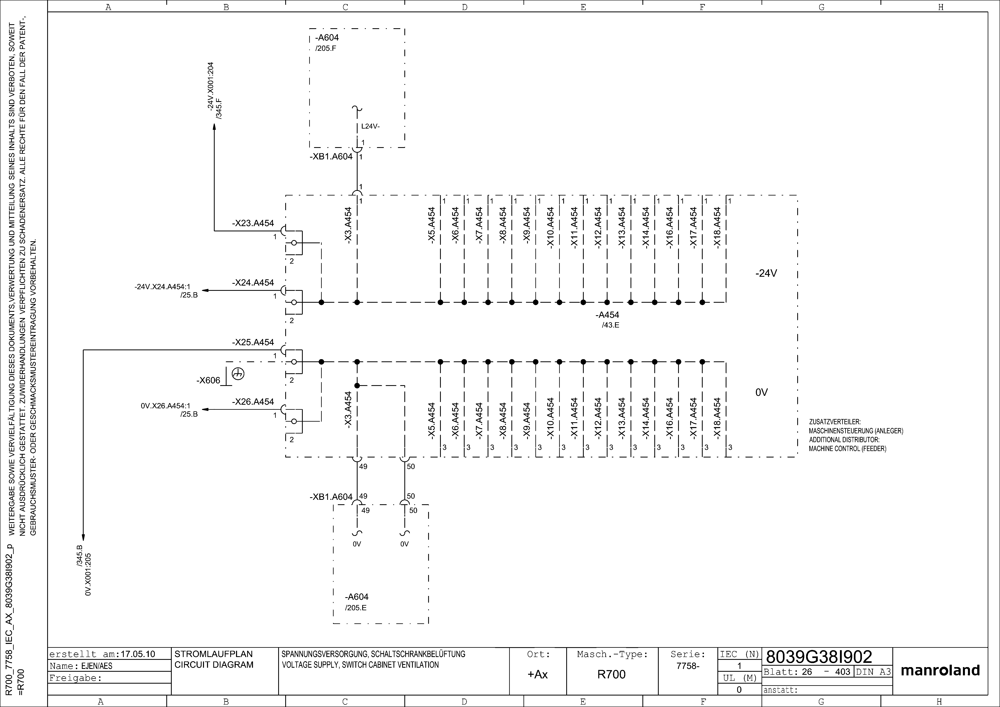

# +Ax — Sheet 26 of 403 — SPANNUNGSVERSORGUNG, SCHALTSCHRANKBELÜFTUNG

**VOLTAGE SUPPLY, SWITCH CABINET VENTILATION**

> Part of the manroland **R700** printing press IEC/UL circuit diagrams.
> Drawing class: **Stromlaufplan / Circuit diagram** (DIN A3).
> Document `+Ax` covers the **Central control console** machine section.

## At a glance

| Field | Value |
|---|---|
| Document | `+Ax`  (8039G38I902) |
| Sheet | **26** of 403 |
| Section (DE) | SPANNUNGSVERSORGUNG, SCHALTSCHRANKBELÜFTUNG |
| Section (EN) | VOLTAGE SUPPLY, SWITCH CABINET VENTILATION |
| Section type | POWER_SUPPLY — Voltage supply |
| Machine type | `R700` |
| Series | `7758` |
| Created | 17.05.10 |
| Replaces | — |
| Columns used | A, B, C, D, E, F, G |
| Path numbers | — |
| Labels on sheet | 102 |
| Cross-refs out | 7 |
| Cross-refs in | 39 |

**Previous:** [+Ax sheet 25](SHEET_0025.md) · **Next:** [+Ax sheet 27](SHEET_0027.md) · **Document TOC:** [_TOC.md](_TOC.md)  (+Ax) · **Master TOC:** [all sheets](../_MASTER_TOC.md)

## Sheet image (300 DPI, exact vector render)



_Rendered directly from the PDF vector layer at 300 DPI (1-bit), no OCR and no resampling. Use it to confirm anything ambiguous in the text below._

## Cross-references on this sheet

Each entry is a wire leaving this sheet. The printed token is `/sheet.column`; the link resolves to that sheet inside the same document.

| Ref | Target sheet | Col | Path | Destination on target | Target section | From col |
|---|---|---|---|---|---|---|
| `/205.F` | [+Ax sheet 205](SHEET_0205.md) | F | — | A604 | REFERENZMODUL | C |
| `/345.F` | [+Ax sheet 345](SHEET_0345.md) | F | — | 24V.X001:204 | OPTION: INLINESHEETER RS104 S | B |
| `/25.B` | [+Ax sheet 25](SHEET_0025.md) | B | — | 24V.X24.A454:1 | SPANNUNGSVERSORGUNG, SCHALTSCHRANKBELÜFTUNG | A |
| `/43.E` | [+Ax sheet 43](SHEET_0043.md) | E | — | — | HAUPTANTRIEB | E |
| `/25.B` | [+Ax sheet 25](SHEET_0025.md) | B | — | 0V.X26.A454:1 | SPANNUNGSVERSORGUNG, SCHALTSCHRANKBELÜFTUNG | B |
| `/345.B` | [+Ax sheet 345](SHEET_0345.md) | B | — | — | OPTION: INLINESHEETER RS104 S | A |
| `/205.E` | [+Ax sheet 205](SHEET_0205.md) | E | — | A604 | REFERENZMODUL | C |

### Incoming references (sheets that point here)

Every other sheet that sends a wire to this one. `Back-ref` is the token printed on *that* sheet; `Path` is its line number.

| From sheet | Cols | Back-ref | Path | Refs | What continues there |
|---|---|---|---|---|---|
| [+Ax#25](SHEET_0025.md) | B | `/25.B` | — | 2 | 24V.X24.A454:1 |
| [+Ax#43](SHEET_0043.md) | E | `/43.E` | — | 1 | — |
| [+Ax#205](SHEET_0205.md) | D, F | `/205.D`, `/205.F` | — | 2 | — |
| [+Ax#210](SHEET_0210.md) | C, D | `/210.C`, `/210.D` | — | 3 | — |
| [+Ax#225](SHEET_0225.md) | A, B | `/225.A`, `/225.B` | — | 3 | — |
| [+Ax#232](SHEET_0232.md) | E | `/232.E` | — | 2 | — |
| [+Ax#234](SHEET_0234.md) | C | `/234.C` | — | 2 | — |
| [+Ax#236](SHEET_0236.md) | C | `/236.C` | — | 2 | — |
| [+Ax#239](SHEET_0239.md) | A | `/239.A` | — | 2 | — |
| [+Ax#242](SHEET_0242.md) | F | `/242.F` | — | 2 | — |
| [+Ax#245](SHEET_0245.md) | F | `/245.F` | — | 2 | — |
| [+Ax#247](SHEET_0247.md) | F | `/247.F` | — | 2 | — |
| [+Ax#249](SHEET_0249.md) | A | `/249.A` | — | 2 | — |
| [+Ax#250](SHEET_0250.md) | C | `/250.C` | — | 2 | — |
| [+Ax#251](SHEET_0251.md) | F | `/251.F` | — | 2 | — |
| [+Ax#254](SHEET_0254.md) | G | `/254.G` | — | 2 | — |
| [+Ax#255](SHEET_0255.md) | G | `/255.G` | — | 2 | — |
| [+Ax#256](SHEET_0256.md) | G | `/256.G` | — | 2 | — |
| [+Ax#345](SHEET_0345.md) | B, E | `/345.B`, `/345.E` | — | 2 | — |


## Devices on this sheet

| Tag | Class | Class meaning (IEC) | Col | Sub | Terminal | Sign |
|---|---|---|---|---|---|---|
| `A604` | A | Baugruppe / assembly, module, PC board | C | — | — | — |
| `A454` | A | Baugruppe / assembly, module, PC board | E | — | — | — |
| `A604` | A | Baugruppe / assembly, module, PC board | C | — | — | — |
| `X606` | X | Klemme / terminal, plug connector | B | — | — | — |
| `XB1.A604` | — | cross-device reference | C | — | — | — |
| `X3.A454` | — | cross-device reference | C | — | — | — |
| `XB1.A604` | — | cross-device reference | C | — | — | — |
| `X24.A454` | — | cross-device reference | B | — | — | — |
| `X26.A454` | — | cross-device reference | B | — | — | — |
| `X3.A454` | — | cross-device reference | C | — | — | — |
| `X25.A454` | — | cross-device reference | B | — | — | — |
| `X23.A454` | — | cross-device reference | B | — | — | — |
| `X5.A454` | — | cross-device reference | D | — | — | — |
| `X6.A454` | — | cross-device reference | D | — | — | — |
| `X7.A454` | — | cross-device reference | D | — | — | — |
| `X8.A454` | — | cross-device reference | D | — | — | — |
| `X9.A454` | — | cross-device reference | E | — | — | — |
| `X10.A454` | — | cross-device reference | E | — | — | — |
| `X11.A454` | — | cross-device reference | E | — | — | — |
| `X12.A454` | — | cross-device reference | E | — | — | — |
| `X13.A454` | — | cross-device reference | E | — | — | — |
| `X14.A454` | — | cross-device reference | F | — | — | — |
| `X16.A454` | — | cross-device reference | F | — | — | — |
| `X17.A454` | — | cross-device reference | F | — | — | — |
| `X18.A454` | — | cross-device reference | F | — | — | — |
| `X5.A454` | — | cross-device reference | D | — | — | — |
| `X6.A454` | — | cross-device reference | D | — | — | — |
| `X7.A454` | — | cross-device reference | D | — | — | — |
| `X8.A454` | — | cross-device reference | D | — | — | — |
| `X9.A454` | — | cross-device reference | E | — | — | — |
| `X10.A454` | — | cross-device reference | E | — | — | — |
| `X11.A454` | — | cross-device reference | E | — | — | — |
| `X12.A454` | — | cross-device reference | E | — | — | — |
| `X13.A454` | — | cross-device reference | E | — | — | — |
| `X14.A454` | — | cross-device reference | F | — | — | — |
| `X16.A454` | — | cross-device reference | F | — | — | — |
| `X17.A454` | — | cross-device reference | F | — | — | — |
| `X18.A454` | — | cross-device reference | F | — | — | — |

## Potentials / nets

| Potential | Count | Columns | Attached devices | Terminals |
|---|---|---|---|---|
| `0V` | 5 | A, C, F | `A454`, `X001`, `X26` | `1`, `205` |
| `24V` | 3 | A, B, G | `A454`, `X001`, `X24` | `1`, `204` |
| `L24V` | 1 | C | — | — |


A potential such as `L24+/4` or `M24+` is a named supply/return rail; every place it appears on this sheet is electrically common.

## Wire-end annotations (grouped as printed)

A wire that continues elsewhere is annotated with a small cluster: the destination description, the path/line number `#NN`, and the `/sheet.column` cross reference. Each row below is one such cluster exactly as it is grouped on the drawing.

| Col | Y | Path | Cross-ref | Text on the wire |
|---|---|---|---|---|
| C | 40.0 | — | `/205.F` | `A604` |
| B | 73.7 | — | `/345.F` | `24V.X001:204` |
| C | 146.7 | — | — | `L24V` |
| C | 166.2 | — | — | `1` |
| C | 181.7 | — | — | `XB1.A604 1` |
| C | 218.6 | — | — | `1` |
| C | 235.6 | — | — | `1` |
| E | 235.6 | — | — | `1 1 1 1 1 1 1 1 1 1 1 1 1` |
| C | 246.1 | — | — | `X3.A454` |
| D | 246.1 | — | — | `X5.A454` |
| D | 246.1 | — | — | `X6.A454` |
| D | 246.1 | — | — | `X7.A454` |
| D | 246.1 | — | — | `X8.A454` |
| E | 246.1 | — | — | `X9.A454` |
| E | 246.1 | — | — | `X10.A454` |
| E | 246.1 | — | — | `X11.A454` |
| E | 246.1 | — | — | `X12.A454` |
| E | 246.1 | — | — | `X13.A454` |
| F | 246.1 | — | — | `X14.A454` |
| F | 246.1 | — | — | `X16.A454` |
| F | 246.1 | — | — | `X17.A454` |
| F | 246.1 | — | — | `X18.A454` |
| B | 261.1 | — | — | `X23.A454 1` |
| C | 307.2 | — | — | `2` |
| G | 320.0 | — | — | `24V` |
| B | 332.0 | — | — | `X24.A454 1` |
| A | 337.6 | — | `/25.B` | `24V.X24.A454:1` |
| E | 370.2 | — | — | `A454` |
| C | 378.0 | — | — | `2` |
| E | 383.3 | — | `/43.E` | — |
| B | 402.8 | — | — | `X25.A454 1` |
| D | 448.2 | — | — | `X606 0V` |
| C | 448.9 | — | — | `2` |
| C | 465.7 | — | — | `X3.A454` |
| E | 473.1 | — | — | `X10.A454` |
| E | 473.1 | — | — | `X11.A454` |
| E | 473.1 | — | — | `X12.A454` |
| E | 473.1 | — | — | `X13.A454` |
| F | 473.1 | — | — | `X14.A454` |
| F | 473.1 | — | — | `X16.A454` |
| F | 473.1 | — | — | `X17.A454` |
| F | 473.1 | — | — | `X18.A454` |
| B | 473.7 | — | — | `X26.A454 1` |
| D | 479.1 | — | — | `X5.A454` |
| D | 479.1 | — | — | `X6.A454` |
| D | 479.1 | — | — | `X7.A454` |
| D | 479.1 | — | — | `X8.A454` |
| E | 479.1 | — | — | `X9.A454` |
| B | 479.3 | — | `/25.B` | `0V.X26.A454:1` |
| G | 499.5 | — | — | `MASCHINENSTEUERUNG (ANLEGER) ZUSATZVERTEILER:` |
| C | 519.8 | — | — | `2` |
| G | 520.8 | — | — | `MACHINE CONTROL (FEEDER) ADDITIONAL DISTRIBUTOR:` |
| E | 529.0 | — | — | `3 3 3 3 3 3 3 3 3 3 3 3 3` |
| C | 551.7 | — | — | `49 50` |
| C | 587.1 | — | — | `XB1.A604 49 50` |
| C | 604.1 | — | — | `49 50` |
| C | 644.2 | — | — | `0V 0V` |
| A | 648.9 | — | `/345.B` | — |
| A | 658.8 | — | — | `0V.X001:205` |
| C | 706.1 | — | `/205.E` | `A604` |


## Reconstructed tables

This sheet carries tabular content (pin map / terminal assignment / index). The grid below was rebuilt from the drawing's own rule lines, so each row is exactly one physical row of the table.

### Table 1 — 9 data rows × 1 columns (at x=255.1, y=34.0)

| C1 |
|---|
| `/345.F` |
| `X23.A454` |
| `1 2 X24.A454` |
| `1` |
| `2 X25.A454` |
| `1` |
| `2` |
| `X26.A454` |
| `1 2` |


### Table 2 — 4 data rows × 17 columns (at x=382.7, y=34.0)

| A604 /205.F |  | L24V 1 |  |  |  |  |  |  |  |  |  |  |  |  |  |  |
|---|---|---|---|---|---|---|---|---|---|---|---|---|---|---|---|---|
| `XB1.A604` | `X3.A454` | `1 1 1` |  | `X5.A454` | `1 X6.A454` | `1 X7.A454` | `1 X8.A454` | `1 X9.A454` | `1 X10.A454` | `1 X11.A454` | `1 X12.A454` | `1 X13.A454` | `1 X14.A454` | `1 X16.A454` | `1 X17.A454` | `1 X18.A454` |
|  |  |  |  |  |  |  |  |  |  |  |  | `A454 /43.E` |  |  |  |  |
| `XB1.A604` | `X3.A454` | `49 49` | `50 50` | `X5.A454` | `X6.A454 3` | `X7.A454 3` | `X8.A454 3` | `X9.A454 3` | `X10.A454 3` | `X11.A454 3` | `X12.A454 3` | `X13.A454 3` | `X14.A454 3` | `X16.A454 3` | `X17.A454 3` | `X18.A454 3` |
|  | `0V A604 /205.E` | `49 0V` | `50` |  |  |  |  |  |  |  |  |  |  |  |  |  |


## Notes and free text on this sheet

| Text | Col | Y (pt) |
|---|---|---|
| `ZUSATZVERTEILER:` | G | 499.51 |
| `MASCHINENSTEUERUNG (ANLEGER)` | G | 510.17 |
| `ADDITIONAL DISTRIBUTOR:` | G | 520.79 |
| `MACHINE CONTROL (FEEDER)` | G | 531.44 |

## Complete label inventory (exact text from the drawing)

Every text object inside the drawing area of this sheet, in DIN reading order (column A→H, then top→bottom). This is the authoritative list: if a string is not here it is not printed on this sheet.

| Col | Y | X | Dir | Type | Text |
|---|---|---|---|---|---|
| A | 337.6 | 160.2 | → | potential | `24V.X24.A454:1` |
| A | 479.3 | 167.8 | → | potential | `0V.X26.A454:1` |
| A | 648.9 | 91.0 | ↕ | cross-reference | `/345.B` |
| A | 658.8 | 100.9 | ↕ | potential | `0V.X001:205` |
| B | 73.7 | 246.9 | ↕ | potential | `24V.X001:204` |
| B | 116.8 | 256.8 | ↕ | cross-reference | `/345.F` |
| B | 261.1 | 276.4 | → | device ref | `X23.A454` |
| B | 278.1 | 325.1 | → | number | `1` |
| B | 332.0 | 276.4 | → | device ref | `X24.A454` |
| B | 347.5 | 214.9 | → | cross-reference | `/25.B` |
| B | 349.0 | 325.1 | → | number | `1` |
| B | 402.8 | 276.4 | → | device ref | `X25.A454` |
| B | 419.9 | 325.1 | → | number | `1` |
| B | 448.2 | 234.0 | → | device tag | `X606` |
| B | 473.7 | 276.4 | → | device ref | `X26.A454` |
| B | 489.2 | 214.9 | → | cross-reference | `/25.B` |
| B | 490.7 | 325.1 | → | number | `1` |
| C | 40.0 | 375.3 | → | device tag | `A604` |
| C | 53.8 | 375.6 | → | cross-reference | `/205.F` |
| C | 146.7 | 430.3 | → | potential | `L24V` |
| C | 166.2 | 430.0 | → | number | `1` |
| C | 181.7 | 368.8 | → | device ref | `XB1.A604` |
| C | 183.2 | 427.2 | → | number | `1` |
| C | 218.6 | 427.2 | → | number | `1` |
| C | 235.6 | 427.2 | → | number | `1` |
| C | 246.0 | 409.9 | ↕ | device ref | `X3.A454` |
| C | 307.2 | 345.0 | → | number | `2` |
| C | 378.0 | 345.0 | → | number | `2` |
| C | 448.9 | 345.0 | → | number | `2` |
| C | 465.7 | 409.9 | ↕ | device ref | `X3.A454` |
| C | 519.8 | 345.0 | → | number | `2` |
| C | 551.7 | 427.7 | → | number | `49` |
| C | 587.1 | 368.8 | → | device ref | `XB1.A604` |
| C | 587.1 | 427.7 | → | number | `49` |
| C | 604.1 | 430.6 | → | number | `49` |
| C | 644.2 | 420.1 | → | potential | `0V` |
| C | 644.2 | 476.8 | → | potential | `0V` |
| C | 706.1 | 410.7 | → | device tag | `A604` |
| C | 719.9 | 411.0 | → | cross-reference | `/205.E` |
| D | 235.6 | 526.4 | → | number | `1` |
| D | 235.6 | 554.7 | → | number | `1` |
| D | 235.6 | 583.1 | → | number | `1` |
| D | 235.6 | 611.4 | → | number | `1` |
| D | 246.0 | 509.1 | ↕ | device ref | `X5.A454` |
| D | 246.0 | 537.5 | ↕ | device ref | `X6.A454` |
| D | 246.0 | 565.8 | ↕ | device ref | `X7.A454` |
| D | 246.0 | 594.2 | ↕ | device ref | `X8.A454` |
| D | 479.1 | 509.1 | ↕ | device ref | `X5.A454` |
| D | 479.1 | 537.5 | ↕ | device ref | `X6.A454` |
| D | 479.1 | 565.8 | ↕ | device ref | `X7.A454` |
| D | 479.1 | 594.2 | ↕ | device ref | `X8.A454` |
| D | 529.0 | 527.0 | → | number | `3` |
| D | 529.0 | 555.3 | → | number | `3` |
| D | 529.0 | 583.7 | → | number | `3` |
| D | 529.0 | 612.0 | → | number | `3` |
| D | 551.7 | 484.4 | → | number | `50` |
| D | 587.1 | 484.4 | → | number | `50` |
| D | 604.1 | 487.3 | → | number | `50` |
| E | 235.6 | 639.8 | → | number | `1` |
| E | 235.6 | 668.1 | → | number | `1` |
| E | 235.6 | 696.5 | → | number | `1` |
| E | 235.6 | 724.8 | → | number | `1` |
| E | 235.6 | 753.2 | → | number | `1` |
| E | 246.0 | 622.5 | ↕ | device ref | `X9.A454` |
| E | 246.0 | 650.9 | ↕ | device ref | `X10.A454` |
| E | 246.0 | 679.2 | ↕ | device ref | `X11.A454` |
| E | 246.0 | 707.5 | ↕ | device ref | `X12.A454` |
| E | 246.0 | 735.9 | ↕ | device ref | `X13.A454` |
| E | 370.2 | 709.2 | → | device tag | `A454` |
| E | 383.3 | 716.9 | → | cross-reference | `/43.E` |
| E | 473.1 | 650.9 | ↕ | device ref | `X10.A454` |
| E | 473.1 | 679.2 | ↕ | device ref | `X11.A454` |
| E | 473.1 | 707.5 | ↕ | device ref | `X12.A454` |
| E | 473.1 | 735.9 | ↕ | device ref | `X13.A454` |
| E | 479.1 | 622.5 | ↕ | device ref | `X9.A454` |
| E | 529.0 | 640.3 | → | number | `3` |
| E | 529.0 | 668.7 | → | number | `3` |
| E | 529.0 | 697.0 | → | number | `3` |
| E | 529.0 | 725.4 | → | number | `3` |
| E | 529.0 | 753.7 | → | number | `3` |
| F | 235.6 | 781.5 | → | number | `1` |
| F | 235.6 | 809.9 | → | number | `1` |
| F | 235.6 | 838.2 | → | number | `1` |
| F | 235.6 | 866.6 | → | number | `1` |
| F | 246.0 | 764.2 | ↕ | device ref | `X14.A454` |
| F | 246.0 | 792.6 | ↕ | device ref | `X16.A454` |
| F | 246.0 | 820.9 | ↕ | device ref | `X17.A454` |
| F | 246.0 | 849.3 | ↕ | device ref | `X18.A454` |
| F | 461.7 | 899.4 | → | potential | `0V` |
| F | 473.1 | 764.2 | ↕ | device ref | `X14.A454` |
| F | 473.1 | 792.6 | ↕ | device ref | `X16.A454` |
| F | 473.1 | 820.9 | ↕ | device ref | `X17.A454` |
| F | 473.1 | 849.3 | ↕ | device ref | `X18.A454` |
| F | 529.0 | 782.1 | → | number | `3` |
| F | 529.0 | 810.4 | → | number | `3` |
| F | 529.0 | 838.8 | → | number | `3` |
| F | 529.0 | 867.1 | → | number | `3` |
| G | 320.0 | 899.7 | → | potential | `24V` |
| G | 499.5 | 963.8 | → | text | `ZUSATZVERTEILER:` |
| G | 510.2 | 963.2 | → | text | `MASCHINENSTEUERUNG (ANLEGER)` |
| G | 520.8 | 963.8 | → | text | `ADDITIONAL DISTRIBUTOR:` |
| G | 531.4 | 963.2 | → | text | `MACHINE CONTROL (FEEDER)` |

## Reading-order text block

The same content as a plain block, grouped by DIN column — convenient to paste or to match against a visual description.

```text
=== Column A ===
 337.6  160.2  net          24V.X24.A454:1
 479.3  167.8  net          0V.X26.A454:1
 648.9   91.0  xref         /345.B
 658.8  100.9  net          0V.X001:205
=== Column B ===
  73.7  246.9  net          24V.X001:204
 116.8  256.8  xref         /345.F
 261.1  276.4  devref       X23.A454
 278.1  325.1  numeric      1
 332.0  276.4  devref       X24.A454
 347.5  214.9  xref         /25.B
 349.0  325.1  numeric      1
 402.8  276.4  devref       X25.A454
 419.9  325.1  numeric      1
 448.2  234.0  devtag       X606
 473.7  276.4  devref       X26.A454
 489.2  214.9  xref         /25.B
 490.7  325.1  numeric      1
=== Column C ===
  40.0  375.3  devtag       A604
  53.8  375.6  xref         /205.F
 146.7  430.3  net          L24V
 166.2  430.0  numeric      1
 181.7  368.8  devref       XB1.A604
 183.2  427.2  numeric      1
 218.6  427.2  numeric      1
 235.6  427.2  numeric      1
 246.0  409.9  devref       X3.A454
 307.2  345.0  numeric      2
 378.0  345.0  numeric      2
 448.9  345.0  numeric      2
 465.7  409.9  devref       X3.A454
 519.8  345.0  numeric      2
 551.7  427.7  numeric      49
 587.1  368.8  devref       XB1.A604
 587.1  427.7  numeric      49
 604.1  430.6  numeric      49
 644.2  420.1  net          0V
 644.2  476.8  net          0V
 706.1  410.7  devtag       A604
 719.9  411.0  xref         /205.E
=== Column D ===
 235.6  526.4  numeric      1
 235.6  554.7  numeric      1
 235.6  583.1  numeric      1
 235.6  611.4  numeric      1
 246.0  509.1  devref       X5.A454
 246.0  537.5  devref       X6.A454
 246.0  565.8  devref       X7.A454
 246.0  594.2  devref       X8.A454
 479.1  509.1  devref       X5.A454
 479.1  537.5  devref       X6.A454
 479.1  565.8  devref       X7.A454
 479.1  594.2  devref       X8.A454
 529.0  527.0  numeric      3
 529.0  555.3  numeric      3
 529.0  583.7  numeric      3
 529.0  612.0  numeric      3
 551.7  484.4  numeric      50
 587.1  484.4  numeric      50
 604.1  487.3  numeric      50
=== Column E ===
 235.6  639.8  numeric      1
 235.6  668.1  numeric      1
 235.6  696.5  numeric      1
 235.6  724.8  numeric      1
 235.6  753.2  numeric      1
 246.0  622.5  devref       X9.A454
 246.0  650.9  devref       X10.A454
 246.0  679.2  devref       X11.A454
 246.0  707.5  devref       X12.A454
 246.0  735.9  devref       X13.A454
 370.2  709.2  devtag       A454
 383.3  716.9  xref         /43.E
 473.1  650.9  devref       X10.A454
 473.1  679.2  devref       X11.A454
 473.1  707.5  devref       X12.A454
 473.1  735.9  devref       X13.A454
 479.1  622.5  devref       X9.A454
 529.0  640.3  numeric      3
 529.0  668.7  numeric      3
 529.0  697.0  numeric      3
 529.0  725.4  numeric      3
 529.0  753.7  numeric      3
=== Column F ===
 235.6  781.5  numeric      1
 235.6  809.9  numeric      1
 235.6  838.2  numeric      1
 235.6  866.6  numeric      1
 246.0  764.2  devref       X14.A454
 246.0  792.6  devref       X16.A454
 246.0  820.9  devref       X17.A454
 246.0  849.3  devref       X18.A454
 461.7  899.4  net          0V
 473.1  764.2  devref       X14.A454
 473.1  792.6  devref       X16.A454
 473.1  820.9  devref       X17.A454
 473.1  849.3  devref       X18.A454
 529.0  782.1  numeric      3
 529.0  810.4  numeric      3
 529.0  838.8  numeric      3
 529.0  867.1  numeric      3
=== Column G ===
 320.0  899.7  net          24V
 499.5  963.8  text         ZUSATZVERTEILER:
 510.2  963.2  text         MASCHINENSTEUERUNG (ANLEGER)
 520.8  963.8  text         ADDITIONAL DISTRIBUTOR:
 531.4  963.2  text         MACHINE CONTROL (FEEDER)
```

---
_Generated from the PDF vector text layer; no OCR. Source: `R700_7758_IEC_AX_8039G38I902_p`, sheet 26._
