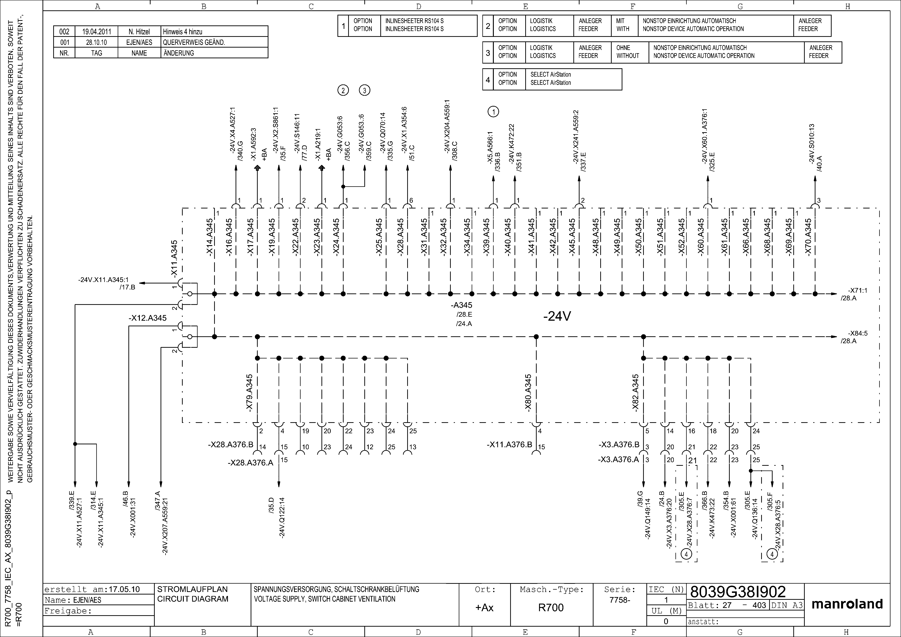

# +Ax — Sheet 27 of 403 — SPANNUNGSVERSORGUNG, SCHALTSCHRANKBELÜFTUNG

**VOLTAGE SUPPLY, SWITCH CABINET VENTILATION**

> Part of the manroland **R700** printing press IEC/UL circuit diagrams.
> Drawing class: **Stromlaufplan / Circuit diagram** (DIN A3).
> Document `+Ax` covers the **Central control console** machine section.

## At a glance

| Field | Value |
|---|---|
| Document | `+Ax`  (8039G38I902) |
| Sheet | **27** of 403 |
| Section (DE) | SPANNUNGSVERSORGUNG, SCHALTSCHRANKBELÜFTUNG |
| Section (EN) | VOLTAGE SUPPLY, SWITCH CABINET VENTILATION |
| Section type | POWER_SUPPLY — Voltage supply |
| Machine type | `R700` |
| Series | `7758` |
| Created | 17.05.10 |
| Replaces | — |
| Columns used | A, B, C, D, E, F, G, H |
| Path numbers | — |
| Labels on sheet | 224 |
| Cross-refs out | 30 |
| Cross-refs in | 95 |

**Previous:** [+Ax sheet 26](SHEET_0026.md) · **Next:** [+Ax sheet 28](SHEET_0028.md) · **Document TOC:** [_TOC.md](_TOC.md)  (+Ax) · **Master TOC:** [all sheets](../_MASTER_TOC.md)

## Sheet image (300 DPI, exact vector render)



_Rendered directly from the PDF vector layer at 300 DPI (1-bit), no OCR and no resampling. Use it to confirm anything ambiguous in the text below._

## Cross-references on this sheet

Each entry is a wire leaving this sheet. The printed token is `/sheet.column`; the link resolves to that sheet inside the same document.

| Ref | Target sheet | Col | Path | Destination on target | Target section | From col |
|---|---|---|---|---|---|---|
| `/308.C` | [+Ax sheet 308](SHEET_0308.md) | C | — | 24V.X204.A559:1 | OPTION: KOMBIGERÄT | D |
| `/340.G` | [+Ax sheet 340](SHEET_0340.md) | G | — | 24V.X4.A527:1 | OPTION: INLINESHEETER RS104 S | B |
| `/35.F` | [+Ax sheet 35](SHEET_0035.md) | F | — | 24V.X2.S861:1 | SCHMIERUNG | C |
| `/51.C` | [+Ax sheet 51](SHEET_0051.md) | C | — | 24V.X1.A354:6 | SIGNALGEBER: AKUSTISCHE WARNSIGNALE | D |
| `/325.E` | [+Ax sheet 325](SHEET_0325.md) | E | — | 24V.X60.1.A376:1 | OPTION: AUTOMATISCHE FARBZUFÜHRUNG | G |
| `/337.E` | [+Ax sheet 337](SHEET_0337.md) | E | — | 24V.X241.A559:2 | OPTION: INLINESHEETER RS104 S | F |
| `/335.G` | [+Ax sheet 335](SHEET_0335.md) | G | — | 24V.Q070:14 | 1 OPTION: LOGISTIK (ANLEGER AUSLEGER) | D |
| `/77.D` | [+Ax sheet 77](SHEET_0077.md) | D | — | 24V.S146:11 | ANLEGER | C |
| `/359.C` | [+Ax sheet 359](SHEET_0359.md) | C | — | 24V.G053.:6 | OPTION: LOGISTIK ANLEGER | D |
| `/356.C` | [+Ax sheet 356](SHEET_0356.md) | C | — | 24V.G053:6 | OPTION: LOGISTIK ANLEGER | C |
| `/351.B` | [+Ax sheet 351](SHEET_0351.md) | B | — | 24V.K472:22 | OPTION: LOGISTIK ANLEGER | E |
| `/40.A` | [+Ax sheet 40](SHEET_0040.md) | A | — | 24V.S010:13 | HAUPTANTRIEB | H |
| `/336.B` | [+Ax sheet 336](SHEET_0336.md) | B | — | X5.A566:1 | OPTION: LOGISTIK ANLEGER / | E |
| `/17.B` | [+Ax sheet 17](SHEET_0017.md) | B | — | 24V.X11.A345:1 | SPANNUNGSVERSORGUNG, SCHALTSCHRANKBELÜFTUNG | A |
| `/28.A` | [+Ax sheet 28](SHEET_0028.md) | A | — | — | SPANNUNGSVERSORGUNG, SCHALTSCHRANKBELÜFTUNG | H |
| `/28.E` | [+Ax sheet 28](SHEET_0028.md) | E | — | — | SPANNUNGSVERSORGUNG, SCHALTSCHRANKBELÜFTUNG | D |
| `/24.A` | [+Ax sheet 24](SHEET_0024.md) | A | — | — | SPANNUNGSVERSORGUNG, SCHALTSCHRANKBELÜFTUNG | D |
| `/28.A` | [+Ax sheet 28](SHEET_0028.md) | A | — | — | SPANNUNGSVERSORGUNG, SCHALTSCHRANKBELÜFTUNG | H |
| `/339.E` | [+Ax sheet 339](SHEET_0339.md) | E | — | — | OPTION: INLINESHEETER RS104 S | A |
| `/314.E` | [+Ax sheet 314](SHEET_0314.md) | E | — | — | OPTION: ZENTRALE LUFTVERSORGUNG | A |
| `/39.G` | [+Ax sheet 39](SHEET_0039.md) | G | — | — | HAUPTANTRIEB | F |
| `/305.E` | [+Ax sheet 305](SHEET_0305.md) | E | — | — | SCHÖN & WIDERDRUCK HAUPTSCHALTSCHRANK | G |
| `/46.B` | [+Ax sheet 46](SHEET_0046.md) | B | — | — | NOT AUS | A |
| `/24.B` | [+Ax sheet 24](SHEET_0024.md) | B | — | — | SPANNUNGSVERSORGUNG, SCHALTSCHRANKBELÜFTUNG | F |
| `/366.B` | [+Ax sheet 366](SHEET_0366.md) | B | — | — | OPTION: LOGISTIK AUSLEGER | G |
| `/354.B` | [+Ax sheet 354](SHEET_0354.md) | B | — | — | OPTION: LOGISTIK ANLEGER | G |
| `/347.A` | [+Ax sheet 347](SHEET_0347.md) | A | — | — | OPTION: LOGISTIK ANLEGER | B |
| `/305.E` | [+Ax sheet 305](SHEET_0305.md) | E | — | — | SCHÖN & WIDERDRUCK HAUPTSCHALTSCHRANK | F |
| `/305.F` | [+Ax sheet 305](SHEET_0305.md) | F | — | — | SCHÖN & WIDERDRUCK HAUPTSCHALTSCHRANK | G |
| `/35.D` | [+Ax sheet 35](SHEET_0035.md) | D | — | — | SCHMIERUNG | C |

### Incoming references (sheets that point here)

Every other sheet that sends a wire to this one. `Back-ref` is the token printed on *that* sheet; `Path` is its line number.

| From sheet | Cols | Back-ref | Path | Refs | What continues there |
|---|---|---|---|---|---|
| [+Ax#17](SHEET_0017.md) | B | `/17.B` | — | 1 | — |
| [+Ax#24](SHEET_0024.md) | A, B | `/24.A`, `/24.B` | — | 2 | — |
| [+Ax#28](SHEET_0028.md) | A, E | `/28.A`, `/28.E` | — | 3 | X71:1; X84:5 |
| [+Ax#35](SHEET_0035.md) | D, F | `/35.D`, `/35.F` | — | 2 | 24V.Q122:14; 24V.X2.S861:1 |
| [+Ax#39](SHEET_0039.md) | G | `/39.G` | — | 1 | 24V.Q149:14 |
| [+Ax#40](SHEET_0040.md) | C | `/40.C` | — | 1 | 24V.X7.A375:7 24V.S010:13 |
| [+Ax#46](SHEET_0046.md) | A | `/46.A` | — | 1 | 24V.X001:31 |
| [+Ax#51](SHEET_0051.md) | B | `/51.B` | — | 1 | — |
| [+Ax#77](SHEET_0077.md) | C | `/77.C` | — | 1 | 24V.S146:11 |
| [+Ax#224](SHEET_0224.md) | E, F | `/224.E`, `/224.F` | — | 12 | — |
| [+Ax#247](SHEET_0247.md) | E | `/247.E` | — | 1 | — |
| [+Ax#251](SHEET_0251.md) | B | `/251.B` | — | 1 | — |
| [+Ax#254](SHEET_0254.md) | B | `/254.B` | — | 1 | — |
| [+Ax#255](SHEET_0255.md) | B | `/255.B` | — | 1 | — |
| [+Ax#258](SHEET_0258.md) | H | `/258.H` | — | 1 | — |
| [+Ax#262](SHEET_0262.md) | F | `/262.F` | — | 1 | — |
| [+Ax#264](SHEET_0264.md) | F | `/264.F` | — | 1 | — |
| [+Ax#266](SHEET_0266.md) | A | `/266.A` | — | 1 | — |
| [+Ax#267](SHEET_0267.md) | C | `/267.C` | — | 1 | — |
| [+Ax#271](SHEET_0271.md) | D, E | `/271.D`, `/271.E` | — | 9 | — |
| [+Ax#272](SHEET_0272.md) | A | `/272.A` | — | 1 | — |
| [+Ax#275](SHEET_0275.md) | B, E | `/275.B`, `/275.E` | — | 2 | — |
| [+Ax#278](SHEET_0278.md) | B | `/278.B` | — | 1 | — |
| [+Ax#280](SHEET_0280.md) | B, D, E | `/280.B`, `/280.D`, `/280.E` | — | 3 | — |
| [+Ax#281](SHEET_0281.md) | A | `/281.A` | — | 1 | — |
| [+Ax#282](SHEET_0282.md) | B | `/282.B` | — | 1 | — |
| [+Ax#283](SHEET_0283.md) | E, F, G | `/283.E`, `/283.F`, `/283.G` | — | 5 | — |
| [+Ax#284](SHEET_0284.md) | C, H | `/284.C`, `/284.H` | — | 3 | — |
| [+Ax#285](SHEET_0285.md) | A | `/285.A` | — | 3 | STROMPFAD PIN 1 2 3 4 |
| [+Ax#286](SHEET_0286.md) | B, C, F | `/286.B`, `/286.C`, `/286.F` | — | 15 | — |
| [+Ax#305](SHEET_0305.md) | E, F | `/305.E`, `/305.F` | — | 3 | 24V.Q136:14; 24V.X28.A376:5; 24V.X28.A376:7 |
| [+Ax#308](SHEET_0308.md) | D | `/308.D` | — | 1 | 24V.X204.A559:1 X205.A559:1 |
| [+Ax#314](SHEET_0314.md) | E | `/314.E` | — | 1 | 24V.X11.A345:1 |
| [+Ax#325](SHEET_0325.md) | C | `/325.C` | — | 1 | 24V.X60.1.A376:1 L1.G010 |
| [+Ax#335](SHEET_0335.md) | G | `/335.G` | — | 1 | 24V.Q070:14 |
| [+Ax#336](SHEET_0336.md) | B | `/336.B` | — | 1 | X5.A566:1 |
| [+Ax#337](SHEET_0337.md) | D | `/337.D` | — | 1 | — |
| [+Ax#339](SHEET_0339.md) | D | `/339.D` | — | 1 | 24V.X11.A527:1 |
| [+Ax#340](SHEET_0340.md) | G | `/340.G` | — | 1 | 24V.X4.A527:1 |
| [+Ax#347](SHEET_0347.md) | A | `/347.A` | — | 1 | — |
| [+Ax#351](SHEET_0351.md) | B | `/351.B` | — | 1 | 24V.K472:22 |
| [+Ax#354](SHEET_0354.md) | B | `/354.B` | — | 1 | 24V.X001:61 |
| [+Ax#356](SHEET_0356.md) | B | `/356.B` | — | 1 | 0V.G053:5 24V.G053:6 G053A:5 |
| [+Ax#359](SHEET_0359.md) | B | `/359.B` | — | 1 | 24V.G053.:6 |
| [+Ax#366](SHEET_0366.md) | A | `/366.A` | — | 1 | 24V.K473:22 |


## Devices on this sheet

| Tag | Class | Class meaning (IEC) | Col | Sub | Terminal | Sign |
|---|---|---|---|---|---|---|
| `A345` | A | Baugruppe / assembly, module, PC board | D | — | — | — |
| `X71:1` | X | Klemme / terminal, plug connector | H | — | 1 | — |
| `X84:5` | X | Klemme / terminal, plug connector | H | — | 5 | — |
| `X11.A345` | — | cross-device reference | B | — | — | — |
| `X17.A345` | — | cross-device reference | B | — | — | — |
| `X19.A345` | — | cross-device reference | C | — | — | — |
| `X16.A345` | — | cross-device reference | B | — | — | — |
| `X24.A345` | — | cross-device reference | C | — | — | — |
| `X12.A345` | — | cross-device reference | A | — | — | — |
| `X22.A345` | — | cross-device reference | C | — | — | — |
| `X23.A345` | — | cross-device reference | C | — | — | — |
| `X1.A592:3` | — | cross-device reference | B | — | 3 | — |
| `X1.A219:1` | — | cross-device reference | C | — | 1 | — |
| `X80.A345` | — | cross-device reference | E | — | — | — |
| `X11.A376.B` | — | cross-device reference | E | — | — | — |
| `X82.A345` | — | cross-device reference | F | — | — | — |
| `X3.A376.B` | — | cross-device reference | F | — | — | — |
| `X3.A376.A` | — | cross-device reference | F | — | — | — |
| `X28.A376.A` | — | cross-device reference | B | — | — | — |
| `X79.A345` | — | cross-device reference | B | — | — | — |
| `X28.A376.B` | — | cross-device reference | B | — | — | — |
| `X28.A345` | — | cross-device reference | D | — | — | — |
| `X60.A345` | — | cross-device reference | G | — | — | — |
| `X70.A345` | — | cross-device reference | H | — | — | — |
| `X32.A345` | — | cross-device reference | D | — | — | — |
| `X25.A345` | — | cross-device reference | D | — | — | — |
| `X39.A345` | — | cross-device reference | E | — | — | — |
| `X40.A345` | — | cross-device reference | E | — | — | — |
| `X45.A345` | — | cross-device reference | E | — | — | — |
| `NR.` | — | cross-device reference | A | — | — | — |
| `28.10.10` | — | cross-device reference | A | — | — | — |
| `X5.A566:1` | — | cross-device reference | E | — | 1 | — |
| `19.04.2011` | — | cross-device reference | A | — | — | — |
| `X14.A345` | — | cross-device reference | B | — | — | — |
| `X34.A345` | — | cross-device reference | D | — | — | — |
| `X41.A345` | — | cross-device reference | E | — | — | — |
| `X42.A345` | — | cross-device reference | E | — | — | — |
| `X61.A345` | — | cross-device reference | G | — | — | — |
| `X66.A345` | — | cross-device reference | G | — | — | — |
| `X48.A345` | — | cross-device reference | F | — | — | — |
| `X49.A345` | — | cross-device reference | F | — | — | — |
| `X50.A345` | — | cross-device reference | F | — | — | — |
| `X51.A345` | — | cross-device reference | F | — | — | — |
| `X52.A345` | — | cross-device reference | F | — | — | — |
| `X69.A345` | — | cross-device reference | G | — | — | — |
| `X31.A345` | — | cross-device reference | D | — | — | — |
| `X68.A345` | — | cross-device reference | G | — | — | — |

## Potentials / nets

| Potential | Count | Columns | Attached devices | Terminals |
|---|---|---|---|---|
| `24V` | 25 | A, B, C, D, E, F, G, H | `1`, `A345`, `A354`, `A376`, `A527`, `A559`, `G053`, `K472`, `K473`, `Q070`, `Q122`, `Q136`, `Q149`, `S010`, `S146`, `S861`, `X001`, `X1`, `X11`, `X2`, `X204`, `X207`, `X241`, `X28`, `X3`, `X4`, `X60` | `1`, `11`, `13`, `14`, `2`, `20`, `21`, `22`, `31`, `5`, `6`, `61`, `7` |


A potential such as `L24+/4` or `M24+` is a named supply/return rail; every place it appears on this sheet is electrically common.

## Wire-end annotations (grouped as printed)

A wire that continues elsewhere is annotated with a small cluster: the destination description, the path/line number `#NN`, and the `/sheet.column` cross reference. Each row below is one such cluster exactly as it is grouped on the drawing.

| Col | Y | Path | Cross-ref | Text on the wire |
|---|---|---|---|---|
| D | 24.7 | — | — | `1 OPTION OPTION INLINESHEETER RS104 S INLINESHEETER RS104 S 2 OPTION OPTION` |
| E | 24.7 | — | — | `LOGISTIK LOGISTICS` |
| F | 24.7 | — | — | `FEEDER ANLEGER` |
| F | 24.7 | — | — | `MIT` |
| G | 24.7 | — | — | `NONSTOP EINRICHTUNG AUTOMATISCH NONSTOP DEVICE AUTOMATIC OPERATION` |
| H | 24.7 | — | — | `FEEDER ANLEGER` |
| F | 35.2 | — | — | `WITH` |
| A | 38.3 | — | — | `002 19.04.2011 N. Hitzel Hinweis 4 hinzu` |
| A | 52.7 | — | — | `001 28.10.10 EJEN/AES QUERVERWEIS GEÄND.` |
| E | 60.1 | — | — | `OPTION OPTION` |
| E | 60.1 | — | — | `LOGISTIK LOGISTICS` |
| F | 60.1 | — | — | `OHNE WITHOUT` |
| F | 60.2 | — | — | `3 FEEDER ANLEGER` |
| F | 60.2 | — | — | `FEEDER ANLEGER` |
| G | 60.2 | — | — | `NONSTOP EINRICHTUNG AUTOMATISCH NONSTOP DEVICE AUTOMATIC OPERATION` |
| A | 66.8 | — | — | `NR. TAG NAME ÄNDERUNG` |
| E | 95.6 | — | — | `4 OPTION OPTION SELECT AirStation SELECT AirStation` |
| C | 116.5 | — | — | `2` |
| C | 116.5 | — | — | `3` |
| D | 131.2 | — | `/308.C` | `24V.X204.A559:1` |
| B | 140.9 | — | `/340.G` | `24V.X4.A527:1` |
| C | 140.9 | — | `/35.F` | `24V.X2.S861:1` |
| D | 140.9 | — | `/51.C` | `24V.X1.A354:6` |
| G | 142.9 | — | `/325.E` | `24V.X60.1.A376:1` |
| E | 144.3 | — | — | `1` |
| F | 145.4 | — | `/337.E` | `24V.X241.A559:2` |
| D | 148.5 | — | `/335.G` | `24V.Q070:14` |
| C | 149.4 | — | `/77.D` | `24V.S146:11` |
| D | 150.8 | — | `/359.C` | `24V.G053.:6` |
| C | 153.4 | — | `/356.C` | `24V.G053:6` |
| E | 163.6 | — | `/351.B` | `24V.K472:22` |
| H | 163.6 | — | `/40.A` | `24V.S010:13` |
| B | 168.9 | — | — | `X1.A592:3` |
| C | 168.9 | — | — | `X1.A219:1` |
| E | 173.2 | — | `/336.B` | `X5.A566:1` |
| C | 195.9 | — | — | `+BA` |
| C | 195.9 | — | — | `+BA` |
| B | 261.1 | — | — | `1` |
| C | 261.1 | — | — | `1` |
| C | 261.1 | — | — | `1` |
| C | 261.1 | — | — | `2` |
| C | 261.1 | — | — | `1` |
| C | 261.1 | — | — | `1` |
| D | 261.1 | — | — | `1` |
| D | 261.1 | — | — | `6` |
| D | 261.1 | — | — | `1` |
| E | 261.1 | — | — | `1` |
| E | 261.1 | — | — | `1` |
| F | 261.1 | — | — | `2` |
| G | 261.1 | — | — | `1` |
| H | 261.1 | — | — | `3` |
| B | 278.1 | — | — | `1` |
| D | 278.1 | — | — | `1` |
| E | 278.1 | — | — | `1` |
| F | 278.1 | — | — | `1 1 1 1` |
| F | 278.1 | — | — | `1 1 1 1 1` |
| G | 278.1 | — | — | `1` |
| H | 278.1 | — | — | `1` |
| B | 288.6 | — | — | `X14.A345` |
| B | 288.6 | — | — | `X16.A345` |
| B | 288.6 | — | — | `X17.A345` |
| C | 288.6 | — | — | `X19.A345` |
| C | 288.6 | — | — | `X22.A345` |
| C | 288.6 | — | — | `X23.A345` |
| C | 288.6 | — | — | `X24.A345` |
| D | 288.6 | — | — | `X25.A345` |
| D | 288.6 | — | — | `X28.A345` |
| D | 288.6 | — | — | `X31.A345` |
| D | 288.6 | — | — | `X32.A345` |
| D | 288.6 | — | — | `X34.A345` |
| E | 288.6 | — | — | `X39.A345` |
| E | 288.6 | — | — | `X40.A345` |
| E | 288.6 | — | — | `X41.A345` |
| E | 288.6 | — | — | `X42.A345` |
| E | 288.6 | — | — | `X45.A345` |
| F | 288.6 | — | — | `X48.A345` |
| F | 288.6 | — | — | `X49.A345` |
| F | 288.6 | — | — | `X50.A345` |
| F | 288.6 | — | — | `X51.A345` |
| F | 288.6 | — | — | `X52.A345` |
| G | 288.6 | — | — | `X60.A345` |
| G | 288.6 | — | — | `X61.A345` |
| G | 288.6 | — | — | `X66.A345` |
| G | 288.6 | — | — | `X68.A345` |
| G | 288.6 | — | — | `X69.A345` |
| H | 288.6 | — | — | `X70.A345` |
| B | 317.2 | — | — | `X11.A345 1` |
| A | 365.9 | — | `/17.B` | `24V.X11.A345:1` |
| H | 380.1 | — | — | `X71:1` |
| H | 390.0 | — | `/28.A` | — |
| D | 398.6 | — | — | `A345` |
| B | 405.1 | — | — | `2` |
| E | 410.2 | — | — | `24V` |
| D | 411.6 | — | `/28.E`, `/24.A` | — |
| A | 415.6 | — | — | `X12.A345` |
| B | 434.0 | — | — | `1` |
| H | 436.8 | — | — | `X84:5` |
| H | 446.7 | — | `/28.A` | — |
| B | 461.8 | — | — | `2` |
| B | 494.4 | — | — | `X79.A345` |
| E | 494.4 | — | — | `X80.A345` |
| F | 494.4 | — | — | `X82.A345` |
| C | 565.8 | — | — | `2` |
| C | 565.8 | — | — | `4 19` |
| C | 565.8 | — | — | `20` |
| C | 565.8 | — | — | `22` |
| D | 565.8 | — | — | `23` |
| D | 565.8 | — | — | `24` |
| D | 565.8 | — | — | `25` |
| E | 565.8 | — | — | `4` |
| F | 565.8 | — | — | `5 14` |
| G | 565.8 | — | — | `16 18 24` |
| G | 565.8 | — | — | `20` |
| B | 582.8 | — | — | `X28.A376.B 14` |
| E | 582.8 | — | — | `X11.A376.B 15` |
| F | 582.8 | — | — | `X3.A376.B 3` |
| C | 587.1 | — | — | `15` |
| C | 587.1 | — | — | `10` |
| C | 587.1 | — | — | `23` |
| C | 587.1 | — | — | `24` |
| D | 587.1 | — | — | `12` |
| D | 587.1 | — | — | `25` |
| D | 587.1 | — | — | `13` |
| F | 587.1 | — | — | `20` |
| G | 587.1 | — | — | `21 22` |
| G | 587.1 | — | — | `23` |
| G | 587.1 | — | — | `25` |
| F | 602.7 | — | — | `X3.A376.A 3` |
| G | 604.0 | — | — | `21` |
| C | 604.1 | — | — | `X28.A376.A 15` |
| F | 604.1 | — | — | `20` |
| G | 604.1 | — | — | `22` |
| G | 604.1 | — | — | `23` |
| G | 604.1 | — | — | `25` |
| A | 648.6 | — | `/339.E` | — |
| A | 648.6 | — | `/314.E` | — |
| F | 648.6 | — | `/39.G` | — |
| G | 648.6 | — | `/305.E` | — |
| A | 648.9 | — | `/46.B` | — |
| F | 648.9 | — | `/24.B` | — |
| G | 648.9 | — | `/366.B` | — |
| G | 648.9 | — | `/354.B` | — |
| B | 649.1 | — | `/347.A` | — |
| F | 650.0 | — | `/305.E` | — |
| G | 650.3 | — | `/305.F` | — |
| A | 657.4 | — | — | `24V.X11.A527:1` |
| A | 657.4 | — | — | `24V.X11.A345:1` |
| A | 657.4 | — | — | `24V.X001:31` |
| B | 657.4 | — | — | `24V.X207.A559:21` |
| C | 657.4 | — | `/35.D` | — |
| C | 657.4 | — | — | `24V.Q122:14` |
| G | 657.4 | — | — | `24V.X28.A376:7` |
| G | 657.4 | — | — | `24V.X001:61` |
| G | 658.5 | — | — | `24V.K473:22` |
| F | 658.8 | — | — | `24V.Q149:14` |
| F | 658.8 | — | — | `24V.X3.A376:20` |
| G | 658.8 | — | — | `24V.Q136:14` |
| G | 660.9 | — | — | `24V.X28.A376:5` |
| G | 729.5 | — | — | `4 4` |


## Reconstructed tables

This sheet carries tabular content (pin map / terminal assignment / index). The grid below was rebuilt from the drawing's own rule lines, so each row is exactly one physical row of the table.

### Table 1 — 2 data rows × 2 columns (at x=170.1, y=388.3)

| X12.A345 | 2 |
|---|---|
|  | `1` |
|  | `2` |


## Notes and free text on this sheet

| Text | Col | Y (pt) |
|---|---|---|
| `+BA` | C | 195.88 |
| `TAG` | A | 66.95 |
| `NAME` | A | 66.94 |
| `ÄNDERUNG` | B | 67 |
| `EJEN/AES` | A | 52.78 |
| `QUERVERWEIS GEÄND.` | B | 52.78 |
| `24V.G053.:6` | C | 150.8 |
| `N. Hitzel` | A | 38.53 |
| `Hinweis 4 hinzu` | B | 38.5 |
| `OPTION` | E | 60.13 |
| `LOGISTIK` | E | 60.12 |
| `LOGISTICS` | E | 70.75 |
| `ANLEGER` | F | 60.16 |
| `FEEDER` | F | 70.76 |
| `OHNE` | F | 60.15 |
| `WITHOUT` | F | 70.75 |
| `NONSTOP EINRICHTUNG AUTOMATISCH` | G | 60.16 |
| `NONSTOP DEVICE AUTOMATIC OPERATION` | G | 70.78 |
| `ANLEGER` | H | 60.16 |
| `FEEDER` | H | 70.76 |
| `OPTION` | C | 24.69 |
| `INLINESHEETER RS104 S` | D | 24.71 |
| `MIT` | F | 24.69 |
| `WITH` | F | 35.22 |
| `SELECT AirStation` | E | 95.59 |

## Complete label inventory (exact text from the drawing)

Every text object inside the drawing area of this sheet, in DIN reading order (column A→H, then top→bottom). This is the authoritative list: if a string is not here it is not printed on this sheet.

| Col | Y | X | Dir | Type | Text |
|---|---|---|---|---|---|
| A | 38.3 | 78.5 | → | number | `002` |
| A | 38.4 | 108.6 | → | device ref | `19.04.2011` |
| A | 38.5 | 170.2 | → | text | `N. Hitzel` |
| A | 52.7 | 79.8 | → | number | `001` |
| A | 52.8 | 114.0 | → | device ref | `28.10.10` |
| A | 52.8 | 167.0 | → | text | `EJEN/AES` |
| A | 66.8 | 78.9 | → | device ref | `NR.` |
| A | 66.9 | 173.8 | → | text | `NAME` |
| A | 67.0 | 120.4 | → | text | `TAG` |
| A | 365.9 | 103.5 | → | potential | `24V.X11.A345:1` |
| A | 375.8 | 158.2 | → | cross-reference | `/17.B` |
| A | 415.6 | 170.1 | → | device ref | `X12.A345` |
| A | 648.6 | 91.0 | ↕ | cross-reference | `/339.E` |
| A | 648.6 | 119.3 | ↕ | cross-reference | `/314.E` |
| A | 648.9 | 161.8 | ↕ | cross-reference | `/46.B` |
| A | 657.4 | 100.9 | ↕ | potential | `24V.X11.A527:1` |
| A | 657.4 | 129.3 | ↕ | potential | `24V.X11.A345:1` |
| A | 657.4 | 171.8 | ↕ | potential | `24V.X001:31` |
| B | 38.5 | 215.4 | → | text | `Hinweis 4 hinzu` |
| B | 52.8 | 215.6 | → | text | `QUERVERWEIS GEÄND.` |
| B | 67.0 | 216.4 | → | text | `ÄNDERUNG` |
| B | 140.9 | 303.6 | ↕ | potential | `24V.X4.A527:1` |
| B | 168.9 | 331.2 | ↕ | device ref | `X1.A592:3` |
| B | 186.2 | 313.5 | ↕ | cross-reference | `/340.G` |
| B | 261.1 | 313.8 | → | number | `1` |
| B | 278.1 | 285.4 | → | number | `1` |
| B | 288.6 | 272.4 | ↕ | device ref | `X14.A345` |
| B | 288.6 | 297.9 | ↕ | device ref | `X16.A345` |
| B | 288.6 | 326.3 | ↕ | device ref | `X17.A345` |
| B | 317.2 | 225.7 | ↕ | device ref | `X11.A345` |
| B | 377.3 | 227.1 | ↕ | number | `1` |
| B | 405.1 | 227.1 | ↕ | number | `2` |
| B | 434.0 | 227.1 | ↕ | number | `1` |
| B | 461.8 | 227.1 | ↕ | number | `2` |
| B | 494.4 | 324.9 | ↕ | device ref | `X79.A345` |
| B | 582.8 | 275.0 | → | device ref | `X28.A376.B` |
| B | 606.9 | 301.0 | → | device ref | `X28.A376.A` |
| B | 649.1 | 204.4 | ↕ | cross-reference | `/347.A` |
| B | 657.4 | 214.3 | ↕ | potential | `24V.X207.A559:21` |
| C | 24.7 | 467.4 | → | text | `OPTION` |
| C | 30.0 | 451.0 | → | number | `1` |
| C | 35.3 | 467.4 | → | text | `OPTION` |
| C | 116.5 | 451.5 | → | number | `2` |
| C | 116.5 | 479.9 | → | number | `3` |
| C | 140.9 | 360.3 | ↕ | potential | `24V.X2.S861:1` |
| C | 149.4 | 388.6 | ↕ | potential | `24V.S146:11` |
| C | 150.8 | 473.7 | ↕ | text | `24V.G053.:6` |
| C | 153.4 | 445.3 | ↕ | potential | `24V.G053:6` |
| C | 168.9 | 416.3 | ↕ | device ref | `X1.A219:1` |
| C | 186.8 | 455.3 | ↕ | cross-reference | `/356.C` |
| C | 191.6 | 398.5 | ↕ | cross-reference | `/77.D` |
| C | 192.5 | 370.2 | ↕ | cross-reference | `/35.F` |
| C | 195.9 | 345.4 | ↕ | text | `+BA` |
| C | 195.9 | 430.4 | ↕ | text | `+BA` |
| C | 261.1 | 342.1 | → | number | `1` |
| C | 261.1 | 370.5 | → | number | `1` |
| C | 261.1 | 399.4 | → | number | `2` |
| C | 261.1 | 427.2 | → | number | `1` |
| C | 261.1 | 455.5 | → | number | `1` |
| C | 288.6 | 354.6 | ↕ | device ref | `X19.A345` |
| C | 288.6 | 385.8 | ↕ | device ref | `X22.A345` |
| C | 288.6 | 414.2 | ↕ | device ref | `X23.A345` |
| C | 288.6 | 439.7 | ↕ | device ref | `X24.A345` |
| C | 565.8 | 342.7 | → | number | `2` |
| C | 565.8 | 371.1 | → | number | `4` |
| C | 565.8 | 398.8 | → | number | `19` |
| C | 565.8 | 427.7 | → | number | `20` |
| C | 565.8 | 456.1 | → | number | `22` |
| C | 587.1 | 342.1 | → | number | `14` |
| C | 587.1 | 370.5 | → | number | `15` |
| C | 587.1 | 398.8 | → | number | `10` |
| C | 587.1 | 427.7 | → | number | `23` |
| C | 587.1 | 456.1 | → | number | `24` |
| C | 604.1 | 370.5 | → | number | `15` |
| C | 657.4 | 354.6 | ↕ | cross-reference | `/35.D` |
| C | 657.4 | 368.8 | ↕ | potential | `24V.Q122:14` |
| D | 24.7 | 509.4 | → | text | `INLINESHEETER RS104 S` |
| D | 35.3 | 509.4 | → | text | `INLINESHEETER RS104 S` |
| D | 131.2 | 587.1 | ↕ | potential | `24V.X204.A559:1` |
| D | 140.9 | 530.4 | ↕ | potential | `24V.X1.A354:6` |
| D | 148.5 | 502.0 | ↕ | potential | `24V.Q070:14` |
| D | 186.2 | 511.9 | ↕ | cross-reference | `/335.G` |
| D | 186.8 | 483.6 | ↕ | cross-reference | `/359.C` |
| D | 186.8 | 597.0 | ↕ | cross-reference | `/308.C` |
| D | 191.6 | 540.3 | ↕ | cross-reference | `/51.C` |
| D | 261.1 | 512.2 | → | number | `1` |
| D | 261.1 | 541.1 | → | number | `6` |
| D | 261.1 | 597.3 | → | number | `1` |
| D | 278.1 | 568.9 | → | number | `1` |
| D | 288.6 | 496.4 | ↕ | device ref | `X25.A345` |
| D | 288.6 | 524.7 | ↕ | device ref | `X28.A345` |
| D | 288.6 | 555.9 | ↕ | device ref | `X31.A345` |
| D | 288.6 | 581.4 | ↕ | device ref | `X32.A345` |
| D | 288.6 | 612.6 | ↕ | device ref | `X34.A345` |
| D | 398.6 | 595.8 | → | device tag | `A345` |
| D | 411.6 | 603.5 | → | cross-reference | `/28.E` |
| D | 424.0 | 602.9 | → | cross-reference | `/24.A` |
| D | 565.8 | 484.4 | → | number | `23` |
| D | 565.8 | 512.8 | → | number | `24` |
| D | 565.8 | 541.1 | → | number | `25` |
| D | 587.1 | 483.9 | → | number | `12` |
| D | 587.1 | 512.8 | → | number | `25` |
| D | 587.1 | 540.6 | → | number | `13` |
| E | 24.7 | 658.8 | → | text | `OPTION` |
| E | 24.7 | 700.7 | → | text | `LOGISTIK` |
| E | 30.0 | 642.0 | → | number | `2` |
| E | 35.3 | 658.8 | → | text | `OPTION` |
| E | 35.3 | 700.7 | → | text | `LOGISTICS` |
| E | 60.1 | 658.8 | → | text | `OPTION` |
| E | 60.1 | 700.7 | → | text | `LOGISTIK` |
| E | 65.5 | 641.9 | → | number | `3` |
| E | 70.8 | 658.8 | → | text | `OPTION` |
| E | 70.8 | 700.7 | → | text | `LOGISTICS` |
| E | 95.6 | 658.8 | → | text | `OPTION` |
| E | 95.6 | 701.3 | → | text | `SELECT AirStation` |
| E | 100.9 | 642.0 | → | number | `4` |
| E | 106.2 | 658.8 | → | text | `OPTION` |
| E | 106.2 | 701.3 | → | text | `SELECT AirStation` |
| E | 144.3 | 650.2 | → | number | `1` |
| E | 145.4 | 757.1 | ↕ | potential | `24V.X241.A559:2` |
| E | 163.6 | 672.1 | ↕ | potential | `24V.K472:22` |
| E | 173.2 | 643.7 | ↕ | device ref | `X5.A566:1` |
| E | 201.3 | 653.6 | ↕ | cross-reference | `/336.B` |
| E | 201.3 | 682.0 | ↕ | cross-reference | `/351.B` |
| E | 261.1 | 654.0 | → | number | `1` |
| E | 261.1 | 682.3 | → | number | `1` |
| E | 278.1 | 625.6 | → | number | `1` |
| E | 278.1 | 710.6 | → | number | `1` |
| E | 278.1 | 739.0 | → | number | `1` |
| E | 288.6 | 638.1 | ↕ | device ref | `X39.A345` |
| E | 288.6 | 666.4 | ↕ | device ref | `X40.A345` |
| E | 288.6 | 697.6 | ↕ | device ref | `X41.A345` |
| E | 288.6 | 726.0 | ↕ | device ref | `X42.A345` |
| E | 288.6 | 751.5 | ↕ | device ref | `X45.A345` |
| E | 410.2 | 718.2 | → | potential | `24V` |
| E | 494.4 | 693.4 | ↕ | device ref | `X80.A345` |
| E | 565.8 | 711.2 | → | number | `4` |
| E | 582.8 | 643.5 | → | device ref | `X11.A376.B` |
| E | 587.1 | 710.6 | → | number | `15` |
| F | 24.7 | 765.4 | → | text | `ANLEGER` |
| F | 24.7 | 814.4 | → | text | `MIT` |
| F | 35.2 | 815.0 | → | text | `WITH` |
| F | 35.3 | 764.5 | → | text | `FEEDER` |
| F | 60.1 | 814.7 | → | text | `OHNE` |
| F | 60.2 | 765.4 | → | text | `ANLEGER` |
| F | 70.7 | 815.0 | → | text | `WITHOUT` |
| F | 70.8 | 764.5 | → | text | `FEEDER` |
| F | 201.3 | 767.0 | ↕ | cross-reference | `/337.E` |
| F | 261.1 | 767.9 | → | number | `2` |
| F | 278.1 | 795.7 | → | number | `1` |
| F | 278.1 | 824.0 | → | number | `1` |
| F | 278.1 | 852.4 | → | number | `1` |
| F | 278.1 | 880.7 | → | number | `1` |
| F | 288.6 | 782.7 | ↕ | device ref | `X48.A345` |
| F | 288.6 | 811.0 | ↕ | device ref | `X49.A345` |
| F | 288.6 | 839.4 | ↕ | device ref | `X50.A345` |
| F | 288.6 | 867.7 | ↕ | device ref | `X51.A345` |
| F | 288.6 | 896.1 | ↕ | device ref | `X52.A345` |
| F | 494.4 | 835.1 | ↕ | device ref | `X82.A345` |
| F | 565.8 | 852.9 | → | number | `5` |
| F | 565.8 | 880.7 | → | number | `14` |
| F | 582.8 | 791.1 | → | device ref | `X3.A376.B` |
| F | 587.1 | 852.9 | → | number | `3` |
| F | 587.1 | 881.3 | → | number | `20` |
| F | 602.7 | 790.3 | → | device ref | `X3.A376.A` |
| F | 604.1 | 852.9 | → | number | `3` |
| F | 604.1 | 881.3 | → | number | `20` |
| F | 648.6 | 842.2 | ↕ | cross-reference | `/39.G` |
| F | 648.9 | 870.5 | ↕ | cross-reference | `/24.B` |
| F | 650.0 | 896.7 | ↕ | cross-reference | `/305.E` |
| F | 658.8 | 852.1 | ↕ | potential | `24V.Q149:14` |
| F | 658.8 | 880.4 | ↕ | potential | `24V.X3.A376:20` |
| F | 729.5 | 905.1 | → | number | `4` |
| G | 24.7 | 849.5 | → | text | `NONSTOP EINRICHTUNG AUTOMATISCH` |
| G | 35.4 | 849.5 | → | text | `NONSTOP DEVICE AUTOMATIC OPERATION` |
| G | 60.2 | 863.7 | → | text | `NONSTOP EINRICHTUNG AUTOMATISCH` |
| G | 70.8 | 863.7 | → | text | `NONSTOP DEVICE AUTOMATIC OPERATION` |
| G | 142.9 | 927.2 | ↕ | potential | `24V.X60.1.A376:1` |
| G | 201.3 | 937.1 | ↕ | cross-reference | `/325.E` |
| G | 261.1 | 937.4 | → | number | `1` |
| G | 278.1 | 909.1 | → | number | `1` |
| G | 278.1 | 965.8 | → | number | `1` |
| G | 278.1 | 994.1 | → | number | `1` |
| G | 278.1 | 1022.5 | → | number | `1` |
| G | 288.6 | 921.6 | ↕ | device ref | `X60.A345` |
| G | 288.6 | 952.7 | ↕ | device ref | `X61.A345` |
| G | 288.6 | 981.1 | ↕ | device ref | `X66.A345` |
| G | 288.6 | 1009.4 | ↕ | device ref | `X68.A345` |
| G | 288.6 | 1037.8 | ↕ | device ref | `X69.A345` |
| G | 565.8 | 909.1 | → | number | `16` |
| G | 565.8 | 937.4 | → | number | `18` |
| G | 565.8 | 966.3 | → | number | `20` |
| G | 565.8 | 994.7 | → | number | `24` |
| G | 587.1 | 909.6 | → | number | `21` |
| G | 587.1 | 938.0 | → | number | `22` |
| G | 587.1 | 966.3 | → | number | `23` |
| G | 587.1 | 994.7 | → | number | `25` |
| G | 604.1 | 909.6 | → | number | `21` |
| G | 604.1 | 938.0 | → | number | `22` |
| G | 604.1 | 966.3 | → | number | `23` |
| G | 604.1 | 994.7 | → | number | `25` |
| G | 648.6 | 983.9 | ↕ | cross-reference | `/305.E` |
| G | 648.9 | 927.2 | ↕ | cross-reference | `/366.B` |
| G | 648.9 | 955.5 | ↕ | cross-reference | `/354.B` |
| G | 650.3 | 1013.7 | ↕ | cross-reference | `/305.F` |
| G | 657.4 | 907.4 | ↕ | potential | `24V.X28.A376:7` |
| G | 657.4 | 965.5 | ↕ | potential | `24V.X001:61` |
| G | 658.5 | 937.1 | ↕ | potential | `24V.K473:22` |
| G | 658.8 | 993.8 | ↕ | potential | `24V.Q136:14` |
| G | 660.9 | 1024.3 | ↕ | potential | `24V.X28.A376:5` |
| G | 729.5 | 1018.5 | → | number | `4` |
| H | 24.7 | 1055.9 | → | text | `ANLEGER` |
| H | 35.3 | 1055.1 | → | text | `FEEDER` |
| H | 60.2 | 1070.1 | → | text | `ANLEGER` |
| H | 70.8 | 1069.2 | → | text | `FEEDER` |
| H | 163.6 | 1068.9 | ↕ | potential | `24V.S010:13` |
| H | 206.1 | 1078.8 | ↕ | cross-reference | `/40.A` |
| H | 261.1 | 1079.7 | → | number | `3` |
| H | 278.1 | 1050.8 | → | number | `1` |
| H | 288.6 | 1063.3 | ↕ | device ref | `X70.A345` |
| H | 380.1 | 1120.8 | → | device tag | `X71:1` |
| H | 390.0 | 1111.2 | → | cross-reference | `/28.A` |
| H | 436.8 | 1120.8 | → | device tag | `X84:5` |
| H | 446.7 | 1111.2 | → | cross-reference | `/28.A` |

## Reading-order text block

The same content as a plain block, grouped by DIN column — convenient to paste or to match against a visual description.

```text
=== Column A ===
  38.3   78.5  numeric      002
  38.4  108.6  devref       19.04.2011
  38.5  170.2  text         N. Hitzel
  52.7   79.8  numeric      001
  52.8  114.0  devref       28.10.10
  52.8  167.0  text         EJEN/AES
  66.8   78.9  devref       NR.
  66.9  173.8  text         NAME
  67.0  120.4  text         TAG
 365.9  103.5  net          24V.X11.A345:1
 375.8  158.2  xref         /17.B
 415.6  170.1  devref       X12.A345
 648.6   91.0  xref         /339.E
 648.6  119.3  xref         /314.E
 648.9  161.8  xref         /46.B
 657.4  100.9  net          24V.X11.A527:1
 657.4  129.3  net          24V.X11.A345:1
 657.4  171.8  net          24V.X001:31
=== Column B ===
  38.5  215.4  text         Hinweis 4 hinzu
  52.8  215.6  text         QUERVERWEIS GEÄND.
  67.0  216.4  text         ÄNDERUNG
 140.9  303.6  net          24V.X4.A527:1
 168.9  331.2  devref       X1.A592:3
 186.2  313.5  xref         /340.G
 261.1  313.8  numeric      1
 278.1  285.4  numeric      1
 288.6  272.4  devref       X14.A345
 288.6  297.9  devref       X16.A345
 288.6  326.3  devref       X17.A345
 317.2  225.7  devref       X11.A345
 377.3  227.1  numeric      1
 405.1  227.1  numeric      2
 434.0  227.1  numeric      1
 461.8  227.1  numeric      2
 494.4  324.9  devref       X79.A345
 582.8  275.0  devref       X28.A376.B
 606.9  301.0  devref       X28.A376.A
 649.1  204.4  xref         /347.A
 657.4  214.3  net          24V.X207.A559:21
=== Column C ===
  24.7  467.4  text         OPTION
  30.0  451.0  numeric      1
  35.3  467.4  text         OPTION
 116.5  451.5  numeric      2
 116.5  479.9  numeric      3
 140.9  360.3  net          24V.X2.S861:1
 149.4  388.6  net          24V.S146:11
 150.8  473.7  text         24V.G053.:6
 153.4  445.3  net          24V.G053:6
 168.9  416.3  devref       X1.A219:1
 186.8  455.3  xref         /356.C
 191.6  398.5  xref         /77.D
 192.5  370.2  xref         /35.F
 195.9  345.4  text         +BA
 195.9  430.4  text         +BA
 261.1  342.1  numeric      1
 261.1  370.5  numeric      1
 261.1  399.4  numeric      2
 261.1  427.2  numeric      1
 261.1  455.5  numeric      1
 288.6  354.6  devref       X19.A345
 288.6  385.8  devref       X22.A345
 288.6  414.2  devref       X23.A345
 288.6  439.7  devref       X24.A345
 565.8  342.7  numeric      2
 565.8  371.1  numeric      4
 565.8  398.8  numeric      19
 565.8  427.7  numeric      20
 565.8  456.1  numeric      22
 587.1  342.1  numeric      14
 587.1  370.5  numeric      15
 587.1  398.8  numeric      10
 587.1  427.7  numeric      23
 587.1  456.1  numeric      24
 604.1  370.5  numeric      15
 657.4  354.6  xref         /35.D
 657.4  368.8  net          24V.Q122:14
=== Column D ===
  24.7  509.4  text         INLINESHEETER RS104 S
  35.3  509.4  text         INLINESHEETER RS104 S
 131.2  587.1  net          24V.X204.A559:1
 140.9  530.4  net          24V.X1.A354:6
 148.5  502.0  net          24V.Q070:14
 186.2  511.9  xref         /335.G
 186.8  483.6  xref         /359.C
 186.8  597.0  xref         /308.C
 191.6  540.3  xref         /51.C
 261.1  512.2  numeric      1
 261.1  541.1  numeric      6
 261.1  597.3  numeric      1
 278.1  568.9  numeric      1
 288.6  496.4  devref       X25.A345
 288.6  524.7  devref       X28.A345
 288.6  555.9  devref       X31.A345
 288.6  581.4  devref       X32.A345
 288.6  612.6  devref       X34.A345
 398.6  595.8  devtag       A345
 411.6  603.5  xref         /28.E
 424.0  602.9  xref         /24.A
 565.8  484.4  numeric      23
 565.8  512.8  numeric      24
 565.8  541.1  numeric      25
 587.1  483.9  numeric      12
 587.1  512.8  numeric      25
 587.1  540.6  numeric      13
=== Column E ===
  24.7  658.8  text         OPTION
  24.7  700.7  text         LOGISTIK
  30.0  642.0  numeric      2
  35.3  658.8  text         OPTION
  35.3  700.7  text         LOGISTICS
  60.1  658.8  text         OPTION
  60.1  700.7  text         LOGISTIK
  65.5  641.9  numeric      3
  70.8  658.8  text         OPTION
  70.8  700.7  text         LOGISTICS
  95.6  658.8  text         OPTION
  95.6  701.3  text         SELECT AirStation
 100.9  642.0  numeric      4
 106.2  658.8  text         OPTION
 106.2  701.3  text         SELECT AirStation
 144.3  650.2  numeric      1
 145.4  757.1  net          24V.X241.A559:2
 163.6  672.1  net          24V.K472:22
 173.2  643.7  devref       X5.A566:1
 201.3  653.6  xref         /336.B
 201.3  682.0  xref         /351.B
 261.1  654.0  numeric      1
 261.1  682.3  numeric      1
 278.1  625.6  numeric      1
 278.1  710.6  numeric      1
 278.1  739.0  numeric      1
 288.6  638.1  devref       X39.A345
 288.6  666.4  devref       X40.A345
 288.6  697.6  devref       X41.A345
 288.6  726.0  devref       X42.A345
 288.6  751.5  devref       X45.A345
 410.2  718.2  net          24V
 494.4  693.4  devref       X80.A345
 565.8  711.2  numeric      4
 582.8  643.5  devref       X11.A376.B
 587.1  710.6  numeric      15
=== Column F ===
  24.7  765.4  text         ANLEGER
  24.7  814.4  text         MIT
  35.2  815.0  text         WITH
  35.3  764.5  text         FEEDER
  60.1  814.7  text         OHNE
  60.2  765.4  text         ANLEGER
  70.7  815.0  text         WITHOUT
  70.8  764.5  text         FEEDER
 201.3  767.0  xref         /337.E
 261.1  767.9  numeric      2
 278.1  795.7  numeric      1
 278.1  824.0  numeric      1
 278.1  852.4  numeric      1
 278.1  880.7  numeric      1
 288.6  782.7  devref       X48.A345
 288.6  811.0  devref       X49.A345
 288.6  839.4  devref       X50.A345
 288.6  867.7  devref       X51.A345
 288.6  896.1  devref       X52.A345
 494.4  835.1  devref       X82.A345
 565.8  852.9  numeric      5
 565.8  880.7  numeric      14
 582.8  791.1  devref       X3.A376.B
 587.1  852.9  numeric      3
 587.1  881.3  numeric      20
 602.7  790.3  devref       X3.A376.A
 604.1  852.9  numeric      3
 604.1  881.3  numeric      20
 648.6  842.2  xref         /39.G
 648.9  870.5  xref         /24.B
 650.0  896.7  xref         /305.E
 658.8  852.1  net          24V.Q149:14
 658.8  880.4  net          24V.X3.A376:20
 729.5  905.1  numeric      4
=== Column G ===
  24.7  849.5  text         NONSTOP EINRICHTUNG AUTOMATISCH
  35.4  849.5  text         NONSTOP DEVICE AUTOMATIC OPERATION
  60.2  863.7  text         NONSTOP EINRICHTUNG AUTOMATISCH
  70.8  863.7  text         NONSTOP DEVICE AUTOMATIC OPERATION
 142.9  927.2  net          24V.X60.1.A376:1
 201.3  937.1  xref         /325.E
 261.1  937.4  numeric      1
 278.1  909.1  numeric      1
 278.1  965.8  numeric      1
 278.1  994.1  numeric      1
 278.1 1022.5  numeric      1
 288.6  921.6  devref       X60.A345
 288.6  952.7  devref       X61.A345
 288.6  981.1  devref       X66.A345
 288.6 1009.4  devref       X68.A345
 288.6 1037.8  devref       X69.A345
 565.8  909.1  numeric      16
 565.8  937.4  numeric      18
 565.8  966.3  numeric      20
 565.8  994.7  numeric      24
 587.1  909.6  numeric      21
 587.1  938.0  numeric      22
 587.1  966.3  numeric      23
 587.1  994.7  numeric      25
 604.1  909.6  numeric      21
 604.1  938.0  numeric      22
 604.1  966.3  numeric      23
 604.1  994.7  numeric      25
 648.6  983.9  xref         /305.E
 648.9  927.2  xref         /366.B
 648.9  955.5  xref         /354.B
 650.3 1013.7  xref         /305.F
 657.4  907.4  net          24V.X28.A376:7
 657.4  965.5  net          24V.X001:61
 658.5  937.1  net          24V.K473:22
 658.8  993.8  net          24V.Q136:14
 660.9 1024.3  net          24V.X28.A376:5
 729.5 1018.5  numeric      4
=== Column H ===
  24.7 1055.9  text         ANLEGER
  35.3 1055.1  text         FEEDER
  60.2 1070.1  text         ANLEGER
  70.8 1069.2  text         FEEDER
 163.6 1068.9  net          24V.S010:13
 206.1 1078.8  xref         /40.A
 261.1 1079.7  numeric      3
 278.1 1050.8  numeric      1
 288.6 1063.3  devref       X70.A345
 380.1 1120.8  devtag       X71:1
 390.0 1111.2  xref         /28.A
 436.8 1120.8  devtag       X84:5
 446.7 1111.2  xref         /28.A
```

---
_Generated from the PDF vector text layer; no OCR. Source: `R700_7758_IEC_AX_8039G38I902_p`, sheet 27._
