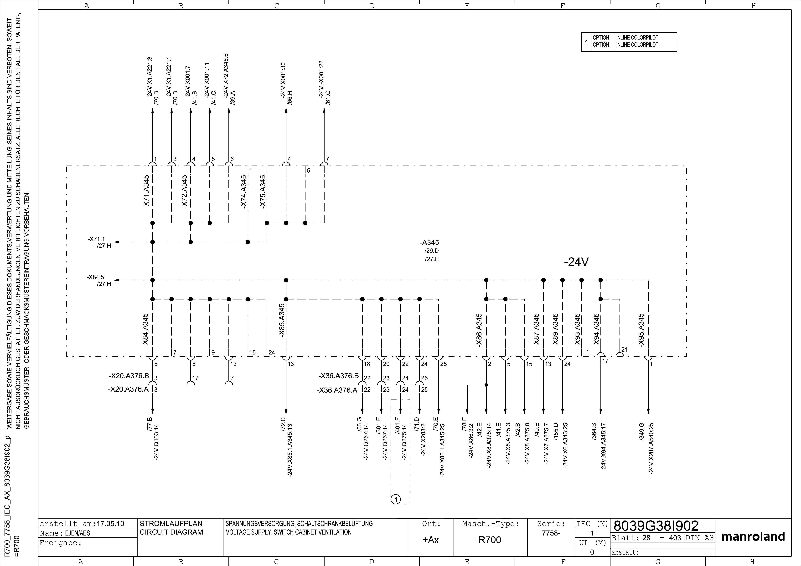

# +Ax — Sheet 28 of 403 — SPANNUNGSVERSORGUNG, SCHALTSCHRANKBELÜFTUNG

**VOLTAGE SUPPLY, SWITCH CABINET VENTILATION**

> Part of the manroland **R700** printing press IEC/UL circuit diagrams.
> Drawing class: **Stromlaufplan / Circuit diagram** (DIN A3).
> Document `+Ax` covers the **Central control console** machine section.

## At a glance

| Field | Value |
|---|---|
| Document | `+Ax`  (8039G38I902) |
| Sheet | **28** of 403 |
| Section (DE) | SPANNUNGSVERSORGUNG, SCHALTSCHRANKBELÜFTUNG |
| Section (EN) | VOLTAGE SUPPLY, SWITCH CABINET VENTILATION |
| Section type | POWER_SUPPLY — Voltage supply |
| Machine type | `R700` |
| Series | `7758` |
| Created | 17.05.10 |
| Replaces | — |
| Columns used | A, B, C, D, E, F, G |
| Path numbers | — |
| Labels on sheet | 117 |
| Cross-refs out | 26 |
| Cross-refs in | 70 |

**Previous:** [+Ax sheet 27](SHEET_0027.md) · **Next:** [+Ax sheet 29](SHEET_0029.md) · **Document TOC:** [_TOC.md](_TOC.md)  (+Ax) · **Master TOC:** [all sheets](../_MASTER_TOC.md)

## Sheet image (300 DPI, exact vector render)



_Rendered directly from the PDF vector layer at 300 DPI (1-bit), no OCR and no resampling. Use it to confirm anything ambiguous in the text below._

## Cross-references on this sheet

Each entry is a wire leaving this sheet. The printed token is `/sheet.column`; the link resolves to that sheet inside the same document.

| Ref | Target sheet | Col | Path | Destination on target | Target section | From col |
|---|---|---|---|---|---|---|
| `/39.A` | [+Ax sheet 39](SHEET_0039.md) | A | — | 24V.X72.A345:6 | HAUPTANTRIEB | C |
| `/70.B` | [+Ax sheet 70](SHEET_0070.md) | B | — | 24V.X1.A221:3 | WASCHVORRICHTUNGEN DRUCKWERKE | B |
| `/70.B` | [+Ax sheet 70](SHEET_0070.md) | B | — | 24V.X1.A221:1 | WASCHVORRICHTUNGEN DRUCKWERKE | B |
| `/61.G` | [+Ax sheet 61](SHEET_0061.md) | G | — | 24V. X001:23 | DRUCKLUFTANLAGE | D |
| `/41.C` | [+Ax sheet 41](SHEET_0041.md) | C | — | 24V.X001:11 | HAUPTANTRIEB | B |
| `/66.H` | [+Ax sheet 66](SHEET_0066.md) | H | — | 24V.X001:30 | DRUCKLUFTANLAGE | C |
| `/41.B` | [+Ax sheet 41](SHEET_0041.md) | B | — | 24V.X001:7 | HAUPTANTRIEB | B |
| `/27.H` | [+Ax sheet 27](SHEET_0027.md) | H | — | X71:1 | SPANNUNGSVERSORGUNG, SCHALTSCHRANKBELÜFTUNG | A |
| `/29.D` | [+Ax sheet 29](SHEET_0029.md) | D | — | — | SPANNUNGSVERSORGUNG, SCHALTSCHRANKBELÜFTUNG | E |
| `/27.E` | [+Ax sheet 27](SHEET_0027.md) | E | — | — | SPANNUNGSVERSORGUNG, SCHALTSCHRANKBELÜFTUNG | E |
| `/27.H` | [+Ax sheet 27](SHEET_0027.md) | H | — | X84:5 | SPANNUNGSVERSORGUNG, SCHALTSCHRANKBELÜFTUNG | A |
| `/56.G` | [+Ax sheet 56](SHEET_0056.md) | G | — | — | LUFTVERSORGUNG | D |
| `/381.E` | [+Ax sheet 381](SHEET_0381.md) | E | — | — | OPTION: INLINEFOILER PRINDOR | D |
| `/70.E` | [+Ax sheet 70](SHEET_0070.md) | E | — | — | WASCHVORRICHTUNGEN DRUCKWERKE | E |
| `/78.E` | [+Ax sheet 78](SHEET_0078.md) | E | — | — | ANLEGER | E |
| `/77.B` | [+Ax sheet 77](SHEET_0077.md) | B | — | — | ANLEGER | B |
| `/401.F` | [+Ax sheet 401](SHEET_0401.md) | F | — | — | OPTION: INLINE COLORPILOT | D |
| `/72.C` | [+Ax sheet 72](SHEET_0072.md) | C | — | — | WASCHVORRICHTUNGEN DRUCKWERKE | C |
| `/71.D` | [+Ax sheet 71](SHEET_0071.md) | D | — | — | WASCHVORRICHTUNGEN DRUCKWERKE | D |
| `/42.E` | [+Ax sheet 42](SHEET_0042.md) | E | — | — | HAUPTANTRIEB | E |
| `/41.E` | [+Ax sheet 41](SHEET_0041.md) | E | — | — | HAUPTANTRIEB | E |
| `/40.E` | [+Ax sheet 40](SHEET_0040.md) | E | — | — | HAUPTANTRIEB | F |
| `/349.G` | [+Ax sheet 349](SHEET_0349.md) | G | — | — | OPTION: LOGISTIK ANLEGER | G |
| `/42.B` | [+Ax sheet 42](SHEET_0042.md) | B | — | — | HAUPTANTRIEB | F |
| `/155.D` | [+Ax sheet 155](SHEET_0155.md) | D | — | — | ÜBERWACHUNGSRECHNER/ANSTEUERUNG NOT AUS | F |
| `/364.B` | [+Ax sheet 364](SHEET_0364.md) | B | — | — | OPTION: LOGISTIK AUSLEGER | F |

### Incoming references (sheets that point here)

Every other sheet that sends a wire to this one. `Back-ref` is the token printed on *that* sheet; `Path` is its line number.

| From sheet | Cols | Back-ref | Path | Refs | What continues there |
|---|---|---|---|---|---|
| [+Ax#27](SHEET_0027.md) | D, H | `/27.D`, `/27.H` | — | 3 | — |
| [+Ax#29](SHEET_0029.md) | D | `/29.D` | — | 1 | — |
| [+Ax#39](SHEET_0039.md) | A | `/39.A` | — | 1 | 24V.X72.A345:6 |
| [+Ax#40](SHEET_0040.md) | C | `/40.C` | — | 1 | 24V.X7.A375:7 24V.S010:13 |
| [+Ax#41](SHEET_0041.md) | A, C, D | `/41.A`, `/41.C`, `/41.D` | — | 3 | 24V.X001:11; 24V.X001:7; 24V.X8.A375:3 |
| [+Ax#42](SHEET_0042.md) | A, D | `/42.A`, `/42.D` | — | 2 | 24V.X8.A375:14; 24V.X8.A375:8 |
| [+Ax#56](SHEET_0056.md) | G | `/56.G` | — | 1 | 24V.Q267:14 |
| [+Ax#61](SHEET_0061.md) | F | `/61.F` | — | 1 | 24V. X001:23 |
| [+Ax#66](SHEET_0066.md) | H | `/66.H` | — | 1 | — |
| [+Ax#70](SHEET_0070.md) | A, B, D | `/70.A`, `/70.B`, `/70.D` | — | 3 | — |
| [+Ax#71](SHEET_0071.md) | D | `/71.D` | — | 1 | 24V.X203:2 24V.Q305:14 |
| [+Ax#72](SHEET_0072.md) | C | `/72.C` | — | 1 | 24V.X85.1.A345:13 |
| [+Ax#77](SHEET_0077.md) | A | `/77.A` | — | 1 | 24V.Q103:14 |
| [+Ax#78](SHEET_0078.md) | D | `/78.D` | — | 1 | 24V.X86.3:2 |
| [+Ax#155](SHEET_0155.md) | D | `/155.D` | — | 1 | — |
| [+Ax#260](SHEET_0260.md) | E, F | `/260.E`, `/260.F` | — | 4 | — |
| [+Ax#279](SHEET_0279.md) | A, B | `/279.A`, `/279.B` | — | 8 | — |
| [+Ax#285](SHEET_0285.md) | B, E | `/285.B`, `/285.E` | — | 10 | — |
| [+Ax#287](SHEET_0287.md) | B, C | `/287.B`, `/287.C` | — | 13 | — |
| [+Ax#288](SHEET_0288.md) | A | `/288.A` | — | 3 | — |
| [+Ax#289](SHEET_0289.md) | A, B, G, H | `/289.A`, `/289.B`, `/289.G`, `/289.H` | — | 5 | — |
| [+Ax#290](SHEET_0290.md) | A | `/290.A` | — | 1 | — |
| [+Ax#349](SHEET_0349.md) | G | `/349.G` | — | 1 | 24V.X207.A540:25 |
| [+Ax#364](SHEET_0364.md) | B | `/364.B` | — | 1 | 24V.X94.A345:17 |
| [+Ax#381](SHEET_0381.md) | D | `/381.D` | — | 1 | 24V.Q257:14 |
| [+Ax#401](SHEET_0401.md) | C | `/401.C` | — | 1 | 24V.Q275:14 L1.Q275:1 |


## Devices on this sheet

| Tag | Class | Class meaning (IEC) | Col | Sub | Terminal | Sign |
|---|---|---|---|---|---|---|
| `A345` | A | Baugruppe / assembly, module, PC board | E | — | — | — |
| `X71:1` | X | Klemme / terminal, plug connector | A | — | 1 | — |
| `X84:5` | X | Klemme / terminal, plug connector | A | — | 5 | — |
| `X20.A376.B` | — | cross-device reference | A | — | — | — |
| `X20.A376.A` | — | cross-device reference | A | — | — | — |
| `X84.A345` | — | cross-device reference | B | — | — | — |
| `X71.A345` | — | cross-device reference | B | — | — | — |
| `X72.A345` | — | cross-device reference | B | — | — | — |
| `X85.A345` | — | cross-device reference | C | — | — | — |
| `X36.A376.B` | — | cross-device reference | D | — | — | — |
| `X36.A376.A` | — | cross-device reference | D | — | — | — |
| `X95.A345` | — | cross-device reference | G | — | — | — |
| `X86.A345` | — | cross-device reference | E | — | — | — |
| `X89.A345` | — | cross-device reference | F | — | — | — |
| `X87.A345` | — | cross-device reference | F | — | — | — |
| `X74.A345` | — | cross-device reference | C | — | — | — |
| `X75.A345` | — | cross-device reference | C | — | — | — |
| `X94.A345` | — | cross-device reference | F | — | — | — |
| `X93.A345` | — | cross-device reference | F | — | — | — |

## Potentials / nets

| Potential | Count | Columns | Attached devices | Terminals |
|---|---|---|---|---|
| `24V` | 23 | B, C, D, E, F, G | `1`, `3`, `A221`, `A343`, `A345`, `A375`, `A540`, `Q103`, `Q257`, `Q267`, `Q275`, `X001`, `X1`, `X203`, `X207`, `X6`, `X7`, `X72`, `X8`, `X85`, `X86`, `X94` | `1`, `11`, `13`, `14`, `17`, `2`, `23`, `25`, `3`, `30`, `6`, `7`, `8` |


A potential such as `L24+/4` or `M24+` is a named supply/return rail; every place it appears on this sheet is electrically common.

## Wire-end annotations (grouped as printed)

A wire that continues elsewhere is annotated with a small cluster: the destination description, the path/line number `#NN`, and the `/sheet.column` cross reference. Each row below is one such cluster exactly as it is grouped on the drawing.

| Col | Y | Path | Cross-ref | Text on the wire |
|---|---|---|---|---|
| F | 53.0 | — | — | `1 OPTION OPTION` |
| G | 53.1 | — | — | `INLINE COLORPILOT INLINE COLORPILOT` |
| C | 79.4 | — | `/39.A` | `24V.X72.A345:6` |
| B | 84.2 | — | `/70.B` | `24V.X1.A221:3` |
| B | 84.2 | — | `/70.B` | `24V.X1.A221:1` |
| D | 89.9 | — | `/61.G` | `24V. X001:23` |
| B | 92.7 | — | `/41.C` | `24V.X001:11` |
| C | 92.7 | — | `/66.H` | `24V.X001:30` |
| B | 97.5 | — | `/41.B` | `24V.X001:7` |
| B | 232.8 | — | — | `1` |
| B | 232.8 | — | — | `3 4` |
| C | 232.8 | — | — | `5 6 4` |
| D | 232.8 | — | — | `7` |
| C | 249.8 | — | — | `1` |
| C | 249.8 | — | — | `5` |
| B | 260.2 | — | — | `X71.A345` |
| B | 260.2 | — | — | `X72.A345` |
| C | 260.2 | — | — | `X74.A345` |
| C | 260.2 | — | — | `X75.A345` |
| A | 351.8 | — | `/27.H` | `X71:1` |
| E | 356.1 | — | — | `A345` |
| E | 369.1 | — | `/29.D` | — |
| E | 381.5 | — | `/27.E` | — |
| F | 381.9 | — | — | `24V` |
| A | 408.5 | — | `/27.H` | `X84:5` |
| C | 451.6 | — | — | `X85.A345` |
| B | 466.0 | — | — | `X84.A345` |
| E | 466.0 | — | — | `X86.A345` |
| F | 466.0 | — | — | `X87.A345` |
| F | 466.0 | — | — | `X89.A345` |
| F | 466.0 | — | — | `X93.A345` |
| F | 466.0 | — | — | `X94.A345` |
| G | 466.0 | — | — | `X95.A345` |
| G | 516.2 | — | — | `21` |
| F | 519.0 | — | — | `1` |
| B | 520.5 | — | — | `7 9 15 24` |
| F | 533.2 | — | — | `17` |
| B | 537.5 | — | — | `5` |
| B | 537.5 | — | — | `8` |
| C | 537.5 | — | — | `13` |
| C | 537.5 | — | — | `13` |
| D | 537.5 | — | — | `18 20 22 24 25` |
| E | 537.5 | — | — | `2` |
| F | 537.5 | — | — | `5 15 24` |
| F | 537.5 | — | — | `13` |
| G | 537.5 | — | — | `1` |
| A | 554.5 | — | — | `X20.A376.B 3` |
| D | 554.5 | — | — | `X36.A376.B 22` |
| B | 558.8 | — | — | `17` |
| C | 558.8 | — | — | `7` |
| D | 558.8 | — | — | `23 24 25` |
| A | 574.3 | — | — | `X20.A376.A 3` |
| D | 575.8 | — | — | `X36.A376.A 22` |
| D | 575.8 | — | — | `23` |
| D | 575.8 | — | — | `24` |
| E | 575.8 | — | — | `25` |
| D | 620.2 | — | `/56.G` | — |
| D | 620.2 | — | `/381.E` | — |
| E | 620.2 | — | `/70.E` | — |
| E | 620.2 | — | `/78.E` | — |
| B | 620.5 | — | `/77.B` | — |
| C | 620.5 | — | `/72.C` | — |
| D | 620.5 | — | `/401.F` | — |
| D | 620.5 | — | `/71.D` | — |
| E | 628.7 | — | `/42.E` | — |
| E | 628.7 | — | `/41.E` | — |
| F | 628.7 | — | `/40.E` | — |
| G | 628.7 | — | `/349.G` | — |
| E | 629.0 | — | — | `24V.X8.A375:14` |
| E | 629.0 | — | — | `24V.X8.A375:3` |
| F | 629.0 | — | `/42.B` | — |
| F | 629.0 | — | — | `24V.X8.A375:8` |
| F | 629.0 | — | — | `24V.X7.A375:7` |
| F | 629.0 | — | `/155.D` | — |
| F | 629.0 | — | — | `24V.X6.A343:25` |
| F | 629.0 | — | `/364.B` | — |
| F | 629.0 | — | — | `24V.X94.A345:17` |
| G | 629.0 | — | — | `24V.X207.A540:25` |
| E | 630.1 | — | — | `24V.X203:2` |
| E | 630.1 | — | — | `24V.X86.3:2` |
| B | 630.4 | — | — | `24V.Q103:14` |
| C | 630.4 | — | — | `24V.X85.1.A345:13` |
| D | 630.4 | — | — | `24V.Q267:14` |
| D | 630.4 | — | — | `24V.Q257:14` |
| D | 630.4 | — | — | `24V.Q275:14` |
| E | 630.4 | — | — | `24V.X85.1.A345:25` |
| D | 739.6 | — | — | `1` |


## Notes and free text on this sheet

| Text | Col | Y (pt) |
|---|---|---|
| `OPTION` | F | 53.04 |
| `INLINE COLORPILOT` | G | 53.07 |

## Complete label inventory (exact text from the drawing)

Every text object inside the drawing area of this sheet, in DIN reading order (column A→H, then top→bottom). This is the authoritative list: if a string is not here it is not printed on this sheet.

| Col | Y | X | Dir | Type | Text |
|---|---|---|---|---|---|
| A | 351.8 | 130.4 | → | device tag | `X71:1` |
| A | 361.7 | 144.3 | → | cross-reference | `/27.H` |
| A | 408.5 | 129.0 | → | device tag | `X84:5` |
| A | 418.4 | 144.3 | → | cross-reference | `/27.H` |
| A | 554.5 | 161.6 | → | device ref | `X20.A376.B` |
| A | 574.3 | 160.7 | → | device ref | `X20.A376.A` |
| B | 79.4 | 331.9 | ↕ | potential | `24V.X72.A345:6` |
| B | 84.2 | 218.5 | ↕ | potential | `24V.X1.A221:3` |
| B | 84.2 | 246.9 | ↕ | potential | `24V.X1.A221:1` |
| B | 92.7 | 303.6 | ↕ | potential | `24V.X001:11` |
| B | 97.5 | 275.2 | ↕ | potential | `24V.X001:7` |
| B | 134.9 | 313.5 | ↕ | cross-reference | `/41.C` |
| B | 135.2 | 228.4 | ↕ | cross-reference | `/70.B` |
| B | 135.2 | 256.8 | ↕ | cross-reference | `/70.B` |
| B | 135.2 | 285.1 | ↕ | cross-reference | `/41.B` |
| B | 232.8 | 228.8 | → | number | `1` |
| B | 232.8 | 257.7 | → | number | `3` |
| B | 232.8 | 286.0 | → | number | `4` |
| B | 232.8 | 314.4 | → | number | `5` |
| B | 260.2 | 212.9 | ↕ | device ref | `X71.A345` |
| B | 260.2 | 269.6 | ↕ | device ref | `X72.A345` |
| B | 466.0 | 211.5 | ↕ | device ref | `X84.A345` |
| B | 520.5 | 257.7 | → | number | `7` |
| B | 520.5 | 314.4 | → | number | `9` |
| B | 537.5 | 229.3 | → | number | `5` |
| B | 537.5 | 286.0 | → | number | `8` |
| B | 558.7 | 229.3 | → | number | `3` |
| B | 558.7 | 285.4 | → | number | `17` |
| B | 575.8 | 229.3 | → | number | `3` |
| B | 620.5 | 218.5 | ↕ | cross-reference | `/77.B` |
| B | 630.4 | 228.5 | ↕ | potential | `24V.Q103:14` |
| C | 89.9 | 473.7 | ↕ | potential | `24V. X001:23` |
| C | 92.7 | 417.0 | ↕ | potential | `24V.X001:30` |
| C | 134.9 | 426.9 | ↕ | cross-reference | `/66.H` |
| C | 135.2 | 341.8 | ↕ | cross-reference | `/39.A` |
| C | 232.8 | 342.7 | → | number | `6` |
| C | 232.8 | 427.7 | → | number | `4` |
| C | 249.8 | 370.5 | → | number | `1` |
| C | 249.8 | 456.1 | → | number | `5` |
| C | 260.2 | 357.5 | ↕ | device ref | `X74.A345` |
| C | 260.2 | 385.8 | ↕ | device ref | `X75.A345` |
| C | 451.6 | 414.2 | ↕ | device ref | `X85.A345` |
| C | 520.5 | 370.5 | → | number | `15` |
| C | 520.5 | 399.4 | → | number | `24` |
| C | 537.5 | 342.1 | → | number | `13` |
| C | 537.5 | 427.2 | → | number | `13` |
| C | 558.7 | 342.7 | → | number | `7` |
| C | 620.5 | 417.0 | ↕ | cross-reference | `/72.C` |
| C | 630.4 | 426.9 | ↕ | potential | `24V.X85.1.A345:13` |
| D | 134.4 | 483.6 | ↕ | cross-reference | `/61.G` |
| D | 232.8 | 484.4 | → | number | `7` |
| D | 537.5 | 540.6 | → | number | `18` |
| D | 537.5 | 569.5 | → | number | `20` |
| D | 537.5 | 597.8 | → | number | `22` |
| D | 554.5 | 473.4 | → | device ref | `X36.A376.B` |
| D | 558.7 | 541.1 | → | number | `22` |
| D | 558.7 | 569.5 | → | number | `23` |
| D | 558.7 | 597.8 | → | number | `24` |
| D | 575.7 | 471.1 | → | device ref | `X36.A376.A` |
| D | 575.8 | 541.1 | → | number | `22` |
| D | 575.8 | 569.5 | → | number | `23` |
| D | 575.8 | 597.8 | → | number | `24` |
| D | 620.2 | 530.3 | ↕ | cross-reference | `/56.G` |
| D | 620.2 | 558.7 | ↕ | cross-reference | `/381.E` |
| D | 620.5 | 587.0 | ↕ | cross-reference | `/401.F` |
| D | 620.5 | 615.4 | ↕ | cross-reference | `/71.D` |
| D | 630.4 | 540.3 | ↕ | potential | `24V.Q267:14` |
| D | 630.4 | 568.6 | ↕ | potential | `24V.Q257:14` |
| D | 630.4 | 597.0 | ↕ | potential | `24V.Q275:14` |
| D | 739.6 | 586.4 | → | number | `1` |
| E | 356.1 | 624.2 | → | device tag | `A345` |
| E | 369.1 | 631.3 | → | cross-reference | `/29.D` |
| E | 381.5 | 631.8 | → | cross-reference | `/27.E` |
| E | 466.0 | 707.5 | ↕ | device ref | `X86.A345` |
| E | 537.5 | 626.2 | → | number | `24` |
| E | 537.5 | 654.5 | → | number | `25` |
| E | 537.5 | 725.4 | → | number | `2` |
| E | 537.5 | 753.7 | → | number | `5` |
| E | 558.7 | 626.2 | → | number | `25` |
| E | 575.8 | 626.2 | → | number | `25` |
| E | 620.2 | 643.7 | ↕ | cross-reference | `/70.E` |
| E | 620.2 | 686.2 | ↕ | cross-reference | `/78.E` |
| E | 628.7 | 708.9 | ↕ | cross-reference | `/42.E` |
| E | 628.7 | 737.3 | ↕ | cross-reference | `/41.E` |
| E | 629.0 | 723.1 | ↕ | potential | `24V.X8.A375:14` |
| E | 629.0 | 751.5 | ↕ | potential | `24V.X8.A375:3` |
| E | 630.1 | 625.3 | ↕ | potential | `24V.X203:2` |
| E | 630.1 | 696.2 | ↕ | potential | `24V.X86.3:2` |
| E | 630.4 | 653.7 | ↕ | potential | `24V.X85.1.A345:25` |
| F | 53.0 | 881.3 | → | text | `OPTION` |
| F | 58.4 | 869.1 | → | number | `1` |
| F | 63.7 | 881.3 | → | text | `OPTION` |
| F | 381.9 | 838.6 | → | potential | `24V` |
| F | 466.0 | 792.6 | ↕ | device ref | `X87.A345` |
| F | 466.0 | 820.9 | ↕ | device ref | `X89.A345` |
| F | 466.0 | 853.5 | ↕ | device ref | `X93.A345` |
| F | 466.0 | 881.9 | ↕ | device ref | `X94.A345` |
| F | 519.0 | 870.5 | → | number | `1` |
| F | 533.2 | 894.9 | → | number | `17` |
| F | 537.5 | 781.5 | → | number | `15` |
| F | 537.5 | 809.9 | → | number | `13` |
| F | 537.5 | 838.8 | → | number | `24` |
| F | 628.7 | 793.9 | ↕ | cross-reference | `/40.E` |
| F | 629.0 | 765.6 | ↕ | cross-reference | `/42.B` |
| F | 629.0 | 779.8 | ↕ | potential | `24V.X8.A375:8` |
| F | 629.0 | 808.1 | ↕ | potential | `24V.X7.A375:7` |
| F | 629.0 | 822.3 | ↕ | cross-reference | `/155.D` |
| F | 629.0 | 836.5 | ↕ | potential | `24V.X6.A343:25` |
| F | 629.0 | 879.0 | ↕ | cross-reference | `/364.B` |
| F | 629.0 | 893.2 | ↕ | potential | `24V.X94.A345:17` |
| G | 53.1 | 916.2 | → | text | `INLINE COLORPILOT` |
| G | 63.7 | 916.2 | → | text | `INLINE COLORPILOT` |
| G | 466.0 | 948.5 | ↕ | device ref | `X95.A345` |
| G | 516.2 | 923.8 | → | number | `21` |
| G | 537.5 | 965.8 | → | number | `1` |
| G | 628.7 | 949.9 | ↕ | cross-reference | `/349.G` |
| G | 629.0 | 964.1 | ↕ | potential | `24V.X207.A540:25` |

## Reading-order text block

The same content as a plain block, grouped by DIN column — convenient to paste or to match against a visual description.

```text
=== Column A ===
 351.8  130.4  devtag       X71:1
 361.7  144.3  xref         /27.H
 408.5  129.0  devtag       X84:5
 418.4  144.3  xref         /27.H
 554.5  161.6  devref       X20.A376.B
 574.3  160.7  devref       X20.A376.A
=== Column B ===
  79.4  331.9  net          24V.X72.A345:6
  84.2  218.5  net          24V.X1.A221:3
  84.2  246.9  net          24V.X1.A221:1
  92.7  303.6  net          24V.X001:11
  97.5  275.2  net          24V.X001:7
 134.9  313.5  xref         /41.C
 135.2  228.4  xref         /70.B
 135.2  256.8  xref         /70.B
 135.2  285.1  xref         /41.B
 232.8  228.8  numeric      1
 232.8  257.7  numeric      3
 232.8  286.0  numeric      4
 232.8  314.4  numeric      5
 260.2  212.9  devref       X71.A345
 260.2  269.6  devref       X72.A345
 466.0  211.5  devref       X84.A345
 520.5  257.7  numeric      7
 520.5  314.4  numeric      9
 537.5  229.3  numeric      5
 537.5  286.0  numeric      8
 558.7  229.3  numeric      3
 558.7  285.4  numeric      17
 575.8  229.3  numeric      3
 620.5  218.5  xref         /77.B
 630.4  228.5  net          24V.Q103:14
=== Column C ===
  89.9  473.7  net          24V. X001:23
  92.7  417.0  net          24V.X001:30
 134.9  426.9  xref         /66.H
 135.2  341.8  xref         /39.A
 232.8  342.7  numeric      6
 232.8  427.7  numeric      4
 249.8  370.5  numeric      1
 249.8  456.1  numeric      5
 260.2  357.5  devref       X74.A345
 260.2  385.8  devref       X75.A345
 451.6  414.2  devref       X85.A345
 520.5  370.5  numeric      15
 520.5  399.4  numeric      24
 537.5  342.1  numeric      13
 537.5  427.2  numeric      13
 558.7  342.7  numeric      7
 620.5  417.0  xref         /72.C
 630.4  426.9  net          24V.X85.1.A345:13
=== Column D ===
 134.4  483.6  xref         /61.G
 232.8  484.4  numeric      7
 537.5  540.6  numeric      18
 537.5  569.5  numeric      20
 537.5  597.8  numeric      22
 554.5  473.4  devref       X36.A376.B
 558.7  541.1  numeric      22
 558.7  569.5  numeric      23
 558.7  597.8  numeric      24
 575.7  471.1  devref       X36.A376.A
 575.8  541.1  numeric      22
 575.8  569.5  numeric      23
 575.8  597.8  numeric      24
 620.2  530.3  xref         /56.G
 620.2  558.7  xref         /381.E
 620.5  587.0  xref         /401.F
 620.5  615.4  xref         /71.D
 630.4  540.3  net          24V.Q267:14
 630.4  568.6  net          24V.Q257:14
 630.4  597.0  net          24V.Q275:14
 739.6  586.4  numeric      1
=== Column E ===
 356.1  624.2  devtag       A345
 369.1  631.3  xref         /29.D
 381.5  631.8  xref         /27.E
 466.0  707.5  devref       X86.A345
 537.5  626.2  numeric      24
 537.5  654.5  numeric      25
 537.5  725.4  numeric      2
 537.5  753.7  numeric      5
 558.7  626.2  numeric      25
 575.8  626.2  numeric      25
 620.2  643.7  xref         /70.E
 620.2  686.2  xref         /78.E
 628.7  708.9  xref         /42.E
 628.7  737.3  xref         /41.E
 629.0  723.1  net          24V.X8.A375:14
 629.0  751.5  net          24V.X8.A375:3
 630.1  625.3  net          24V.X203:2
 630.1  696.2  net          24V.X86.3:2
 630.4  653.7  net          24V.X85.1.A345:25
=== Column F ===
  53.0  881.3  text         OPTION
  58.4  869.1  numeric      1
  63.7  881.3  text         OPTION
 381.9  838.6  net          24V
 466.0  792.6  devref       X87.A345
 466.0  820.9  devref       X89.A345
 466.0  853.5  devref       X93.A345
 466.0  881.9  devref       X94.A345
 519.0  870.5  numeric      1
 533.2  894.9  numeric      17
 537.5  781.5  numeric      15
 537.5  809.9  numeric      13
 537.5  838.8  numeric      24
 628.7  793.9  xref         /40.E
 629.0  765.6  xref         /42.B
 629.0  779.8  net          24V.X8.A375:8
 629.0  808.1  net          24V.X7.A375:7
 629.0  822.3  xref         /155.D
 629.0  836.5  net          24V.X6.A343:25
 629.0  879.0  xref         /364.B
 629.0  893.2  net          24V.X94.A345:17
=== Column G ===
  53.1  916.2  text         INLINE COLORPILOT
  63.7  916.2  text         INLINE COLORPILOT
 466.0  948.5  devref       X95.A345
 516.2  923.8  numeric      21
 537.5  965.8  numeric      1
 628.7  949.9  xref         /349.G
 629.0  964.1  net          24V.X207.A540:25
```

---
_Generated from the PDF vector text layer; no OCR. Source: `R700_7758_IEC_AX_8039G38I902_p`, sheet 28._
