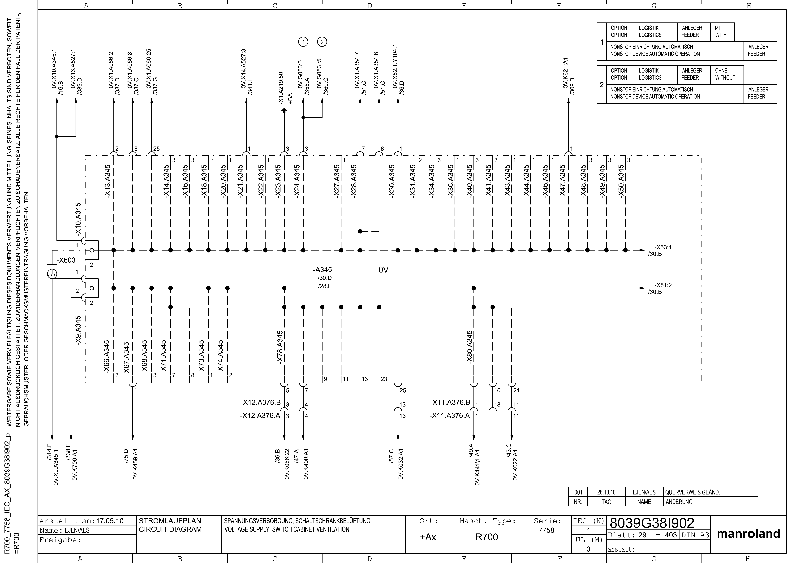

# +Ax — Sheet 29 of 403 — SPANNUNGSVERSORGUNG, SCHALTSCHRANKBELÜFTUNG

**VOLTAGE SUPPLY, SWITCH CABINET VENTILATION**

> Part of the manroland **R700** printing press IEC/UL circuit diagrams.
> Drawing class: **Stromlaufplan / Circuit diagram** (DIN A3).
> Document `+Ax` covers the **Central control console** machine section.

## At a glance

| Field | Value |
|---|---|
| Document | `+Ax`  (8039G38I902) |
| Sheet | **29** of 403 |
| Section (DE) | SPANNUNGSVERSORGUNG, SCHALTSCHRANKBELÜFTUNG |
| Section (EN) | VOLTAGE SUPPLY, SWITCH CABINET VENTILATION |
| Section type | POWER_SUPPLY — Voltage supply |
| Machine type | `R700` |
| Series | `7758` |
| Created | 17.05.10 |
| Replaces | — |
| Columns used | A, B, C, D, E, F, G, H |
| Path numbers | — |
| Labels on sheet | 185 |
| Cross-refs out | 24 |
| Cross-refs in | 80 |

**Previous:** [+Ax sheet 28](SHEET_0028.md) · **Next:** [+Ax sheet 30](SHEET_0030.md) · **Document TOC:** [_TOC.md](_TOC.md)  (+Ax) · **Master TOC:** [all sheets](../_MASTER_TOC.md)

## Sheet image (300 DPI, exact vector render)



_Rendered directly from the PDF vector layer at 300 DPI (1-bit), no OCR and no resampling. Use it to confirm anything ambiguous in the text below._

## Cross-references on this sheet

Each entry is a wire leaving this sheet. The printed token is `/sheet.column`; the link resolves to that sheet inside the same document.

| Ref | Target sheet | Col | Path | Destination on target | Target section | From col |
|---|---|---|---|---|---|---|
| `/36.D` | [+Ax sheet 36](SHEET_0036.md) | D | — | 0V.X52.1.Y104:1 | SCHMIERUNG | D |
| `/16.B` | [+Ax sheet 16](SHEET_0016.md) | B | — | 0V.X10.A345:1 0V.X9.A345:1 | SPANNUNGSVERSORGUNG, SCHALTSCHRANKBELÜFTUNG | A |
| `/339.D` | [+Ax sheet 339](SHEET_0339.md) | D | — | 0V.X13.A527:1 | OPTION: INLINESHEETER RS104 S | A |
| `/337.G` | [+Ax sheet 337](SHEET_0337.md) | G | — | 0V.X1.A066:25 | OPTION: INLINESHEETER RS104 S | B |
| `/341.F` | [+Ax sheet 341](SHEET_0341.md) | F | — | 0V.X14.A527:3 | OPTION: INLINESHEETER RS104 S | C |
| `/337.D` | [+Ax sheet 337](SHEET_0337.md) | D | — | 0V.X1.A066:2 | OPTION: INLINESHEETER RS104 S | A |
| `/337.C` | [+Ax sheet 337](SHEET_0337.md) | C | — | 0V.X1.A066:8 | OPTION: INLINESHEETER RS104 S | B |
| `/51.C` | [+Ax sheet 51](SHEET_0051.md) | C | — | 0V.X1.A354:7 | SIGNALGEBER: AKUSTISCHE WARNSIGNALE | D |
| `/51.C` | [+Ax sheet 51](SHEET_0051.md) | C | — | 0V.X1.A354:8 | SIGNALGEBER: AKUSTISCHE WARNSIGNALE | D |
| `/309.B` | [+Ax sheet 309](SHEET_0309.md) | B | — | 0V.K621:A1 | OPTION: FARBWERKTEMPERIERUNG | F |
| `/360.C` | [+Ax sheet 360](SHEET_0360.md) | C | — | 0V.G053.:5 | OPTION: LOGISTIK ANLEGER | D |
| `/356.A` | [+Ax sheet 356](SHEET_0356.md) | A | — | 0V.G053:5 | OPTION: LOGISTIK ANLEGER | C |
| `/30.B` | [+Ax sheet 30](SHEET_0030.md) | B | — | — | SPANNUNGSVERSORGUNG, SCHALTSCHRANKBELÜFTUNG | G |
| `/30.D` | [+Ax sheet 30](SHEET_0030.md) | D | — | — | SPANNUNGSVERSORGUNG, SCHALTSCHRANKBELÜFTUNG | D |
| `/28.E` | [+Ax sheet 28](SHEET_0028.md) | E | — | — | SPANNUNGSVERSORGUNG, SCHALTSCHRANKBELÜFTUNG | D |
| `/30.B` | [+Ax sheet 30](SHEET_0030.md) | B | — | — | SPANNUNGSVERSORGUNG, SCHALTSCHRANKBELÜFTUNG | G |
| `/338.E` | [+Ax sheet 338](SHEET_0338.md) | E | — | — | OPTION: INLINESHEETER RS104 S | A |
| `/314.F` | [+Ax sheet 314](SHEET_0314.md) | F | — | — | OPTION: ZENTRALE LUFTVERSORGUNG | A |
| `/43.C` | [+Ax sheet 43](SHEET_0043.md) | C | — | — | HAUPTANTRIEB | E |
| `/49.A` | [+Ax sheet 49](SHEET_0049.md) | A | — | — | NOT AUS | E |
| `/75.D` | [+Ax sheet 75](SHEET_0075.md) | D | — | — | FEUCHTMITTELKÜHLGERÄT | A |
| `/36.B` | [+Ax sheet 36](SHEET_0036.md) | B | — | — | SCHMIERUNG | C |
| `/57.C` | [+Ax sheet 57](SHEET_0057.md) | C | — | — | LUFTVERSORGUNG | D |
| `/47.A` | [+Ax sheet 47](SHEET_0047.md) | A | — | — | NOT AUS | C |

### Incoming references (sheets that point here)

Every other sheet that sends a wire to this one. `Back-ref` is the token printed on *that* sheet; `Path` is its line number.

| From sheet | Cols | Back-ref | Path | Refs | What continues there |
|---|---|---|---|---|---|
| [+Ax#16](SHEET_0016.md) | B | `/16.B` | — | 1 | — |
| [+Ax#28](SHEET_0028.md) | E | `/28.E` | — | 1 | — |
| [+Ax#30](SHEET_0030.md) | A, D | `/30.A`, `/30.D` | — | 3 | X53:1; X81:2 |
| [+Ax#36](SHEET_0036.md) | C | `/36.C` | — | 2 | 0V.X52.1.Y104:1 0V.K066:22 |
| [+Ax#43](SHEET_0043.md) | B | `/43.B` | — | 1 | 0V.K252:A1 0V.K022:A1 |
| [+Ax#47](SHEET_0047.md) | A | `/47.A` | — | 1 | 0V.K400:A1 |
| [+Ax#49](SHEET_0049.md) | A | `/49.A` | — | 1 | 0V.K441\1:A1 |
| [+Ax#51](SHEET_0051.md) | C | `/51.C` | — | 2 | — |
| [+Ax#57](SHEET_0057.md) | C | `/57.C` | — | 1 | 0V.K032:A1 |
| [+Ax#75](SHEET_0075.md) | D | `/75.D` | — | 1 | 0V.K459:A1 |
| [+Ax#247](SHEET_0247.md) | C, E | `/247.C`, `/247.E` | — | 6 | — |
| [+Ax#248](SHEET_0248.md) | G, H | `/248.G`, `/248.H` | — | 6 | — |
| [+Ax#249](SHEET_0249.md) | G, H | `/249.G`, `/249.H` | — | 3 | — |
| [+Ax#251](SHEET_0251.md) | B | `/251.B` | — | 1 | — |
| [+Ax#254](SHEET_0254.md) | B | `/254.B` | — | 1 | — |
| [+Ax#256](SHEET_0256.md) | D | `/256.D` | — | 1 | STROMPFAD PIN 1 2 |
| [+Ax#260](SHEET_0260.md) | B | `/260.B` | — | 1 | — |
| [+Ax#261](SHEET_0261.md) | B | `/261.B` | — | 1 | — |
| [+Ax#262](SHEET_0262.md) | F | `/262.F` | — | 1 | — |
| [+Ax#264](SHEET_0264.md) | F | `/264.F` | — | 1 | — |
| [+Ax#266](SHEET_0266.md) | A | `/266.A` | — | 1 | — |
| [+Ax#270](SHEET_0270.md) | B | `/270.B` | — | 1 | — |
| [+Ax#272](SHEET_0272.md) | A | `/272.A` | — | 2 | — |
| [+Ax#274](SHEET_0274.md) | G | `/274.G` | — | 1 | — |
| [+Ax#275](SHEET_0275.md) | B | `/275.B` | — | 1 | — |
| [+Ax#278](SHEET_0278.md) | B | `/278.B` | — | 1 | — |
| [+Ax#279](SHEET_0279.md) | C | `/279.C` | — | 1 | — |
| [+Ax#280](SHEET_0280.md) | D, E | `/280.D`, `/280.E` | — | 2 | — |
| [+Ax#281](SHEET_0281.md) | E, H | `/281.E`, `/281.H` | — | 2 | — |
| [+Ax#283](SHEET_0283.md) | C, E, F | `/283.C`, `/283.E`, `/283.F` | — | 5 | — |
| [+Ax#284](SHEET_0284.md) | H | `/284.H` | — | 2 | — |
| [+Ax#285](SHEET_0285.md) | A, B, C, E | `/285.A`, `/285.B`, `/285.C`, `/285.E` | — | 5 | — |
| [+Ax#286](SHEET_0286.md) | A, C | `/286.A`, `/286.C` | — | 10 | — |
| [+Ax#309](SHEET_0309.md) | B | `/309.B` | — | 1 | 0V.K621:A1 |
| [+Ax#314](SHEET_0314.md) | F | `/314.F` | — | 1 | 0V.X9.A345:1 |
| [+Ax#337](SHEET_0337.md) | C, D, F | `/337.C`, `/337.D`, `/337.F` | — | 3 | — |
| [+Ax#338](SHEET_0338.md) | E | `/338.E` | — | 1 | 0V.K700:A1 |
| [+Ax#339](SHEET_0339.md) | C | `/339.C` | — | 1 | 0V.X13.A527:1 |
| [+Ax#341](SHEET_0341.md) | F | `/341.F` | — | 1 | — |
| [+Ax#356](SHEET_0356.md) | B | `/356.B` | — | 1 | 0V.G053:5 24V.G053:6 G053A:5 |
| [+Ax#360](SHEET_0360.md) | C | `/360.C` | — | 1 | 0V.G053.:5 |


## Devices on this sheet

| Tag | Class | Class meaning (IEC) | Col | Sub | Terminal | Sign |
|---|---|---|---|---|---|---|
| `A345` | A | Baugruppe / assembly, module, PC board | D | — | — | — |
| `X53:1` | X | Klemme / terminal, plug connector | G | — | 1 | — |
| `X81:2` | X | Klemme / terminal, plug connector | G | — | 2 | — |
| `X603` | X | Klemme / terminal, plug connector | A | — | — | — |
| `X67.A345` | — | cross-device reference | A | — | — | — |
| `X21.A345` | — | cross-device reference | C | — | — | — |
| `X10.A345` | — | cross-device reference | A | — | — | — |
| `X13.A345` | — | cross-device reference | A | — | — | — |
| `X24.A345` | — | cross-device reference | C | — | — | — |
| `X23.A345` | — | cross-device reference | C | — | — | — |
| `X12.A376.B` | — | cross-device reference | C | — | — | — |
| `X12.A376.A` | — | cross-device reference | C | — | — | — |
| `X78.A345` | — | cross-device reference | C | — | — | — |
| `X11.A376.B` | — | cross-device reference | E | — | — | — |
| `X11.A376.A` | — | cross-device reference | E | — | — | — |
| `X80.A345` | — | cross-device reference | E | — | — | — |
| `X1.A219:50` | — | cross-device reference | C | — | 50 | — |
| `X28.A345` | — | cross-device reference | D | — | — | — |
| `X30.A345` | — | cross-device reference | D | — | — | — |
| `X47.A345` | — | cross-device reference | F | — | — | — |
| `X9.A345` | — | cross-device reference | A | — | — | — |
| `NR.` | — | cross-device reference | F | — | — | — |
| `28.10.10` | — | cross-device reference | F | — | — | — |
| `X66.A345` | — | cross-device reference | A | — | — | — |
| `X71.A345` | — | cross-device reference | B | — | — | — |
| `X74.A345` | — | cross-device reference | B | — | — | — |
| `X73.A345` | — | cross-device reference | B | — | — | — |
| `X16.A345` | — | cross-device reference | B | — | — | — |
| `X14.A345` | — | cross-device reference | B | — | — | — |
| `X20.A345` | — | cross-device reference | B | — | — | — |
| `X22.A345` | — | cross-device reference | C | — | — | — |
| `X18.A345` | — | cross-device reference | B | — | — | — |
| `X68.A345` | — | cross-device reference | B | — | — | — |
| `X27.A345` | — | cross-device reference | D | — | — | — |
| `X34.A345` | — | cross-device reference | E | — | — | — |
| `X36.A345` | — | cross-device reference | E | — | — | — |
| `X41.A345` | — | cross-device reference | E | — | — | — |
| `X43.A345` | — | cross-device reference | E | — | — | — |
| `X40.A345` | — | cross-device reference | E | — | — | — |
| `X31.A345` | — | cross-device reference | D | — | — | — |
| `X44.A345` | — | cross-device reference | F | — | — | — |
| `X48.A345` | — | cross-device reference | F | — | — | — |
| `X49.A345` | — | cross-device reference | F | — | — | — |
| `X50.A345` | — | cross-device reference | G | — | — | — |
| `X46.A345` | — | cross-device reference | F | — | — | — |

## Potentials / nets

| Potential | Count | Columns | Attached devices | Terminals |
|---|---|---|---|---|
| `0V` | 20 | A, B, C, D, E, F | `1`, `A066`, `A345`, `A354`, `A527`, `G053`, `K022`, `K032`, `K066`, `K400`, `K441\1`, `K459`, `K621`, `K700`, `X1`, `X10`, `X13`, `X14`, `X52`, `X9`, `Y104` | `1`, `2`, `22`, `25`, `3`, `5`, `7`, `8`, `A1` |


A potential such as `L24+/4` or `M24+` is a named supply/return rail; every place it appears on this sheet is electrically common.

## Wire-end annotations (grouped as printed)

A wire that continues elsewhere is annotated with a small cluster: the destination description, the path/line number `#NN`, and the `/sheet.column` cross reference. Each row below is one such cluster exactly as it is grouped on the drawing.

| Col | Y | Path | Cross-ref | Text on the wire |
|---|---|---|---|---|
| G | 38.9 | — | — | `OPTION OPTION` |
| G | 38.9 | — | — | `LOGISTIK LOGISTICS` |
| G | 38.9 | — | — | `FEEDER ANLEGER` |
| H | 38.9 | — | — | `MIT` |
| H | 49.4 | — | — | `WITH` |
| F | 58.4 | — | — | `1` |
| C | 59.3 | — | — | `1` |
| C | 59.8 | — | — | `2` |
| D | 65.5 | — | `/36.D` | `0V.X52.1.Y104:1` |
| G | 67.2 | — | — | `NONSTOP EINRICHTUNG AUTOMATISCH NONSTOP DEVICE AUTOMATIC OPERATION` |
| H | 67.2 | — | — | `FEEDER ANLEGER` |
| A | 72.8 | — | `/16.B` | `0V.X10.A345:1 0V.X9.A345:1` |
| A | 72.8 | — | `/339.D` | `0V.X13.A527:1` |
| B | 72.8 | — | `/337.G` | `0V.X1.A066:25` |
| C | 72.8 | — | `/341.F` | `0V.X14.A527:3` |
| A | 77.7 | — | `/337.D` | `0V.X1.A066:2` |
| B | 77.7 | — | `/337.C` | `0V.X1.A066:8` |
| D | 77.7 | — | `/51.C` | `0V.X1.A354:7` |
| D | 77.7 | — | `/51.C` | `0V.X1.A354:8` |
| F | 85.0 | — | `/309.B` | `0V.K621:A1` |
| D | 87.6 | — | `/360.C` | `0V.G053.:5` |
| C | 90.1 | — | `/356.A` | `0V.G053:5` |
| G | 102.6 | — | — | `OPTION OPTION` |
| G | 102.6 | — | — | `LOGISTIK LOGISTICS` |
| G | 102.7 | — | — | `FEEDER ANLEGER` |
| H | 102.7 | — | — | `OHNE WITHOUT` |
| C | 107.4 | — | — | `X1.A219:50` |
| F | 122.2 | — | — | `2` |
| G | 131.0 | — | — | `NONSTOP EINRICHTUNG AUTOMATISCH NONSTOP DEVICE AUTOMATIC OPERATION` |
| H | 131.0 | — | — | `FEEDER ANLEGER` |
| C | 139.2 | — | — | `+BA` |
| A | 218.6 | — | — | `2` |
| B | 218.6 | — | — | `8 25` |
| C | 218.6 | — | — | `1` |
| C | 218.6 | — | — | `3` |
| C | 218.6 | — | — | `3` |
| D | 218.6 | — | — | `7` |
| D | 218.6 | — | — | `8 1` |
| F | 218.6 | — | — | `1` |
| B | 235.6 | — | — | `3 3` |
| C | 235.6 | — | — | `1` |
| C | 235.6 | — | — | `1` |
| D | 235.6 | — | — | `1` |
| F | 235.6 | — | — | `2 3 1 3 3 1 1 1 3 3 3` |
| B | 236.3 | — | — | `1` |
| A | 246.1 | — | — | `X13.A345` |
| B | 246.1 | — | — | `X14.A345` |
| B | 246.1 | — | — | `X16.A345` |
| B | 246.1 | — | — | `X18.A345` |
| B | 246.1 | — | — | `X20.A345` |
| C | 246.1 | — | — | `X21.A345` |
| C | 246.1 | — | — | `X22.A345` |
| C | 246.1 | — | — | `X23.A345` |
| C | 246.1 | — | — | `X24.A345` |
| D | 246.1 | — | — | `X27.A345` |
| D | 246.1 | — | — | `X28.A345` |
| D | 246.1 | — | — | `X30.A345` |
| D | 246.1 | — | — | `X31.A345` |
| E | 246.1 | — | — | `X34.A345` |
| E | 246.1 | — | — | `X36.A345` |
| E | 246.1 | — | — | `X40.A345` |
| E | 246.1 | — | — | `X41.A345` |
| E | 246.1 | — | — | `X43.A345` |
| F | 246.1 | — | — | `X44.A345` |
| F | 246.1 | — | — | `X46.A345` |
| F | 246.1 | — | — | `X47.A345` |
| F | 246.1 | — | — | `X48.A345` |
| F | 246.1 | — | — | `X49.A345` |
| G | 246.1 | — | — | `X50.A345` |
| A | 303.0 | — | — | `X10.A345` |
| A | 363.2 | — | — | `1` |
| G | 366.0 | — | — | `X53:1` |
| G | 375.8 | — | `/30.B` | — |
| A | 384.4 | — | — | `X603` |
| A | 392.2 | — | — | `2` |
| D | 397.9 | — | — | `0V` |
| D | 398.6 | — | — | `A345` |
| A | 402.8 | — | — | `1` |
| D | 411.7 | — | `/30.D` | — |
| G | 422.6 | — | — | `X81:2` |
| D | 424.0 | — | `/28.E` | — |
| A | 431.2 | — | — | `2` |
| G | 432.5 | — | `/30.B` | — |
| A | 448.9 | — | — | `2` |
| A | 472.0 | — | — | `X9.A345` |
| C | 494.1 | — | — | `X78.A345` |
| E | 494.1 | — | — | `X80.A345` |
| A | 508.5 | — | — | `X66.A345` |
| B | 508.5 | — | — | `X68.A345` |
| B | 508.5 | — | — | `X71.A345` |
| B | 508.5 | — | — | `X73.A345` |
| B | 508.5 | — | — | `X74.A345` |
| A | 511.4 | — | — | `X67.A345` |
| A | 557.3 | — | — | `3` |
| B | 557.3 | — | — | `3` |
| B | 557.3 | — | — | `7 8 1 2` |
| D | 563.0 | — | — | `9 11 13 23` |
| B | 580.0 | — | — | `1` |
| C | 580.0 | — | — | `5` |
| D | 580.0 | — | — | `7 25` |
| E | 580.0 | — | — | `1` |
| E | 580.0 | — | — | `10` |
| F | 580.0 | — | — | `21` |
| C | 597.0 | — | — | `X12.A376.B 3` |
| E | 597.0 | — | — | `X11.A376.B 1` |
| C | 601.3 | — | — | `4` |
| D | 601.3 | — | — | `13` |
| E | 601.3 | — | — | `18` |
| F | 601.3 | — | — | `11` |
| C | 616.9 | — | — | `X12.A376.A 3` |
| E | 616.9 | — | — | `X11.A376.A 1` |
| C | 618.3 | — | — | `4` |
| D | 618.3 | — | — | `13` |
| F | 618.3 | — | — | `11` |
| A | 662.7 | — | `/338.E` | — |
| A | 663.0 | — | `/314.F` | — |
| E | 663.0 | — | `/43.C` | — |
| E | 663.3 | — | `/49.A` | — |
| B | 670.1 | — | — | `0V.K459:A1` |
| C | 670.1 | — | — | `0V.K400:A1` |
| D | 670.1 | — | — | `0V.K032:A1` |
| C | 671.2 | — | — | `0V.K066:22` |
| A | 671.5 | — | — | `0V.K700:A1` |
| A | 671.5 | — | `/75.D` | — |
| C | 671.5 | — | `/36.B` | — |
| D | 671.5 | — | `/57.C` | — |
| E | 671.5 | — | — | `0V.K441\1:A1` |
| F | 671.5 | — | — | `0V.K022:A1` |
| C | 671.8 | — | `/47.A` | — |
| G | 733.0 | — | — | `001 28.10.10 EJEN/AES QUERVERWEIS GEÄND.` |
| G | 747.1 | — | — | `NR. TAG NAME ÄNDERUNG` |


## Reconstructed tables

This sheet carries tabular content (pin map / terminal assignment / index). The grid below was rebuilt from the drawing's own rule lines, so each row is exactly one physical row of the table.

### Table 1 — 2 data rows × 1 columns (at x=113.4, y=374.2)

| C1 |
|---|
| `2 1` |
| `2 2` |


## Notes and free text on this sheet

| Text | Col | Y (pt) |
|---|---|---|
| `+BA` | C | 139.18 |
| `TAG` | G | 747.27 |
| `NAME` | G | 747.25 |
| `ÄNDERUNG` | G | 747.31 |
| `EJEN/AES` | G | 733.09 |
| `QUERVERWEIS GEÄND.` | G | 733.1 |
| `0V.G053.:5` | C | 87.59 |
| `OPTION` | G | 38.87 |
| `LOGISTIK` | G | 38.86 |
| `LOGISTICS` | G | 49.5 |
| `ANLEGER` | G | 38.9 |
| `FEEDER` | G | 49.5 |
| `MIT` | H | 38.86 |
| `WITH` | H | 49.4 |
| `NONSTOP EINRICHTUNG AUTOMATISCH` | G | 67.25 |
| `NONSTOP DEVICE AUTOMATIC OPERATION` | G | 77.87 |
| `ANLEGER` | H | 67.25 |
| `FEEDER` | H | 77.84 |
| `OHNE` | H | 102.67 |
| `WITHOUT` | H | 113.27 |

## Complete label inventory (exact text from the drawing)

Every text object inside the drawing area of this sheet, in DIN reading order (column A→H, then top→bottom). This is the authoritative list: if a string is not here it is not printed on this sheet.

| Col | Y | X | Dir | Type | Text |
|---|---|---|---|---|---|
| A | 72.9 | 76.8 | ↕ | potential | `0V.X10.A345:1` |
| A | 72.9 | 105.2 | ↕ | potential | `0V.X13.A527:1` |
| A | 77.7 | 161.8 | ↕ | potential | `0V.X1.A066:2` |
| A | 77.7 | 190.2 | ↕ | potential | `0V.X1.A066:8` |
| A | 115.9 | 115.1 | ↕ | cross-reference | `/339.D` |
| A | 115.9 | 171.8 | ↕ | cross-reference | `/337.D` |
| A | 121.0 | 86.7 | ↕ | cross-reference | `/16.B` |
| A | 218.6 | 172.6 | → | number | `2` |
| A | 246.0 | 156.2 | ↕ | device ref | `X13.A345` |
| A | 303.0 | 112.3 | ↕ | device ref | `X10.A345` |
| A | 363.2 | 112.5 | → | number | `1` |
| A | 384.4 | 84.8 | → | device tag | `X603` |
| A | 392.2 | 134.4 | → | number | `2` |
| A | 402.8 | 112.5 | → | number | `1` |
| A | 431.2 | 113.1 | → | number | `2` |
| A | 448.9 | 134.4 | → | number | `2` |
| A | 472.0 | 112.3 | ↕ | device ref | `X9.A345` |
| A | 508.5 | 154.8 | ↕ | device ref | `X66.A345` |
| A | 511.4 | 184.6 | ↕ | device ref | `X67.A345` |
| A | 557.3 | 172.6 | → | number | `3` |
| A | 662.7 | 98.1 | ↕ | cross-reference | `/338.E` |
| A | 663.0 | 69.7 | ↕ | cross-reference | `/314.F` |
| A | 671.5 | 79.6 | ↕ | potential | `0V.X9.A345:1` |
| A | 671.5 | 108.0 | ↕ | potential | `0V.K700:A1` |
| A | 671.5 | 184.5 | ↕ | cross-reference | `/75.D` |
| B | 72.9 | 218.5 | ↕ | potential | `0V.X1.A066:25` |
| B | 115.4 | 228.5 | ↕ | cross-reference | `/337.G` |
| B | 115.9 | 200.1 | ↕ | cross-reference | `/337.C` |
| B | 218.6 | 201.0 | → | number | `8` |
| B | 218.6 | 229.3 | → | number | `25` |
| B | 235.6 | 257.7 | → | number | `3` |
| B | 235.6 | 286.0 | → | number | `3` |
| B | 236.3 | 315.8 | → | number | `1` |
| B | 246.0 | 244.1 | ↕ | device ref | `X14.A345` |
| B | 246.0 | 272.4 | ↕ | device ref | `X16.A345` |
| B | 246.0 | 300.8 | ↕ | device ref | `X18.A345` |
| B | 246.0 | 329.1 | ↕ | device ref | `X20.A345` |
| B | 508.5 | 211.5 | ↕ | device ref | `X68.A345` |
| B | 508.5 | 239.8 | ↕ | device ref | `X71.A345` |
| B | 508.5 | 296.5 | ↕ | device ref | `X73.A345` |
| B | 508.5 | 324.9 | ↕ | device ref | `X74.A345` |
| B | 557.3 | 229.3 | → | number | `3` |
| B | 557.3 | 257.7 | → | number | `7` |
| B | 557.3 | 286.0 | → | number | `8` |
| B | 557.3 | 313.8 | → | number | `1` |
| B | 580.0 | 200.4 | → | number | `1` |
| B | 670.1 | 198.7 | ↕ | potential | `0V.K459:A1` |
| C | 59.3 | 451.8 | → | number | `1` |
| C | 59.8 | 479.9 | → | number | `2` |
| C | 72.9 | 360.3 | ↕ | potential | `0V.X14.A527:3` |
| C | 87.6 | 473.7 | ↕ | text | `0V.G053.:5` |
| C | 90.1 | 445.3 | ↕ | potential | `0V.G053:5` |
| C | 107.4 | 416.3 | ↕ | device ref | `X1.A219:50` |
| C | 116.2 | 455.2 | ↕ | cross-reference | `/356.A` |
| C | 116.8 | 370.2 | ↕ | cross-reference | `/341.F` |
| C | 139.2 | 430.4 | ↕ | text | `+BA` |
| C | 218.6 | 370.5 | → | number | `1` |
| C | 218.6 | 427.7 | → | number | `3` |
| C | 218.6 | 456.1 | → | number | `3` |
| C | 235.6 | 342.1 | → | number | `1` |
| C | 235.6 | 398.8 | → | number | `1` |
| C | 246.0 | 354.6 | ↕ | device ref | `X21.A345` |
| C | 246.0 | 385.8 | ↕ | device ref | `X22.A345` |
| C | 246.0 | 411.3 | ↕ | device ref | `X23.A345` |
| C | 246.0 | 439.7 | ↕ | device ref | `X24.A345` |
| C | 494.1 | 414.2 | ↕ | device ref | `X78.A345` |
| C | 557.3 | 342.7 | → | number | `2` |
| C | 580.0 | 427.7 | → | number | `5` |
| C | 580.0 | 456.1 | → | number | `7` |
| C | 597.0 | 360.0 | → | device ref | `X12.A376.B` |
| C | 601.3 | 427.7 | → | number | `3` |
| C | 601.3 | 456.1 | → | number | `4` |
| C | 616.8 | 359.1 | → | device ref | `X12.A376.A` |
| C | 618.3 | 427.7 | → | number | `3` |
| C | 618.3 | 456.1 | → | number | `4` |
| C | 670.1 | 453.8 | ↕ | potential | `0V.K400:A1` |
| C | 671.2 | 425.5 | ↕ | potential | `0V.K066:22` |
| C | 671.5 | 411.3 | ↕ | cross-reference | `/36.B` |
| C | 671.8 | 439.6 | ↕ | cross-reference | `/47.A` |
| D | 65.5 | 587.0 | ↕ | potential | `0V.X52.1.Y104:1` |
| D | 77.7 | 530.3 | ↕ | potential | `0V.X1.A354:7` |
| D | 77.7 | 558.7 | ↕ | potential | `0V.X1.A354:8` |
| D | 115.9 | 483.6 | ↕ | cross-reference | `/360.C` |
| D | 120.8 | 540.3 | ↕ | cross-reference | `/51.C` |
| D | 120.8 | 568.6 | ↕ | cross-reference | `/51.C` |
| D | 120.8 | 597.0 | ↕ | cross-reference | `/36.D` |
| D | 218.6 | 541.1 | → | number | `7` |
| D | 218.6 | 569.5 | → | number | `8` |
| D | 218.6 | 597.3 | → | number | `1` |
| D | 235.6 | 512.2 | → | number | `1` |
| D | 246.0 | 499.2 | ↕ | device ref | `X27.A345` |
| D | 246.0 | 524.7 | ↕ | device ref | `X28.A345` |
| D | 246.0 | 581.4 | ↕ | device ref | `X30.A345` |
| D | 246.0 | 612.6 | ↕ | device ref | `X31.A345` |
| D | 398.0 | 566.4 | → | potential | `0V` |
| D | 398.6 | 468.3 | → | device tag | `A345` |
| D | 411.7 | 475.4 | → | cross-reference | `/30.D` |
| D | 424.0 | 475.9 | → | cross-reference | `/28.E` |
| D | 563.0 | 484.4 | → | number | `9` |
| D | 563.0 | 512.2 | → | number | `11` |
| D | 563.0 | 540.6 | → | number | `13` |
| D | 563.0 | 569.5 | → | number | `23` |
| D | 580.0 | 597.8 | → | number | `25` |
| D | 601.3 | 597.3 | → | number | `13` |
| D | 618.3 | 597.3 | → | number | `13` |
| D | 670.1 | 595.5 | ↕ | potential | `0V.K032:A1` |
| D | 671.5 | 581.4 | ↕ | cross-reference | `/57.C` |
| E | 235.6 | 626.2 | → | number | `2` |
| E | 235.6 | 654.5 | → | number | `3` |
| E | 235.6 | 682.3 | → | number | `1` |
| E | 235.6 | 711.2 | → | number | `3` |
| E | 235.6 | 739.6 | → | number | `3` |
| E | 246.0 | 640.9 | ↕ | device ref | `X34.A345` |
| E | 246.0 | 669.3 | ↕ | device ref | `X36.A345` |
| E | 246.0 | 697.6 | ↕ | device ref | `X40.A345` |
| E | 246.0 | 726.0 | ↕ | device ref | `X41.A345` |
| E | 246.0 | 754.3 | ↕ | device ref | `X43.A345` |
| E | 494.1 | 697.6 | ↕ | device ref | `X80.A345` |
| E | 580.0 | 710.6 | → | number | `1` |
| E | 580.0 | 739.0 | → | number | `10` |
| E | 597.0 | 643.5 | → | device ref | `X11.A376.B` |
| E | 601.3 | 710.6 | → | number | `1` |
| E | 601.3 | 739.0 | → | number | `18` |
| E | 616.8 | 642.6 | → | device ref | `X11.A376.A` |
| E | 618.3 | 710.6 | → | number | `1` |
| E | 663.0 | 757.1 | ↕ | cross-reference | `/43.C` |
| E | 663.3 | 700.4 | ↕ | cross-reference | `/49.A` |
| E | 671.5 | 710.3 | ↕ | potential | `0V.K441\1:A1` |
| F | 58.4 | 897.4 | → | number | `1` |
| F | 85.0 | 842.2 | ↕ | potential | `0V.K621:A1` |
| F | 116.2 | 852.1 | ↕ | cross-reference | `/309.B` |
| F | 122.2 | 897.2 | → | number | `2` |
| F | 218.6 | 852.4 | → | number | `1` |
| F | 235.6 | 767.3 | → | number | `1` |
| F | 235.6 | 795.7 | → | number | `1` |
| F | 235.6 | 824.0 | → | number | `1` |
| F | 235.6 | 881.3 | → | number | `3` |
| F | 246.0 | 782.7 | ↕ | device ref | `X44.A345` |
| F | 246.0 | 811.0 | ↕ | device ref | `X46.A345` |
| F | 246.0 | 836.5 | ↕ | device ref | `X47.A345` |
| F | 246.0 | 867.7 | ↕ | device ref | `X48.A345` |
| F | 246.0 | 896.1 | ↕ | device ref | `X49.A345` |
| F | 580.0 | 767.9 | → | number | `21` |
| F | 601.3 | 767.3 | → | number | `11` |
| F | 618.3 | 767.3 | → | number | `11` |
| F | 671.5 | 767.0 | ↕ | potential | `0V.K022:A1` |
| F | 733.0 | 859.4 | → | number | `001` |
| F | 733.1 | 893.5 | → | device ref | `28.10.10` |
| F | 747.1 | 858.4 | → | device ref | `NR.` |
| G | 38.9 | 913.9 | → | text | `OPTION` |
| G | 38.9 | 955.8 | → | text | `LOGISTIK` |
| G | 38.9 | 1020.5 | → | text | `ANLEGER` |
| G | 49.5 | 913.9 | → | text | `OPTION` |
| G | 49.5 | 955.8 | → | text | `LOGISTICS` |
| G | 49.5 | 1019.6 | → | text | `FEEDER` |
| G | 67.2 | 913.3 | → | text | `NONSTOP EINRICHTUNG AUTOMATISCH` |
| G | 77.9 | 913.3 | → | text | `NONSTOP DEVICE AUTOMATIC OPERATION` |
| G | 102.6 | 913.9 | → | text | `OPTION` |
| G | 102.6 | 955.8 | → | text | `LOGISTIK` |
| G | 102.7 | 1020.5 | → | text | `ANLEGER` |
| G | 113.3 | 913.9 | → | text | `OPTION` |
| G | 113.3 | 955.8 | → | text | `LOGISTICS` |
| G | 113.3 | 1019.6 | → | text | `FEEDER` |
| G | 131.0 | 913.3 | → | text | `NONSTOP EINRICHTUNG AUTOMATISCH` |
| G | 141.7 | 913.3 | → | text | `NONSTOP DEVICE AUTOMATIC OPERATION` |
| G | 235.6 | 909.6 | → | number | `3` |
| G | 235.6 | 938.0 | → | number | `3` |
| G | 246.0 | 924.4 | ↕ | device ref | `X50.A345` |
| G | 366.0 | 979.1 | → | device tag | `X53:1` |
| G | 375.8 | 969.4 | → | cross-reference | `/30.B` |
| G | 422.7 | 979.1 | → | device tag | `X81:2` |
| G | 432.5 | 969.4 | → | cross-reference | `/30.B` |
| G | 733.1 | 946.5 | → | text | `EJEN/AES` |
| G | 733.1 | 995.1 | → | text | `QUERVERWEIS GEÄND.` |
| G | 747.3 | 900.0 | → | text | `TAG` |
| G | 747.3 | 953.4 | → | text | `NAME` |
| G | 747.3 | 996.0 | → | text | `ÄNDERUNG` |
| H | 38.9 | 1069.5 | → | text | `MIT` |
| H | 49.4 | 1070.1 | → | text | `WITH` |
| H | 67.2 | 1119.7 | → | text | `ANLEGER` |
| H | 77.8 | 1118.8 | → | text | `FEEDER` |
| H | 102.7 | 1069.8 | → | text | `OHNE` |
| H | 113.3 | 1070.1 | → | text | `WITHOUT` |
| H | 131.0 | 1119.7 | → | text | `ANLEGER` |
| H | 141.6 | 1118.8 | → | text | `FEEDER` |

## Reading-order text block

The same content as a plain block, grouped by DIN column — convenient to paste or to match against a visual description.

```text
=== Column A ===
  72.9   76.8  net          0V.X10.A345:1
  72.9  105.2  net          0V.X13.A527:1
  77.7  161.8  net          0V.X1.A066:2
  77.7  190.2  net          0V.X1.A066:8
 115.9  115.1  xref         /339.D
 115.9  171.8  xref         /337.D
 121.0   86.7  xref         /16.B
 218.6  172.6  numeric      2
 246.0  156.2  devref       X13.A345
 303.0  112.3  devref       X10.A345
 363.2  112.5  numeric      1
 384.4   84.8  devtag       X603
 392.2  134.4  numeric      2
 402.8  112.5  numeric      1
 431.2  113.1  numeric      2
 448.9  134.4  numeric      2
 472.0  112.3  devref       X9.A345
 508.5  154.8  devref       X66.A345
 511.4  184.6  devref       X67.A345
 557.3  172.6  numeric      3
 662.7   98.1  xref         /338.E
 663.0   69.7  xref         /314.F
 671.5   79.6  net          0V.X9.A345:1
 671.5  108.0  net          0V.K700:A1
 671.5  184.5  xref         /75.D
=== Column B ===
  72.9  218.5  net          0V.X1.A066:25
 115.4  228.5  xref         /337.G
 115.9  200.1  xref         /337.C
 218.6  201.0  numeric      8
 218.6  229.3  numeric      25
 235.6  257.7  numeric      3
 235.6  286.0  numeric      3
 236.3  315.8  numeric      1
 246.0  244.1  devref       X14.A345
 246.0  272.4  devref       X16.A345
 246.0  300.8  devref       X18.A345
 246.0  329.1  devref       X20.A345
 508.5  211.5  devref       X68.A345
 508.5  239.8  devref       X71.A345
 508.5  296.5  devref       X73.A345
 508.5  324.9  devref       X74.A345
 557.3  229.3  numeric      3
 557.3  257.7  numeric      7
 557.3  286.0  numeric      8
 557.3  313.8  numeric      1
 580.0  200.4  numeric      1
 670.1  198.7  net          0V.K459:A1
=== Column C ===
  59.3  451.8  numeric      1
  59.8  479.9  numeric      2
  72.9  360.3  net          0V.X14.A527:3
  87.6  473.7  text         0V.G053.:5
  90.1  445.3  net          0V.G053:5
 107.4  416.3  devref       X1.A219:50
 116.2  455.2  xref         /356.A
 116.8  370.2  xref         /341.F
 139.2  430.4  text         +BA
 218.6  370.5  numeric      1
 218.6  427.7  numeric      3
 218.6  456.1  numeric      3
 235.6  342.1  numeric      1
 235.6  398.8  numeric      1
 246.0  354.6  devref       X21.A345
 246.0  385.8  devref       X22.A345
 246.0  411.3  devref       X23.A345
 246.0  439.7  devref       X24.A345
 494.1  414.2  devref       X78.A345
 557.3  342.7  numeric      2
 580.0  427.7  numeric      5
 580.0  456.1  numeric      7
 597.0  360.0  devref       X12.A376.B
 601.3  427.7  numeric      3
 601.3  456.1  numeric      4
 616.8  359.1  devref       X12.A376.A
 618.3  427.7  numeric      3
 618.3  456.1  numeric      4
 670.1  453.8  net          0V.K400:A1
 671.2  425.5  net          0V.K066:22
 671.5  411.3  xref         /36.B
 671.8  439.6  xref         /47.A
=== Column D ===
  65.5  587.0  net          0V.X52.1.Y104:1
  77.7  530.3  net          0V.X1.A354:7
  77.7  558.7  net          0V.X1.A354:8
 115.9  483.6  xref         /360.C
 120.8  540.3  xref         /51.C
 120.8  568.6  xref         /51.C
 120.8  597.0  xref         /36.D
 218.6  541.1  numeric      7
 218.6  569.5  numeric      8
 218.6  597.3  numeric      1
 235.6  512.2  numeric      1
 246.0  499.2  devref       X27.A345
 246.0  524.7  devref       X28.A345
 246.0  581.4  devref       X30.A345
 246.0  612.6  devref       X31.A345
 398.0  566.4  net          0V
 398.6  468.3  devtag       A345
 411.7  475.4  xref         /30.D
 424.0  475.9  xref         /28.E
 563.0  484.4  numeric      9
 563.0  512.2  numeric      11
 563.0  540.6  numeric      13
 563.0  569.5  numeric      23
 580.0  597.8  numeric      25
 601.3  597.3  numeric      13
 618.3  597.3  numeric      13
 670.1  595.5  net          0V.K032:A1
 671.5  581.4  xref         /57.C
=== Column E ===
 235.6  626.2  numeric      2
 235.6  654.5  numeric      3
 235.6  682.3  numeric      1
 235.6  711.2  numeric      3
 235.6  739.6  numeric      3
 246.0  640.9  devref       X34.A345
 246.0  669.3  devref       X36.A345
 246.0  697.6  devref       X40.A345
 246.0  726.0  devref       X41.A345
 246.0  754.3  devref       X43.A345
 494.1  697.6  devref       X80.A345
 580.0  710.6  numeric      1
 580.0  739.0  numeric      10
 597.0  643.5  devref       X11.A376.B
 601.3  710.6  numeric      1
 601.3  739.0  numeric      18
 616.8  642.6  devref       X11.A376.A
 618.3  710.6  numeric      1
 663.0  757.1  xref         /43.C
 663.3  700.4  xref         /49.A
 671.5  710.3  net          0V.K441\1:A1
=== Column F ===
  58.4  897.4  numeric      1
  85.0  842.2  net          0V.K621:A1
 116.2  852.1  xref         /309.B
 122.2  897.2  numeric      2
 218.6  852.4  numeric      1
 235.6  767.3  numeric      1
 235.6  795.7  numeric      1
 235.6  824.0  numeric      1
 235.6  881.3  numeric      3
 246.0  782.7  devref       X44.A345
 246.0  811.0  devref       X46.A345
 246.0  836.5  devref       X47.A345
 246.0  867.7  devref       X48.A345
 246.0  896.1  devref       X49.A345
 580.0  767.9  numeric      21
 601.3  767.3  numeric      11
 618.3  767.3  numeric      11
 671.5  767.0  net          0V.K022:A1
 733.0  859.4  numeric      001
 733.1  893.5  devref       28.10.10
 747.1  858.4  devref       NR.
=== Column G ===
  38.9  913.9  text         OPTION
  38.9  955.8  text         LOGISTIK
  38.9 1020.5  text         ANLEGER
  49.5  913.9  text         OPTION
  49.5  955.8  text         LOGISTICS
  49.5 1019.6  text         FEEDER
  67.2  913.3  text         NONSTOP EINRICHTUNG AUTOMATISCH
  77.9  913.3  text         NONSTOP DEVICE AUTOMATIC OPERATION
 102.6  913.9  text         OPTION
 102.6  955.8  text         LOGISTIK
 102.7 1020.5  text         ANLEGER
 113.3  913.9  text         OPTION
 113.3  955.8  text         LOGISTICS
 113.3 1019.6  text         FEEDER
 131.0  913.3  text         NONSTOP EINRICHTUNG AUTOMATISCH
 141.7  913.3  text         NONSTOP DEVICE AUTOMATIC OPERATION
 235.6  909.6  numeric      3
 235.6  938.0  numeric      3
 246.0  924.4  devref       X50.A345
 366.0  979.1  devtag       X53:1
 375.8  969.4  xref         /30.B
 422.7  979.1  devtag       X81:2
 432.5  969.4  xref         /30.B
 733.1  946.5  text         EJEN/AES
 733.1  995.1  text         QUERVERWEIS GEÄND.
 747.3  900.0  text         TAG
 747.3  953.4  text         NAME
 747.3  996.0  text         ÄNDERUNG
=== Column H ===
  38.9 1069.5  text         MIT
  49.4 1070.1  text         WITH
  67.2 1119.7  text         ANLEGER
  77.8 1118.8  text         FEEDER
 102.7 1069.8  text         OHNE
 113.3 1070.1  text         WITHOUT
 131.0 1119.7  text         ANLEGER
 141.6 1118.8  text         FEEDER
```

---
_Generated from the PDF vector text layer; no OCR. Source: `R700_7758_IEC_AX_8039G38I902_p`, sheet 29._
