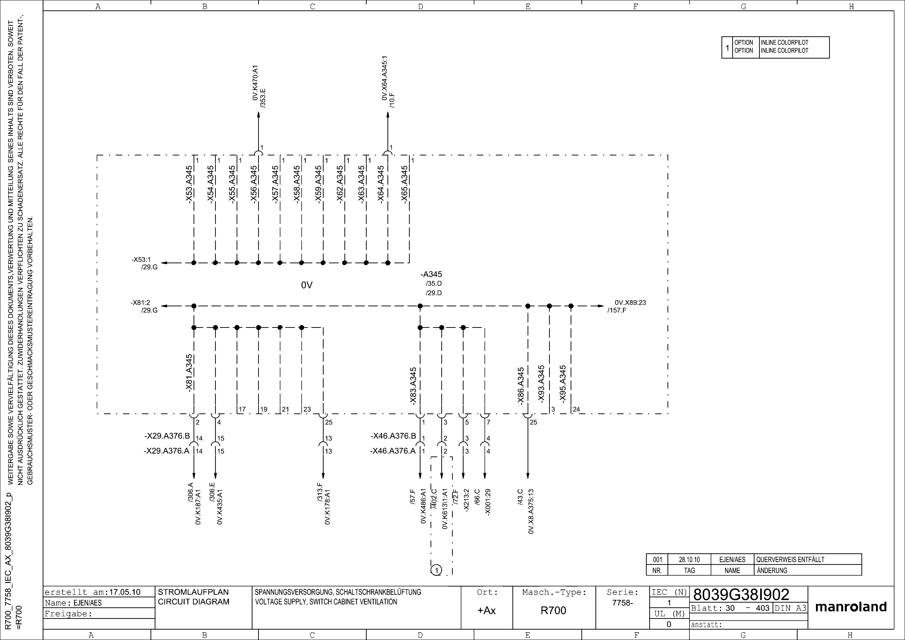

# +Ax — Sheet 30 of 403 — SPANNUNGSVERSORGUNG, SCHALTSCHRANKBELÜFTUNG

**VOLTAGE SUPPLY, SWITCH CABINET VENTILATION**

> Part of the manroland **R700** printing press IEC/UL circuit diagrams.
> Drawing class: **Stromlaufplan / Circuit diagram** (DIN A3).
> Document `+Ax` covers the **Central control console** machine section.

## At a glance

| Field | Value |
|---|---|
| Document | `+Ax`  (8039G38I902) |
| Sheet | **30** of 403 |
| Section (DE) | SPANNUNGSVERSORGUNG, SCHALTSCHRANKBELÜFTUNG |
| Section (EN) | VOLTAGE SUPPLY, SWITCH CABINET VENTILATION |
| Section type | POWER_SUPPLY — Voltage supply |
| Machine type | `R700` |
| Series | `7758` |
| Created | 17.05.10 |
| Replaces | — |
| Columns used | A, B, C, D, E, F, G |
| Path numbers | — |
| Labels on sheet | 103 |
| Cross-refs out | 15 |
| Cross-refs in | 54 |

**Previous:** [+Ax sheet 29](SHEET_0029.md) · **Next:** [+Ax sheet 31](SHEET_0031.md) · **Document TOC:** [_TOC.md](_TOC.md)  (+Ax) · **Master TOC:** [all sheets](../_MASTER_TOC.md)

## Sheet image (300 DPI, exact vector render)



_Rendered directly from the PDF vector layer at 300 DPI (1-bit), no OCR and no resampling. Use it to confirm anything ambiguous in the text below._

## Cross-references on this sheet

Each entry is a wire leaving this sheet. The printed token is `/sheet.column`; the link resolves to that sheet inside the same document.

| Ref | Target sheet | Col | Path | Destination on target | Target section | From col |
|---|---|---|---|---|---|---|
| `/10.F` | [+Ax sheet 10](SHEET_0010.md) | F | — | 0V.X64.A345:1 | SPANNUNGSVERSORGUNG, SCHALTSCHRANKBELÜFTUNG | D |
| `/353.E` | [+Ax sheet 353](SHEET_0353.md) | E | — | 0V.K470:A1 | OPTION: LOGISTIK ANLEGER | C |
| `/29.G` | [+Ax sheet 29](SHEET_0029.md) | G | — | X53:1 | SPANNUNGSVERSORGUNG, SCHALTSCHRANKBELÜFTUNG | A |
| `/35.D` | [+Ax sheet 35](SHEET_0035.md) | D | — | — | SCHMIERUNG | D |
| `/29.D` | [+Ax sheet 29](SHEET_0029.md) | D | — | — | SPANNUNGSVERSORGUNG, SCHALTSCHRANKBELÜFTUNG | D |
| `/29.G` | [+Ax sheet 29](SHEET_0029.md) | G | — | X81:2 | SPANNUNGSVERSORGUNG, SCHALTSCHRANKBELÜFTUNG | A |
| `/157.F` | [+Ax sheet 157](SHEET_0157.md) | F | — | — | ÜBERWACHUNGSRECHNER/ANSTEUERUNG NOT AUS | F |
| `/306.E` | [+Ax sheet 306](SHEET_0306.md) | E | — | — | SCHÖN & WIDERDRUCK HAUPTSCHALTSCHRANK | B |
| `/313.F` | [+Ax sheet 313](SHEET_0313.md) | F | — | — | OPTION: STAUBSAUGER MIT BÜRSTE | C |
| `/306.A` | [+Ax sheet 306](SHEET_0306.md) | A | — | — | SCHÖN & WIDERDRUCK HAUPTSCHALTSCHRANK | B |
| `/57.F` | [+Ax sheet 57](SHEET_0057.md) | F | — | — | LUFTVERSORGUNG | D |
| `/402.C` | [+Ax sheet 402](SHEET_0402.md) | C | — | — | OPTION: INLINE COLORPILOT | D |
| `/72.F` | [+Ax sheet 72](SHEET_0072.md) | F | — | — | WASCHVORRICHTUNGEN DRUCKWERKE | D |
| `/66.C` | [+Ax sheet 66](SHEET_0066.md) | C | — | — | DRUCKLUFTANLAGE | E |
| `/43.C` | [+Ax sheet 43](SHEET_0043.md) | C | — | — | HAUPTANTRIEB | E |

### Incoming references (sheets that point here)

Every other sheet that sends a wire to this one. `Back-ref` is the token printed on *that* sheet; `Path` is its line number.

| From sheet | Cols | Back-ref | Path | Refs | What continues there |
|---|---|---|---|---|---|
| [+Ax#10](SHEET_0010.md) | G | `/10.G` | — | 1 | — |
| [+Ax#29](SHEET_0029.md) | D, G | `/29.D`, `/29.G` | — | 3 | — |
| [+Ax#35](SHEET_0035.md) | C | `/35.C` | — | 1 | — |
| [+Ax#43](SHEET_0043.md) | C | `/43.C` | — | 1 | 0V.X8.A375:13 |
| [+Ax#57](SHEET_0057.md) | F | `/57.F` | — | 1 | 0V.K486:A1 |
| [+Ax#66](SHEET_0066.md) | D | `/66.D` | — | 1 | X001:29 X001:29 |
| [+Ax#72](SHEET_0072.md) | E | `/72.E` | — | 1 | X213:2 |
| [+Ax#157](SHEET_0157.md) | F | `/157.F` | — | 1 | 0V.X89:23 |
| [+Ax#273](SHEET_0273.md) | A, B | `/273.A`, `/273.B` | — | 6 | — |
| [+Ax#283](SHEET_0283.md) | A, B, H | `/283.A`, `/283.B`, `/283.H` | — | 11 | — |
| [+Ax#284](SHEET_0284.md) | A, B, G, H | `/284.A`, `/284.B`, `/284.G`, `/284.H` | — | 8 | — |
| [+Ax#286](SHEET_0286.md) | E | `/286.E` | — | 7 | — |
| [+Ax#287](SHEET_0287.md) | A | `/287.A` | — | 4 | — |
| [+Ax#288](SHEET_0288.md) | A | `/288.A` | — | 1 | — |
| [+Ax#289](SHEET_0289.md) | G | `/289.G` | — | 1 | — |
| [+Ax#290](SHEET_0290.md) | A | `/290.A` | — | 1 | — |
| [+Ax#306](SHEET_0306.md) | A, E | `/306.A`, `/306.E` | — | 2 | 0V.K187:A1; 0V.K435:A1 |
| [+Ax#313](SHEET_0313.md) | E | `/313.E` | — | 1 | 0V.K178:A1 |
| [+Ax#353](SHEET_0353.md) | D | `/353.D` | — | 1 | 0V.K470:A1 |
| [+Ax#402](SHEET_0402.md) | C | `/402.C` | — | 1 | 0V.K613\1:A1 |


## Devices on this sheet

| Tag | Class | Class meaning (IEC) | Col | Sub | Terminal | Sign |
|---|---|---|---|---|---|---|
| `A345` | A | Baugruppe / assembly, module, PC board | D | — | — | — |
| `X001:29` | X | Klemme / terminal, plug connector | E | — | 29 | — |
| `X53:1` | X | Klemme / terminal, plug connector | A | — | 1 | — |
| `X213:2` | X | Klemme / terminal, plug connector | D | — | 2 | — |
| `X81:2` | X | Klemme / terminal, plug connector | A | — | 2 | — |
| `X83.A345` | — | cross-device reference | D | — | — | — |
| `X46.A376.B` | — | cross-device reference | D | — | — | — |
| `X46.A376.A` | — | cross-device reference | D | — | — | — |
| `X29.A376.B` | — | cross-device reference | B | — | — | — |
| `X29.A376.A` | — | cross-device reference | B | — | — | — |
| `X81.A345` | — | cross-device reference | B | — | — | — |
| `X64.A345` | — | cross-device reference | D | — | — | — |
| `X86.A345` | — | cross-device reference | E | — | — | — |
| `NR.` | — | cross-device reference | F | — | — | — |
| `28.10.10` | — | cross-device reference | F | — | — | — |
| `X53.A345` | — | cross-device reference | B | — | — | — |
| `X54.A345` | — | cross-device reference | B | — | — | — |
| `X55.A345` | — | cross-device reference | B | — | — | — |
| `X56.A345` | — | cross-device reference | B | — | — | — |
| `X57.A345` | — | cross-device reference | C | — | — | — |
| `X58.A345` | — | cross-device reference | C | — | — | — |
| `X59.A345` | — | cross-device reference | C | — | — | — |
| `X62.A345` | — | cross-device reference | C | — | — | — |
| `X63.A345` | — | cross-device reference | C | — | — | — |
| `X65.A345` | — | cross-device reference | D | — | — | — |
| `X93.A345` | — | cross-device reference | E | — | — | — |
| `X95.A345` | — | cross-device reference | E | — | — | — |

## Potentials / nets

| Potential | Count | Columns | Attached devices | Terminals |
|---|---|---|---|---|
| `0V` | 10 | B, C, D, E, F | `A345`, `A375`, `K178`, `K187`, `K435`, `K470`, `K486`, `K613\1`, `X64`, `X8`, `X89` | `1`, `13`, `23`, `A1` |


A potential such as `L24+/4` or `M24+` is a named supply/return rail; every place it appears on this sheet is electrically common.

## Wire-end annotations (grouped as printed)

A wire that continues elsewhere is annotated with a small cluster: the destination description, the path/line number `#NN`, and the `/sheet.column` cross reference. Each row below is one such cluster exactly as it is grouped on the drawing.

| Col | Y | Path | Cross-ref | Text on the wire |
|---|---|---|---|---|
| G | 53.0 | — | — | `1 OPTION OPTION` |
| G | 53.1 | — | — | `INLINE COLORPILOT INLINE COLORPILOT` |
| D | 72.8 | — | `/10.F` | `0V.X64.A345:1` |
| C | 85.0 | — | `/353.E` | `0V.K470:A1` |
| C | 190.2 | — | — | `1` |
| D | 190.2 | — | — | `1` |
| C | 207.2 | — | — | `1 1 1 1 1 1 1 1` |
| D | 207.2 | — | — | `1` |
| B | 217.7 | — | — | `X53.A345` |
| B | 217.7 | — | — | `X54.A345` |
| B | 217.7 | — | — | `X55.A345` |
| B | 217.7 | — | — | `X56.A345` |
| C | 217.7 | — | — | `X57.A345` |
| C | 217.7 | — | — | `X58.A345` |
| C | 217.7 | — | — | `X59.A345` |
| C | 217.7 | — | — | `X62.A345` |
| C | 217.7 | — | — | `X63.A345` |
| D | 217.7 | — | — | `X64.A345` |
| D | 217.7 | — | — | `X65.A345` |
| A | 337.6 | — | `/29.G` | `X53:1` |
| D | 356.1 | — | — | `A345` |
| D | 369.1 | — | `/35.D`, `/29.D` | — |
| C | 369.6 | — | — | `0V` |
| A | 394.3 | — | `/29.G` | `X81:2` |
| F | 394.3 | — | — | `0V.X89:23` |
| F | 404.2 | — | `/157.F` | — |
| B | 465.7 | — | — | `X81.A345` |
| E | 480.2 | — | — | `X93.A345` |
| E | 480.2 | — | — | `X95.A345` |
| D | 483.0 | — | — | `X83.A345` |
| E | 483.0 | — | — | `X86.A345` |
| C | 534.7 | — | — | `17 23` |
| C | 534.7 | — | — | `19` |
| C | 534.7 | — | — | `21` |
| E | 534.7 | — | — | `3` |
| E | 534.7 | — | — | `24` |
| B | 551.7 | — | — | `2` |
| B | 551.7 | — | — | `4` |
| C | 551.7 | — | — | `25` |
| D | 551.7 | — | — | `1 7` |
| D | 551.7 | — | — | `3` |
| D | 551.7 | — | — | `5` |
| E | 551.7 | — | — | `25` |
| B | 568.7 | — | — | `X29.A376.B 14` |
| D | 568.7 | — | — | `X46.A376.B 1` |
| B | 572.9 | — | — | `15` |
| C | 572.9 | — | — | `13` |
| D | 572.9 | — | — | `2` |
| D | 572.9 | — | — | `3` |
| E | 572.9 | — | — | `4` |
| B | 588.5 | — | — | `X29.A376.A 14` |
| D | 588.5 | — | — | `X46.A376.A 1` |
| B | 589.9 | — | — | `15` |
| C | 589.9 | — | — | `13` |
| D | 589.9 | — | — | `2` |
| D | 589.9 | — | — | `3` |
| E | 589.9 | — | — | `4` |
| B | 634.4 | — | `/306.E` | — |
| C | 634.7 | — | `/313.F` | — |
| B | 635.0 | — | `/306.A` | — |
| D | 641.8 | — | — | `0V.K486:A1` |
| D | 641.8 | — | — | `0V.K613\1:A1` |
| D | 642.9 | — | — | `X213:2` |
| B | 643.2 | — | — | `0V.K187:A1` |
| B | 643.2 | — | — | `0V.K435:A1` |
| C | 643.2 | — | — | `0V.K178:A1` |
| D | 643.2 | — | `/57.F` | — |
| D | 643.2 | — | `/402.C` | — |
| D | 643.2 | — | `/72.F` | — |
| E | 643.2 | — | `/66.C` | — |
| E | 643.2 | — | — | `X001:29` |
| E | 643.2 | — | `/43.C` | — |
| E | 643.2 | — | — | `0V.X8.A375:13` |
| G | 733.0 | — | — | `001 28.10.10 EJEN/AES QUERVERWEIS ENTFÄLLT` |
| D | 746.7 | — | — | `1` |
| G | 747.1 | — | — | `NR. TAG NAME ÄNDERUNG` |


## Notes and free text on this sheet

| Text | Col | Y (pt) |
|---|---|---|
| `TAG` | G | 747.27 |
| `NAME` | G | 747.25 |
| `ÄNDERUNG` | G | 747.31 |
| `EJEN/AES` | G | 733.09 |
| `QUERVERWEIS ENTFÄLLT` | G | 733.12 |
| `OPTION` | G | 53.04 |
| `INLINE COLORPILOT` | G | 53.07 |

## Complete label inventory (exact text from the drawing)

Every text object inside the drawing area of this sheet, in DIN reading order (column A→H, then top→bottom). This is the authoritative list: if a string is not here it is not printed on this sheet.

| Col | Y | X | Dir | Type | Text |
|---|---|---|---|---|---|
| A | 337.6 | 172.9 | → | device tag | `X53:1` |
| A | 347.5 | 186.0 | → | cross-reference | `/29.G` |
| A | 394.3 | 171.8 | → | device tag | `X81:2` |
| A | 404.2 | 186.0 | → | cross-reference | `/29.G` |
| B | 85.0 | 331.9 | ↕ | potential | `0V.K470:A1` |
| B | 207.3 | 257.1 | → | number | `1` |
| B | 207.3 | 285.4 | → | number | `1` |
| B | 207.3 | 313.8 | → | number | `1` |
| B | 217.7 | 244.1 | ↕ | device ref | `X53.A345` |
| B | 217.7 | 272.4 | ↕ | device ref | `X54.A345` |
| B | 217.7 | 300.8 | ↕ | device ref | `X55.A345` |
| B | 217.7 | 329.1 | ↕ | device ref | `X56.A345` |
| B | 465.7 | 244.1 | ↕ | device ref | `X81.A345` |
| B | 534.7 | 313.8 | → | number | `17` |
| B | 551.7 | 257.7 | → | number | `2` |
| B | 551.7 | 286.0 | → | number | `4` |
| B | 568.7 | 189.9 | → | device ref | `X29.A376.B` |
| B | 572.9 | 257.1 | → | number | `14` |
| B | 572.9 | 285.4 | → | number | `15` |
| B | 588.5 | 189.1 | → | device ref | `X29.A376.A` |
| B | 589.9 | 257.1 | → | number | `14` |
| B | 589.9 | 285.4 | → | number | `15` |
| B | 634.4 | 275.2 | ↕ | cross-reference | `/306.E` |
| B | 635.0 | 246.9 | ↕ | cross-reference | `/306.A` |
| B | 643.2 | 256.8 | ↕ | potential | `0V.K187:A1` |
| B | 643.2 | 285.1 | ↕ | potential | `0V.K435:A1` |
| C | 116.2 | 341.8 | ↕ | cross-reference | `/353.E` |
| C | 190.2 | 342.1 | → | number | `1` |
| C | 207.3 | 370.5 | → | number | `1` |
| C | 207.3 | 398.8 | → | number | `1` |
| C | 207.3 | 427.2 | → | number | `1` |
| C | 207.3 | 455.5 | → | number | `1` |
| C | 217.7 | 357.5 | ↕ | device ref | `X57.A345` |
| C | 217.7 | 385.8 | ↕ | device ref | `X58.A345` |
| C | 217.7 | 414.2 | ↕ | device ref | `X59.A345` |
| C | 217.7 | 442.5 | ↕ | device ref | `X62.A345` |
| C | 217.7 | 470.9 | ↕ | device ref | `X63.A345` |
| C | 369.6 | 396.3 | → | potential | `0V` |
| C | 534.7 | 342.1 | → | number | `19` |
| C | 534.7 | 371.1 | → | number | `21` |
| C | 534.7 | 399.4 | → | number | `23` |
| C | 551.7 | 427.7 | → | number | `25` |
| C | 572.9 | 427.2 | → | number | `13` |
| C | 589.9 | 427.2 | → | number | `13` |
| C | 634.7 | 417.0 | ↕ | cross-reference | `/313.F` |
| C | 643.2 | 426.9 | ↕ | potential | `0V.K178:A1` |
| D | 72.9 | 502.0 | ↕ | potential | `0V.X64.A345:1` |
| D | 121.6 | 511.9 | ↕ | cross-reference | `/10.F` |
| D | 190.2 | 512.2 | → | number | `1` |
| D | 207.3 | 483.9 | → | number | `1` |
| D | 207.3 | 540.6 | → | number | `1` |
| D | 217.7 | 496.4 | ↕ | device ref | `X64.A345` |
| D | 217.7 | 527.5 | ↕ | device ref | `X65.A345` |
| D | 356.1 | 553.3 | → | device tag | `A345` |
| D | 369.1 | 560.4 | → | cross-reference | `/35.D` |
| D | 381.5 | 560.4 | → | cross-reference | `/29.D` |
| D | 483.0 | 538.9 | ↕ | device ref | `X83.A345` |
| D | 551.7 | 554.7 | → | number | `1` |
| D | 551.7 | 583.7 | → | number | `3` |
| D | 551.7 | 612.0 | → | number | `5` |
| D | 568.7 | 487.6 | → | device ref | `X46.A376.B` |
| D | 572.9 | 554.7 | → | number | `1` |
| D | 572.9 | 583.7 | → | number | `2` |
| D | 572.9 | 612.0 | → | number | `3` |
| D | 588.5 | 486.7 | → | device ref | `X46.A376.A` |
| D | 589.9 | 554.7 | → | number | `1` |
| D | 589.9 | 583.7 | → | number | `2` |
| D | 589.9 | 612.0 | → | number | `3` |
| D | 641.8 | 553.0 | ↕ | potential | `0V.K486:A1` |
| D | 641.8 | 581.4 | ↕ | potential | `0V.K613\1:A1` |
| D | 642.9 | 609.7 | ↕ | device tag | `X213:2` |
| D | 643.2 | 538.8 | ↕ | cross-reference | `/57.F` |
| D | 643.2 | 567.2 | ↕ | cross-reference | `/402.C` |
| D | 643.2 | 595.5 | ↕ | cross-reference | `/72.F` |
| D | 746.7 | 572.3 | → | number | `1` |
| E | 480.2 | 707.5 | ↕ | device ref | `X93.A345` |
| E | 480.2 | 735.9 | ↕ | device ref | `X95.A345` |
| E | 483.0 | 680.6 | ↕ | device ref | `X86.A345` |
| E | 534.7 | 725.4 | → | number | `3` |
| E | 534.7 | 753.7 | → | number | `24` |
| E | 551.7 | 640.3 | → | number | `7` |
| E | 551.7 | 697.0 | → | number | `25` |
| E | 572.9 | 640.3 | → | number | `4` |
| E | 589.9 | 640.3 | → | number | `4` |
| E | 643.2 | 623.9 | ↕ | cross-reference | `/66.C` |
| E | 643.2 | 638.1 | ↕ | device tag | `X001:29` |
| E | 643.2 | 680.6 | ↕ | cross-reference | `/43.C` |
| E | 643.2 | 694.8 | ↕ | potential | `0V.X8.A375:13` |
| F | 394.3 | 809.0 | → | potential | `0V.X89:23` |
| F | 404.2 | 799.4 | → | cross-reference | `/157.F` |
| F | 733.0 | 859.4 | → | number | `001` |
| F | 733.1 | 893.5 | → | device ref | `28.10.10` |
| F | 747.1 | 858.4 | → | device ref | `NR.` |
| G | 53.0 | 966.3 | → | text | `OPTION` |
| G | 53.1 | 1001.2 | → | text | `INLINE COLORPILOT` |
| G | 58.4 | 954.1 | → | number | `1` |
| G | 63.7 | 966.3 | → | text | `OPTION` |
| G | 63.7 | 1001.2 | → | text | `INLINE COLORPILOT` |
| G | 733.1 | 946.5 | → | text | `EJEN/AES` |
| G | 733.1 | 995.1 | → | text | `QUERVERWEIS ENTFÄLLT` |
| G | 747.3 | 900.0 | → | text | `TAG` |
| G | 747.3 | 953.4 | → | text | `NAME` |
| G | 747.3 | 996.0 | → | text | `ÄNDERUNG` |

## Reading-order text block

The same content as a plain block, grouped by DIN column — convenient to paste or to match against a visual description.

```text
=== Column A ===
 337.6  172.9  devtag       X53:1
 347.5  186.0  xref         /29.G
 394.3  171.8  devtag       X81:2
 404.2  186.0  xref         /29.G
=== Column B ===
  85.0  331.9  net          0V.K470:A1
 207.3  257.1  numeric      1
 207.3  285.4  numeric      1
 207.3  313.8  numeric      1
 217.7  244.1  devref       X53.A345
 217.7  272.4  devref       X54.A345
 217.7  300.8  devref       X55.A345
 217.7  329.1  devref       X56.A345
 465.7  244.1  devref       X81.A345
 534.7  313.8  numeric      17
 551.7  257.7  numeric      2
 551.7  286.0  numeric      4
 568.7  189.9  devref       X29.A376.B
 572.9  257.1  numeric      14
 572.9  285.4  numeric      15
 588.5  189.1  devref       X29.A376.A
 589.9  257.1  numeric      14
 589.9  285.4  numeric      15
 634.4  275.2  xref         /306.E
 635.0  246.9  xref         /306.A
 643.2  256.8  net          0V.K187:A1
 643.2  285.1  net          0V.K435:A1
=== Column C ===
 116.2  341.8  xref         /353.E
 190.2  342.1  numeric      1
 207.3  370.5  numeric      1
 207.3  398.8  numeric      1
 207.3  427.2  numeric      1
 207.3  455.5  numeric      1
 217.7  357.5  devref       X57.A345
 217.7  385.8  devref       X58.A345
 217.7  414.2  devref       X59.A345
 217.7  442.5  devref       X62.A345
 217.7  470.9  devref       X63.A345
 369.6  396.3  net          0V
 534.7  342.1  numeric      19
 534.7  371.1  numeric      21
 534.7  399.4  numeric      23
 551.7  427.7  numeric      25
 572.9  427.2  numeric      13
 589.9  427.2  numeric      13
 634.7  417.0  xref         /313.F
 643.2  426.9  net          0V.K178:A1
=== Column D ===
  72.9  502.0  net          0V.X64.A345:1
 121.6  511.9  xref         /10.F
 190.2  512.2  numeric      1
 207.3  483.9  numeric      1
 207.3  540.6  numeric      1
 217.7  496.4  devref       X64.A345
 217.7  527.5  devref       X65.A345
 356.1  553.3  devtag       A345
 369.1  560.4  xref         /35.D
 381.5  560.4  xref         /29.D
 483.0  538.9  devref       X83.A345
 551.7  554.7  numeric      1
 551.7  583.7  numeric      3
 551.7  612.0  numeric      5
 568.7  487.6  devref       X46.A376.B
 572.9  554.7  numeric      1
 572.9  583.7  numeric      2
 572.9  612.0  numeric      3
 588.5  486.7  devref       X46.A376.A
 589.9  554.7  numeric      1
 589.9  583.7  numeric      2
 589.9  612.0  numeric      3
 641.8  553.0  net          0V.K486:A1
 641.8  581.4  net          0V.K613\1:A1
 642.9  609.7  devtag       X213:2
 643.2  538.8  xref         /57.F
 643.2  567.2  xref         /402.C
 643.2  595.5  xref         /72.F
 746.7  572.3  numeric      1
=== Column E ===
 480.2  707.5  devref       X93.A345
 480.2  735.9  devref       X95.A345
 483.0  680.6  devref       X86.A345
 534.7  725.4  numeric      3
 534.7  753.7  numeric      24
 551.7  640.3  numeric      7
 551.7  697.0  numeric      25
 572.9  640.3  numeric      4
 589.9  640.3  numeric      4
 643.2  623.9  xref         /66.C
 643.2  638.1  devtag       X001:29
 643.2  680.6  xref         /43.C
 643.2  694.8  net          0V.X8.A375:13
=== Column F ===
 394.3  809.0  net          0V.X89:23
 404.2  799.4  xref         /157.F
 733.0  859.4  numeric      001
 733.1  893.5  devref       28.10.10
 747.1  858.4  devref       NR.
=== Column G ===
  53.0  966.3  text         OPTION
  53.1 1001.2  text         INLINE COLORPILOT
  58.4  954.1  numeric      1
  63.7  966.3  text         OPTION
  63.7 1001.2  text         INLINE COLORPILOT
 733.1  946.5  text         EJEN/AES
 733.1  995.1  text         QUERVERWEIS ENTFÄLLT
 747.3  900.0  text         TAG
 747.3  953.4  text         NAME
 747.3  996.0  text         ÄNDERUNG
```

---
_Generated from the PDF vector text layer; no OCR. Source: `R700_7758_IEC_AX_8039G38I902_p`, sheet 30._
