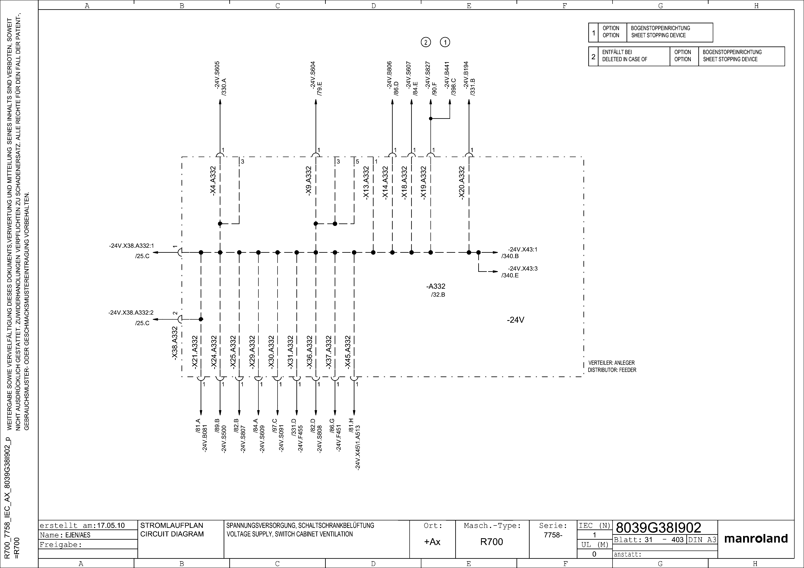

# +Ax — Sheet 31 of 403 — SPANNUNGSVERSORGUNG, SCHALTSCHRANKBELÜFTUNG

**VOLTAGE SUPPLY, SWITCH CABINET VENTILATION**

> Part of the manroland **R700** printing press IEC/UL circuit diagrams.
> Drawing class: **Stromlaufplan / Circuit diagram** (DIN A3).
> Document `+Ax` covers the **Central control console** machine section.

## At a glance

| Field | Value |
|---|---|
| Document | `+Ax`  (8039G38I902) |
| Sheet | **31** of 403 |
| Section (DE) | SPANNUNGSVERSORGUNG, SCHALTSCHRANKBELÜFTUNG |
| Section (EN) | VOLTAGE SUPPLY, SWITCH CABINET VENTILATION |
| Section type | POWER_SUPPLY — Voltage supply |
| Machine type | `R700` |
| Series | `7758` |
| Created | 17.05.10 |
| Replaces | — |
| Columns used | A, B, C, D, E, F, G, H |
| Path numbers | — |
| Labels on sheet | 97 |
| Cross-refs out | 21 |
| Cross-refs in | 42 |

**Previous:** [+Ax sheet 30](SHEET_0030.md) · **Next:** [+Ax sheet 32](SHEET_0032.md) · **Document TOC:** [_TOC.md](_TOC.md)  (+Ax) · **Master TOC:** [all sheets](../_MASTER_TOC.md)

## Sheet image (300 DPI, exact vector render)



_Rendered directly from the PDF vector layer at 300 DPI (1-bit), no OCR and no resampling. Use it to confirm anything ambiguous in the text below._

## Cross-references on this sheet

Each entry is a wire leaving this sheet. The printed token is `/sheet.column`; the link resolves to that sheet inside the same document.

| Ref | Target sheet | Col | Path | Destination on target | Target section | From col |
|---|---|---|---|---|---|---|
| `/330.A` | [+Ax sheet 330](SHEET_0330.md) | A | — | 24V.S605 | OPTION: NONSTOP EINRICHTUNG MANUELL, ANLEGER | B |
| `/79.E` | [+Ax sheet 79](SHEET_0079.md) | E | — | 24V.S604 | ANLEGER | C |
| `/86.D` | [+Ax sheet 86](SHEET_0086.md) | D | — | 24V.B806 | ANLEGER | D |
| `/84.E` | [+Ax sheet 84](SHEET_0084.md) | E | — | 24V.S607 | ANLEGER | D |
| `/90.F` | [+Ax sheet 90](SHEET_0090.md) | F | — | 24V.S827 | ANLEGER | E |
| `/398.C` | [+Ax sheet 398](SHEET_0398.md) | C | — | 24V.B441 | OPTION: BOGENSTOPPEINRICHTUNG | E |
| `/331.B` | [+Ax sheet 331](SHEET_0331.md) | B | — | 24V.B194 | OPTION: NONSTOP EINRICHTUNG MANUELL, ANLEGER | E |
| `/340.B` | [+Ax sheet 340](SHEET_0340.md) | B | — | — | OPTION: INLINESHEETER RS104 S | E |
| `/25.C` | [+Ax sheet 25](SHEET_0025.md) | C | — | — | SPANNUNGSVERSORGUNG, SCHALTSCHRANKBELÜFTUNG | B |
| `/340.E` | [+Ax sheet 340](SHEET_0340.md) | E | — | — | OPTION: INLINESHEETER RS104 S | E |
| `/32.B` | [+Ax sheet 32](SHEET_0032.md) | B | — | — | SPANNUNGSVERSORGUNG, SCHALTSCHRANKBELÜFTUNG | E |
| `/25.C` | [+Ax sheet 25](SHEET_0025.md) | C | — | — | SPANNUNGSVERSORGUNG, SCHALTSCHRANKBELÜFTUNG | B |
| `/81.H` | [+Ax sheet 81](SHEET_0081.md) | H | — | — | ANLEGER | D |
| `/86.G` | [+Ax sheet 86](SHEET_0086.md) | G | — | — | ANLEGER | D |
| `/89.B` | [+Ax sheet 89](SHEET_0089.md) | B | — | — | ANLEGER | B |
| `/82.B` | [+Ax sheet 82](SHEET_0082.md) | B | — | — | ANLEGER | C |
| `/97.C` | [+Ax sheet 97](SHEET_0097.md) | C | — | — | ANLEGER | C |
| `/331.D` | [+Ax sheet 331](SHEET_0331.md) | D | — | — | OPTION: NONSTOP EINRICHTUNG MANUELL, ANLEGER | C |
| `/82.D` | [+Ax sheet 82](SHEET_0082.md) | D | — | — | ANLEGER | C |
| `/81.A` | [+Ax sheet 81](SHEET_0081.md) | A | — | — | ANLEGER | B |
| `/84.A` | [+Ax sheet 84](SHEET_0084.md) | A | — | — | ANLEGER | C |

### Incoming references (sheets that point here)

Every other sheet that sends a wire to this one. `Back-ref` is the token printed on *that* sheet; `Path` is its line number.

| From sheet | Cols | Back-ref | Path | Refs | What continues there |
|---|---|---|---|---|---|
| [+Ax#25](SHEET_0025.md) | C | `/25.C` | — | 2 | 24V.X38.A332:1; 24V.X38.A332:2 |
| [+Ax#32](SHEET_0032.md) | B | `/32.B` | — | 1 | — |
| [+Ax#79](SHEET_0079.md) | E | `/79.E` | — | 1 | 24V.S604 |
| [+Ax#81](SHEET_0081.md) | A, G | `/81.A`, `/81.G` | — | 2 | 24V.B081; 24V.X45\1.A513 |
| [+Ax#82](SHEET_0082.md) | B, D | `/82.B`, `/82.D` | — | 2 | 24V.S807; 24V.S808 |
| [+Ax#84](SHEET_0084.md) | A, E | `/84.A`, `/84.E` | — | 2 | 24V.S607; 24V.S609 |
| [+Ax#86](SHEET_0086.md) | E | `/86.E` | — | 2 | 24V.B806 24V.F451 |
| [+Ax#89](SHEET_0089.md) | A | `/89.A` | — | 1 | 24V.S500 |
| [+Ax#90](SHEET_0090.md) | F | `/90.F` | — | 1 | 24V.S827 |
| [+Ax#97](SHEET_0097.md) | B | `/97.B` | — | 1 | 24V.S091 |
| [+Ax#226](SHEET_0226.md) | F | `/226.F` | — | 2 | — |
| [+Ax#240](SHEET_0240.md) | E | `/240.E` | — | 3 | — |
| [+Ax#249](SHEET_0249.md) | F | `/249.F` | — | 1 | — |
| [+Ax#251](SHEET_0251.md) | B | `/251.B` | — | 1 | — |
| [+Ax#256](SHEET_0256.md) | C | `/256.C` | — | 1 | — |
| [+Ax#258](SHEET_0258.md) | C | `/258.C` | — | 1 | — |
| [+Ax#260](SHEET_0260.md) | A | `/260.A` | — | 1 | — |
| [+Ax#261](SHEET_0261.md) | A | `/261.A` | — | 1 | — |
| [+Ax#266](SHEET_0266.md) | A | `/266.A` | — | 1 | — |
| [+Ax#267](SHEET_0267.md) | C | `/267.C` | — | 1 | — |
| [+Ax#273](SHEET_0273.md) | C | `/273.C` | — | 1 | — |
| [+Ax#274](SHEET_0274.md) | F | `/274.F` | — | 1 | — |
| [+Ax#275](SHEET_0275.md) | A | `/275.A` | — | 1 | — |
| [+Ax#279](SHEET_0279.md) | C, F | `/279.C`, `/279.F` | — | 2 | — |
| [+Ax#280](SHEET_0280.md) | A | `/280.A` | — | 2 | — |
| [+Ax#282](SHEET_0282.md) | A | `/282.A` | — | 1 | — |
| [+Ax#330](SHEET_0330.md) | A | `/330.A` | — | 1 | 24V.S605 |
| [+Ax#331](SHEET_0331.md) | B, D | `/331.B`, `/331.D` | — | 2 | 24V.B194; 24V.F455 |
| [+Ax#340](SHEET_0340.md) | B, D | `/340.B`, `/340.D` | — | 2 | — |
| [+Ax#398](SHEET_0398.md) | B | `/398.B` | — | 1 | 24V.B441 |


## Devices on this sheet

| Tag | Class | Class meaning (IEC) | Col | Sub | Terminal | Sign |
|---|---|---|---|---|---|---|
| `A332` | A | Baugruppe / assembly, module, PC board | E | — | — | — |
| `X38.A332` | — | cross-device reference | B | — | — | — |
| `X21.A332` | — | cross-device reference | B | — | — | — |
| `X24.A332` | — | cross-device reference | B | — | — | — |
| `X4.A332` | — | cross-device reference | B | — | — | — |
| `X25.A332` | — | cross-device reference | C | — | — | — |
| `X29.A332` | — | cross-device reference | C | — | — | — |
| `X30.A332` | — | cross-device reference | C | — | — | — |
| `X31.A332` | — | cross-device reference | C | — | — | — |
| `X36.A332` | — | cross-device reference | C | — | — | — |
| `X9.A332` | — | cross-device reference | C | — | — | — |
| `X37.A332` | — | cross-device reference | D | — | — | — |
| `X45.A332` | — | cross-device reference | D | — | — | — |
| `X14.A332` | — | cross-device reference | D | — | — | — |
| `X18.A332` | — | cross-device reference | D | — | — | — |
| `X19.A332` | — | cross-device reference | E | — | — | — |
| `X20.A332` | — | cross-device reference | E | — | — | — |
| `X13.A332` | — | cross-device reference | D | — | — | — |

## Potentials / nets

| Potential | Count | Columns | Attached devices | Terminals |
|---|---|---|---|---|
| `24V` | 21 | A, B, C, D, E, F | `A332`, `A513`, `B081`, `B194`, `B441`, `B806`, `F451`, `F455`, `S091`, `S500`, `S604`, `S605`, `S607`, `S609`, `S807`, `S808`, `S827`, `X38`, `X43`, `X45\1` | `1`, `2`, `3` |


A potential such as `L24+/4` or `M24+` is a named supply/return rail; every place it appears on this sheet is electrically common.

## Wire-end annotations (grouped as printed)

A wire that continues elsewhere is annotated with a small cluster: the destination description, the path/line number `#NN`, and the `/sheet.column` cross reference. Each row below is one such cluster exactly as it is grouped on the drawing.

| Col | Y | Path | Cross-ref | Text on the wire |
|---|---|---|---|---|
| G | 38.9 | — | — | `1 OPTION OPTION BOGENSTOPPEINRICHTUNG` |
| F | 49.5 | — | — | `2 1 SHEET STOPPING DEVICE` |
| G | 74.3 | — | — | `2 ENTFÄLLT BEI DELETED IN CASE OF` |
| G | 74.3 | — | — | `OPTION OPTION` |
| H | 74.3 | — | — | `BOGENSTOPPEINRICHTUNG` |
| H | 84.9 | — | — | `SHEET STOPPING DEVICE` |
| B | 90.7 | — | `/330.A` | `24V.S605` |
| C | 90.7 | — | `/79.E` | `24V.S604` |
| D | 90.7 | — | `/86.D` | `24V.B806` |
| D | 90.7 | — | `/84.E` | `24V.S607` |
| E | 90.7 | — | `/90.F` | `24V.S827` |
| E | 90.7 | — | `/398.C` | `24V.B441` |
| E | 90.7 | — | `/331.B` | `24V.B194` |
| B | 218.6 | — | — | `1` |
| C | 218.6 | — | — | `1` |
| D | 218.6 | — | — | `1` |
| D | 218.6 | — | — | `1` |
| E | 218.6 | — | — | `1` |
| E | 218.6 | — | — | `1` |
| C | 235.6 | — | — | `3` |
| D | 235.6 | — | — | `3 5` |
| D | 235.6 | — | — | `1` |
| B | 246.1 | — | — | `X4.A332` |
| C | 246.1 | — | — | `X9.A332` |
| D | 246.1 | — | — | `X13.A332` |
| D | 246.1 | — | — | `X14.A332` |
| D | 246.1 | — | — | `X18.A332` |
| E | 246.1 | — | — | `X19.A332` |
| E | 246.1 | — | — | `X20.A332` |
| A | 360.3 | — | — | `24V.X38.A332:1` |
| B | 363.1 | — | — | `1` |
| F | 365.9 | — | — | `24V.X43:1` |
| B | 375.9 | — | `/25.C` | — |
| E | 375.9 | — | `/340.B` | — |
| F | 394.3 | — | — | `24V.X43:3` |
| E | 404.2 | — | `/340.E` | — |
| E | 419.8 | — | — | `A332` |
| E | 432.9 | — | `/32.B` | — |
| A | 459.5 | — | — | `24V.X38.A332:2` |
| B | 461.8 | — | — | `X38.A332 2` |
| E | 468.9 | — | — | `24V` |
| B | 475.1 | — | `/25.C` | — |
| B | 497.2 | — | — | `X21.A332` |
| B | 497.2 | — | — | `X24.A332` |
| C | 497.2 | — | — | `X25.A332` |
| C | 497.2 | — | — | `X29.A332` |
| C | 497.2 | — | — | `X30.A332` |
| C | 497.2 | — | — | `X31.A332` |
| C | 497.2 | — | — | `X36.A332` |
| D | 497.2 | — | — | `X37.A332` |
| D | 497.2 | — | — | `X45.A332` |
| F | 535.0 | — | — | `DISTRIBUTOR: FEEDER VERTEILER: ANLEGER` |
| B | 565.8 | — | — | `1` |
| B | 565.8 | — | — | `1` |
| C | 565.8 | — | — | `1` |
| C | 565.8 | — | — | `1` |
| C | 565.8 | — | — | `1` |
| C | 565.8 | — | — | `1` |
| C | 565.8 | — | — | `1` |
| D | 565.8 | — | — | `1` |
| D | 565.8 | — | — | `1` |
| D | 619.9 | — | `/81.H` | — |
| D | 620.2 | — | `/86.G` | — |
| B | 620.5 | — | `/89.B` | — |
| C | 620.5 | — | `/82.B` | — |
| C | 620.5 | — | `/97.C` | — |
| C | 620.5 | — | `/331.D` | — |
| C | 620.5 | — | `/82.D` | — |
| B | 620.8 | — | `/81.A` | — |
| C | 620.8 | — | `/84.A` | — |
| B | 629.0 | — | — | `24V.B081` |
| C | 629.0 | — | — | `24V.S091` |
| D | 629.0 | — | — | `24V.F451` |
| B | 630.4 | — | — | `24V.S500` |
| C | 630.4 | — | — | `24V.S807` |
| C | 630.4 | — | — | `24V.S609` |
| C | 630.4 | — | — | `24V.F455` |
| C | 630.4 | — | — | `24V.S808` |
| D | 630.4 | — | — | `24V.X45\1.A513` |


## Notes and free text on this sheet

| Text | Col | Y (pt) |
|---|---|---|
| `VERTEILER: ANLEGER` | F | 534.96 |
| `DISTRIBUTOR: FEEDER` | F | 545.58 |
| `ENTFÄLLT BEI` | G | 74.29 |
| `DELETED IN CASE OF` | G | 84.94 |
| `OPTION` | G | 74.3 |
| `BOGENSTOPPEINRICHTUNG` | H | 74.33 |
| `SHEET STOPPING DEVICE` | H | 84.94 |
| `OPTION` | F | 38.87 |
| `BOGENSTOPPEINRICHTUNG` | G | 38.9 |
| `SHEET STOPPING DEVICE` | G | 49.51 |

## Complete label inventory (exact text from the drawing)

Every text object inside the drawing area of this sheet, in DIN reading order (column A→H, then top→bottom). This is the authoritative list: if a string is not here it is not printed on this sheet.

| Col | Y | X | Dir | Type | Text |
|---|---|---|---|---|---|
| A | 360.3 | 161.6 | → | potential | `24V.X38.A332:1` |
| A | 459.5 | 160.4 | → | potential | `24V.X38.A332:2` |
| B | 90.7 | 317.8 | ↕ | potential | `24V.S605` |
| B | 116.2 | 327.7 | ↕ | cross-reference | `/330.A` |
| B | 218.6 | 328.0 | → | number | `1` |
| B | 246.0 | 310.7 | ↕ | device ref | `X4.A332` |
| B | 363.1 | 255.4 | ↕ | number | `1` |
| B | 375.9 | 200.4 | → | cross-reference | `/25.C` |
| B | 461.8 | 255.4 | ↕ | number | `2` |
| B | 475.1 | 200.4 | → | cross-reference | `/25.C` |
| B | 483.6 | 254.0 | ↕ | device ref | `X38.A332` |
| B | 497.2 | 283.8 | ↕ | device ref | `X21.A332` |
| B | 497.2 | 312.1 | ↕ | device ref | `X24.A332` |
| B | 565.8 | 299.6 | → | number | `1` |
| B | 565.8 | 328.0 | → | number | `1` |
| B | 620.5 | 317.7 | ↕ | cross-reference | `/89.B` |
| B | 620.8 | 289.4 | ↕ | cross-reference | `/81.A` |
| B | 629.0 | 299.3 | ↕ | potential | `24V.B081` |
| B | 630.4 | 327.7 | ↕ | potential | `24V.S500` |
| C | 90.7 | 459.5 | ↕ | potential | `24V.S604` |
| C | 121.0 | 469.4 | ↕ | cross-reference | `/79.E` |
| C | 218.6 | 469.7 | → | number | `1` |
| C | 235.6 | 356.9 | → | number | `3` |
| C | 246.0 | 452.4 | ↕ | device ref | `X9.A332` |
| C | 497.2 | 340.5 | ↕ | device ref | `X25.A332` |
| C | 497.2 | 368.8 | ↕ | device ref | `X29.A332` |
| C | 497.2 | 397.2 | ↕ | device ref | `X30.A332` |
| C | 497.2 | 425.5 | ↕ | device ref | `X31.A332` |
| C | 497.2 | 453.8 | ↕ | device ref | `X36.A332` |
| C | 565.8 | 356.3 | → | number | `1` |
| C | 565.8 | 384.7 | → | number | `1` |
| C | 565.8 | 413.0 | → | number | `1` |
| C | 565.8 | 441.4 | → | number | `1` |
| C | 565.8 | 469.7 | → | number | `1` |
| C | 620.5 | 346.1 | ↕ | cross-reference | `/82.B` |
| C | 620.5 | 402.8 | ↕ | cross-reference | `/97.C` |
| C | 620.5 | 431.2 | ↕ | cross-reference | `/331.D` |
| C | 620.5 | 459.5 | ↕ | cross-reference | `/82.D` |
| C | 620.8 | 374.4 | ↕ | cross-reference | `/84.A` |
| C | 629.0 | 412.7 | ↕ | potential | `24V.S091` |
| C | 630.4 | 356.0 | ↕ | potential | `24V.S807` |
| C | 630.4 | 384.4 | ↕ | potential | `24V.S609` |
| C | 630.4 | 441.1 | ↕ | potential | `24V.F455` |
| C | 630.4 | 469.4 | ↕ | potential | `24V.S808` |
| D | 90.7 | 572.9 | ↕ | potential | `24V.B806` |
| D | 90.7 | 601.2 | ↕ | potential | `24V.S607` |
| D | 120.8 | 582.8 | ↕ | cross-reference | `/86.D` |
| D | 121.0 | 611.1 | ↕ | cross-reference | `/84.E` |
| D | 218.6 | 583.1 | → | number | `1` |
| D | 218.6 | 611.4 | → | number | `1` |
| D | 235.6 | 498.6 | → | number | `3` |
| D | 235.6 | 527.0 | → | number | `5` |
| D | 235.6 | 554.7 | → | number | `1` |
| D | 246.0 | 537.5 | ↕ | device ref | `X13.A332` |
| D | 246.0 | 565.8 | ↕ | device ref | `X14.A332` |
| D | 246.0 | 594.2 | ↕ | device ref | `X18.A332` |
| D | 497.2 | 482.2 | ↕ | device ref | `X37.A332` |
| D | 497.2 | 510.5 | ↕ | device ref | `X45.A332` |
| D | 565.8 | 498.0 | → | number | `1` |
| D | 565.8 | 526.4 | → | number | `1` |
| D | 619.9 | 516.2 | ↕ | cross-reference | `/81.H` |
| D | 620.2 | 487.8 | ↕ | cross-reference | `/86.G` |
| D | 629.0 | 497.8 | ↕ | potential | `24V.F451` |
| D | 630.4 | 526.1 | ↕ | potential | `24V.X45\1.A513` |
| E | 59.3 | 657.3 | → | number | `1` |
| E | 59.8 | 628.7 | → | number | `2` |
| E | 90.7 | 629.6 | ↕ | potential | `24V.S827` |
| E | 90.7 | 657.9 | ↕ | potential | `24V.B441` |
| E | 90.7 | 686.3 | ↕ | potential | `24V.B194` |
| E | 115.9 | 667.8 | ↕ | cross-reference | `/398.C` |
| E | 116.2 | 696.2 | ↕ | cross-reference | `/331.B` |
| E | 121.6 | 639.5 | ↕ | cross-reference | `/90.F` |
| E | 218.6 | 639.8 | → | number | `1` |
| E | 218.6 | 696.5 | → | number | `1` |
| E | 246.0 | 622.5 | ↕ | device ref | `X19.A332` |
| E | 246.0 | 679.2 | ↕ | device ref | `X20.A332` |
| E | 375.9 | 742.7 | → | cross-reference | `/340.B` |
| E | 404.2 | 742.7 | → | cross-reference | `/340.E` |
| E | 419.8 | 631.3 | → | device tag | `A332` |
| E | 432.9 | 638.6 | → | cross-reference | `/32.B` |
| E | 468.8 | 750.9 | → | potential | `24V` |
| F | 38.9 | 892.6 | → | text | `OPTION` |
| F | 44.2 | 876.2 | → | number | `1` |
| F | 49.5 | 892.6 | → | text | `OPTION` |
| F | 79.6 | 875.9 | → | number | `2` |
| F | 365.9 | 752.3 | → | potential | `24V.X43:1` |
| F | 394.3 | 752.3 | → | potential | `24V.X43:3` |
| F | 535.0 | 871.7 | → | text | `VERTEILER: ANLEGER` |
| F | 545.6 | 870.8 | → | text | `DISTRIBUTOR: FEEDER` |
| G | 38.9 | 934.6 | → | text | `BOGENSTOPPEINRICHTUNG` |
| G | 49.5 | 935.1 | → | text | `SHEET STOPPING DEVICE` |
| G | 74.3 | 892.1 | → | text | `ENTFÄLLT BEI` |
| G | 74.3 | 998.9 | → | text | `OPTION` |
| G | 84.9 | 892.1 | → | text | `DELETED IN CASE OF` |
| G | 84.9 | 998.9 | → | text | `OPTION` |
| H | 74.3 | 1040.9 | → | text | `BOGENSTOPPEINRICHTUNG` |
| H | 84.9 | 1041.4 | → | text | `SHEET STOPPING DEVICE` |

## Reading-order text block

The same content as a plain block, grouped by DIN column — convenient to paste or to match against a visual description.

```text
=== Column A ===
 360.3  161.6  net          24V.X38.A332:1
 459.5  160.4  net          24V.X38.A332:2
=== Column B ===
  90.7  317.8  net          24V.S605
 116.2  327.7  xref         /330.A
 218.6  328.0  numeric      1
 246.0  310.7  devref       X4.A332
 363.1  255.4  numeric      1
 375.9  200.4  xref         /25.C
 461.8  255.4  numeric      2
 475.1  200.4  xref         /25.C
 483.6  254.0  devref       X38.A332
 497.2  283.8  devref       X21.A332
 497.2  312.1  devref       X24.A332
 565.8  299.6  numeric      1
 565.8  328.0  numeric      1
 620.5  317.7  xref         /89.B
 620.8  289.4  xref         /81.A
 629.0  299.3  net          24V.B081
 630.4  327.7  net          24V.S500
=== Column C ===
  90.7  459.5  net          24V.S604
 121.0  469.4  xref         /79.E
 218.6  469.7  numeric      1
 235.6  356.9  numeric      3
 246.0  452.4  devref       X9.A332
 497.2  340.5  devref       X25.A332
 497.2  368.8  devref       X29.A332
 497.2  397.2  devref       X30.A332
 497.2  425.5  devref       X31.A332
 497.2  453.8  devref       X36.A332
 565.8  356.3  numeric      1
 565.8  384.7  numeric      1
 565.8  413.0  numeric      1
 565.8  441.4  numeric      1
 565.8  469.7  numeric      1
 620.5  346.1  xref         /82.B
 620.5  402.8  xref         /97.C
 620.5  431.2  xref         /331.D
 620.5  459.5  xref         /82.D
 620.8  374.4  xref         /84.A
 629.0  412.7  net          24V.S091
 630.4  356.0  net          24V.S807
 630.4  384.4  net          24V.S609
 630.4  441.1  net          24V.F455
 630.4  469.4  net          24V.S808
=== Column D ===
  90.7  572.9  net          24V.B806
  90.7  601.2  net          24V.S607
 120.8  582.8  xref         /86.D
 121.0  611.1  xref         /84.E
 218.6  583.1  numeric      1
 218.6  611.4  numeric      1
 235.6  498.6  numeric      3
 235.6  527.0  numeric      5
 235.6  554.7  numeric      1
 246.0  537.5  devref       X13.A332
 246.0  565.8  devref       X14.A332
 246.0  594.2  devref       X18.A332
 497.2  482.2  devref       X37.A332
 497.2  510.5  devref       X45.A332
 565.8  498.0  numeric      1
 565.8  526.4  numeric      1
 619.9  516.2  xref         /81.H
 620.2  487.8  xref         /86.G
 629.0  497.8  net          24V.F451
 630.4  526.1  net          24V.X45\1.A513
=== Column E ===
  59.3  657.3  numeric      1
  59.8  628.7  numeric      2
  90.7  629.6  net          24V.S827
  90.7  657.9  net          24V.B441
  90.7  686.3  net          24V.B194
 115.9  667.8  xref         /398.C
 116.2  696.2  xref         /331.B
 121.6  639.5  xref         /90.F
 218.6  639.8  numeric      1
 218.6  696.5  numeric      1
 246.0  622.5  devref       X19.A332
 246.0  679.2  devref       X20.A332
 375.9  742.7  xref         /340.B
 404.2  742.7  xref         /340.E
 419.8  631.3  devtag       A332
 432.9  638.6  xref         /32.B
 468.8  750.9  net          24V
=== Column F ===
  38.9  892.6  text         OPTION
  44.2  876.2  numeric      1
  49.5  892.6  text         OPTION
  79.6  875.9  numeric      2
 365.9  752.3  net          24V.X43:1
 394.3  752.3  net          24V.X43:3
 535.0  871.7  text         VERTEILER: ANLEGER
 545.6  870.8  text         DISTRIBUTOR: FEEDER
=== Column G ===
  38.9  934.6  text         BOGENSTOPPEINRICHTUNG
  49.5  935.1  text         SHEET STOPPING DEVICE
  74.3  892.1  text         ENTFÄLLT BEI
  74.3  998.9  text         OPTION
  84.9  892.1  text         DELETED IN CASE OF
  84.9  998.9  text         OPTION
=== Column H ===
  74.3 1040.9  text         BOGENSTOPPEINRICHTUNG
  84.9 1041.4  text         SHEET STOPPING DEVICE
```

---
_Generated from the PDF vector text layer; no OCR. Source: `R700_7758_IEC_AX_8039G38I902_p`, sheet 31._
