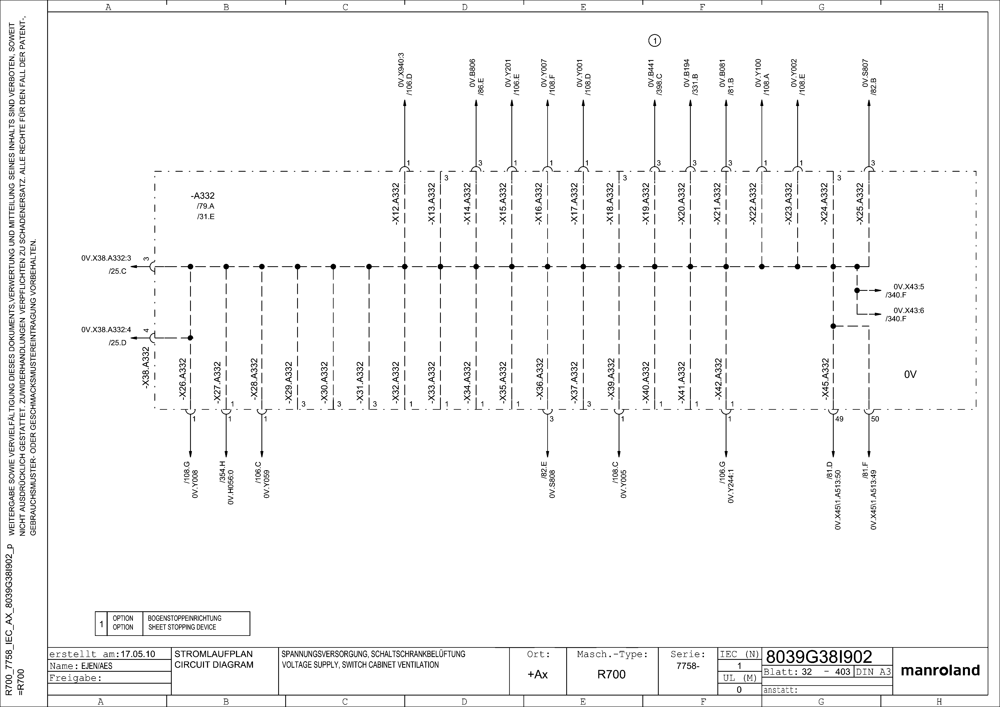

# +Ax — Sheet 32 of 403 — SPANNUNGSVERSORGUNG, SCHALTSCHRANKBELÜFTUNG

**VOLTAGE SUPPLY, SWITCH CABINET VENTILATION**

> Part of the manroland **R700** printing press IEC/UL circuit diagrams.
> Drawing class: **Stromlaufplan / Circuit diagram** (DIN A3).
> Document `+Ax` covers the **Central control console** machine section.

## At a glance

| Field | Value |
|---|---|
| Document | `+Ax`  (8039G38I902) |
| Sheet | **32** of 403 |
| Section (DE) | SPANNUNGSVERSORGUNG, SCHALTSCHRANKBELÜFTUNG |
| Section (EN) | VOLTAGE SUPPLY, SWITCH CABINET VENTILATION |
| Section type | POWER_SUPPLY — Voltage supply |
| Machine type | `R700` |
| Series | `7758` |
| Created | 17.05.10 |
| Replaces | — |
| Columns used | A, B, C, D, E, F, G, H |
| Path numbers | — |
| Labels on sheet | 124 |
| Cross-refs out | 25 |
| Cross-refs in | 59 |

**Previous:** [+Ax sheet 31](SHEET_0031.md) · **Next:** [+Ax sheet 33](SHEET_0033.md) · **Document TOC:** [_TOC.md](_TOC.md)  (+Ax) · **Master TOC:** [all sheets](../_MASTER_TOC.md)

## Sheet image (300 DPI, exact vector render)



_Rendered directly from the PDF vector layer at 300 DPI (1-bit), no OCR and no resampling. Use it to confirm anything ambiguous in the text below._

## Cross-references on this sheet

Each entry is a wire leaving this sheet. The printed token is `/sheet.column`; the link resolves to that sheet inside the same document.

| Ref | Target sheet | Col | Path | Destination on target | Target section | From col |
|---|---|---|---|---|---|---|
| `/106.D` | [+Ax sheet 106](SHEET_0106.md) | D | — | 0V.X940:3 | ANLEGER | D |
| `/86.E` | [+Ax sheet 86](SHEET_0086.md) | E | — | 0V.B806 | ANLEGER | D |
| `/106.E` | [+Ax sheet 106](SHEET_0106.md) | E | — | 0V.Y201 | ANLEGER | D |
| `/108.F` | [+Ax sheet 108](SHEET_0108.md) | F | — | 0V.Y007 | ANLEGER | E |
| `/108.D` | [+Ax sheet 108](SHEET_0108.md) | D | — | 0V.Y001 | ANLEGER | E |
| `/398.C` | [+Ax sheet 398](SHEET_0398.md) | C | — | 0V.B441 | OPTION: BOGENSTOPPEINRICHTUNG | F |
| `/331.B` | [+Ax sheet 331](SHEET_0331.md) | B | — | 0V.B194 | OPTION: NONSTOP EINRICHTUNG MANUELL, ANLEGER | F |
| `/81.B` | [+Ax sheet 81](SHEET_0081.md) | B | — | 0V.B081 | ANLEGER | F |
| `/108.A` | [+Ax sheet 108](SHEET_0108.md) | A | — | 0V.Y100 | ANLEGER | G |
| `/108.E` | [+Ax sheet 108](SHEET_0108.md) | E | — | 0V.Y002 | ANLEGER | G |
| `/82.B` | [+Ax sheet 82](SHEET_0082.md) | B | — | 0V.S807 | ANLEGER | G |
| `/79.A` | [+Ax sheet 79](SHEET_0079.md) | A | — | — | ANLEGER | B |
| `/31.E` | [+Ax sheet 31](SHEET_0031.md) | E | — | — | SPANNUNGSVERSORGUNG, SCHALTSCHRANKBELÜFTUNG | B |
| `/25.C` | [+Ax sheet 25](SHEET_0025.md) | C | — | — | SPANNUNGSVERSORGUNG, SCHALTSCHRANKBELÜFTUNG | A |
| `/340.F` | [+Ax sheet 340](SHEET_0340.md) | F | — | — | OPTION: INLINESHEETER RS104 S | H |
| `/340.F` | [+Ax sheet 340](SHEET_0340.md) | F | — | — | OPTION: INLINESHEETER RS104 S | H |
| `/25.D` | [+Ax sheet 25](SHEET_0025.md) | D | — | — | SPANNUNGSVERSORGUNG, SCHALTSCHRANKBELÜFTUNG | A |
| `/354.H` | [+Ax sheet 354](SHEET_0354.md) | H | — | — | OPTION: LOGISTIK ANLEGER | B |
| `/82.E` | [+Ax sheet 82](SHEET_0082.md) | E | — | — | ANLEGER | E |
| `/108.G` | [+Ax sheet 108](SHEET_0108.md) | G | — | — | ANLEGER | B |
| `/106.G` | [+Ax sheet 106](SHEET_0106.md) | G | — | — | ANLEGER | F |
| `/106.C` | [+Ax sheet 106](SHEET_0106.md) | C | — | — | ANLEGER | B |
| `/108.C` | [+Ax sheet 108](SHEET_0108.md) | C | — | — | ANLEGER | E |
| `/81.D` | [+Ax sheet 81](SHEET_0081.md) | D | — | — | ANLEGER | G |
| `/81.F` | [+Ax sheet 81](SHEET_0081.md) | F | — | — | ANLEGER | G |

### Incoming references (sheets that point here)

Every other sheet that sends a wire to this one. `Back-ref` is the token printed on *that* sheet; `Path` is its line number.

| From sheet | Cols | Back-ref | Path | Refs | What continues there |
|---|---|---|---|---|---|
| [+Ax#25](SHEET_0025.md) | C | `/25.C` | — | 2 | — |
| [+Ax#31](SHEET_0031.md) | E | `/31.E` | — | 1 | — |
| [+Ax#79](SHEET_0079.md) | A | `/79.A` | — | 1 | — |
| [+Ax#81](SHEET_0081.md) | A, D | `/81.A`, `/81.D` | — | 3 | 0V.B081; 0V.X45\1.A513:49 0V.X45\1.A513:50 |
| [+Ax#82](SHEET_0082.md) | C | `/82.C` | — | 2 | 0V.S807 0V.S808 |
| [+Ax#86](SHEET_0086.md) | D | `/86.D` | — | 1 | 0V.B806 |
| [+Ax#106](SHEET_0106.md) | E | `/106.E` | — | 4 | 0V.X940:3 0V.Y244:1 0V.Y059 0V.Y201 |
| [+Ax#108](SHEET_0108.md) | D | `/108.D` | — | 6 | 0V.Y100 0V.Y005 0V.Y001 0V.Y002 0V.Y007 0V.Y008 |
| [+Ax#248](SHEET_0248.md) | C | `/248.C` | — | 1 | — |
| [+Ax#249](SHEET_0249.md) | F | `/249.F` | — | 1 | — |
| [+Ax#251](SHEET_0251.md) | B | `/251.B` | — | 1 | — |
| [+Ax#252](SHEET_0252.md) | C | `/252.C` | — | 1 | — |
| [+Ax#254](SHEET_0254.md) | A | `/254.A` | — | 1 | — |
| [+Ax#255](SHEET_0255.md) | A | `/255.A` | — | 1 | — |
| [+Ax#256](SHEET_0256.md) | C | `/256.C` | — | 1 | — |
| [+Ax#258](SHEET_0258.md) | C | `/258.C` | — | 1 | — |
| [+Ax#260](SHEET_0260.md) | A | `/260.A` | — | 1 | — |
| [+Ax#261](SHEET_0261.md) | A | `/261.A` | — | 1 | — |
| [+Ax#262](SHEET_0262.md) | C | `/262.C` | — | 1 | — |
| [+Ax#264](SHEET_0264.md) | C | `/264.C` | — | 1 | — |
| [+Ax#266](SHEET_0266.md) | A | `/266.A` | — | 1 | — |
| [+Ax#267](SHEET_0267.md) | C | `/267.C` | — | 1 | — |
| [+Ax#268](SHEET_0268.md) | E | `/268.E` | — | 1 | — |
| [+Ax#270](SHEET_0270.md) | B | `/270.B` | — | 1 | — |
| [+Ax#271](SHEET_0271.md) | G | `/271.G` | — | 1 | — |
| [+Ax#273](SHEET_0273.md) | C | `/273.C` | — | 1 | — |
| [+Ax#274](SHEET_0274.md) | F | `/274.F` | — | 1 | — |
| [+Ax#275](SHEET_0275.md) | A, D | `/275.A`, `/275.D` | — | 2 | — |
| [+Ax#276](SHEET_0276.md) | C | `/276.C` | — | 1 | — |
| [+Ax#277](SHEET_0277.md) | G | `/277.G` | — | 1 | — |
| [+Ax#278](SHEET_0278.md) | D | `/278.D` | — | 1 | — |
| [+Ax#279](SHEET_0279.md) | C, F | `/279.C`, `/279.F` | — | 2 | — |
| [+Ax#280](SHEET_0280.md) | A, B, D, E | `/280.A`, `/280.B`, `/280.D`, `/280.E` | — | 5 | — |
| [+Ax#281](SHEET_0281.md) | A | `/281.A` | — | 1 | — |
| [+Ax#282](SHEET_0282.md) | B | `/282.B` | — | 2 | — |
| [+Ax#331](SHEET_0331.md) | B | `/331.B` | — | 1 | 0V.B194 |
| [+Ax#340](SHEET_0340.md) | F | `/340.F` | — | 2 | — |
| [+Ax#354](SHEET_0354.md) | G | `/354.G` | — | 1 | — |
| [+Ax#398](SHEET_0398.md) | B | `/398.B` | — | 1 | 0V.B441 |


## Devices on this sheet

| Tag | Class | Class meaning (IEC) | Col | Sub | Terminal | Sign |
|---|---|---|---|---|---|---|
| `A332` | A | Baugruppe / assembly, module, PC board | B | — | — | — |
| `X26.A332` | — | cross-device reference | B | — | — | — |
| `X38.A332` | — | cross-device reference | A | — | — | — |
| `X28.A332` | — | cross-device reference | B | — | — | — |
| `X12.A332` | — | cross-device reference | C | — | — | — |
| `X15.A332` | — | cross-device reference | D | — | — | — |
| `X16.A332` | — | cross-device reference | E | — | — | — |
| `X17.A332` | — | cross-device reference | E | — | — | — |
| `X22.A332` | — | cross-device reference | F | — | — | — |
| `X23.A332` | — | cross-device reference | G | — | — | — |
| `X14.A332` | — | cross-device reference | D | — | — | — |
| `X20.A332` | — | cross-device reference | F | — | — | — |
| `X25.A332` | — | cross-device reference | G | — | — | — |
| `X21.A332` | — | cross-device reference | F | — | — | — |
| `X39.A332` | — | cross-device reference | E | — | — | — |
| `X45.A332` | — | cross-device reference | G | — | — | — |
| `X36.A332` | — | cross-device reference | E | — | — | — |
| `X42.A332` | — | cross-device reference | F | — | — | — |
| `X19.A332` | — | cross-device reference | F | — | — | — |
| `X27.A332` | — | cross-device reference | B | — | — | — |
| `X24.A332` | — | cross-device reference | G | — | — | — |
| `X18.A332` | — | cross-device reference | E | — | — | — |
| `X29.A332` | — | cross-device reference | C | — | — | — |
| `X30.A332` | — | cross-device reference | C | — | — | — |
| `X32.A332` | — | cross-device reference | C | — | — | — |
| `X31.A332` | — | cross-device reference | C | — | — | — |
| `X33.A332` | — | cross-device reference | D | — | — | — |
| `X34.A332` | — | cross-device reference | D | — | — | — |
| `X37.A332` | — | cross-device reference | E | — | — | — |
| `X13.A332` | — | cross-device reference | D | — | — | — |
| `X41.A332` | — | cross-device reference | F | — | — | — |
| `X40.A332` | — | cross-device reference | F | — | — | — |
| `X35.A332` | — | cross-device reference | D | — | — | — |

## Potentials / nets

| Potential | Count | Columns | Attached devices | Terminals |
|---|---|---|---|---|
| `0V` | 24 | A, B, C, D, E, F, G, H | `A332`, `A513`, `B081`, `B194`, `B441`, `B806`, `H056`, `S807`, `S808`, `X38`, `X43`, `X45\1`, `X940`, `Y001`, `Y002`, `Y005`, `Y007`, `Y008`, `Y059`, `Y100`, `Y201`, `Y244` | `0`, `1`, `3`, `4`, `49`, `5`, `50`, `6` |


A potential such as `L24+/4` or `M24+` is a named supply/return rail; every place it appears on this sheet is electrically common.

## Wire-end annotations (grouped as printed)

A wire that continues elsewhere is annotated with a small cluster: the destination description, the path/line number `#NN`, and the `/sheet.column` cross reference. Each row below is one such cluster exactly as it is grouped on the drawing.

| Col | Y | Path | Cross-ref | Text on the wire |
|---|---|---|---|---|
| F | 45.1 | — | — | `1` |
| D | 62.6 | — | `/106.D` | `0V.X940:3` |
| D | 70.0 | — | `/86.E` | `0V.B806` |
| D | 70.0 | — | `/106.E` | `0V.Y201` |
| E | 70.0 | — | `/108.F` | `0V.Y007` |
| E | 70.0 | — | `/108.D` | `0V.Y001` |
| F | 70.0 | — | `/398.C` | `0V.B441` |
| F | 70.0 | — | `/331.B` | `0V.B194` |
| F | 70.0 | — | `/81.B` | `0V.B081` |
| G | 70.0 | — | `/108.A` | `0V.Y100` |
| G | 70.0 | — | `/108.E` | `0V.Y002` |
| G | 70.0 | — | `/82.B` | `0V.S807` |
| D | 190.2 | — | — | `1` |
| D | 190.2 | — | — | `3` |
| D | 190.2 | — | — | `1` |
| E | 190.2 | — | — | `1` |
| E | 190.2 | — | — | `1` |
| F | 190.2 | — | — | `3` |
| F | 190.2 | — | — | `3` |
| F | 190.2 | — | — | `3` |
| G | 190.2 | — | — | `1` |
| G | 190.2 | — | — | `1` |
| G | 190.2 | — | — | `3` |
| D | 208.0 | — | — | `3` |
| F | 208.0 | — | — | `3 3` |
| C | 217.7 | — | — | `X12.A332` |
| D | 217.7 | — | — | `X13.A332` |
| D | 217.7 | — | — | `X14.A332` |
| D | 217.7 | — | — | `X15.A332` |
| E | 217.7 | — | — | `X16.A332` |
| E | 217.7 | — | — | `X17.A332` |
| E | 217.7 | — | — | `X18.A332` |
| F | 217.7 | — | — | `X19.A332` |
| F | 217.7 | — | — | `X20.A332` |
| F | 217.7 | — | — | `X21.A332` |
| F | 217.7 | — | — | `X22.A332` |
| G | 217.7 | — | — | `X23.A332` |
| G | 217.7 | — | — | `X24.A332` |
| G | 217.7 | — | — | `X25.A332` |
| B | 228.5 | — | — | `A332` |
| B | 241.6 | — | `/79.A` | — |
| B | 253.9 | — | `/31.E` | — |
| A | 303.6 | — | — | `0V.X38.A332:3` |
| A | 305.9 | — | — | `3` |
| A | 319.2 | — | `/25.C` | — |
| H | 337.6 | — | — | `0V.X43:5` |
| H | 347.5 | — | `/340.F` | — |
| H | 365.9 | — | — | `0V.X43:6` |
| H | 375.9 | — | `/340.F` | — |
| A | 388.6 | — | — | `0V.X38.A332:4` |
| A | 390.9 | — | — | `X38.A332 4` |
| A | 404.2 | — | `/25.D` | — |
| B | 426.3 | — | — | `X26.A332` |
| B | 426.3 | — | — | `X28.A332` |
| E | 426.3 | — | — | `X36.A332` |
| E | 426.3 | — | — | `X39.A332` |
| F | 426.3 | — | — | `X42.A332` |
| G | 426.3 | — | — | `X45.A332` |
| B | 430.6 | — | — | `X27.A332` |
| C | 430.6 | — | — | `X29.A332` |
| C | 430.6 | — | — | `X30.A332` |
| C | 430.6 | — | — | `X31.A332` |
| C | 430.6 | — | — | `X32.A332` |
| D | 430.6 | — | — | `X33.A332` |
| D | 430.6 | — | — | `X34.A332` |
| D | 430.6 | — | — | `X35.A332` |
| E | 430.6 | — | — | `X37.A332` |
| F | 430.6 | — | — | `X40.A332` |
| F | 430.6 | — | — | `X41.A332` |
| H | 440.5 | — | — | `0V` |
| B | 477.2 | — | — | `1` |
| D | 477.2 | — | — | `3 3 3 1 1 1 3 1 1` |
| E | 477.2 | — | — | `1 1` |
| B | 495.0 | — | — | `1` |
| B | 495.0 | — | — | `1` |
| B | 495.0 | — | — | `1` |
| F | 495.0 | — | — | `3 50` |
| E | 495.0 | — | — | `1` |
| F | 495.0 | — | — | `1` |
| G | 495.0 | — | — | `49` |
| B | 549.1 | — | `/354.H` | — |
| B | 549.4 | — | `/108.G` | — |
| E | 549.4 | — | `/82.E` | — |
| F | 549.4 | — | `/106.G` | — |
| B | 549.6 | — | `/106.C` | — |
| E | 549.6 | — | `/108.C` | — |
| G | 549.6 | — | `/81.D` | — |
| G | 549.6 | — | `/81.F` | — |
| F | 558.1 | — | — | `0V.Y244:1` |
| B | 559.6 | — | — | `0V.Y008` |
| B | 559.6 | — | — | `0V.H056:0` |
| B | 559.6 | — | — | `0V.Y059` |
| E | 559.6 | — | — | `0V.S808` |
| E | 559.6 | — | — | `0V.Y005` |
| G | 559.6 | — | — | `0V.X45\1.A513:50` |
| G | 559.6 | — | — | `0V.X45\1.A513:49` |
| A | 733.4 | — | — | `1 OPTION OPTION BOGENSTOPPEINRICHTUNG` |
| B | 744.0 | — | — | `SHEET STOPPING DEVICE` |


## Notes and free text on this sheet

| Text | Col | Y (pt) |
|---|---|---|
| `OPTION` | A | 733.35 |
| `BOGENSTOPPEINRICHTUNG` | B | 733.39 |
| `SHEET STOPPING DEVICE` | B | 744 |

## Complete label inventory (exact text from the drawing)

Every text object inside the drawing area of this sheet, in DIN reading order (column A→H, then top→bottom). This is the authoritative list: if a string is not here it is not printed on this sheet.

| Col | Y | X | Dir | Type | Text |
|---|---|---|---|---|---|
| A | 303.6 | 96.9 | → | potential | `0V.X38.A332:3` |
| A | 305.9 | 170.4 | ↕ | number | `3` |
| A | 319.2 | 129.5 | → | cross-reference | `/25.C` |
| A | 388.6 | 96.9 | → | potential | `0V.X38.A332:4` |
| A | 390.9 | 170.4 | ↕ | number | `4` |
| A | 404.2 | 129.5 | → | cross-reference | `/25.D` |
| A | 412.7 | 169.0 | ↕ | device ref | `X38.A332` |
| A | 733.4 | 134.4 | → | text | `OPTION` |
| A | 738.7 | 117.9 | → | number | `1` |
| A | 744.0 | 134.4 | → | text | `OPTION` |
| B | 228.5 | 227.3 | → | device tag | `A332` |
| B | 241.5 | 234.4 | → | cross-reference | `/79.A` |
| B | 253.9 | 235.0 | → | cross-reference | `/31.E` |
| B | 426.3 | 212.9 | ↕ | device ref | `X26.A332` |
| B | 426.3 | 297.9 | ↕ | device ref | `X28.A332` |
| B | 430.6 | 254.0 | ↕ | device ref | `X27.A332` |
| B | 477.3 | 274.4 | → | number | `1` |
| B | 495.0 | 228.8 | → | number | `1` |
| B | 495.0 | 271.3 | → | number | `1` |
| B | 495.0 | 313.8 | → | number | `1` |
| B | 549.1 | 261.1 | ↕ | cross-reference | `/354.H` |
| B | 549.4 | 218.5 | ↕ | cross-reference | `/108.G` |
| B | 549.6 | 303.6 | ↕ | cross-reference | `/106.C` |
| B | 559.6 | 228.5 | ↕ | potential | `0V.Y008` |
| B | 559.6 | 271.0 | ↕ | potential | `0V.H056:0` |
| B | 559.6 | 313.5 | ↕ | potential | `0V.Y059` |
| B | 733.4 | 176.3 | → | text | `BOGENSTOPPEINRICHTUNG` |
| B | 744.0 | 176.9 | → | text | `SHEET STOPPING DEVICE` |
| C | 62.6 | 473.7 | ↕ | potential | `0V.X940:3` |
| C | 217.7 | 466.6 | ↕ | device ref | `X12.A332` |
| C | 430.6 | 339.0 | ↕ | device ref | `X29.A332` |
| C | 430.6 | 381.6 | ↕ | device ref | `X30.A332` |
| C | 430.6 | 424.1 | ↕ | device ref | `X31.A332` |
| C | 430.6 | 466.6 | ↕ | device ref | `X32.A332` |
| C | 477.3 | 359.0 | → | number | `3` |
| C | 477.3 | 401.5 | → | number | `3` |
| C | 477.3 | 444.0 | → | number | `3` |
| D | 70.0 | 558.7 | ↕ | potential | `0V.B806` |
| D | 70.0 | 601.2 | ↕ | potential | `0V.Y201` |
| D | 87.6 | 483.6 | ↕ | cross-reference | `/106.D` |
| D | 87.9 | 611.1 | ↕ | cross-reference | `/106.E` |
| D | 92.7 | 568.6 | ↕ | cross-reference | `/86.E` |
| D | 190.2 | 483.9 | → | number | `1` |
| D | 190.2 | 569.5 | → | number | `3` |
| D | 190.2 | 611.4 | → | number | `1` |
| D | 208.0 | 529.1 | → | number | `3` |
| D | 217.7 | 509.1 | ↕ | device ref | `X13.A332` |
| D | 217.7 | 551.6 | ↕ | device ref | `X14.A332` |
| D | 217.7 | 594.2 | ↕ | device ref | `X15.A332` |
| D | 430.6 | 509.1 | ↕ | device ref | `X33.A332` |
| D | 430.6 | 551.6 | ↕ | device ref | `X34.A332` |
| D | 430.6 | 594.2 | ↕ | device ref | `X35.A332` |
| D | 477.3 | 487.0 | → | number | `1` |
| D | 477.3 | 529.5 | → | number | `1` |
| D | 477.3 | 572.0 | → | number | `1` |
| D | 477.3 | 614.6 | → | number | `1` |
| E | 70.0 | 643.7 | ↕ | potential | `0V.Y007` |
| E | 70.0 | 686.3 | ↕ | potential | `0V.Y001` |
| E | 87.6 | 696.2 | ↕ | cross-reference | `/108.D` |
| E | 88.4 | 653.7 | ↕ | cross-reference | `/108.F` |
| E | 190.2 | 654.0 | → | number | `1` |
| E | 190.2 | 696.5 | → | number | `1` |
| E | 208.0 | 741.7 | → | number | `3` |
| E | 217.7 | 636.7 | ↕ | device ref | `X16.A332` |
| E | 217.7 | 679.2 | ↕ | device ref | `X17.A332` |
| E | 217.7 | 721.7 | ↕ | device ref | `X18.A332` |
| E | 426.3 | 638.1 | ↕ | device ref | `X36.A332` |
| E | 426.3 | 723.1 | ↕ | device ref | `X39.A332` |
| E | 430.6 | 679.2 | ↕ | device ref | `X37.A332` |
| E | 477.3 | 699.2 | → | number | `3` |
| E | 495.0 | 654.5 | → | number | `3` |
| E | 495.0 | 739.0 | → | number | `1` |
| E | 549.4 | 643.7 | ↕ | cross-reference | `/82.E` |
| E | 549.6 | 728.8 | ↕ | cross-reference | `/108.C` |
| E | 559.6 | 653.7 | ↕ | potential | `0V.S808` |
| E | 559.6 | 738.7 | ↕ | potential | `0V.Y005` |
| F | 45.1 | 777.8 | → | number | `1` |
| F | 70.0 | 771.3 | ↕ | potential | `0V.B441` |
| F | 70.0 | 813.8 | ↕ | potential | `0V.B194` |
| F | 70.0 | 856.3 | ↕ | potential | `0V.B081` |
| F | 70.0 | 898.9 | ↕ | potential | `0V.Y100` |
| F | 87.6 | 781.2 | ↕ | cross-reference | `/398.C` |
| F | 87.9 | 823.7 | ↕ | cross-reference | `/331.B` |
| F | 92.7 | 866.2 | ↕ | cross-reference | `/81.B` |
| F | 190.2 | 782.1 | → | number | `3` |
| F | 190.2 | 824.6 | → | number | `3` |
| F | 190.2 | 867.1 | → | number | `3` |
| F | 217.7 | 764.2 | ↕ | device ref | `X19.A332` |
| F | 217.7 | 806.8 | ↕ | device ref | `X20.A332` |
| F | 217.7 | 849.3 | ↕ | device ref | `X21.A332` |
| F | 217.7 | 891.8 | ↕ | device ref | `X22.A332` |
| F | 426.3 | 850.7 | ↕ | device ref | `X42.A332` |
| F | 430.6 | 764.2 | ↕ | device ref | `X40.A332` |
| F | 430.6 | 806.8 | ↕ | device ref | `X41.A332` |
| F | 477.3 | 784.6 | → | number | `1` |
| F | 477.3 | 827.1 | → | number | `1` |
| F | 477.3 | 869.7 | → | number | `1` |
| F | 495.0 | 866.6 | → | number | `1` |
| F | 549.4 | 856.3 | ↕ | cross-reference | `/106.G` |
| F | 558.1 | 866.3 | ↕ | potential | `0V.Y244:1` |
| G | 70.0 | 941.4 | ↕ | potential | `0V.Y002` |
| G | 70.0 | 1026.4 | ↕ | potential | `0V.S807` |
| G | 87.9 | 908.8 | ↕ | cross-reference | `/108.A` |
| G | 87.9 | 951.3 | ↕ | cross-reference | `/108.E` |
| G | 92.7 | 1036.3 | ↕ | cross-reference | `/82.B` |
| G | 190.2 | 909.1 | → | number | `1` |
| G | 190.2 | 951.6 | → | number | `1` |
| G | 190.2 | 1037.2 | → | number | `3` |
| G | 208.0 | 996.8 | → | number | `3` |
| G | 217.7 | 934.3 | ↕ | device ref | `X23.A332` |
| G | 217.7 | 976.8 | ↕ | device ref | `X24.A332` |
| G | 217.7 | 1019.4 | ↕ | device ref | `X25.A332` |
| G | 426.3 | 978.3 | ↕ | device ref | `X45.A332` |
| G | 495.0 | 994.7 | → | number | `49` |
| G | 495.0 | 1037.2 | → | number | `50` |
| G | 549.6 | 983.9 | ↕ | cross-reference | `/81.D` |
| G | 549.6 | 1026.4 | ↕ | cross-reference | `/81.F` |
| G | 559.6 | 993.8 | ↕ | potential | `0V.X45\1.A513:50` |
| G | 559.6 | 1036.3 | ↕ | potential | `0V.X45\1.A513:49` |
| H | 337.6 | 1064.1 | → | potential | `0V.X43:5` |
| H | 347.5 | 1054.5 | → | cross-reference | `/340.F` |
| H | 365.9 | 1064.1 | → | potential | `0V.X43:6` |
| H | 375.9 | 1054.5 | → | cross-reference | `/340.F` |
| H | 440.5 | 1076.6 | → | potential | `0V` |

## Reading-order text block

The same content as a plain block, grouped by DIN column — convenient to paste or to match against a visual description.

```text
=== Column A ===
 303.6   96.9  net          0V.X38.A332:3
 305.9  170.4  numeric      3
 319.2  129.5  xref         /25.C
 388.6   96.9  net          0V.X38.A332:4
 390.9  170.4  numeric      4
 404.2  129.5  xref         /25.D
 412.7  169.0  devref       X38.A332
 733.4  134.4  text         OPTION
 738.7  117.9  numeric      1
 744.0  134.4  text         OPTION
=== Column B ===
 228.5  227.3  devtag       A332
 241.5  234.4  xref         /79.A
 253.9  235.0  xref         /31.E
 426.3  212.9  devref       X26.A332
 426.3  297.9  devref       X28.A332
 430.6  254.0  devref       X27.A332
 477.3  274.4  numeric      1
 495.0  228.8  numeric      1
 495.0  271.3  numeric      1
 495.0  313.8  numeric      1
 549.1  261.1  xref         /354.H
 549.4  218.5  xref         /108.G
 549.6  303.6  xref         /106.C
 559.6  228.5  net          0V.Y008
 559.6  271.0  net          0V.H056:0
 559.6  313.5  net          0V.Y059
 733.4  176.3  text         BOGENSTOPPEINRICHTUNG
 744.0  176.9  text         SHEET STOPPING DEVICE
=== Column C ===
  62.6  473.7  net          0V.X940:3
 217.7  466.6  devref       X12.A332
 430.6  339.0  devref       X29.A332
 430.6  381.6  devref       X30.A332
 430.6  424.1  devref       X31.A332
 430.6  466.6  devref       X32.A332
 477.3  359.0  numeric      3
 477.3  401.5  numeric      3
 477.3  444.0  numeric      3
=== Column D ===
  70.0  558.7  net          0V.B806
  70.0  601.2  net          0V.Y201
  87.6  483.6  xref         /106.D
  87.9  611.1  xref         /106.E
  92.7  568.6  xref         /86.E
 190.2  483.9  numeric      1
 190.2  569.5  numeric      3
 190.2  611.4  numeric      1
 208.0  529.1  numeric      3
 217.7  509.1  devref       X13.A332
 217.7  551.6  devref       X14.A332
 217.7  594.2  devref       X15.A332
 430.6  509.1  devref       X33.A332
 430.6  551.6  devref       X34.A332
 430.6  594.2  devref       X35.A332
 477.3  487.0  numeric      1
 477.3  529.5  numeric      1
 477.3  572.0  numeric      1
 477.3  614.6  numeric      1
=== Column E ===
  70.0  643.7  net          0V.Y007
  70.0  686.3  net          0V.Y001
  87.6  696.2  xref         /108.D
  88.4  653.7  xref         /108.F
 190.2  654.0  numeric      1
 190.2  696.5  numeric      1
 208.0  741.7  numeric      3
 217.7  636.7  devref       X16.A332
 217.7  679.2  devref       X17.A332
 217.7  721.7  devref       X18.A332
 426.3  638.1  devref       X36.A332
 426.3  723.1  devref       X39.A332
 430.6  679.2  devref       X37.A332
 477.3  699.2  numeric      3
 495.0  654.5  numeric      3
 495.0  739.0  numeric      1
 549.4  643.7  xref         /82.E
 549.6  728.8  xref         /108.C
 559.6  653.7  net          0V.S808
 559.6  738.7  net          0V.Y005
=== Column F ===
  45.1  777.8  numeric      1
  70.0  771.3  net          0V.B441
  70.0  813.8  net          0V.B194
  70.0  856.3  net          0V.B081
  70.0  898.9  net          0V.Y100
  87.6  781.2  xref         /398.C
  87.9  823.7  xref         /331.B
  92.7  866.2  xref         /81.B
 190.2  782.1  numeric      3
 190.2  824.6  numeric      3
 190.2  867.1  numeric      3
 217.7  764.2  devref       X19.A332
 217.7  806.8  devref       X20.A332
 217.7  849.3  devref       X21.A332
 217.7  891.8  devref       X22.A332
 426.3  850.7  devref       X42.A332
 430.6  764.2  devref       X40.A332
 430.6  806.8  devref       X41.A332
 477.3  784.6  numeric      1
 477.3  827.1  numeric      1
 477.3  869.7  numeric      1
 495.0  866.6  numeric      1
 549.4  856.3  xref         /106.G
 558.1  866.3  net          0V.Y244:1
=== Column G ===
  70.0  941.4  net          0V.Y002
  70.0 1026.4  net          0V.S807
  87.9  908.8  xref         /108.A
  87.9  951.3  xref         /108.E
  92.7 1036.3  xref         /82.B
 190.2  909.1  numeric      1
 190.2  951.6  numeric      1
 190.2 1037.2  numeric      3
 208.0  996.8  numeric      3
 217.7  934.3  devref       X23.A332
 217.7  976.8  devref       X24.A332
 217.7 1019.4  devref       X25.A332
 426.3  978.3  devref       X45.A332
 495.0  994.7  numeric      49
 495.0 1037.2  numeric      50
 549.6  983.9  xref         /81.D
 549.6 1026.4  xref         /81.F
 559.6  993.8  net          0V.X45\1.A513:50
 559.6 1036.3  net          0V.X45\1.A513:49
=== Column H ===
 337.6 1064.1  net          0V.X43:5
 347.5 1054.5  xref         /340.F
 365.9 1064.1  net          0V.X43:6
 375.9 1054.5  xref         /340.F
 440.5 1076.6  net          0V
```

---
_Generated from the PDF vector text layer; no OCR. Source: `R700_7758_IEC_AX_8039G38I902_p`, sheet 32._
