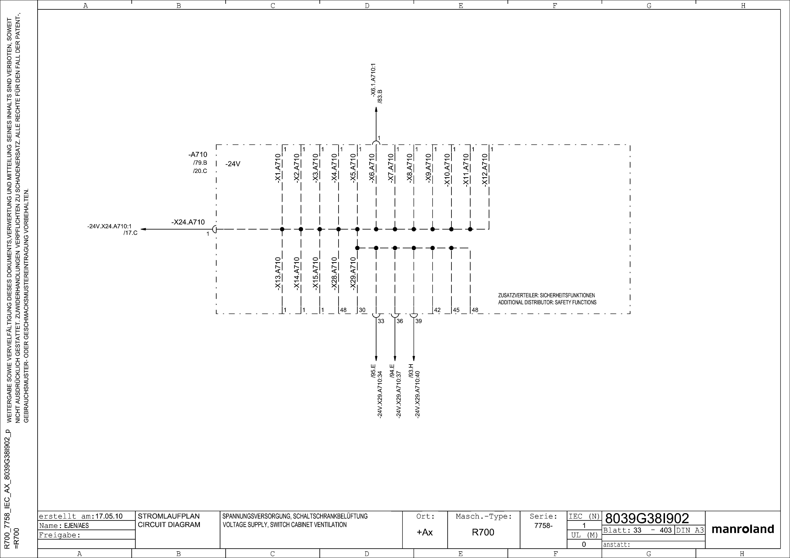

# +Ax — Sheet 33 of 403 — SPANNUNGSVERSORGUNG, SCHALTSCHRANKBELÜFTUNG

**VOLTAGE SUPPLY, SWITCH CABINET VENTILATION**

> Part of the manroland **R700** printing press IEC/UL circuit diagrams.
> Drawing class: **Stromlaufplan / Circuit diagram** (DIN A3).
> Document `+Ax` covers the **Central control console** machine section.

## At a glance

| Field | Value |
|---|---|
| Document | `+Ax`  (8039G38I902) |
| Sheet | **33** of 403 |
| Section (DE) | SPANNUNGSVERSORGUNG, SCHALTSCHRANKBELÜFTUNG |
| Section (EN) | VOLTAGE SUPPLY, SWITCH CABINET VENTILATION |
| Section type | POWER_SUPPLY — Voltage supply |
| Machine type | `R700` |
| Series | `7758` |
| Created | 17.05.10 |
| Replaces | — |
| Columns used | A, B, C, D, E, F |
| Path numbers | — |
| Labels on sheet | 58 |
| Cross-refs out | 7 |
| Cross-refs in | 31 |

**Previous:** [+Ax sheet 32](SHEET_0032.md) · **Next:** [+Ax sheet 34](SHEET_0034.md) · **Document TOC:** [_TOC.md](_TOC.md)  (+Ax) · **Master TOC:** [all sheets](../_MASTER_TOC.md)

## Sheet image (300 DPI, exact vector render)



_Rendered directly from the PDF vector layer at 300 DPI (1-bit), no OCR and no resampling. Use it to confirm anything ambiguous in the text below._

## Cross-references on this sheet

Each entry is a wire leaving this sheet. The printed token is `/sheet.column`; the link resolves to that sheet inside the same document.

| Ref | Target sheet | Col | Path | Destination on target | Target section | From col |
|---|---|---|---|---|---|---|
| `/83.B` | [+Ax sheet 83](SHEET_0083.md) | B | — | X6.1.A710:1 | ANLEGER | D |
| `/79.B` | [+Ax sheet 79](SHEET_0079.md) | B | — | — | ANLEGER | B |
| `/20.C` | [+Ax sheet 20](SHEET_0020.md) | C | — | — | SPANNUNGSVERSORGUNG, SCHALTSCHRANKBELÜFTUNG | B |
| `/17.C` | [+Ax sheet 17](SHEET_0017.md) | C | — | 24V.X24.A710:1 | SPANNUNGSVERSORGUNG, SCHALTSCHRANKBELÜFTUNG | A |
| `/93.H` | [+Ax sheet 93](SHEET_0093.md) | H | — | — | ANLEGER | D |
| `/95.E` | [+Ax sheet 95](SHEET_0095.md) | E | — | — | ANLEGER | D |
| `/94.E` | [+Ax sheet 94](SHEET_0094.md) | E | — | — | ANLEGER | D |

### Incoming references (sheets that point here)

Every other sheet that sends a wire to this one. `Back-ref` is the token printed on *that* sheet; `Path` is its line number.

| From sheet | Cols | Back-ref | Path | Refs | What continues there |
|---|---|---|---|---|---|
| [+Ax#17](SHEET_0017.md) | C | `/17.C` | — | 1 | — |
| [+Ax#20](SHEET_0020.md) | C | `/20.C` | — | 1 | — |
| [+Ax#79](SHEET_0079.md) | B | `/79.B` | — | 1 | — |
| [+Ax#83](SHEET_0083.md) | A | `/83.A` | — | 1 | X6.1.A710:1 |
| [+Ax#93](SHEET_0093.md) | H | `/93.H` | — | 1 | 24V.X29.A710:40 |
| [+Ax#94](SHEET_0094.md) | E | `/94.E` | — | 1 | 24V.X29.A710:37 |
| [+Ax#95](SHEET_0095.md) | E | `/95.E` | — | 1 | 24V.X29.A710:34 |
| [+Ax#211](SHEET_0211.md) | E | `/211.E` | — | 1 | STROMPFAD PIN 1 2 |
| [+Ax#221](SHEET_0221.md) | G | `/221.G` | — | 1 | STROMPFAD PIN 1 2 |
| [+Ax#225](SHEET_0225.md) | H | `/225.H` | — | 1 | STROMPFAD PIN 1 2 |
| [+Ax#229](SHEET_0229.md) | E | `/229.E` | — | 1 | STROMPFAD PIN 1 2 |
| [+Ax#232](SHEET_0232.md) | H | `/232.H` | — | 1 | STROMPFAD PIN 1 2 |
| [+Ax#234](SHEET_0234.md) | G | `/234.G` | — | 1 | — |
| [+Ax#236](SHEET_0236.md) | H | `/236.H` | — | 1 | STROMPFAD PIN 1 2 |
| [+Ax#239](SHEET_0239.md) | C | `/239.C` | — | 1 | STROMPFAD PIN 1 2 |
| [+Ax#242](SHEET_0242.md) | G | `/242.G` | — | 1 | STROMPFAD PIN 1 2 |
| [+Ax#245](SHEET_0245.md) | H | `/245.H` | — | 1 | STROMPFAD PIN 1 2 |
| [+Ax#247](SHEET_0247.md) | H | `/247.H` | — | 1 | STROMPFAD PIN 1 2 |
| [+Ax#249](SHEET_0249.md) | C | `/249.C` | — | 1 | STROMPFAD PIN 1 2 |
| [+Ax#250](SHEET_0250.md) | G | `/250.G` | — | 1 | STROMPFAD PIN 1 2 |
| [+Ax#251](SHEET_0251.md) | H | `/251.H` | — | 1 | STROMPFAD PIN 1 2 |
| [+Ax#253](SHEET_0253.md) | G | `/253.G` | — | 1 | STROMPFAD PIN 1 2 |
| [+Ax#266](SHEET_0266.md) | H | `/266.H` | — | 1 | STROMPFAD PIN 1 2 |
| [+Ax#272](SHEET_0272.md) | F | `/272.F` | — | 1 | — |
| [+Ax#273](SHEET_0273.md) | H | `/273.H` | — | 7 | — |


## Devices on this sheet

| Tag | Class | Class meaning (IEC) | Col | Sub | Terminal | Sign |
|---|---|---|---|---|---|---|
| `A710` | A | Baugruppe / assembly, module, PC board | B | — | — | — |
| `X6.A710` | — | cross-device reference | D | — | — | — |
| `X24.A710` | — | cross-device reference | B | — | — | — |
| `X6.1.A710:1` | — | cross-device reference | D | — | 1 | — |
| `X1.A710` | — | cross-device reference | C | — | — | — |
| `X2.A710` | — | cross-device reference | C | — | — | — |
| `X3.A710` | — | cross-device reference | C | — | — | — |
| `X5.A710` | — | cross-device reference | D | — | — | — |
| `X7.A710` | — | cross-device reference | D | — | — | — |
| `X4.A710` | — | cross-device reference | D | — | — | — |
| `X9.A710` | — | cross-device reference | E | — | — | — |
| `X10.A710` | — | cross-device reference | E | — | — | — |
| `X8.A710` | — | cross-device reference | D | — | — | — |
| `X11.A710` | — | cross-device reference | E | — | — | — |
| `X12.A710` | — | cross-device reference | E | — | — | — |
| `X14.A710` | — | cross-device reference | C | — | — | — |
| `X15.A710` | — | cross-device reference | C | — | — | — |
| `X13.A710` | — | cross-device reference | C | — | — | — |
| `X28.A710` | — | cross-device reference | D | — | — | — |
| `X29.A710` | — | cross-device reference | D | — | — | — |

## Potentials / nets

| Potential | Count | Columns | Attached devices | Terminals |
|---|---|---|---|---|
| `24V` | 5 | A, C, D, E | `A710`, `X24`, `X29` | `1`, `34`, `37`, `40` |


A potential such as `L24+/4` or `M24+` is a named supply/return rail; every place it appears on this sheet is electrically common.

## Wire-end annotations (grouped as printed)

A wire that continues elsewhere is annotated with a small cluster: the destination description, the path/line number `#NN`, and the `/sheet.column` cross reference. Each row below is one such cluster exactly as it is grouped on the drawing.

| Col | Y | Path | Cross-ref | Text on the wire |
|---|---|---|---|---|
| D | 95.0 | — | `/83.B` | `X6.1.A710:1` |
| D | 204.4 | — | — | `1` |
| D | 221.4 | — | — | `1 1 1 1 1` |
| E | 221.4 | — | — | `1 1 1 1 1 1` |
| B | 228.5 | — | — | `A710` |
| C | 231.9 | — | — | `X1.A710` |
| C | 231.9 | — | — | `X2.A710` |
| C | 231.9 | — | — | `X3.A710` |
| D | 231.9 | — | — | `X4.A710` |
| D | 231.9 | — | — | `X5.A710` |
| D | 231.9 | — | — | `X6.A710` |
| D | 231.9 | — | — | `X7.A710` |
| D | 231.9 | — | — | `X8.A710` |
| E | 231.9 | — | — | `X9.A710` |
| E | 231.9 | — | — | `X10.A710` |
| E | 231.9 | — | — | `X11.A710` |
| E | 231.9 | — | — | `X12.A710` |
| B | 241.6 | — | `/79.B`, `/20.C` | — |
| C | 242.7 | — | — | `24V` |
| B | 330.5 | — | — | `X24.A710` |
| A | 337.6 | — | `/17.C` | `24V.X24.A710:1` |
| B | 349.0 | — | — | `1` |
| C | 387.8 | — | — | `X13.A710` |
| C | 387.8 | — | — | `X14.A710` |
| C | 387.8 | — | — | `X15.A710` |
| D | 387.8 | — | — | `X28.A710` |
| D | 387.8 | — | — | `X29.A710` |
| F | 442.8 | — | — | `ZUSATZVERTEILER: SICHERHEITSFUNKTIONEN ADDITIONAL DISTRIBUTOR: SAFETY FUNCTIONS` |
| D | 463.8 | — | — | `1 1 1 48 30` |
| E | 463.8 | — | — | `42 45 48` |
| D | 480.8 | — | — | `33 36 39` |
| D | 549.1 | — | `/93.H` | — |
| D | 549.4 | — | `/95.E` | — |
| D | 549.4 | — | `/94.E` | — |
| D | 559.6 | — | — | `24V.X29.A710:34` |
| D | 559.6 | — | — | `24V.X29.A710:37` |
| E | 559.6 | — | — | `24V.X29.A710:40` |


## Notes and free text on this sheet

| Text | Col | Y (pt) |
|---|---|---|
| `ZUSATZVERTEILER: SICHERHEITSFUNKTIONEN` | F | 442.83 |
| `ADDITIONAL DISTRIBUTOR: SAFETY FUNCTIONS` | F | 453.47 |

## Complete label inventory (exact text from the drawing)

Every text object inside the drawing area of this sheet, in DIN reading order (column A→H, then top→bottom). This is the authoritative list: if a string is not here it is not printed on this sheet.

| Col | Y | X | Dir | Type | Text |
|---|---|---|---|---|---|
| A | 337.6 | 131.8 | → | potential | `24V.X24.A710:1` |
| A | 347.5 | 186.2 | → | cross-reference | `/17.C` |
| B | 228.5 | 284.0 | → | device tag | `A710` |
| B | 241.5 | 291.4 | → | cross-reference | `/79.B` |
| B | 254.0 | 291.1 | → | cross-reference | `/20.C` |
| B | 330.5 | 258.5 | → | device ref | `X24.A710` |
| B | 349.0 | 311.0 | → | number | `1` |
| C | 221.4 | 427.2 | → | number | `1` |
| C | 221.4 | 455.5 | → | number | `1` |
| C | 231.9 | 414.2 | ↕ | device ref | `X1.A710` |
| C | 231.9 | 442.5 | ↕ | device ref | `X2.A710` |
| C | 231.9 | 470.9 | ↕ | device ref | `X3.A710` |
| C | 242.7 | 339.9 | → | potential | `24V` |
| C | 387.8 | 414.2 | ↕ | device ref | `X13.A710` |
| C | 387.8 | 442.5 | ↕ | device ref | `X14.A710` |
| C | 387.8 | 470.9 | ↕ | device ref | `X15.A710` |
| C | 463.8 | 427.2 | → | number | `1` |
| C | 463.8 | 455.5 | → | number | `1` |
| D | 95.0 | 558.7 | ↕ | device ref | `X6.1.A710:1` |
| D | 135.2 | 568.6 | ↕ | cross-reference | `/83.B` |
| D | 204.4 | 568.9 | → | number | `1` |
| D | 221.4 | 483.9 | → | number | `1` |
| D | 221.4 | 512.2 | → | number | `1` |
| D | 221.4 | 540.6 | → | number | `1` |
| D | 221.4 | 597.3 | → | number | `1` |
| D | 231.9 | 499.2 | ↕ | device ref | `X4.A710` |
| D | 231.9 | 527.6 | ↕ | device ref | `X5.A710` |
| D | 231.9 | 555.9 | ↕ | device ref | `X6.A710` |
| D | 231.9 | 584.2 | ↕ | device ref | `X7.A710` |
| D | 231.9 | 612.6 | ↕ | device ref | `X8.A710` |
| D | 387.8 | 499.2 | ↕ | device ref | `X28.A710` |
| D | 387.8 | 527.5 | ↕ | device ref | `X29.A710` |
| D | 463.8 | 483.9 | → | number | `1` |
| D | 463.8 | 512.8 | → | number | `48` |
| D | 463.8 | 541.1 | → | number | `30` |
| D | 480.8 | 569.5 | → | number | `33` |
| D | 480.8 | 597.8 | → | number | `36` |
| D | 549.1 | 615.4 | ↕ | cross-reference | `/93.H` |
| D | 549.4 | 558.7 | ↕ | cross-reference | `/95.E` |
| D | 549.4 | 587.0 | ↕ | cross-reference | `/94.E` |
| D | 559.6 | 568.6 | ↕ | potential | `24V.X29.A710:34` |
| D | 559.6 | 597.0 | ↕ | potential | `24V.X29.A710:37` |
| E | 221.4 | 625.6 | → | number | `1` |
| E | 221.4 | 654.0 | → | number | `1` |
| E | 221.4 | 682.3 | → | number | `1` |
| E | 221.4 | 710.6 | → | number | `1` |
| E | 221.4 | 739.0 | → | number | `1` |
| E | 231.9 | 640.9 | ↕ | device ref | `X9.A710` |
| E | 231.9 | 669.3 | ↕ | device ref | `X10.A710` |
| E | 231.9 | 697.6 | ↕ | device ref | `X11.A710` |
| E | 231.9 | 726.0 | ↕ | device ref | `X12.A710` |
| E | 463.8 | 654.5 | → | number | `42` |
| E | 463.8 | 682.9 | → | number | `45` |
| E | 463.8 | 711.2 | → | number | `48` |
| E | 480.8 | 626.2 | → | number | `39` |
| E | 559.6 | 625.3 | ↕ | potential | `24V.X29.A710:40` |
| F | 442.8 | 751.2 | → | text | `ZUSATZVERTEILER: SICHERHEITSFUNKTIONEN` |
| F | 453.5 | 751.2 | → | text | `ADDITIONAL DISTRIBUTOR: SAFETY FUNCTIONS` |

## Reading-order text block

The same content as a plain block, grouped by DIN column — convenient to paste or to match against a visual description.

```text
=== Column A ===
 337.6  131.8  net          24V.X24.A710:1
 347.5  186.2  xref         /17.C
=== Column B ===
 228.5  284.0  devtag       A710
 241.5  291.4  xref         /79.B
 254.0  291.1  xref         /20.C
 330.5  258.5  devref       X24.A710
 349.0  311.0  numeric      1
=== Column C ===
 221.4  427.2  numeric      1
 221.4  455.5  numeric      1
 231.9  414.2  devref       X1.A710
 231.9  442.5  devref       X2.A710
 231.9  470.9  devref       X3.A710
 242.7  339.9  net          24V
 387.8  414.2  devref       X13.A710
 387.8  442.5  devref       X14.A710
 387.8  470.9  devref       X15.A710
 463.8  427.2  numeric      1
 463.8  455.5  numeric      1
=== Column D ===
  95.0  558.7  devref       X6.1.A710:1
 135.2  568.6  xref         /83.B
 204.4  568.9  numeric      1
 221.4  483.9  numeric      1
 221.4  512.2  numeric      1
 221.4  540.6  numeric      1
 221.4  597.3  numeric      1
 231.9  499.2  devref       X4.A710
 231.9  527.6  devref       X5.A710
 231.9  555.9  devref       X6.A710
 231.9  584.2  devref       X7.A710
 231.9  612.6  devref       X8.A710
 387.8  499.2  devref       X28.A710
 387.8  527.5  devref       X29.A710
 463.8  483.9  numeric      1
 463.8  512.8  numeric      48
 463.8  541.1  numeric      30
 480.8  569.5  numeric      33
 480.8  597.8  numeric      36
 549.1  615.4  xref         /93.H
 549.4  558.7  xref         /95.E
 549.4  587.0  xref         /94.E
 559.6  568.6  net          24V.X29.A710:34
 559.6  597.0  net          24V.X29.A710:37
=== Column E ===
 221.4  625.6  numeric      1
 221.4  654.0  numeric      1
 221.4  682.3  numeric      1
 221.4  710.6  numeric      1
 221.4  739.0  numeric      1
 231.9  640.9  devref       X9.A710
 231.9  669.3  devref       X10.A710
 231.9  697.6  devref       X11.A710
 231.9  726.0  devref       X12.A710
 463.8  654.5  numeric      42
 463.8  682.9  numeric      45
 463.8  711.2  numeric      48
 480.8  626.2  numeric      39
 559.6  625.3  net          24V.X29.A710:40
=== Column F ===
 442.8  751.2  text         ZUSATZVERTEILER: SICHERHEITSFUNKTIONEN
 453.5  751.2  text         ADDITIONAL DISTRIBUTOR: SAFETY FUNCTIONS
```

---
_Generated from the PDF vector text layer; no OCR. Source: `R700_7758_IEC_AX_8039G38I902_p`, sheet 33._
