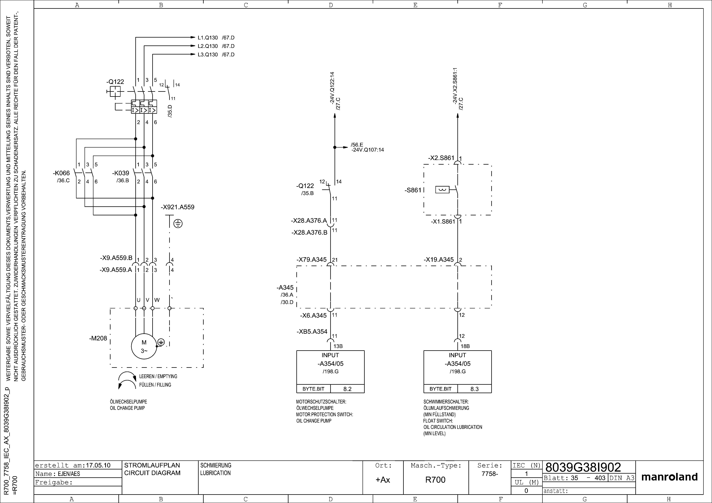

# +Ax — Sheet 35 of 403 — SCHMIERUNG

**LUBRICATION**

> Part of the manroland **R700** printing press IEC/UL circuit diagrams.
> Drawing class: **Stromlaufplan / Circuit diagram** (DIN A3).
> Document `+Ax` covers the **Central control console** machine section.

## At a glance

| Field | Value |
|---|---|
| Document | `+Ax`  (8039G38I902) |
| Sheet | **35** of 403 |
| Section (DE) | SCHMIERUNG |
| Section (EN) | LUBRICATION |
| Section type | CIRCUIT — Circuit diagram |
| Machine type | `R700` |
| Series | `7758` |
| Created | 17.05.10 |
| Replaces | — |
| Columns used | A, B, C, D, E, F |
| Path numbers | — |
| Labels on sheet | 110 |
| Cross-refs out | 14 |
| Cross-refs in | 30 |

**Previous:** [+Ax sheet 34](SHEET_0034.md) · **Next:** [+Ax sheet 36](SHEET_0036.md) · **Document TOC:** [_TOC.md](_TOC.md)  (+Ax) · **Master TOC:** [all sheets](../_MASTER_TOC.md)

## Sheet image (300 DPI, exact vector render)



_Rendered directly from the PDF vector layer at 300 DPI (1-bit), no OCR and no resampling. Use it to confirm anything ambiguous in the text below._

## Cross-references on this sheet

Each entry is a wire leaving this sheet. The printed token is `/sheet.column`; the link resolves to that sheet inside the same document.

| Ref | Target sheet | Col | Path | Destination on target | Target section | From col |
|---|---|---|---|---|---|---|
| `/67.D` | [+Ax sheet 67](SHEET_0067.md) | D | — | L1.Q130 | SAUGBÄNDERTISCH | C |
| `/67.D` | [+Ax sheet 67](SHEET_0067.md) | D | — | L2.Q130 | SAUGBÄNDERTISCH | C |
| `/67.D` | [+Ax sheet 67](SHEET_0067.md) | D | — | L3.Q130 | SAUGBÄNDERTISCH | C |
| `/27.C` | [+Ax sheet 27](SHEET_0027.md) | C | — | 24V.X2.S861:1 | SPANNUNGSVERSORGUNG, SCHALTSCHRANKBELÜFTUNG | F |
| `/27.C` | [+Ax sheet 27](SHEET_0027.md) | C | — | 24V.Q122:14 | SPANNUNGSVERSORGUNG, SCHALTSCHRANKBELÜFTUNG | D |
| `/35.D` | [+Ax sheet 35](SHEET_0035.md) | D | — | — | SCHMIERUNG | B |
| `/56.E` | [+Ax sheet 56](SHEET_0056.md) | E | — | — | LUFTVERSORGUNG | D |
| `/36.B` | [+Ax sheet 36](SHEET_0036.md) | B | — | — | SCHMIERUNG | B |
| `/36.C` | [+Ax sheet 36](SHEET_0036.md) | C | — | — | SCHMIERUNG | A |
| `/35.B` | [+Ax sheet 35](SHEET_0035.md) | B | — | — | SCHMIERUNG | D |
| `/36.A` | [+Ax sheet 36](SHEET_0036.md) | A | — | — | SCHMIERUNG | C |
| `/30.D` | [+Ax sheet 30](SHEET_0030.md) | D | — | — | SPANNUNGSVERSORGUNG, SCHALTSCHRANKBELÜFTUNG | C |
| `/198.G` | [+Ax sheet 198](SHEET_0198.md) | G | — | — | REFERENZMODUL | D |
| `/198.G` | [+Ax sheet 198](SHEET_0198.md) | G | — | — | REFERENZMODUL | F |

### Incoming references (sheets that point here)

Every other sheet that sends a wire to this one. `Back-ref` is the token printed on *that* sheet; `Path` is its line number.

| From sheet | Cols | Back-ref | Path | Refs | What continues there |
|---|---|---|---|---|---|
| [+Ax#27](SHEET_0027.md) | C | `/27.C` | — | 2 | 24V.X2.S861:1 |
| [+Ax#30](SHEET_0030.md) | D | `/30.D` | — | 1 | — |
| [+Ax#35](SHEET_0035.md) | B, D | `/35.B`, `/35.D` | — | 2 | — |
| [+Ax#36](SHEET_0036.md) | A, B, C | `/36.A`, `/36.B`, `/36.C` | — | 3 | — |
| [+Ax#56](SHEET_0056.md) | E | `/56.E` | — | 1 | 24V.Q107:14 |
| [+Ax#67](SHEET_0067.md) | C | `/67.C` | — | 3 | L1.Q130; L2.Q130; L3.Q130 |
| [+Ax#198](SHEET_0198.md) | G | `/198.G` | — | 2 | — |
| [+Ax#231](SHEET_0231.md) | E | `/231.E` | — | 2 | — |
| [+Ax#233](SHEET_0233.md) | G | `/233.G` | — | 2 | — |
| [+Ax#242](SHEET_0242.md) | G | `/242.G` | — | 8 | — |
| [+Ax#258](SHEET_0258.md) | H | `/258.H` | — | 1 | — |
| [+Ax#271](SHEET_0271.md) | D, E | `/271.D`, `/271.E` | — | 2 | — |
| [+Ax#286](SHEET_0286.md) | B | `/286.B` | — | 1 | — |


## Devices on this sheet

| Tag | Class | Class meaning (IEC) | Col | Sub | Terminal | Sign |
|---|---|---|---|---|---|---|
| `K039` | K | Relais / relay, contactor | B | — | — | — |
| `K066` | K | Relais / relay, contactor | A | — | — | — |
| `Q122` | Q | Leistungsschalter / power switching device | A | — | — | — |
| `A354/05` | A | Baugruppe / assembly, module, PC board | F | 05 | — | — |
| `S861` | S | Schalter / switch | E | — | — | — |
| `A354/05` | A | Baugruppe / assembly, module, PC board | D | 05 | — | — |
| `A345` | A | Baugruppe / assembly, module, PC board | C | — | — | — |
| `Q122` | Q | Leistungsschalter / power switching device | D | — | — | — |
| `X9.A559.B` | — | cross-device reference | A | — | — | — |
| `X9.A559.A` | — | cross-device reference | A | — | — | — |
| `8.3` | — | cross-device reference | F | — | — | — |
| `X19.A345` | — | cross-device reference | E | — | — | — |
| `X1.S861` | — | cross-device reference | E | — | — | — |
| `X2.S861` | — | cross-device reference | E | — | — | — |
| `8.2` | — | cross-device reference | D | — | — | — |
| `XB5.A354` | — | cross-device reference | D | — | — | — |
| `X6.A345` | — | cross-device reference | D | — | — | — |
| `X28.A376.B` | — | cross-device reference | D | — | — | — |
| `X28.A376.A` | — | cross-device reference | D | — | — | — |
| `X79.A345` | — | cross-device reference | D | — | — | — |
| `X921.A559` | — | cross-device reference | B | — | — | — |

## Potentials / nets

| Potential | Count | Columns | Attached devices | Terminals |
|---|---|---|---|---|
| `24V` | 3 | D, E | `Q107`, `Q122`, `S861`, `X2` | `1`, `14` |
| `L1` | 1 | C | `Q130` | — |
| `L2` | 1 | C | `Q130` | — |
| `L3` | 1 | C | `Q130` | — |
| `M208` | 1 | A | — | — |


A potential such as `L24+/4` or `M24+` is a named supply/return rail; every place it appears on this sheet is electrically common.

## Wire-end annotations (grouped as printed)

A wire that continues elsewhere is annotated with a small cluster: the destination description, the path/line number `#NN`, and the `/sheet.column` cross reference. Each row below is one such cluster exactly as it is grouped on the drawing.

| Col | Y | Path | Cross-ref | Text on the wire |
|---|---|---|---|---|
| C | 59.1 | — | `/67.D` | `L1.Q130` |
| C | 73.3 | — | `/67.D` | `L2.Q130` |
| C | 87.5 | — | `/67.D` | `L3.Q130` |
| F | 112.5 | — | `/27.C` | `24V.X2.S861:1` |
| D | 120.2 | — | `/27.C` | `24V.Q122:14` |
| B | 130.0 | — | — | `1` |
| B | 130.0 | — | — | `3` |
| B | 130.0 | — | — | `5` |
| A | 132.1 | — | — | `Q122` |
| B | 139.1 | — | — | `12 14` |
| B | 161.8 | — | — | `11` |
| B | 175.5 | — | `/35.D` | — |
| B | 200.9 | — | — | `2` |
| B | 200.9 | — | — | `4` |
| B | 200.9 | — | — | `6` |
| D | 238.4 | — | `/56.E` | — |
| D | 246.9 | — | — | `24V.Q107:14` |
| E | 259.7 | — | — | `X2.S861 1` |
| A | 271.7 | — | — | `1` |
| A | 271.7 | — | — | `3` |
| A | 271.7 | — | — | `5` |
| B | 271.7 | — | — | `1` |
| B | 271.7 | — | — | `3` |
| B | 271.7 | — | — | `5` |
| A | 285.2 | — | — | `K066 6` |
| B | 285.2 | — | — | `K039 6` |
| B | 298.2 | — | `/36.B` | — |
| A | 298.3 | — | `/36.C` | — |
| A | 300.1 | — | — | `2` |
| A | 300.1 | — | — | `4` |
| B | 300.1 | — | — | `2` |
| B | 300.1 | — | — | `4` |
| D | 300.1 | — | — | `Q122 14` |
| D | 300.1 | — | — | `12` |
| E | 313.5 | — | — | `S861` |
| D | 319.5 | — | `/35.B` | — |
| D | 328.4 | — | — | `11` |
| B | 341.9 | — | — | `X921.A559` |
| D | 364.6 | — | — | `X28.A376.A 11` |
| E | 365.9 | — | — | `X1.S861 1` |
| D | 381.6 | — | — | `X28.A376.B 11` |
| B | 426.9 | — | — | `X9.A559.B 1 2 3 4` |
| D | 429.8 | — | — | `X79.A345 21` |
| E | 429.8 | — | — | `X19.A345 2` |
| B | 446.8 | — | — | `X9.A559.A 1 2 3 4` |
| C | 476.5 | — | — | `A345` |
| C | 489.6 | — | `/36.A`, `/30.D` | — |
| B | 497.3 | — | — | `U V W '` |
| D | 523.3 | — | — | `X6.A345 11` |
| F | 523.3 | — | — | `12` |
| D | 550.2 | — | — | `XB5.A354 11` |
| F | 558.8 | — | — | `12` |
| A | 561.6 | — | — | `M208` |
| B | 568.9 | — | — | `3~ M` |
| D | 575.7 | — | — | `13B` |
| F | 575.7 | — | — | `18B` |
| D | 590.2 | — | — | `INPUT` |
| E | 590.2 | — | — | `INPUT` |
| D | 604.1 | — | — | `A354/05` |
| F | 604.1 | — | — | `A354/05` |
| D | 617.9 | — | `/198.G` | — |
| F | 617.9 | — | `/198.G` | — |
| B | 627.1 | — | — | `LEEREN / EMPTYING` |
| B | 641.2 | — | — | `FÜLLEN / FILLING` |
| D | 646.9 | — | — | `BYTE.BIT 8.2` |
| E | 646.9 | — | — | `BYTE.BIT 8.3` |
| B | 669.6 | — | — | `ÖLWECHSELPUMPE OIL CHANGE PUMP` |
| D | 669.6 | — | — | `MOTORSCHUTZSCHALTER: MOTOR PROTECTION SWITCH: ÖLWECHSELPUMPE OIL CHANGE PUMP` |
| E | 669.6 | — | — | `FLOAT SWITCH: (MIN FÜLLSTAND) SCHWIMMERSCHALTER: ÖLUMLAUFSCHMIERUNG` |
| E | 712.1 | — | — | `(MIN LEVEL) OIL CIRCULATION LUBRICATION` |


## Reconstructed tables

This sheet carries tabular content (pin map / terminal assignment / index). The grid below was rebuilt from the drawing's own rule lines, so each row is exactly one physical row of the table.

### Table 1 — 0 data rows × 4 columns (at x=127.6, y=62.4) — **Q122**

_none_


### Table 2 — 3 data rows × 1 columns (at x=226.8, y=62.4)

| C1 |
|---|
| `1` |
| `2` |
| `1 2` |


### Table 3 — 3 data rows × 1 columns (at x=240.9, y=62.4)

| C1 |
|---|
| `3` |
| `4` |
| `3 4` |


### Table 4 — 2 data rows × 2 columns (at x=255.1, y=62.4)

| 5 | 12 |
|---|---|
| `6` |  |
| `5 6` |  |


### Table 5 — 1 data rows × 3 columns (at x=496.1, y=586.8)

| INPUT | A354/05 /198.G |  |
|---|---|---|
| `BYTE.BIT` |  | `8.2` |


### Table 6 — 1 data rows × 2 columns (at x=708.7, y=586.8)

| INPUT | A354/05 /198.G |
|---|---|
| `BYTE.BIT` | `8.3` |


## Notes and free text on this sheet

| Text | Col | Y (pt) |
|---|---|---|
| `M` | B | 568.93 |
| `U` | B | 498.52 |
| `V` | B | 498.41 |
| `W` | B | 498.15 |
| `ÖLWECHSELPUMPE` | B | 669.59 |
| `OIL CHANGE PUMP` | B | 680.25 |
| `18B` | F | 575.72 |
| `INPUT` | E | 590.24 |
| `BYTE.BIT` | E | 647.49 |
| `SCHWIMMERSCHALTER:` | E | 669.6 |
| `ÖLUMLAUFSCHMIERUNG` | E | 680.27 |
| `(MIN FÜLLSTAND)` | E | 690.89 |
| `FLOAT SWITCH:` | E | 701.44 |
| `OIL CIRCULATION LUBRICATION` | E | 712.14 |
| `(MIN LEVEL)` | E | 722.76 |
| `13B` | D | 575.72 |
| `INPUT` | D | 590.24 |
| `BYTE.BIT` | D | 647.49 |
| `MOTORSCHUTZSCHALTER:` | D | 669.62 |
| `ÖLWECHSELPUMPE` | D | 680.22 |
| `MOTOR PROTECTION SWITCH:` | D | 690.86 |
| `OIL CHANGE PUMP` | D | 701.51 |
| `LEEREN / EMPTYING` | B | 627.07 |
| `FÜLLEN / FILLING` | B | 641.25 |

## Complete label inventory (exact text from the drawing)

Every text object inside the drawing area of this sheet, in DIN reading order (column A→H, then top→bottom). This is the authoritative list: if a string is not here it is not printed on this sheet.

| Col | Y | X | Dir | Type | Text |
|---|---|---|---|---|---|
| A | 132.1 | 178.0 | → | device tag | `Q122` |
| A | 271.7 | 129.5 | → | number | `1` |
| A | 271.7 | 144.3 | → | number | `3` |
| A | 271.7 | 158.5 | → | number | `5` |
| A | 285.2 | 88.4 | → | device tag | `K066` |
| A | 298.3 | 95.5 | → | cross-reference | `/36.C` |
| A | 300.1 | 130.1 | → | number | `2` |
| A | 300.1 | 144.3 | → | number | `4` |
| A | 300.1 | 158.5 | → | number | `6` |
| A | 426.9 | 167.5 | → | device ref | `X9.A559.B` |
| A | 446.8 | 166.7 | → | device ref | `X9.A559.A` |
| A | 561.6 | 149.1 | → | potential | `M208` |
| B | 130.0 | 228.8 | → | number | `1` |
| B | 130.0 | 243.5 | → | number | `3` |
| B | 130.0 | 257.7 | → | number | `5` |
| B | 139.1 | 265.9 | → | number | `12` |
| B | 139.1 | 292.8 | → | number | `14` |
| B | 161.8 | 285.7 | → | number | `11` |
| B | 175.5 | 280.2 | ↕ | cross-reference | `/35.D` |
| B | 200.9 | 229.3 | → | number | `2` |
| B | 200.9 | 243.5 | → | number | `4` |
| B | 200.9 | 257.7 | → | number | `6` |
| B | 271.7 | 228.8 | → | number | `1` |
| B | 271.7 | 243.5 | → | number | `3` |
| B | 271.7 | 257.7 | → | number | `5` |
| B | 285.2 | 187.7 | → | device tag | `K039` |
| B | 298.2 | 195.0 | → | cross-reference | `/36.B` |
| B | 300.1 | 229.3 | → | number | `2` |
| B | 300.1 | 243.5 | → | number | `4` |
| B | 300.1 | 257.7 | → | number | `6` |
| B | 341.9 | 269.0 | → | device ref | `X921.A559` |
| B | 431.2 | 228.8 | → | number | `1` |
| B | 431.2 | 243.5 | → | number | `2` |
| B | 431.2 | 257.7 | → | number | `3` |
| B | 431.2 | 286.0 | → | number | `4` |
| B | 448.2 | 228.8 | → | number | `1` |
| B | 448.2 | 243.5 | → | number | `2` |
| B | 448.2 | 257.7 | → | number | `3` |
| B | 448.2 | 286.0 | → | number | `4` |
| B | 497.3 | 285.7 | → | other | `'` |
| B | 498.2 | 258.0 | → | text | `W` |
| B | 498.4 | 243.8 | → | text | `V` |
| B | 498.5 | 228.8 | → | text | `U` |
| B | 568.9 | 236.8 | → | text | `M` |
| B | 583.2 | 235.6 | → | other | `3~` |
| B | 627.1 | 233.0 | → | text | `LEEREN / EMPTYING` |
| B | 641.2 | 233.0 | → | text | `FÜLLEN / FILLING` |
| B | 669.6 | 184.0 | → | text | `ÖLWECHSELPUMPE` |
| B | 680.2 | 184.0 | → | text | `OIL CHANGE PUMP` |
| C | 59.1 | 330.8 | → | potential | `L1.Q130` |
| C | 59.1 | 371.3 | → | cross-reference | `/67.D` |
| C | 73.3 | 330.8 | → | potential | `L2.Q130` |
| C | 73.3 | 371.3 | → | cross-reference | `/67.D` |
| C | 87.4 | 371.3 | → | cross-reference | `/67.D` |
| C | 87.5 | 330.8 | → | potential | `L3.Q130` |
| C | 476.5 | 462.6 | → | device tag | `A345` |
| C | 489.6 | 469.7 | → | cross-reference | `/36.A` |
| C | 502.0 | 469.7 | → | cross-reference | `/30.D` |
| D | 120.2 | 551.6 | ↕ | potential | `24V.Q122:14` |
| D | 163.3 | 561.5 | ↕ | cross-reference | `/27.C` |
| D | 238.4 | 586.8 | → | cross-reference | `/56.E` |
| D | 246.9 | 587.9 | → | potential | `24V.Q107:14` |
| D | 300.1 | 533.8 | → | number | `12` |
| D | 300.1 | 561.8 | → | number | `14` |
| D | 306.5 | 495.5 | → | device tag | `Q122` |
| D | 319.5 | 504.0 | → | cross-reference | `/35.B` |
| D | 328.4 | 554.7 | → | number | `11` |
| D | 364.6 | 486.7 | → | device ref | `X28.A376.A` |
| D | 364.6 | 554.7 | → | number | `11` |
| D | 381.6 | 554.7 | → | number | `11` |
| D | 384.4 | 487.6 | → | device ref | `X28.A376.B` |
| D | 429.8 | 496.1 | → | device ref | `X79.A345` |
| D | 431.2 | 555.3 | → | number | `21` |
| D | 523.3 | 502.0 | → | device ref | `X6.A345` |
| D | 523.3 | 554.7 | → | number | `11` |
| D | 550.2 | 496.3 | → | device ref | `XB5.A354` |
| D | 558.7 | 554.7 | → | number | `11` |
| D | 575.7 | 557.6 | → | text | `13B` |
| D | 590.2 | 537.9 | → | text | `INPUT` |
| D | 604.1 | 531.4 | → | device tag | `A354/05` |
| D | 617.9 | 539.9 | → | cross-reference | `/198.G` |
| D | 646.9 | 574.3 | → | device ref | `8.2` |
| D | 647.5 | 506.0 | → | text | `BYTE.BIT` |
| D | 669.6 | 495.5 | → | text | `MOTORSCHUTZSCHALTER:` |
| D | 680.2 | 495.8 | → | text | `ÖLWECHSELPUMPE` |
| D | 690.9 | 495.5 | → | text | `MOTOR PROTECTION SWITCH:` |
| D | 701.5 | 495.8 | → | text | `OIL CHANGE PUMP` |
| E | 112.5 | 757.1 | ↕ | potential | `24V.X2.S861:1` |
| E | 259.7 | 716.0 | → | device ref | `X2.S861` |
| E | 313.5 | 676.6 | → | device tag | `S861` |
| E | 366.6 | 720.9 | → | device ref | `X1.S861` |
| E | 429.8 | 708.7 | → | device ref | `X19.A345` |
| E | 590.2 | 750.5 | → | text | `INPUT` |
| E | 647.5 | 718.6 | → | text | `BYTE.BIT` |
| E | 669.6 | 708.4 | → | text | `SCHWIMMERSCHALTER:` |
| E | 680.3 | 708.4 | → | text | `ÖLUMLAUFSCHMIERUNG` |
| E | 690.9 | 708.1 | → | text | `(MIN FÜLLSTAND)` |
| E | 701.4 | 707.8 | → | text | `FLOAT SWITCH:` |
| E | 712.1 | 708.4 | → | text | `OIL CIRCULATION LUBRICATION` |
| E | 722.8 | 708.1 | → | text | `(MIN LEVEL)` |
| F | 163.3 | 767.1 | ↕ | cross-reference | `/27.C` |
| F | 261.1 | 767.1 | → | number | `1` |
| F | 365.9 | 767.1 | → | number | `1` |
| F | 431.2 | 767.9 | → | number | `2` |
| F | 523.3 | 767.3 | → | number | `12` |
| F | 558.7 | 767.3 | → | number | `12` |
| F | 575.7 | 770.2 | → | text | `18B` |
| F | 604.1 | 744.0 | → | device tag | `A354/05` |
| F | 617.9 | 752.5 | → | cross-reference | `/198.G` |
| F | 646.9 | 786.9 | → | device ref | `8.3` |

## Reading-order text block

The same content as a plain block, grouped by DIN column — convenient to paste or to match against a visual description.

```text
=== Column A ===
 132.1  178.0  devtag       Q122
 271.7  129.5  numeric      1
 271.7  144.3  numeric      3
 271.7  158.5  numeric      5
 285.2   88.4  devtag       K066
 298.3   95.5  xref         /36.C
 300.1  130.1  numeric      2
 300.1  144.3  numeric      4
 300.1  158.5  numeric      6
 426.9  167.5  devref       X9.A559.B
 446.8  166.7  devref       X9.A559.A
 561.6  149.1  net          M208
=== Column B ===
 130.0  228.8  numeric      1
 130.0  243.5  numeric      3
 130.0  257.7  numeric      5
 139.1  265.9  numeric      12
 139.1  292.8  numeric      14
 161.8  285.7  numeric      11
 175.5  280.2  xref         /35.D
 200.9  229.3  numeric      2
 200.9  243.5  numeric      4
 200.9  257.7  numeric      6
 271.7  228.8  numeric      1
 271.7  243.5  numeric      3
 271.7  257.7  numeric      5
 285.2  187.7  devtag       K039
 298.2  195.0  xref         /36.B
 300.1  229.3  numeric      2
 300.1  243.5  numeric      4
 300.1  257.7  numeric      6
 341.9  269.0  devref       X921.A559
 431.2  228.8  numeric      1
 431.2  243.5  numeric      2
 431.2  257.7  numeric      3
 431.2  286.0  numeric      4
 448.2  228.8  numeric      1
 448.2  243.5  numeric      2
 448.2  257.7  numeric      3
 448.2  286.0  numeric      4
 497.3  285.7  other        `
 498.2  258.0  text         W
 498.4  243.8  text         V
 498.5  228.8  text         U
 568.9  236.8  text         M
 583.2  235.6  other        3~
 627.1  233.0  text         LEEREN / EMPTYING
 641.2  233.0  text         FÜLLEN / FILLING
 669.6  184.0  text         ÖLWECHSELPUMPE
 680.2  184.0  text         OIL CHANGE PUMP
=== Column C ===
  59.1  330.8  net          L1.Q130
  59.1  371.3  xref         /67.D
  73.3  330.8  net          L2.Q130
  73.3  371.3  xref         /67.D
  87.4  371.3  xref         /67.D
  87.5  330.8  net          L3.Q130
 476.5  462.6  devtag       A345
 489.6  469.7  xref         /36.A
 502.0  469.7  xref         /30.D
=== Column D ===
 120.2  551.6  net          24V.Q122:14
 163.3  561.5  xref         /27.C
 238.4  586.8  xref         /56.E
 246.9  587.9  net          24V.Q107:14
 300.1  533.8  numeric      12
 300.1  561.8  numeric      14
 306.5  495.5  devtag       Q122
 319.5  504.0  xref         /35.B
 328.4  554.7  numeric      11
 364.6  486.7  devref       X28.A376.A
 364.6  554.7  numeric      11
 381.6  554.7  numeric      11
 384.4  487.6  devref       X28.A376.B
 429.8  496.1  devref       X79.A345
 431.2  555.3  numeric      21
 523.3  502.0  devref       X6.A345
 523.3  554.7  numeric      11
 550.2  496.3  devref       XB5.A354
 558.7  554.7  numeric      11
 575.7  557.6  text         13B
 590.2  537.9  text         INPUT
 604.1  531.4  devtag       A354/05
 617.9  539.9  xref         /198.G
 646.9  574.3  devref       8.2
 647.5  506.0  text         BYTE.BIT
 669.6  495.5  text         MOTORSCHUTZSCHALTER:
 680.2  495.8  text         ÖLWECHSELPUMPE
 690.9  495.5  text         MOTOR PROTECTION SWITCH:
 701.5  495.8  text         OIL CHANGE PUMP
=== Column E ===
 112.5  757.1  net          24V.X2.S861:1
 259.7  716.0  devref       X2.S861
 313.5  676.6  devtag       S861
 366.6  720.9  devref       X1.S861
 429.8  708.7  devref       X19.A345
 590.2  750.5  text         INPUT
 647.5  718.6  text         BYTE.BIT
 669.6  708.4  text         SCHWIMMERSCHALTER:
 680.3  708.4  text         ÖLUMLAUFSCHMIERUNG
 690.9  708.1  text         (MIN FÜLLSTAND)
 701.4  707.8  text         FLOAT SWITCH:
 712.1  708.4  text         OIL CIRCULATION LUBRICATION
 722.8  708.1  text         (MIN LEVEL)
=== Column F ===
 163.3  767.1  xref         /27.C
 261.1  767.1  numeric      1
 365.9  767.1  numeric      1
 431.2  767.9  numeric      2
 523.3  767.3  numeric      12
 558.7  767.3  numeric      12
 575.7  770.2  text         18B
 604.1  744.0  devtag       A354/05
 617.9  752.5  xref         /198.G
 646.9  786.9  devref       8.3
```

---
_Generated from the PDF vector text layer; no OCR. Source: `R700_7758_IEC_AX_8039G38I902_p`, sheet 35._
