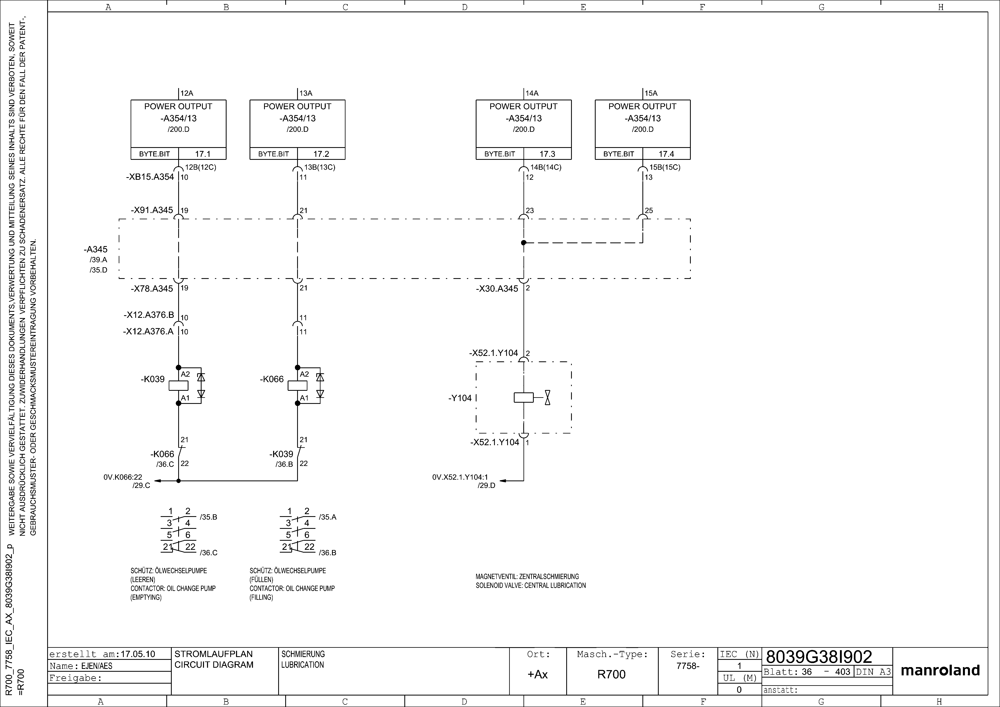

# +Ax — Sheet 36 of 403 — SCHMIERUNG

**LUBRICATION**

> Part of the manroland **R700** printing press IEC/UL circuit diagrams.
> Drawing class: **Stromlaufplan / Circuit diagram** (DIN A3).
> Document `+Ax` covers the **Central control console** machine section.

## At a glance

| Field | Value |
|---|---|
| Document | `+Ax`  (8039G38I902) |
| Sheet | **36** of 403 |
| Section (DE) | SCHMIERUNG |
| Section (EN) | LUBRICATION |
| Section type | CIRCUIT — Circuit diagram |
| Machine type | `R700` |
| Series | `7758` |
| Created | 17.05.10 |
| Replaces | — |
| Columns used | A, B, C, D, E, F |
| Path numbers | — |
| Labels on sheet | 105 |
| Cross-refs out | 14 |
| Cross-refs in | 31 |

**Previous:** [+Ax sheet 35](SHEET_0035.md) · **Next:** [+Ax sheet 37](SHEET_0037.md) · **Document TOC:** [_TOC.md](_TOC.md)  (+Ax) · **Master TOC:** [all sheets](../_MASTER_TOC.md)

## Sheet image (300 DPI, exact vector render)



_Rendered directly from the PDF vector layer at 300 DPI (1-bit), no OCR and no resampling. Use it to confirm anything ambiguous in the text below._

## Cross-references on this sheet

Each entry is a wire leaving this sheet. The printed token is `/sheet.column`; the link resolves to that sheet inside the same document.

| Ref | Target sheet | Col | Path | Destination on target | Target section | From col |
|---|---|---|---|---|---|---|
| `/200.D` | [+Ax sheet 200](SHEET_0200.md) | D | — | — | REFERENZMODUL | B |
| `/200.D` | [+Ax sheet 200](SHEET_0200.md) | D | — | — | REFERENZMODUL | C |
| `/200.D` | [+Ax sheet 200](SHEET_0200.md) | D | — | — | REFERENZMODUL | E |
| `/200.D` | [+Ax sheet 200](SHEET_0200.md) | D | — | — | REFERENZMODUL | F |
| `/39.A` | [+Ax sheet 39](SHEET_0039.md) | A | — | — | HAUPTANTRIEB | A |
| `/35.D` | [+Ax sheet 35](SHEET_0035.md) | D | — | — | SCHMIERUNG | A |
| `/36.B` | [+Ax sheet 36](SHEET_0036.md) | B | — | — | SCHMIERUNG | B |
| `/36.C` | [+Ax sheet 36](SHEET_0036.md) | C | — | — | SCHMIERUNG | A |
| `/29.C` | [+Ax sheet 29](SHEET_0029.md) | C | — | 0V.X52.1.Y104:1 0V.K066:22 | SPANNUNGSVERSORGUNG, SCHALTSCHRANKBELÜFTUNG | C |
| `/29.D` | [+Ax sheet 29](SHEET_0029.md) | D | — | 0V.X52.1.Y104:1 0V.K066:22 | SPANNUNGSVERSORGUNG, SCHALTSCHRANKBELÜFTUNG | C |
| `/35.B` | [+Ax sheet 35](SHEET_0035.md) | B | — | — | SCHMIERUNG | B |
| `/35.A` | [+Ax sheet 35](SHEET_0035.md) | A | — | — | SCHMIERUNG | C |
| `/36.B` | [+Ax sheet 36](SHEET_0036.md) | B | — | — | SCHMIERUNG | C |
| `/36.C` | [+Ax sheet 36](SHEET_0036.md) | C | — | — | SCHMIERUNG | B |

### Incoming references (sheets that point here)

Every other sheet that sends a wire to this one. `Back-ref` is the token printed on *that* sheet; `Path` is its line number.

| From sheet | Cols | Back-ref | Path | Refs | What continues there |
|---|---|---|---|---|---|
| [+Ax#29](SHEET_0029.md) | C, D | `/29.C`, `/29.D` | — | 2 | 0V.X52.1.Y104:1 |
| [+Ax#35](SHEET_0035.md) | A, B, C | `/35.A`, `/35.B`, `/35.C` | — | 3 | — |
| [+Ax#36](SHEET_0036.md) | A, B, C | `/36.A`, `/36.B`, `/36.C` | — | 4 | — |
| [+Ax#39](SHEET_0039.md) | A | `/39.A` | — | 1 | — |
| [+Ax#200](SHEET_0200.md) | D | `/200.D` | — | 4 | — |
| [+Ax#248](SHEET_0248.md) | G, H | `/248.G`, `/248.H` | — | 4 | — |
| [+Ax#253](SHEET_0253.md) | B | `/253.B` | — | 4 | — |
| [+Ax#274](SHEET_0274.md) | G | `/274.G` | — | 1 | — |
| [+Ax#283](SHEET_0283.md) | G | `/283.G` | — | 2 | — |
| [+Ax#286](SHEET_0286.md) | A | `/286.A` | — | 2 | — |
| [+Ax#289](SHEET_0289.md) | E | `/289.E` | — | 4 | — |


## Devices on this sheet

| Tag | Class | Class meaning (IEC) | Col | Sub | Terminal | Sign |
|---|---|---|---|---|---|---|
| `A354/13` | A | Baugruppe / assembly, module, PC board | B | 13 | — | — |
| `A354/13` | A | Baugruppe / assembly, module, PC board | C | 13 | — | — |
| `A2` | A | Baugruppe / assembly, module, PC board | B | — | — | — |
| `A1` | A | Baugruppe / assembly, module, PC board | B | — | — | — |
| `K039` | K | Relais / relay, contactor | A | — | — | — |
| `A2` | A | Baugruppe / assembly, module, PC board | C | — | — | — |
| `A1` | A | Baugruppe / assembly, module, PC board | C | — | — | — |
| `K066` | K | Relais / relay, contactor | B | — | — | — |
| `K066` | K | Relais / relay, contactor | A | — | — | — |
| `K039` | K | Relais / relay, contactor | B | — | — | — |
| `A354/13` | A | Baugruppe / assembly, module, PC board | E | 13 | — | — |
| `A354/13` | A | Baugruppe / assembly, module, PC board | F | 13 | — | — |
| `Y104` | Y | Magnetventil / solenoid valve, actuator | D | — | — | — |
| `A345` | A | Baugruppe / assembly, module, PC board | A | — | — | — |
| `17.1` | — | cross-device reference | B | — | — | — |
| `17.2` | — | cross-device reference | C | — | — | — |
| `XB15.A354` | — | cross-device reference | A | — | — | — |
| `17.3` | — | cross-device reference | E | — | — | — |
| `17.4` | — | cross-device reference | F | — | — | — |
| `X52.1.Y104` | — | cross-device reference | D | — | — | — |
| `X52.1.Y104` | — | cross-device reference | D | — | — | — |
| `X12.A376.B` | — | cross-device reference | A | — | — | — |
| `X12.A376.A` | — | cross-device reference | A | — | — | — |
| `X30.A345` | — | cross-device reference | D | — | — | — |
| `X78.A345` | — | cross-device reference | A | — | — | — |
| `X91.A345` | — | cross-device reference | A | — | — | — |

## Potentials / nets

| Potential | Count | Columns | Attached devices | Terminals |
|---|---|---|---|---|
| `0V` | 2 | A, D | `1`, `K066`, `X52`, `Y104` | `1`, `22` |


A potential such as `L24+/4` or `M24+` is a named supply/return rail; every place it appears on this sheet is electrically common.

## Wire-end annotations (grouped as printed)

A wire that continues elsewhere is annotated with a small cluster: the destination description, the path/line number `#NN`, and the `/sheet.column` cross reference. Each row below is one such cluster exactly as it is grouped on the drawing.

| Col | Y | Path | Cross-ref | Text on the wire |
|---|---|---|---|---|
| B | 107.3 | — | — | `12A` |
| C | 107.3 | — | — | `13A` |
| E | 107.3 | — | — | `14A` |
| F | 107.3 | — | — | `15A` |
| B | 122.5 | — | — | `POWER OUTPUT` |
| C | 122.5 | — | — | `POWER OUTPUT` |
| D | 122.5 | — | — | `POWER OUTPUT` |
| E | 122.5 | — | — | `POWER OUTPUT` |
| B | 136.4 | — | — | `A354/13` |
| C | 136.4 | — | — | `A354/13` |
| E | 136.4 | — | — | `A354/13` |
| F | 136.4 | — | — | `A354/13` |
| B | 150.2 | — | `/200.D` | — |
| C | 150.2 | — | `/200.D` | — |
| E | 150.2 | — | `/200.D` | — |
| F | 150.2 | — | `/200.D` | — |
| B | 179.2 | — | — | `BYTE.BIT 17.1` |
| C | 179.2 | — | — | `BYTE.BIT 17.2` |
| D | 179.2 | — | — | `BYTE.BIT 17.3` |
| E | 179.2 | — | — | `BYTE.BIT 17.4` |
| B | 195.2 | — | — | `12B(12C)` |
| C | 195.2 | — | — | `13B(13C)` |
| E | 195.2 | — | — | `14B(14C)` |
| F | 195.2 | — | — | `15B(15C)` |
| B | 205.8 | — | — | `XB15.A354 10 11` |
| E | 207.2 | — | — | `12 13` |
| C | 245.5 | — | — | `X91.A345 19 21 23 25` |
| A | 292.3 | — | — | `A345` |
| A | 305.3 | — | `/39.A`, `/35.D` | — |
| C | 339.0 | — | — | `X78.A345 19 21 X30.A345 2` |
| B | 370.2 | — | — | `X12.A376.B 10 11` |
| B | 390.1 | — | — | `X12.A376.A 10 11` |
| D | 415.6 | — | — | `X52.1.Y104 2` |
| B | 441.8 | — | — | `A2` |
| C | 441.8 | — | — | `A2` |
| A | 446.8 | — | — | `K039` |
| B | 446.8 | — | — | `K066` |
| D | 469.5 | — | — | `Y104` |
| B | 470.1 | — | — | `A1` |
| C | 470.1 | — | — | `A1` |
| B | 519.8 | — | — | `21` |
| C | 519.8 | — | — | `21` |
| D | 521.9 | — | — | `X52.1.Y104 1` |
| B | 536.0 | — | — | `K066 22` |
| C | 536.0 | — | — | `K039 22` |
| A | 549.1 | — | `/36.C` | — |
| B | 549.1 | — | `/36.B` | — |
| C | 564.4 | — | `/29.C`, `/29.D` | `0V.K066:22 0V.X52.1.Y104:1` |
| B | 604.0 | — | — | `21 3 5 1` |
| B | 604.0 | — | — | `2 4 6 22` |
| C | 604.0 | — | — | `21 3 5 1` |
| C | 604.0 | — | — | `2 4 6 22` |
| B | 611.8 | — | `/35.B` | — |
| C | 611.8 | — | `/35.A` | — |
| C | 654.3 | — | `/36.B` | — |
| B | 654.4 | — | `/36.C` | — |
| B | 676.7 | — | — | `(LEEREN) (EMPTYING) SCHÜTZ: ÖLWECHSELPUMPE CONTACTOR: OIL CHANGE PUMP` |
| C | 676.7 | — | — | `(FÜLLEN) (FILLING) SCHÜTZ: ÖLWECHSELPUMPE CONTACTOR: OIL CHANGE PUMP` |
| E | 683.8 | — | — | `MAGNETVENTIL: ZENTRALSCHMIERUNG SOLENOID VALVE: CENTRAL LUBRICATION` |


## Reconstructed tables

This sheet carries tabular content (pin map / terminal assignment / index). The grid below was rebuilt from the drawing's own rule lines, so each row is exactly one physical row of the table.

### Table 1 — 2 data rows × 3 columns (at x=155.9, y=119.1)

| POWER | OUTPUT A354/13 /200.D |  |
|---|---|---|
| `BYTE.BIT` |  | `17.1` |
| `XB15.A354 X91.A345 X78.A345 X12.A376.B X12.A376.A K039 K066 /36.C` | `12B(12C) 10 19 19 10 10 A2 A1 21 22` |  |


### Table 2 — 2 data rows × 3 columns (at x=297.6, y=119.1)

| POWER | OUTPUT A354/13 /200.D |  |
|---|---|---|
| `BYTE.BIT` |  | `17.2` |
| `K066 K039 /36.B` | `13B(13C) 11 21 21 11 11 A2 A1 21 22` |  |


### Table 3 — 2 data rows × 2 columns (at x=566.9, y=119.1)

| POWER | OUTPUT A354/13 /200.D |
|---|---|
| `BYTE.BIT` | `17.3` |
|  | `14B(14C) 12 23` |


### Table 4 — 2 data rows × 2 columns (at x=708.7, y=119.1)

| POWER | OUTPUT A354/13 /200.D |
|---|---|
| `BYTE.BIT` | `17.4` |
|  | `15B(15C) 13 25` |


## Notes and free text on this sheet

| Text | Col | Y (pt) |
|---|---|---|
| `12A` | B | 107.29 |
| `12B(12C)` | B | 195.2 |
| `POWER OUTPUT` | B | 122.45 |
| `BYTE.BIT` | A | 179.78 |
| `13A` | C | 107.29 |
| `13B(13C)` | C | 195.2 |
| `POWER OUTPUT` | C | 122.45 |
| `BYTE.BIT` | B | 179.78 |
| `SCHÜTZ: ÖLWECHSELPUMPE` | B | 676.68 |
| `(LEEREN)` | A | 687.32 |
| `CONTACTOR: OIL CHANGE PUMP` | B | 697.97 |
| `(EMPTYING)` | A | 708.58 |
| `SCHÜTZ: ÖLWECHSELPUMPE` | C | 676.68 |
| `(FÜLLEN)` | B | 687.33 |
| `CONTACTOR: OIL CHANGE PUMP` | C | 697.97 |
| `(FILLING)` | B | 708.58 |
| `14A` | E | 107.29 |
| `14B(14C)` | E | 195.2 |
| `POWER OUTPUT` | D | 122.45 |
| `BYTE.BIT` | D | 179.78 |
| `15A` | F | 107.29 |
| `15B(15C)` | F | 195.2 |
| `POWER OUTPUT` | E | 122.45 |
| `BYTE.BIT` | E | 179.78 |
| `MAGNETVENTIL: ZENTRALSCHMIERUNG` | E | 683.79 |
| `SOLENOID VALVE: CENTRAL LUBRICATION` | E | 694.41 |

## Complete label inventory (exact text from the drawing)

Every text object inside the drawing area of this sheet, in DIN reading order (column A→H, then top→bottom). This is the authoritative list: if a string is not here it is not printed on this sheet.

| Col | Y | X | Dir | Type | Text |
|---|---|---|---|---|---|
| A | 179.8 | 165.8 | → | text | `BYTE.BIT` |
| A | 205.8 | 150.2 | → | device ref | `XB15.A354` |
| A | 245.5 | 155.9 | → | device ref | `X91.A345` |
| A | 292.3 | 99.8 | → | device tag | `A345` |
| A | 305.3 | 106.9 | → | cross-reference | `/39.A` |
| A | 317.8 | 106.9 | → | cross-reference | `/35.D` |
| A | 339.0 | 155.9 | → | device ref | `X78.A345` |
| A | 370.2 | 147.4 | → | device ref | `X12.A376.B` |
| A | 390.1 | 146.6 | → | device ref | `X12.A376.A` |
| A | 446.8 | 167.8 | → | device tag | `K039` |
| A | 536.1 | 179.1 | → | device tag | `K066` |
| A | 549.1 | 186.2 | → | cross-reference | `/36.C` |
| A | 564.4 | 123.3 | → | potential | `0V.K066:22` |
| A | 574.3 | 157.9 | → | cross-reference | `/29.C` |
| A | 687.3 | 155.3 | → | text | `(LEEREN)` |
| A | 708.6 | 155.3 | → | text | `(EMPTYING)` |
| B | 107.3 | 214.6 | → | text | `12A` |
| B | 122.5 | 171.8 | → | text | `POWER OUTPUT` |
| B | 136.4 | 191.2 | → | device tag | `A354/13` |
| B | 150.2 | 199.8 | → | cross-reference | `/200.D` |
| B | 179.2 | 232.0 | → | device ref | `17.1` |
| B | 179.8 | 307.6 | → | text | `BYTE.BIT` |
| B | 195.2 | 220.3 | → | text | `12B(12C)` |
| B | 207.3 | 214.6 | → | number | `10` |
| B | 246.9 | 214.6 | → | number | `19` |
| B | 339.1 | 214.6 | → | number | `19` |
| B | 374.5 | 214.6 | → | number | `10` |
| B | 391.5 | 214.6 | → | number | `10` |
| B | 441.8 | 215.4 | → | device tag | `A2` |
| B | 446.8 | 309.5 | → | device tag | `K066` |
| B | 470.1 | 215.4 | → | device tag | `A1` |
| B | 519.8 | 215.1 | → | number | `21` |
| B | 536.1 | 320.9 | → | device tag | `K039` |
| B | 548.1 | 215.1 | → | number | `22` |
| B | 549.1 | 328.3 | → | cross-reference | `/36.B` |
| B | 604.1 | 200.1 | → | number | `1` |
| B | 604.1 | 220.8 | → | number | `2` |
| B | 611.8 | 238.1 | → | cross-reference | `/35.B` |
| B | 618.2 | 198.7 | → | number | `3` |
| B | 618.2 | 220.8 | → | number | `4` |
| B | 632.4 | 198.7 | → | number | `5` |
| B | 632.4 | 220.8 | → | number | `6` |
| B | 646.6 | 194.2 | → | number | `21` |
| B | 646.6 | 220.8 | → | number | `22` |
| B | 654.4 | 238.1 | → | cross-reference | `/36.C` |
| B | 676.7 | 155.6 | → | text | `SCHÜTZ: ÖLWECHSELPUMPE` |
| B | 687.3 | 297.1 | → | text | `(FÜLLEN)` |
| B | 698.0 | 155.6 | → | text | `CONTACTOR: OIL CHANGE PUMP` |
| B | 708.6 | 297.1 | → | text | `(FILLING)` |
| C | 107.3 | 356.3 | → | text | `13A` |
| C | 122.5 | 313.5 | → | text | `POWER OUTPUT` |
| C | 136.4 | 332.9 | → | device tag | `A354/13` |
| C | 150.2 | 341.6 | → | cross-reference | `/200.D` |
| C | 179.2 | 372.9 | → | device ref | `17.2` |
| C | 195.2 | 362.0 | → | text | `13B(13C)` |
| C | 207.3 | 356.3 | → | number | `11` |
| C | 246.9 | 356.9 | → | number | `21` |
| C | 339.1 | 356.9 | → | number | `21` |
| C | 374.5 | 356.3 | → | number | `11` |
| C | 391.5 | 356.3 | → | number | `11` |
| C | 441.8 | 357.2 | → | device tag | `A2` |
| C | 470.1 | 357.2 | → | device tag | `A1` |
| C | 519.8 | 356.9 | → | number | `21` |
| C | 548.1 | 356.9 | → | number | `22` |
| C | 604.1 | 341.9 | → | number | `1` |
| C | 604.1 | 362.6 | → | number | `2` |
| C | 611.8 | 379.8 | → | cross-reference | `/35.A` |
| C | 618.2 | 340.4 | → | number | `3` |
| C | 618.2 | 362.6 | → | number | `4` |
| C | 632.4 | 340.4 | → | number | `5` |
| C | 632.4 | 362.6 | → | number | `6` |
| C | 646.6 | 335.9 | → | number | `21` |
| C | 646.6 | 362.6 | → | number | `22` |
| C | 654.3 | 379.8 | → | cross-reference | `/36.B` |
| C | 676.7 | 297.4 | → | text | `SCHÜTZ: ÖLWECHSELPUMPE` |
| C | 698.0 | 297.4 | → | text | `CONTACTOR: OIL CHANGE PUMP` |
| D | 122.5 | 582.8 | → | text | `POWER OUTPUT` |
| D | 179.8 | 576.9 | → | text | `BYTE.BIT` |
| D | 339.0 | 566.9 | → | device ref | `X30.A345` |
| D | 415.6 | 558.7 | → | device ref | `X52.1.Y104` |
| D | 469.5 | 534.0 | → | device tag | `Y104` |
| D | 521.9 | 560.1 | → | device ref | `X52.1.Y104` |
| D | 564.4 | 514.8 | → | potential | `0V.X52.1.Y104:1` |
| D | 574.3 | 568.9 | → | cross-reference | `/29.D` |
| E | 107.3 | 625.6 | → | text | `14A` |
| E | 122.5 | 724.5 | → | text | `POWER OUTPUT` |
| E | 136.4 | 602.2 | → | device tag | `A354/13` |
| E | 150.2 | 610.9 | → | cross-reference | `/200.D` |
| E | 179.2 | 642.2 | → | device ref | `17.3` |
| E | 179.8 | 718.6 | → | text | `BYTE.BIT` |
| E | 195.2 | 631.3 | → | text | `14B(14C)` |
| E | 207.3 | 625.6 | → | number | `12` |
| E | 246.9 | 626.2 | → | number | `23` |
| E | 339.1 | 626.2 | → | number | `2` |
| E | 417.0 | 626.2 | → | number | `2` |
| E | 523.3 | 625.6 | → | number | `1` |
| E | 683.8 | 566.4 | → | text | `MAGNETVENTIL: ZENTRALSCHMIERUNG` |
| E | 694.4 | 566.6 | → | text | `SOLENOID VALVE: CENTRAL LUBRICATION` |
| F | 107.3 | 767.3 | → | text | `15A` |
| F | 136.4 | 744.0 | → | device tag | `A354/13` |
| F | 150.2 | 752.6 | → | cross-reference | `/200.D` |
| F | 179.2 | 783.9 | → | device ref | `17.4` |
| F | 195.2 | 773.0 | → | text | `15B(15C)` |
| F | 207.3 | 767.3 | → | number | `13` |
| F | 246.9 | 767.9 | → | number | `25` |

## Reading-order text block

The same content as a plain block, grouped by DIN column — convenient to paste or to match against a visual description.

```text
=== Column A ===
 179.8  165.8  text         BYTE.BIT
 205.8  150.2  devref       XB15.A354
 245.5  155.9  devref       X91.A345
 292.3   99.8  devtag       A345
 305.3  106.9  xref         /39.A
 317.8  106.9  xref         /35.D
 339.0  155.9  devref       X78.A345
 370.2  147.4  devref       X12.A376.B
 390.1  146.6  devref       X12.A376.A
 446.8  167.8  devtag       K039
 536.1  179.1  devtag       K066
 549.1  186.2  xref         /36.C
 564.4  123.3  net          0V.K066:22
 574.3  157.9  xref         /29.C
 687.3  155.3  text         (LEEREN)
 708.6  155.3  text         (EMPTYING)
=== Column B ===
 107.3  214.6  text         12A
 122.5  171.8  text         POWER OUTPUT
 136.4  191.2  devtag       A354/13
 150.2  199.8  xref         /200.D
 179.2  232.0  devref       17.1
 179.8  307.6  text         BYTE.BIT
 195.2  220.3  text         12B(12C)
 207.3  214.6  numeric      10
 246.9  214.6  numeric      19
 339.1  214.6  numeric      19
 374.5  214.6  numeric      10
 391.5  214.6  numeric      10
 441.8  215.4  devtag       A2
 446.8  309.5  devtag       K066
 470.1  215.4  devtag       A1
 519.8  215.1  numeric      21
 536.1  320.9  devtag       K039
 548.1  215.1  numeric      22
 549.1  328.3  xref         /36.B
 604.1  200.1  numeric      1
 604.1  220.8  numeric      2
 611.8  238.1  xref         /35.B
 618.2  198.7  numeric      3
 618.2  220.8  numeric      4
 632.4  198.7  numeric      5
 632.4  220.8  numeric      6
 646.6  194.2  numeric      21
 646.6  220.8  numeric      22
 654.4  238.1  xref         /36.C
 676.7  155.6  text         SCHÜTZ: ÖLWECHSELPUMPE
 687.3  297.1  text         (FÜLLEN)
 698.0  155.6  text         CONTACTOR: OIL CHANGE PUMP
 708.6  297.1  text         (FILLING)
=== Column C ===
 107.3  356.3  text         13A
 122.5  313.5  text         POWER OUTPUT
 136.4  332.9  devtag       A354/13
 150.2  341.6  xref         /200.D
 179.2  372.9  devref       17.2
 195.2  362.0  text         13B(13C)
 207.3  356.3  numeric      11
 246.9  356.9  numeric      21
 339.1  356.9  numeric      21
 374.5  356.3  numeric      11
 391.5  356.3  numeric      11
 441.8  357.2  devtag       A2
 470.1  357.2  devtag       A1
 519.8  356.9  numeric      21
 548.1  356.9  numeric      22
 604.1  341.9  numeric      1
 604.1  362.6  numeric      2
 611.8  379.8  xref         /35.A
 618.2  340.4  numeric      3
 618.2  362.6  numeric      4
 632.4  340.4  numeric      5
 632.4  362.6  numeric      6
 646.6  335.9  numeric      21
 646.6  362.6  numeric      22
 654.3  379.8  xref         /36.B
 676.7  297.4  text         SCHÜTZ: ÖLWECHSELPUMPE
 698.0  297.4  text         CONTACTOR: OIL CHANGE PUMP
=== Column D ===
 122.5  582.8  text         POWER OUTPUT
 179.8  576.9  text         BYTE.BIT
 339.0  566.9  devref       X30.A345
 415.6  558.7  devref       X52.1.Y104
 469.5  534.0  devtag       Y104
 521.9  560.1  devref       X52.1.Y104
 564.4  514.8  net          0V.X52.1.Y104:1
 574.3  568.9  xref         /29.D
=== Column E ===
 107.3  625.6  text         14A
 122.5  724.5  text         POWER OUTPUT
 136.4  602.2  devtag       A354/13
 150.2  610.9  xref         /200.D
 179.2  642.2  devref       17.3
 179.8  718.6  text         BYTE.BIT
 195.2  631.3  text         14B(14C)
 207.3  625.6  numeric      12
 246.9  626.2  numeric      23
 339.1  626.2  numeric      2
 417.0  626.2  numeric      2
 523.3  625.6  numeric      1
 683.8  566.4  text         MAGNETVENTIL: ZENTRALSCHMIERUNG
 694.4  566.6  text         SOLENOID VALVE: CENTRAL LUBRICATION
=== Column F ===
 107.3  767.3  text         15A
 136.4  744.0  devtag       A354/13
 150.2  752.6  xref         /200.D
 179.2  783.9  devref       17.4
 195.2  773.0  text         15B(15C)
 207.3  767.3  numeric      13
 246.9  767.9  numeric      25
```

---
_Generated from the PDF vector text layer; no OCR. Source: `R700_7758_IEC_AX_8039G38I902_p`, sheet 36._
