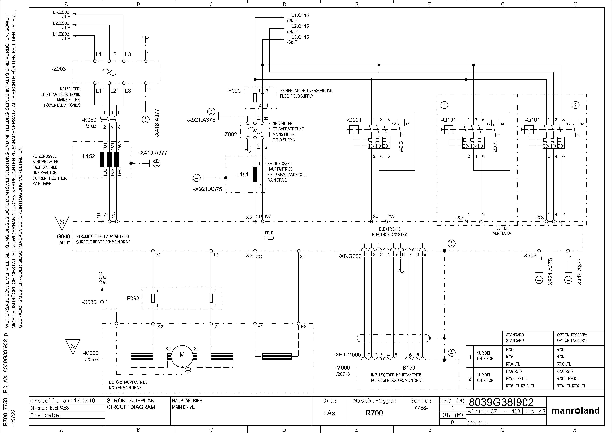

# +Ax — Sheet 37 of 403 — HAUPTANTRIEB

**MAIN DRIVE**

> Part of the manroland **R700** printing press IEC/UL circuit diagrams.
> Drawing class: **Stromlaufplan / Circuit diagram** (DIN A3).
> Document `+Ax` covers the **Central control console** machine section.

## At a glance

| Field | Value |
|---|---|
| Document | `+Ax`  (8039G38I902) |
| Sheet | **37** of 403 |
| Section (DE) | HAUPTANTRIEB |
| Section (EN) | MAIN DRIVE |
| Section type | CIRCUIT — Circuit diagram |
| Machine type | `R700` |
| Series | `7758` |
| Created | 17.05.10 |
| Replaces | — |
| Columns used | A, B, C, D, E, F, G, H |
| Path numbers | — |
| Labels on sheet | 212 |
| Cross-refs out | 13 |
| Cross-refs in | 30 |

**Previous:** [+Ax sheet 36](SHEET_0036.md) · **Next:** [+Ax sheet 38](SHEET_0038.md) · **Document TOC:** [_TOC.md](_TOC.md)  (+Ax) · **Master TOC:** [all sheets](../_MASTER_TOC.md)

## Sheet image (300 DPI, exact vector render)



_Rendered directly from the PDF vector layer at 300 DPI (1-bit), no OCR and no resampling. Use it to confirm anything ambiguous in the text below._

## Cross-references on this sheet

Each entry is a wire leaving this sheet. The printed token is `/sheet.column`; the link resolves to that sheet inside the same document.

| Ref | Target sheet | Col | Path | Destination on target | Target section | From col |
|---|---|---|---|---|---|---|
| `/9.F` | [+Ax sheet 9](SHEET_0009.md) | F | — | L3.Z003 | SPANNUNGSVERSORGUNG, SCHALTSCHRANKBELÜFTUNG | A |
| `/38.F` | [+Ax sheet 38](SHEET_0038.md) | F | — | — | HAUPTANTRIEB | D |
| `/9.F` | [+Ax sheet 9](SHEET_0009.md) | F | — | L2.Z003 | SPANNUNGSVERSORGUNG, SCHALTSCHRANKBELÜFTUNG | A |
| `/38.F` | [+Ax sheet 38](SHEET_0038.md) | F | — | L1.Z003 L3.Q115 | HAUPTANTRIEB | C |
| `/9.F` | [+Ax sheet 9](SHEET_0009.md) | F | — | L1.Z003 L3.Q115 | SPANNUNGSVERSORGUNG, SCHALTSCHRANKBELÜFTUNG | C |
| `/38.F` | [+Ax sheet 38](SHEET_0038.md) | F | — | — | HAUPTANTRIEB | D |
| `/38.D` | [+Ax sheet 38](SHEET_0038.md) | D | — | — | HAUPTANTRIEB | A |
| `/42.B` | [+Ax sheet 42](SHEET_0042.md) | B | — | — | HAUPTANTRIEB | F |
| `/42.C` | [+Ax sheet 42](SHEET_0042.md) | C | — | — | HAUPTANTRIEB | G |
| `/41.E` | [+Ax sheet 41](SHEET_0041.md) | E | — | — | HAUPTANTRIEB | A |
| `/9.G` | [+Ax sheet 9](SHEET_0009.md) | G | — | X030 | SPANNUNGSVERSORGUNG, SCHALTSCHRANKBELÜFTUNG | B |
| `/205.G` | [+Ax sheet 205](SHEET_0205.md) | G | — | — | REFERENZMODUL | A |
| `/205.G` | [+Ax sheet 205](SHEET_0205.md) | G | — | — | REFERENZMODUL | E |

### Incoming references (sheets that point here)

Every other sheet that sends a wire to this one. `Back-ref` is the token printed on *that* sheet; `Path` is its line number.

| From sheet | Cols | Back-ref | Path | Refs | What continues there |
|---|---|---|---|---|---|
| [+Ax#9](SHEET_0009.md) | F, G | `/9.F`, `/9.G` | — | 4 | L1.Z003; L2.Z003; L3.Z003; X030 |
| [+Ax#38](SHEET_0038.md) | D, F | `/38.D`, `/38.F` | — | 4 | L1.Q115; L2.Q115; L3.Q115 |
| [+Ax#41](SHEET_0041.md) | E | `/41.E` | — | 1 | T |
| [+Ax#42](SHEET_0042.md) | B, C | `/42.B`, `/42.C` | — | 2 | — |
| [+Ax#205](SHEET_0205.md) | G | `/205.G` | — | 2 | — |
| [+Ax#214](SHEET_0214.md) | C | `/214.C` | — | 8 | — |
| [+Ax#239](SHEET_0239.md) | E | `/239.E` | — | 9 | — |


## Devices on this sheet

| Tag | Class | Class meaning (IEC) | Col | Sub | Terminal | Sign |
|---|---|---|---|---|---|---|
| `X2` | X | Klemme / terminal, plug connector | D | — | — | — |
| `X2` | X | Klemme / terminal, plug connector | D | — | — | — |
| `K050` | K | Relais / relay, contactor | A | — | — | — |
| `F093` | F | Schutz / protection device (fuse, circuit breaker) | B | — | — | — |
| `X2` | X | Klemme / terminal, plug connector | B | — | — | — |
| `X1` | X | Klemme / terminal, plug connector | C | — | — | — |
| `A2` | A | Baugruppe / assembly, module, PC board | B | — | — | — |
| `A1` | A | Baugruppe / assembly, module, PC board | C | — | — | — |
| `F1` | F | Schutz / protection device (fuse, circuit breaker) | D | — | — | — |
| `F2` | F | Schutz / protection device (fuse, circuit breaker) | D | — | — | — |
| `G000` | G | Stromversorgung / power supply | A | — | — | — |
| `Z003` | Z |  | A | — | — | — |
| `Z002` | Z |  | C | — | — | — |
| `B150` | B | Umformer / transducer, sensor | F | — | — | — |
| `X603` | X | Klemme / terminal, plug connector | G | — | — | — |
| `Q001` | Q | Leistungsschalter / power switching device | E | — | — | — |
| `F090` | F | Schutz / protection device (fuse, circuit breaker) | C | — | — | — |
| `X3` | X | Klemme / terminal, plug connector | H | — | — | — |
| `X3` | X | Klemme / terminal, plug connector | F | — | — | — |
| `Q101` | Q | Leistungsschalter / power switching device | F | — | — | — |
| `X030` | X | Klemme / terminal, plug connector | A | — | — | — |
| `X030` | X | Klemme / terminal, plug connector | A | — | — | — |
| `R706` | R | Widerstand / resistor | G | — | — | — |
| `R705` | R | Widerstand / resistor | H | — | — | — |
| `Q101` | Q | Leistungsschalter / power switching device | G | — | — | — |
| `X8.G000` | — | cross-device reference | E | — | — | — |
| `XB1.M000` | — | cross-device reference | E | — | — | — |
| `X419.A377` | — | cross-device reference | B | — | — | — |
| `X418.A377` | — | cross-device reference | B | — | — | — |
| `X921.A375` | — | cross-device reference | C | — | — | — |
| `X921.A375` | — | cross-device reference | H | — | — | — |
| `X416.A377` | — | cross-device reference | H | — | — | — |
| `X921.A375` | — | cross-device reference | C | — | — | — |

## Potentials / nets

| Potential | Count | Columns | Attached devices | Terminals |
|---|---|---|---|---|
| `1V` | 1 | B | — | — |
| `L1` | 4 | A, D | `Q115`, `Z003` | — |
| `L151` | 1 | C | — | — |
| `L152` | 1 | A | — | — |
| `L2` | 3 | A, B, D | `Q115`, `Z003` | — |
| `L3` | 3 | A, B, D | `Q115`, `Z003` | — |
| `M000` | 2 | A, E | — | — |
| `N` | 1 | D | — | — |


A potential such as `L24+/4` or `M24+` is a named supply/return rail; every place it appears on this sheet is electrically common.

## Wire-end annotations (grouped as printed)

A wire that continues elsewhere is annotated with a small cluster: the destination description, the path/line number `#NN`, and the `/sheet.column` cross reference. Each row below is one such cluster exactly as it is grouped on the drawing.

| Col | Y | Path | Cross-ref | Text on the wire |
|---|---|---|---|---|
| A | 20.1 | — | `/9.F` | `L3.Z003` |
| D | 25.8 | — | — | `L1.Q115` |
| D | 35.7 | — | `/38.F` | — |
| A | 41.4 | — | `/9.F` | `L2.Z003` |
| D | 47.1 | — | — | `L2.Q115` |
| C | 57.0 | — | `/38.F`, `/9.F` | `L1.Z003 L3.Q115` |
| D | 78.2 | — | `/38.F` | — |
| B | 100.9 | — | — | `L1 L2 L3 '` |
| A | 129.3 | — | — | `Z003` |
| A | 170.0 | — | — | `LEISTUNGSELEKTRONIK NETZFILTER:` |
| B | 171.8 | — | — | `L1´ L3´` |
| B | 171.8 | — | — | `L2´` |
| D | 171.8 | — | — | `F090 FUSE: FIELD SUPPLY SICHERUNG: FELDVERSORGUNG` |
| B | 172.0 | — | — | `'´` |
| D | 172.5 | — | — | `1` |
| D | 172.5 | — | — | `3` |
| A | 191.2 | — | — | `POWER ELECTRONICS MAINS FILTER:` |
| D | 200.9 | — | — | `2` |
| F | 200.9 | — | — | `4 2` |
| F | 201.0 | — | — | `1` |
| B | 211.3 | — | — | `X418.A377` |
| B | 215.1 | — | — | `1` |
| B | 215.1 | — | — | `3` |
| B | 215.1 | — | — | `5` |
| D | 223.7 | — | — | `L1 L1´` |
| D | 227.1 | — | — | `N N´` |
| A | 228.5 | — | — | `K050 6` |
| C | 228.5 | — | — | `X921.A375` |
| E | 228.5 | — | — | `Q001` |
| F | 228.5 | — | — | `Q101` |
| G | 228.5 | — | — | `Q101` |
| E | 229.2 | — | — | `1` |
| E | 229.2 | — | — | `3` |
| E | 229.2 | — | — | `5` |
| G | 229.2 | — | — | `1` |
| G | 229.2 | — | — | `3` |
| G | 229.2 | — | — | `5` |
| H | 229.2 | — | — | `1` |
| H | 229.2 | — | — | `3` |
| H | 229.2 | — | — | `5` |
| D | 229.9 | — | — | `'` |
| D | 237.3 | — | — | `NETZFILTER: FELDVERSORGUNG FIELD SUPPLY MAINS FILTER:` |
| F | 238.3 | — | — | `12 14` |
| G | 238.3 | — | — | `12 14` |
| H | 238.3 | — | — | `12 14` |
| A | 241.6 | — | `/38.D` | — |
| B | 243.4 | — | — | `2` |
| B | 243.4 | — | — | `4` |
| C | 256.8 | — | — | `Z002` |
| F | 261.0 | — | — | `11` |
| G | 261.0 | — | — | `11` |
| H | 261.0 | — | — | `11` |
| B | 274.1 | — | — | `1W1` |
| F | 274.7 | — | `/42.B` | — |
| G | 274.7 | — | `/42.C` | — |
| B | 276.9 | — | — | `1U1` |
| B | 277.2 | — | — | `1V1` |
| D | 283.8 | — | — | `'´` |
| B | 292.3 | — | — | `X419.A377` |
| A | 299.4 | — | — | `NETZDROSSEL: L152` |
| E | 300.1 | — | — | `2` |
| E | 300.1 | — | — | `4` |
| E | 300.1 | — | — | `6` |
| G | 300.1 | — | — | `2` |
| G | 300.1 | — | — | `4` |
| G | 300.1 | — | — | `6` |
| H | 300.1 | — | — | `2` |
| H | 300.1 | — | — | `4` |
| H | 300.1 | — | — | `6` |
| A | 311.7 | — | — | `HAUPTANTRIEB LINE REACTOR: STROMRICHTER,` |
| D | 314.3 | — | — | `1` |
| D | 315.3 | — | — | `FELDDROSSEL: HAUPTANTRIEB FIELD REACTANCE COIL: MAIN DRIVE` |
| B | 325.1 | — | — | `1W2` |
| B | 328.0 | — | — | `1U2` |
| B | 328.2 | — | — | `1V2` |
| C | 334.8 | — | — | `L151` |
| A | 343.6 | — | — | `MAIN DRIVE CURRENT RECTIFIER,` |
| C | 356.8 | — | — | `X921.A375 2` |
| B | 410.7 | — | — | `1W` |
| G | 413.5 | — | — | `X3 1 2` |
| H | 413.5 | — | — | `X3 1 4 2` |
| A | 413.6 | — | — | `1U` |
| B | 413.9 | — | — | `1V` |
| D | 416.8 | — | — | `X2 3U 3W` |
| E | 416.8 | — | — | `2W` |
| E | 417.0 | — | — | `2U` |
| A | 426.3 | — | — | `S` |
| G | 441.1 | — | — | `VENTILATOR LÜFTER` |
| E | 442.8 | — | — | `ELECTRONIC SYSTEM ELEKTRONIK` |
| D | 449.9 | — | — | `FIELD FELD` |
| A | 455.3 | — | — | `G000` |
| B | 457.0 | — | — | `STROMRICHTER: HAUPTANTRIEB CURRENT RECTIFIER: MAIN DRIVE` |
| A | 468.3 | — | `/41.E` | — |
| E | 490.7 | — | — | `X8.G000 1 2 3 4 5 6 7 8 9` |
| C | 491.4 | — | — | `1C 1D X2 3C 3D` |
| H | 492.1 | — | — | `X603 1 '` |
| H | 501.9 | — | — | `X921.A375` |
| H | 501.9 | — | — | `X416.A377` |
| B | 528.4 | — | `/9.G` | `X030` |
| B | 563.3 | — | — | `1` |
| C | 563.6 | — | — | `3` |
| B | 575.7 | — | — | `F093` |
| A | 582.4 | — | — | `X030 '` |
| B | 591.9 | — | — | `2` |
| C | 591.9 | — | — | `4` |
| C | 631.7 | — | — | `' A2 A1 F1 F2` |
| G | 648.4 | — | — | `STANDARD STANDARD` |
| H | 648.4 | — | — | `OPTION 17000DR/H OPTION 17000DR/H` |
| A | 667.2 | — | — | `S` |
| C | 674.2 | — | — | `X2 M X1` |
| G | 676.7 | — | — | `R706` |
| H | 676.7 | — | — | `R705` |
| A | 682.0 | — | — | `M000` |
| G | 683.7 | — | — | `NUR BEI` |
| E | 684.9 | — | — | `XB1.M000 10 12 3 4 8 6 5 1` |
| G | 689.1 | — | — | `1 R704 LTL` |
| G | 690.9 | — | — | `R705 L` |
| H | 690.9 | — | — | `R704 L` |
| G | 694.4 | — | — | `ONLY FOR` |
| A | 695.1 | — | `/205.G` | — |
| H | 705.0 | — | — | `R703 LTL` |
| E | 710.4 | — | — | `M000` |
| F | 710.4 | — | — | `B150` |
| G | 719.2 | — | — | `R707 R712` |
| H | 719.2 | — | — | `R706 R709` |
| E | 723.5 | — | `/205.G` | — |
| G | 726.2 | — | — | `NUR BEI` |
| F | 726.3 | — | — | `IMPULSGEBER: HAUPTANTRIEB PULSE GENERATOR: MAIN DRIVE` |
| G | 731.6 | — | — | `2 R705 LTL R710 LTL` |
| G | 733.4 | — | — | `R706 L R711 L` |
| H | 733.4 | — | — | `R705 L R708 L` |
| G | 736.9 | — | — | `ONLY FOR` |
| B | 740.5 | — | — | `MOTOR: HAUPTANTRIEB MOTOR: MAIN DRIVE` |
| H | 747.6 | — | — | `R704 LTL R707 LTL` |


## Reconstructed tables

This sheet carries tabular content (pin map / terminal assignment / index). The grid below was rebuilt from the drawing's own rule lines, so each row is exactly one physical row of the table.

### Table 1 — 4 data rows × 2 columns (at x=184.3, y=26.9)

| C1 | C2 |
|---|---|
| `L1` |  |
| `L1´` |  |
| `1U` |  |
|  | `RECTIFIER: X030` |


### Table 2 — 5 data rows × 1 columns (at x=202.7, y=26.9)

| C1 |
|---|
| `1` |
| `2` |
| `1U1` |
| `1U2 1V` |
| `/9.G '` |


### Table 3 — 8 data rows × 2 columns (at x=216.9, y=26.9)

| C1 | C2 |
|---|---|
| `L2` |  |
| `L2´` |  |
| `3` |  |
| `4` |  |
| `1V1` |  |
| `1V2 1W` |  |
|  | `HAUPTANTRIEB MAIN` |
|  | `MOTOR: MOTOR:` |


### Table 4 — 10 data rows × 5 columns (at x=231.0, y=26.9)

|  | L3 | ` |  |  |
|---|---|---|---|---|
|  | `L3´` | `'´` |  | `F090` |
| `5` |  |  |  |  |
| `6` |  |  | `X418.A377 X921.A375` | `'` |
|  |  |  |  | `Z002` |
| `1W1` |  |  |  | `'´` |
| `1W2` |  |  | `X921.A375` | `L151 X2` |
|  | `DRIVE F093` |  | `1C 1 2` | `1D X2 3 4` |
| `'` |  |  | `A2` | `A1` |
|  |  |  | `X2 X1` |  |
|  | `HAUPTANTRIEB MAIN DRIVE` |  |  |  |


### Table 5 — 11 data rows × 7 columns (at x=498.9, y=26.9) — **L1.Q115 /38.F**

|  |  | /38.F /38.F | L2.Q115 L3.Q115 |  |  |  |
|---|---|---|---|---|---|---|
| `1` | `3` | `SICHERUNG:` |  | `FELDVERSORGUNG` |  |  |
| `2` | `4` | `FUSE: FIELD` | `SUPPLY` |  |  |  |
| `L1` | `N` | `NETZFILTER: FELDVERSORGUNG` |  |  |  | `Q001` |
|  |  | `MAINS FILTER:` |  |  |  |  |
|  |  | `FIELD SUPPLY` |  |  |  |  |
| `L1´` | `N´` |  |  |  |  |  |
| `1` |  | `FELDDROSSEL: HAUPTANTRIEB` |  |  |  |  |
| `2 3U` | `3W` | `FIELD REACTANCE MAIN DRIVE` | `COIL:` |  |  |  |
| `3C` | `FELD FIELD` |  | `3D` |  | `X8.G000` |  |
| `F1` |  |  | `F2` |  |  |  |
|  |  |  |  | `M000 /205.G` |  |  |


### Table 6 — 7 data rows × 10 columns (at x=722.8, y=26.9)

| 1 |  | 3 |  | 5 |  | 12 14 |  |  |  |
|---|---|---|---|---|---|---|---|---|---|
|  |  |  |  |  |  | `11` |  |  |  |
|  |  |  |  |  |  | `/42.B` |  |  |  |
| `2` |  | `4` |  | `6` |  |  |  |  |  |
|  | `2U` |  |  |  | `2W` |  |  |  |  |
| `2` |  | `3` | `ELECTRONIC` | `ELEKTRONIK 4` |  | `SYSTEM 5 6` | `7` | `8` | `9` |
|  |  |  |  |  |  |  | `B150` |  |  |
|  | `PULSE` |  | `IMPULSGEBER:` |  | `GENERATOR:` |  | `HAUPTANTRIEB MAIN` | `DRIVE` |  |


### Table 7 — 2 data rows × 1 columns (at x=864.6, y=26.9)

| C1 |
|---|
| `1` |
| `Q101` |


### Table 8 — 10 data rows × 11 columns (at x=907.1, y=26.9)

| 1 |  | 3 |  | 5 | 12 14 |  |  |  | Q101 |  |
|---|---|---|---|---|---|---|---|---|---|---|
|  |  |  |  |  | `11` |  |  |  |  |  |
|  |  |  |  |  | `/42.C` |  |  |  |  |  |
| `2` |  | `4` |  | `6` |  |  |  |  |  |  |
| `1` |  |  |  | `2` |  |  |  |  |  | `X3` |
|  |  |  |  |  | `LÜFTER VENTILATOR` |  |  |  | `X603` | `1` |
|  |  |  |  |  |  | `STANDARD STANDARD` |  |  |  |  |
|  |  |  |  |  | `R706` |  |  |  |  |  |
|  |  |  |  |  | `R704` | `LTL` |  |  |  |  |
|  |  |  |  |  |  | `R707 R712` |  |  |  |  |
|  | `2` |  | `NUR` | `ONLY` | `BEI R706 FOR R705` |  | `L R711 LTL R710` | `L` | `LTL` |  |


### Table 9 — 9 data rows × 6 columns (at x=1063.0, y=26.9) — **2**

| 1 |  | 3 |  | 5 | 12 14 |
|---|---|---|---|---|---|
|  |  |  |  |  | `11` |
| `2` |  | `4` |  | `6` |  |
| `1` |  | `4` |  | `2` |  |
|  | `X921.A375` |  |  |  | `' X416.A377` |
|  |  |  |  | `OPTION OPTION` | `17000DR/H 17000DR/H` |
|  |  |  | `R705` |  |  |
|  |  |  | `R703` |  | `LTL` |
|  |  |  |  |  | `R706 R709` |
|  |  |  | `R705 R704` |  | `L R708 L LTL R707 LTL` |


## Notes and free text on this sheet

| Text | Col | Y (pt) |
|---|---|---|
| `2U` | E | 417.02 |
| `3C` | D | 494.98 |
| `3D` | D | 494.98 |
| `1C` | B | 491.43 |
| `1D` | C | 491.43 |
| `3W` | D | 416.79 |
| `3U` | D | 417.02 |
| `NETZDROSSEL:` | A | 301.08 |
| `STROMRICHTER,` | A | 311.74 |
| `HAUPTANTRIEB` | A | 322.35 |
| `LINE REACTOR:` | A | 332.98 |
| `CURRENT RECTIFIER,` | A | 343.63 |
| `MAIN DRIVE` | A | 354.25 |
| `1U` | A | 413.58 |
| `1W` | B | 410.74 |
| `M` | C | 684.65 |
| `MOTOR: HAUPTANTRIEB` | B | 740.47 |
| `MOTOR: MAIN DRIVE` | B | 751.11 |
| `STROMRICHTER: HAUPTANTRIEB` | B | 457.02 |
| `CURRENT RECTIFIER: MAIN DRIVE` | B | 467.64 |
| `L2´` | B | 171.81 |
| `L1´` | A | 171.81 |
| `L3´` | B | 171.81 |
| `NETZFILTER:` | A | 169.97 |
| `LEISTUNGSELEKTRONIK` | A | 180.63 |
| `MAINS FILTER:` | A | 191.24 |
| `POWER ELECTRONICS` | A | 201.87 |
| `L1´` | D | 279.5 |
| `N´` | D | 282.33 |
| `NETZFILTER:` | D | 237.29 |
| `FELDVERSORGUNG` | D | 247.96 |
| `MAINS FILTER:` | D | 258.56 |
| `FIELD SUPPLY` | D | 269.2 |
| `2W` | E | 416.79 |
| `IMPULSGEBER: HAUPTANTRIEB` | F | 726.29 |
| `PULSE GENERATOR: MAIN DRIVE` | F | 736.92 |
| `FELDDROSSEL:` | D | 315.26 |
| `HAUPTANTRIEB` | D | 325.89 |
| `FIELD REACTANCE COIL:` | D | 336.53 |
| `MAIN DRIVE` | D | 347.16 |
| `SICHERUNG: FELDVERSORGUNG` | D | 173.55 |
| `FUSE: FIELD SUPPLY` | D | 184.16 |
| `FELD` | D | 449.88 |
| `FIELD` | D | 460.51 |
| `1U1` | B | 276.95 |
| `1V1` | B | 277.23 |
| `1W1` | B | 274.11 |
| `1U2` | B | 327.97 |
| `1V2` | B | 328.25 |
| `1W2` | B | 325.13 |
| `S` | A | 426.29 |
| `NUR BEI` | G | 726.25 |
| `ONLY FOR` | G | 736.94 |
| `R707 R712` | G | 719.23 |
| `R706 L R711 L` | G | 733.4 |
| `R705 LTL R710 LTL` | G | 747.58 |
| `R705 L` | G | 690.86 |
| `R704 LTL` | G | 705.04 |
| `R706 R709` | H | 719.24 |
| `R705 L R708 L` | H | 733.4 |
| `R704 LTL R707 LTL` | H | 747.58 |
| `R704 L` | H | 690.86 |
| `R703 LTL` | H | 705.04 |
| `STANDARD` | G | 648.35 |
| `OPTION 17000DR/H` | H | 648.35 |
| `ELEKTRONIK` | E | 442.82 |
| `ELECTRONIC SYSTEM` | E | 453.46 |
| `LÜFTER` | G | 441.09 |
| `VENTILATOR` | G | 451.07 |

## Complete label inventory (exact text from the drawing)

Every text object inside the drawing area of this sheet, in DIN reading order (column A→H, then top→bottom). This is the authoritative list: if a string is not here it is not printed on this sheet.

| Col | Y | X | Dir | Type | Text |
|---|---|---|---|---|---|
| A | 20.1 | 102.9 | → | potential | `L3.Z003` |
| A | 28.6 | 121.0 | → | cross-reference | `/9.F` |
| A | 41.4 | 102.9 | → | potential | `L2.Z003` |
| A | 49.8 | 121.0 | → | cross-reference | `/9.F` |
| A | 62.7 | 102.9 | → | potential | `L1.Z003` |
| A | 71.1 | 121.0 | → | cross-reference | `/9.F` |
| A | 100.9 | 186.2 | → | potential | `L1` |
| A | 129.3 | 100.3 | → | device tag | `Z003` |
| A | 170.0 | 116.6 | → | text | `NETZFILTER:` |
| A | 171.8 | 186.2 | → | text | `L1´` |
| A | 180.6 | 80.6 | → | text | `LEISTUNGSELEKTRONIK` |
| A | 191.2 | 111.5 | → | text | `MAINS FILTER:` |
| A | 201.9 | 85.8 | → | text | `POWER ELECTRONICS` |
| A | 228.5 | 159.3 | → | device tag | `K050` |
| A | 241.6 | 166.4 | → | cross-reference | `/38.D` |
| A | 299.4 | 157.6 | → | potential | `L152` |
| A | 301.1 | 62.9 | → | text | `NETZDROSSEL:` |
| A | 311.7 | 63.5 | → | text | `STROMRICHTER,` |
| A | 322.4 | 62.9 | → | text | `HAUPTANTRIEB` |
| A | 333.0 | 62.9 | → | text | `LINE REACTOR:` |
| A | 343.6 | 63.5 | → | text | `CURRENT RECTIFIER,` |
| A | 354.2 | 63.2 | → | text | `MAIN DRIVE` |
| A | 413.6 | 188.1 | ↕ | text | `1U` |
| A | 426.3 | 116.4 | → | text | `S` |
| A | 455.3 | 107.1 | → | device tag | `G000` |
| A | 468.3 | 115.9 | → | cross-reference | `/41.E` |
| A | 528.4 | 191.6 | ↕ | device tag | `X030` |
| A | 582.8 | 159.3 | → | device tag | `X030` |
| A | 667.2 | 137.6 | → | text | `S` |
| A | 682.0 | 161.9 | → | potential | `M000` |
| A | 695.1 | 165.5 | → | cross-reference | `/205.G` |
| B | 100.9 | 214.6 | → | potential | `L2` |
| B | 100.9 | 242.9 | → | potential | `L3` |
| B | 101.1 | 286.0 | → | other | `'` |
| B | 171.8 | 214.6 | → | text | `L2´` |
| B | 171.8 | 242.9 | → | text | `L3´` |
| B | 172.0 | 286.0 | → | other | `'´` |
| B | 211.3 | 300.8 | ↕ | device ref | `X418.A377` |
| B | 215.0 | 200.4 | → | number | `1` |
| B | 215.0 | 215.1 | → | number | `3` |
| B | 215.0 | 229.3 | → | number | `5` |
| B | 243.4 | 201.0 | → | number | `2` |
| B | 243.4 | 215.1 | → | number | `4` |
| B | 243.4 | 229.3 | → | number | `6` |
| B | 274.1 | 229.1 | ↕ | text | `1W1` |
| B | 276.9 | 200.9 | ↕ | text | `1U1` |
| B | 277.2 | 215.0 | ↕ | text | `1V1` |
| B | 292.3 | 269.7 | → | device ref | `X419.A377` |
| B | 325.1 | 229.1 | ↕ | text | `1W2` |
| B | 328.0 | 200.9 | ↕ | text | `1U2` |
| B | 328.3 | 215.0 | ↕ | text | `1V2` |
| B | 410.7 | 216.2 | ↕ | text | `1W` |
| B | 413.9 | 202.2 | ↕ | potential | `1V` |
| B | 457.0 | 148.5 | → | text | `STROMRICHTER: HAUPTANTRIEB` |
| B | 467.6 | 148.5 | → | text | `CURRENT RECTIFIER: MAIN DRIVE` |
| B | 491.4 | 301.0 | → | text | `1C` |
| B | 536.0 | 200.1 | ↕ | cross-reference | `/9.G` |
| B | 563.3 | 304.2 | → | number | `1` |
| B | 575.7 | 243.5 | → | device tag | `F093` |
| B | 582.4 | 204.9 | → | other | `'` |
| B | 591.9 | 304.4 | → | number | `2` |
| B | 631.7 | 306.7 | → | device tag | `A2` |
| B | 635.3 | 232.2 | → | other | `'` |
| B | 674.2 | 321.4 | → | device tag | `X2` |
| B | 740.5 | 212.0 | → | text | `MOTOR: HAUPTANTRIEB` |
| B | 751.1 | 212.0 | → | text | `MOTOR: MAIN DRIVE` |
| C | 171.8 | 440.5 | → | device tag | `F090` |
| C | 228.5 | 362.6 | → | device ref | `X921.A375` |
| C | 256.8 | 433.4 | → | device tag | `Z002` |
| C | 334.8 | 456.7 | → | potential | `L151` |
| C | 363.1 | 376.0 | → | device ref | `X921.A375` |
| C | 491.4 | 414.4 | → | text | `1D` |
| C | 563.6 | 417.8 | → | number | `3` |
| C | 591.9 | 417.8 | → | number | `4` |
| C | 631.9 | 418.3 | → | device tag | `A1` |
| C | 674.2 | 377.0 | → | device tag | `X1` |
| C | 684.6 | 349.7 | → | text | `M` |
| D | 25.8 | 567.5 | → | potential | `L1.Q115` |
| D | 35.7 | 558.4 | → | cross-reference | `/38.F` |
| D | 47.1 | 567.5 | → | potential | `L2.Q115` |
| D | 57.0 | 558.4 | → | cross-reference | `/38.F` |
| D | 68.3 | 567.5 | → | potential | `L3.Q115` |
| D | 78.2 | 558.4 | → | cross-reference | `/38.F` |
| D | 172.5 | 502.3 | → | number | `1` |
| D | 172.5 | 517.0 | → | number | `3` |
| D | 173.6 | 545.4 | → | text | `SICHERUNG: FELDVERSORGUNG` |
| D | 184.2 | 544.8 | → | text | `FUSE: FIELD SUPPLY` |
| D | 200.9 | 502.9 | → | number | `2` |
| D | 200.9 | 517.0 | → | number | `4` |
| D | 223.7 | 499.9 | ↕ | potential | `L1` |
| D | 227.1 | 514.1 | ↕ | potential | `N` |
| D | 229.9 | 485.8 | ↕ | other | `'` |
| D | 237.3 | 530.6 | → | text | `NETZFILTER:` |
| D | 248.0 | 530.6 | → | text | `FELDVERSORGUNG` |
| D | 258.6 | 530.9 | → | text | `MAINS FILTER:` |
| D | 269.2 | 530.6 | → | text | `FIELD SUPPLY` |
| D | 279.5 | 500.5 | ↕ | text | `L1´` |
| D | 282.3 | 514.7 | ↕ | text | `N´` |
| D | 283.7 | 485.8 | ↕ | other | `'´` |
| D | 314.3 | 502.3 | → | number | `1` |
| D | 315.3 | 520.7 | → | text | `FELDDROSSEL:` |
| D | 325.9 | 520.7 | → | text | `HAUPTANTRIEB` |
| D | 336.5 | 520.7 | → | text | `FIELD REACTANCE COIL:` |
| D | 347.2 | 521.0 | → | text | `MAIN DRIVE` |
| D | 356.8 | 502.9 | → | number | `2` |
| D | 416.8 | 512.8 | → | text | `3W` |
| D | 417.0 | 498.6 | → | text | `3U` |
| D | 418.4 | 474.5 | → | device tag | `X2` |
| D | 449.9 | 516.0 | → | text | `FELD` |
| D | 460.5 | 515.1 | → | text | `FIELD` |
| D | 492.1 | 474.5 | → | device tag | `X2` |
| D | 495.0 | 498.6 | → | text | `3C` |
| D | 495.0 | 583.7 | → | text | `3D` |
| D | 631.7 | 500.9 | → | device tag | `F1` |
| D | 631.7 | 585.9 | → | device tag | `F2` |
| E | 228.5 | 674.1 | → | device tag | `Q001` |
| E | 229.2 | 724.8 | → | number | `1` |
| E | 229.2 | 739.6 | → | number | `3` |
| E | 229.2 | 753.7 | → | number | `5` |
| E | 300.1 | 725.4 | → | number | `2` |
| E | 300.1 | 739.6 | → | number | `4` |
| E | 300.1 | 753.7 | → | number | `6` |
| E | 416.8 | 753.7 | → | text | `2W` |
| E | 417.0 | 725.4 | → | text | `2U` |
| E | 442.8 | 737.9 | → | text | `ELEKTRONIK` |
| E | 453.5 | 724.1 | → | text | `ELECTRONIC SYSTEM` |
| E | 490.7 | 710.6 | → | number | `1` |
| E | 490.7 | 725.4 | → | number | `2` |
| E | 490.7 | 739.6 | → | number | `3` |
| E | 490.7 | 753.7 | → | number | `4` |
| E | 493.5 | 658.2 | → | device ref | `X8.G000` |
| E | 684.9 | 649.1 | → | device ref | `XB1.M000` |
| E | 686.3 | 710.6 | → | number | `10` |
| E | 686.3 | 724.8 | → | number | `12 3` |
| E | 686.3 | 753.7 | → | number | `4` |
| E | 710.4 | 650.8 | → | potential | `M000` |
| E | 723.5 | 654.5 | → | cross-reference | `/205.G` |
| F | 201.0 | 862.8 | → | number | `1` |
| F | 228.5 | 858.3 | → | device tag | `Q101` |
| F | 238.3 | 762.0 | → | number | `12` |
| F | 238.3 | 788.9 | → | number | `14` |
| F | 261.0 | 781.8 | → | number | `11` |
| F | 274.7 | 776.2 | ↕ | cross-reference | `/42.B` |
| F | 418.4 | 885.5 | → | device tag | `X3` |
| F | 490.7 | 767.9 | → | number | `5` |
| F | 490.7 | 782.1 | → | number | `6` |
| F | 490.7 | 796.3 | → | number | `7` |
| F | 490.7 | 810.4 | → | number | `8` |
| F | 490.7 | 824.6 | → | number | `9` |
| F | 686.3 | 767.9 | → | number | `8` |
| F | 686.3 | 796.3 | → | number | `6` |
| F | 686.3 | 810.4 | → | number | `5` |
| F | 686.3 | 824.0 | → | number | `1` |
| F | 710.4 | 779.7 | → | device tag | `B150` |
| F | 726.3 | 722.0 | → | text | `IMPULSGEBER: HAUPTANTRIEB` |
| F | 736.9 | 722.0 | → | text | `PULSE GENERATOR: MAIN DRIVE` |
| G | 228.5 | 1021.3 | → | device tag | `Q101` |
| G | 229.2 | 909.1 | → | number | `1` |
| G | 229.2 | 923.8 | → | number | `3` |
| G | 229.2 | 938.0 | → | number | `5` |
| G | 238.3 | 946.2 | → | number | `12` |
| G | 238.3 | 973.1 | → | number | `14` |
| G | 261.0 | 966.0 | → | number | `11` |
| G | 274.7 | 960.5 | ↕ | cross-reference | `/42.C` |
| G | 300.1 | 909.6 | → | number | `2` |
| G | 300.1 | 923.8 | → | number | `4` |
| G | 300.1 | 938.0 | → | number | `6` |
| G | 413.5 | 909.1 | → | number | `1` |
| G | 413.5 | 938.0 | → | number | `2` |
| G | 441.1 | 966.1 | → | text | `LÜFTER` |
| G | 451.1 | 959.5 | → | text | `VENTILATOR` |
| G | 492.1 | 1015.4 | → | device tag | `X603` |
| G | 648.4 | 984.8 | → | text | `STANDARD` |
| G | 659.0 | 984.8 | → | text | `STANDARD` |
| G | 676.7 | 984.2 | → | device tag | `R706` |
| G | 683.7 | 927.5 | → | text | `NUR BEI` |
| G | 689.1 | 911.6 | → | number | `1` |
| G | 690.9 | 984.2 | → | text | `R705 L` |
| G | 694.4 | 928.1 | → | text | `ONLY FOR` |
| G | 705.0 | 984.2 | → | text | `R704 LTL` |
| G | 719.2 | 984.2 | → | text | `R707 R712` |
| G | 726.2 | 927.5 | → | text | `NUR BEI` |
| G | 731.6 | 911.3 | → | number | `2` |
| G | 733.4 | 984.2 | → | text | `R706 L R711 L` |
| G | 736.9 | 928.1 | → | text | `ONLY FOR` |
| G | 747.6 | 984.2 | → | text | `R705 LTL R710 LTL` |
| H | 201.6 | 1117.7 | → | number | `2` |
| H | 229.2 | 1065.0 | → | number | `1` |
| H | 229.2 | 1079.7 | → | number | `3` |
| H | 229.2 | 1093.9 | → | number | `5` |
| H | 238.3 | 1102.1 | → | number | `12` |
| H | 238.3 | 1129.0 | → | number | `14` |
| H | 261.0 | 1122.0 | → | number | `11` |
| H | 300.1 | 1065.5 | → | number | `2` |
| H | 300.1 | 1079.7 | → | number | `4` |
| H | 300.1 | 1093.9 | → | number | `6` |
| H | 413.5 | 1065.0 | → | number | `1` |
| H | 413.5 | 1079.7 | → | number | `4` |
| H | 413.5 | 1093.9 | → | number | `2` |
| H | 418.4 | 1041.4 | → | device tag | `X3` |
| H | 497.3 | 1107.8 | → | other | `'` |
| H | 498.5 | 1050.8 | → | number | `1` |
| H | 501.9 | 1066.1 | ↕ | device ref | `X921.A375` |
| H | 501.9 | 1122.8 | ↕ | device ref | `X416.A377` |
| H | 648.4 | 1084.0 | → | text | `OPTION 17000DR/H` |
| H | 659.0 | 1084.0 | → | text | `OPTION 17000DR/H` |
| H | 676.7 | 1083.4 | → | device tag | `R705` |
| H | 690.9 | 1083.4 | → | text | `R704 L` |
| H | 705.0 | 1083.4 | → | text | `R703 LTL` |
| H | 719.2 | 1083.4 | → | text | `R706 R709` |
| H | 733.4 | 1083.4 | → | text | `R705 L R708 L` |
| H | 747.6 | 1083.4 | → | text | `R704 LTL R707 LTL` |

## Reading-order text block

The same content as a plain block, grouped by DIN column — convenient to paste or to match against a visual description.

```text
=== Column A ===
  20.1  102.9  net          L3.Z003
  28.6  121.0  xref         /9.F
  41.4  102.9  net          L2.Z003
  49.8  121.0  xref         /9.F
  62.7  102.9  net          L1.Z003
  71.1  121.0  xref         /9.F
 100.9  186.2  net          L1
 129.3  100.3  devtag       Z003
 170.0  116.6  text         NETZFILTER:
 171.8  186.2  text         L1´
 180.6   80.6  text         LEISTUNGSELEKTRONIK
 191.2  111.5  text         MAINS FILTER:
 201.9   85.8  text         POWER ELECTRONICS
 228.5  159.3  devtag       K050
 241.6  166.4  xref         /38.D
 299.4  157.6  net          L152
 301.1   62.9  text         NETZDROSSEL:
 311.7   63.5  text         STROMRICHTER,
 322.4   62.9  text         HAUPTANTRIEB
 333.0   62.9  text         LINE REACTOR:
 343.6   63.5  text         CURRENT RECTIFIER,
 354.2   63.2  text         MAIN DRIVE
 413.6  188.1  text         1U
 426.3  116.4  text         S
 455.3  107.1  devtag       G000
 468.3  115.9  xref         /41.E
 528.4  191.6  devtag       X030
 582.8  159.3  devtag       X030
 667.2  137.6  text         S
 682.0  161.9  net          M000
 695.1  165.5  xref         /205.G
=== Column B ===
 100.9  214.6  net          L2
 100.9  242.9  net          L3
 101.1  286.0  other        `
 171.8  214.6  text         L2´
 171.8  242.9  text         L3´
 172.0  286.0  other        `´
 211.3  300.8  devref       X418.A377
 215.0  200.4  numeric      1
 215.0  215.1  numeric      3
 215.0  229.3  numeric      5
 243.4  201.0  numeric      2
 243.4  215.1  numeric      4
 243.4  229.3  numeric      6
 274.1  229.1  text         1W1
 276.9  200.9  text         1U1
 277.2  215.0  text         1V1
 292.3  269.7  devref       X419.A377
 325.1  229.1  text         1W2
 328.0  200.9  text         1U2
 328.3  215.0  text         1V2
 410.7  216.2  text         1W
 413.9  202.2  net          1V
 457.0  148.5  text         STROMRICHTER: HAUPTANTRIEB
 467.6  148.5  text         CURRENT RECTIFIER: MAIN DRIVE
 491.4  301.0  text         1C
 536.0  200.1  xref         /9.G
 563.3  304.2  numeric      1
 575.7  243.5  devtag       F093
 582.4  204.9  other        `
 591.9  304.4  numeric      2
 631.7  306.7  devtag       A2
 635.3  232.2  other        `
 674.2  321.4  devtag       X2
 740.5  212.0  text         MOTOR: HAUPTANTRIEB
 751.1  212.0  text         MOTOR: MAIN DRIVE
=== Column C ===
 171.8  440.5  devtag       F090
 228.5  362.6  devref       X921.A375
 256.8  433.4  devtag       Z002
 334.8  456.7  net          L151
 363.1  376.0  devref       X921.A375
 491.4  414.4  text         1D
 563.6  417.8  numeric      3
 591.9  417.8  numeric      4
 631.9  418.3  devtag       A1
 674.2  377.0  devtag       X1
 684.6  349.7  text         M
=== Column D ===
  25.8  567.5  net          L1.Q115
  35.7  558.4  xref         /38.F
  47.1  567.5  net          L2.Q115
  57.0  558.4  xref         /38.F
  68.3  567.5  net          L3.Q115
  78.2  558.4  xref         /38.F
 172.5  502.3  numeric      1
 172.5  517.0  numeric      3
 173.6  545.4  text         SICHERUNG: FELDVERSORGUNG
 184.2  544.8  text         FUSE: FIELD SUPPLY
 200.9  502.9  numeric      2
 200.9  517.0  numeric      4
 223.7  499.9  net          L1
 227.1  514.1  net          N
 229.9  485.8  other        `
 237.3  530.6  text         NETZFILTER:
 248.0  530.6  text         FELDVERSORGUNG
 258.6  530.9  text         MAINS FILTER:
 269.2  530.6  text         FIELD SUPPLY
 279.5  500.5  text         L1´
 282.3  514.7  text         N´
 283.7  485.8  other        `´
 314.3  502.3  numeric      1
 315.3  520.7  text         FELDDROSSEL:
 325.9  520.7  text         HAUPTANTRIEB
 336.5  520.7  text         FIELD REACTANCE COIL:
 347.2  521.0  text         MAIN DRIVE
 356.8  502.9  numeric      2
 416.8  512.8  text         3W
 417.0  498.6  text         3U
 418.4  474.5  devtag       X2
 449.9  516.0  text         FELD
 460.5  515.1  text         FIELD
 492.1  474.5  devtag       X2
 495.0  498.6  text         3C
 495.0  583.7  text         3D
 631.7  500.9  devtag       F1
 631.7  585.9  devtag       F2
=== Column E ===
 228.5  674.1  devtag       Q001
 229.2  724.8  numeric      1
 229.2  739.6  numeric      3
 229.2  753.7  numeric      5
 300.1  725.4  numeric      2
 300.1  739.6  numeric      4
 300.1  753.7  numeric      6
 416.8  753.7  text         2W
 417.0  725.4  text         2U
 442.8  737.9  text         ELEKTRONIK
 453.5  724.1  text         ELECTRONIC SYSTEM
 490.7  710.6  numeric      1
 490.7  725.4  numeric      2
 490.7  739.6  numeric      3
 490.7  753.7  numeric      4
 493.5  658.2  devref       X8.G000
 684.9  649.1  devref       XB1.M000
 686.3  710.6  numeric      10
 686.3  724.8  numeric      12 3
 686.3  753.7  numeric      4
 710.4  650.8  net          M000
 723.5  654.5  xref         /205.G
=== Column F ===
 201.0  862.8  numeric      1
 228.5  858.3  devtag       Q101
 238.3  762.0  numeric      12
 238.3  788.9  numeric      14
 261.0  781.8  numeric      11
 274.7  776.2  xref         /42.B
 418.4  885.5  devtag       X3
 490.7  767.9  numeric      5
 490.7  782.1  numeric      6
 490.7  796.3  numeric      7
 490.7  810.4  numeric      8
 490.7  824.6  numeric      9
 686.3  767.9  numeric      8
 686.3  796.3  numeric      6
 686.3  810.4  numeric      5
 686.3  824.0  numeric      1
 710.4  779.7  devtag       B150
 726.3  722.0  text         IMPULSGEBER: HAUPTANTRIEB
 736.9  722.0  text         PULSE GENERATOR: MAIN DRIVE
=== Column G ===
 228.5 1021.3  devtag       Q101
 229.2  909.1  numeric      1
 229.2  923.8  numeric      3
 229.2  938.0  numeric      5
 238.3  946.2  numeric      12
 238.3  973.1  numeric      14
 261.0  966.0  numeric      11
 274.7  960.5  xref         /42.C
 300.1  909.6  numeric      2
 300.1  923.8  numeric      4
 300.1  938.0  numeric      6
 413.5  909.1  numeric      1
 413.5  938.0  numeric      2
 441.1  966.1  text         LÜFTER
 451.1  959.5  text         VENTILATOR
 492.1 1015.4  devtag       X603
 648.4  984.8  text         STANDARD
 659.0  984.8  text         STANDARD
 676.7  984.2  devtag       R706
 683.7  927.5  text         NUR BEI
 689.1  911.6  numeric      1
 690.9  984.2  text         R705 L
 694.4  928.1  text         ONLY FOR
 705.0  984.2  text         R704 LTL
 719.2  984.2  text         R707 R712
 726.2  927.5  text         NUR BEI
 731.6  911.3  numeric      2
 733.4  984.2  text         R706 L R711 L
 736.9  928.1  text         ONLY FOR
 747.6  984.2  text         R705 LTL R710 LTL
=== Column H ===
 201.6 1117.7  numeric      2
 229.2 1065.0  numeric      1
 229.2 1079.7  numeric      3
 229.2 1093.9  numeric      5
 238.3 1102.1  numeric      12
 238.3 1129.0  numeric      14
 261.0 1122.0  numeric      11
 300.1 1065.5  numeric      2
 300.1 1079.7  numeric      4
 300.1 1093.9  numeric      6
 413.5 1065.0  numeric      1
 413.5 1079.7  numeric      4
 413.5 1093.9  numeric      2
 418.4 1041.4  devtag       X3
 497.3 1107.8  other        `
 498.5 1050.8  numeric      1
 501.9 1066.1  devref       X921.A375
 501.9 1122.8  devref       X416.A377
 648.4 1084.0  text         OPTION 17000DR/H
 659.0 1084.0  text         OPTION 17000DR/H
 676.7 1083.4  devtag       R705
 690.9 1083.4  text         R704 L
 705.0 1083.4  text         R703 LTL
 719.2 1083.4  text         R706 R709
 733.4 1083.4  text         R705 L R708 L
 747.6 1083.4  text         R704 LTL R707 LTL
```

---
_Generated from the PDF vector text layer; no OCR. Source: `R700_7758_IEC_AX_8039G38I902_p`, sheet 37._
