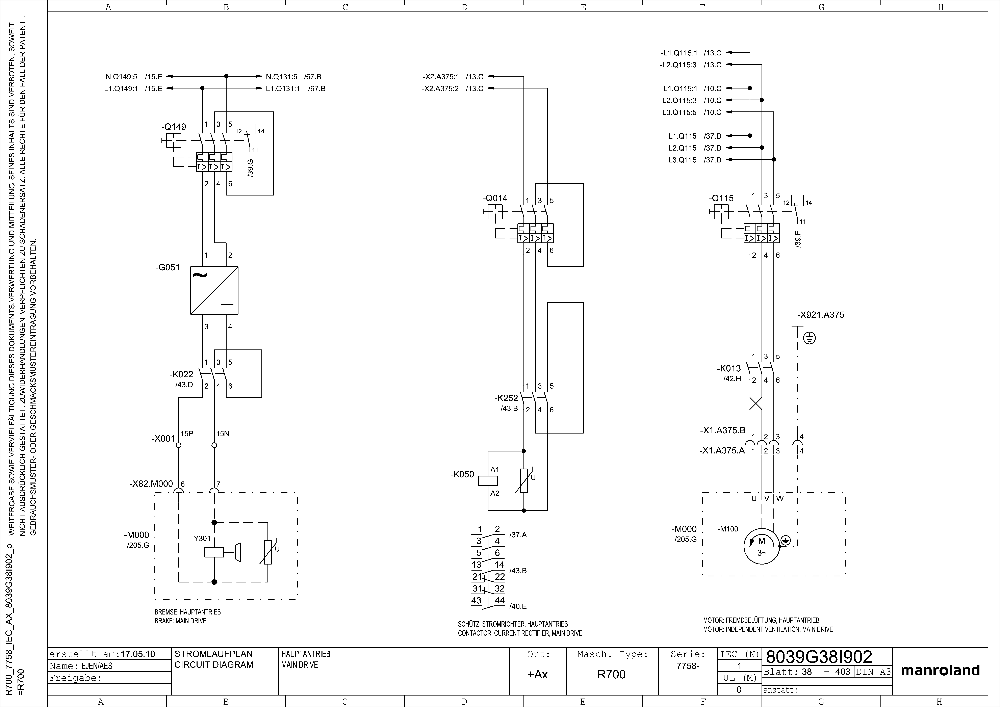

# +Ax — Sheet 38 of 403 — HAUPTANTRIEB

**MAIN DRIVE**

> Part of the manroland **R700** printing press IEC/UL circuit diagrams.
> Drawing class: **Stromlaufplan / Circuit diagram** (DIN A3).
> Document `+Ax` covers the **Central control console** machine section.

## At a glance

| Field | Value |
|---|---|
| Document | `+Ax`  (8039G38I902) |
| Sheet | **38** of 403 |
| Section (DE) | HAUPTANTRIEB |
| Section (EN) | MAIN DRIVE |
| Section type | CIRCUIT — Circuit diagram |
| Machine type | `R700` |
| Series | `7758` |
| Created | 17.05.10 |
| Replaces | — |
| Columns used | A, B, C, D, E, F, G |
| Path numbers | — |
| Labels on sheet | 144 |
| Cross-refs out | 24 |
| Cross-refs in | 34 |

**Previous:** [+Ax sheet 37](SHEET_0037.md) · **Next:** [+Ax sheet 39](SHEET_0039.md) · **Document TOC:** [_TOC.md](_TOC.md)  (+Ax) · **Master TOC:** [all sheets](../_MASTER_TOC.md)

## Sheet image (300 DPI, exact vector render)



_Rendered directly from the PDF vector layer at 300 DPI (1-bit), no OCR and no resampling. Use it to confirm anything ambiguous in the text below._

## Cross-references on this sheet

Each entry is a wire leaving this sheet. The printed token is `/sheet.column`; the link resolves to that sheet inside the same document.

| Ref | Target sheet | Col | Path | Destination on target | Target section | From col |
|---|---|---|---|---|---|---|
| `/13.C` | [+Ax sheet 13](SHEET_0013.md) | C | — | L1.Q115:1 | SPANNUNGSVERSORGUNG, SCHALTSCHRANKBELÜFTUNG | F |
| `/13.C` | [+Ax sheet 13](SHEET_0013.md) | C | — | L2.Q115:3 | SPANNUNGSVERSORGUNG, SCHALTSCHRANKBELÜFTUNG | F |
| `/15.E` | [+Ax sheet 15](SHEET_0015.md) | E | — | N.Q149:5 N.Q131:5 | SPANNUNGSVERSORGUNG, SCHALTSCHRANKBELÜFTUNG | B |
| `/67.B` | [+Ax sheet 67](SHEET_0067.md) | B | — | N.Q149:5 N.Q131:5 | SAUGBÄNDERTISCH | B |
| `/13.C` | [+Ax sheet 13](SHEET_0013.md) | C | — | X2.A375:1 | SPANNUNGSVERSORGUNG, SCHALTSCHRANKBELÜFTUNG | D |
| `/15.E` | [+Ax sheet 15](SHEET_0015.md) | E | — | L1.Q149:1 L1.Q131:1 L1.Q115:1 | SPANNUNGSVERSORGUNG, SCHALTSCHRANKBELÜFTUNG | D |
| `/67.B` | [+Ax sheet 67](SHEET_0067.md) | B | — | L1.Q149:1 L1.Q131:1 L1.Q115:1 | SAUGBÄNDERTISCH | D |
| `/10.C` | [+Ax sheet 10](SHEET_0010.md) | C | — | L1.Q149:1 L1.Q131:1 L1.Q115:1 | SPANNUNGSVERSORGUNG, SCHALTSCHRANKBELÜFTUNG | D |
| `/13.C` | [+Ax sheet 13](SHEET_0013.md) | C | — | X2.A375:2 | SPANNUNGSVERSORGUNG, SCHALTSCHRANKBELÜFTUNG | D |
| `/10.C` | [+Ax sheet 10](SHEET_0010.md) | C | — | L2.Q115:3 | SPANNUNGSVERSORGUNG, SCHALTSCHRANKBELÜFTUNG | F |
| `/10.C` | [+Ax sheet 10](SHEET_0010.md) | C | — | L3.Q115:5 | SPANNUNGSVERSORGUNG, SCHALTSCHRANKBELÜFTUNG | F |
| `/37.D` | [+Ax sheet 37](SHEET_0037.md) | D | — | L1.Q115 | HAUPTANTRIEB | F |
| `/37.D` | [+Ax sheet 37](SHEET_0037.md) | D | — | L2.Q115 | HAUPTANTRIEB | F |
| `/37.D` | [+Ax sheet 37](SHEET_0037.md) | D | — | L3.Q115 | HAUPTANTRIEB | F |
| `/39.G` | [+Ax sheet 39](SHEET_0039.md) | G | — | — | HAUPTANTRIEB | B |
| `/39.F` | [+Ax sheet 39](SHEET_0039.md) | F | — | — | HAUPTANTRIEB | G |
| `/42.H` | [+Ax sheet 42](SHEET_0042.md) | H | — | — | HAUPTANTRIEB | F |
| `/43.D` | [+Ax sheet 43](SHEET_0043.md) | D | — | — | HAUPTANTRIEB | B |
| `/43.B` | [+Ax sheet 43](SHEET_0043.md) | B | — | — | HAUPTANTRIEB | D |
| `/205.G` | [+Ax sheet 205](SHEET_0205.md) | G | — | 1 3 5 13 21 31 43 | REFERENZMODUL | E |
| `/37.A` | [+Ax sheet 37](SHEET_0037.md) | A | — | — | HAUPTANTRIEB | D |
| `/205.G` | [+Ax sheet 205](SHEET_0205.md) | G | — | — | REFERENZMODUL | A |
| `/43.B` | [+Ax sheet 43](SHEET_0043.md) | B | — | — | HAUPTANTRIEB | D |
| `/40.E` | [+Ax sheet 40](SHEET_0040.md) | E | — | — | HAUPTANTRIEB | D |

### Incoming references (sheets that point here)

Every other sheet that sends a wire to this one. `Back-ref` is the token printed on *that* sheet; `Path` is its line number.

| From sheet | Cols | Back-ref | Path | Refs | What continues there |
|---|---|---|---|---|---|
| [+Ax#10](SHEET_0010.md) | C | `/10.C` | — | 3 | L1.Q115:1; L2.Q115:3; L3.Q115:5 |
| [+Ax#13](SHEET_0013.md) | C, D | `/13.C`, `/13.D` | — | 4 | — |
| [+Ax#15](SHEET_0015.md) | F | `/15.F` | — | 2 | — |
| [+Ax#37](SHEET_0037.md) | A, C, D | `/37.A`, `/37.C`, `/37.D` | — | 4 | L1.Z003 L3.Q115 |
| [+Ax#39](SHEET_0039.md) | F, G | `/39.F`, `/39.G` | — | 2 | — |
| [+Ax#40](SHEET_0040.md) | E | `/40.E` | — | 1 | — |
| [+Ax#42](SHEET_0042.md) | H | `/42.H` | — | 1 | — |
| [+Ax#43](SHEET_0043.md) | B, D | `/43.B`, `/43.D` | — | 3 | — |
| [+Ax#67](SHEET_0067.md) | A | `/67.A` | — | 2 | L1.Q131:1; N.Q131:5 |
| [+Ax#205](SHEET_0205.md) | G | `/205.G` | — | 2 | — |
| [+Ax#208](SHEET_0208.md) | C | `/208.C` | — | 8 | — |
| [+Ax#286](SHEET_0286.md) | G | `/286.G` | — | 2 | — |


## Devices on this sheet

| Tag | Class | Class meaning (IEC) | Col | Sub | Terminal | Sign |
|---|---|---|---|---|---|---|
| `K022` | K | Relais / relay, contactor | B | — | — | — |
| `G051` | G | Stromversorgung / power supply | B | — | — | — |
| `Q149` | Q | Leistungsschalter / power switching device | B | — | — | — |
| `Q014` | Q | Leistungsschalter / power switching device | D | — | — | — |
| `Y301` | Y | Magnetventil / solenoid valve, actuator | B | — | — | — |
| `X001` | X | Klemme / terminal, plug connector | A | — | — | — |
| `Q115` | Q | Leistungsschalter / power switching device | F | — | — | — |
| `K013` | K | Relais / relay, contactor | F | — | — | — |
| `A1` | A | Baugruppe / assembly, module, PC board | D | — | — | — |
| `A2` | A | Baugruppe / assembly, module, PC board | D | — | — | — |
| `K050` | K | Relais / relay, contactor | D | — | — | — |
| `K252` | K | Relais / relay, contactor | D | — | — | — |
| `X82.M000` | — | cross-device reference | A | — | — | — |
| `X1.A375.B` | — | cross-device reference | F | — | — | — |
| `X1.A375.A` | — | cross-device reference | F | — | — | — |
| `X2.A375:2` | — | cross-device reference | D | — | 2 | — |
| `X2.A375:1` | — | cross-device reference | D | — | 1 | — |
| `X921.A375` | — | cross-device reference | G | — | — | — |

## Potentials / nets

| Potential | Count | Columns | Attached devices | Terminals |
|---|---|---|---|---|
| `L1` | 5 | A, B, F | `Q115`, `Q131`, `Q149` | `1` |
| `L2` | 3 | F | `Q115` | `3` |
| `L3` | 2 | F | `Q115` | `5` |
| `M000` | 2 | A, F | — | — |
| `M100` | 1 | F | — | — |
| `N` | 2 | A, B | `Q131`, `Q149` | `5` |


A potential such as `L24+/4` or `M24+` is a named supply/return rail; every place it appears on this sheet is electrically common.

## Wire-end annotations (grouped as printed)

A wire that continues elsewhere is annotated with a small cluster: the destination description, the path/line number `#NN`, and the `/sheet.column` cross reference. Each row below is one such cluster exactly as it is grouped on the drawing.

| Col | Y | Path | Cross-ref | Text on the wire |
|---|---|---|---|---|
| F | 59.1 | — | `/13.C` | `L1.Q115:1` |
| F | 73.3 | — | `/13.C` | `L2.Q115:3` |
| B | 87.4 | — | `/15.E`, `/67.B` | `N.Q149:5 N.Q131:5` |
| D | 87.5 | — | `/13.C` | `X2.A375:1` |
| D | 101.6 | — | `/15.E`, `/67.B`, `/10.C` | `L1.Q149:1 L1.Q131:1 L1.Q115:1` |
| D | 101.6 | — | `/13.C` | `X2.A375:2` |
| F | 115.8 | — | `/10.C` | `L2.Q115:3` |
| F | 130.0 | — | `/10.C` | `L3.Q115:5` |
| B | 144.2 | — | — | `1` |
| B | 144.2 | — | — | `3` |
| B | 144.2 | — | — | `5` |
| B | 146.3 | — | — | `Q149` |
| B | 153.2 | — | — | `12 14` |
| F | 158.3 | — | `/37.D` | `L1.Q115` |
| F | 172.5 | — | `/37.D` | `L2.Q115` |
| B | 175.9 | — | — | `11` |
| F | 186.7 | — | `/37.D` | `L3.Q115` |
| B | 189.4 | — | `/39.G` | — |
| B | 215.1 | — | — | `2` |
| B | 215.1 | — | — | `4` |
| B | 215.1 | — | — | `6` |
| F | 229.2 | — | — | `1` |
| G | 229.2 | — | — | `3` |
| G | 229.2 | — | — | `5` |
| D | 231.3 | — | — | `Q014` |
| F | 231.3 | — | — | `Q115` |
| E | 234.9 | — | — | `1 3 5` |
| G | 238.3 | — | — | `12 14` |
| G | 261.0 | — | — | `11` |
| G | 274.7 | — | `/39.F` | — |
| E | 294.4 | — | — | `2 4 6` |
| B | 300.1 | — | — | `1 2` |
| F | 300.1 | — | — | `2` |
| G | 300.1 | — | — | `4` |
| G | 300.1 | — | — | `6` |
| B | 313.5 | — | — | `G051` |
| B | 313.9 | — | — | `~` |
| G | 370.2 | — | — | `X921.A375` |
| B | 385.1 | — | — | `3 4` |
| F | 420.6 | — | — | `1` |
| G | 420.6 | — | — | `3` |
| G | 420.6 | — | — | `5` |
| B | 427.6 | — | — | `1` |
| B | 427.6 | — | — | `3` |
| B | 427.6 | — | — | `5` |
| F | 434.0 | — | — | `K013 6` |
| B | 441.1 | — | — | `K022 6` |
| F | 447.1 | — | `/42.H` | — |
| F | 448.9 | — | — | `2` |
| G | 448.9 | — | — | `4` |
| B | 454.2 | — | `/43.D` | — |
| B | 456.0 | — | — | `2` |
| B | 456.0 | — | — | `4` |
| E | 456.0 | — | — | `1` |
| E | 456.0 | — | — | `3` |
| E | 456.0 | — | — | `5` |
| E | 469.4 | — | — | `K252 6` |
| D | 482.5 | — | `/43.B` | — |
| E | 484.3 | — | — | `2` |
| E | 484.3 | — | — | `4` |
| F | 507.7 | — | — | `X1.A375.B 1` |
| B | 512.6 | — | — | `X001 15P` |
| B | 512.7 | — | — | `15N` |
| G | 516.2 | — | — | `2 3` |
| G | 516.2 | — | — | `4` |
| F | 531.8 | — | — | `X1.A375.A 1 2 3` |
| G | 533.2 | — | — | `4` |
| D | 555.1 | — | — | `A1` |
| D | 560.1 | — | — | `K050` |
| E | 565.3 | — | — | `U` |
| A | 571.5 | — | — | `X82.M000 6` |
| B | 572.9 | — | — | `7` |
| D | 583.5 | — | — | `A2` |
| G | 589.6 | — | — | `U V W '` |
| E | 625.3 | — | `/205.G` | `13 43 21 31 3 5 1` |
| D | 625.3 | — | — | `14 32 2 4 6 22 44` |
| F | 625.4 | — | — | `M000` |
| F | 626.1 | — | — | `M100` |
| A | 632.4 | — | — | `M000` |
| D | 633.1 | — | `/37.A` | — |
| B | 637.4 | — | — | `Y301 U` |
| G | 639.8 | — | — | `3~ M` |
| A | 645.5 | — | `/205.G` | — |
| D | 675.6 | — | `/43.B` | — |
| D | 718.1 | — | `/40.E` | — |
| B | 726.0 | — | — | `BREMSE: HAUPTANTRIEB BRAKE: MAIN DRIVE` |
| G | 736.0 | — | — | `MOTOR: FREMDBELÜFTUNG, HAUPTANTRIEB MOTOR: INDEPENDENT VENTILATION, MAIN DRIVE` |
| D | 740.5 | — | — | `SCHÜTZ: STROMRICHTER, HAUPTANTRIEB CONTACTOR: CURRENT RECTIFIER, MAIN DRIVE` |


## Reconstructed tables

This sheet carries tabular content (pin map / terminal assignment / index). The grid below was rebuilt from the drawing's own rule lines, so each row is exactly one physical row of the table.

### Table 1 — 4 data rows × 3 columns (at x=198.4, y=90.7)

| C1 | C2 | C3 |
|---|---|---|
|  | `Q149` |  |
| `G051` |  |  |
|  |  | `K022 /43.D` |
|  |  | `15P 6` |


### Table 2 — 7 data rows × 2 columns (at x=233.9, y=90.7)

| C1 | C2 |
|---|---|
|  | `1` |
|  | `2` |
|  | `1` |
| `~` |  |
|  | `3` |
|  | `1 2` |
| `Y301` |  |


### Table 3 — 5 data rows × 3 columns (at x=255.1, y=90.7)

| 3 |  | 5 |
|---|---|---|
| `4` |  | `6` |
|  |  | `2` |
|  |  | `4` |
| `3 4` |  | `5 6` |
| `7` | `15N` |  |


### Table 4 — 3 data rows × 1 columns (at x=286.3, y=90.7)

| C1 |
|---|
| `14` |
| `11` |
| `/39.G` |


### Table 5 — 3 data rows × 3 columns (at x=581.1, y=104.9)

| C1 | C2 | C3 |
|---|---|---|
|  | `Q014` |  |
|  |  | `K252 /43.B` |
| `A1 A2` |  |  |


### Table 6 — 4 data rows × 2 columns (at x=630.7, y=104.9)

| C1 | C2 |
|---|---|
|  | `3` |
|  | `4` |
|  | `3 4` |
| `U` |  |


### Table 7 — 3 data rows × 1 columns (at x=652.0, y=104.9)

| C1 |
|---|
| `5` |
| `6` |
| `5 6` |


## Notes and free text on this sheet

| Text | Col | Y (pt) |
|---|---|---|
| `15N` | B | 512.69 |
| `U` | B | 650.32 |
| `BREMSE: HAUPTANTRIEB` | B | 726 |
| `BRAKE: MAIN DRIVE` | B | 736.62 |
| `15P` | B | 512.65 |
| `U` | E | 565.28 |
| `M` | F | 639.8 |
| `U` | F | 589.94 |
| `V` | G | 589.83 |
| `W` | G | 589.57 |
| `MOTOR: FREMDBELÜFTUNG, HAUPTANTRIEB` | F | 735.95 |
| `MOTOR: INDEPENDENT VENTILATION, MAIN DRIVE` | G | 746.57 |
| `SCHÜTZ: STROMRICHTER, HAUPTANTRIEB` | D | 740.48 |
| `CONTACTOR: CURRENT RECTIFIER, MAIN DRIVE` | D | 751.11 |

## Complete label inventory (exact text from the drawing)

Every text object inside the drawing area of this sheet, in DIN reading order (column A→H, then top→bottom). This is the authoritative list: if a string is not here it is not printed on this sheet.

| Col | Y | X | Dir | Type | Text |
|---|---|---|---|---|---|
| A | 87.4 | 172.6 | → | cross-reference | `/15.E` |
| A | 87.5 | 125.9 | → | potential | `N.Q149:5` |
| A | 101.6 | 123.9 | → | potential | `L1.Q149:1` |
| A | 101.6 | 172.6 | → | cross-reference | `/15.E` |
| A | 517.6 | 180.6 | → | device tag | `X001` |
| A | 571.5 | 154.2 | → | device ref | `X82.M000` |
| A | 632.4 | 147.7 | → | potential | `M000` |
| A | 645.5 | 151.4 | → | cross-reference | `/205.G` |
| B | 87.5 | 316.6 | → | potential | `N.Q131:5` |
| B | 101.6 | 316.6 | → | potential | `L1.Q131:1` |
| B | 144.2 | 242.9 | → | number | `1` |
| B | 144.2 | 257.7 | → | number | `3` |
| B | 144.2 | 271.8 | → | number | `5` |
| B | 146.3 | 192.2 | → | device tag | `Q149` |
| B | 153.3 | 280.1 | → | number | `12` |
| B | 153.3 | 307.0 | → | number | `14` |
| B | 175.9 | 299.9 | → | number | `11` |
| B | 189.4 | 294.4 | ↕ | cross-reference | `/39.G` |
| B | 215.0 | 243.5 | → | number | `2` |
| B | 215.0 | 257.7 | → | number | `4` |
| B | 215.0 | 271.8 | → | number | `6` |
| B | 300.1 | 242.9 | → | number | `1` |
| B | 300.1 | 271.8 | → | number | `2` |
| B | 313.5 | 185.1 | → | device tag | `G051` |
| B | 313.9 | 228.5 | → | other | `~` |
| B | 385.1 | 243.5 | → | number | `3` |
| B | 385.1 | 271.8 | → | number | `4` |
| B | 427.6 | 242.9 | → | number | `1` |
| B | 427.6 | 257.7 | → | number | `3` |
| B | 427.6 | 271.8 | → | number | `5` |
| B | 441.1 | 201.8 | → | device tag | `K022` |
| B | 454.2 | 208.9 | → | cross-reference | `/43.D` |
| B | 456.0 | 243.5 | → | number | `2` |
| B | 456.0 | 257.7 | → | number | `4` |
| B | 456.0 | 271.8 | → | number | `6` |
| B | 512.6 | 214.6 | → | text | `15P` |
| B | 512.7 | 257.1 | → | text | `15N` |
| B | 572.9 | 215.1 | → | number | `6` |
| B | 572.9 | 257.7 | → | number | `7` |
| B | 637.4 | 227.9 | → | device tag | `Y301` |
| B | 650.3 | 327.3 | → | text | `U` |
| B | 726.0 | 184.3 | → | text | `BREMSE: HAUPTANTRIEB` |
| B | 736.6 | 184.3 | → | text | `BRAKE: MAIN DRIVE` |
| C | 87.4 | 362.1 | → | cross-reference | `/67.B` |
| C | 101.6 | 367.1 | → | cross-reference | `/67.B` |
| D | 87.4 | 503.4 | → | device ref | `X2.A375:1` |
| D | 87.4 | 554.7 | → | cross-reference | `/13.C` |
| D | 101.6 | 502.3 | → | device ref | `X2.A375:2` |
| D | 101.6 | 554.7 | → | cross-reference | `/13.C` |
| D | 231.3 | 574.9 | → | device tag | `Q014` |
| D | 469.4 | 588.8 | → | device tag | `K252` |
| D | 482.5 | 596.1 | → | cross-reference | `/43.B` |
| D | 555.2 | 583.9 | → | device tag | `A1` |
| D | 560.1 | 536.3 | → | device tag | `K050` |
| D | 583.5 | 583.9 | → | device tag | `A2` |
| D | 625.3 | 568.6 | → | number | `1` |
| D | 625.3 | 589.3 | → | number | `2` |
| D | 633.1 | 606.6 | → | cross-reference | `/37.A` |
| D | 639.5 | 567.2 | → | number | `3` |
| D | 639.5 | 589.3 | → | number | `4` |
| D | 653.7 | 567.2 | → | number | `5` |
| D | 653.7 | 589.3 | → | number | `6` |
| D | 667.8 | 561.3 | → | number | `13` |
| D | 667.8 | 588.5 | → | number | `14` |
| D | 675.6 | 606.6 | → | cross-reference | `/43.B` |
| D | 682.0 | 562.7 | → | number | `21` |
| D | 682.0 | 589.3 | → | number | `22` |
| D | 696.2 | 562.7 | → | number | `31` |
| D | 696.2 | 589.0 | → | number | `32` |
| D | 710.3 | 561.3 | → | number | `43` |
| D | 710.3 | 589.3 | → | number | `44` |
| D | 718.1 | 606.6 | → | cross-reference | `/40.E` |
| D | 740.5 | 545.4 | → | text | `SCHÜTZ: STROMRICHTER, HAUPTANTRIEB` |
| D | 751.1 | 545.4 | → | text | `CONTACTOR: CURRENT RECTIFIER, MAIN DRIVE` |
| E | 234.9 | 625.6 | → | number | `1` |
| E | 234.9 | 640.3 | → | number | `3` |
| E | 234.9 | 654.5 | → | number | `5` |
| E | 294.4 | 626.2 | → | number | `2` |
| E | 294.4 | 640.3 | → | number | `4` |
| E | 294.4 | 654.5 | → | number | `6` |
| E | 456.0 | 625.6 | → | number | `1` |
| E | 456.0 | 640.3 | → | number | `3` |
| E | 456.0 | 654.5 | → | number | `5` |
| E | 484.3 | 626.2 | → | number | `2` |
| E | 484.3 | 640.3 | → | number | `4` |
| E | 484.3 | 654.5 | → | number | `6` |
| E | 565.3 | 632.0 | → | text | `U` |
| F | 59.1 | 787.2 | → | potential | `L1.Q115:1` |
| F | 59.1 | 838.2 | → | cross-reference | `/13.C` |
| F | 73.3 | 785.8 | → | potential | `L2.Q115:3` |
| F | 73.3 | 838.2 | → | cross-reference | `/13.C` |
| F | 101.6 | 790.0 | → | potential | `L1.Q115:1` |
| F | 101.6 | 838.2 | → | cross-reference | `/10.C` |
| F | 115.8 | 788.6 | → | potential | `L2.Q115:3` |
| F | 115.8 | 838.2 | → | cross-reference | `/10.C` |
| F | 130.0 | 788.6 | → | potential | `L3.Q115:5` |
| F | 130.0 | 838.2 | → | cross-reference | `/10.C` |
| F | 158.3 | 796.0 | → | potential | `L1.Q115` |
| F | 158.3 | 838.2 | → | cross-reference | `/37.D` |
| F | 172.5 | 796.0 | → | potential | `L2.Q115` |
| F | 172.5 | 838.2 | → | cross-reference | `/37.D` |
| F | 186.7 | 796.0 | → | potential | `L3.Q115` |
| F | 186.7 | 838.2 | → | cross-reference | `/37.D` |
| F | 229.2 | 894.9 | → | number | `1` |
| F | 231.3 | 844.2 | → | device tag | `Q115` |
| F | 300.1 | 895.5 | → | number | `2` |
| F | 420.6 | 894.9 | → | number | `1` |
| F | 434.0 | 853.8 | → | device tag | `K013` |
| F | 447.1 | 861.4 | → | cross-reference | `/42.H` |
| F | 448.9 | 895.5 | → | number | `2` |
| F | 507.7 | 833.7 | → | device ref | `X1.A375.B` |
| F | 516.2 | 894.9 | → | number | `1` |
| F | 531.8 | 832.8 | → | device ref | `X1.A375.A` |
| F | 533.2 | 894.9 | → | number | `1` |
| F | 589.9 | 894.9 | → | text | `U` |
| F | 625.3 | 799.7 | → | potential | `M000` |
| F | 626.1 | 854.6 | → | potential | `M100` |
| F | 638.4 | 803.3 | → | cross-reference | `/205.G` |
| F | 639.8 | 903.0 | → | text | `M` |
| F | 735.9 | 837.4 | → | text | `MOTOR: FREMDBELÜFTUNG, HAUPTANTRIEB` |
| G | 229.2 | 909.6 | → | number | `3` |
| G | 229.2 | 923.8 | → | number | `5` |
| G | 238.3 | 932.0 | → | number | `12` |
| G | 238.3 | 959.0 | → | number | `14` |
| G | 261.0 | 951.9 | → | number | `11` |
| G | 274.7 | 946.3 | ↕ | cross-reference | `/39.F` |
| G | 300.1 | 909.6 | → | number | `4` |
| G | 300.1 | 923.8 | → | number | `6` |
| G | 370.2 | 949.3 | → | device ref | `X921.A375` |
| G | 420.6 | 909.6 | → | number | `3` |
| G | 420.6 | 923.8 | → | number | `5` |
| G | 448.9 | 909.6 | → | number | `4` |
| G | 448.9 | 923.8 | → | number | `6` |
| G | 516.2 | 909.6 | → | number | `2` |
| G | 516.2 | 923.8 | → | number | `3` |
| G | 516.2 | 952.2 | → | number | `4` |
| G | 533.2 | 909.6 | → | number | `2` |
| G | 533.2 | 923.8 | → | number | `3` |
| G | 533.2 | 952.2 | → | number | `4` |
| G | 589.6 | 924.1 | → | text | `W` |
| G | 589.8 | 909.9 | → | text | `V` |
| G | 590.0 | 952.2 | → | other | `'` |
| G | 654.0 | 901.7 | → | other | `3~` |
| G | 746.6 | 837.4 | → | text | `MOTOR: INDEPENDENT VENTILATION, MAIN DRIVE` |

## Reading-order text block

The same content as a plain block, grouped by DIN column — convenient to paste or to match against a visual description.

```text
=== Column A ===
  87.4  172.6  xref         /15.E
  87.5  125.9  net          N.Q149:5
 101.6  123.9  net          L1.Q149:1
 101.6  172.6  xref         /15.E
 517.6  180.6  devtag       X001
 571.5  154.2  devref       X82.M000
 632.4  147.7  net          M000
 645.5  151.4  xref         /205.G
=== Column B ===
  87.5  316.6  net          N.Q131:5
 101.6  316.6  net          L1.Q131:1
 144.2  242.9  numeric      1
 144.2  257.7  numeric      3
 144.2  271.8  numeric      5
 146.3  192.2  devtag       Q149
 153.3  280.1  numeric      12
 153.3  307.0  numeric      14
 175.9  299.9  numeric      11
 189.4  294.4  xref         /39.G
 215.0  243.5  numeric      2
 215.0  257.7  numeric      4
 215.0  271.8  numeric      6
 300.1  242.9  numeric      1
 300.1  271.8  numeric      2
 313.5  185.1  devtag       G051
 313.9  228.5  other        ~
 385.1  243.5  numeric      3
 385.1  271.8  numeric      4
 427.6  242.9  numeric      1
 427.6  257.7  numeric      3
 427.6  271.8  numeric      5
 441.1  201.8  devtag       K022
 454.2  208.9  xref         /43.D
 456.0  243.5  numeric      2
 456.0  257.7  numeric      4
 456.0  271.8  numeric      6
 512.6  214.6  text         15P
 512.7  257.1  text         15N
 572.9  215.1  numeric      6
 572.9  257.7  numeric      7
 637.4  227.9  devtag       Y301
 650.3  327.3  text         U
 726.0  184.3  text         BREMSE: HAUPTANTRIEB
 736.6  184.3  text         BRAKE: MAIN DRIVE
=== Column C ===
  87.4  362.1  xref         /67.B
 101.6  367.1  xref         /67.B
=== Column D ===
  87.4  503.4  devref       X2.A375:1
  87.4  554.7  xref         /13.C
 101.6  502.3  devref       X2.A375:2
 101.6  554.7  xref         /13.C
 231.3  574.9  devtag       Q014
 469.4  588.8  devtag       K252
 482.5  596.1  xref         /43.B
 555.2  583.9  devtag       A1
 560.1  536.3  devtag       K050
 583.5  583.9  devtag       A2
 625.3  568.6  numeric      1
 625.3  589.3  numeric      2
 633.1  606.6  xref         /37.A
 639.5  567.2  numeric      3
 639.5  589.3  numeric      4
 653.7  567.2  numeric      5
 653.7  589.3  numeric      6
 667.8  561.3  numeric      13
 667.8  588.5  numeric      14
 675.6  606.6  xref         /43.B
 682.0  562.7  numeric      21
 682.0  589.3  numeric      22
 696.2  562.7  numeric      31
 696.2  589.0  numeric      32
 710.3  561.3  numeric      43
 710.3  589.3  numeric      44
 718.1  606.6  xref         /40.E
 740.5  545.4  text         SCHÜTZ: STROMRICHTER, HAUPTANTRIEB
 751.1  545.4  text         CONTACTOR: CURRENT RECTIFIER, MAIN DRIVE
=== Column E ===
 234.9  625.6  numeric      1
 234.9  640.3  numeric      3
 234.9  654.5  numeric      5
 294.4  626.2  numeric      2
 294.4  640.3  numeric      4
 294.4  654.5  numeric      6
 456.0  625.6  numeric      1
 456.0  640.3  numeric      3
 456.0  654.5  numeric      5
 484.3  626.2  numeric      2
 484.3  640.3  numeric      4
 484.3  654.5  numeric      6
 565.3  632.0  text         U
=== Column F ===
  59.1  787.2  net          L1.Q115:1
  59.1  838.2  xref         /13.C
  73.3  785.8  net          L2.Q115:3
  73.3  838.2  xref         /13.C
 101.6  790.0  net          L1.Q115:1
 101.6  838.2  xref         /10.C
 115.8  788.6  net          L2.Q115:3
 115.8  838.2  xref         /10.C
 130.0  788.6  net          L3.Q115:5
 130.0  838.2  xref         /10.C
 158.3  796.0  net          L1.Q115
 158.3  838.2  xref         /37.D
 172.5  796.0  net          L2.Q115
 172.5  838.2  xref         /37.D
 186.7  796.0  net          L3.Q115
 186.7  838.2  xref         /37.D
 229.2  894.9  numeric      1
 231.3  844.2  devtag       Q115
 300.1  895.5  numeric      2
 420.6  894.9  numeric      1
 434.0  853.8  devtag       K013
 447.1  861.4  xref         /42.H
 448.9  895.5  numeric      2
 507.7  833.7  devref       X1.A375.B
 516.2  894.9  numeric      1
 531.8  832.8  devref       X1.A375.A
 533.2  894.9  numeric      1
 589.9  894.9  text         U
 625.3  799.7  net          M000
 626.1  854.6  net          M100
 638.4  803.3  xref         /205.G
 639.8  903.0  text         M
 735.9  837.4  text         MOTOR: FREMDBELÜFTUNG, HAUPTANTRIEB
=== Column G ===
 229.2  909.6  numeric      3
 229.2  923.8  numeric      5
 238.3  932.0  numeric      12
 238.3  959.0  numeric      14
 261.0  951.9  numeric      11
 274.7  946.3  xref         /39.F
 300.1  909.6  numeric      4
 300.1  923.8  numeric      6
 370.2  949.3  devref       X921.A375
 420.6  909.6  numeric      3
 420.6  923.8  numeric      5
 448.9  909.6  numeric      4
 448.9  923.8  numeric      6
 516.2  909.6  numeric      2
 516.2  923.8  numeric      3
 516.2  952.2  numeric      4
 533.2  909.6  numeric      2
 533.2  923.8  numeric      3
 533.2  952.2  numeric      4
 589.6  924.1  text         W
 589.8  909.9  text         V
 590.0  952.2  other        `
 654.0  901.7  other        3~
 746.6  837.4  text         MOTOR: INDEPENDENT VENTILATION, MAIN DRIVE
```

---
_Generated from the PDF vector text layer; no OCR. Source: `R700_7758_IEC_AX_8039G38I902_p`, sheet 38._
