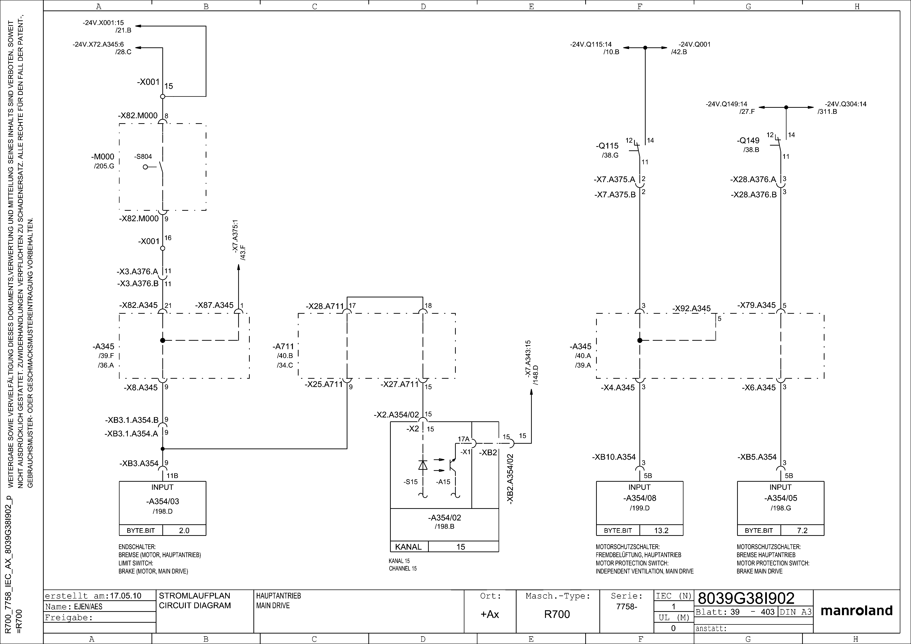

# +Ax — Sheet 39 of 403 — HAUPTANTRIEB

**MAIN DRIVE**

> Part of the manroland **R700** printing press IEC/UL circuit diagrams.
> Drawing class: **Stromlaufplan / Circuit diagram** (DIN A3).
> Document `+Ax` covers the **Central control console** machine section.

## At a glance

| Field | Value |
|---|---|
| Document | `+Ax`  (8039G38I902) |
| Sheet | **39** of 403 |
| Section (DE) | HAUPTANTRIEB |
| Section (EN) | MAIN DRIVE |
| Section type | CIRCUIT — Circuit diagram |
| Machine type | `R700` |
| Series | `7758` |
| Created | 17.05.10 |
| Replaces | — |
| Columns used | A, B, C, D, E, F, G, H |
| Path numbers | — |
| Labels on sheet | 138 |
| Cross-refs out | 21 |
| Cross-refs in | 48 |

**Previous:** [+Ax sheet 38](SHEET_0038.md) · **Next:** [+Ax sheet 40](SHEET_0040.md) · **Document TOC:** [_TOC.md](_TOC.md)  (+Ax) · **Master TOC:** [all sheets](../_MASTER_TOC.md)

## Sheet image (300 DPI, exact vector render)



_Rendered directly from the PDF vector layer at 300 DPI (1-bit), no OCR and no resampling. Use it to confirm anything ambiguous in the text below._

## Cross-references on this sheet

Each entry is a wire leaving this sheet. The printed token is `/sheet.column`; the link resolves to that sheet inside the same document.

| Ref | Target sheet | Col | Path | Destination on target | Target section | From col |
|---|---|---|---|---|---|---|
| `/21.B` | [+Ax sheet 21](SHEET_0021.md) | B | — | 24V.X001:15 | SPANNUNGSVERSORGUNG, SCHALTSCHRANKBELÜFTUNG | A |
| `/28.C` | [+Ax sheet 28](SHEET_0028.md) | C | — | 24V.X72.A345:6 | SPANNUNGSVERSORGUNG, SCHALTSCHRANKBELÜFTUNG | A |
| `/10.B` | [+Ax sheet 10](SHEET_0010.md) | B | — | 24V.Q115:14 | SPANNUNGSVERSORGUNG, SCHALTSCHRANKBELÜFTUNG | F |
| `/42.B` | [+Ax sheet 42](SHEET_0042.md) | B | — | — | HAUPTANTRIEB | F |
| `/27.F` | [+Ax sheet 27](SHEET_0027.md) | F | — | 24V.Q149:14 | SPANNUNGSVERSORGUNG, SCHALTSCHRANKBELÜFTUNG | G |
| `/311.B` | [+Ax sheet 311](SHEET_0311.md) | B | — | — | OPTION: IONISATIONSANLAGE ANLEGER | H |
| `/38.B` | [+Ax sheet 38](SHEET_0038.md) | B | — | — | HAUPTANTRIEB | G |
| `/38.G` | [+Ax sheet 38](SHEET_0038.md) | G | — | — | HAUPTANTRIEB | F |
| `/205.G` | [+Ax sheet 205](SHEET_0205.md) | G | — | — | REFERENZMODUL | A |
| `/43.F` | [+Ax sheet 43](SHEET_0043.md) | F | — | X7.A375:1 | HAUPTANTRIEB | B |
| `/148.D` | [+Ax sheet 148](SHEET_0148.md) | D | — | X7.A343:15 | ÜBERWACHUNGSRECHNER SICHERHEITSBUS | E |
| `/40.B` | [+Ax sheet 40](SHEET_0040.md) | B | — | — | HAUPTANTRIEB | C |
| `/34.C` | [+Ax sheet 34](SHEET_0034.md) | C | — | — | SPANNUNGSVERSORGUNG, SCHALTSCHRANKBELÜFTUNG | C |
| `/40.A` | [+Ax sheet 40](SHEET_0040.md) | A | — | — | HAUPTANTRIEB | E |
| `/39.A` | [+Ax sheet 39](SHEET_0039.md) | A | — | — | HAUPTANTRIEB | E |
| `/39.F` | [+Ax sheet 39](SHEET_0039.md) | F | — | — | HAUPTANTRIEB | A |
| `/36.A` | [+Ax sheet 36](SHEET_0036.md) | A | — | — | SCHMIERUNG | A |
| `/198.G` | [+Ax sheet 198](SHEET_0198.md) | G | — | — | REFERENZMODUL | G |
| `/199.D` | [+Ax sheet 199](SHEET_0199.md) | D | — | — | REFERENZMODUL | F |
| `/198.D` | [+Ax sheet 198](SHEET_0198.md) | D | — | — | REFERENZMODUL | B |
| `/198.B` | [+Ax sheet 198](SHEET_0198.md) | B | — | — | REFERENZMODUL | D |

### Incoming references (sheets that point here)

Every other sheet that sends a wire to this one. `Back-ref` is the token printed on *that* sheet; `Path` is its line number.

| From sheet | Cols | Back-ref | Path | Refs | What continues there |
|---|---|---|---|---|---|
| [+Ax#10](SHEET_0010.md) | B | `/10.B` | — | 1 | — |
| [+Ax#21](SHEET_0021.md) | B | `/21.B` | — | 1 | — |
| [+Ax#27](SHEET_0027.md) | F | `/27.F` | — | 1 | — |
| [+Ax#28](SHEET_0028.md) | C | `/28.C` | — | 1 | 24V.X72.A345:6 |
| [+Ax#34](SHEET_0034.md) | C | `/34.C` | — | 1 | — |
| [+Ax#36](SHEET_0036.md) | A | `/36.A` | — | 1 | — |
| [+Ax#38](SHEET_0038.md) | B, G | `/38.B`, `/38.G` | — | 2 | — |
| [+Ax#39](SHEET_0039.md) | A, E | `/39.A`, `/39.E` | — | 2 | — |
| [+Ax#40](SHEET_0040.md) | A, B | `/40.A`, `/40.B` | — | 2 | — |
| [+Ax#42](SHEET_0042.md) | B | `/42.B` | — | 1 | 24V.Q001 24V.Q113:14 |
| [+Ax#43](SHEET_0043.md) | F | `/43.F` | — | 1 | X7.A375:1 |
| [+Ax#148](SHEET_0148.md) | D | `/148.D` | — | 1 | X7.A343:15 |
| [+Ax#198](SHEET_0198.md) | B, D, G | `/198.B`, `/198.D`, `/198.G` | — | 3 | — |
| [+Ax#199](SHEET_0199.md) | D | `/199.D` | — | 1 | — |
| [+Ax#205](SHEET_0205.md) | G | `/205.G` | — | 1 | — |
| [+Ax#219](SHEET_0219.md) | C, E | `/219.C`, `/219.E` | — | 2 | — |
| [+Ax#224](SHEET_0224.md) | A, B, C, E, F | `/224.A`, `/224.B`, `/224.C`, `/224.E`, `/224.F` | — | 5 | — |
| [+Ax#227](SHEET_0227.md) | A | `/227.A` | — | 1 | — |
| [+Ax#231](SHEET_0231.md) | E | `/231.E` | — | 1 | — |
| [+Ax#233](SHEET_0233.md) | G | `/233.G` | — | 1 | — |
| [+Ax#236](SHEET_0236.md) | E, F | `/236.E`, `/236.F` | — | 2 | — |
| [+Ax#238](SHEET_0238.md) | A | `/238.A` | — | 1 | — |
| [+Ax#245](SHEET_0245.md) | B | `/245.B` | — | 1 | — |
| [+Ax#268](SHEET_0268.md) | C | `/268.C` | — | 1 | — |
| [+Ax#271](SHEET_0271.md) | A, D, E | `/271.A`, `/271.D`, `/271.E` | — | 3 | — |
| [+Ax#272](SHEET_0272.md) | G | `/272.G` | — | 2 | — |
| [+Ax#286](SHEET_0286.md) | B, F, G | `/286.B`, `/286.F`, `/286.G` | — | 4 | — |
| [+Ax#289](SHEET_0289.md) | A, F | `/289.A`, `/289.F` | — | 3 | — |
| [+Ax#311](SHEET_0311.md) | A | `/311.A` | — | 1 | 24V.Q304:14 |


## Devices on this sheet

| Tag | Class | Class meaning (IEC) | Col | Sub | Terminal | Sign |
|---|---|---|---|---|---|---|
| `A354/08` | A | Baugruppe / assembly, module, PC board | F | 08 | — | — |
| `A354/05` | A | Baugruppe / assembly, module, PC board | G | 05 | — | — |
| `A354/03` | A | Baugruppe / assembly, module, PC board | B | 03 | — | — |
| `S15` | S | Schalter / switch | D | — | — | — |
| `A15` | A | Baugruppe / assembly, module, PC board | D | — | — | — |
| `X1` | X | Klemme / terminal, plug connector | D | — | — | — |
| `X2` | X | Klemme / terminal, plug connector | D | — | — | — |
| `XB2` | XB |  | E | — | — | — |
| `A354/02` | A | Baugruppe / assembly, module, PC board | D | 02 | — | — |
| `A711` | A | Baugruppe / assembly, module, PC board | C | — | — | — |
| `X001` | X | Klemme / terminal, plug connector | A | — | — | — |
| `X001` | X | Klemme / terminal, plug connector | A | — | — | — |
| `S804` | S | Schalter / switch | A | — | — | — |
| `A345` | A | Baugruppe / assembly, module, PC board | A | — | — | — |
| `Q115` | Q | Leistungsschalter / power switching device | F | — | — | — |
| `Q149` | Q | Leistungsschalter / power switching device | G | — | — | — |
| `A345` | A | Baugruppe / assembly, module, PC board | E | — | — | — |
| `13.2` | — | cross-device reference | F | — | — | — |
| `XB10.A354` | — | cross-device reference | F | — | — | — |
| `7.2` | — | cross-device reference | G | — | — | — |
| `XB5.A354` | — | cross-device reference | G | — | — | — |
| `2.0` | — | cross-device reference | B | — | — | — |
| `XB3.A354` | — | cross-device reference | A | — | — | — |
| `XB3.1.A354.B` | — | cross-device reference | A | — | — | — |
| `XB3.1.A354.A` | — | cross-device reference | A | — | — | — |
| `X27.A711` | — | cross-device reference | D | — | — | — |
| `X28.A711` | — | cross-device reference | C | — | — | — |
| `X25.A711` | — | cross-device reference | C | — | — | — |
| `X82.M000` | — | cross-device reference | A | — | — | — |
| `X3.A376.B` | — | cross-device reference | A | — | — | — |
| `X3.A376.A` | — | cross-device reference | A | — | — | — |
| `X82.M000` | — | cross-device reference | A | — | — | — |
| `X82.A345` | — | cross-device reference | A | — | — | — |
| `X87.A345` | — | cross-device reference | B | — | — | — |
| `X8.A345` | — | cross-device reference | A | — | — | — |
| `X7.A375.B` | — | cross-device reference | F | — | — | — |
| `X7.A375.A` | — | cross-device reference | F | — | — | — |
| `X28.A376.B` | — | cross-device reference | G | — | — | — |
| `X28.A376.A` | — | cross-device reference | G | — | — | — |
| `X79.A345` | — | cross-device reference | G | — | — | — |
| `X4.A345` | — | cross-device reference | F | — | — | — |
| `X6.A345` | — | cross-device reference | G | — | — | — |
| `X7.A343:15` | — | cross-device reference | E | — | 15 | — |
| `X7.A375:1` | — | cross-device reference | B | — | 1 | — |
| `X92.A345` | — | cross-device reference | F | — | — | — |

## Potentials / nets

| Potential | Count | Columns | Attached devices | Terminals |
|---|---|---|---|---|
| `24V` | 6 | A, F, G, H | `A345`, `Q001`, `Q115`, `Q149`, `Q304`, `X001`, `X72` | `14`, `15`, `6` |
| `M000` | 1 | A | — | — |


A potential such as `L24+/4` or `M24+` is a named supply/return rail; every place it appears on this sheet is electrically common.

## Wire-end annotations (grouped as printed)

A wire that continues elsewhere is annotated with a small cluster: the destination description, the path/line number `#NN`, and the `/sheet.column` cross reference. Each row below is one such cluster exactly as it is grouped on the drawing.

| Col | Y | Path | Cross-ref | Text on the wire |
|---|---|---|---|---|
| A | 25.8 | — | `/21.B` | `24V.X001:15` |
| A | 54.1 | — | `/28.C` | `24V.X72.A345:6` |
| F | 54.1 | — | `/10.B` | `24V.Q115:14` |
| G | 54.2 | — | — | `24V.Q001` |
| F | 64.0 | — | `/42.B` | — |
| B | 102.1 | — | — | `X001 15` |
| G | 132.1 | — | `/27.F` | `24V.Q149:14` |
| H | 132.1 | — | — | `24V.Q304:14` |
| H | 142.0 | — | `/311.B` | — |
| A | 146.3 | — | — | `X82.M000 8` |
| G | 172.5 | — | — | `Q149 14` |
| G | 172.5 | — | — | `12` |
| F | 179.6 | — | — | `Q115 14` |
| F | 179.6 | — | — | `12` |
| G | 191.9 | — | `/38.B` | — |
| F | 199.1 | — | `/38.G` | — |
| A | 200.2 | — | — | `M000 S804` |
| G | 200.9 | — | — | `11` |
| F | 208.0 | — | — | `11` |
| A | 213.2 | — | `/205.G` | — |
| F | 229.9 | — | — | `X7.A375.A 2` |
| G | 229.9 | — | — | `X28.A376.A 3` |
| F | 246.9 | — | — | `X7.A375.B 2` |
| G | 246.9 | — | — | `X28.A376.B 3` |
| A | 280.9 | — | — | `X82.M000 9` |
| B | 286.6 | — | `/43.F` | `X7.A375:1` |
| B | 307.2 | — | — | `X001 16` |
| A | 350.4 | — | — | `X3.A376.A 11` |
| A | 366.0 | — | — | `X3.A376.B 11` |
| B | 394.3 | — | — | `X82.A345 21 X87.A345 1` |
| G | 394.3 | — | — | `X79.A345 5` |
| C | 395.7 | — | — | `X28.A711 17` |
| D | 395.8 | — | — | `18` |
| F | 395.8 | — | — | `3` |
| F | 398.6 | — | — | `X92.A345` |
| G | 412.8 | — | — | `5` |
| E | 444.8 | — | `/148.D` | `X7.A343:15` |
| A | 448.2 | — | — | `A345` |
| C | 448.2 | — | — | `A711` |
| E | 448.2 | — | — | `A345` |
| A | 461.2 | — | `/39.F`, `/36.A` | — |
| C | 461.2 | — | `/40.B`, `/34.C` | — |
| E | 461.2 | — | `/40.A`, `/39.A` | — |
| C | 497.8 | — | — | `X25.A711 9` |
| D | 497.8 | — | — | `X27.A711 15` |
| A | 502.0 | — | — | `X8.A345 9` |
| F | 502.0 | — | — | `X4.A345 3 X6.A345 3` |
| D | 537.5 | — | — | `X2.A354/02 15` |
| A | 544.6 | — | — | `XB3.1.A354.B 9` |
| D | 555.9 | — | — | `X2` |
| C | 557.3 | — | — | `XB3.1.A354.A 9 15 15` |
| E | 565.8 | — | — | `15` |
| D | 570.0 | — | — | `17A` |
| D | 587.1 | — | — | `X1` |
| E | 587.1 | — | — | `XB2` |
| F | 592.8 | — | — | `XB10.A354 3` |
| G | 592.8 | — | — | `XB5.A354 3` |
| E | 593.3 | — | — | `XB2.A354/02` |
| A | 601.2 | — | — | `XB3.A354 9` |
| B | 618.2 | — | — | `11B` |
| F | 618.2 | — | — | `5B` |
| G | 618.2 | — | — | `5B` |
| D | 626.0 | — | — | `S15 A15` |
| B | 632.8 | — | — | `INPUT` |
| F | 632.8 | — | — | `INPUT` |
| G | 632.8 | — | — | `INPUT` |
| F | 646.6 | — | — | `A354/08` |
| G | 646.6 | — | — | `A354/05` |
| B | 650.9 | — | — | `A354/03` |
| F | 660.4 | — | `/199.D` | — |
| G | 660.4 | — | `/198.G` | — |
| B | 664.7 | — | `/198.D` | — |
| D | 672.1 | — | — | `A354/02` |
| D | 684.5 | — | `/198.B` | — |
| B | 689.4 | — | — | `BYTE.BIT 2.0` |
| G | 689.4 | — | — | `BYTE.BIT 7.2` |
| F | 689.5 | — | — | `BYTE.BIT 13.2` |
| D | 710.4 | — | — | `KANAL 15` |
| B | 712.1 | — | — | `ENDSCHALTER: BREMSE (MOTOR, HAUPTANTRIEB) LIMIT SWITCH: BRAKE (MOTOR, MAIN DRIVE)` |
| F | 712.1 | — | — | `FREMDBELÜFTUNG, HAUPTANTRIEB INDEPENDENT VENTILATION, MAIN DRIVE MOTORSCHUTZSCHALTER: MOTOR PROTECTION SWITCH:` |
| G | 712.1 | — | — | `BREMSE HAUPTANTRIEB BRAKE MAIN DRIVE MOTORSCHUTZSCHALTER: MOTOR PROTECTION SWITCH:` |
| D | 730.7 | — | — | `KANAL 15 CHANNEL 15` |


## Reconstructed tables

This sheet carries tabular content (pin map / terminal assignment / index). The grid below was rebuilt from the drawing's own rule lines, so each row is exactly one physical row of the table.

### Table 1 — 5 data rows × 3 columns (at x=155.9, y=34.0)

| /21.B /28.C X001 | 15 |  |
|---|---|---|
| `X82.M000 S804 X82.M000 X001 X3.A376.A X3.A376.B X82.A345` | `8 9 16 11 11 21` | `X7.A375:1 X87.A345` |
| `X8.A345 XB3.1.A354.B XB3.1.A354.A` | `9 9 9` |  |
| `XB3.A354` | `9 11B` |  |
| `INPUT` | `A354/03 /198.D` |  |
| `BYTE.BIT` | `2.0` |  |


### Table 2 — 7 data rows × 15 columns (at x=453.5, y=388.3)

| 17 |  | 18 |  |  |  |  |  | 3 |  | X92.A345 | 5 | X79.A345 | 5 |  |
|---|---|---|---|---|---|---|---|---|---|---|---|---|---|---|
| `9` | `X27.A711 X2.A354/02` | `15 15` |  |  | `X7.A343:15` | `A345 /40.A /39.A /148.D` | `X4.A345` | `3` |  |  |  | `X6.A345` | `3` |  |
|  | `X2` | `15` | `17A` |  | `15 15` |  |  |  |  |  |  |  |  |  |
|  |  |  | `X1` | `XB2` | `XB2.A354/02` |  | `XB10.A354` | `3` | `5B` |  |  | `XB5.A354` | `3` | `5B` |
|  | `S15` | `A15` |  |  |  |  | `INPUT` | `A354/08` |  |  |  | `INPUT` | `A354/05` |  |
|  |  | `A354/02` |  |  |  |  |  | `/199.D` |  |  |  |  | `/198.G` |  |
|  |  | `/198.B` |  |  |  |  | `BYTE.BIT` |  | `13.2` |  |  | `BYTE.BIT` |  | `7.2` |
|  | `KANAL` |  | `15` |  |  |  | `MOTORSCHUTZSCHALTER:` |  |  |  |  | `MOTORSCHUTZSCHALTER:` |  |  |


## Notes and free text on this sheet

| Text | Col | Y (pt) |
|---|---|---|
| `5B` | F | 618.22 |
| `INPUT` | F | 632.76 |
| `BYTE.BIT` | F | 690.01 |
| `MOTORSCHUTZSCHALTER:` | F | 712.14 |
| `FREMDBELÜFTUNG, HAUPTANTRIEB` | F | 722.76 |
| `MOTOR PROTECTION SWITCH:` | F | 733.38 |
| `INDEPENDENT VENTILATION, MAIN DRIVE` | F | 744.02 |
| `5B` | G | 618.22 |
| `INPUT` | G | 632.76 |
| `BYTE.BIT` | G | 690.01 |
| `MOTORSCHUTZSCHALTER:` | G | 712.14 |
| `BREMSE HAUPTANTRIEB` | G | 722.75 |
| `MOTOR PROTECTION SWITCH:` | G | 733.38 |
| `BRAKE MAIN DRIVE` | G | 744 |
| `11B` | B | 618.24 |
| `INPUT` | B | 632.76 |
| `BYTE.BIT` | A | 690.01 |
| `ENDSCHALTER:` | A | 712.11 |
| `BREMSE (MOTOR, HAUPTANTRIEB)` | B | 722.76 |
| `LIMIT SWITCH:` | A | 733.33 |
| `BRAKE (MOTOR, MAIN DRIVE)` | B | 744.02 |
| `KANAL 15` | D | 730.71 |
| `CHANNEL 15` | D | 740.65 |
| `17A` | D | 570.05 |
| `KANAL` | D | 710.38 |
| `X2.A354/02` | D | 537.47 |
| `XB2.A354/02` | E | 593.29 |

## Complete label inventory (exact text from the drawing)

Every text object inside the drawing area of this sheet, in DIN reading order (column A→H, then top→bottom). This is the authoritative list: if a string is not here it is not printed on this sheet.

| Col | Y | X | Dir | Type | Text |
|---|---|---|---|---|---|
| A | 25.8 | 108.3 | → | potential | `24V.X001:15` |
| A | 35.7 | 151.1 | → | cross-reference | `/21.B` |
| A | 54.1 | 95.0 | → | potential | `24V.X72.A345:6` |
| A | 64.1 | 150.8 | → | cross-reference | `/28.C` |
| A | 102.1 | 179.1 | → | device tag | `X001` |
| A | 146.3 | 154.2 | → | device ref | `X82.M000` |
| A | 200.2 | 119.3 | → | potential | `M000` |
| A | 200.9 | 175.5 | → | device tag | `S804` |
| A | 213.2 | 123.0 | → | cross-reference | `/205.G` |
| A | 280.9 | 155.6 | → | device ref | `X82.M000` |
| A | 310.7 | 180.6 | → | device tag | `X001` |
| A | 350.4 | 152.5 | → | device ref | `X3.A376.A` |
| A | 366.0 | 153.4 | → | device ref | `X3.A376.B` |
| A | 394.3 | 155.9 | → | device ref | `X82.A345` |
| A | 448.2 | 121.0 | → | device tag | `A345` |
| A | 461.2 | 129.0 | → | cross-reference | `/39.F` |
| A | 473.6 | 128.1 | → | cross-reference | `/36.A` |
| A | 502.0 | 161.9 | → | device ref | `X8.A345` |
| A | 544.6 | 137.5 | → | device ref | `XB3.1.A354.B` |
| A | 562.3 | 136.6 | → | device ref | `XB3.1.A354.A` |
| A | 601.3 | 156.2 | → | device ref | `XB3.A354` |
| A | 690.0 | 165.8 | → | text | `BYTE.BIT` |
| A | 712.1 | 155.1 | → | text | `ENDSCHALTER:` |
| A | 733.3 | 155.1 | → | text | `LIMIT SWITCH:` |
| B | 108.0 | 214.3 | → | number | `15` |
| B | 147.7 | 215.1 | → | number | `8` |
| B | 282.4 | 215.1 | → | number | `9` |
| B | 286.6 | 303.6 | ↕ | device ref | `X7.A375:1` |
| B | 307.2 | 214.6 | → | number | `16` |
| B | 320.0 | 313.5 | ↕ | cross-reference | `/43.F` |
| B | 350.4 | 214.6 | → | number | `11` |
| B | 367.4 | 214.6 | → | number | `11` |
| B | 394.3 | 255.1 | → | device ref | `X87.A345` |
| B | 395.8 | 215.1 | → | number | `21` |
| B | 395.8 | 313.8 | → | number | `1` |
| B | 502.1 | 215.1 | → | number | `9` |
| B | 544.6 | 215.1 | → | number | `9` |
| B | 561.6 | 215.1 | → | number | `9` |
| B | 601.3 | 215.1 | → | number | `9` |
| B | 618.2 | 217.4 | → | text | `11B` |
| B | 632.8 | 197.7 | → | text | `INPUT` |
| B | 650.9 | 191.2 | → | device tag | `A354/03` |
| B | 664.7 | 199.8 | → | cross-reference | `/198.D` |
| B | 689.4 | 234.1 | → | device ref | `2.0` |
| B | 722.8 | 155.1 | → | text | `BREMSE (MOTOR, HAUPTANTRIEB)` |
| B | 744.0 | 155.1 | → | text | `BRAKE (MOTOR, MAIN DRIVE)` |
| C | 395.7 | 399.7 | → | device ref | `X28.A711` |
| C | 395.8 | 455.5 | → | number | `17` |
| C | 448.2 | 356.3 | → | device tag | `A711` |
| C | 461.2 | 362.3 | → | cross-reference | `/40.B` |
| C | 473.7 | 362.0 | → | cross-reference | `/34.C` |
| C | 497.8 | 398.3 | → | device ref | `X25.A711` |
| C | 502.1 | 456.1 | → | number | `9` |
| D | 395.8 | 554.7 | → | number | `18` |
| D | 497.8 | 497.5 | → | device ref | `X27.A711` |
| D | 502.1 | 554.7 | → | number | `15` |
| D | 537.5 | 488.7 | → | text | `X2.A354/02` |
| D | 537.5 | 554.7 | → | number | `15` |
| D | 555.9 | 531.2 | → | device tag | `X2` |
| D | 557.3 | 557.6 | → | number | `15` |
| D | 570.1 | 598.1 | → | text | `17A` |
| D | 587.1 | 601.8 | → | device tag | `X1` |
| D | 626.1 | 527.5 | → | device tag | `S15` |
| D | 626.1 | 570.0 | → | device tag | `A15` |
| D | 672.1 | 559.7 | → | device tag | `A354/02` |
| D | 684.5 | 568.5 | → | cross-reference | `/198.B` |
| D | 710.3 | 596.1 | → | number | `15` |
| D | 710.4 | 516.5 | → | text | `KANAL` |
| D | 730.7 | 508.3 | → | text | `KANAL 15` |
| D | 740.6 | 508.5 | → | text | `CHANNEL 15` |
| E | 444.8 | 686.3 | ↕ | device ref | `X7.A343:15` |
| E | 448.2 | 744.7 | → | device tag | `A345` |
| E | 461.2 | 751.7 | → | cross-reference | `/40.A` |
| E | 473.6 | 751.7 | → | cross-reference | `/39.A` |
| E | 477.4 | 696.2 | ↕ | cross-reference | `/148.D` |
| E | 565.8 | 678.0 | → | number | `15` |
| E | 567.3 | 656.8 | → | number | `15` |
| E | 587.1 | 626.2 | → | device tag | `XB2` |
| E | 593.3 | 662.2 | ↕ | text | `XB2.A354/02` |
| F | 54.2 | 745.2 | → | potential | `24V.Q115:14` |
| F | 64.0 | 788.9 | → | cross-reference | `/10.B` |
| F | 64.0 | 877.3 | → | cross-reference | `/42.B` |
| F | 179.6 | 817.2 | → | number | `12` |
| F | 179.6 | 845.3 | → | number | `14` |
| F | 186.0 | 779.0 | → | device tag | `Q115` |
| F | 199.0 | 786.9 | → | cross-reference | `/38.G` |
| F | 208.0 | 838.2 | → | number | `11` |
| F | 229.9 | 776.1 | → | device ref | `X7.A375.A` |
| F | 229.9 | 838.8 | → | number | `2` |
| F | 246.9 | 838.8 | → | number | `2` |
| F | 249.8 | 777.0 | → | device ref | `X7.A375.B` |
| F | 395.8 | 838.8 | → | number | `3` |
| F | 398.6 | 878.7 | → | device ref | `X92.A345` |
| F | 502.0 | 785.5 | → | device ref | `X4.A345` |
| F | 502.1 | 838.8 | → | number | `3` |
| F | 592.7 | 773.9 | → | device ref | `XB10.A354` |
| F | 601.3 | 838.8 | → | number | `3` |
| F | 618.2 | 841.6 | → | text | `5B` |
| F | 632.8 | 821.3 | → | text | `INPUT` |
| F | 646.6 | 814.8 | → | device tag | `A354/08` |
| F | 660.4 | 823.5 | → | cross-reference | `/199.D` |
| F | 689.4 | 854.8 | → | device ref | `13.2` |
| F | 690.0 | 789.4 | → | text | `BYTE.BIT` |
| F | 712.1 | 779.0 | → | text | `MOTORSCHUTZSCHALTER:` |
| F | 722.8 | 778.7 | → | text | `FREMDBELÜFTUNG, HAUPTANTRIEB` |
| F | 733.4 | 779.0 | → | text | `MOTOR PROTECTION SWITCH:` |
| F | 744.0 | 778.7 | → | text | `INDEPENDENT VENTILATION, MAIN DRIVE` |
| G | 54.2 | 887.0 | → | potential | `24V.Q001` |
| G | 132.1 | 922.4 | → | potential | `24V.Q149:14` |
| G | 142.0 | 966.6 | → | cross-reference | `/27.F` |
| G | 172.5 | 1001.5 | → | number | `12` |
| G | 172.5 | 1029.5 | → | number | `14` |
| G | 178.9 | 963.2 | → | device tag | `Q149` |
| G | 191.9 | 971.7 | → | cross-reference | `/38.B` |
| G | 200.9 | 1022.5 | → | number | `11` |
| G | 229.9 | 954.4 | → | device ref | `X28.A376.A` |
| G | 229.9 | 1023.0 | → | number | `3` |
| G | 246.9 | 1023.0 | → | number | `3` |
| G | 249.8 | 955.3 | → | device ref | `X28.A376.B` |
| G | 394.3 | 963.8 | → | device ref | `X79.A345` |
| G | 395.8 | 1023.0 | → | number | `5` |
| G | 412.8 | 938.0 | → | number | `5` |
| G | 502.0 | 969.7 | → | device ref | `X6.A345` |
| G | 502.1 | 1023.0 | → | number | `3` |
| G | 592.7 | 964.1 | → | device ref | `XB5.A354` |
| G | 601.3 | 1023.0 | → | number | `3` |
| G | 618.2 | 1025.9 | → | text | `5B` |
| G | 632.8 | 1005.6 | → | text | `INPUT` |
| G | 646.6 | 999.1 | → | device tag | `A354/05` |
| G | 660.4 | 1007.6 | → | cross-reference | `/198.G` |
| G | 689.4 | 1042.0 | → | device ref | `7.2` |
| G | 690.0 | 973.7 | → | text | `BYTE.BIT` |
| G | 712.1 | 963.2 | → | text | `MOTORSCHUTZSCHALTER:` |
| G | 722.7 | 962.9 | → | text | `BREMSE HAUPTANTRIEB` |
| G | 733.4 | 963.2 | → | text | `MOTOR PROTECTION SWITCH:` |
| G | 744.0 | 962.9 | → | text | `BRAKE MAIN DRIVE` |
| H | 132.1 | 1078.3 | → | potential | `24V.Q304:14` |
| H | 142.0 | 1068.7 | → | cross-reference | `/311.B` |

## Reading-order text block

The same content as a plain block, grouped by DIN column — convenient to paste or to match against a visual description.

```text
=== Column A ===
  25.8  108.3  net          24V.X001:15
  35.7  151.1  xref         /21.B
  54.1   95.0  net          24V.X72.A345:6
  64.1  150.8  xref         /28.C
 102.1  179.1  devtag       X001
 146.3  154.2  devref       X82.M000
 200.2  119.3  net          M000
 200.9  175.5  devtag       S804
 213.2  123.0  xref         /205.G
 280.9  155.6  devref       X82.M000
 310.7  180.6  devtag       X001
 350.4  152.5  devref       X3.A376.A
 366.0  153.4  devref       X3.A376.B
 394.3  155.9  devref       X82.A345
 448.2  121.0  devtag       A345
 461.2  129.0  xref         /39.F
 473.6  128.1  xref         /36.A
 502.0  161.9  devref       X8.A345
 544.6  137.5  devref       XB3.1.A354.B
 562.3  136.6  devref       XB3.1.A354.A
 601.3  156.2  devref       XB3.A354
 690.0  165.8  text         BYTE.BIT
 712.1  155.1  text         ENDSCHALTER:
 733.3  155.1  text         LIMIT SWITCH:
=== Column B ===
 108.0  214.3  numeric      15
 147.7  215.1  numeric      8
 282.4  215.1  numeric      9
 286.6  303.6  devref       X7.A375:1
 307.2  214.6  numeric      16
 320.0  313.5  xref         /43.F
 350.4  214.6  numeric      11
 367.4  214.6  numeric      11
 394.3  255.1  devref       X87.A345
 395.8  215.1  numeric      21
 395.8  313.8  numeric      1
 502.1  215.1  numeric      9
 544.6  215.1  numeric      9
 561.6  215.1  numeric      9
 601.3  215.1  numeric      9
 618.2  217.4  text         11B
 632.8  197.7  text         INPUT
 650.9  191.2  devtag       A354/03
 664.7  199.8  xref         /198.D
 689.4  234.1  devref       2.0
 722.8  155.1  text         BREMSE (MOTOR, HAUPTANTRIEB)
 744.0  155.1  text         BRAKE (MOTOR, MAIN DRIVE)
=== Column C ===
 395.7  399.7  devref       X28.A711
 395.8  455.5  numeric      17
 448.2  356.3  devtag       A711
 461.2  362.3  xref         /40.B
 473.7  362.0  xref         /34.C
 497.8  398.3  devref       X25.A711
 502.1  456.1  numeric      9
=== Column D ===
 395.8  554.7  numeric      18
 497.8  497.5  devref       X27.A711
 502.1  554.7  numeric      15
 537.5  488.7  text         X2.A354/02
 537.5  554.7  numeric      15
 555.9  531.2  devtag       X2
 557.3  557.6  numeric      15
 570.1  598.1  text         17A
 587.1  601.8  devtag       X1
 626.1  527.5  devtag       S15
 626.1  570.0  devtag       A15
 672.1  559.7  devtag       A354/02
 684.5  568.5  xref         /198.B
 710.3  596.1  numeric      15
 710.4  516.5  text         KANAL
 730.7  508.3  text         KANAL 15
 740.6  508.5  text         CHANNEL 15
=== Column E ===
 444.8  686.3  devref       X7.A343:15
 448.2  744.7  devtag       A345
 461.2  751.7  xref         /40.A
 473.6  751.7  xref         /39.A
 477.4  696.2  xref         /148.D
 565.8  678.0  numeric      15
 567.3  656.8  numeric      15
 587.1  626.2  devtag       XB2
 593.3  662.2  text         XB2.A354/02
=== Column F ===
  54.2  745.2  net          24V.Q115:14
  64.0  788.9  xref         /10.B
  64.0  877.3  xref         /42.B
 179.6  817.2  numeric      12
 179.6  845.3  numeric      14
 186.0  779.0  devtag       Q115
 199.0  786.9  xref         /38.G
 208.0  838.2  numeric      11
 229.9  776.1  devref       X7.A375.A
 229.9  838.8  numeric      2
 246.9  838.8  numeric      2
 249.8  777.0  devref       X7.A375.B
 395.8  838.8  numeric      3
 398.6  878.7  devref       X92.A345
 502.0  785.5  devref       X4.A345
 502.1  838.8  numeric      3
 592.7  773.9  devref       XB10.A354
 601.3  838.8  numeric      3
 618.2  841.6  text         5B
 632.8  821.3  text         INPUT
 646.6  814.8  devtag       A354/08
 660.4  823.5  xref         /199.D
 689.4  854.8  devref       13.2
 690.0  789.4  text         BYTE.BIT
 712.1  779.0  text         MOTORSCHUTZSCHALTER:
 722.8  778.7  text         FREMDBELÜFTUNG, HAUPTANTRIEB
 733.4  779.0  text         MOTOR PROTECTION SWITCH:
 744.0  778.7  text         INDEPENDENT VENTILATION, MAIN DRIVE
=== Column G ===
  54.2  887.0  net          24V.Q001
 132.1  922.4  net          24V.Q149:14
 142.0  966.6  xref         /27.F
 172.5 1001.5  numeric      12
 172.5 1029.5  numeric      14
 178.9  963.2  devtag       Q149
 191.9  971.7  xref         /38.B
 200.9 1022.5  numeric      11
 229.9  954.4  devref       X28.A376.A
 229.9 1023.0  numeric      3
 246.9 1023.0  numeric      3
 249.8  955.3  devref       X28.A376.B
 394.3  963.8  devref       X79.A345
 395.8 1023.0  numeric      5
 412.8  938.0  numeric      5
 502.0  969.7  devref       X6.A345
 502.1 1023.0  numeric      3
 592.7  964.1  devref       XB5.A354
 601.3 1023.0  numeric      3
 618.2 1025.9  text         5B
 632.8 1005.6  text         INPUT
 646.6  999.1  devtag       A354/05
 660.4 1007.6  xref         /198.G
 689.4 1042.0  devref       7.2
 690.0  973.7  text         BYTE.BIT
 712.1  963.2  text         MOTORSCHUTZSCHALTER:
 722.7  962.9  text         BREMSE HAUPTANTRIEB
 733.4  963.2  text         MOTOR PROTECTION SWITCH:
 744.0  962.9  text         BRAKE MAIN DRIVE
=== Column H ===
 132.1 1078.3  net          24V.Q304:14
 142.0 1068.7  xref         /311.B
```

---
_Generated from the PDF vector text layer; no OCR. Source: `R700_7758_IEC_AX_8039G38I902_p`, sheet 39._
