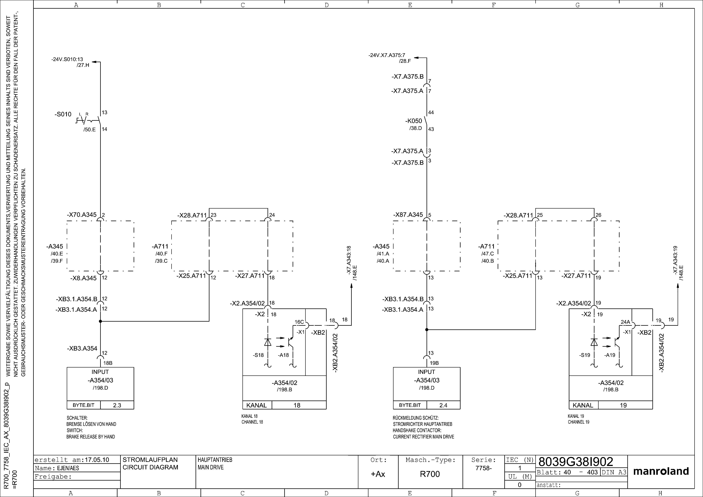

# +Ax — Sheet 40 of 403 — HAUPTANTRIEB

**MAIN DRIVE**

> Part of the manroland **R700** printing press IEC/UL circuit diagrams.
> Drawing class: **Stromlaufplan / Circuit diagram** (DIN A3).
> Document `+Ax` covers the **Central control console** machine section.

## At a glance

| Field | Value |
|---|---|
| Document | `+Ax`  (8039G38I902) |
| Sheet | **40** of 403 |
| Section (DE) | HAUPTANTRIEB |
| Section (EN) | MAIN DRIVE |
| Section type | CIRCUIT — Circuit diagram |
| Machine type | `R700` |
| Series | `7758` |
| Created | 17.05.10 |
| Replaces | — |
| Columns used | A, B, C, D, E, F, G, H |
| Path numbers | — |
| Labels on sheet | 126 |
| Cross-refs out | 18 |
| Cross-refs in | 44 |

**Previous:** [+Ax sheet 39](SHEET_0039.md) · **Next:** [+Ax sheet 41](SHEET_0041.md) · **Document TOC:** [_TOC.md](_TOC.md)  (+Ax) · **Master TOC:** [all sheets](../_MASTER_TOC.md)

## Sheet image (300 DPI, exact vector render)



_Rendered directly from the PDF vector layer at 300 DPI (1-bit), no OCR and no resampling. Use it to confirm anything ambiguous in the text below._

## Cross-references on this sheet

Each entry is a wire leaving this sheet. The printed token is `/sheet.column`; the link resolves to that sheet inside the same document.

| Ref | Target sheet | Col | Path | Destination on target | Target section | From col |
|---|---|---|---|---|---|---|
| `/28.F` | [+Ax sheet 28](SHEET_0028.md) | F | — | 24V.X7.A375:7 24V.S010:13 | SPANNUNGSVERSORGUNG, SCHALTSCHRANKBELÜFTUNG | C |
| `/27.H` | [+Ax sheet 27](SHEET_0027.md) | H | — | 24V.X7.A375:7 24V.S010:13 | SPANNUNGSVERSORGUNG, SCHALTSCHRANKBELÜFTUNG | C |
| `/38.D` | [+Ax sheet 38](SHEET_0038.md) | D | — | — | HAUPTANTRIEB | E |
| `/50.E` | [+Ax sheet 50](SHEET_0050.md) | E | — | — | STOP SICHERN | A |
| `/148.E` | [+Ax sheet 148](SHEET_0148.md) | E | — | X7.A343:18 | ÜBERWACHUNGSRECHNER SICHERHEITSBUS | D |
| `/148.E` | [+Ax sheet 148](SHEET_0148.md) | E | — | X7.A343:19 | ÜBERWACHUNGSRECHNER SICHERHEITSBUS | H |
| `/40.E` | [+Ax sheet 40](SHEET_0040.md) | E | — | — | HAUPTANTRIEB | A |
| `/39.F` | [+Ax sheet 39](SHEET_0039.md) | F | — | — | HAUPTANTRIEB | A |
| `/41.A` | [+Ax sheet 41](SHEET_0041.md) | A | — | — | HAUPTANTRIEB | E |
| `/40.A` | [+Ax sheet 40](SHEET_0040.md) | A | — | — | HAUPTANTRIEB | E |
| `/40.F` | [+Ax sheet 40](SHEET_0040.md) | F | — | — | HAUPTANTRIEB | B |
| `/39.C` | [+Ax sheet 39](SHEET_0039.md) | C | — | — | HAUPTANTRIEB | B |
| `/47.C` | [+Ax sheet 47](SHEET_0047.md) | C | — | — | NOT AUS | F |
| `/40.B` | [+Ax sheet 40](SHEET_0040.md) | B | — | — | HAUPTANTRIEB | F |
| `/198.D` | [+Ax sheet 198](SHEET_0198.md) | D | — | — | REFERENZMODUL | A |
| `/198.D` | [+Ax sheet 198](SHEET_0198.md) | D | — | — | REFERENZMODUL | E |
| `/198.B` | [+Ax sheet 198](SHEET_0198.md) | B | — | — | REFERENZMODUL | C |
| `/198.B` | [+Ax sheet 198](SHEET_0198.md) | B | — | — | REFERENZMODUL | G |

### Incoming references (sheets that point here)

Every other sheet that sends a wire to this one. `Back-ref` is the token printed on *that* sheet; `Path` is its line number.

| From sheet | Cols | Back-ref | Path | Refs | What continues there |
|---|---|---|---|---|---|
| [+Ax#27](SHEET_0027.md) | H | `/27.H` | — | 1 | 24V.S010:13 |
| [+Ax#28](SHEET_0028.md) | F | `/28.F` | — | 1 | — |
| [+Ax#38](SHEET_0038.md) | D | `/38.D` | — | 1 | — |
| [+Ax#39](SHEET_0039.md) | C, E | `/39.C`, `/39.E` | — | 2 | — |
| [+Ax#40](SHEET_0040.md) | A, B, E, F | `/40.A`, `/40.B`, `/40.E`, `/40.F` | — | 4 | — |
| [+Ax#41](SHEET_0041.md) | A | `/41.A` | — | 1 | — |
| [+Ax#47](SHEET_0047.md) | C | `/47.C` | — | 1 | — |
| [+Ax#50](SHEET_0050.md) | E | `/50.E` | — | 1 | — |
| [+Ax#148](SHEET_0148.md) | E | `/148.E` | — | 2 | X7.A343:18; X7.A343:19 |
| [+Ax#198](SHEET_0198.md) | B, D | `/198.B`, `/198.D` | — | 4 | — |
| [+Ax#219](SHEET_0219.md) | D, F | `/219.D`, `/219.F` | — | 4 | — |
| [+Ax#224](SHEET_0224.md) | A, B, C | `/224.A`, `/224.B`, `/224.C` | — | 6 | — |
| [+Ax#236](SHEET_0236.md) | E, F | `/236.E`, `/236.F` | — | 4 | — |
| [+Ax#238](SHEET_0238.md) | A | `/238.A` | — | 2 | — |
| [+Ax#268](SHEET_0268.md) | C | `/268.C` | — | 2 | — |
| [+Ax#271](SHEET_0271.md) | B | `/271.B` | — | 2 | — |
| [+Ax#272](SHEET_0272.md) | G, H | `/272.G`, `/272.H` | — | 4 | — |
| [+Ax#285](SHEET_0285.md) | A | `/285.A` | — | 1 | — |
| [+Ax#289](SHEET_0289.md) | A | `/289.A` | — | 1 | — |


## Devices on this sheet

| Tag | Class | Class meaning (IEC) | Col | Sub | Terminal | Sign |
|---|---|---|---|---|---|---|
| `A354/03` | A | Baugruppe / assembly, module, PC board | E | 03 | — | — |
| `A711` | A | Baugruppe / assembly, module, PC board | F | — | — | — |
| `K050` | K | Relais / relay, contactor | E | — | — | — |
| `A345` | A | Baugruppe / assembly, module, PC board | E | — | — | — |
| `S19` | S | Schalter / switch | G | — | — | — |
| `A19` | A | Baugruppe / assembly, module, PC board | G | — | — | — |
| `X1` | X | Klemme / terminal, plug connector | H | — | — | — |
| `X2` | X | Klemme / terminal, plug connector | G | — | — | — |
| `XB2` | XB |  | H | — | — | — |
| `A354/02` | A | Baugruppe / assembly, module, PC board | G | 02 | — | — |
| `S010` | S | Schalter / switch | A | — | — | — |
| `A345` | A | Baugruppe / assembly, module, PC board | A | — | — | — |
| `A354/03` | A | Baugruppe / assembly, module, PC board | A | 03 | — | — |
| `A711` | A | Baugruppe / assembly, module, PC board | B | — | — | — |
| `S18` | S | Schalter / switch | C | — | — | — |
| `A18` | A | Baugruppe / assembly, module, PC board | C | — | — | — |
| `X1` | X | Klemme / terminal, plug connector | D | — | — | — |
| `X2` | X | Klemme / terminal, plug connector | C | — | — | — |
| `XB2` | XB |  | D | — | — | — |
| `A354/02` | A | Baugruppe / assembly, module, PC board | C | 02 | — | — |
| `2.4` | — | cross-device reference | E | — | — | — |
| `X27.A711` | — | cross-device reference | G | — | — | — |
| `X28.A711` | — | cross-device reference | F | — | — | — |
| `X25.A711` | — | cross-device reference | F | — | — | — |
| `X7.A375.A` | — | cross-device reference | E | — | — | — |
| `X7.A375.B` | — | cross-device reference | E | — | — | — |
| `X7.A375.B` | — | cross-device reference | E | — | — | — |
| `X7.A375.A` | — | cross-device reference | E | — | — | — |
| `X87.A345` | — | cross-device reference | E | — | — | — |
| `X70.A345` | — | cross-device reference | A | — | — | — |
| `X8.A345` | — | cross-device reference | A | — | — | — |
| `2.3` | — | cross-device reference | A | — | — | — |
| `XB3.A354` | — | cross-device reference | A | — | — | — |
| `X27.A711` | — | cross-device reference | C | — | — | — |
| `X28.A711` | — | cross-device reference | B | — | — | — |
| `X25.A711` | — | cross-device reference | B | — | — | — |
| `XB3.1.A354.B` | — | cross-device reference | A | — | — | — |
| `XB3.1.A354.A` | — | cross-device reference | A | — | — | — |
| `XB3.1.A354.B` | — | cross-device reference | E | — | — | — |
| `XB3.1.A354.A` | — | cross-device reference | E | — | — | — |
| `X7.A343:19` | — | cross-device reference | H | — | 19 | — |
| `X7.A343:18` | — | cross-device reference | D | — | 18 | — |

## Potentials / nets

| Potential | Count | Columns | Attached devices | Terminals |
|---|---|---|---|---|
| `24V` | 2 | A, E | `A375`, `S010`, `X7` | `13`, `7` |


A potential such as `L24+/4` or `M24+` is a named supply/return rail; every place it appears on this sheet is electrically common.

## Wire-end annotations (grouped as printed)

A wire that continues elsewhere is annotated with a small cluster: the destination description, the path/line number `#NN`, and the `/sheet.column` cross reference. Each row below is one such cluster exactly as it is grouped on the drawing.

| Col | Y | Path | Cross-ref | Text on the wire |
|---|---|---|---|---|
| C | 89.6 | — | `/28.F`, `/27.H` | `24V.S010:13 24V.X7.A375:7` |
| E | 125.0 | — | — | `X7.A375.B 7` |
| E | 149.1 | — | — | `X7.A375.A 7` |
| A | 186.7 | — | — | `13` |
| E | 186.7 | — | — | `44` |
| A | 188.8 | — | — | `S010 L R` |
| E | 200.1 | — | — | `K050 43` |
| E | 213.2 | — | `/38.D` | — |
| A | 215.1 | — | — | `14` |
| A | 215.7 | — | `/50.E` | — |
| E | 251.2 | — | — | `X7.A375.A 3` |
| E | 268.2 | — | — | `X7.A375.B 3` |
| A | 358.9 | — | — | `X70.A345 2` |
| E | 358.9 | — | — | `X87.A345 5` |
| B | 360.3 | — | — | `X28.A711 23` |
| C | 360.3 | — | — | `24` |
| F | 360.3 | — | — | `X28.A711 25` |
| G | 360.3 | — | — | `26` |
| A | 412.7 | — | — | `A345` |
| B | 412.7 | — | — | `A711` |
| E | 412.7 | — | — | `A345` |
| F | 412.7 | — | — | `A711` |
| D | 416.4 | — | `/148.E` | `X7.A343:18` |
| H | 416.4 | — | `/148.E` | `X7.A343:19` |
| A | 425.8 | — | `/40.E`, `/39.F` | — |
| B | 425.8 | — | `/40.F`, `/39.C` | — |
| E | 425.8 | — | `/41.A`, `/40.A` | — |
| F | 425.8 | — | `/47.C`, `/40.B` | — |
| B | 462.4 | — | — | `X25.A711 12` |
| C | 462.4 | — | — | `X27.A711 18` |
| F | 462.4 | — | — | `X25.A711 13` |
| G | 462.4 | — | — | `X27.A711 19` |
| A | 466.6 | — | — | `X8.A345 12` |
| E | 466.6 | — | — | `13` |
| A | 502.1 | — | — | `XB3.1.A354.B 12` |
| E | 502.1 | — | — | `XB3.1.A354.B 13` |
| C | 509.1 | — | — | `X2.A354/02 18` |
| G | 509.1 | — | — | `X2.A354/02 19` |
| A | 519.1 | — | — | `XB3.1.A354.A 12` |
| D | 519.1 | — | — | `18 18 XB3.1.A354.A 13` |
| C | 527.6 | — | — | `X2` |
| G | 527.6 | — | — | `X2` |
| H | 529.0 | — | — | `19 19` |
| D | 537.5 | — | — | `18` |
| H | 537.5 | — | — | `19` |
| H | 541.7 | — | — | `24A` |
| D | 541.8 | — | — | `16C` |
| D | 558.7 | — | — | `X1` |
| D | 558.7 | — | — | `XB2` |
| H | 558.7 | — | — | `X1` |
| H | 558.7 | — | — | `XB2` |
| D | 565.0 | — | — | `XB2.A354/02` |
| H | 565.0 | — | — | `XB2.A354/02` |
| A | 585.7 | — | — | `XB3.A354 12` |
| E | 594.2 | — | — | `13` |
| C | 597.7 | — | — | `S18 A18` |
| G | 597.7 | — | — | `S19 A19` |
| A | 611.1 | — | — | `18B` |
| E | 611.1 | — | — | `19B` |
| A | 625.7 | — | — | `INPUT` |
| E | 625.7 | — | — | `INPUT` |
| A | 639.5 | — | — | `A354/03` |
| E | 639.5 | — | — | `A354/03` |
| C | 643.8 | — | — | `A354/02` |
| G | 643.8 | — | — | `A354/02` |
| A | 653.3 | — | `/198.D` | — |
| E | 653.3 | — | `/198.D` | — |
| C | 656.1 | — | `/198.B` | — |
| G | 656.1 | — | `/198.B` | — |
| C | 682.0 | — | — | `KANAL 18` |
| G | 682.0 | — | — | `KANAL 19` |
| A | 682.4 | — | — | `BYTE.BIT 2.3` |
| E | 682.4 | — | — | `BYTE.BIT 2.4` |
| C | 702.4 | — | — | `KANAL 18 CHANNEL 18` |
| G | 702.4 | — | — | `KANAL 19 CHANNEL 19` |
| A | 705.0 | — | — | `BREMSE LÖSEN VON HAND SCHALTER:` |
| E | 705.0 | — | — | `RÜCKMELDUNG SCHÜTZ:` |
| E | 715.7 | — | — | `HANDSHAKE CONTACTOR: STROMRICHTER HAUPTANTRIEB` |
| A | 726.2 | — | — | `BRAKE RELEASE BY HAND SWITCH:` |
| E | 736.9 | — | — | `CURRENT RECTIFIER MAIN DRIVE` |


## Reconstructed tables

This sheet carries tabular content (pin map / terminal assignment / index). The grid below was rebuilt from the drawing's own rule lines, so each row is exactly one physical row of the table.

### Table 1 — 2 data rows × 2 columns (at x=113.4, y=544.3)

| XB3.A354 | 12 18B |
|---|---|
| `INPUT` | `A354/03 /198.D` |
| `BYTE.BIT` | `2.3` |


### Table 2 — 6 data rows × 9 columns (at x=354.3, y=352.9)

| 23 12 | X27.A711 X2.A354/02 | 24 18 18 |  |  | X7.A343:18 | A345 /41.A /40.A /148.E | X87.A345 XB3.1.A354.B | 5 13 13 |
|---|---|---|---|---|---|---|---|---|
|  | `X2` | `18` |  |  | `18 18` |  | `XB3.1.A354.A` | `13` |
|  |  |  | `16C` |  |  |  |  |  |
|  | `S18` | `A18` | `X1` | `XB2` | `XB2.A354/02` |  |  | `13 19B` |
|  |  |  |  |  |  |  | `INPUT` |  |
|  |  | `A354/02 /198.B` |  |  |  |  |  | `A354/03 /198.D` |
|  | `KANAL` |  | `18` |  |  |  | `BYTE.BIT` | `2.4` |


### Table 3 — 4 data rows × 6 columns (at x=907.1, y=352.9)

| 25 13 | X27.A711 X2.A354/02 | 26 19 19 |  |  | X7.A343:19 |
|---|---|---|---|---|---|
|  | `X2` | `19` | `24A` |  | `19 19` |
|  | `S19` | `A19` | `X1` | `XB2` | `XB2.A354/02` |
|  |  | `A354/02 /198.B` |  |  |  |
|  | `KANAL` |  | `19` |  |  |


## Notes and free text on this sheet

| Text | Col | Y (pt) |
|---|---|---|
| `19B` | E | 611.15 |
| `INPUT` | E | 625.68 |
| `BYTE.BIT` | E | 682.93 |
| `RÜCKMELDUNG SCHÜTZ:` | E | 705.05 |
| `STROMRICHTER HAUPTANTRIEB` | E | 715.68 |
| `HANDSHAKE CONTACTOR:` | E | 726.3 |
| `CURRENT RECTIFIER MAIN DRIVE` | E | 736.94 |
| `KANAL 19` | G | 702.36 |
| `CHANNEL 19` | G | 712.3 |
| `24A` | H | 541.7 |
| `KANAL` | G | 682.03 |
| `X2.A354/02` | G | 509.13 |
| `XB2.A354/02` | H | 564.95 |
| `L` | A | 190.48 |
| `R` | A | 190.46 |
| `18B` | A | 611.15 |
| `INPUT` | A | 625.68 |
| `BYTE.BIT` | A | 682.93 |
| `SCHALTER:` | A | 705.02 |
| `BREMSE LÖSEN VON HAND` | A | 715.67 |
| `SWITCH:` | A | 726.21 |
| `BRAKE RELEASE BY HAND` | A | 736.92 |
| `KANAL 18` | C | 702.36 |
| `CHANNEL 18` | C | 712.3 |
| `16C` | D | 541.75 |
| `KANAL` | C | 682.03 |
| `X2.A354/02` | C | 509.13 |
| `XB2.A354/02` | D | 564.95 |

## Complete label inventory (exact text from the drawing)

Every text object inside the drawing area of this sheet, in DIN reading order (column A→H, then top→bottom). This is the authoritative list: if a string is not here it is not printed on this sheet.

| Col | Y | X | Dir | Type | Text |
|---|---|---|---|---|---|
| A | 96.7 | 87.0 | → | potential | `24V.S010:13` |
| A | 106.6 | 130.1 | → | cross-reference | `/27.H` |
| A | 186.7 | 172.1 | → | number | `13` |
| A | 188.8 | 92.7 | → | device tag | `S010` |
| A | 190.5 | 134.1 | → | text | `L` |
| A | 190.5 | 144.9 | → | text | `R` |
| A | 215.0 | 172.1 | → | number | `14` |
| A | 215.7 | 141.4 | → | cross-reference | `/50.E` |
| A | 358.9 | 113.4 | → | device ref | `X70.A345` |
| A | 360.3 | 172.6 | → | number | `2` |
| A | 412.7 | 78.5 | → | device tag | `A345` |
| A | 425.8 | 86.2 | → | cross-reference | `/40.E` |
| A | 438.2 | 86.5 | → | cross-reference | `/39.F` |
| A | 466.6 | 119.3 | → | device ref | `X8.A345` |
| A | 466.6 | 172.1 | → | number | `12` |
| A | 502.1 | 95.0 | → | device ref | `XB3.1.A354.B` |
| A | 502.1 | 172.1 | → | number | `12` |
| A | 519.1 | 172.1 | → | number | `12` |
| A | 519.8 | 94.1 | → | device ref | `XB3.1.A354.A` |
| A | 585.7 | 113.7 | → | device ref | `XB3.A354` |
| A | 594.2 | 172.1 | → | number | `12` |
| A | 611.2 | 174.9 | → | text | `18B` |
| A | 625.7 | 155.2 | → | text | `INPUT` |
| A | 639.5 | 148.7 | → | device tag | `A354/03` |
| A | 653.3 | 157.3 | → | cross-reference | `/198.D` |
| A | 682.3 | 191.6 | → | device ref | `2.3` |
| A | 682.9 | 123.3 | → | text | `BYTE.BIT` |
| A | 705.0 | 113.1 | → | text | `SCHALTER:` |
| A | 715.7 | 112.5 | → | text | `BREMSE LÖSEN VON HAND` |
| A | 726.2 | 113.1 | → | text | `SWITCH:` |
| A | 736.9 | 112.5 | → | text | `BRAKE RELEASE BY HAND` |
| B | 360.3 | 300.5 | → | device ref | `X28.A711` |
| B | 412.7 | 257.1 | → | device tag | `A711` |
| B | 425.8 | 263.6 | → | cross-reference | `/40.F` |
| B | 438.2 | 262.8 | → | cross-reference | `/39.C` |
| B | 462.4 | 299.1 | → | device ref | `X25.A711` |
| C | 360.3 | 356.9 | → | number | `23` |
| C | 360.3 | 456.1 | → | number | `24` |
| C | 462.4 | 398.3 | → | device ref | `X27.A711` |
| C | 466.6 | 356.3 | → | number | `12` |
| C | 466.6 | 455.5 | → | number | `18` |
| C | 509.1 | 389.5 | → | text | `X2.A354/02` |
| C | 509.1 | 455.5 | → | number | `18` |
| C | 527.6 | 432.0 | → | device tag | `X2` |
| C | 529.0 | 458.4 | → | number | `18` |
| C | 597.7 | 428.3 | → | device tag | `S18` |
| C | 597.7 | 470.8 | → | device tag | `A18` |
| C | 643.8 | 460.5 | → | device tag | `A354/02` |
| C | 656.1 | 469.3 | → | cross-reference | `/198.B` |
| C | 682.0 | 417.3 | → | text | `KANAL` |
| C | 702.4 | 409.0 | → | text | `KANAL 18` |
| C | 712.3 | 409.3 | → | text | `CHANNEL 18` |
| D | 416.4 | 587.1 | ↕ | device ref | `X7.A343:18` |
| D | 449.3 | 597.0 | ↕ | cross-reference | `/148.E` |
| D | 537.5 | 578.8 | → | number | `18` |
| D | 538.9 | 557.6 | → | number | `18` |
| D | 541.7 | 498.9 | → | text | `16C` |
| D | 558.7 | 502.6 | → | device tag | `X1` |
| D | 558.7 | 527.0 | → | device tag | `XB2` |
| D | 564.9 | 563.0 | ↕ | text | `XB2.A354/02` |
| D | 682.0 | 496.9 | → | number | `18` |
| E | 89.6 | 624.2 | → | potential | `24V.X7.A375:7` |
| E | 99.5 | 676.1 | → | cross-reference | `/28.F` |
| E | 125.0 | 663.6 | → | device ref | `X7.A375.B` |
| E | 133.6 | 725.4 | → | number | `7` |
| E | 149.1 | 662.7 | → | device ref | `X7.A375.A` |
| E | 150.6 | 725.4 | → | number | `7` |
| E | 186.7 | 725.4 | → | number | `44` |
| E | 200.1 | 686.6 | → | device tag | `K050` |
| E | 213.2 | 693.6 | → | cross-reference | `/38.D` |
| E | 215.0 | 725.4 | → | number | `43` |
| E | 251.2 | 662.7 | → | device ref | `X7.A375.A` |
| E | 251.2 | 725.4 | → | number | `3` |
| E | 268.2 | 725.4 | → | number | `3` |
| E | 271.0 | 663.6 | → | device ref | `X7.A375.B` |
| E | 358.9 | 666.1 | → | device ref | `X87.A345` |
| E | 360.3 | 725.4 | → | number | `5` |
| E | 412.7 | 631.3 | → | device tag | `A345` |
| E | 425.8 | 638.4 | → | cross-reference | `/41.A` |
| E | 438.2 | 638.4 | → | cross-reference | `/40.A` |
| E | 466.6 | 724.8 | → | number | `13` |
| E | 502.1 | 647.7 | → | device ref | `XB3.1.A354.B` |
| E | 502.1 | 724.8 | → | number | `13` |
| E | 519.1 | 724.8 | → | number | `13` |
| E | 519.8 | 646.9 | → | device ref | `XB3.1.A354.A` |
| E | 594.2 | 724.8 | → | number | `13` |
| E | 611.2 | 727.7 | → | text | `19B` |
| E | 625.7 | 708.0 | → | text | `INPUT` |
| E | 639.5 | 701.4 | → | device tag | `A354/03` |
| E | 653.3 | 710.1 | → | cross-reference | `/198.D` |
| E | 682.3 | 744.4 | → | device ref | `2.4` |
| E | 682.9 | 676.1 | → | text | `BYTE.BIT` |
| E | 705.1 | 665.3 | → | text | `RÜCKMELDUNG SCHÜTZ:` |
| E | 715.7 | 665.9 | → | text | `STROMRICHTER HAUPTANTRIEB` |
| E | 726.3 | 665.3 | → | text | `HANDSHAKE CONTACTOR:` |
| E | 736.9 | 665.9 | → | text | `CURRENT RECTIFIER MAIN DRIVE` |
| F | 360.3 | 853.2 | → | device ref | `X28.A711` |
| F | 412.7 | 809.9 | → | device tag | `A711` |
| F | 425.8 | 815.5 | → | cross-reference | `/47.C` |
| F | 438.2 | 815.8 | → | cross-reference | `/40.B` |
| F | 462.4 | 851.8 | → | device ref | `X25.A711` |
| G | 360.3 | 909.6 | → | number | `25` |
| G | 360.3 | 1008.9 | → | number | `26` |
| G | 462.4 | 951.0 | → | device ref | `X27.A711` |
| G | 466.6 | 909.1 | → | number | `13` |
| G | 466.6 | 1008.3 | → | number | `19` |
| G | 509.1 | 942.2 | → | text | `X2.A354/02` |
| G | 509.1 | 1008.3 | → | number | `19` |
| G | 527.6 | 984.8 | → | device tag | `X2` |
| G | 529.0 | 1011.1 | → | number | `19` |
| G | 597.7 | 981.1 | → | device tag | `S19` |
| G | 597.7 | 1023.6 | → | device tag | `A19` |
| G | 643.8 | 1013.2 | → | device tag | `A354/02` |
| G | 656.1 | 1022.0 | → | cross-reference | `/198.B` |
| G | 682.0 | 970.0 | → | text | `KANAL` |
| G | 702.4 | 961.8 | → | text | `KANAL 19` |
| G | 712.3 | 962.1 | → | text | `CHANNEL 19` |
| H | 416.4 | 1139.8 | ↕ | device ref | `X7.A343:19` |
| H | 449.3 | 1149.7 | ↕ | cross-reference | `/148.E` |
| H | 537.5 | 1131.6 | → | number | `19` |
| H | 538.9 | 1110.3 | → | number | `19` |
| H | 541.7 | 1051.7 | → | text | `24A` |
| H | 558.7 | 1055.3 | → | device tag | `X1` |
| H | 558.7 | 1079.7 | → | device tag | `XB2` |
| H | 564.9 | 1115.7 | ↕ | text | `XB2.A354/02` |
| H | 682.0 | 1049.7 | → | number | `19` |

## Reading-order text block

The same content as a plain block, grouped by DIN column — convenient to paste or to match against a visual description.

```text
=== Column A ===
  96.7   87.0  net          24V.S010:13
 106.6  130.1  xref         /27.H
 186.7  172.1  numeric      13
 188.8   92.7  devtag       S010
 190.5  134.1  text         L
 190.5  144.9  text         R
 215.0  172.1  numeric      14
 215.7  141.4  xref         /50.E
 358.9  113.4  devref       X70.A345
 360.3  172.6  numeric      2
 412.7   78.5  devtag       A345
 425.8   86.2  xref         /40.E
 438.2   86.5  xref         /39.F
 466.6  119.3  devref       X8.A345
 466.6  172.1  numeric      12
 502.1   95.0  devref       XB3.1.A354.B
 502.1  172.1  numeric      12
 519.1  172.1  numeric      12
 519.8   94.1  devref       XB3.1.A354.A
 585.7  113.7  devref       XB3.A354
 594.2  172.1  numeric      12
 611.2  174.9  text         18B
 625.7  155.2  text         INPUT
 639.5  148.7  devtag       A354/03
 653.3  157.3  xref         /198.D
 682.3  191.6  devref       2.3
 682.9  123.3  text         BYTE.BIT
 705.0  113.1  text         SCHALTER:
 715.7  112.5  text         BREMSE LÖSEN VON HAND
 726.2  113.1  text         SWITCH:
 736.9  112.5  text         BRAKE RELEASE BY HAND
=== Column B ===
 360.3  300.5  devref       X28.A711
 412.7  257.1  devtag       A711
 425.8  263.6  xref         /40.F
 438.2  262.8  xref         /39.C
 462.4  299.1  devref       X25.A711
=== Column C ===
 360.3  356.9  numeric      23
 360.3  456.1  numeric      24
 462.4  398.3  devref       X27.A711
 466.6  356.3  numeric      12
 466.6  455.5  numeric      18
 509.1  389.5  text         X2.A354/02
 509.1  455.5  numeric      18
 527.6  432.0  devtag       X2
 529.0  458.4  numeric      18
 597.7  428.3  devtag       S18
 597.7  470.8  devtag       A18
 643.8  460.5  devtag       A354/02
 656.1  469.3  xref         /198.B
 682.0  417.3  text         KANAL
 702.4  409.0  text         KANAL 18
 712.3  409.3  text         CHANNEL 18
=== Column D ===
 416.4  587.1  devref       X7.A343:18
 449.3  597.0  xref         /148.E
 537.5  578.8  numeric      18
 538.9  557.6  numeric      18
 541.7  498.9  text         16C
 558.7  502.6  devtag       X1
 558.7  527.0  devtag       XB2
 564.9  563.0  text         XB2.A354/02
 682.0  496.9  numeric      18
=== Column E ===
  89.6  624.2  net          24V.X7.A375:7
  99.5  676.1  xref         /28.F
 125.0  663.6  devref       X7.A375.B
 133.6  725.4  numeric      7
 149.1  662.7  devref       X7.A375.A
 150.6  725.4  numeric      7
 186.7  725.4  numeric      44
 200.1  686.6  devtag       K050
 213.2  693.6  xref         /38.D
 215.0  725.4  numeric      43
 251.2  662.7  devref       X7.A375.A
 251.2  725.4  numeric      3
 268.2  725.4  numeric      3
 271.0  663.6  devref       X7.A375.B
 358.9  666.1  devref       X87.A345
 360.3  725.4  numeric      5
 412.7  631.3  devtag       A345
 425.8  638.4  xref         /41.A
 438.2  638.4  xref         /40.A
 466.6  724.8  numeric      13
 502.1  647.7  devref       XB3.1.A354.B
 502.1  724.8  numeric      13
 519.1  724.8  numeric      13
 519.8  646.9  devref       XB3.1.A354.A
 594.2  724.8  numeric      13
 611.2  727.7  text         19B
 625.7  708.0  text         INPUT
 639.5  701.4  devtag       A354/03
 653.3  710.1  xref         /198.D
 682.3  744.4  devref       2.4
 682.9  676.1  text         BYTE.BIT
 705.1  665.3  text         RÜCKMELDUNG SCHÜTZ:
 715.7  665.9  text         STROMRICHTER HAUPTANTRIEB
 726.3  665.3  text         HANDSHAKE CONTACTOR:
 736.9  665.9  text         CURRENT RECTIFIER MAIN DRIVE
=== Column F ===
 360.3  853.2  devref       X28.A711
 412.7  809.9  devtag       A711
 425.8  815.5  xref         /47.C
 438.2  815.8  xref         /40.B
 462.4  851.8  devref       X25.A711
=== Column G ===
 360.3  909.6  numeric      25
 360.3 1008.9  numeric      26
 462.4  951.0  devref       X27.A711
 466.6  909.1  numeric      13
 466.6 1008.3  numeric      19
 509.1  942.2  text         X2.A354/02
 509.1 1008.3  numeric      19
 527.6  984.8  devtag       X2
 529.0 1011.1  numeric      19
 597.7  981.1  devtag       S19
 597.7 1023.6  devtag       A19
 643.8 1013.2  devtag       A354/02
 656.1 1022.0  xref         /198.B
 682.0  970.0  text         KANAL
 702.4  961.8  text         KANAL 19
 712.3  962.1  text         CHANNEL 19
=== Column H ===
 416.4 1139.8  devref       X7.A343:19
 449.3 1149.7  xref         /148.E
 537.5 1131.6  numeric      19
 538.9 1110.3  numeric      19
 541.7 1051.7  text         24A
 558.7 1055.3  devtag       X1
 558.7 1079.7  devtag       XB2
 564.9 1115.7  text         XB2.A354/02
 682.0 1049.7  numeric      19
```

---
_Generated from the PDF vector text layer; no OCR. Source: `R700_7758_IEC_AX_8039G38I902_p`, sheet 40._
