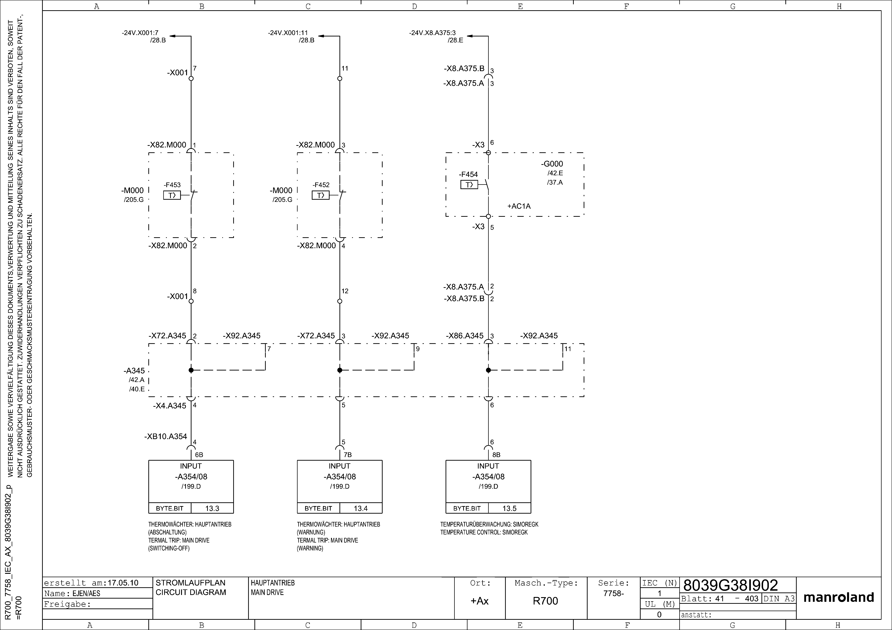

# +Ax — Sheet 41 of 403 — HAUPTANTRIEB

**MAIN DRIVE**

> Part of the manroland **R700** printing press IEC/UL circuit diagrams.
> Drawing class: **Stromlaufplan / Circuit diagram** (DIN A3).
> Document `+Ax` covers the **Central control console** machine section.

## At a glance

| Field | Value |
|---|---|
| Document | `+Ax`  (8039G38I902) |
| Sheet | **41** of 403 |
| Section (DE) | HAUPTANTRIEB |
| Section (EN) | MAIN DRIVE |
| Section type | CIRCUIT — Circuit diagram |
| Machine type | `R700` |
| Series | `7758` |
| Created | 17.05.10 |
| Replaces | — |
| Columns used | A, B, C, D, E |
| Path numbers | — |
| Labels on sheet | 97 |
| Cross-refs out | 12 |
| Cross-refs in | 32 |

**Previous:** [+Ax sheet 40](SHEET_0040.md) · **Next:** [+Ax sheet 42](SHEET_0042.md) · **Document TOC:** [_TOC.md](_TOC.md)  (+Ax) · **Master TOC:** [all sheets](../_MASTER_TOC.md)

## Sheet image (300 DPI, exact vector render)



_Rendered directly from the PDF vector layer at 300 DPI (1-bit), no OCR and no resampling. Use it to confirm anything ambiguous in the text below._

## Cross-references on this sheet

Each entry is a wire leaving this sheet. The printed token is `/sheet.column`; the link resolves to that sheet inside the same document.

| Ref | Target sheet | Col | Path | Destination on target | Target section | From col |
|---|---|---|---|---|---|---|
| `/28.E` | [+Ax sheet 28](SHEET_0028.md) | E | — | 24V.X8.A375:3 | SPANNUNGSVERSORGUNG, SCHALTSCHRANKBELÜFTUNG | D |
| `/28.B` | [+Ax sheet 28](SHEET_0028.md) | B | — | 24V.X001:7 | SPANNUNGSVERSORGUNG, SCHALTSCHRANKBELÜFTUNG | A |
| `/28.B` | [+Ax sheet 28](SHEET_0028.md) | B | — | 24V.X001:11 | SPANNUNGSVERSORGUNG, SCHALTSCHRANKBELÜFTUNG | C |
| `/42.E` | [+Ax sheet 42](SHEET_0042.md) | E | — | T | HAUPTANTRIEB | E |
| `/37.A` | [+Ax sheet 37](SHEET_0037.md) | A | — | T | HAUPTANTRIEB | E |
| `/205.G` | [+Ax sheet 205](SHEET_0205.md) | G | — | T | REFERENZMODUL | B |
| `/205.G` | [+Ax sheet 205](SHEET_0205.md) | G | — | — | REFERENZMODUL | C |
| `/42.A` | [+Ax sheet 42](SHEET_0042.md) | A | — | — | HAUPTANTRIEB | A |
| `/40.E` | [+Ax sheet 40](SHEET_0040.md) | E | — | — | HAUPTANTRIEB | A |
| `/199.D` | [+Ax sheet 199](SHEET_0199.md) | D | — | — | REFERENZMODUL | B |
| `/199.D` | [+Ax sheet 199](SHEET_0199.md) | D | — | — | REFERENZMODUL | C |
| `/199.D` | [+Ax sheet 199](SHEET_0199.md) | D | — | — | REFERENZMODUL | E |

### Incoming references (sheets that point here)

Every other sheet that sends a wire to this one. `Back-ref` is the token printed on *that* sheet; `Path` is its line number.

| From sheet | Cols | Back-ref | Path | Refs | What continues there |
|---|---|---|---|---|---|
| [+Ax#28](SHEET_0028.md) | B, E | `/28.B`, `/28.E` | — | 3 | 24V.X001:11; 24V.X001:7 |
| [+Ax#37](SHEET_0037.md) | A | `/37.A` | — | 1 | — |
| [+Ax#40](SHEET_0040.md) | E | `/40.E` | — | 1 | — |
| [+Ax#42](SHEET_0042.md) | A, E | `/42.A`, `/42.E` | — | 2 | — |
| [+Ax#199](SHEET_0199.md) | D | `/199.D` | — | 3 | — |
| [+Ax#205](SHEET_0205.md) | G | `/205.G` | — | 2 | — |
| [+Ax#227](SHEET_0227.md) | A | `/227.A` | — | 3 | — |
| [+Ax#238](SHEET_0238.md) | G, H | `/238.G`, `/238.H` | — | 4 | — |
| [+Ax#245](SHEET_0245.md) | B | `/245.B` | — | 3 | — |
| [+Ax#285](SHEET_0285.md) | B | `/285.B` | — | 2 | — |
| [+Ax#286](SHEET_0286.md) | G | `/286.G` | — | 4 | — |
| [+Ax#288](SHEET_0288.md) | A | `/288.A` | — | 1 | — |
| [+Ax#289](SHEET_0289.md) | F | `/289.F` | — | 3 | — |


## Devices on this sheet

| Tag | Class | Class meaning (IEC) | Col | Sub | Terminal | Sign |
|---|---|---|---|---|---|---|
| `X001` | X | Klemme / terminal, plug connector | B | — | — | — |
| `A354/08` | A | Baugruppe / assembly, module, PC board | E | 08 | — | — |
| `A354/08` | A | Baugruppe / assembly, module, PC board | C | 08 | — | — |
| `A354/08` | A | Baugruppe / assembly, module, PC board | B | 08 | — | — |
| `A345` | A | Baugruppe / assembly, module, PC board | A | — | — | — |
| `F453` | F | Schutz / protection device (fuse, circuit breaker) | B | — | — | — |
| `F452` | F | Schutz / protection device (fuse, circuit breaker) | C | — | — | — |
| `X001` | X | Klemme / terminal, plug connector | B | — | — | — |
| `X3` | X | Klemme / terminal, plug connector | E | — | — | — |
| `X3` | X | Klemme / terminal, plug connector | E | — | — | — |
| `G000` | G | Stromversorgung / power supply | E | — | — | — |
| `F454` | F | Schutz / protection device (fuse, circuit breaker) | E | — | — | — |
| `13.5` | — | cross-device reference | E | — | — | — |
| `13.4` | — | cross-device reference | C | — | — | — |
| `13.3` | — | cross-device reference | B | — | — | — |
| `X4.A345` | — | cross-device reference | B | — | — | — |
| `XB10.A354` | — | cross-device reference | B | — | — | — |
| `X72.A345` | — | cross-device reference | B | — | — | — |
| `X72.A345` | — | cross-device reference | C | — | — | — |
| `X86.A345` | — | cross-device reference | D | — | — | — |
| `X8.A375.B` | — | cross-device reference | D | — | — | — |
| `X82.M000` | — | cross-device reference | C | — | — | — |
| `X82.M000` | — | cross-device reference | B | — | — | — |
| `X82.M000` | — | cross-device reference | C | — | — | — |
| `X82.M000` | — | cross-device reference | B | — | — | — |
| `X8.A375.A` | — | cross-device reference | D | — | — | — |
| `X8.A375.A` | — | cross-device reference | D | — | — | — |
| `X8.A375.B` | — | cross-device reference | D | — | — | — |
| `X92.A345` | — | cross-device reference | D | — | — | — |
| `X92.A345` | — | cross-device reference | B | — | — | — |
| `X92.A345` | — | cross-device reference | E | — | — | — |

## Potentials / nets

| Potential | Count | Columns | Attached devices | Terminals |
|---|---|---|---|---|
| `24V` | 3 | A, C, D | `A375`, `X001`, `X8` | `11`, `3`, `7` |
| `M000` | 2 | A, C | — | — |


A potential such as `L24+/4` or `M24+` is a named supply/return rail; every place it appears on this sheet is electrically common.

## Wire-end annotations (grouped as printed)

A wire that continues elsewhere is annotated with a small cluster: the destination description, the path/line number `#NN`, and the `/sheet.column` cross reference. Each row below is one such cluster exactly as it is grouped on the drawing.

| Col | Y | Path | Cross-ref | Text on the wire |
|---|---|---|---|---|
| A | 40.0 | — | `/28.B` | `24V.X001:7` |
| C | 40.0 | — | `/28.B` | `24V.X001:11` |
| D | 40.0 | — | `/28.E` | `24V.X8.A375:3` |
| C | 86.8 | — | — | `X001 7 11 X8.A375.B 3` |
| E | 106.6 | — | — | `X8.A375.A 3` |
| E | 186.7 | — | — | `X3 6` |
| B | 188.8 | — | — | `X82.M000 1 X82.M000 3` |
| E | 214.3 | — | — | `G000` |
| E | 227.4 | — | `/42.E`, `/37.A` | `T` |
| E | 228.8 | — | — | `F454` |
| B | 243.4 | — | — | `M000 F453` |
| C | 243.4 | — | — | `M000 F452` |
| B | 257.2 | — | `/205.G` | `T` |
| B | 257.2 | — | — | `T` |
| C | 262.8 | — | `/205.G` | — |
| E | 271.3 | — | — | `+AC1A` |
| E | 298.0 | — | — | `X3 5` |
| B | 323.5 | — | — | `X82.M000 2 X82.M000 4` |
| E | 378.7 | — | — | `X8.A375.A 2` |
| C | 385.1 | — | — | `X001 8 12` |
| E | 394.3 | — | — | `X8.A375.B 2` |
| C | 443.9 | — | — | `X72.A345 2 X72.A345 3 X86.A345 3` |
| D | 443.9 | — | — | `X92.A345 X92.A345 X92.A345` |
| D | 462.4 | — | — | `7 9 11` |
| A | 490.7 | — | — | `A345` |
| A | 503.8 | — | `/42.A` | — |
| A | 516.1 | — | `/40.E` | — |
| B | 537.5 | — | — | `X4.A345 4` |
| C | 537.5 | — | — | `5` |
| E | 537.5 | — | — | `6` |
| B | 578.6 | — | — | `XB10.A354 4` |
| C | 587.1 | — | — | `5` |
| E | 587.1 | — | — | `6` |
| B | 604.0 | — | — | `6B` |
| C | 604.0 | — | — | `7B` |
| E | 604.0 | — | — | `8B` |
| B | 618.6 | — | — | `INPUT` |
| C | 618.6 | — | — | `INPUT` |
| E | 618.6 | — | — | `INPUT` |
| B | 632.4 | — | — | `A354/08` |
| C | 632.4 | — | — | `A354/08` |
| E | 632.4 | — | — | `A354/08` |
| B | 646.2 | — | `/199.D` | — |
| C | 646.2 | — | `/199.D` | — |
| E | 646.2 | — | `/199.D` | — |
| B | 675.3 | — | — | `BYTE.BIT 13.3` |
| C | 675.3 | — | — | `BYTE.BIT 13.4` |
| E | 675.3 | — | — | `BYTE.BIT 13.5` |
| B | 698.0 | — | — | `(ABSCHALTUNG) (SWITCHING OFF) THERMOWÄCHTER: HAUPTANTRIEB TERMAL TRIP: MAIN DRIVE` |
| C | 698.0 | — | — | `(WARNUNG) (WARNING) THERMOWÄCHTER: HAUPTANTRIEB TERMAL TRIP: MAIN DRIVE` |
| E | 698.0 | — | — | `TEMPERATURÜBERWACHUNG: SIMOREGK TEMPERATURE CONTROL: SIMOREGK` |


## Reconstructed tables

This sheet carries tabular content (pin map / terminal assignment / index). The grid below was rebuilt from the drawing's own rule lines, so each row is exactly one physical row of the table.

### Table 1 — 2 data rows × 2 columns (at x=198.4, y=494.6)

| X4.A345 XB10.A354 | 4 4 6B |
|---|---|
| `INPUT` | `A354/08 /199.D` |
| `BYTE.BIT` | `13.3` |


### Table 2 — 1 data rows × 2 columns (at x=396.9, y=494.6) — **5 5 7B**

| INPUT | A354/08 /199.D |
|---|---|
| `BYTE.BIT` | `13.4` |


### Table 3 — 1 data rows × 2 columns (at x=595.3, y=494.6) — **6 6 8B**

| INPUT | A354/08 /199.D |
|---|---|
| `BYTE.BIT` | `13.5` |


## Notes and free text on this sheet

| Text | Col | Y (pt) |
|---|---|---|
| `8B` | E | 604.05 |
| `INPUT` | E | 618.59 |
| `BYTE.BIT` | D | 675.84 |
| `TEMPERATURÜBERWACHUNG: SIMOREGK` | E | 697.96 |
| `TEMPERATURE CONTROL: SIMOREGK` | E | 708.6 |
| `7B` | C | 604.05 |
| `INPUT` | C | 618.59 |
| `BYTE.BIT` | C | 675.84 |
| `THERMOWÄCHTER: HAUPTANTRIEB` | C | 697.95 |
| `(WARNUNG)` | C | 708.56 |
| `TERMAL TRIP: MAIN DRIVE` | C | 719.21 |
| `(WARNING)` | C | 729.81 |
| `6B` | B | 604.05 |
| `INPUT` | B | 618.59 |
| `BYTE.BIT` | B | 675.84 |
| `THERMOWÄCHTER: HAUPTANTRIEB` | B | 697.95 |
| `(ABSCHALTUNG)` | B | 708.59 |
| `TERMAL TRIP: MAIN DRIVE` | B | 719.21 |
| `(SWITCHING OFF)` | B | 729.83 |
| `T` | B | 257.17 |
| `T` | C | 257.17 |
| `T` | E | 243 |
| `+AC1A` | E | 271.34 |

## Complete label inventory (exact text from the drawing)

Every text object inside the drawing area of this sheet, in DIN reading order (column A→H, then top→bottom). This is the authoritative list: if a string is not here it is not printed on this sheet.

| Col | Y | X | Dir | Type | Text |
|---|---|---|---|---|---|
| A | 40.0 | 162.7 | → | potential | `24V.X001:7` |
| A | 249.8 | 161.9 | → | potential | `M000` |
| A | 262.8 | 165.5 | → | cross-reference | `/205.G` |
| A | 490.7 | 165.0 | → | device tag | `A345` |
| A | 503.8 | 172.1 | → | cross-reference | `/42.A` |
| A | 516.2 | 172.6 | → | cross-reference | `/40.E` |
| B | 49.9 | 200.7 | → | cross-reference | `/28.B` |
| B | 87.5 | 257.7 | → | number | `7` |
| B | 92.4 | 223.1 | → | device tag | `X001` |
| B | 188.8 | 196.7 | → | device ref | `X82.M000` |
| B | 190.2 | 257.1 | → | number | `1` |
| B | 243.4 | 218.6 | → | device tag | `F453` |
| B | 257.2 | 224.6 | → | text | `T` |
| B | 323.5 | 198.1 | → | device ref | `X82.M000` |
| B | 324.9 | 257.7 | → | number | `2` |
| B | 385.1 | 257.7 | → | number | `8` |
| B | 391.5 | 223.1 | → | device tag | `X001` |
| B | 443.9 | 198.4 | → | device ref | `X72.A345` |
| B | 443.9 | 297.6 | → | device ref | `X92.A345` |
| B | 445.4 | 257.7 | → | number | `2` |
| B | 537.5 | 204.4 | → | device ref | `X4.A345` |
| B | 537.5 | 257.7 | → | number | `4` |
| B | 578.6 | 192.8 | → | device ref | `XB10.A354` |
| B | 587.1 | 257.7 | → | number | `4` |
| B | 604.0 | 260.5 | → | text | `6B` |
| B | 618.6 | 240.2 | → | text | `INPUT` |
| B | 632.4 | 233.7 | → | device tag | `A354/08` |
| B | 646.2 | 242.4 | → | cross-reference | `/199.D` |
| B | 675.3 | 273.7 | → | device ref | `13.3` |
| B | 675.8 | 208.3 | → | text | `BYTE.BIT` |
| B | 697.9 | 198.1 | → | text | `THERMOWÄCHTER: HAUPTANTRIEB` |
| B | 708.6 | 197.9 | → | text | `(ABSCHALTUNG)` |
| B | 719.2 | 198.1 | → | text | `TERMAL TRIP: MAIN DRIVE` |
| B | 729.8 | 197.9 | → | text | `(SWITCHING OFF)` |
| C | 40.0 | 357.7 | → | potential | `24V.X001:11` |
| C | 49.9 | 399.1 | → | cross-reference | `/28.B` |
| C | 87.5 | 455.5 | → | number | `11` |
| C | 188.8 | 395.1 | → | device ref | `X82.M000` |
| C | 190.2 | 456.1 | → | number | `3` |
| C | 243.4 | 417.3 | → | device tag | `F452` |
| C | 249.8 | 360.3 | → | potential | `M000` |
| C | 257.2 | 423.1 | → | text | `T` |
| C | 262.8 | 364.0 | → | cross-reference | `/205.G` |
| C | 323.5 | 396.6 | → | device ref | `X82.M000` |
| C | 324.9 | 456.1 | → | number | `4` |
| C | 385.1 | 455.5 | → | number | `12` |
| C | 443.9 | 396.9 | → | device ref | `X72.A345` |
| C | 445.4 | 456.1 | → | number | `3` |
| C | 462.4 | 356.9 | → | number | `7` |
| C | 537.5 | 456.1 | → | number | `5` |
| C | 587.1 | 456.1 | → | number | `5` |
| C | 604.0 | 458.9 | → | text | `7B` |
| C | 618.6 | 438.7 | → | text | `INPUT` |
| C | 632.4 | 432.1 | → | device tag | `A354/08` |
| C | 646.2 | 440.8 | → | cross-reference | `/199.D` |
| C | 675.3 | 472.1 | → | device ref | `13.4` |
| C | 675.8 | 406.8 | → | text | `BYTE.BIT` |
| C | 697.9 | 396.6 | → | text | `THERMOWÄCHTER: HAUPTANTRIEB` |
| C | 708.6 | 396.3 | → | text | `(WARNUNG)` |
| C | 719.2 | 396.6 | → | text | `TERMAL TRIP: MAIN DRIVE` |
| C | 729.8 | 396.3 | → | text | `(WARNING)` |
| D | 40.0 | 546.2 | → | potential | `24V.X8.A375:3` |
| D | 49.9 | 597.8 | → | cross-reference | `/28.E` |
| D | 86.8 | 592.7 | → | device ref | `X8.A375.B` |
| D | 106.6 | 591.9 | → | device ref | `X8.A375.A` |
| D | 378.7 | 591.9 | → | device ref | `X8.A375.A` |
| D | 394.3 | 592.7 | → | device ref | `X8.A375.B` |
| D | 443.9 | 496.1 | → | device ref | `X92.A345` |
| D | 443.9 | 595.3 | → | device ref | `X86.A345` |
| D | 462.4 | 555.3 | → | number | `9` |
| D | 675.8 | 605.2 | → | text | `BYTE.BIT` |
| E | 91.0 | 654.5 | → | number | `3` |
| E | 108.0 | 654.5 | → | number | `3` |
| E | 186.7 | 654.5 | → | number | `6` |
| E | 188.8 | 630.4 | → | device tag | `X3` |
| E | 214.3 | 722.3 | → | device tag | `G000` |
| E | 227.4 | 731.1 | → | cross-reference | `/42.E` |
| E | 228.8 | 612.6 | → | device tag | `F454` |
| E | 239.8 | 730.5 | → | cross-reference | `/37.A` |
| E | 243.0 | 621.5 | → | text | `T` |
| E | 271.3 | 677.2 | → | text | `+AC1A` |
| E | 298.0 | 630.4 | → | device tag | `X3` |
| E | 300.1 | 654.5 | → | number | `5` |
| E | 378.7 | 654.5 | → | number | `2` |
| E | 395.8 | 654.5 | → | number | `2` |
| E | 443.9 | 694.5 | → | device ref | `X92.A345` |
| E | 445.4 | 654.5 | → | number | `3` |
| E | 462.4 | 753.2 | → | number | `11` |
| E | 537.5 | 654.5 | → | number | `6` |
| E | 587.1 | 654.5 | → | number | `6` |
| E | 604.0 | 657.4 | → | text | `8B` |
| E | 618.6 | 637.1 | → | text | `INPUT` |
| E | 632.4 | 630.6 | → | device tag | `A354/08` |
| E | 646.2 | 639.2 | → | cross-reference | `/199.D` |
| E | 675.3 | 670.5 | → | device ref | `13.5` |
| E | 698.0 | 587.9 | → | text | `TEMPERATURÜBERWACHUNG: SIMOREGK` |
| E | 708.6 | 587.9 | → | text | `TEMPERATURE CONTROL: SIMOREGK` |

## Reading-order text block

The same content as a plain block, grouped by DIN column — convenient to paste or to match against a visual description.

```text
=== Column A ===
  40.0  162.7  net          24V.X001:7
 249.8  161.9  net          M000
 262.8  165.5  xref         /205.G
 490.7  165.0  devtag       A345
 503.8  172.1  xref         /42.A
 516.2  172.6  xref         /40.E
=== Column B ===
  49.9  200.7  xref         /28.B
  87.5  257.7  numeric      7
  92.4  223.1  devtag       X001
 188.8  196.7  devref       X82.M000
 190.2  257.1  numeric      1
 243.4  218.6  devtag       F453
 257.2  224.6  text         T
 323.5  198.1  devref       X82.M000
 324.9  257.7  numeric      2
 385.1  257.7  numeric      8
 391.5  223.1  devtag       X001
 443.9  198.4  devref       X72.A345
 443.9  297.6  devref       X92.A345
 445.4  257.7  numeric      2
 537.5  204.4  devref       X4.A345
 537.5  257.7  numeric      4
 578.6  192.8  devref       XB10.A354
 587.1  257.7  numeric      4
 604.0  260.5  text         6B
 618.6  240.2  text         INPUT
 632.4  233.7  devtag       A354/08
 646.2  242.4  xref         /199.D
 675.3  273.7  devref       13.3
 675.8  208.3  text         BYTE.BIT
 697.9  198.1  text         THERMOWÄCHTER: HAUPTANTRIEB
 708.6  197.9  text         (ABSCHALTUNG)
 719.2  198.1  text         TERMAL TRIP: MAIN DRIVE
 729.8  197.9  text         (SWITCHING OFF)
=== Column C ===
  40.0  357.7  net          24V.X001:11
  49.9  399.1  xref         /28.B
  87.5  455.5  numeric      11
 188.8  395.1  devref       X82.M000
 190.2  456.1  numeric      3
 243.4  417.3  devtag       F452
 249.8  360.3  net          M000
 257.2  423.1  text         T
 262.8  364.0  xref         /205.G
 323.5  396.6  devref       X82.M000
 324.9  456.1  numeric      4
 385.1  455.5  numeric      12
 443.9  396.9  devref       X72.A345
 445.4  456.1  numeric      3
 462.4  356.9  numeric      7
 537.5  456.1  numeric      5
 587.1  456.1  numeric      5
 604.0  458.9  text         7B
 618.6  438.7  text         INPUT
 632.4  432.1  devtag       A354/08
 646.2  440.8  xref         /199.D
 675.3  472.1  devref       13.4
 675.8  406.8  text         BYTE.BIT
 697.9  396.6  text         THERMOWÄCHTER: HAUPTANTRIEB
 708.6  396.3  text         (WARNUNG)
 719.2  396.6  text         TERMAL TRIP: MAIN DRIVE
 729.8  396.3  text         (WARNING)
=== Column D ===
  40.0  546.2  net          24V.X8.A375:3
  49.9  597.8  xref         /28.E
  86.8  592.7  devref       X8.A375.B
 106.6  591.9  devref       X8.A375.A
 378.7  591.9  devref       X8.A375.A
 394.3  592.7  devref       X8.A375.B
 443.9  496.1  devref       X92.A345
 443.9  595.3  devref       X86.A345
 462.4  555.3  numeric      9
 675.8  605.2  text         BYTE.BIT
=== Column E ===
  91.0  654.5  numeric      3
 108.0  654.5  numeric      3
 186.7  654.5  numeric      6
 188.8  630.4  devtag       X3
 214.3  722.3  devtag       G000
 227.4  731.1  xref         /42.E
 228.8  612.6  devtag       F454
 239.8  730.5  xref         /37.A
 243.0  621.5  text         T
 271.3  677.2  text         +AC1A
 298.0  630.4  devtag       X3
 300.1  654.5  numeric      5
 378.7  654.5  numeric      2
 395.8  654.5  numeric      2
 443.9  694.5  devref       X92.A345
 445.4  654.5  numeric      3
 462.4  753.2  numeric      11
 537.5  654.5  numeric      6
 587.1  654.5  numeric      6
 604.0  657.4  text         8B
 618.6  637.1  text         INPUT
 632.4  630.6  devtag       A354/08
 646.2  639.2  xref         /199.D
 675.3  670.5  devref       13.5
 698.0  587.9  text         TEMPERATURÜBERWACHUNG: SIMOREGK
 708.6  587.9  text         TEMPERATURE CONTROL: SIMOREGK
```

---
_Generated from the PDF vector text layer; no OCR. Source: `R700_7758_IEC_AX_8039G38I902_p`, sheet 41._
