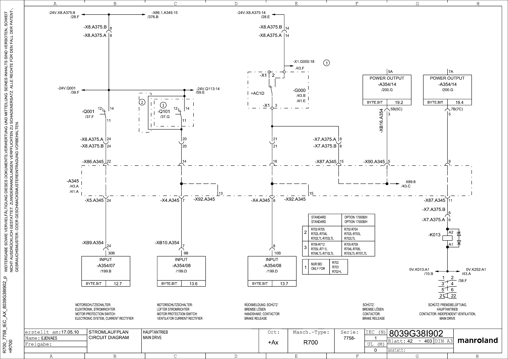

# +Ax — Sheet 42 of 403 — HAUPTANTRIEB

**MAIN DRIVE**

> Part of the manroland **R700** printing press IEC/UL circuit diagrams.
> Drawing class: **Stromlaufplan / Circuit diagram** (DIN A3).
> Document `+Ax` covers the **Central control console** machine section.

## At a glance

| Field | Value |
|---|---|
| Document | `+Ax`  (8039G38I902) |
| Sheet | **42** of 403 |
| Section (DE) | HAUPTANTRIEB |
| Section (EN) | MAIN DRIVE |
| Section type | CIRCUIT — Circuit diagram |
| Machine type | `R700` |
| Series | `7758` |
| Created | 17.05.10 |
| Replaces | — |
| Columns used | A, B, C, D, E, F, G, H |
| Path numbers | — |
| Labels on sheet | 183 |
| Cross-refs out | 21 |
| Cross-refs in | 52 |

**Previous:** [+Ax sheet 41](SHEET_0041.md) · **Next:** [+Ax sheet 43](SHEET_0043.md) · **Document TOC:** [_TOC.md](_TOC.md)  (+Ax) · **Master TOC:** [all sheets](../_MASTER_TOC.md)

## Sheet image (300 DPI, exact vector render)



_Rendered directly from the PDF vector layer at 300 DPI (1-bit), no OCR and no resampling. Use it to confirm anything ambiguous in the text below._

## Cross-references on this sheet

Each entry is a wire leaving this sheet. The printed token is `/sheet.column`; the link resolves to that sheet inside the same document.

| Ref | Target sheet | Col | Path | Destination on target | Target section | From col |
|---|---|---|---|---|---|---|
| `/28.F` | [+Ax sheet 28](SHEET_0028.md) | F | — | 24V.X8.A375:8 | SPANNUNGSVERSORGUNG, SCHALTSCHRANKBELÜFTUNG | A |
| `/28.E` | [+Ax sheet 28](SHEET_0028.md) | E | — | 24V.X8.A375:14 | SPANNUNGSVERSORGUNG, SCHALTSCHRANKBELÜFTUNG | D |
| `/376.B` | [+Ax sheet 376](SHEET_0376.md) | B | — | 24V.X8.A375:14 | OPTION: FWW SPEZIALREINIGER | D |
| `/43.F` | [+Ax sheet 43](SHEET_0043.md) | F | — | — | HAUPTANTRIEB | E |
| `/39.F` | [+Ax sheet 39](SHEET_0039.md) | F | — | 24V.Q001 24V.Q113:14 | HAUPTANTRIEB | B |
| `/200.G` | [+Ax sheet 200](SHEET_0200.md) | G | — | — | REFERENZMODUL | G |
| `/200.G` | [+Ax sheet 200](SHEET_0200.md) | G | — | — | REFERENZMODUL | H |
| `/59.E` | [+Ax sheet 59](SHEET_0059.md) | E | — | — | DRUCKLUFTANLAGE | C |
| `/43.B` | [+Ax sheet 43](SHEET_0043.md) | B | — | — | HAUPTANTRIEB | E |
| `/41.E` | [+Ax sheet 41](SHEET_0041.md) | E | — | — | HAUPTANTRIEB | E |
| `/37.F` | [+Ax sheet 37](SHEET_0037.md) | F | — | — | HAUPTANTRIEB | B |
| `/37.G` | [+Ax sheet 37](SHEET_0037.md) | G | — | — | HAUPTANTRIEB | C |
| `/43.C` | [+Ax sheet 43](SHEET_0043.md) | C | — | — | HAUPTANTRIEB | G |
| `/43.A` | [+Ax sheet 43](SHEET_0043.md) | A | — | — | HAUPTANTRIEB | A |
| `/41.A` | [+Ax sheet 41](SHEET_0041.md) | A | — | — | HAUPTANTRIEB | A |
| `/10.B` | [+Ax sheet 10](SHEET_0010.md) | B | — | 0V.K013:A1 | SPANNUNGSVERSORGUNG, SCHALTSCHRANKBELÜFTUNG | G |
| `/43.A` | [+Ax sheet 43](SHEET_0043.md) | A | — | 0V.K013:A1 | HAUPTANTRIEB | G |
| `/199.B` | [+Ax sheet 199](SHEET_0199.md) | B | — | — | REFERENZMODUL | B |
| `/199.D` | [+Ax sheet 199](SHEET_0199.md) | D | — | — | REFERENZMODUL | C |
| `/199.D` | [+Ax sheet 199](SHEET_0199.md) | D | — | — | REFERENZMODUL | E |
| `/38.F` | [+Ax sheet 38](SHEET_0038.md) | F | — | — | HAUPTANTRIEB | H |

### Incoming references (sheets that point here)

Every other sheet that sends a wire to this one. `Back-ref` is the token printed on *that* sheet; `Path` is its line number.

| From sheet | Cols | Back-ref | Path | Refs | What continues there |
|---|---|---|---|---|---|
| [+Ax#10](SHEET_0010.md) | B | `/10.B` | — | 1 | — |
| [+Ax#28](SHEET_0028.md) | E, F | `/28.E`, `/28.F` | — | 2 | — |
| [+Ax#37](SHEET_0037.md) | F, G | `/37.F`, `/37.G` | — | 2 | — |
| [+Ax#38](SHEET_0038.md) | F | `/38.F` | — | 1 | — |
| [+Ax#39](SHEET_0039.md) | F | `/39.F` | — | 1 | — |
| [+Ax#41](SHEET_0041.md) | A, E | `/41.A`, `/41.E` | — | 2 | T |
| [+Ax#43](SHEET_0043.md) | A, B, C, F | `/43.A`, `/43.B`, `/43.C`, `/43.F` | — | 5 | 0V.K252:A1 0V.K022:A1; X89:8 |
| [+Ax#59](SHEET_0059.md) | D | `/59.D` | — | 1 | 24V.Q113:14 |
| [+Ax#199](SHEET_0199.md) | B, D | `/199.B`, `/199.D` | — | 3 | — |
| [+Ax#200](SHEET_0200.md) | F | `/200.F` | — | 2 | — |
| [+Ax#227](SHEET_0227.md) | A | `/227.A` | — | 2 | — |
| [+Ax#231](SHEET_0231.md) | A | `/231.A` | — | 1 | — |
| [+Ax#236](SHEET_0236.md) | E, F | `/236.E`, `/236.F` | — | 4 | — |
| [+Ax#238](SHEET_0238.md) | G, H | `/238.G`, `/238.H` | — | 10 | — |
| [+Ax#242](SHEET_0242.md) | A | `/242.A` | — | 1 | — |
| [+Ax#245](SHEET_0245.md) | B | `/245.B` | — | 2 | — |
| [+Ax#254](SHEET_0254.md) | F | `/254.F` | — | 2 | — |
| [+Ax#288](SHEET_0288.md) | A | `/288.A` | — | 3 | — |
| [+Ax#289](SHEET_0289.md) | A, C, F | `/289.A`, `/289.C`, `/289.F` | — | 6 | — |
| [+Ax#376](SHEET_0376.md) | B | `/376.B` | — | 1 | X86.1.A345:15 |


## Devices on this sheet

| Tag | Class | Class meaning (IEC) | Col | Sub | Terminal | Sign |
|---|---|---|---|---|---|---|
| `Q101` | Q | Leistungsschalter / power switching device | C | — | — | — |
| `A354/08` | A | Baugruppe / assembly, module, PC board | C | 08 | — | — |
| `A354/08` | A | Baugruppe / assembly, module, PC board | E | 08 | — | — |
| `A2` | A | Baugruppe / assembly, module, PC board | H | — | — | — |
| `A1` | A | Baugruppe / assembly, module, PC board | H | — | — | — |
| `K013` | K | Relais / relay, contactor | G | — | — | — |
| `Q001` | Q | Leistungsschalter / power switching device | B | — | — | — |
| `A354/07` | A | Baugruppe / assembly, module, PC board | B | 07 | — | — |
| `A345` | A | Baugruppe / assembly, module, PC board | A | — | — | — |
| `A354/14` | A | Baugruppe / assembly, module, PC board | G | 14 | — | — |
| `A354/14` | A | Baugruppe / assembly, module, PC board | G | 14 | — | — |
| `X1` | X | Klemme / terminal, plug connector | E | — | — | — |
| `X1` | X | Klemme / terminal, plug connector | D | — | — | — |
| `G000` | G | Stromversorgung / power supply | E | — | — | — |
| `X89:8` | X | Klemme / terminal, plug connector | G | — | 8 | — |
| `R702` | R | Widerstand / resistor | F | — | — | — |
| `R703` | R | Widerstand / resistor | F | — | — | — |
| `13.6` | — | cross-device reference | C | — | — | — |
| `XB10.A354` | — | cross-device reference | C | — | — | — |
| `X4.A345` | — | cross-device reference | C | — | — | — |
| `X87.A345` | — | cross-device reference | G | — | — | — |
| `13.7` | — | cross-device reference | E | — | — | — |
| `X4.A345` | — | cross-device reference | D | — | — | — |
| `X7.A375.A` | — | cross-device reference | G | — | — | — |
| `X7.A375.B` | — | cross-device reference | G | — | — | — |
| `X8.A375.B` | — | cross-device reference | B | — | — | — |
| `X8.A375.A` | — | cross-device reference | B | — | — | — |
| `12.7` | — | cross-device reference | B | — | — | — |
| `XB9.A354` | — | cross-device reference | B | — | — | — |
| `X5.A345` | — | cross-device reference | B | — | — | — |
| `X86.A345` | — | cross-device reference | B | — | — | — |
| `X8.A375.B` | — | cross-device reference | B | — | — | — |
| `X8.A375.A` | — | cross-device reference | B | — | — | — |
| `19.4` | — | cross-device reference | H | — | — | — |
| `X90.A345` | — | cross-device reference | F | — | — | — |
| `19.2` | — | cross-device reference | G | — | — | — |
| `XB16.A354` | — | cross-device reference | F | — | — | — |
| `X87.A345` | — | cross-device reference | E | — | — | — |
| `X7.A375.B` | — | cross-device reference | E | — | — | — |
| `X7.A375.A` | — | cross-device reference | E | — | — | — |
| `X8.A375.B` | — | cross-device reference | E | — | — | — |
| `X8.A375.A` | — | cross-device reference | E | — | — | — |
| `X1.G000:18` | — | cross-device reference | E | — | 18 | — |
| `X86.1.A345:15` | — | cross-device reference | C | — | 15 | — |
| `X92.A345` | — | cross-device reference | C | — | — | — |
| `X92.A345` | — | cross-device reference | E | — | — | — |

## Potentials / nets

| Potential | Count | Columns | Attached devices | Terminals |
|---|---|---|---|---|
| `0V` | 2 | G, H | `K013`, `K252` | `A1` |
| `24V` | 4 | A, D | `A375`, `Q001`, `Q113`, `X8` | `14`, `8` |


A potential such as `L24+/4` or `M24+` is a named supply/return rail; every place it appears on this sheet is electrically common.

## Wire-end annotations (grouped as printed)

A wire that continues elsewhere is annotated with a small cluster: the destination description, the path/line number `#NN`, and the `/sheet.column` cross reference. Each row below is one such cluster exactly as it is grouped on the drawing.

| Col | Y | Path | Cross-ref | Text on the wire |
|---|---|---|---|---|
| A | 25.8 | — | `/28.F` | `24V.X8.A375:8` |
| D | 25.8 | — | `/28.E`, `/376.B` | `24V.X8.A375:14` |
| C | 25.8 | — | — | `X86.1.A345:15` |
| B | 58.4 | — | — | `X8.A375.B 8` |
| E | 58.4 | — | — | `X8.A375.B 14` |
| B | 78.3 | — | — | `X8.A375.A 8` |
| E | 78.3 | — | — | `X8.A375.A 14` |
| E | 140.6 | — | — | `X1.G000:18` |
| F | 144.3 | — | — | `1` |
| E | 156.2 | — | `/43.F` | — |
| G | 164.0 | — | — | `5A` |
| H | 164.0 | — | — | `7A` |
| E | 171.8 | — | — | `X1 2` |
| F | 179.1 | — | — | `POWER OUTPUT` |
| G | 179.1 | — | — | `POWER OUTPUT` |
| G | 193.1 | — | — | `A354/14` |
| G | 193.1 | — | — | `A354/14` |
| B | 203.0 | — | `/39.F` | `24V.Q001 24V.Q113:14` |
| G | 206.8 | — | `/200.G` | — |
| H | 206.8 | — | `/200.G` | — |
| E | 207.2 | — | — | `G000` |
| C | 212.8 | — | `/59.E` | — |
| D | 214.6 | — | — | `+AC1D` |
| E | 220.3 | — | `/43.B`, `/41.E` | — |
| F | 235.9 | — | — | `BYTE.BIT 19.2` |
| G | 235.9 | — | — | `BYTE.BIT 19.4` |
| C | 237.0 | — | — | `2 3` |
| E | 242.7 | — | — | `X1 3` |
| B | 250.5 | — | — | `Q001 14` |
| B | 250.5 | — | — | `12` |
| C | 250.5 | — | — | `Q101 14` |
| C | 250.5 | — | — | `12` |
| G | 251.9 | — | — | `5B(5C)` |
| H | 251.9 | — | — | `7B(7C)` |
| F | 254.6 | — | — | `XB16.A354` |
| G | 263.9 | — | — | `3` |
| H | 263.9 | — | — | `5` |
| B | 269.9 | — | `/37.F` | — |
| C | 269.9 | — | `/37.G` | — |
| B | 278.8 | — | — | `11` |
| C | 278.8 | — | — | `11` |
| B | 322.1 | — | — | `X8.A375.A 24` |
| C | 322.1 | — | — | `20` |
| E | 322.1 | — | — | `21` |
| F | 322.1 | — | — | `X7.A375.A 8` |
| B | 337.6 | — | — | `X8.A375.B 24` |
| F | 337.6 | — | — | `X7.A375.B 8` |
| C | 339.1 | — | — | `20` |
| E | 339.1 | — | — | `21` |
| B | 374.5 | — | — | `X86.A345 22` |
| C | 374.5 | — | — | `14` |
| E | 374.5 | — | — | `16` |
| F | 374.5 | — | — | `X87.A345 15` |
| F | 374.5 | — | — | `X90.A345 5` |
| H | 374.5 | — | — | `9` |
| A | 419.8 | — | — | `A345` |
| G | 422.6 | — | — | `X89:8` |
| G | 432.6 | — | `/43.C` | — |
| A | 432.9 | — | `/43.A`, `/41.A` | — |
| D | 449.6 | — | — | `13 15` |
| D | 462.4 | — | — | `X92.A345 X92.A345` |
| B | 465.2 | — | — | `X5.A345 24` |
| C | 465.2 | — | — | `X4.A345 7` |
| D | 465.2 | — | — | `X4.A345 8` |
| G | 465.2 | — | — | `X87.A345 11` |
| G | 486.5 | — | — | `X7.A375.B 6` |
| E | 506.6 | — | — | `STANDARD STANDARD` |
| F | 506.6 | — | — | `OPTION 17000B/H OPTION 17000B/H` |
| G | 510.6 | — | — | `X7.A375.A 6` |
| F | 535.0 | — | — | `2 R702 R704 R702L R703L R702LTL` |
| E | 535.0 | — | — | `R702 R705 R702L R704L R702LTL R703LTL` |
| H | 541.0 | — | — | `A2` |
| G | 546.0 | — | — | `K013` |
| B | 564.4 | — | — | `XB9.A354 24` |
| C | 564.4 | — | — | `XB10.A354 7` |
| H | 569.3 | — | — | `A1` |
| F | 570.4 | — | — | `3 R705 R709 R704L R708L R703LTL R707LTL` |
| E | 570.4 | — | — | `R706 R712 R705L R711L R704LTL R710LTL` |
| E | 572.9 | — | — | `8` |
| B | 589.9 | — | — | `30B` |
| C | 589.9 | — | — | `9B` |
| E | 589.9 | — | — | `10B` |
| B | 604.4 | — | — | `INPUT` |
| C | 604.4 | — | — | `INPUT` |
| E | 604.4 | — | — | `INPUT` |
| F | 612.9 | — | — | `R702 R703 R702+L` |
| E | 616.4 | — | — | `NUR BEI` |
| B | 618.3 | — | — | `A354/07` |
| C | 618.3 | — | — | `A354/08` |
| E | 618.3 | — | — | `A354/08` |
| E | 622.5 | — | — | `1 ONLY FOR` |
| G | 628.1 | — | `/10.B`, `/43.A` | `0V.K013:A1` |
| H | 628.1 | — | — | `0V.K252:A1` |
| B | 632.0 | — | `/199.B` | — |
| C | 632.1 | — | `/199.D` | — |
| E | 632.1 | — | `/199.D` | — |
| G | 646.6 | — | — | `21 3 5 1` |
| H | 646.6 | — | — | `2 4 6 22` |
| H | 654.4 | — | `/38.F` | — |
| B | 661.1 | — | — | `BYTE.BIT 12.7` |
| C | 661.1 | — | — | `BYTE.BIT 13.6` |
| E | 661.1 | — | — | `BYTE.BIT 13.7` |
| B | 712.1 | — | — | `ELEKTRONIK, STROMRICHTER ELECTRONIC SYSTEM, CURRENT RECTIFIER MOTORSCHUTZSCHALTER: MOTOR PROTECTION SWITCH:` |
| C | 712.1 | — | — | `LÜFTER STROMRICHTER MOTORSCHUTZSCHALTER: MOTOR PROTECTION SWITCH:` |
| D | 712.1 | — | — | `RÜCKMELDUNG: SCHÜTZ BREMSE LÖSEN HANDSHAKE: CONTACTOR BRAKE RELEASE` |
| F | 712.1 | — | — | `BREMSE LÖSEN SCHÜTZ:` |
| H | 712.1 | — | — | `SCHÜTZ: FREMDBELÜFTUNG,` |
| H | 722.7 | — | — | `CONTACTOR: INDEPENDENT VENTILATION, HAUPTANTRIEB` |
| F | 733.4 | — | — | `BRAKE RELEASE CONTACTOR:` |
| C | 744.0 | — | — | `VENTILATOR CURRENT RECTIFIER` |
| G | 744.0 | — | — | `MAIN DRIVE` |


## Reconstructed tables

This sheet carries tabular content (pin map / terminal assignment / index). The grid below was rebuilt from the drawing's own rule lines, so each row is exactly one physical row of the table.

### Table 1 — 8 data rows × 20 columns (at x=191.3, y=34.0)

| X8.A375.B X8.A375.A |  | 8 8 |  | /376.B |  |  |  |  | /28.E X8.A375.B X8.A375.A |  | 14 14 | X1.G000:18 1 /43.F |  |  | 5A |  |  | 7A |  |
|---|---|---|---|---|---|---|---|---|---|---|---|---|---|---|---|---|---|---|---|
|  |  |  |  |  |  |  |  | `24V.Q113:14` | `X1` | `2` |  |  |  | `POWER` | `OUTPUT A354/14` |  | `POWER` | `OUTPUT A354/14` |  |
|  |  |  |  |  |  |  | `/59.E` |  | `+AC1D` |  |  | `G000 /43.B` |  |  | `/200.G` |  |  | `/200.G` |  |
|  |  |  | `2` |  |  |  |  |  |  |  |  | `/41.E` |  | `BYTE.BIT` | `19.2` |  | `BYTE.BIT` |  | `19.4` |
| `12 Q001 /37.F` | `11` | `14` |  |  | `3 12 Q101 /37.G` | `11` | `14` |  | `X1` | `3` |  |  |  | `XB16.A354` | `5B(5C) 3` |  |  | `7B(7C) 5` |  |
| `X8.A375.A X8.A375.B X86.A345` |  | `24 24 22` |  |  |  | `14` | `20 20` |  |  | `21 21 16` |  | `X7.A375.A X7.A375.B X87.A345` | `8 8 15` | `X90.A345` | `5 X89:8` |  |  | `9` |  |
| `X5.A345 XB9.A354` |  | `24 24 30B` |  |  | `X4.A345 XB10.A354` | `7 7` | `X92.A345 9B` | `13` | `X4.A345` | `8 8 10B` | `X92.A345` | `15 STANDARD STANDARD R702 R705 2 R702L R704L R702LTL R703LTL R706 R712 3 R705L R711L R704LTL R710LTL` | `OPTION 17000B/H OPTION 17000B/H R702 R704 R702L R703L R702LTL R705 R709 R704L R708L R703LTL R707LTL` |  | `/43.C` |  | `X87.A345 X7.A375.B X7.A375.A K013` | `11 6 6 A2 A1` |  |
| `INPUT` | `A354/07 /199.B` |  |  |  | `INPUT` | `A354/08 /199.D` |  |  | `INPUT` | `A354/08 /199.D` |  | `R702 NUR BEI 1 R703 ONLY FOR R702+L` |  |  |  | `0V.K013:A1` | `/10.B 1` | `2` | `/43.A` |
| `BYTE.BIT` |  | `12.7` |  |  | `BYTE.BIT` |  | `13.6` |  | `BYTE.BIT` | `13.7` |  |  |  |  |  |  | `3` | `4` | `/38.F` |


## Notes and free text on this sheet

| Text | Col | Y (pt) |
|---|---|---|
| `9B` | C | 589.88 |
| `INPUT` | C | 604.42 |
| `BYTE.BIT` | C | 661.67 |
| `MOTORSCHUTZSCHALTER:` | C | 712.14 |
| `LÜFTER STROMRICHTER` | C | 722.77 |
| `MOTOR PROTECTION SWITCH:` | C | 733.38 |
| `VENTILATOR CURRENT RECTIFIER` | C | 744.03 |
| `10B` | E | 589.89 |
| `INPUT` | E | 604.42 |
| `BYTE.BIT` | D | 661.67 |
| `RÜCKMELDUNG: SCHÜTZ` | D | 712.15 |
| `BREMSE LÖSEN` | D | 722.74 |
| `HANDSHAKE: CONTACTOR` | D | 733.39 |
| `BRAKE RELEASE` | D | 743.99 |
| `30B` | B | 589.89 |
| `INPUT` | B | 604.42 |
| `BYTE.BIT` | B | 661.67 |
| `MOTORSCHUTZSCHALTER:` | B | 712.14 |
| `ELEKTRONIK, STROMRICHTER` | B | 722.76 |
| `MOTOR PROTECTION SWITCH:` | B | 733.38 |
| `ELECTRONIC SYSTEM, CURRENT RECTIFIER` | B | 744.03 |
| `7A` | H | 163.97 |
| `7B(7C)` | H | 251.89 |
| `POWER OUTPUT` | G | 179.14 |
| `BYTE.BIT` | G | 236.47 |
| `SCHÜTZ: FREMDBELÜFTUNG,` | H | 712.14 |
| `HAUPTANTRIEB` | G | 722.74 |
| `CONTACTOR: INDEPENDENT VENTILATION,` | H | 733.39 |
| `MAIN DRIVE` | G | 744.01 |
| `5A` | G | 163.97 |
| `5B(5C)` | G | 251.89 |
| `POWER OUTPUT` | F | 179.14 |
| `BYTE.BIT` | F | 236.47 |
| `SCHÜTZ:` | F | 712.11 |
| `BREMSE LÖSEN` | F | 722.74 |
| `CONTACTOR:` | F | 733.39 |
| `BRAKE RELEASE` | F | 743.99 |
| `STANDARD` | E | 506.62 |
| `R702 R705` | E | 534.99 |
| `R702L R704L` | E | 545.62 |
| `R702LTL R703LTL` | E | 556.26 |
| `OPTION 17000B/H` | F | 506.61 |
| `R702 R704` | F | 534.99 |
| `R702L R703L` | F | 545.62 |
| `R702LTL` | F | 556.23 |
| `R706 R712` | E | 570.41 |
| `R705L R711L` | E | 581.06 |
| `R704LTL R710LTL` | E | 591.69 |
| `R705 R709` | F | 570.42 |
| `R704L R708L` | F | 581.06 |
| `R703LTL R707LTL` | F | 591.69 |
| `+AC1D` | D | 214.64 |
| `R702+L` | F | 634.18 |
| `NUR BEI` | E | 616.41 |
| `ONLY FOR` | E | 627.09 |

## Complete label inventory (exact text from the drawing)

Every text object inside the drawing area of this sheet, in DIN reading order (column A→H, then top→bottom). This is the authoritative list: if a string is not here it is not printed on this sheet.

| Col | Y | X | Dir | Type | Text |
|---|---|---|---|---|---|
| A | 25.8 | 114.0 | → | potential | `24V.X8.A375:8` |
| A | 35.7 | 165.8 | → | cross-reference | `/28.F` |
| A | 203.0 | 135.2 | → | potential | `24V.Q001` |
| A | 212.9 | 165.8 | → | cross-reference | `/39.F` |
| A | 419.8 | 156.5 | → | device tag | `A345` |
| A | 432.9 | 163.6 | → | cross-reference | `/43.A` |
| A | 445.3 | 163.6 | → | cross-reference | `/41.A` |
| B | 58.4 | 195.9 | → | device ref | `X8.A375.B` |
| B | 62.7 | 257.7 | → | number | `8` |
| B | 78.3 | 195.0 | → | device ref | `X8.A375.A` |
| B | 79.7 | 257.7 | → | number | `8` |
| B | 237.0 | 331.1 | → | number | `2` |
| B | 250.5 | 229.0 | → | number | `12` |
| B | 250.5 | 257.1 | → | number | `14` |
| B | 256.8 | 192.2 | → | device tag | `Q001` |
| B | 269.9 | 199.8 | → | cross-reference | `/37.F` |
| B | 278.8 | 250.0 | → | number | `11` |
| B | 322.0 | 187.9 | → | device ref | `X8.A375.A` |
| B | 322.1 | 250.6 | → | number | `24` |
| B | 337.6 | 188.8 | → | device ref | `X8.A375.B` |
| B | 339.1 | 250.6 | → | number | `24` |
| B | 374.5 | 192.8 | → | device ref | `X86.A345` |
| B | 374.5 | 250.6 | → | number | `22` |
| B | 465.2 | 198.7 | → | device ref | `X5.A345` |
| B | 466.6 | 250.6 | → | number | `24` |
| B | 564.4 | 191.6 | → | device ref | `XB9.A354` |
| B | 572.9 | 250.6 | → | number | `24` |
| B | 589.9 | 253.4 | → | text | `30B` |
| B | 604.4 | 233.1 | → | text | `INPUT` |
| B | 618.3 | 226.6 | → | device tag | `A354/07` |
| B | 632.0 | 235.4 | → | cross-reference | `/199.B` |
| B | 661.1 | 266.6 | → | device ref | `12.7` |
| B | 661.7 | 201.3 | → | text | `BYTE.BIT` |
| B | 712.1 | 176.6 | → | text | `MOTORSCHUTZSCHALTER:` |
| B | 722.8 | 176.3 | → | text | `ELEKTRONIK, STROMRICHTER` |
| B | 733.4 | 176.6 | → | text | `MOTOR PROTECTION SWITCH:` |
| B | 744.0 | 176.3 | → | text | `ELECTRONIC SYSTEM, CURRENT RECTIFIER` |
| C | 25.8 | 355.5 | → | device ref | `X86.1.A345:15` |
| C | 35.7 | 345.8 | → | cross-reference | `/376.B` |
| C | 212.8 | 459.2 | → | cross-reference | `/59.E` |
| C | 244.1 | 380.7 | → | number | `3` |
| C | 250.5 | 406.2 | → | number | `12` |
| C | 250.5 | 434.3 | → | number | `14` |
| C | 256.8 | 369.4 | → | device tag | `Q101` |
| C | 269.9 | 375.9 | → | cross-reference | `/37.G` |
| C | 278.8 | 427.2 | → | number | `11` |
| C | 322.1 | 427.7 | → | number | `20` |
| C | 339.1 | 427.7 | → | number | `20` |
| C | 374.5 | 427.2 | → | number | `14` |
| C | 462.4 | 453.5 | → | device ref | `X92.A345` |
| C | 465.2 | 375.9 | → | device ref | `X4.A345` |
| C | 466.6 | 427.7 | → | number | `7` |
| C | 564.4 | 362.8 | → | device ref | `XB10.A354` |
| C | 572.9 | 427.7 | → | number | `7` |
| C | 589.9 | 430.6 | → | text | `9B` |
| C | 604.4 | 410.3 | → | text | `INPUT` |
| C | 618.3 | 403.8 | → | device tag | `A354/08` |
| C | 632.1 | 412.4 | → | cross-reference | `/199.D` |
| C | 661.1 | 443.8 | → | device ref | `13.6` |
| C | 661.7 | 378.4 | → | text | `BYTE.BIT` |
| C | 712.1 | 367.9 | → | text | `MOTORSCHUTZSCHALTER:` |
| C | 722.8 | 367.7 | → | text | `LÜFTER STROMRICHTER` |
| C | 733.4 | 367.9 | → | text | `MOTOR PROTECTION SWITCH:` |
| C | 744.0 | 368.5 | → | text | `VENTILATOR CURRENT RECTIFIER` |
| D | 25.8 | 555.6 | → | potential | `24V.X8.A375:14` |
| D | 35.7 | 612.0 | → | cross-reference | `/28.E` |
| D | 171.8 | 609.2 | → | device tag | `X1` |
| D | 204.4 | 460.3 | → | potential | `24V.Q113:14` |
| D | 214.6 | 587.6 | → | text | `+AC1D` |
| D | 449.6 | 512.2 | → | number | `13` |
| D | 465.2 | 588.5 | → | device ref | `X4.A345` |
| D | 661.7 | 591.0 | → | text | `BYTE.BIT` |
| D | 712.1 | 573.2 | → | text | `RÜCKMELDUNG: SCHÜTZ` |
| D | 722.7 | 573.2 | → | text | `BREMSE LÖSEN` |
| D | 733.4 | 573.2 | → | text | `HANDSHAKE: CONTACTOR` |
| D | 744.0 | 573.2 | → | text | `BRAKE RELEASE` |
| E | 58.4 | 606.9 | → | device ref | `X8.A375.B` |
| E | 62.7 | 668.1 | → | number | `14` |
| E | 78.3 | 606.0 | → | device ref | `X8.A375.A` |
| E | 79.7 | 668.1 | → | number | `14` |
| E | 140.6 | 687.1 | → | device ref | `X1.G000:18` |
| E | 156.2 | 693.1 | → | cross-reference | `/43.F` |
| E | 171.8 | 637.5 | → | number | `2` |
| E | 207.2 | 686.8 | → | device tag | `G000` |
| E | 220.3 | 695.3 | → | cross-reference | `/43.B` |
| E | 232.7 | 695.6 | → | cross-reference | `/41.E` |
| E | 242.7 | 616.3 | → | device tag | `X1` |
| E | 243.4 | 644.6 | → | number | `3` |
| E | 322.0 | 733.6 | → | device ref | `X7.A375.A` |
| E | 322.1 | 640.3 | → | number | `21` |
| E | 337.6 | 734.5 | → | device ref | `X7.A375.B` |
| E | 339.1 | 640.3 | → | number | `21` |
| E | 374.5 | 639.8 | → | number | `16` |
| E | 374.5 | 738.4 | → | device ref | `X87.A345` |
| E | 449.6 | 724.8 | → | number | `15` |
| E | 462.4 | 666.1 | → | device ref | `X92.A345` |
| E | 466.6 | 640.3 | → | number | `8` |
| E | 506.6 | 729.6 | → | text | `STANDARD` |
| E | 517.3 | 729.6 | → | text | `STANDARD` |
| E | 535.0 | 729.1 | → | text | `R702 R705` |
| E | 540.3 | 712.9 | → | number | `2` |
| E | 545.6 | 729.1 | → | text | `R702L R704L` |
| E | 556.3 | 729.1 | → | text | `R702LTL R703LTL` |
| E | 570.4 | 729.1 | → | text | `R706 R712` |
| E | 572.9 | 640.3 | → | number | `8` |
| E | 575.7 | 712.8 | → | number | `3` |
| E | 581.1 | 729.1 | → | text | `R705L R711L` |
| E | 589.9 | 642.6 | → | text | `10B` |
| E | 591.7 | 729.1 | → | text | `R704LTL R710LTL` |
| E | 604.4 | 622.9 | → | text | `INPUT` |
| E | 616.4 | 729.1 | → | text | `NUR BEI` |
| E | 618.3 | 616.4 | → | device tag | `A354/08` |
| E | 622.5 | 713.2 | → | number | `1` |
| E | 627.1 | 729.6 | → | text | `ONLY FOR` |
| E | 632.1 | 625.0 | → | cross-reference | `/199.D` |
| E | 661.1 | 656.4 | → | device ref | `13.7` |
| F | 144.3 | 763.6 | → | number | `1` |
| F | 179.1 | 866.3 | → | text | `POWER OUTPUT` |
| F | 236.5 | 860.3 | → | text | `BYTE.BIT` |
| F | 254.6 | 889.0 | ↕ | device ref | `XB16.A354` |
| F | 322.1 | 796.3 | → | number | `8` |
| F | 339.1 | 796.3 | → | number | `8` |
| F | 374.5 | 795.7 | → | number | `15` |
| F | 374.5 | 851.8 | → | device ref | `X90.A345` |
| F | 506.6 | 807.6 | → | text | `OPTION 17000B/H` |
| F | 517.2 | 807.6 | → | text | `OPTION 17000B/H` |
| F | 535.0 | 807.0 | → | text | `R702 R704` |
| F | 545.6 | 807.0 | → | text | `R702L R703L` |
| F | 556.2 | 807.0 | → | text | `R702LTL` |
| F | 570.4 | 807.0 | → | text | `R705 R709` |
| F | 581.1 | 807.0 | → | text | `R704L R708L` |
| F | 591.7 | 807.0 | → | text | `R703LTL R707LTL` |
| F | 612.9 | 778.7 | → | device tag | `R702` |
| F | 623.5 | 778.7 | → | device tag | `R703` |
| F | 634.2 | 778.7 | → | text | `R702+L` |
| F | 712.1 | 850.1 | → | text | `SCHÜTZ:` |
| F | 722.7 | 849.5 | → | text | `BREMSE LÖSEN` |
| F | 733.4 | 850.1 | → | text | `CONTACTOR:` |
| F | 744.0 | 849.5 | → | text | `BRAKE RELEASE` |
| G | 164.0 | 909.6 | → | text | `5A` |
| G | 179.1 | 1008.0 | → | text | `POWER OUTPUT` |
| G | 193.1 | 885.7 | → | device tag | `A354/14` |
| G | 193.1 | 1027.4 | → | device tag | `A354/14` |
| G | 206.9 | 894.2 | → | cross-reference | `/200.G` |
| G | 235.9 | 925.7 | → | device ref | `19.2` |
| G | 236.5 | 1002.0 | → | text | `BYTE.BIT` |
| G | 251.9 | 915.3 | → | text | `5B(5C)` |
| G | 263.9 | 909.6 | → | number | `3` |
| G | 374.5 | 909.6 | → | number | `5` |
| G | 422.6 | 951.0 | → | device tag | `X89:8` |
| G | 432.6 | 941.1 | → | cross-reference | `/43.C` |
| G | 465.2 | 993.5 | → | device ref | `X87.A345` |
| G | 486.5 | 989.6 | → | device ref | `X7.A375.B` |
| G | 510.6 | 988.7 | → | device ref | `X7.A375.A` |
| G | 546.0 | 1004.0 | → | device tag | `K013` |
| G | 628.1 | 959.5 | → | potential | `0V.K013:A1` |
| G | 638.0 | 994.4 | → | cross-reference | `/10.B` |
| G | 646.6 | 1036.3 | → | number | `1` |
| G | 660.7 | 1034.9 | → | number | `3` |
| G | 674.9 | 1034.9 | → | number | `5` |
| G | 689.1 | 1030.4 | → | number | `21` |
| G | 722.7 | 1024.2 | → | text | `HAUPTANTRIEB` |
| G | 744.0 | 1030.4 | → | text | `MAIN DRIVE` |
| H | 164.0 | 1051.4 | → | text | `7A` |
| H | 206.9 | 1035.9 | → | cross-reference | `/200.G` |
| H | 235.9 | 1067.4 | → | device ref | `19.4` |
| H | 251.9 | 1057.0 | → | text | `7B(7C)` |
| H | 263.9 | 1051.4 | → | number | `5` |
| H | 374.5 | 1051.4 | → | number | `9` |
| H | 466.6 | 1050.8 | → | number | `11` |
| H | 495.0 | 1051.4 | → | number | `6` |
| H | 512.0 | 1051.4 | → | number | `6` |
| H | 541.0 | 1051.7 | → | device tag | `A2` |
| H | 569.3 | 1051.7 | → | device tag | `A1` |
| H | 628.1 | 1092.5 | → | potential | `0V.K252:A1` |
| H | 638.0 | 1082.8 | → | cross-reference | `/43.A` |
| H | 646.6 | 1057.0 | → | number | `2` |
| H | 654.4 | 1074.3 | → | cross-reference | `/38.F` |
| H | 660.7 | 1057.0 | → | number | `4` |
| H | 674.9 | 1057.0 | → | number | `6` |
| H | 689.1 | 1057.0 | → | number | `22` |
| H | 712.1 | 1003.9 | → | text | `SCHÜTZ: FREMDBELÜFTUNG,` |
| H | 733.4 | 982.8 | → | text | `CONTACTOR: INDEPENDENT VENTILATION,` |

## Reading-order text block

The same content as a plain block, grouped by DIN column — convenient to paste or to match against a visual description.

```text
=== Column A ===
  25.8  114.0  net          24V.X8.A375:8
  35.7  165.8  xref         /28.F
 203.0  135.2  net          24V.Q001
 212.9  165.8  xref         /39.F
 419.8  156.5  devtag       A345
 432.9  163.6  xref         /43.A
 445.3  163.6  xref         /41.A
=== Column B ===
  58.4  195.9  devref       X8.A375.B
  62.7  257.7  numeric      8
  78.3  195.0  devref       X8.A375.A
  79.7  257.7  numeric      8
 237.0  331.1  numeric      2
 250.5  229.0  numeric      12
 250.5  257.1  numeric      14
 256.8  192.2  devtag       Q001
 269.9  199.8  xref         /37.F
 278.8  250.0  numeric      11
 322.0  187.9  devref       X8.A375.A
 322.1  250.6  numeric      24
 337.6  188.8  devref       X8.A375.B
 339.1  250.6  numeric      24
 374.5  192.8  devref       X86.A345
 374.5  250.6  numeric      22
 465.2  198.7  devref       X5.A345
 466.6  250.6  numeric      24
 564.4  191.6  devref       XB9.A354
 572.9  250.6  numeric      24
 589.9  253.4  text         30B
 604.4  233.1  text         INPUT
 618.3  226.6  devtag       A354/07
 632.0  235.4  xref         /199.B
 661.1  266.6  devref       12.7
 661.7  201.3  text         BYTE.BIT
 712.1  176.6  text         MOTORSCHUTZSCHALTER:
 722.8  176.3  text         ELEKTRONIK, STROMRICHTER
 733.4  176.6  text         MOTOR PROTECTION SWITCH:
 744.0  176.3  text         ELECTRONIC SYSTEM, CURRENT RECTIFIER
=== Column C ===
  25.8  355.5  devref       X86.1.A345:15
  35.7  345.8  xref         /376.B
 212.8  459.2  xref         /59.E
 244.1  380.7  numeric      3
 250.5  406.2  numeric      12
 250.5  434.3  numeric      14
 256.8  369.4  devtag       Q101
 269.9  375.9  xref         /37.G
 278.8  427.2  numeric      11
 322.1  427.7  numeric      20
 339.1  427.7  numeric      20
 374.5  427.2  numeric      14
 462.4  453.5  devref       X92.A345
 465.2  375.9  devref       X4.A345
 466.6  427.7  numeric      7
 564.4  362.8  devref       XB10.A354
 572.9  427.7  numeric      7
 589.9  430.6  text         9B
 604.4  410.3  text         INPUT
 618.3  403.8  devtag       A354/08
 632.1  412.4  xref         /199.D
 661.1  443.8  devref       13.6
 661.7  378.4  text         BYTE.BIT
 712.1  367.9  text         MOTORSCHUTZSCHALTER:
 722.8  367.7  text         LÜFTER STROMRICHTER
 733.4  367.9  text         MOTOR PROTECTION SWITCH:
 744.0  368.5  text         VENTILATOR CURRENT RECTIFIER
=== Column D ===
  25.8  555.6  net          24V.X8.A375:14
  35.7  612.0  xref         /28.E
 171.8  609.2  devtag       X1
 204.4  460.3  net          24V.Q113:14
 214.6  587.6  text         +AC1D
 449.6  512.2  numeric      13
 465.2  588.5  devref       X4.A345
 661.7  591.0  text         BYTE.BIT
 712.1  573.2  text         RÜCKMELDUNG: SCHÜTZ
 722.7  573.2  text         BREMSE LÖSEN
 733.4  573.2  text         HANDSHAKE: CONTACTOR
 744.0  573.2  text         BRAKE RELEASE
=== Column E ===
  58.4  606.9  devref       X8.A375.B
  62.7  668.1  numeric      14
  78.3  606.0  devref       X8.A375.A
  79.7  668.1  numeric      14
 140.6  687.1  devref       X1.G000:18
 156.2  693.1  xref         /43.F
 171.8  637.5  numeric      2
 207.2  686.8  devtag       G000
 220.3  695.3  xref         /43.B
 232.7  695.6  xref         /41.E
 242.7  616.3  devtag       X1
 243.4  644.6  numeric      3
 322.0  733.6  devref       X7.A375.A
 322.1  640.3  numeric      21
 337.6  734.5  devref       X7.A375.B
 339.1  640.3  numeric      21
 374.5  639.8  numeric      16
 374.5  738.4  devref       X87.A345
 449.6  724.8  numeric      15
 462.4  666.1  devref       X92.A345
 466.6  640.3  numeric      8
 506.6  729.6  text         STANDARD
 517.3  729.6  text         STANDARD
 535.0  729.1  text         R702 R705
 540.3  712.9  numeric      2
 545.6  729.1  text         R702L R704L
 556.3  729.1  text         R702LTL R703LTL
 570.4  729.1  text         R706 R712
 572.9  640.3  numeric      8
 575.7  712.8  numeric      3
 581.1  729.1  text         R705L R711L
 589.9  642.6  text         10B
 591.7  729.1  text         R704LTL R710LTL
 604.4  622.9  text         INPUT
 616.4  729.1  text         NUR BEI
 618.3  616.4  devtag       A354/08
 622.5  713.2  numeric      1
 627.1  729.6  text         ONLY FOR
 632.1  625.0  xref         /199.D
 661.1  656.4  devref       13.7
=== Column F ===
 144.3  763.6  numeric      1
 179.1  866.3  text         POWER OUTPUT
 236.5  860.3  text         BYTE.BIT
 254.6  889.0  devref       XB16.A354
 322.1  796.3  numeric      8
 339.1  796.3  numeric      8
 374.5  795.7  numeric      15
 374.5  851.8  devref       X90.A345
 506.6  807.6  text         OPTION 17000B/H
 517.2  807.6  text         OPTION 17000B/H
 535.0  807.0  text         R702 R704
 545.6  807.0  text         R702L R703L
 556.2  807.0  text         R702LTL
 570.4  807.0  text         R705 R709
 581.1  807.0  text         R704L R708L
 591.7  807.0  text         R703LTL R707LTL
 612.9  778.7  devtag       R702
 623.5  778.7  devtag       R703
 634.2  778.7  text         R702+L
 712.1  850.1  text         SCHÜTZ:
 722.7  849.5  text         BREMSE LÖSEN
 733.4  850.1  text         CONTACTOR:
 744.0  849.5  text         BRAKE RELEASE
=== Column G ===
 164.0  909.6  text         5A
 179.1 1008.0  text         POWER OUTPUT
 193.1  885.7  devtag       A354/14
 193.1 1027.4  devtag       A354/14
 206.9  894.2  xref         /200.G
 235.9  925.7  devref       19.2
 236.5 1002.0  text         BYTE.BIT
 251.9  915.3  text         5B(5C)
 263.9  909.6  numeric      3
 374.5  909.6  numeric      5
 422.6  951.0  devtag       X89:8
 432.6  941.1  xref         /43.C
 465.2  993.5  devref       X87.A345
 486.5  989.6  devref       X7.A375.B
 510.6  988.7  devref       X7.A375.A
 546.0 1004.0  devtag       K013
 628.1  959.5  net          0V.K013:A1
 638.0  994.4  xref         /10.B
 646.6 1036.3  numeric      1
 660.7 1034.9  numeric      3
 674.9 1034.9  numeric      5
 689.1 1030.4  numeric      21
 722.7 1024.2  text         HAUPTANTRIEB
 744.0 1030.4  text         MAIN DRIVE
=== Column H ===
 164.0 1051.4  text         7A
 206.9 1035.9  xref         /200.G
 235.9 1067.4  devref       19.4
 251.9 1057.0  text         7B(7C)
 263.9 1051.4  numeric      5
 374.5 1051.4  numeric      9
 466.6 1050.8  numeric      11
 495.0 1051.4  numeric      6
 512.0 1051.4  numeric      6
 541.0 1051.7  devtag       A2
 569.3 1051.7  devtag       A1
 628.1 1092.5  net          0V.K252:A1
 638.0 1082.8  xref         /43.A
 646.6 1057.0  numeric      2
 654.4 1074.3  xref         /38.F
 660.7 1057.0  numeric      4
 674.9 1057.0  numeric      6
 689.1 1057.0  numeric      22
 712.1 1003.9  text         SCHÜTZ: FREMDBELÜFTUNG,
 733.4  982.8  text         CONTACTOR: INDEPENDENT VENTILATION,
```

---
_Generated from the PDF vector text layer; no OCR. Source: `R700_7758_IEC_AX_8039G38I902_p`, sheet 42._
