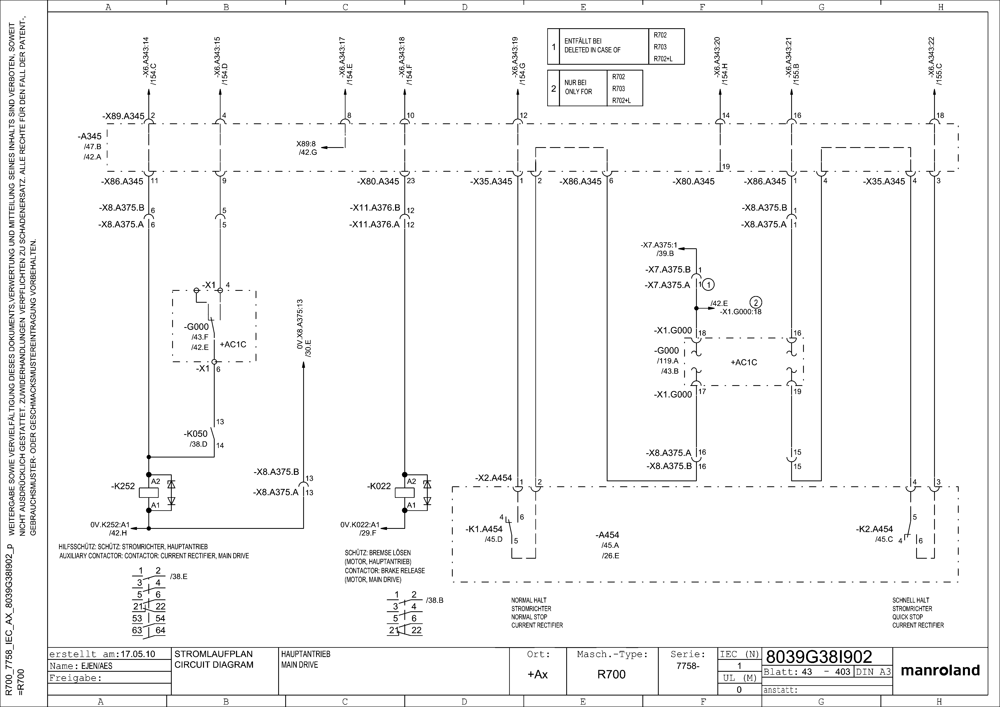

# +Ax — Sheet 43 of 403 — HAUPTANTRIEB

**MAIN DRIVE**

> Part of the manroland **R700** printing press IEC/UL circuit diagrams.
> Drawing class: **Stromlaufplan / Circuit diagram** (DIN A3).
> Document `+Ax` covers the **Central control console** machine section.

## At a glance

| Field | Value |
|---|---|
| Document | `+Ax`  (8039G38I902) |
| Sheet | **43** of 403 |
| Section (DE) | HAUPTANTRIEB |
| Section (EN) | MAIN DRIVE |
| Section type | CIRCUIT — Circuit diagram |
| Machine type | `R700` |
| Series | `7758` |
| Created | 17.05.10 |
| Replaces | — |
| Columns used | A, B, C, D, E, F, G, H |
| Path numbers | — |
| Labels on sheet | 182 |
| Cross-refs out | 27 |
| Cross-refs in | 68 |

**Previous:** [+Ax sheet 42](SHEET_0042.md) · **Next:** [+Ax sheet 44](SHEET_0044.md) · **Document TOC:** [_TOC.md](_TOC.md)  (+Ax) · **Master TOC:** [all sheets](../_MASTER_TOC.md)

## Sheet image (300 DPI, exact vector render)



_Rendered directly from the PDF vector layer at 300 DPI (1-bit), no OCR and no resampling. Use it to confirm anything ambiguous in the text below._

## Cross-references on this sheet

Each entry is a wire leaving this sheet. The printed token is `/sheet.column`; the link resolves to that sheet inside the same document.

| Ref | Target sheet | Col | Path | Destination on target | Target section | From col |
|---|---|---|---|---|---|---|
| `/154.C` | [+Ax sheet 154](SHEET_0154.md) | C | — | X6.A343:14 | ÜBERWACHUNGSRECHNER/ANSTEUERUNG NOT AUS | A |
| `/154.D` | [+Ax sheet 154](SHEET_0154.md) | D | — | X6.A343:15 | ÜBERWACHUNGSRECHNER/ANSTEUERUNG NOT AUS | B |
| `/154.E` | [+Ax sheet 154](SHEET_0154.md) | E | — | X6.A343:17 | ÜBERWACHUNGSRECHNER/ANSTEUERUNG NOT AUS | C |
| `/154.F` | [+Ax sheet 154](SHEET_0154.md) | F | — | X6.A343:18 | ÜBERWACHUNGSRECHNER/ANSTEUERUNG NOT AUS | D |
| `/154.G` | [+Ax sheet 154](SHEET_0154.md) | G | — | X6.A343:19 | ÜBERWACHUNGSRECHNER/ANSTEUERUNG NOT AUS | D |
| `/154.H` | [+Ax sheet 154](SHEET_0154.md) | H | — | X6.A343:20 | ÜBERWACHUNGSRECHNER/ANSTEUERUNG NOT AUS | F |
| `/155.B` | [+Ax sheet 155](SHEET_0155.md) | B | — | X6.A343:21 | ÜBERWACHUNGSRECHNER/ANSTEUERUNG NOT AUS | G |
| `/155.C` | [+Ax sheet 155](SHEET_0155.md) | C | — | X6.A343:22 | ÜBERWACHUNGSRECHNER/ANSTEUERUNG NOT AUS | H |
| `/42.G` | [+Ax sheet 42](SHEET_0042.md) | G | — | X89:8 | HAUPTANTRIEB | C |
| `/47.B` | [+Ax sheet 47](SHEET_0047.md) | B | — | — | NOT AUS | A |
| `/42.A` | [+Ax sheet 42](SHEET_0042.md) | A | — | — | HAUPTANTRIEB | A |
| `/39.B` | [+Ax sheet 39](SHEET_0039.md) | B | — | X7.A375:1 | HAUPTANTRIEB | F |
| `/30.E` | [+Ax sheet 30](SHEET_0030.md) | E | — | 0V.X8.A375:13 | SPANNUNGSVERSORGUNG, SCHALTSCHRANKBELÜFTUNG | C |
| `/42.E` | [+Ax sheet 42](SHEET_0042.md) | E | — | — | HAUPTANTRIEB | F |
| `/43.F` | [+Ax sheet 43](SHEET_0043.md) | F | — | — | HAUPTANTRIEB | B |
| `/42.E` | [+Ax sheet 42](SHEET_0042.md) | E | — | — | HAUPTANTRIEB | B |
| `/119.A` | [+Ax sheet 119](SHEET_0119.md) | A | — | — | REALTIMERECHNER HAUPTANTRIEB | F |
| `/43.B` | [+Ax sheet 43](SHEET_0043.md) | B | — | — | HAUPTANTRIEB | F |
| `/38.D` | [+Ax sheet 38](SHEET_0038.md) | D | — | — | HAUPTANTRIEB | B |
| `/29.F` | [+Ax sheet 29](SHEET_0029.md) | F | — | 0V.K252:A1 0V.K022:A1 | SPANNUNGSVERSORGUNG, SCHALTSCHRANKBELÜFTUNG | B |
| `/42.H` | [+Ax sheet 42](SHEET_0042.md) | H | — | 0V.K252:A1 0V.K022:A1 | HAUPTANTRIEB | B |
| `/45.D` | [+Ax sheet 45](SHEET_0045.md) | D | — | — | HAUPTANTRIEB | D |
| `/45.C` | [+Ax sheet 45](SHEET_0045.md) | C | — | — | HAUPTANTRIEB | H |
| `/45.A` | [+Ax sheet 45](SHEET_0045.md) | A | — | — | HAUPTANTRIEB | E |
| `/26.E` | [+Ax sheet 26](SHEET_0026.md) | E | — | — | SPANNUNGSVERSORGUNG, SCHALTSCHRANKBELÜFTUNG | E |
| `/38.E` | [+Ax sheet 38](SHEET_0038.md) | E | — | — | HAUPTANTRIEB | B |
| `/38.B` | [+Ax sheet 38](SHEET_0038.md) | B | — | — | HAUPTANTRIEB | D |

### Incoming references (sheets that point here)

Every other sheet that sends a wire to this one. `Back-ref` is the token printed on *that* sheet; `Path` is its line number.

| From sheet | Cols | Back-ref | Path | Refs | What continues there |
|---|---|---|---|---|---|
| [+Ax#26](SHEET_0026.md) | E | `/26.E` | — | 1 | — |
| [+Ax#29](SHEET_0029.md) | E | `/29.E` | — | 1 | — |
| [+Ax#30](SHEET_0030.md) | E | `/30.E` | — | 1 | — |
| [+Ax#38](SHEET_0038.md) | B, D | `/38.B`, `/38.D` | — | 3 | — |
| [+Ax#39](SHEET_0039.md) | B | `/39.B` | — | 1 | X7.A375:1 |
| [+Ax#42](SHEET_0042.md) | A, E, G | `/42.A`, `/42.E`, `/42.G` | — | 5 | 0V.K013:A1 |
| [+Ax#43](SHEET_0043.md) | B, F | `/43.B`, `/43.F` | — | 2 | — |
| [+Ax#45](SHEET_0045.md) | A | `/45.A` | — | 1 | — |
| [+Ax#47](SHEET_0047.md) | B | `/47.B` | — | 1 | — |
| [+Ax#119](SHEET_0119.md) | A | `/119.A` | — | 1 | — |
| [+Ax#154](SHEET_0154.md) | C, D, E, F, G, H | `/154.C`, `/154.D`, `/154.E`, `/154.F`, `/154.G`, `/154.H` | — | 6 | — |
| [+Ax#155](SHEET_0155.md) | B | `/155.B` | — | 2 | — |
| [+Ax#214](SHEET_0214.md) | B | `/214.B` | — | 4 | — |
| [+Ax#220](SHEET_0220.md) | F | `/220.F` | — | 4 | — |
| [+Ax#236](SHEET_0236.md) | E, F | `/236.E`, `/236.F` | — | 2 | — |
| [+Ax#238](SHEET_0238.md) | G, H | `/238.G`, `/238.H` | — | 12 | — |
| [+Ax#247](SHEET_0247.md) | C, E | `/247.C`, `/247.E` | — | 2 | — |
| [+Ax#278](SHEET_0278.md) | E | `/278.E` | — | 4 | — |
| [+Ax#286](SHEET_0286.md) | C | `/286.C` | — | 2 | — |
| [+Ax#288](SHEET_0288.md) | A | `/288.A` | — | 5 | — |
| [+Ax#289](SHEET_0289.md) | B | `/289.B` | — | 8 | — |


## Devices on this sheet

| Tag | Class | Class meaning (IEC) | Col | Sub | Terminal | Sign |
|---|---|---|---|---|---|---|
| `A454` | A | Baugruppe / assembly, module, PC board | E | — | — | — |
| `A345` | A | Baugruppe / assembly, module, PC board | A | — | — | — |
| `A2` | A | Baugruppe / assembly, module, PC board | A | — | — | — |
| `A1` | A | Baugruppe / assembly, module, PC board | A | — | — | — |
| `K252` | K | Relais / relay, contactor | A | — | — | — |
| `K050` | K | Relais / relay, contactor | B | — | — | — |
| `A2` | A | Baugruppe / assembly, module, PC board | D | — | — | — |
| `A1` | A | Baugruppe / assembly, module, PC board | D | — | — | — |
| `K022` | K | Relais / relay, contactor | C | — | — | — |
| `X1` | X | Klemme / terminal, plug connector | B | — | — | — |
| `G000` | G | Stromversorgung / power supply | B | — | — | — |
| `X1` | X | Klemme / terminal, plug connector | B | — | — | — |
| `G000` | G | Stromversorgung / power supply | F | — | — | — |
| `X89:8` | X | Klemme / terminal, plug connector | C | — | 8 | — |
| `R702` | R | Widerstand / resistor | F | — | — | — |
| `R703` | R | Widerstand / resistor | F | — | — | — |
| `R702` | R | Widerstand / resistor | E | — | — | — |
| `R703` | R | Widerstand / resistor | E | — | — | — |
| `X8.A375.B` | — | cross-device reference | B | — | — | — |
| `X8.A375.A` | — | cross-device reference | B | — | — | — |
| `X2.A454` | — | cross-device reference | D | — | — | — |
| `K1.A454` | — | cross-device reference | D | — | — | — |
| `X89.A345` | — | cross-device reference | A | — | — | — |
| `X35.A345` | — | cross-device reference | D | — | — | — |
| `X86.A345` | — | cross-device reference | A | — | — | — |
| `X86.A345` | — | cross-device reference | E | — | — | — |
| `X86.A345` | — | cross-device reference | G | — | — | — |
| `X80.A345` | — | cross-device reference | C | — | — | — |
| `X8.A375.B` | — | cross-device reference | A | — | — | — |
| `X8.A375.A` | — | cross-device reference | A | — | — | — |
| `X11.A376.B` | — | cross-device reference | C | — | — | — |
| `X11.A376.A` | — | cross-device reference | C | — | — | — |
| `X8.A375.B` | — | cross-device reference | G | — | — | — |
| `X8.A375.A` | — | cross-device reference | G | — | — | — |
| `X8.A375.B` | — | cross-device reference | F | — | — | — |
| `X8.A375.A` | — | cross-device reference | F | — | — | — |
| `X7.A375.B` | — | cross-device reference | F | — | — | — |
| `X7.A375.A` | — | cross-device reference | F | — | — | — |
| `X1.G000` | — | cross-device reference | F | — | — | — |
| `X1.G000` | — | cross-device reference | F | — | — | — |
| `K2.A454` | — | cross-device reference | G | — | — | — |
| `X35.A345` | — | cross-device reference | H | — | — | — |
| `X7.A375:1` | — | cross-device reference | F | — | 1 | — |
| `X1.G000:18` | — | cross-device reference | F | — | 18 | — |
| `X6.A343:22` | — | cross-device reference | H | — | 22 | — |
| `X6.A343:18` | — | cross-device reference | C | — | 18 | — |
| `X6.A343:17` | — | cross-device reference | C | — | 17 | — |
| `X6.A343:15` | — | cross-device reference | B | — | 15 | — |
| `X6.A343:14` | — | cross-device reference | A | — | 14 | — |
| `X6.A343:21` | — | cross-device reference | G | — | 21 | — |
| `X6.A343:20` | — | cross-device reference | F | — | 20 | — |
| `X6.A343:19` | — | cross-device reference | D | — | 19 | — |
| `X80.A345` | — | cross-device reference | F | — | — | — |

## Potentials / nets

| Potential | Count | Columns | Attached devices | Terminals |
|---|---|---|---|---|
| `0V` | 3 | A, C | `A375`, `K022`, `K252`, `X8` | `13`, `A1` |


A potential such as `L24+/4` or `M24+` is a named supply/return rail; every place it appears on this sheet is electrically common.

## Wire-end annotations (grouped as printed)

A wire that continues elsewhere is annotated with a small cluster: the destination description, the path/line number `#NN`, and the `/sheet.column` cross reference. Each row below is one such cluster exactly as it is grouped on the drawing.

| Col | Y | Path | Cross-ref | Text on the wire |
|---|---|---|---|---|
| F | 38.9 | — | — | `R702` |
| A | 43.8 | — | `/154.C` | `X6.A343:14` |
| B | 43.8 | — | `/154.D` | `X6.A343:15` |
| C | 43.8 | — | `/154.E` | `X6.A343:17` |
| D | 43.8 | — | `/154.F` | `X6.A343:18` |
| D | 43.8 | — | `/154.G` | `X6.A343:19` |
| F | 43.8 | — | `/154.H` | `X6.A343:20` |
| G | 43.8 | — | `/155.B` | `X6.A343:21` |
| H | 43.8 | — | `/155.C` | `X6.A343:22` |
| E | 45.9 | — | — | `ENTFÄLLT BEI DELETED IN CASE OF` |
| E | 51.3 | — | — | `1` |
| F | 53.1 | — | — | `R703` |
| F | 67.2 | — | — | `R702+L` |
| E | 88.5 | — | — | `R702` |
| E | 95.5 | — | — | `NUR BEI` |
| E | 100.9 | — | — | `2 R702+L` |
| E | 102.7 | — | — | `R703` |
| E | 106.2 | — | — | `ONLY FOR` |
| D | 133.5 | — | — | `X89.A345 2 4 8 12 14 16` |
| D | 133.6 | — | — | `10` |
| H | 133.6 | — | — | `18` |
| A | 157.6 | — | — | `A345` |
| C | 167.5 | — | `/42.G` | `X89:8` |
| A | 170.7 | — | `/47.B`, `/42.A` | — |
| F | 194.5 | — | — | `19` |
| D | 211.5 | — | — | `X86.A345 11 9 X35.A345 1 2 X86.A345 6 X86.A345 1` |
| C | 211.5 | — | — | `X80.A345 23` |
| F | 211.5 | — | — | `X80.A345` |
| G | 211.5 | — | — | `4` |
| H | 211.5 | — | — | `X35.A345 4 3` |
| A | 242.7 | — | — | `X8.A375.B 6` |
| C | 242.7 | — | — | `X11.A376.B 12` |
| G | 242.7 | — | — | `X8.A375.B 1` |
| B | 246.9 | — | — | `5` |
| A | 262.5 | — | — | `X8.A375.A 6` |
| C | 262.5 | — | — | `X11.A376.A 12` |
| G | 262.5 | — | — | `X8.A375.A 1` |
| B | 263.9 | — | — | `5` |
| F | 288.0 | — | `/39.B` | `X7.A375:1` |
| F | 316.4 | — | — | `X7.A375.B 1` |
| B | 334.8 | — | — | `X1 4` |
| F | 334.8 | — | — | `X7.A375.A 1` |
| F | 335.7 | — | — | `1` |
| C | 356.3 | — | `/30.E` | `0V.X8.A375:13` |
| F | 357.1 | — | — | `2` |
| F | 357.4 | — | `/42.E` | — |
| F | 367.4 | — | — | `X1.G000:18` |
| B | 384.4 | — | — | `G000` |
| F | 388.7 | — | — | `X1.G000 18` |
| G | 392.9 | — | — | `16` |
| B | 397.5 | — | `/43.F`, `/42.E` | — |
| B | 406.0 | — | — | `+AC1C` |
| F | 412.8 | — | — | `G000` |
| F | 425.8 | — | `/119.A` | — |
| F | 427.2 | — | — | `+AC1C` |
| B | 434.0 | — | — | `X1 6` |
| F | 438.2 | — | `/43.B` | — |
| F | 462.4 | — | — | `X1.G000 17` |
| G | 462.4 | — | — | `19` |
| B | 498.5 | — | — | `13` |
| B | 512.0 | — | — | `K050 14` |
| B | 525.0 | — | `/38.D` | — |
| F | 534.6 | — | — | `X8.A375.A 16` |
| G | 534.7 | — | — | `15` |
| F | 550.2 | — | — | `X8.A375.B 16` |
| G | 551.7 | — | — | `15` |
| B | 557.3 | — | — | `X8.A375.B 13` |
| D | 564.4 | — | — | `X2.A454 1` |
| A | 569.3 | — | — | `A2` |
| D | 569.3 | — | — | `A2` |
| E | 570.1 | — | — | `2` |
| H | 570.1 | — | — | `4 3` |
| A | 574.3 | — | — | `K252` |
| C | 574.3 | — | — | `K022` |
| B | 581.4 | — | — | `X8.A375.A 13` |
| A | 597.7 | — | — | `A1` |
| D | 597.7 | — | — | `A1` |
| D | 611.9 | — | — | `K1.A454 6` |
| D | 611.9 | — | — | `4` |
| H | 611.9 | — | — | `5` |
| B | 621.0 | — | `/29.F`, `/42.H` | `0V.K252:A1 0V.K022:A1` |
| H | 625.4 | — | — | `K2.A454 6` |
| E | 632.4 | — | — | `A454` |
| D | 638.4 | — | `/45.D` | — |
| H | 638.4 | — | `/45.C` | — |
| D | 640.2 | — | — | `5` |
| H | 640.2 | — | — | `4` |
| E | 645.5 | — | `/45.A` | — |
| A | 648.4 | — | — | `HILFSSCHÜTZ: SCHÜTZ: STROMRICHTER, HAUPTANTRIEB` |
| C | 655.4 | — | — | `(MOTOR, HAUPTANTRIEB) (MOTOR, MAIN DRIVE) SCHÜTZ: BREMSE LÖSEN CONTACTOR: BRAKE RELEASE` |
| E | 657.9 | — | `/26.E` | — |
| A | 659.0 | — | — | `AUXILIARY CONTACTOR: CONTACTOR: CURRENT RECTIFIER, MAIN DRIVE` |
| A | 674.9 | — | — | `53 63 21 54 2 4 6 22 64` |
| A | 674.9 | — | — | `3 5 1` |
| B | 682.7 | — | `/38.E` | — |
| C | 703.3 | — | — | `21 3 5 1` |
| D | 703.3 | — | — | `2 4 6 22` |
| D | 711.0 | — | `/38.B` | — |
| E | 712.3 | — | — | `NORMAL HALT NORMAL STOP STROMRICHTER CURRENT RECTIFIER` |
| H | 712.3 | — | — | `SCHNELL HALT STROMRICHTER QUICK STOP CURRENT RECTIFIER` |


## Notes and free text on this sheet

| Text | Col | Y (pt) |
|---|---|---|
| `HILFSSCHÜTZ: SCHÜTZ: STROMRICHTER, HAUPTANTRIEB` | A | 648.35 |
| `AUXILIARY CONTACTOR: CONTACTOR: CURRENT RECTIFIER, MAIN DRIVE` | A | 658.99 |
| `SCHÜTZ: BREMSE LÖSEN` | C | 655.43 |
| `(MOTOR, HAUPTANTRIEB)` | C | 666.07 |
| `CONTACTOR: BRAKE RELEASE` | C | 676.69 |
| `(MOTOR, MAIN DRIVE)` | C | 687.34 |
| `ENTFÄLLT BEI` | E | 45.94 |
| `DELETED IN CASE OF` | E | 56.6 |
| `R702+L` | F | 67.25 |
| `NUR BEI` | E | 95.54 |
| `ONLY FOR` | E | 106.23 |
| `R702+L` | E | 116.86 |
| `+AC1C` | B | 405.98 |
| `+AC1C` | F | 427.24 |
| `NORMAL HALT` | E | 712.26 |
| `STROMRICHTER` | E | 722.21 |
| `NORMAL STOP` | E | 732.16 |
| `CURRENT RECTIFIER` | E | 742.11 |
| `SCHNELL HALT` | H | 712.27 |
| `STROMRICHTER` | H | 722.21 |
| `QUICK STOP` | H | 732.16 |
| `CURRENT RECTIFIER` | H | 742.11 |

## Complete label inventory (exact text from the drawing)

Every text object inside the drawing area of this sheet, in DIN reading order (column A→H, then top→bottom). This is the authoritative list: if a string is not here it is not printed on this sheet.

| Col | Y | X | Dir | Type | Text |
|---|---|---|---|---|---|
| A | 43.8 | 169.8 | ↕ | device ref | `X6.A343:14` |
| A | 75.4 | 178.7 | ↕ | cross-reference | `/154.C` |
| A | 133.5 | 121.9 | → | device ref | `X89.A345` |
| A | 133.6 | 179.7 | → | number | `2` |
| A | 157.6 | 92.7 | → | device tag | `A345` |
| A | 170.7 | 100.1 | → | cross-reference | `/47.B` |
| A | 183.1 | 99.8 | → | cross-reference | `/42.A` |
| A | 211.5 | 120.5 | → | device ref | `X86.A345` |
| A | 211.5 | 179.1 | → | number | `11` |
| A | 242.7 | 117.9 | → | device ref | `X8.A375.B` |
| A | 246.9 | 179.7 | → | number | `6` |
| A | 262.5 | 117.1 | → | device ref | `X8.A375.A` |
| A | 263.9 | 179.7 | → | number | `6` |
| A | 569.3 | 180.0 | → | device tag | `A2` |
| A | 574.3 | 132.4 | → | device tag | `K252` |
| A | 597.7 | 180.0 | → | device tag | `A1` |
| A | 621.1 | 107.7 | → | potential | `0V.K252:A1` |
| A | 631.0 | 130.1 | → | cross-reference | `/42.H` |
| A | 648.4 | 70.0 | → | text | `HILFSSCHÜTZ: SCHÜTZ: STROMRICHTER, HAUPTANTRIEB` |
| A | 659.0 | 70.9 | → | text | `AUXILIARY CONTACTOR: CONTACTOR: CURRENT RECTIFIER, MAIN DRIVE` |
| A | 674.9 | 164.7 | → | number | `1` |
| A | 674.9 | 185.4 | → | number | `2` |
| A | 689.1 | 163.3 | → | number | `3` |
| A | 689.1 | 185.4 | → | number | `4` |
| A | 703.3 | 163.3 | → | number | `5` |
| A | 703.3 | 185.4 | → | number | `6` |
| A | 717.4 | 158.7 | → | number | `21` |
| A | 717.4 | 185.4 | → | number | `22` |
| A | 731.6 | 157.3 | → | number | `53` |
| A | 731.6 | 185.1 | → | number | `54` |
| A | 745.8 | 157.3 | → | number | `63` |
| A | 745.8 | 185.4 | → | number | `64` |
| B | 43.8 | 254.8 | ↕ | device ref | `X6.A343:15` |
| B | 75.4 | 263.8 | ↕ | cross-reference | `/154.D` |
| B | 133.6 | 264.8 | → | number | `4` |
| B | 211.5 | 264.8 | → | number | `9` |
| B | 246.9 | 264.8 | → | number | `5` |
| B | 263.9 | 264.8 | → | number | `5` |
| B | 334.8 | 240.7 | → | device tag | `X1` |
| B | 335.5 | 269.0 | → | number | `4` |
| B | 384.4 | 219.1 | → | device tag | `G000` |
| B | 397.5 | 228.2 | → | cross-reference | `/43.F` |
| B | 406.0 | 261.6 | → | text | `+AC1C` |
| B | 409.9 | 227.9 | → | cross-reference | `/42.E` |
| B | 434.0 | 233.6 | → | device tag | `X1` |
| B | 436.2 | 257.7 | → | number | `6` |
| B | 498.5 | 257.1 | → | number | `13` |
| B | 512.0 | 218.8 | → | device tag | `K050` |
| B | 525.0 | 225.9 | → | cross-reference | `/38.D` |
| B | 526.9 | 257.1 | → | number | `14` |
| B | 557.3 | 302.2 | → | device ref | `X8.A375.B` |
| B | 581.4 | 301.3 | → | device ref | `X8.A375.A` |
| B | 682.7 | 202.7 | → | cross-reference | `/38.E` |
| C | 43.8 | 403.7 | ↕ | device ref | `X6.A343:17` |
| C | 43.8 | 474.5 | ↕ | device ref | `X6.A343:18` |
| C | 75.7 | 412.6 | ↕ | cross-reference | `/154.E` |
| C | 133.6 | 413.6 | → | number | `8` |
| C | 167.5 | 352.9 | → | device tag | `X89:8` |
| C | 177.4 | 356.0 | → | cross-reference | `/42.G` |
| C | 211.5 | 425.2 | → | device ref | `X80.A345` |
| C | 242.7 | 416.7 | → | device ref | `X11.A376.B` |
| C | 262.5 | 415.8 | → | device ref | `X11.A376.A` |
| C | 356.3 | 353.2 | ↕ | potential | `0V.X8.A375:13` |
| C | 404.5 | 363.1 | ↕ | cross-reference | `/30.E` |
| C | 565.8 | 363.4 | → | number | `13` |
| C | 574.3 | 437.1 | → | device tag | `K022` |
| C | 582.8 | 363.4 | → | number | `13` |
| C | 621.1 | 405.4 | → | potential | `0V.K022:A1` |
| C | 631.0 | 428.0 | → | cross-reference | `/29.F` |
| C | 655.4 | 410.7 | → | text | `SCHÜTZ: BREMSE LÖSEN` |
| C | 666.1 | 410.5 | → | text | `(MOTOR, HAUPTANTRIEB)` |
| C | 676.7 | 410.7 | → | text | `CONTACTOR: BRAKE RELEASE` |
| C | 687.3 | 410.5 | → | text | `(MOTOR, MAIN DRIVE)` |
| C | 703.3 | 469.4 | → | number | `1` |
| C | 717.4 | 468.0 | → | number | `3` |
| C | 731.6 | 468.0 | → | number | `5` |
| C | 745.8 | 463.5 | → | number | `21` |
| D | 43.8 | 609.2 | ↕ | device ref | `X6.A343:19` |
| D | 74.8 | 618.1 | ↕ | cross-reference | `/154.G` |
| D | 76.3 | 483.4 | ↕ | cross-reference | `/154.F` |
| D | 133.6 | 483.9 | → | number | `10` |
| D | 133.6 | 618.5 | → | number | `12` |
| D | 211.5 | 484.4 | → | number | `23` |
| D | 211.5 | 559.8 | → | device ref | `X35.A345` |
| D | 211.5 | 618.5 | → | number | `1` |
| D | 246.9 | 483.9 | → | number | `12` |
| D | 263.9 | 483.9 | → | number | `12` |
| D | 564.4 | 565.8 | → | device ref | `X2.A454` |
| D | 569.3 | 484.7 | → | device tag | `A2` |
| D | 570.1 | 618.5 | → | number | `1` |
| D | 597.7 | 484.7 | → | device tag | `A1` |
| D | 611.9 | 595.0 | → | number | `4` |
| D | 611.9 | 619.1 | → | number | `6` |
| D | 625.3 | 554.5 | → | device ref | `K1.A454` |
| D | 638.4 | 577.4 | → | cross-reference | `/45.D` |
| D | 640.2 | 612.0 | → | number | `5` |
| D | 703.3 | 490.1 | → | number | `2` |
| D | 711.0 | 507.4 | → | cross-reference | `/38.B` |
| D | 717.4 | 490.1 | → | number | `4` |
| D | 731.6 | 490.1 | → | number | `6` |
| D | 745.8 | 490.1 | → | number | `22` |
| E | 45.9 | 672.4 | → | text | `ENTFÄLLT BEI` |
| E | 51.3 | 656.5 | → | number | `1` |
| E | 56.6 | 672.4 | → | text | `DELETED IN CASE OF` |
| E | 88.5 | 729.1 | → | device tag | `R702` |
| E | 95.5 | 672.4 | → | text | `NUR BEI` |
| E | 100.9 | 656.2 | → | number | `2` |
| E | 102.7 | 729.1 | → | device tag | `R703` |
| E | 106.2 | 672.9 | → | text | `ONLY FOR` |
| E | 116.9 | 729.1 | → | text | `R702+L` |
| E | 211.5 | 640.3 | → | number | `2` |
| E | 211.5 | 666.1 | → | device ref | `X86.A345` |
| E | 211.5 | 725.4 | → | number | `6` |
| E | 570.1 | 640.3 | → | number | `2` |
| E | 632.4 | 709.2 | → | device tag | `A454` |
| E | 645.5 | 716.3 | → | cross-reference | `/45.A` |
| E | 657.9 | 716.9 | → | cross-reference | `/26.E` |
| E | 712.3 | 608.9 | → | text | `NORMAL HALT` |
| E | 722.2 | 609.2 | → | text | `STROMRICHTER` |
| E | 732.2 | 608.9 | → | text | `NORMAL STOP` |
| E | 742.1 | 609.2 | → | text | `CURRENT RECTIFIER` |
| F | 38.9 | 778.7 | → | device tag | `R702` |
| F | 43.8 | 850.1 | ↕ | device ref | `X6.A343:20` |
| F | 53.1 | 778.7 | → | device tag | `R703` |
| F | 67.2 | 778.7 | → | text | `R702+L` |
| F | 75.4 | 859.0 | ↕ | cross-reference | `/154.H` |
| F | 133.6 | 859.5 | → | number | `14` |
| F | 194.5 | 859.5 | → | number | `19` |
| F | 211.5 | 800.8 | → | device ref | `X80.A345` |
| F | 288.0 | 762.8 | → | device ref | `X7.A375:1` |
| F | 297.9 | 781.8 | → | cross-reference | `/39.B` |
| F | 316.4 | 768.5 | → | device ref | `X7.A375.B` |
| F | 317.8 | 831.1 | → | number | `1` |
| F | 334.8 | 767.6 | → | device ref | `X7.A375.A` |
| F | 334.8 | 831.1 | → | number | `1` |
| F | 335.7 | 841.6 | → | number | `1` |
| F | 357.1 | 897.9 | → | number | `2` |
| F | 357.4 | 846.1 | → | cross-reference | `/42.E` |
| F | 367.4 | 857.2 | → | device ref | `X1.G000:18` |
| F | 388.7 | 778.7 | → | device ref | `X1.G000` |
| F | 392.9 | 831.1 | → | number | `18` |
| F | 412.7 | 779.0 | → | device tag | `G000` |
| F | 425.8 | 782.4 | → | cross-reference | `/119.A` |
| F | 427.2 | 870.0 | → | text | `+AC1C` |
| F | 438.2 | 787.5 | → | cross-reference | `/43.B` |
| F | 462.4 | 831.1 | → | number | `17` |
| F | 465.2 | 778.7 | → | device ref | `X1.G000` |
| F | 534.6 | 769.0 | → | device ref | `X8.A375.A` |
| F | 534.7 | 831.1 | → | number | `16` |
| F | 550.2 | 769.9 | → | device ref | `X8.A375.B` |
| F | 551.7 | 831.1 | → | number | `16` |
| G | 43.8 | 935.2 | ↕ | device ref | `X6.A343:21` |
| G | 75.7 | 944.1 | ↕ | cross-reference | `/155.B` |
| G | 133.6 | 944.5 | → | number | `16` |
| G | 211.5 | 885.8 | → | device ref | `X86.A345` |
| G | 211.5 | 944.5 | → | number | `1` |
| G | 211.5 | 980.5 | → | number | `4` |
| G | 242.7 | 883.3 | → | device ref | `X8.A375.B` |
| G | 246.9 | 944.5 | → | number | `1` |
| G | 262.5 | 882.4 | → | device ref | `X8.A375.A` |
| G | 263.9 | 944.5 | → | number | `1` |
| G | 392.9 | 944.5 | → | number | `16` |
| G | 462.4 | 944.5 | → | number | `19` |
| G | 534.7 | 944.5 | → | number | `15` |
| G | 551.7 | 944.5 | → | number | `15` |
| G | 625.3 | 1019.3 | → | device ref | `K2.A454` |
| H | 43.8 | 1105.2 | ↕ | device ref | `X6.A343:22` |
| H | 75.4 | 1114.2 | ↕ | cross-reference | `/155.C` |
| H | 133.6 | 1114.6 | → | number | `18` |
| H | 211.5 | 1027.6 | → | device ref | `X35.A345` |
| H | 211.5 | 1086.8 | → | number | `4` |
| H | 211.5 | 1115.1 | → | number | `3` |
| H | 570.1 | 1086.8 | → | number | `4` |
| H | 570.1 | 1115.1 | → | number | `3` |
| H | 611.9 | 1086.8 | → | number | `5` |
| H | 638.4 | 1042.3 | → | cross-reference | `/45.C` |
| H | 640.2 | 1069.8 | → | number | `4` |
| H | 640.2 | 1093.9 | → | number | `6` |
| H | 712.3 | 1062.7 | → | text | `SCHNELL HALT` |
| H | 722.2 | 1062.7 | → | text | `STROMRICHTER` |
| H | 732.2 | 1062.7 | → | text | `QUICK STOP` |
| H | 742.1 | 1062.7 | → | text | `CURRENT RECTIFIER` |

## Reading-order text block

The same content as a plain block, grouped by DIN column — convenient to paste or to match against a visual description.

```text
=== Column A ===
  43.8  169.8  devref       X6.A343:14
  75.4  178.7  xref         /154.C
 133.5  121.9  devref       X89.A345
 133.6  179.7  numeric      2
 157.6   92.7  devtag       A345
 170.7  100.1  xref         /47.B
 183.1   99.8  xref         /42.A
 211.5  120.5  devref       X86.A345
 211.5  179.1  numeric      11
 242.7  117.9  devref       X8.A375.B
 246.9  179.7  numeric      6
 262.5  117.1  devref       X8.A375.A
 263.9  179.7  numeric      6
 569.3  180.0  devtag       A2
 574.3  132.4  devtag       K252
 597.7  180.0  devtag       A1
 621.1  107.7  net          0V.K252:A1
 631.0  130.1  xref         /42.H
 648.4   70.0  text         HILFSSCHÜTZ: SCHÜTZ: STROMRICHTER, HAUPTANTRIEB
 659.0   70.9  text         AUXILIARY CONTACTOR: CONTACTOR: CURRENT RECTIFIER, MAIN DRIVE
 674.9  164.7  numeric      1
 674.9  185.4  numeric      2
 689.1  163.3  numeric      3
 689.1  185.4  numeric      4
 703.3  163.3  numeric      5
 703.3  185.4  numeric      6
 717.4  158.7  numeric      21
 717.4  185.4  numeric      22
 731.6  157.3  numeric      53
 731.6  185.1  numeric      54
 745.8  157.3  numeric      63
 745.8  185.4  numeric      64
=== Column B ===
  43.8  254.8  devref       X6.A343:15
  75.4  263.8  xref         /154.D
 133.6  264.8  numeric      4
 211.5  264.8  numeric      9
 246.9  264.8  numeric      5
 263.9  264.8  numeric      5
 334.8  240.7  devtag       X1
 335.5  269.0  numeric      4
 384.4  219.1  devtag       G000
 397.5  228.2  xref         /43.F
 406.0  261.6  text         +AC1C
 409.9  227.9  xref         /42.E
 434.0  233.6  devtag       X1
 436.2  257.7  numeric      6
 498.5  257.1  numeric      13
 512.0  218.8  devtag       K050
 525.0  225.9  xref         /38.D
 526.9  257.1  numeric      14
 557.3  302.2  devref       X8.A375.B
 581.4  301.3  devref       X8.A375.A
 682.7  202.7  xref         /38.E
=== Column C ===
  43.8  403.7  devref       X6.A343:17
  43.8  474.5  devref       X6.A343:18
  75.7  412.6  xref         /154.E
 133.6  413.6  numeric      8
 167.5  352.9  devtag       X89:8
 177.4  356.0  xref         /42.G
 211.5  425.2  devref       X80.A345
 242.7  416.7  devref       X11.A376.B
 262.5  415.8  devref       X11.A376.A
 356.3  353.2  net          0V.X8.A375:13
 404.5  363.1  xref         /30.E
 565.8  363.4  numeric      13
 574.3  437.1  devtag       K022
 582.8  363.4  numeric      13
 621.1  405.4  net          0V.K022:A1
 631.0  428.0  xref         /29.F
 655.4  410.7  text         SCHÜTZ: BREMSE LÖSEN
 666.1  410.5  text         (MOTOR, HAUPTANTRIEB)
 676.7  410.7  text         CONTACTOR: BRAKE RELEASE
 687.3  410.5  text         (MOTOR, MAIN DRIVE)
 703.3  469.4  numeric      1
 717.4  468.0  numeric      3
 731.6  468.0  numeric      5
 745.8  463.5  numeric      21
=== Column D ===
  43.8  609.2  devref       X6.A343:19
  74.8  618.1  xref         /154.G
  76.3  483.4  xref         /154.F
 133.6  483.9  numeric      10
 133.6  618.5  numeric      12
 211.5  484.4  numeric      23
 211.5  559.8  devref       X35.A345
 211.5  618.5  numeric      1
 246.9  483.9  numeric      12
 263.9  483.9  numeric      12
 564.4  565.8  devref       X2.A454
 569.3  484.7  devtag       A2
 570.1  618.5  numeric      1
 597.7  484.7  devtag       A1
 611.9  595.0  numeric      4
 611.9  619.1  numeric      6
 625.3  554.5  devref       K1.A454
 638.4  577.4  xref         /45.D
 640.2  612.0  numeric      5
 703.3  490.1  numeric      2
 711.0  507.4  xref         /38.B
 717.4  490.1  numeric      4
 731.6  490.1  numeric      6
 745.8  490.1  numeric      22
=== Column E ===
  45.9  672.4  text         ENTFÄLLT BEI
  51.3  656.5  numeric      1
  56.6  672.4  text         DELETED IN CASE OF
  88.5  729.1  devtag       R702
  95.5  672.4  text         NUR BEI
 100.9  656.2  numeric      2
 102.7  729.1  devtag       R703
 106.2  672.9  text         ONLY FOR
 116.9  729.1  text         R702+L
 211.5  640.3  numeric      2
 211.5  666.1  devref       X86.A345
 211.5  725.4  numeric      6
 570.1  640.3  numeric      2
 632.4  709.2  devtag       A454
 645.5  716.3  xref         /45.A
 657.9  716.9  xref         /26.E
 712.3  608.9  text         NORMAL HALT
 722.2  609.2  text         STROMRICHTER
 732.2  608.9  text         NORMAL STOP
 742.1  609.2  text         CURRENT RECTIFIER
=== Column F ===
  38.9  778.7  devtag       R702
  43.8  850.1  devref       X6.A343:20
  53.1  778.7  devtag       R703
  67.2  778.7  text         R702+L
  75.4  859.0  xref         /154.H
 133.6  859.5  numeric      14
 194.5  859.5  numeric      19
 211.5  800.8  devref       X80.A345
 288.0  762.8  devref       X7.A375:1
 297.9  781.8  xref         /39.B
 316.4  768.5  devref       X7.A375.B
 317.8  831.1  numeric      1
 334.8  767.6  devref       X7.A375.A
 334.8  831.1  numeric      1
 335.7  841.6  numeric      1
 357.1  897.9  numeric      2
 357.4  846.1  xref         /42.E
 367.4  857.2  devref       X1.G000:18
 388.7  778.7  devref       X1.G000
 392.9  831.1  numeric      18
 412.7  779.0  devtag       G000
 425.8  782.4  xref         /119.A
 427.2  870.0  text         +AC1C
 438.2  787.5  xref         /43.B
 462.4  831.1  numeric      17
 465.2  778.7  devref       X1.G000
 534.6  769.0  devref       X8.A375.A
 534.7  831.1  numeric      16
 550.2  769.9  devref       X8.A375.B
 551.7  831.1  numeric      16
=== Column G ===
  43.8  935.2  devref       X6.A343:21
  75.7  944.1  xref         /155.B
 133.6  944.5  numeric      16
 211.5  885.8  devref       X86.A345
 211.5  944.5  numeric      1
 211.5  980.5  numeric      4
 242.7  883.3  devref       X8.A375.B
 246.9  944.5  numeric      1
 262.5  882.4  devref       X8.A375.A
 263.9  944.5  numeric      1
 392.9  944.5  numeric      16
 462.4  944.5  numeric      19
 534.7  944.5  numeric      15
 551.7  944.5  numeric      15
 625.3 1019.3  devref       K2.A454
=== Column H ===
  43.8 1105.2  devref       X6.A343:22
  75.4 1114.2  xref         /155.C
 133.6 1114.6  numeric      18
 211.5 1027.6  devref       X35.A345
 211.5 1086.8  numeric      4
 211.5 1115.1  numeric      3
 570.1 1086.8  numeric      4
 570.1 1115.1  numeric      3
 611.9 1086.8  numeric      5
 638.4 1042.3  xref         /45.C
 640.2 1069.8  numeric      4
 640.2 1093.9  numeric      6
 712.3 1062.7  text         SCHNELL HALT
 722.2 1062.7  text         STROMRICHTER
 732.2 1062.7  text         QUICK STOP
 742.1 1062.7  text         CURRENT RECTIFIER
```

---
_Generated from the PDF vector text layer; no OCR. Source: `R700_7758_IEC_AX_8039G38I902_p`, sheet 43._
