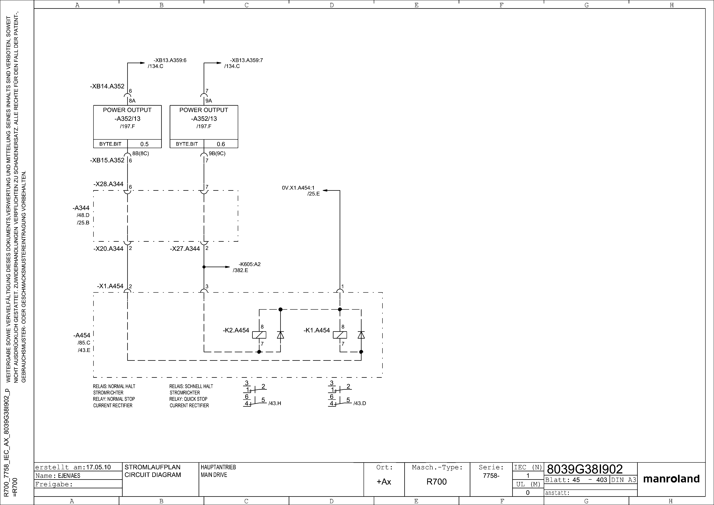

# +Ax — Sheet 45 of 403 — HAUPTANTRIEB

**MAIN DRIVE**

> Part of the manroland **R700** printing press IEC/UL circuit diagrams.
> Drawing class: **Stromlaufplan / Circuit diagram** (DIN A3).
> Document `+Ax` covers the **Central control console** machine section.

## At a glance

| Field | Value |
|---|---|
| Document | `+Ax`  (8039G38I902) |
| Sheet | **45** of 403 |
| Section (DE) | HAUPTANTRIEB |
| Section (EN) | MAIN DRIVE |
| Section type | CIRCUIT — Circuit diagram |
| Machine type | `R700` |
| Series | `7758` |
| Created | 17.05.10 |
| Replaces | — |
| Columns used | A, B, C, D |
| Path numbers | — |
| Labels on sheet | 71 |
| Cross-refs out | 10 |
| Cross-refs in | 23 |

**Previous:** [+Ax sheet 44](SHEET_0044.md) · **Next:** [+Ax sheet 46](SHEET_0046.md) · **Document TOC:** [_TOC.md](_TOC.md)  (+Ax) · **Master TOC:** [all sheets](../_MASTER_TOC.md)

## Sheet image (300 DPI, exact vector render)



_Rendered directly from the PDF vector layer at 300 DPI (1-bit), no OCR and no resampling. Use it to confirm anything ambiguous in the text below._

## Cross-references on this sheet

Each entry is a wire leaving this sheet. The printed token is `/sheet.column`; the link resolves to that sheet inside the same document.

| Ref | Target sheet | Col | Path | Destination on target | Target section | From col |
|---|---|---|---|---|---|---|
| `/134.C` | [+Ax sheet 134](SHEET_0134.md) | C | — | XB13.A359:7 | REALTIMERECHNER ANSTEUERUNG DER SPS POWERKARTE | C |
| `/134.C` | [+Ax sheet 134](SHEET_0134.md) | C | — | — | REALTIMERECHNER ANSTEUERUNG DER SPS POWERKARTE | C |
| `/197.F` | [+Ax sheet 197](SHEET_0197.md) | F | — | — | REFERENZMODUL | B |
| `/197.F` | [+Ax sheet 197](SHEET_0197.md) | F | — | — | REFERENZMODUL | B |
| `/25.E` | [+Ax sheet 25](SHEET_0025.md) | E | — | 0V.X1.A454:1 | SPANNUNGSVERSORGUNG, SCHALTSCHRANKBELÜFTUNG | D |
| `/48.D` | [+Ax sheet 48](SHEET_0048.md) | D | — | — | NOT AUS | A |
| `/25.B` | [+Ax sheet 25](SHEET_0025.md) | B | — | — | SPANNUNGSVERSORGUNG, SCHALTSCHRANKBELÜFTUNG | A |
| `/382.E` | [+Ax sheet 382](SHEET_0382.md) | E | — | — | OPTION: INLINEFOILER PRINDOR | C |
| `/85.C` | [+Ax sheet 85](SHEET_0085.md) | C | — | — | ANLEGER | A |
| `/43.E` | [+Ax sheet 43](SHEET_0043.md) | E | — | — | HAUPTANTRIEB | A |

### Incoming references (sheets that point here)

Every other sheet that sends a wire to this one. `Back-ref` is the token printed on *that* sheet; `Path` is its line number.

| From sheet | Cols | Back-ref | Path | Refs | What continues there |
|---|---|---|---|---|---|
| [+Ax#25](SHEET_0025.md) | B, E | `/25.B`, `/25.E` | — | 2 | — |
| [+Ax#43](SHEET_0043.md) | D, E, H | `/43.D`, `/43.E`, `/43.H` | — | 3 | — |
| [+Ax#48](SHEET_0048.md) | D | `/48.D` | — | 1 | — |
| [+Ax#85](SHEET_0085.md) | C | `/85.C` | — | 1 | — |
| [+Ax#134](SHEET_0134.md) | C | `/134.C` | — | 2 | — |
| [+Ax#197](SHEET_0197.md) | F | `/197.F` | — | 2 | — |
| [+Ax#209](SHEET_0209.md) | A | `/209.A` | — | 3 | — |
| [+Ax#251](SHEET_0251.md) | C | `/251.C` | — | 2 | — |
| [+Ax#253](SHEET_0253.md) | A | `/253.A` | — | 2 | — |
| [+Ax#260](SHEET_0260.md) | B | `/260.B` | — | 1 | — |
| [+Ax#270](SHEET_0270.md) | B | `/270.B` | — | 1 | — |
| [+Ax#271](SHEET_0271.md) | H | `/271.H` | — | 2 | — |
| [+Ax#382](SHEET_0382.md) | E | `/382.E` | — | 1 | K605:A2 |


## Devices on this sheet

| Tag | Class | Class meaning (IEC) | Col | Sub | Terminal | Sign |
|---|---|---|---|---|---|---|
| `A454` | A | Baugruppe / assembly, module, PC board | A | — | — | — |
| `A352/13` | A | Baugruppe / assembly, module, PC board | B | 13 | — | — |
| `A352/13` | A | Baugruppe / assembly, module, PC board | B | 13 | — | — |
| `A344` | A | Baugruppe / assembly, module, PC board | A | — | — | — |
| `K605:A2` | K | Relais / relay, contactor | C | — | A2 | — |
| `X1.A454` | — | cross-device reference | A | — | — | — |
| `0.5` | — | cross-device reference | B | — | — | — |
| `X28.A344` | — | cross-device reference | A | — | — | — |
| `X20.A344` | — | cross-device reference | A | — | — | — |
| `0.6` | — | cross-device reference | C | — | — | — |
| `X27.A344` | — | cross-device reference | B | — | — | — |
| `XB15.A352` | — | cross-device reference | A | — | — | — |
| `XB14.A352` | — | cross-device reference | A | — | — | — |
| `K1.A454` | — | cross-device reference | D | — | — | — |
| `K2.A454` | — | cross-device reference | C | — | — | — |
| `XB13.A359:7` | — | cross-device reference | C | — | 7 | — |
| `XB13.A359:6` | — | cross-device reference | B | — | 6 | — |

## Potentials / nets

| Potential | Count | Columns | Attached devices | Terminals |
|---|---|---|---|---|
| `0V` | 1 | D | `A454`, `X1` | `1` |


A potential such as `L24+/4` or `M24+` is a named supply/return rail; every place it appears on this sheet is electrically common.

## Wire-end annotations (grouped as printed)

A wire that continues elsewhere is annotated with a small cluster: the destination description, the path/line number `#NN`, and the `/sheet.column` cross reference. Each row below is one such cluster exactly as it is grouped on the drawing.

| Col | Y | Path | Cross-ref | Text on the wire |
|---|---|---|---|---|
| C | 96.7 | — | `/134.C` | `XB13.A359:7` |
| B | 96.7 | — | — | `XB13.A359:6` |
| C | 106.6 | — | `/134.C` | — |
| A | 139.2 | — | — | `XB14.A352 6` |
| C | 147.7 | — | — | `7` |
| B | 164.0 | — | — | `8A` |
| C | 164.0 | — | — | `9A` |
| B | 179.1 | — | — | `POWER OUTPUT` |
| B | 179.1 | — | — | `POWER OUTPUT` |
| B | 193.1 | — | — | `A352/13` |
| B | 193.1 | — | — | `A352/13` |
| B | 206.8 | — | `/197.F` | — |
| B | 206.8 | — | `/197.F` | — |
| B | 235.9 | — | — | `BYTE.BIT 0.5` |
| B | 235.9 | — | — | `BYTE.BIT 0.6` |
| B | 251.9 | — | — | `8B(8C)` |
| C | 251.9 | — | — | `9B(9C)` |
| B | 262.5 | — | — | `XB15.A352 6 7` |
| A | 302.2 | — | — | `X28.A344 6` |
| C | 307.9 | — | — | `7` |
| D | 309.2 | — | `/25.E` | `0V.X1.A454:1` |
| A | 341.9 | — | — | `A344` |
| A | 355.0 | — | `/48.D`, `/25.B` | — |
| A | 409.9 | — | — | `X20.A344 2` |
| B | 409.9 | — | — | `X27.A344 2` |
| C | 436.8 | — | — | `K605:A2` |
| C | 446.7 | — | `/382.E` | — |
| B | 472.3 | — | — | `X1.A454 2 3` |
| D | 473.7 | — | — | `1` |
| C | 541.0 | — | — | `8` |
| D | 541.0 | — | — | `8` |
| C | 546.0 | — | — | `K2.A454` |
| D | 546.0 | — | — | `K1.A454` |
| A | 554.5 | — | — | `A454` |
| A | 567.6 | — | `/85.C` | — |
| C | 569.4 | — | — | `7` |
| D | 569.4 | — | — | `7` |
| A | 579.9 | — | `/43.E` | — |
| C | 633.8 | — | — | `3 6 4 1` |
| D | 633.8 | — | — | `3 6 4 1` |
| C | 639.5 | — | — | `2` |
| D | 639.5 | — | — | `2` |
| B | 641.2 | — | — | `RELAIS: SCHNELL HALT` |
| A | 641.3 | — | — | `RELAIS: NORMAL HALT` |
| A | 651.9 | — | — | `RELAY: NORMAL STOP STROMRICHTER` |
| B | 651.9 | — | — | `RELAY: QUICK STOP STROMRICHTER` |
| C | 662.2 | — | — | `5 /43.H` |
| D | 662.2 | — | — | `5 /43.D` |
| A | 673.2 | — | — | `CURRENT RECTIFIER` |
| B | 673.2 | — | — | `CURRENT RECTIFIER` |


## Reconstructed tables

This sheet carries tabular content (pin map / terminal assignment / index). The grid below was rebuilt from the drawing's own rule lines, so each row is exactly one physical row of the table.

### Table 1 — 2 data rows × 2 columns (at x=155.9, y=175.7)

| POWER | OUTPUT A352/13 /197.F |
|---|---|
| `BYTE.BIT` | `0.5` |
| `XB15.A352 X28.A344 X20.A344 X1.A454` | `8B(8C) 6 6 2 2` |


### Table 2 — 3 data rows × 3 columns (at x=283.5, y=175.7)

| POWER | OUTPUT A352/13 /197.F |  |
|---|---|---|
| `BYTE.BIT` | `0.6` |  |
| `X27.A344` | `9B(9C) 7 7 2 3` | `K605:A2 /382.E` |
|  | `K2.A454` |  |


### Table 3 — 1 data rows × 3 columns (at x=432.3, y=175.7)

|  | 0V.X1.A454:1 /25.E | 1 |
|---|---|---|
| `8 7` | `K1.A454` | `8 7` |


## Notes and free text on this sheet

| Text | Col | Y (pt) |
|---|---|---|
| `8A` | B | 163.97 |
| `8B(8C)` | B | 251.89 |
| `POWER OUTPUT` | B | 179.14 |
| `BYTE.BIT` | A | 236.47 |
| `RELAIS: NORMAL HALT` | A | 641.26 |
| `STROMRICHTER` | A | 651.91 |
| `RELAY: NORMAL STOP` | A | 662.52 |
| `CURRENT RECTIFIER` | A | 673.17 |
| `9A` | C | 163.97 |
| `9B(9C)` | C | 251.89 |
| `BYTE.BIT` | B | 236.47 |
| `RELAIS: SCHNELL HALT` | B | 641.25 |
| `STROMRICHTER` | B | 651.91 |
| `RELAY: QUICK STOP` | B | 662.5 |
| `CURRENT RECTIFIER` | B | 673.17 |
| `5 /43.D` | D | 662.16 |
| `5 /43.H` | C | 662.16 |

## Complete label inventory (exact text from the drawing)

Every text object inside the drawing area of this sheet, in DIN reading order (column A→H, then top→bottom). This is the authoritative list: if a string is not here it is not printed on this sheet.

| Col | Y | X | Dir | Type | Text |
|---|---|---|---|---|---|
| A | 139.2 | 150.2 | → | device ref | `XB14.A352` |
| A | 236.5 | 165.8 | → | text | `BYTE.BIT` |
| A | 262.5 | 150.2 | → | device ref | `XB15.A352` |
| A | 302.2 | 155.9 | → | device ref | `X28.A344` |
| A | 341.9 | 121.0 | → | device tag | `A344` |
| A | 355.0 | 128.1 | → | cross-reference | `/48.D` |
| A | 367.3 | 128.4 | → | cross-reference | `/25.B` |
| A | 409.9 | 155.9 | → | device ref | `X20.A344` |
| A | 472.3 | 161.9 | → | device ref | `X1.A454` |
| A | 554.5 | 122.5 | → | device tag | `A454` |
| A | 567.6 | 129.5 | → | cross-reference | `/85.C` |
| A | 579.9 | 130.1 | → | cross-reference | `/43.E` |
| A | 641.3 | 155.1 | → | text | `RELAIS: NORMAL HALT` |
| A | 651.9 | 155.6 | → | text | `STROMRICHTER` |
| A | 662.5 | 155.1 | → | text | `RELAY: NORMAL STOP` |
| A | 673.2 | 155.6 | → | text | `CURRENT RECTIFIER` |
| B | 96.7 | 256.3 | → | device ref | `XB13.A359:6` |
| B | 106.6 | 246.6 | → | cross-reference | `/134.C` |
| B | 147.7 | 215.1 | → | number | `6` |
| B | 164.0 | 215.1 | → | text | `8A` |
| B | 179.1 | 171.8 | → | text | `POWER OUTPUT` |
| B | 179.1 | 299.3 | → | text | `POWER OUTPUT` |
| B | 193.1 | 191.2 | → | device tag | `A352/13` |
| B | 193.1 | 318.8 | → | device tag | `A352/13` |
| B | 206.8 | 200.3 | → | cross-reference | `/197.F` |
| B | 206.8 | 327.8 | → | cross-reference | `/197.F` |
| B | 235.9 | 234.1 | → | device ref | `0.5` |
| B | 236.5 | 293.4 | → | text | `BYTE.BIT` |
| B | 251.9 | 220.8 | → | text | `8B(8C)` |
| B | 263.9 | 215.1 | → | number | `6` |
| B | 307.9 | 215.1 | → | number | `6` |
| B | 409.9 | 215.1 | → | number | `2` |
| B | 409.9 | 283.5 | → | device ref | `X27.A344` |
| B | 473.7 | 215.1 | → | number | `2` |
| B | 641.3 | 282.6 | → | text | `RELAIS: SCHNELL HALT` |
| B | 651.9 | 283.2 | → | text | `STROMRICHTER` |
| B | 662.5 | 282.6 | → | text | `RELAY: QUICK STOP` |
| B | 673.2 | 283.2 | → | text | `CURRENT RECTIFIER` |
| C | 96.7 | 383.8 | → | device ref | `XB13.A359:7` |
| C | 106.6 | 374.2 | → | cross-reference | `/134.C` |
| C | 147.7 | 342.7 | → | number | `7` |
| C | 164.0 | 342.7 | → | text | `9A` |
| C | 235.9 | 361.7 | → | device ref | `0.6` |
| C | 251.9 | 348.4 | → | text | `9B(9C)` |
| C | 263.9 | 342.7 | → | number | `7` |
| C | 307.9 | 342.7 | → | number | `7` |
| C | 409.9 | 342.7 | → | number | `2` |
| C | 436.8 | 398.0 | → | device tag | `K605:A2` |
| C | 446.7 | 388.3 | → | cross-reference | `/382.E` |
| C | 473.7 | 342.7 | → | number | `3` |
| C | 541.0 | 434.8 | → | number | `8` |
| C | 546.0 | 371.6 | → | device ref | `K2.A454` |
| C | 569.4 | 434.8 | → | number | `7` |
| C | 633.8 | 408.5 | → | number | `3` |
| C | 639.5 | 436.3 | → | number | `2` |
| C | 645.2 | 409.9 | → | number | `1` |
| C | 656.5 | 408.5 | → | number | `6` |
| C | 662.2 | 436.0 | → | text | `5 /43.H` |
| C | 667.8 | 408.5 | → | number | `4` |
| D | 309.2 | 470.3 | → | potential | `0V.X1.A454:1` |
| D | 319.1 | 512.8 | → | cross-reference | `/25.E` |
| D | 473.7 | 568.9 | → | number | `1` |
| D | 541.0 | 569.5 | → | number | `8` |
| D | 546.0 | 506.3 | → | device ref | `K1.A454` |
| D | 569.4 | 569.5 | → | number | `7` |
| D | 633.8 | 550.2 | → | number | `3` |
| D | 639.5 | 578.0 | → | number | `2` |
| D | 645.2 | 551.6 | → | number | `1` |
| D | 656.5 | 550.2 | → | number | `6` |
| D | 662.2 | 577.7 | → | text | `5 /43.D` |
| D | 667.8 | 550.2 | → | number | `4` |

## Reading-order text block

The same content as a plain block, grouped by DIN column — convenient to paste or to match against a visual description.

```text
=== Column A ===
 139.2  150.2  devref       XB14.A352
 236.5  165.8  text         BYTE.BIT
 262.5  150.2  devref       XB15.A352
 302.2  155.9  devref       X28.A344
 341.9  121.0  devtag       A344
 355.0  128.1  xref         /48.D
 367.3  128.4  xref         /25.B
 409.9  155.9  devref       X20.A344
 472.3  161.9  devref       X1.A454
 554.5  122.5  devtag       A454
 567.6  129.5  xref         /85.C
 579.9  130.1  xref         /43.E
 641.3  155.1  text         RELAIS: NORMAL HALT
 651.9  155.6  text         STROMRICHTER
 662.5  155.1  text         RELAY: NORMAL STOP
 673.2  155.6  text         CURRENT RECTIFIER
=== Column B ===
  96.7  256.3  devref       XB13.A359:6
 106.6  246.6  xref         /134.C
 147.7  215.1  numeric      6
 164.0  215.1  text         8A
 179.1  171.8  text         POWER OUTPUT
 179.1  299.3  text         POWER OUTPUT
 193.1  191.2  devtag       A352/13
 193.1  318.8  devtag       A352/13
 206.8  200.3  xref         /197.F
 206.8  327.8  xref         /197.F
 235.9  234.1  devref       0.5
 236.5  293.4  text         BYTE.BIT
 251.9  220.8  text         8B(8C)
 263.9  215.1  numeric      6
 307.9  215.1  numeric      6
 409.9  215.1  numeric      2
 409.9  283.5  devref       X27.A344
 473.7  215.1  numeric      2
 641.3  282.6  text         RELAIS: SCHNELL HALT
 651.9  283.2  text         STROMRICHTER
 662.5  282.6  text         RELAY: QUICK STOP
 673.2  283.2  text         CURRENT RECTIFIER
=== Column C ===
  96.7  383.8  devref       XB13.A359:7
 106.6  374.2  xref         /134.C
 147.7  342.7  numeric      7
 164.0  342.7  text         9A
 235.9  361.7  devref       0.6
 251.9  348.4  text         9B(9C)
 263.9  342.7  numeric      7
 307.9  342.7  numeric      7
 409.9  342.7  numeric      2
 436.8  398.0  devtag       K605:A2
 446.7  388.3  xref         /382.E
 473.7  342.7  numeric      3
 541.0  434.8  numeric      8
 546.0  371.6  devref       K2.A454
 569.4  434.8  numeric      7
 633.8  408.5  numeric      3
 639.5  436.3  numeric      2
 645.2  409.9  numeric      1
 656.5  408.5  numeric      6
 662.2  436.0  text         5 /43.H
 667.8  408.5  numeric      4
=== Column D ===
 309.2  470.3  net          0V.X1.A454:1
 319.1  512.8  xref         /25.E
 473.7  568.9  numeric      1
 541.0  569.5  numeric      8
 546.0  506.3  devref       K1.A454
 569.4  569.5  numeric      7
 633.8  550.2  numeric      3
 639.5  578.0  numeric      2
 645.2  551.6  numeric      1
 656.5  550.2  numeric      6
 662.2  577.7  text         5 /43.D
 667.8  550.2  numeric      4
```

---
_Generated from the PDF vector text layer; no OCR. Source: `R700_7758_IEC_AX_8039G38I902_p`, sheet 45._
