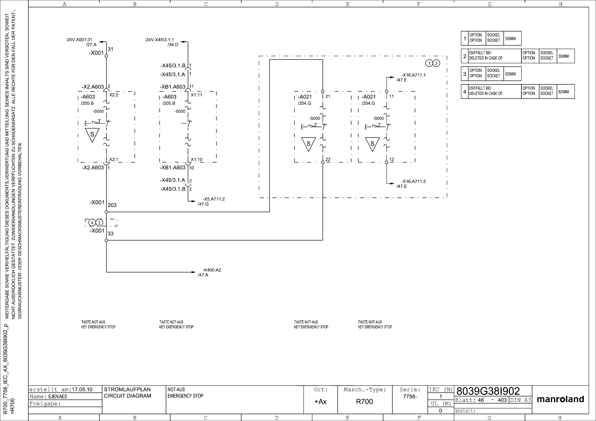

# +Ax — Sheet 46 of 403 — NOT AUS

**EMERGENCY STOP**

> Part of the manroland **R700** printing press IEC/UL circuit diagrams.
> Drawing class: **Stromlaufplan / Circuit diagram** (DIN A3).
> Document `+Ax` covers the **Central control console** machine section.

## At a glance

| Field | Value |
|---|---|
| Document | `+Ax`  (8039G38I902) |
| Sheet | **46** of 403 |
| Section (DE) | NOT AUS |
| Section (EN) | EMERGENCY STOP |
| Section type | CIRCUIT — Circuit diagram |
| Machine type | `R700` |
| Series | `7758` |
| Created | 17.05.10 |
| Replaces | — |
| Columns used | A, B, C, D, E, F, G, H |
| Path numbers | — |
| Labels on sheet | 97 |
| Cross-refs out | 10 |
| Cross-refs in | 18 |

**Previous:** [+Ax sheet 45](SHEET_0045.md) · **Next:** [+Ax sheet 47](SHEET_0047.md) · **Document TOC:** [_TOC.md](_TOC.md)  (+Ax) · **Master TOC:** [all sheets](../_MASTER_TOC.md)

## Sheet image (300 DPI, exact vector render)



_Rendered directly from the PDF vector layer at 300 DPI (1-bit), no OCR and no resampling. Use it to confirm anything ambiguous in the text below._

## Cross-references on this sheet

Each entry is a wire leaving this sheet. The printed token is `/sheet.column`; the link resolves to that sheet inside the same document.

| Ref | Target sheet | Col | Path | Destination on target | Target section | From col |
|---|---|---|---|---|---|---|
| `/34.D` | [+Ax sheet 34](SHEET_0034.md) | D | — | 24V.X45\3.1:1 | SPANNUNGSVERSORGUNG, SCHALTSCHRANKBELÜFTUNG | B |
| `/27.A` | [+Ax sheet 27](SHEET_0027.md) | A | — | 24V.X001:31 | SPANNUNGSVERSORGUNG, SCHALTSCHRANKBELÜFTUNG | A |
| `/47.E` | [+Ax sheet 47](SHEET_0047.md) | E | — | — | NOT AUS | F |
| `/205.B` | [+Ax sheet 205](SHEET_0205.md) | B | — | A603 | REFERENZMODUL | A |
| `/205.B` | [+Ax sheet 205](SHEET_0205.md) | B | — | A603 | REFERENZMODUL | B |
| `/204.G` | [+Ax sheet 204](SHEET_0204.md) | G | — | A021 | REFERENZMODUL | D |
| `/204.G` | [+Ax sheet 204](SHEET_0204.md) | G | — | A021 | REFERENZMODUL | E |
| `/47.E` | [+Ax sheet 47](SHEET_0047.md) | E | — | — | NOT AUS | F |
| `/47.G` | [+Ax sheet 47](SHEET_0047.md) | G | — | — | NOT AUS | C |
| `/47.A` | [+Ax sheet 47](SHEET_0047.md) | A | — | — | NOT AUS | C |

### Incoming references (sheets that point here)

Every other sheet that sends a wire to this one. `Back-ref` is the token printed on *that* sheet; `Path` is its line number.

| From sheet | Cols | Back-ref | Path | Refs | What continues there |
|---|---|---|---|---|---|
| [+Ax#27](SHEET_0027.md) | A | `/27.A` | — | 1 | — |
| [+Ax#34](SHEET_0034.md) | D | `/34.D` | — | 1 | 24V.X45\3.1:1 |
| [+Ax#47](SHEET_0047.md) | A, E, G | `/47.A`, `/47.E`, `/47.G` | — | 4 | K400:A2; X16.A711:1; X16.A711:2; X5.A711:2 |
| [+Ax#204](SHEET_0204.md) | F | `/204.F` | — | 2 | — |
| [+Ax#205](SHEET_0205.md) | B | `/205.B` | — | 2 | — |
| [+Ax#210](SHEET_0210.md) | A | `/210.A` | — | 2 | — |
| [+Ax#221](SHEET_0221.md) | B | `/221.B` | — | 2 | — |
| [+Ax#282](SHEET_0282.md) | H | `/282.H` | — | 4 | — |


## Devices on this sheet

| Tag | Class | Class meaning (IEC) | Col | Sub | Terminal | Sign |
|---|---|---|---|---|---|---|
| `X001` | X | Klemme / terminal, plug connector | A | — | — | — |
| `X001` | X | Klemme / terminal, plug connector | A | — | — | — |
| `X001` | X | Klemme / terminal, plug connector | A | — | — | — |
| `X1:10` | X | Klemme / terminal, plug connector | C | — | 10 | — |
| `X1:11` | X | Klemme / terminal, plug connector | C | — | 11 | — |
| `S000` | S | Schalter / switch | C | — | — | — |
| `A603` | A | Baugruppe / assembly, module, PC board | B | — | — | — |
| `X2:1` | X | Klemme / terminal, plug connector | B | — | 1 | — |
| `X2:2` | X | Klemme / terminal, plug connector | B | — | 2 | — |
| `S000` | S | Schalter / switch | A | — | — | — |
| `A603` | A | Baugruppe / assembly, module, PC board | A | — | — | — |
| `S000` | S | Schalter / switch | E | — | — | — |
| `A021` | A | Baugruppe / assembly, module, PC board | D | — | — | — |
| `S000` | S | Schalter / switch | E | — | — | — |
| `A021` | A | Baugruppe / assembly, module, PC board | E | — | — | — |
| `K400:A2` | K | Relais / relay, contactor | C | — | A2 | — |
| `X45/3.1.B` | — | cross-device reference | C | — | — | — |
| `X45/3.1.A` | — | cross-device reference | C | — | — | — |
| `XB1.A603` | — | cross-device reference | C | — | — | — |
| `X45/3.1.A` | — | cross-device reference | C | — | — | — |
| `X45/3.1.B` | — | cross-device reference | C | — | — | — |
| `X2.A603` | — | cross-device reference | A | — | — | — |
| `XB1.A603` | — | cross-device reference | C | — | — | — |
| `X2.A603` | — | cross-device reference | A | — | — | — |
| `X5.A711:2` | — | cross-device reference | C | — | 2 | — |
| `X16.A711:1` | — | cross-device reference | F | — | 1 | — |
| `X16.A711:2` | — | cross-device reference | F | — | 2 | — |

## Potentials / nets

| Potential | Count | Columns | Attached devices | Terminals |
|---|---|---|---|---|
| `24V` | 2 | A, B | `1`, `X001`, `X45\3` | `1`, `31` |


A potential such as `L24+/4` or `M24+` is a named supply/return rail; every place it appears on this sheet is electrically common.

## Wire-end annotations (grouped as printed)

A wire that continues elsewhere is annotated with a small cluster: the destination description, the path/line number `#NN`, and the `/sheet.column` cross reference. Each row below is one such cluster exactly as it is grouped on the drawing.

| Col | Y | Path | Cross-ref | Text on the wire |
|---|---|---|---|---|
| G | 67.2 | — | — | `1 OPTION OPTION` |
| G | 67.2 | — | — | `SOCKEL SOCKET 550MM` |
| A | 75.4 | — | `/27.A` | `24V.X001:31` |
| B | 75.4 | — | `/34.D` | `24V.X45\3.1:1` |
| B | 93.8 | — | — | `X001 31` |
| G | 102.6 | — | — | `2 ENTFÄLLT BEI DELETED IN CASE OF` |
| H | 102.6 | — | — | `OPTION OPTION` |
| H | 102.7 | — | — | `SOCKEL SOCKET 550MM` |
| F | 123.1 | — | — | `1 3` |
| C | 126.5 | — | — | `X45/3.1.B 1` |
| G | 138.1 | — | — | `3 OPTION OPTION` |
| G | 138.1 | — | — | `SOCKEL SOCKET 825MM` |
| C | 143.5 | — | — | `X45/3.1.A 1` |
| F | 146.3 | — | — | `X16.A711:1` |
| F | 156.2 | — | `/47.E` | — |
| A | 169.0 | — | — | `X2.A603 2` |
| C | 169.0 | — | — | `XB1.A603 11` |
| G | 173.5 | — | — | `4 ENTFÄLLT BEI DELETED IN CASE OF` |
| H | 173.5 | — | — | `OPTION OPTION` |
| H | 173.5 | — | — | `SOCKEL SOCKET 825MM` |
| B | 185.9 | — | — | `X2:2` |
| C | 185.9 | — | — | `X1:11` |
| A | 188.8 | — | `/205.B` | `A603` |
| B | 188.8 | — | `/205.B` | `A603` |
| D | 188.8 | — | `/204.G` | `A021` |
| E | 188.8 | — | — | `21` |
| E | 188.8 | — | `/204.G` | `A021` |
| F | 188.8 | — | — | `11` |
| A | 219.0 | — | — | `S000` |
| C | 219.0 | — | — | `S000` |
| E | 233.2 | — | — | `S000` |
| E | 233.2 | — | — | `S000` |
| A | 263.3 | — | — | `S` |
| E | 281.7 | — | — | `S S` |
| B | 314.9 | — | — | `X2:1` |
| C | 314.9 | — | — | `X1:10` |
| E | 315.0 | — | — | `22` |
| F | 315.0 | — | — | `12` |
| C | 330.5 | — | — | `XB1.A603 10` |
| A | 330.6 | — | — | `X2.A603 1` |
| C | 355.4 | — | — | `X45/3.1.A 2` |
| F | 358.9 | — | — | `X16.A711:2` |
| F | 368.8 | — | `/47.E` | — |
| C | 373.1 | — | — | `X45/3.1.B 2` |
| C | 394.3 | — | — | `X5.A711:2` |
| B | 399.8 | — | — | `X001 203` |
| C | 404.2 | — | `/47.G` | — |
| A | 442.5 | — | — | `4 2` |
| B | 456.4 | — | — | `X001 33` |
| C | 536.0 | — | — | `K400:A2` |
| C | 545.9 | — | `/47.A` | — |
| A | 641.4 | — | — | `KEY EMERGENCY STOP TASTE NOT AUS` |
| C | 641.4 | — | — | `KEY EMERGENCY STOP TASTE NOT AUS` |
| D | 641.4 | — | — | `KEY EMERGENCY STOP TASTE NOT AUS` |
| E | 641.4 | — | — | `KEY EMERGENCY STOP TASTE NOT AUS` |


## Reconstructed tables

This sheet carries tabular content (pin map / terminal assignment / index). The grid below was rebuilt from the drawing's own rule lines, so each row is exactly one physical row of the table.

### Table 1 — 3 data rows × 2 columns (at x=155.9, y=119.1)

| X2.A603 | 2 |
|---|---|
| `A603 /205.B S000 S` | `X2:2 X2:1` |
| `X2.A603 X001` | `1 203` |
| `4 2 X001` | `33` |


### Table 2 — 3 data rows × 2 columns (at x=318.9, y=119.1)

| X45/3.1.B X45/3.1.A XB1.A603 | 1 1 11 |
|---|---|
| `A603 /205.B S000` | `X1:11 X1:10` |
| `XB1.A603 X45/3.1.A X45/3.1.B` | `10 2 2 X5.A711:2 /47.G` |
|  | `K400:A2` |


### Table 3 — 1 data rows × 2 columns (at x=715.7, y=119.1) — **X16.A711:1 /47.E**

| A021 /204.G S000 S | 11 12 |
|---|---|
|  | `X16.A711:2 /47.E` |


## Notes and free text on this sheet

| Text | Col | Y (pt) |
|---|---|---|
| `TASTE NOT AUS` | C | 641.36 |
| `KEY EMERGENCY STOP` | C | 651.36 |
| `TASTE NOT AUS` | A | 641.36 |
| `KEY EMERGENCY STOP` | A | 651.36 |
| `TASTE NOT AUS` | D | 641.36 |
| `KEY EMERGENCY STOP` | D | 651.36 |
| `TASTE NOT AUS` | E | 641.36 |
| `KEY EMERGENCY STOP` | E | 651.36 |
| `OPTION` | G | 67.21 |
| `SOCKEL` | G | 67.23 |
| `SOCKET` | G | 77.86 |
| `550MM` | G | 74.37 |
| `ENTFÄLLT BEI` | G | 102.64 |
| `DELETED IN CASE OF` | G | 113.29 |
| `OPTION` | H | 102.64 |
| `SOCKEL` | H | 102.66 |
| `SOCKET` | H | 113.29 |
| `550MM` | H | 109.81 |
| `825MM` | G | 145.24 |
| `825MM` | H | 180.67 |
| `S` | A | 263.29 |
| `S` | D | 281.72 |
| `S` | E | 281.72 |

## Complete label inventory (exact text from the drawing)

Every text object inside the drawing area of this sheet, in DIN reading order (column A→H, then top→bottom). This is the authoritative list: if a string is not here it is not printed on this sheet.

| Col | Y | X | Dir | Type | Text |
|---|---|---|---|---|---|
| A | 75.4 | 131.0 | → | potential | `24V.X001:31` |
| A | 85.3 | 172.1 | → | cross-reference | `/27.A` |
| A | 100.7 | 177.7 | → | device tag | `X001` |
| A | 169.0 | 163.3 | → | device ref | `X2.A603` |
| A | 188.8 | 161.3 | → | device tag | `A603` |
| A | 202.6 | 161.6 | → | cross-reference | `/205.B` |
| A | 219.0 | 185.4 | → | device tag | `S000` |
| A | 263.3 | 180.1 | → | text | `S` |
| A | 330.5 | 163.3 | → | device ref | `X2.A603` |
| A | 399.8 | 179.1 | → | device tag | `X001` |
| A | 442.5 | 182.3 | → | number | `4` |
| A | 442.5 | 196.4 | → | number | `2` |
| A | 456.4 | 179.1 | → | device tag | `X001` |
| A | 641.4 | 162.7 | → | text | `TASTE NOT AUS` |
| A | 651.4 | 162.4 | → | text | `KEY EMERGENCY STOP` |
| B | 75.4 | 288.9 | → | potential | `24V.X45\3.1:1` |
| B | 93.8 | 214.9 | → | number | `31` |
| B | 169.0 | 215.1 | → | number | `2` |
| B | 185.9 | 218.3 | → | device tag | `X2:2` |
| B | 188.8 | 324.3 | → | device tag | `A603` |
| B | 202.6 | 324.6 | → | cross-reference | `/205.B` |
| B | 314.9 | 218.3 | → | device tag | `X2:1` |
| B | 332.0 | 214.6 | → | number | `1` |
| B | 405.6 | 215.1 | → | number | `203` |
| B | 462.3 | 214.9 | → | number | `33` |
| C | 85.3 | 335.1 | → | cross-reference | `/34.D` |
| C | 126.5 | 320.6 | → | device ref | `X45/3.1.B` |
| C | 126.5 | 377.6 | → | number | `1` |
| C | 143.5 | 377.6 | → | number | `1` |
| C | 144.2 | 319.7 | → | device ref | `X45/3.1.A` |
| C | 169.0 | 319.2 | → | device ref | `XB1.A603` |
| C | 169.0 | 377.6 | → | number | `11` |
| C | 185.9 | 381.3 | → | device tag | `X1:11` |
| C | 219.0 | 348.4 | → | device tag | `S000` |
| C | 314.9 | 381.3 | → | device tag | `X1:10` |
| C | 330.5 | 319.2 | → | device ref | `XB1.A603` |
| C | 332.0 | 377.6 | → | number | `10` |
| C | 355.4 | 319.7 | → | device ref | `X45/3.1.A` |
| C | 357.5 | 378.1 | → | number | `2` |
| C | 373.1 | 320.6 | → | device ref | `X45/3.1.B` |
| C | 374.5 | 378.1 | → | number | `2` |
| C | 394.3 | 405.1 | → | device ref | `X5.A711:2` |
| C | 404.2 | 395.4 | → | cross-reference | `/47.G` |
| C | 536.0 | 405.1 | → | device tag | `K400:A2` |
| C | 545.9 | 395.4 | → | cross-reference | `/47.A` |
| C | 641.4 | 318.6 | → | text | `TASTE NOT AUS` |
| C | 651.4 | 318.3 | → | text | `KEY EMERGENCY STOP` |
| D | 188.8 | 595.0 | → | device tag | `A021` |
| D | 202.6 | 595.3 | → | cross-reference | `/204.G` |
| D | 281.7 | 612.4 | → | text | `S` |
| D | 641.4 | 587.9 | → | text | `TASTE NOT AUS` |
| D | 651.4 | 587.6 | → | text | `KEY EMERGENCY STOP` |
| E | 188.8 | 650.3 | → | number | `21` |
| E | 188.8 | 722.6 | → | device tag | `A021` |
| E | 202.6 | 722.8 | → | cross-reference | `/204.G` |
| E | 233.2 | 617.7 | → | device tag | `S000` |
| E | 233.2 | 745.2 | → | device tag | `S000` |
| E | 281.7 | 740.0 | → | text | `S` |
| E | 315.0 | 650.3 | → | number | `22` |
| E | 641.4 | 715.5 | → | text | `TASTE NOT AUS` |
| E | 651.4 | 715.2 | → | text | `KEY EMERGENCY STOP` |
| F | 123.1 | 855.7 | → | number | `1` |
| F | 123.6 | 869.7 | → | number | `3` |
| F | 146.3 | 801.9 | → | device ref | `X16.A711:1` |
| F | 156.2 | 792.3 | → | cross-reference | `/47.E` |
| F | 188.8 | 777.3 | → | number | `11` |
| F | 315.0 | 777.3 | → | number | `12` |
| F | 358.9 | 801.9 | → | device ref | `X16.A711:2` |
| F | 368.8 | 792.3 | → | cross-reference | `/47.E` |
| G | 67.2 | 938.0 | → | text | `OPTION` |
| G | 67.2 | 973.4 | → | text | `SOCKEL` |
| G | 72.6 | 925.8 | → | number | `1` |
| G | 74.4 | 1009.6 | → | text | `550MM` |
| G | 77.8 | 938.0 | → | text | `OPTION` |
| G | 77.9 | 973.4 | → | text | `SOCKET` |
| G | 102.6 | 937.4 | → | text | `ENTFÄLLT BEI` |
| G | 108.0 | 925.5 | → | number | `2` |
| G | 113.3 | 937.4 | → | text | `DELETED IN CASE OF` |
| G | 138.1 | 938.0 | → | text | `OPTION` |
| G | 138.1 | 973.4 | → | text | `SOCKEL` |
| G | 143.4 | 925.4 | → | number | `3` |
| G | 145.2 | 1009.6 | → | text | `825MM` |
| G | 148.7 | 938.0 | → | text | `OPTION` |
| G | 148.7 | 973.4 | → | text | `SOCKET` |
| G | 173.5 | 937.4 | → | text | `ENTFÄLLT BEI` |
| G | 178.9 | 925.5 | → | number | `4` |
| G | 184.2 | 937.4 | → | text | `DELETED IN CASE OF` |
| H | 102.6 | 1044.3 | → | text | `OPTION` |
| H | 102.7 | 1079.7 | → | text | `SOCKEL` |
| H | 109.8 | 1115.9 | → | text | `550MM` |
| H | 113.3 | 1044.3 | → | text | `OPTION` |
| H | 113.3 | 1079.7 | → | text | `SOCKET` |
| H | 173.5 | 1044.3 | → | text | `OPTION` |
| H | 173.5 | 1079.7 | → | text | `SOCKEL` |
| H | 180.7 | 1115.9 | → | text | `825MM` |
| H | 184.1 | 1044.3 | → | text | `OPTION` |
| H | 184.2 | 1079.7 | → | text | `SOCKET` |

## Reading-order text block

The same content as a plain block, grouped by DIN column — convenient to paste or to match against a visual description.

```text
=== Column A ===
  75.4  131.0  net          24V.X001:31
  85.3  172.1  xref         /27.A
 100.7  177.7  devtag       X001
 169.0  163.3  devref       X2.A603
 188.8  161.3  devtag       A603
 202.6  161.6  xref         /205.B
 219.0  185.4  devtag       S000
 263.3  180.1  text         S
 330.5  163.3  devref       X2.A603
 399.8  179.1  devtag       X001
 442.5  182.3  numeric      4
 442.5  196.4  numeric      2
 456.4  179.1  devtag       X001
 641.4  162.7  text         TASTE NOT AUS
 651.4  162.4  text         KEY EMERGENCY STOP
=== Column B ===
  75.4  288.9  net          24V.X45\3.1:1
  93.8  214.9  numeric      31
 169.0  215.1  numeric      2
 185.9  218.3  devtag       X2:2
 188.8  324.3  devtag       A603
 202.6  324.6  xref         /205.B
 314.9  218.3  devtag       X2:1
 332.0  214.6  numeric      1
 405.6  215.1  numeric      203
 462.3  214.9  numeric      33
=== Column C ===
  85.3  335.1  xref         /34.D
 126.5  320.6  devref       X45/3.1.B
 126.5  377.6  numeric      1
 143.5  377.6  numeric      1
 144.2  319.7  devref       X45/3.1.A
 169.0  319.2  devref       XB1.A603
 169.0  377.6  numeric      11
 185.9  381.3  devtag       X1:11
 219.0  348.4  devtag       S000
 314.9  381.3  devtag       X1:10
 330.5  319.2  devref       XB1.A603
 332.0  377.6  numeric      10
 355.4  319.7  devref       X45/3.1.A
 357.5  378.1  numeric      2
 373.1  320.6  devref       X45/3.1.B
 374.5  378.1  numeric      2
 394.3  405.1  devref       X5.A711:2
 404.2  395.4  xref         /47.G
 536.0  405.1  devtag       K400:A2
 545.9  395.4  xref         /47.A
 641.4  318.6  text         TASTE NOT AUS
 651.4  318.3  text         KEY EMERGENCY STOP
=== Column D ===
 188.8  595.0  devtag       A021
 202.6  595.3  xref         /204.G
 281.7  612.4  text         S
 641.4  587.9  text         TASTE NOT AUS
 651.4  587.6  text         KEY EMERGENCY STOP
=== Column E ===
 188.8  650.3  numeric      21
 188.8  722.6  devtag       A021
 202.6  722.8  xref         /204.G
 233.2  617.7  devtag       S000
 233.2  745.2  devtag       S000
 281.7  740.0  text         S
 315.0  650.3  numeric      22
 641.4  715.5  text         TASTE NOT AUS
 651.4  715.2  text         KEY EMERGENCY STOP
=== Column F ===
 123.1  855.7  numeric      1
 123.6  869.7  numeric      3
 146.3  801.9  devref       X16.A711:1
 156.2  792.3  xref         /47.E
 188.8  777.3  numeric      11
 315.0  777.3  numeric      12
 358.9  801.9  devref       X16.A711:2
 368.8  792.3  xref         /47.E
=== Column G ===
  67.2  938.0  text         OPTION
  67.2  973.4  text         SOCKEL
  72.6  925.8  numeric      1
  74.4 1009.6  text         550MM
  77.8  938.0  text         OPTION
  77.9  973.4  text         SOCKET
 102.6  937.4  text         ENTFÄLLT BEI
 108.0  925.5  numeric      2
 113.3  937.4  text         DELETED IN CASE OF
 138.1  938.0  text         OPTION
 138.1  973.4  text         SOCKEL
 143.4  925.4  numeric      3
 145.2 1009.6  text         825MM
 148.7  938.0  text         OPTION
 148.7  973.4  text         SOCKET
 173.5  937.4  text         ENTFÄLLT BEI
 178.9  925.5  numeric      4
 184.2  937.4  text         DELETED IN CASE OF
=== Column H ===
 102.6 1044.3  text         OPTION
 102.7 1079.7  text         SOCKEL
 109.8 1115.9  text         550MM
 113.3 1044.3  text         OPTION
 113.3 1079.7  text         SOCKET
 173.5 1044.3  text         OPTION
 173.5 1079.7  text         SOCKEL
 180.7 1115.9  text         825MM
 184.1 1044.3  text         OPTION
 184.2 1079.7  text         SOCKET
```

---
_Generated from the PDF vector text layer; no OCR. Source: `R700_7758_IEC_AX_8039G38I902_p`, sheet 46._
