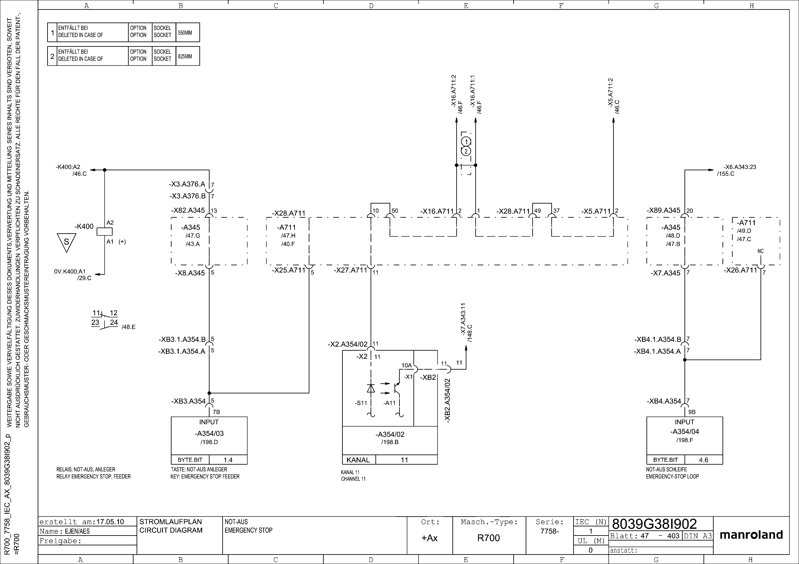

# +Ax — Sheet 47 of 403 — NOT AUS

**EMERGENCY STOP**

> Part of the manroland **R700** printing press IEC/UL circuit diagrams.
> Drawing class: **Stromlaufplan / Circuit diagram** (DIN A3).
> Document `+Ax` covers the **Central control console** machine section.

## At a glance

| Field | Value |
|---|---|
| Document | `+Ax`  (8039G38I902) |
| Sheet | **47** of 403 |
| Section (DE) | NOT AUS |
| Section (EN) | EMERGENCY STOP |
| Section type | CIRCUIT — Circuit diagram |
| Machine type | `R700` |
| Series | `7758` |
| Created | 17.05.10 |
| Replaces | — |
| Columns used | A, B, C, D, E, F, G, H |
| Path numbers | — |
| Labels on sheet | 132 |
| Cross-refs out | 19 |
| Cross-refs in | 44 |

**Previous:** [+Ax sheet 46](SHEET_0046.md) · **Next:** [+Ax sheet 48](SHEET_0048.md) · **Document TOC:** [_TOC.md](_TOC.md)  (+Ax) · **Master TOC:** [all sheets](../_MASTER_TOC.md)

## Sheet image (300 DPI, exact vector render)



_Rendered directly from the PDF vector layer at 300 DPI (1-bit), no OCR and no resampling. Use it to confirm anything ambiguous in the text below._

## Cross-references on this sheet

Each entry is a wire leaving this sheet. The printed token is `/sheet.column`; the link resolves to that sheet inside the same document.

| Ref | Target sheet | Col | Path | Destination on target | Target section | From col |
|---|---|---|---|---|---|---|
| `/46.F` | [+Ax sheet 46](SHEET_0046.md) | F | — | X16.A711:2 | NOT AUS | E |
| `/46.F` | [+Ax sheet 46](SHEET_0046.md) | F | — | X16.A711:1 | NOT AUS | E |
| `/46.C` | [+Ax sheet 46](SHEET_0046.md) | C | — | X5.A711:2 | NOT AUS | G |
| `/46.C` | [+Ax sheet 46](SHEET_0046.md) | C | — | K400:A2 | NOT AUS | A |
| `/155.C` | [+Ax sheet 155](SHEET_0155.md) | C | — | — | ÜBERWACHUNGSRECHNER/ANSTEUERUNG NOT AUS | H |
| `/49.D` | [+Ax sheet 49](SHEET_0049.md) | D | — | A711 | NOT AUS | H |
| `/47.C` | [+Ax sheet 47](SHEET_0047.md) | C | — | A711 | NOT AUS | H |
| `/47.G` | [+Ax sheet 47](SHEET_0047.md) | G | — | — | NOT AUS | B |
| `/43.A` | [+Ax sheet 43](SHEET_0043.md) | A | — | — | HAUPTANTRIEB | B |
| `/47.H` | [+Ax sheet 47](SHEET_0047.md) | H | — | — | NOT AUS | C |
| `/40.F` | [+Ax sheet 40](SHEET_0040.md) | F | — | — | HAUPTANTRIEB | C |
| `/48.D` | [+Ax sheet 48](SHEET_0048.md) | D | — | — | NOT AUS | G |
| `/47.B` | [+Ax sheet 47](SHEET_0047.md) | B | — | — | NOT AUS | G |
| `/29.C` | [+Ax sheet 29](SHEET_0029.md) | C | — | 0V.K400:A1 | SPANNUNGSVERSORGUNG, SCHALTSCHRANKBELÜFTUNG | A |
| `/148.C` | [+Ax sheet 148](SHEET_0148.md) | C | — | X7.A343:11 | ÜBERWACHUNGSRECHNER SICHERHEITSBUS | E |
| `/48.E` | [+Ax sheet 48](SHEET_0048.md) | E | — | — | NOT AUS | A |
| `/198.F` | [+Ax sheet 198](SHEET_0198.md) | F | — | — | REFERENZMODUL | G |
| `/198.B` | [+Ax sheet 198](SHEET_0198.md) | B | — | — | REFERENZMODUL | D |
| `/198.D` | [+Ax sheet 198](SHEET_0198.md) | D | — | — | REFERENZMODUL | B |

### Incoming references (sheets that point here)

Every other sheet that sends a wire to this one. `Back-ref` is the token printed on *that* sheet; `Path` is its line number.

| From sheet | Cols | Back-ref | Path | Refs | What continues there |
|---|---|---|---|---|---|
| [+Ax#29](SHEET_0029.md) | C | `/29.C` | — | 1 | — |
| [+Ax#40](SHEET_0040.md) | F | `/40.F` | — | 1 | — |
| [+Ax#43](SHEET_0043.md) | A | `/43.A` | — | 1 | — |
| [+Ax#46](SHEET_0046.md) | C, F | `/46.C`, `/46.F` | — | 4 | — |
| [+Ax#47](SHEET_0047.md) | B, C, G, H | `/47.B`, `/47.C`, `/47.G`, `/47.H` | — | 4 | A711 |
| [+Ax#48](SHEET_0048.md) | D, E | `/48.D`, `/48.E` | — | 2 | — |
| [+Ax#49](SHEET_0049.md) | C | `/49.C` | — | 1 | — |
| [+Ax#148](SHEET_0148.md) | C | `/148.C` | — | 1 | X7.A343:11 |
| [+Ax#155](SHEET_0155.md) | C | `/155.C` | — | 1 | — |
| [+Ax#198](SHEET_0198.md) | B, D, F | `/198.B`, `/198.D`, `/198.F` | — | 3 | — |
| [+Ax#219](SHEET_0219.md) | C, E | `/219.C`, `/219.E` | — | 2 | — |
| [+Ax#224](SHEET_0224.md) | A, B, C, E, F | `/224.A`, `/224.B`, `/224.C`, `/224.E`, `/224.F` | — | 5 | — |
| [+Ax#228](SHEET_0228.md) | A, B, C | `/228.A`, `/228.B`, `/228.C` | — | 3 | — |
| [+Ax#232](SHEET_0232.md) | H | `/232.H` | — | 1 | — |
| [+Ax#235](SHEET_0235.md) | H | `/235.H` | — | 1 | — |
| [+Ax#238](SHEET_0238.md) | A | `/238.A` | — | 1 | — |
| [+Ax#254](SHEET_0254.md) | H | `/254.H` | — | 2 | — |
| [+Ax#268](SHEET_0268.md) | C | `/268.C` | — | 1 | — |
| [+Ax#269](SHEET_0269.md) | H | `/269.H` | — | 1 | — |
| [+Ax#271](SHEET_0271.md) | A | `/271.A` | — | 1 | — |
| [+Ax#272](SHEET_0272.md) | G, H | `/272.G`, `/272.H` | — | 5 | — |
| [+Ax#286](SHEET_0286.md) | F | `/286.F` | — | 1 | — |
| [+Ax#289](SHEET_0289.md) | B | `/289.B` | — | 1 | — |


## Devices on this sheet

| Tag | Class | Class meaning (IEC) | Col | Sub | Terminal | Sign |
|---|---|---|---|---|---|---|
| `A2` | A | Baugruppe / assembly, module, PC board | A | — | — | — |
| `A1` | A | Baugruppe / assembly, module, PC board | A | — | — | — |
| `K400` | K | Relais / relay, contactor | A | — | — | — |
| `A354/03` | A | Baugruppe / assembly, module, PC board | B | 03 | — | — |
| `A711` | A | Baugruppe / assembly, module, PC board | C | — | — | — |
| `A345` | A | Baugruppe / assembly, module, PC board | B | — | — | — |
| `S11` | S | Schalter / switch | D | — | — | — |
| `A11` | A | Baugruppe / assembly, module, PC board | D | — | — | — |
| `X1` | X | Klemme / terminal, plug connector | D | — | — | — |
| `X2` | X | Klemme / terminal, plug connector | D | — | — | — |
| `XB2` | XB |  | E | — | — | — |
| `A354/02` | A | Baugruppe / assembly, module, PC board | D | 02 | — | — |
| `A354/04` | A | Baugruppe / assembly, module, PC board | G | 04 | — | — |
| `A345` | A | Baugruppe / assembly, module, PC board | G | — | — | — |
| `A711` | A | Baugruppe / assembly, module, PC board | H | — | — | — |
| `K400:A2` | K | Relais / relay, contactor | A | — | A2 | — |
| `1.4` | — | cross-device reference | B | — | — | — |
| `XB3.A354` | — | cross-device reference | B | — | — | — |
| `XB3.1.A354.B` | — | cross-device reference | B | — | — | — |
| `XB3.1.A354.A` | — | cross-device reference | B | — | — | — |
| `X82.A345` | — | cross-device reference | B | — | — | — |
| `X3.A376.B` | — | cross-device reference | B | — | — | — |
| `X3.A376.A` | — | cross-device reference | B | — | — | — |
| `X25.A711` | — | cross-device reference | C | — | — | — |
| `X8.A345` | — | cross-device reference | B | — | — | — |
| `X27.A711` | — | cross-device reference | D | — | — | — |
| `X16.A711` | — | cross-device reference | E | — | — | — |
| `4.6` | — | cross-device reference | G | — | — | — |
| `XB4.A354` | — | cross-device reference | G | — | — | — |
| `XB4.1.A354.B` | — | cross-device reference | G | — | — | — |
| `XB4.1.A354.A` | — | cross-device reference | G | — | — | — |
| `X89.A345` | — | cross-device reference | G | — | — | — |
| `X7.A345` | — | cross-device reference | G | — | — | — |
| `X26.A711` | — | cross-device reference | H | — | — | — |
| `X28.A711` | — | cross-device reference | E | — | — | — |
| `X5.A711` | — | cross-device reference | F | — | — | — |
| `X7.A343:11` | — | cross-device reference | E | — | 11 | — |
| `X5.A711:2` | — | cross-device reference | G | — | 2 | — |
| `X6.A343:23` | — | cross-device reference | H | — | 23 | — |
| `X16.A711:1` | — | cross-device reference | E | — | 1 | — |
| `X16.A711:2` | — | cross-device reference | E | — | 2 | — |
| `X28.A711` | — | cross-device reference | C | — | — | — |

## Potentials / nets

| Potential | Count | Columns | Attached devices | Terminals |
|---|---|---|---|---|
| `0V` | 1 | A | `K400` | `A1` |


A potential such as `L24+/4` or `M24+` is a named supply/return rail; every place it appears on this sheet is electrically common.

## Wire-end annotations (grouped as printed)

A wire that continues elsewhere is annotated with a small cluster: the destination description, the path/line number `#NN`, and the `/sheet.column` cross reference. Each row below is one such cluster exactly as it is grouped on the drawing.

| Col | Y | Path | Cross-ref | Text on the wire |
|---|---|---|---|---|
| A | 38.9 | — | — | `ENTFÄLLT BEI DELETED IN CASE OF` |
| B | 38.9 | — | — | `OPTION OPTION` |
| B | 38.9 | — | — | `SOCKEL SOCKET 550MM` |
| A | 44.2 | — | — | `1` |
| A | 74.3 | — | — | `ENTFÄLLT BEI DELETED IN CASE OF` |
| B | 74.3 | — | — | `OPTION OPTION` |
| B | 74.3 | — | — | `SOCKEL SOCKET 825MM` |
| A | 79.6 | — | — | `2` |
| E | 111.7 | — | `/46.F` | `X16.A711:2` |
| E | 111.7 | — | `/46.F` | `X16.A711:1` |
| G | 116.5 | — | `/46.C` | `X5.A711:2` |
| E | 208.1 | — | — | `1` |
| E | 222.8 | — | — | `2` |
| A | 245.5 | — | `/46.C` | `K400:A2` |
| H | 245.5 | — | — | `X6.A343:23` |
| H | 255.4 | — | `/155.C` | — |
| B | 270.3 | — | — | `X3.A376.A 7` |
| B | 288.0 | — | — | `X3.A376.B 7` |
| B | 309.3 | — | — | `X82.A345 13` |
| G | 309.3 | — | — | `X89.A345 20` |
| D | 310.7 | — | — | `10` |
| E | 310.7 | — | — | `50 X16.A711 2 1` |
| F | 310.7 | — | — | `X28.A711 49 37 X5.A711 2` |
| C | 313.5 | — | — | `X28.A711` |
| H | 327.7 | — | `/49.D`, `/47.C` | `A711` |
| A | 328.4 | — | — | `A2` |
| A | 333.4 | — | — | `K400` |
| B | 334.8 | — | — | `A345` |
| C | 334.8 | — | — | `A711` |
| G | 334.8 | — | — | `A345` |
| B | 347.9 | — | `/47.G`, `/43.A` | — |
| C | 347.9 | — | `/47.H`, `/40.F` | — |
| G | 347.9 | — | `/48.D`, `/47.B` | — |
| A | 355.4 | — | — | `S (+)` |
| A | 356.7 | — | — | `A1` |
| H | 371.9 | — | — | `NC` |
| C | 398.6 | — | — | `X8.A345 5 X25.A711 5` |
| D | 398.6 | — | — | `X27.A711 11` |
| H | 398.6 | — | — | `X26.A711 7` |
| A | 401.4 | — | `/29.C` | `0V.K400:A1` |
| G | 402.8 | — | — | `X7.A345 7` |
| E | 451.8 | — | `/148.C` | `X7.A343:11` |
| A | 462.3 | — | — | `23 11 12 24` |
| A | 484.3 | — | `/48.E` | — |
| B | 502.1 | — | — | `XB3.1.A354.B 5` |
| G | 502.1 | — | — | `XB4.1.A354.B 7` |
| D | 509.1 | — | — | `X2.A354/02 11` |
| B | 519.1 | — | — | `XB3.1.A354.A 5` |
| G | 519.1 | — | — | `XB4.1.A354.A 7` |
| D | 527.6 | — | — | `X2` |
| D | 529.0 | — | — | `11 11` |
| E | 537.5 | — | — | `11` |
| D | 541.7 | — | — | `10A` |
| D | 558.7 | — | — | `X1` |
| E | 558.7 | — | — | `XB2` |
| E | 565.0 | — | — | `XB2.A354/02` |
| B | 594.2 | — | — | `XB3.A354 5` |
| G | 594.2 | — | — | `XB4.A354 7` |
| D | 597.7 | — | — | `S11 A11` |
| B | 611.1 | — | — | `7B` |
| G | 611.1 | — | — | `9B` |
| B | 625.7 | — | — | `INPUT` |
| G | 625.7 | — | — | `INPUT` |
| G | 639.5 | — | — | `A354/04` |
| B | 642.4 | — | — | `A354/03` |
| D | 643.8 | — | — | `A354/02` |
| G | 653.3 | — | `/198.F` | — |
| D | 656.1 | — | `/198.B` | — |
| B | 656.2 | — | `/198.D` | — |
| D | 682.0 | — | — | `KANAL 11` |
| B | 682.4 | — | — | `BYTE.BIT 1.4` |
| G | 682.4 | — | — | `BYTE.BIT 4.6` |
| A | 697.9 | — | — | `RELAIS: NOT AUS, ANLEGER RELAY EMERGENCY STOP, FEEDER` |
| G | 697.9 | — | — | `NOT AUS SCHLEIFE EMERGENCY STOP LOOP` |
| B | 698.0 | — | — | `KEY: EMERGENCY STOP FEEDER TASTE: NOT AUS ANLEGER` |
| D | 702.3 | — | — | `KANAL 11 CHANNEL 11` |


## Reconstructed tables

This sheet carries tabular content (pin map / terminal assignment / index). The grid below was rebuilt from the drawing's own rule lines, so each row is exactly one physical row of the table.

### Table 1 — 6 data rows × 12 columns (at x=155.9, y=253.7)

| A2 | X3.A376.A X3.A376.B X82.A345 A345 /47.G | 7 7 13 | X28.A711 A711 /47.H |  |  | 10 50 |  | X16.A711 |  | 2 |  |
|---|---|---|---|---|---|---|---|---|---|---|---|
| `A1 (+) 12 24 /48.E` | `/43.A X8.A345 XB3.1.A354.B` | `5 5` | `/40.F X25.A711` | `5` | `X27.A711 X2.A354/02` | `11 11` |  |  |  | `X7.A343:11` | `/148.C` |
|  | `XB3.1.A354.A` | `5` |  |  | `X2` | `11` | `10A X1` | `XB2` | `11` | `11` |  |
|  | `XB3.A354` | `5 7B` |  |  | `S11` | `A11` |  |  | `XB2.A354/02` |  |  |
|  | `INPUT` |  |  |  |  |  |  |  |  |  |  |
|  |  | `A354/03 /198.D` |  |  |  | `A354/02 /198.B` |  |  |  |  |  |
|  | `BYTE.BIT` | `1.4` |  |  | `KANAL` |  | `11` |  |  |  |  |


### Table 2 — 3 data rows × 3 columns (at x=963.8, y=352.9)

| /47.B X7.A345 XB4.1.A354.B XB4.1.A354.A | 7 7 7 | /47.C NC X26.A711 |
|---|---|---|
| `XB4.A354` | `7 9B` |  |
| `INPUT` | `A354/04 /198.F` |  |
| `BYTE.BIT` | `4.6` |  |


## Notes and free text on this sheet

| Text | Col | Y (pt) |
|---|---|---|
| `RELAIS: NOT AUS, ANLEGER` | A | 697.94 |
| `RELAY EMERGENCY STOP, FEEDER` | A | 708.58 |
| `7B` | B | 611.14 |
| `INPUT` | B | 625.68 |
| `BYTE.BIT` | B | 682.93 |
| `TASTE: NOT AUS ANLEGER` | B | 697.95 |
| `KEY: EMERGENCY STOP FEEDER` | B | 708.57 |
| `KANAL 11` | D | 702.33 |
| `CHANNEL 11` | D | 712.28 |
| `10A` | D | 541.7 |
| `KANAL` | D | 682.03 |
| `X2.A354/02` | D | 509.13 |
| `XB2.A354/02` | E | 564.95 |
| `9B` | G | 611.14 |
| `INPUT` | G | 625.68 |
| `BYTE.BIT` | G | 682.93 |
| `NOT AUS SCHLEIFE` | G | 697.94 |
| `EMERGENCY STOP LOOP` | G | 708.59 |
| `S` | A | 355.42 |
| `ENTFÄLLT BEI` | A | 38.86 |
| `DELETED IN CASE OF` | A | 49.51 |
| `OPTION` | B | 38.87 |
| `SOCKEL` | B | 38.88 |
| `SOCKET` | B | 49.51 |
| `550MM` | B | 46.03 |
| `825MM` | B | 81.46 |
| `NC` | H | 371.92 |

## Complete label inventory (exact text from the drawing)

Every text object inside the drawing area of this sheet, in DIN reading order (column A→H, then top→bottom). This is the authoritative list: if a string is not here it is not printed on this sheet.

| Col | Y | X | Dir | Type | Text |
|---|---|---|---|---|---|
| A | 38.9 | 87.0 | → | text | `ENTFÄLLT BEI` |
| A | 44.2 | 75.4 | → | number | `1` |
| A | 49.5 | 87.0 | → | text | `DELETED IN CASE OF` |
| A | 74.3 | 87.0 | → | text | `ENTFÄLLT BEI` |
| A | 79.6 | 75.1 | → | number | `2` |
| A | 84.9 | 87.0 | → | text | `DELETED IN CASE OF` |
| A | 245.5 | 83.1 | → | device tag | `K400:A2` |
| A | 255.4 | 108.3 | → | cross-reference | `/46.C` |
| A | 328.4 | 158.7 | → | device tag | `A2` |
| A | 333.4 | 111.1 | → | device tag | `K400` |
| A | 355.4 | 95.1 | → | text | `S` |
| A | 356.7 | 158.7 | → | device tag | `A1` |
| A | 356.8 | 176.6 | → | other | `(+)` |
| A | 401.4 | 80.8 | → | potential | `0V.K400:A1` |
| A | 411.3 | 115.4 | → | cross-reference | `/29.C` |
| A | 462.3 | 137.5 | → | number | `11` |
| A | 462.3 | 163.3 | → | number | `12` |
| A | 476.5 | 136.1 | → | number | `23` |
| A | 476.5 | 164.1 | → | number | `24` |
| A | 484.3 | 181.4 | → | cross-reference | `/48.E` |
| A | 697.9 | 84.2 | → | text | `RELAIS: NOT AUS, ANLEGER` |
| A | 708.6 | 84.2 | → | text | `RELAY EMERGENCY STOP, FEEDER` |
| B | 38.9 | 193.9 | → | text | `OPTION` |
| B | 38.9 | 229.3 | → | text | `SOCKEL` |
| B | 46.0 | 265.5 | → | text | `550MM` |
| B | 49.5 | 193.9 | → | text | `OPTION` |
| B | 49.5 | 229.3 | → | text | `SOCKET` |
| B | 74.3 | 193.9 | → | text | `OPTION` |
| B | 74.3 | 229.3 | → | text | `SOCKEL` |
| B | 81.5 | 265.5 | → | text | `825MM` |
| B | 84.9 | 193.9 | → | text | `OPTION` |
| B | 84.9 | 229.3 | → | text | `SOCKET` |
| B | 270.3 | 251.7 | → | device ref | `X3.A376.A` |
| B | 272.5 | 314.4 | → | number | `7` |
| B | 288.0 | 252.6 | → | device ref | `X3.A376.B` |
| B | 289.5 | 314.4 | → | number | `7` |
| B | 309.3 | 255.1 | → | device ref | `X82.A345` |
| B | 310.7 | 313.8 | → | number | `13` |
| B | 334.8 | 269.9 | → | device tag | `A345` |
| B | 347.9 | 276.7 | → | cross-reference | `/47.G` |
| B | 360.2 | 276.9 | → | cross-reference | `/43.A` |
| B | 402.8 | 261.1 | → | device ref | `X8.A345` |
| B | 402.8 | 314.4 | → | number | `5` |
| B | 502.1 | 236.7 | → | device ref | `XB3.1.A354.B` |
| B | 502.1 | 314.4 | → | number | `5` |
| B | 519.1 | 314.4 | → | number | `5` |
| B | 519.8 | 235.8 | → | device ref | `XB3.1.A354.A` |
| B | 594.2 | 255.4 | → | device ref | `XB3.A354` |
| B | 594.2 | 314.4 | → | number | `5` |
| B | 611.1 | 317.2 | → | text | `7B` |
| B | 625.7 | 296.9 | → | text | `INPUT` |
| B | 642.4 | 290.4 | → | device tag | `A354/03` |
| B | 656.2 | 299.1 | → | cross-reference | `/198.D` |
| B | 682.3 | 333.1 | → | device ref | `1.4` |
| B | 682.9 | 265.0 | → | text | `BYTE.BIT` |
| B | 697.9 | 254.8 | → | text | `TASTE: NOT AUS ANLEGER` |
| B | 708.6 | 254.3 | → | text | `KEY: EMERGENCY STOP FEEDER` |
| C | 313.5 | 405.4 | → | device ref | `X28.A711` |
| C | 334.8 | 413.0 | → | device tag | `A711` |
| C | 347.9 | 419.2 | → | cross-reference | `/47.H` |
| C | 360.3 | 419.5 | → | cross-reference | `/40.F` |
| C | 398.6 | 405.4 | → | device ref | `X25.A711` |
| C | 402.8 | 463.2 | → | number | `5` |
| D | 310.7 | 554.7 | → | number | `10` |
| D | 310.7 | 583.7 | → | number | `50` |
| D | 398.6 | 497.5 | → | device ref | `X27.A711` |
| D | 402.8 | 554.7 | → | number | `11` |
| D | 509.1 | 488.7 | → | text | `X2.A354/02` |
| D | 509.1 | 554.7 | → | number | `11` |
| D | 527.6 | 531.2 | → | device tag | `X2` |
| D | 529.0 | 557.6 | → | number | `11` |
| D | 541.7 | 598.1 | → | text | `10A` |
| D | 558.7 | 601.8 | → | device tag | `X1` |
| D | 597.7 | 528.9 | → | device tag | `S11` |
| D | 597.7 | 571.5 | → | device tag | `A11` |
| D | 643.8 | 559.7 | → | device tag | `A354/02` |
| D | 656.1 | 568.5 | → | cross-reference | `/198.B` |
| D | 682.0 | 516.5 | → | text | `KANAL` |
| D | 682.0 | 596.8 | → | number | `11` |
| D | 702.3 | 508.3 | → | text | `KANAL 11` |
| D | 712.3 | 508.5 | → | text | `CHANNEL 11` |
| E | 111.7 | 672.1 | ↕ | device ref | `X16.A711:2` |
| E | 111.7 | 700.4 | ↕ | device ref | `X16.A711:1` |
| E | 150.0 | 682.0 | ↕ | cross-reference | `/46.F` |
| E | 150.0 | 710.3 | ↕ | cross-reference | `/46.F` |
| E | 208.1 | 692.7 | → | number | `1` |
| E | 222.8 | 692.5 | → | number | `2` |
| E | 310.7 | 626.5 | → | device ref | `X16.A711` |
| E | 310.7 | 682.9 | → | number | `2` |
| E | 310.7 | 710.6 | → | number | `1` |
| E | 310.7 | 739.8 | → | device ref | `X28.A711` |
| E | 451.8 | 686.3 | ↕ | device ref | `X7.A343:11` |
| E | 484.4 | 696.2 | ↕ | cross-reference | `/148.C` |
| E | 537.5 | 679.5 | → | number | `11` |
| E | 538.9 | 656.8 | → | number | `11` |
| E | 558.7 | 626.2 | → | device tag | `XB2` |
| E | 564.9 | 662.2 | ↕ | text | `XB2.A354/02` |
| F | 310.7 | 796.3 | → | number | `49` |
| F | 310.7 | 824.6 | → | number | `37` |
| F | 310.7 | 866.3 | → | device ref | `X5.A711` |
| G | 116.5 | 905.9 | ↕ | device ref | `X5.A711:2` |
| G | 149.1 | 915.9 | ↕ | cross-reference | `/46.C` |
| G | 309.3 | 963.8 | → | device ref | `X89.A345` |
| G | 310.7 | 916.7 | → | number | `2` |
| G | 310.7 | 1023.0 | → | number | `20` |
| G | 334.8 | 985.6 | → | device tag | `A345` |
| G | 347.9 | 992.7 | → | cross-reference | `/48.D` |
| G | 360.2 | 993.0 | → | cross-reference | `/47.B` |
| G | 402.8 | 969.7 | → | device ref | `X7.A345` |
| G | 402.8 | 1023.0 | → | number | `7` |
| G | 502.1 | 945.4 | → | device ref | `XB4.1.A354.B` |
| G | 502.1 | 1023.0 | → | number | `7` |
| G | 519.1 | 1023.0 | → | number | `7` |
| G | 519.8 | 944.5 | → | device ref | `XB4.1.A354.A` |
| G | 594.2 | 964.1 | → | device ref | `XB4.A354` |
| G | 594.2 | 1023.0 | → | number | `7` |
| G | 611.1 | 1025.9 | → | text | `9B` |
| G | 625.7 | 1005.6 | → | text | `INPUT` |
| G | 639.5 | 999.1 | → | device tag | `A354/04` |
| G | 653.3 | 1008.1 | → | cross-reference | `/198.F` |
| G | 682.3 | 1042.0 | → | device ref | `4.6` |
| G | 682.9 | 973.7 | → | text | `BYTE.BIT` |
| G | 697.9 | 962.9 | → | text | `NOT AUS SCHLEIFE` |
| G | 708.6 | 962.9 | → | text | `EMERGENCY STOP LOOP` |
| H | 245.5 | 1078.3 | → | device ref | `X6.A343:23` |
| H | 255.4 | 1068.7 | → | cross-reference | `/155.C` |
| H | 327.7 | 1098.1 | → | device tag | `A711` |
| H | 340.8 | 1098.4 | → | cross-reference | `/49.D` |
| H | 353.2 | 1098.4 | → | cross-reference | `/47.C` |
| H | 371.9 | 1129.0 | → | text | `NC` |
| H | 398.6 | 1078.6 | → | device ref | `X26.A711` |
| H | 402.8 | 1136.4 | → | number | `7` |

## Reading-order text block

The same content as a plain block, grouped by DIN column — convenient to paste or to match against a visual description.

```text
=== Column A ===
  38.9   87.0  text         ENTFÄLLT BEI
  44.2   75.4  numeric      1
  49.5   87.0  text         DELETED IN CASE OF
  74.3   87.0  text         ENTFÄLLT BEI
  79.6   75.1  numeric      2
  84.9   87.0  text         DELETED IN CASE OF
 245.5   83.1  devtag       K400:A2
 255.4  108.3  xref         /46.C
 328.4  158.7  devtag       A2
 333.4  111.1  devtag       K400
 355.4   95.1  text         S
 356.7  158.7  devtag       A1
 356.8  176.6  other        (+)
 401.4   80.8  net          0V.K400:A1
 411.3  115.4  xref         /29.C
 462.3  137.5  numeric      11
 462.3  163.3  numeric      12
 476.5  136.1  numeric      23
 476.5  164.1  numeric      24
 484.3  181.4  xref         /48.E
 697.9   84.2  text         RELAIS: NOT AUS, ANLEGER
 708.6   84.2  text         RELAY EMERGENCY STOP, FEEDER
=== Column B ===
  38.9  193.9  text         OPTION
  38.9  229.3  text         SOCKEL
  46.0  265.5  text         550MM
  49.5  193.9  text         OPTION
  49.5  229.3  text         SOCKET
  74.3  193.9  text         OPTION
  74.3  229.3  text         SOCKEL
  81.5  265.5  text         825MM
  84.9  193.9  text         OPTION
  84.9  229.3  text         SOCKET
 270.3  251.7  devref       X3.A376.A
 272.5  314.4  numeric      7
 288.0  252.6  devref       X3.A376.B
 289.5  314.4  numeric      7
 309.3  255.1  devref       X82.A345
 310.7  313.8  numeric      13
 334.8  269.9  devtag       A345
 347.9  276.7  xref         /47.G
 360.2  276.9  xref         /43.A
 402.8  261.1  devref       X8.A345
 402.8  314.4  numeric      5
 502.1  236.7  devref       XB3.1.A354.B
 502.1  314.4  numeric      5
 519.1  314.4  numeric      5
 519.8  235.8  devref       XB3.1.A354.A
 594.2  255.4  devref       XB3.A354
 594.2  314.4  numeric      5
 611.1  317.2  text         7B
 625.7  296.9  text         INPUT
 642.4  290.4  devtag       A354/03
 656.2  299.1  xref         /198.D
 682.3  333.1  devref       1.4
 682.9  265.0  text         BYTE.BIT
 697.9  254.8  text         TASTE: NOT AUS ANLEGER
 708.6  254.3  text         KEY: EMERGENCY STOP FEEDER
=== Column C ===
 313.5  405.4  devref       X28.A711
 334.8  413.0  devtag       A711
 347.9  419.2  xref         /47.H
 360.3  419.5  xref         /40.F
 398.6  405.4  devref       X25.A711
 402.8  463.2  numeric      5
=== Column D ===
 310.7  554.7  numeric      10
 310.7  583.7  numeric      50
 398.6  497.5  devref       X27.A711
 402.8  554.7  numeric      11
 509.1  488.7  text         X2.A354/02
 509.1  554.7  numeric      11
 527.6  531.2  devtag       X2
 529.0  557.6  numeric      11
 541.7  598.1  text         10A
 558.7  601.8  devtag       X1
 597.7  528.9  devtag       S11
 597.7  571.5  devtag       A11
 643.8  559.7  devtag       A354/02
 656.1  568.5  xref         /198.B
 682.0  516.5  text         KANAL
 682.0  596.8  numeric      11
 702.3  508.3  text         KANAL 11
 712.3  508.5  text         CHANNEL 11
=== Column E ===
 111.7  672.1  devref       X16.A711:2
 111.7  700.4  devref       X16.A711:1
 150.0  682.0  xref         /46.F
 150.0  710.3  xref         /46.F
 208.1  692.7  numeric      1
 222.8  692.5  numeric      2
 310.7  626.5  devref       X16.A711
 310.7  682.9  numeric      2
 310.7  710.6  numeric      1
 310.7  739.8  devref       X28.A711
 451.8  686.3  devref       X7.A343:11
 484.4  696.2  xref         /148.C
 537.5  679.5  numeric      11
 538.9  656.8  numeric      11
 558.7  626.2  devtag       XB2
 564.9  662.2  text         XB2.A354/02
=== Column F ===
 310.7  796.3  numeric      49
 310.7  824.6  numeric      37
 310.7  866.3  devref       X5.A711
=== Column G ===
 116.5  905.9  devref       X5.A711:2
 149.1  915.9  xref         /46.C
 309.3  963.8  devref       X89.A345
 310.7  916.7  numeric      2
 310.7 1023.0  numeric      20
 334.8  985.6  devtag       A345
 347.9  992.7  xref         /48.D
 360.2  993.0  xref         /47.B
 402.8  969.7  devref       X7.A345
 402.8 1023.0  numeric      7
 502.1  945.4  devref       XB4.1.A354.B
 502.1 1023.0  numeric      7
 519.1 1023.0  numeric      7
 519.8  944.5  devref       XB4.1.A354.A
 594.2  964.1  devref       XB4.A354
 594.2 1023.0  numeric      7
 611.1 1025.9  text         9B
 625.7 1005.6  text         INPUT
 639.5  999.1  devtag       A354/04
 653.3 1008.1  xref         /198.F
 682.3 1042.0  devref       4.6
 682.9  973.7  text         BYTE.BIT
 697.9  962.9  text         NOT AUS SCHLEIFE
 708.6  962.9  text         EMERGENCY STOP LOOP
=== Column H ===
 245.5 1078.3  devref       X6.A343:23
 255.4 1068.7  xref         /155.C
 327.7 1098.1  devtag       A711
 340.8 1098.4  xref         /49.D
 353.2 1098.4  xref         /47.C
 371.9 1129.0  text         NC
 398.6 1078.6  devref       X26.A711
 402.8 1136.4  numeric      7
```

---
_Generated from the PDF vector text layer; no OCR. Source: `R700_7758_IEC_AX_8039G38I902_p`, sheet 47._
