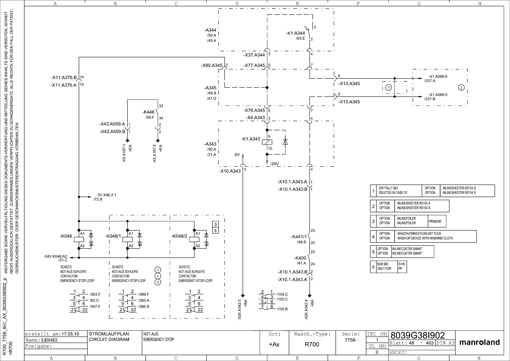

# +Ax — Sheet 48 of 403 — NOT AUS

**EMERGENCY STOP**

> Part of the manroland **R700** printing press IEC/UL circuit diagrams.
> Drawing class: **Stromlaufplan / Circuit diagram** (DIN A3).
> Document `+Ax` covers the **Central control console** machine section.

## At a glance

| Field | Value |
|---|---|
| Document | `+Ax`  (8039G38I902) |
| Sheet | **48** of 403 |
| Section (DE) | NOT AUS |
| Section (EN) | EMERGENCY STOP |
| Section type | CIRCUIT — Circuit diagram |
| Machine type | `R700` |
| Series | `7758` |
| Created | 17.05.10 |
| Replaces | — |
| Columns used | A, B, C, D, E, F, G, H |
| Path numbers | — |
| Labels on sheet | 188 |
| Cross-refs out | 23 |
| Cross-refs in | 46 |

**Previous:** [+Ax sheet 47](SHEET_0047.md) · **Next:** [+Ax sheet 49](SHEET_0049.md) · **Document TOC:** [_TOC.md](_TOC.md)  (+Ax) · **Master TOC:** [all sheets](../_MASTER_TOC.md)

## Sheet image (300 DPI, exact vector render)



_Rendered directly from the PDF vector layer at 300 DPI (1-bit), no OCR and no resampling. Use it to confirm anything ambiguous in the text below._

## Cross-references on this sheet

Each entry is a wire leaving this sheet. The printed token is `/sheet.column`; the link resolves to that sheet inside the same document.

| Ref | Target sheet | Col | Path | Destination on target | Target section | From col |
|---|---|---|---|---|---|---|
| `/50.A` | [+Ax sheet 50](SHEET_0050.md) | A | — | — | STOP SICHERN | D |
| `/45.A` | [+Ax sheet 45](SHEET_0045.md) | A | — | — | HAUPTANTRIEB | D |
| `/93.E` | [+Ax sheet 93](SHEET_0093.md) | E | — | — | ANLEGER | E |
| `/337.A` | [+Ax sheet 337](SHEET_0337.md) | A | — | — | OPTION: INLINESHEETER RS104 S | G |
| `/49.B` | [+Ax sheet 49](SHEET_0049.md) | B | — | — | NOT AUS | D |
| `/47.G` | [+Ax sheet 47](SHEET_0047.md) | G | — | — | NOT AUS | D |
| `/337.B` | [+Ax sheet 337](SHEET_0337.md) | B | — | — | OPTION: INLINESHEETER RS104 S | G |
| `/59.F` | [+Ax sheet 59](SHEET_0059.md) | F | — | — | DRUCKLUFTANLAGE | C |
| `/50.A` | [+Ax sheet 50](SHEET_0050.md) | A | — | — | STOP SICHERN | D |
| `/21.A` | [+Ax sheet 21](SHEET_0021.md) | A | — | — | SPANNUNGSVERSORGUNG, SCHALTSCHRANKBELÜFTUNG | D |
| `/72.B` | [+Ax sheet 72](SHEET_0072.md) | B | — | — | WASCHVORRICHTUNGEN DRUCKWERKE | B |
| `/49.B` | [+Ax sheet 49](SHEET_0049.md) | B | — | — | NOT AUS | E |
| `/21.C` | [+Ax sheet 21](SHEET_0021.md) | C | — | 24V.K048:A2 | SPANNUNGSVERSORGUNG, SCHALTSCHRANKBELÜFTUNG | A |
| `/47.A` | [+Ax sheet 47](SHEET_0047.md) | A | — | — | NOT AUS | E |
| `/363.F` | [+Ax sheet 363](SHEET_0363.md) | F | — | — | OPTION: LOGISTIK AUSLEGER | B |
| `/389.F` | [+Ax sheet 389](SHEET_0389.md) | F | — | — | OPTION: WASCHVORRICHTUNG MIT TUCH | B |
| `/154.C` | [+Ax sheet 154](SHEET_0154.md) | C | — | — | ÜBERWACHUNGSRECHNER/ANSTEUERUNG NOT AUS | E |
| `/155.C` | [+Ax sheet 155](SHEET_0155.md) | C | — | — | ÜBERWACHUNGSRECHNER/ANSTEUERUNG NOT AUS | E |
| `/383.A` | [+Ax sheet 383](SHEET_0383.md) | A | — | — | OPTION: INLINEFOILER PRINDOR | B |
| `/63.D` | [+Ax sheet 63](SHEET_0063.md) | D | — | — | DRUCKLUFTANLAGE | B |
| `/386.B` | [+Ax sheet 386](SHEET_0386.md) | B | — | — | OPTION: INLINECOATER SMART | B |
| `/347.F` | [+Ax sheet 347](SHEET_0347.md) | F | — | — | OPTION: LOGISTIK ANLEGER | B |
| `/155.B` | [+Ax sheet 155](SHEET_0155.md) | B | — | — | ÜBERWACHUNGSRECHNER/ANSTEUERUNG NOT AUS | E |

### Incoming references (sheets that point here)

Every other sheet that sends a wire to this one. `Back-ref` is the token printed on *that* sheet; `Path` is its line number.

| From sheet | Cols | Back-ref | Path | Refs | What continues there |
|---|---|---|---|---|---|
| [+Ax#21](SHEET_0021.md) | A, C | `/21.A`, `/21.C` | — | 2 | 24V.K048:A2; A343 |
| [+Ax#45](SHEET_0045.md) | A | `/45.A` | — | 1 | — |
| [+Ax#47](SHEET_0047.md) | A, G | `/47.A`, `/47.G` | — | 2 | — |
| [+Ax#49](SHEET_0049.md) | B | `/49.B` | — | 2 | — |
| [+Ax#50](SHEET_0050.md) | A | `/50.A` | — | 2 | — |
| [+Ax#59](SHEET_0059.md) | F | `/59.F` | — | 1 | — |
| [+Ax#63](SHEET_0063.md) | D | `/63.D` | — | 1 | — |
| [+Ax#72](SHEET_0072.md) | A | `/72.A` | — | 1 | 0V.X46.2:1 |
| [+Ax#93](SHEET_0093.md) | E | `/93.E` | — | 1 | — |
| [+Ax#154](SHEET_0154.md) | C | `/154.C` | — | 1 | — |
| [+Ax#155](SHEET_0155.md) | A, C | `/155.A`, `/155.C` | — | 2 | — |
| [+Ax#226](SHEET_0226.md) | G | `/226.G` | — | 2 | — |
| [+Ax#243](SHEET_0243.md) | G, H | `/243.G`, `/243.H` | — | 6 | — |
| [+Ax#247](SHEET_0247.md) | C, E | `/247.C`, `/247.E` | — | 2 | — |
| [+Ax#249](SHEET_0249.md) | G | `/249.G` | — | 2 | — |
| [+Ax#279](SHEET_0279.md) | F | `/279.F` | — | 2 | — |
| [+Ax#281](SHEET_0281.md) | F, G | `/281.F`, `/281.G` | — | 4 | — |
| [+Ax#285](SHEET_0285.md) | F, H | `/285.F`, `/285.H` | — | 4 | — |
| [+Ax#286](SHEET_0286.md) | C | `/286.C` | — | 1 | — |
| [+Ax#337](SHEET_0337.md) | A | `/337.A` | — | 2 | — |
| [+Ax#347](SHEET_0347.md) | F | `/347.F` | — | 1 | — |
| [+Ax#363](SHEET_0363.md) | E | `/363.E` | — | 1 | — |
| [+Ax#383](SHEET_0383.md) | A | `/383.A` | — | 1 | — |
| [+Ax#386](SHEET_0386.md) | B | `/386.B` | — | 1 | — |
| [+Ax#389](SHEET_0389.md) | F | `/389.F` | — | 1 | — |


## Devices on this sheet

| Tag | Class | Class meaning (IEC) | Col | Sub | Terminal | Sign |
|---|---|---|---|---|---|---|
| `K400` | K | Relais / relay, contactor | E | — | — | — |
| `K441/1` | K | Relais / relay, contactor | E | 1 | — | — |
| `A344` | A | Baugruppe / assembly, module, PC board | D | — | — | — |
| `A345` | A | Baugruppe / assembly, module, PC board | D | — | — | — |
| `A343` | A | Baugruppe / assembly, module, PC board | D | — | — | — |
| `A1` | A | Baugruppe / assembly, module, PC board | A | — | — | — |
| `A2` | A | Baugruppe / assembly, module, PC board | A | — | — | — |
| `K048` | K | Relais / relay, contactor | A | — | — | — |
| `A1` | A | Baugruppe / assembly, module, PC board | B | — | — | — |
| `A2` | A | Baugruppe / assembly, module, PC board | B | — | — | — |
| `K048/1` | K | Relais / relay, contactor | B | 1 | — | — |
| `A1` | A | Baugruppe / assembly, module, PC board | C | — | — | — |
| `A2` | A | Baugruppe / assembly, module, PC board | C | — | — | — |
| `K048/2` | K | Relais / relay, contactor | C | 2 | — | — |
| `K446` | K | Relais / relay, contactor | C | — | — | — |
| `X10.1.A343.B` | — | cross-device reference | E | — | — | — |
| `X10.1.A343.A` | — | cross-device reference | E | — | — | — |
| `X26.A342:4` | — | cross-device reference | E | — | 4 | — |
| `X26.A342:3` | — | cross-device reference | D | — | 3 | — |
| `K1.A344` | — | cross-device reference | E | — | — | — |
| `X37.A344` | — | cross-device reference | D | — | — | — |
| `X13.A345` | — | cross-device reference | F | — | — | — |
| `X13.A345` | — | cross-device reference | F | — | — | — |
| `X77.A345` | — | cross-device reference | D | — | — | — |
| `X76.A345` | — | cross-device reference | D | — | — | — |
| `X80.A345` | — | cross-device reference | D | — | — | — |
| `X4.A343` | — | cross-device reference | D | — | — | — |
| `X10.A343` | — | cross-device reference | D | — | — | — |
| `K1.A343` | — | cross-device reference | D | — | — | — |
| `X10.1.A343.B` | — | cross-device reference | E | — | — | — |
| `X10.1.A343.A` | — | cross-device reference | E | — | — | — |
| `X11.A376.B` | — | cross-device reference | A | — | — | — |
| `X11.A376.A` | — | cross-device reference | A | — | — | — |
| `X5.A187:2` | — | cross-device reference | C | — | 2 | — |
| `X5.A187:1` | — | cross-device reference | B | — | 1 | — |
| `X43.A559.B` | — | cross-device reference | B | — | — | — |
| `X43.A559.A` | — | cross-device reference | B | — | — | — |
| `X1.A066:5` | — | cross-device reference | G | — | 5 | — |
| `X1.A066:6` | — | cross-device reference | G | — | 6 | — |

## Potentials / nets

| Potential | Count | Columns | Attached devices | Terminals |
|---|---|---|---|---|
| `0V` | 2 | B, D | `2`, `X46` | `1` |
| `24V` | 2 | A, E | `K048` | `A2` |


A potential such as `L24+/4` or `M24+` is a named supply/return rail; every place it appears on this sheet is electrically common.

## Wire-end annotations (grouped as printed)

A wire that continues elsewhere is annotated with a small cluster: the destination description, the path/line number `#NN`, and the `/sheet.column` cross reference. Each row below is one such cluster exactly as it is grouped on the drawing.

| Col | Y | Path | Cross-ref | Text on the wire |
|---|---|---|---|---|
| E | 59.1 | — | — | `K1.A344 3` |
| E | 59.1 | — | — | `1` |
| D | 65.5 | — | — | `A344` |
| D | 78.6 | — | `/50.A`, `/45.A` | — |
| E | 85.6 | — | `/93.E` | — |
| E | 87.5 | — | — | `2` |
| E | 122.2 | — | — | `X37.A344 3 4` |
| D | 147.7 | — | — | `X80.A345 2` |
| E | 147.7 | — | — | `X77.A345 5 7` |
| F | 173.2 | — | — | `6` |
| G | 174.6 | — | — | `X1.A066:6` |
| A | 176.1 | — | — | `X11.A376.B 14` |
| G | 184.5 | — | `/337.A` | — |
| F | 190.2 | — | — | `X13.A345` |
| A | 193.1 | — | — | `X11.A376.A 14` |
| D | 200.1 | — | — | `A345` |
| G | 201.0 | — | — | `1` |
| H | 201.6 | — | — | `2` |
| D | 213.2 | — | `/49.B`, `/47.G` | — |
| F | 215.8 | — | — | `5` |
| G | 217.1 | — | — | `X1.A066:5` |
| G | 227.0 | — | `/337.B` | — |
| F | 232.8 | — | — | `X13.A345` |
| C | 243.4 | — | — | `33` |
| E | 252.6 | — | — | `X76.A345 5 7` |
| C | 256.8 | — | — | `K446 34` |
| D | 269.6 | — | — | `X4.A343 3` |
| C | 269.9 | — | `/59.F` | — |
| E | 272.4 | — | — | `4` |
| B | 284.5 | — | — | `X43.A559.A 1` |
| C | 286.6 | — | — | `2` |
| B | 302.2 | — | — | `X43.A559.B 1` |
| C | 303.6 | — | — | `2` |
| E | 314.3 | — | — | `9` |
| D | 319.2 | — | — | `K1.A343` |
| D | 331.2 | — | — | `A343` |
| B | 335.6 | — | — | `X5.A187:1` |
| C | 336.8 | — | — | `X5.A187:2` |
| B | 337.3 | — | — | `+EA` |
| C | 337.3 | — | — | `+EA` |
| E | 342.6 | — | — | `10` |
| D | 344.3 | — | `/50.A`, `/21.A` | — |
| D | 356.4 | — | — | `0V` |
| E | 377.6 | — | — | `24V` |
| D | 391.5 | — | — | `X10.A343 3` |
| E | 391.5 | — | — | `4` |
| E | 419.1 | — | — | `X10.1.A343.A 1` |
| G | 435.7 | — | — | `ENTFÄLLT BEI DELETED IN CASE OF` |
| G | 435.7 | — | — | `OPTION OPTION` |
| H | 435.7 | — | — | `INLINESHEETER RS104 S INLINESHEETER RS104 S` |
| E | 436.9 | — | — | `X10.1.A343.B 1` |
| F | 441.1 | — | — | `1` |
| B | 451.0 | — | — | `0V.X46.2:1` |
| B | 460.9 | — | `/72.B` | — |
| F | 471.1 | — | — | `OPTION OPTION` |
| G | 471.2 | — | — | `INLINESHEETER RS104 S INLINESHEETER RS104 S` |
| F | 476.5 | — | — | `2` |
| G | 506.6 | — | — | `3 OPTION OPTION INLINEFOILER INLINEFOILER PRINDOR` |
| D | 519.0 | — | — | `3` |
| E | 534.0 | — | — | `23` |
| D | 534.3 | — | — | `6` |
| A | 541.0 | — | — | `A1` |
| B | 541.0 | — | — | `A1` |
| C | 541.0 | — | — | `A1` |
| F | 542.0 | — | — | `OPTION OPTION` |
| G | 542.0 | — | — | `WASCHVORRICHTUNG MIT TUCH WASH UP DEVICE WITH WASHING CLOTH` |
| A | 546.0 | — | — | `K048` |
| B | 546.0 | — | — | `K048/1` |
| C | 546.0 | — | — | `K048/2` |
| E | 547.4 | — | — | `K441/1 24` |
| F | 547.4 | — | — | `4` |
| E | 560.5 | — | `/49.B` | — |
| A | 569.3 | — | — | `A2` |
| B | 569.3 | — | — | `A2` |
| C | 569.3 | — | — | `A2` |
| F | 577.5 | — | — | `5 OPTION OPTION` |
| G | 577.5 | — | — | `INLINECOATER SMART INLINECOATER SMART` |
| E | 583.5 | — | — | `23` |
| A | 594.1 | — | `/21.C` | `24V.K048:A2` |
| E | 597.0 | — | — | `K400 24` |
| E | 610.0 | — | `/47.A` | — |
| G | 612.8 | — | — | `PP S+W` |
| F | 612.9 | — | — | `6 NUR BEI` |
| A | 620.0 | — | — | `NOT AUS SCHLEIFE SCHÜTZ:` |
| B | 620.0 | — | — | `NOT AUS SCHLEIFE SCHÜTZ:` |
| C | 620.0 | — | — | `NOT AUS SCHLEIFE SCHÜTZ:` |
| F | 623.5 | — | — | `ONLY FOR` |
| C | 627.1 | — | — | `3` |
| E | 629.6 | — | — | `X10.1.A343.B 2` |
| A | 641.3 | — | — | `EMERGENCY STOP LOOP CONTACTOR:` |
| B | 641.3 | — | — | `EMERGENCY STOP LOOP CONTACTOR:` |
| C | 641.3 | — | — | `4` |
| C | 641.3 | — | — | `EMERGENCY STOP LOOP CONTACTOR:` |
| E | 646.6 | — | — | `X10.1.A343.A 2` |
| C | 655.5 | — | — | `5` |
| A | 674.9 | — | — | `21 3 5 1` |
| A | 674.9 | — | — | `2 4 6 22` |
| B | 674.9 | — | — | `21 3 5 1` |
| B | 674.9 | — | — | `2 4 6 22` |
| C | 674.9 | — | — | `21 3 5 1` |
| C | 674.9 | — | — | `2 4 6 22` |
| E | 676.3 | — | — | `2 4 5 7 1 3 8 6` |
| B | 682.7 | — | `/363.F` | — |
| B | 682.7 | — | `/389.F` | — |
| E | 682.7 | — | `/154.C`, `/155.C` | — |
| B | 696.9 | — | `/63.D` | — |
| B | 696.9 | — | `/383.A` | — |
| D | 698.5 | — | — | `X26.A342:3` |
| E | 698.5 | — | — | `X26.A342:4` |
| D | 698.7 | — | — | `+BA` |
| E | 698.7 | — | — | `+BA` |
| B | 711.0 | — | `/386.B` | — |
| B | 711.1 | — | `/347.F` | — |
| E | 716.7 | — | `/155.B` | — |


## Reconstructed tables

This sheet carries tabular content (pin map / terminal assignment / index). The grid below was rebuilt from the drawing's own rule lines, so each row is exactly one physical row of the table.

### Table 1 — 9 data rows × 13 columns (at x=184.3, y=34.0)

|  |  |  |  |  |  |  | A344 /50.A /45.A |  | X37.A344 | 3 | 1 K1.A344 /93.E | 2 4 |
|---|---|---|---|---|---|---|---|---|---|---|---|---|
| `14` |  |  |  |  |  |  | `X80.A345` | `2` | `X77.A345` | `5` |  | `7` |
| `14` |  |  |  |  |  |  |  |  |  |  |  |  |
|  |  |  |  |  |  |  | `A345 /49.B` |  |  |  |  |  |
|  |  |  |  |  |  |  | `/47.G` |  |  |  |  |  |
|  |  | `X43.A559.A` | `1` | `33 K446 /59.F 34 2` |  |  |  |  | `X76.A345 X4.A343` | `5 3` |  | `7 4` |
|  |  | `X43.A559.B X5.A187:1` | `1 +EA` | `2 X5.A187:2 +EA` |  |  | `A343 /50.A` |  | `K1.A343` | `9 10` |  |  |
|  | `0V.X46.2:1 /72.B` |  |  |  |  |  | `/21.A` | `0V X10.A343` | `3` | `24V` | `X10.1.A343.A X10.1.A343.B` | `4 1 1` |
| `A1 A2` |  | `K048/1` | `A1 A2` |  | `K048/2` | `A1 A2` | `3 6` |  |  |  | `K441/1 /49.B` |  |
| `SCHLEIFE LOOP 2 4 6 22` | `/363.F /63.D /347.F` | `SCHÜTZ: NOT AUS CONTACTOR: EMERGENCY STOP 1 3 5 21` | `SCHLEIFE 2 4 6 22` | `3 4 LOOP 5 /389.F /383.A /386.B` | `SCHÜTZ: NOT AUS CONTACTOR: EMERGENCY STOP 1 3 5 21` | `SCHLEIFE 2 4 6 22` | `LOOP` | `X26.A342:3` | `2 4 +BA 5 7` | `1 /154.C 3 /155.C 6 8 /155.B` | `K400 /47.A X10.1.A343.B X10.1.A343.A X26.A342:4` | `2 2 +BA` |


## Notes and free text on this sheet

| Text | Col | Y (pt) |
|---|---|---|
| `+BA` | E | 698.74 |
| `+BA` | D | 698.74 |
| `SCHÜTZ:` | A | 619.98 |
| `NOT AUS SCHLEIFE` | A | 630.62 |
| `CONTACTOR:` | A | 641.27 |
| `EMERGENCY STOP LOOP` | A | 651.9 |
| `SCHÜTZ:` | B | 619.98 |
| `NOT AUS SCHLEIFE` | B | 630.62 |
| `CONTACTOR:` | B | 641.27 |
| `EMERGENCY STOP LOOP` | B | 651.9 |
| `SCHÜTZ:` | C | 619.98 |
| `NOT AUS SCHLEIFE` | C | 630.62 |
| `CONTACTOR:` | C | 641.27 |
| `EMERGENCY STOP LOOP` | C | 651.9 |
| `+EA` | C | 337.32 |
| `+EA` | B | 337.32 |
| `ENTFÄLLT BEI` | F | 435.71 |
| `DELETED IN CASE OF` | G | 446.36 |
| `OPTION` | F | 471.15 |
| `OPTION` | G | 435.72 |
| `INLINESHEETER RS104 S` | H | 435.74 |
| `INLINESHEETER RS104 S` | G | 471.17 |
| `INLINEFOILER` | G | 506.6 |
| `PRINDOR` | G | 513.7 |
| `INLINECOATER SMART` | G | 577.48 |
| `WASCHVORRICHTUNG MIT TUCH` | G | 542.05 |
| `WASH UP DEVICE WITH WASHING CLOTH` | G | 552.64 |
| `NUR BEI` | F | 612.86 |
| `ONLY FOR` | F | 623.55 |
| `S+W` | G | 612.77 |
| `PP` | G | 623.4 |

## Complete label inventory (exact text from the drawing)

Every text object inside the drawing area of this sheet, in DIN reading order (column A→H, then top→bottom). This is the authoritative list: if a string is not here it is not printed on this sheet.

| Col | Y | X | Dir | Type | Text |
|---|---|---|---|---|---|
| A | 176.1 | 119.1 | → | device ref | `X11.A376.B` |
| A | 176.1 | 186.2 | → | number | `14` |
| A | 193.1 | 186.2 | → | number | `14` |
| A | 193.8 | 118.2 | → | device ref | `X11.A376.A` |
| A | 541.0 | 187.1 | → | device tag | `A1` |
| A | 546.0 | 139.5 | → | device tag | `K048` |
| A | 569.3 | 187.1 | → | device tag | `A2` |
| A | 594.1 | 101.8 | → | potential | `24V.K048:A2` |
| A | 602.6 | 136.6 | → | cross-reference | `/21.C` |
| A | 620.0 | 141.4 | → | text | `SCHÜTZ:` |
| A | 630.6 | 140.9 | → | text | `NOT AUS SCHLEIFE` |
| A | 641.3 | 141.4 | → | text | `CONTACTOR:` |
| A | 651.9 | 140.9 | → | text | `EMERGENCY STOP LOOP` |
| A | 674.9 | 171.8 | → | number | `1` |
| A | 674.9 | 192.5 | → | number | `2` |
| A | 689.1 | 170.4 | → | number | `3` |
| A | 689.1 | 192.5 | → | number | `4` |
| A | 703.3 | 170.4 | → | number | `5` |
| A | 703.3 | 192.5 | → | number | `6` |
| A | 717.4 | 165.8 | → | number | `21` |
| A | 717.4 | 192.5 | → | number | `22` |
| B | 284.5 | 231.6 | → | device ref | `X43.A559.A` |
| B | 286.6 | 299.6 | → | number | `1` |
| B | 302.2 | 232.4 | → | device ref | `X43.A559.B` |
| B | 303.6 | 299.6 | → | number | `1` |
| B | 335.6 | 285.9 | ↕ | device ref | `X5.A187:1` |
| B | 337.3 | 300.0 | ↕ | text | `+EA` |
| B | 451.0 | 227.9 | → | potential | `0V.X46.2:1` |
| B | 460.9 | 218.3 | → | cross-reference | `/72.B` |
| B | 541.0 | 300.5 | → | device tag | `A1` |
| B | 546.0 | 245.5 | → | device tag | `K048/1` |
| B | 569.3 | 300.5 | → | device tag | `A2` |
| B | 620.0 | 261.9 | → | text | `SCHÜTZ:` |
| B | 630.6 | 261.4 | → | text | `NOT AUS SCHLEIFE` |
| B | 641.3 | 261.9 | → | text | `CONTACTOR:` |
| B | 651.9 | 261.4 | → | text | `EMERGENCY STOP LOOP` |
| B | 674.9 | 285.2 | → | number | `1` |
| B | 674.9 | 305.9 | → | number | `2` |
| B | 682.7 | 209.8 | → | cross-reference | `/363.F` |
| B | 682.7 | 323.1 | → | cross-reference | `/389.F` |
| B | 689.1 | 283.7 | → | number | `3` |
| B | 689.1 | 305.9 | → | number | `4` |
| B | 696.9 | 209.8 | → | cross-reference | `/63.D` |
| B | 696.9 | 323.1 | → | cross-reference | `/383.A` |
| B | 703.3 | 283.7 | → | number | `5` |
| B | 703.3 | 305.9 | → | number | `6` |
| B | 711.1 | 209.8 | → | cross-reference | `/347.F` |
| B | 711.1 | 323.1 | → | cross-reference | `/386.B` |
| B | 717.4 | 279.2 | → | number | `21` |
| B | 717.4 | 305.9 | → | number | `22` |
| C | 243.4 | 371.1 | → | number | `33` |
| C | 256.8 | 332.2 | → | device tag | `K446` |
| C | 269.9 | 340.2 | → | cross-reference | `/59.F` |
| C | 271.7 | 371.1 | → | number | `34` |
| C | 286.6 | 371.1 | → | number | `2` |
| C | 303.6 | 371.1 | → | number | `2` |
| C | 336.8 | 356.7 | ↕ | device ref | `X5.A187:2` |
| C | 337.3 | 370.9 | ↕ | text | `+EA` |
| C | 541.0 | 456.4 | → | device tag | `A1` |
| C | 546.0 | 400.0 | → | device tag | `K048/2` |
| C | 569.3 | 456.4 | → | device tag | `A2` |
| C | 620.0 | 417.8 | → | text | `SCHÜTZ:` |
| C | 627.1 | 366.8 | → | number | `3` |
| C | 630.6 | 417.3 | → | text | `NOT AUS SCHLEIFE` |
| C | 641.3 | 366.8 | → | number | `4` |
| C | 641.3 | 417.8 | → | text | `CONTACTOR:` |
| C | 651.9 | 417.3 | → | text | `EMERGENCY STOP LOOP` |
| C | 655.5 | 366.8 | → | number | `5` |
| C | 674.9 | 441.1 | → | number | `1` |
| C | 674.9 | 461.8 | → | number | `2` |
| C | 689.1 | 439.7 | → | number | `3` |
| C | 689.1 | 461.8 | → | number | `4` |
| C | 703.3 | 439.7 | → | number | `5` |
| C | 703.3 | 461.8 | → | number | `6` |
| C | 717.4 | 435.1 | → | number | `21` |
| C | 717.4 | 461.8 | → | number | `22` |
| D | 65.5 | 476.8 | → | device tag | `A344` |
| D | 78.6 | 483.9 | → | cross-reference | `/50.A` |
| D | 91.0 | 483.9 | → | cross-reference | `/45.A` |
| D | 123.6 | 568.3 | → | device ref | `X37.A344` |
| D | 147.7 | 469.1 | → | device ref | `X80.A345` |
| D | 147.7 | 527.0 | → | number | `2` |
| D | 147.7 | 568.3 | → | device ref | `X77.A345` |
| D | 200.1 | 476.8 | → | device tag | `A345` |
| D | 213.2 | 484.2 | → | cross-reference | `/49.B` |
| D | 225.6 | 483.6 | → | cross-reference | `/47.G` |
| D | 252.6 | 568.3 | → | device ref | `X76.A345` |
| D | 269.6 | 574.3 | → | device ref | `X4.A343` |
| D | 319.2 | 563.0 | → | device ref | `K1.A343` |
| D | 331.2 | 476.8 | → | device tag | `A343` |
| D | 344.3 | 483.9 | → | cross-reference | `/50.A` |
| D | 356.4 | 547.7 | → | potential | `0V` |
| D | 356.7 | 483.9 | → | cross-reference | `/21.A` |
| D | 391.5 | 569.5 | → | number | `3` |
| D | 394.3 | 511.7 | → | device ref | `X10.A343` |
| D | 519.0 | 500.2 | → | number | `3` |
| D | 534.3 | 501.1 | → | number | `6` |
| D | 676.3 | 609.7 | → | number | `2` |
| D | 687.7 | 609.7 | → | number | `4` |
| D | 698.5 | 555.2 | ↕ | device ref | `X26.A342:3` |
| D | 698.7 | 569.3 | ↕ | text | `+BA` |
| D | 699.0 | 609.7 | → | number | `5` |
| D | 710.3 | 609.7 | → | number | `7` |
| E | 59.1 | 709.8 | → | number | `1` |
| E | 59.1 | 732.5 | → | number | `3` |
| E | 72.6 | 667.8 | → | device ref | `K1.A344` |
| E | 85.6 | 691.4 | → | cross-reference | `/93.E` |
| E | 87.5 | 725.4 | → | number | `2` |
| E | 122.2 | 626.2 | → | number | `3` |
| E | 122.2 | 725.4 | → | number | `4` |
| E | 147.7 | 626.2 | → | number | `5` |
| E | 147.7 | 725.4 | → | number | `7` |
| E | 254.0 | 626.2 | → | number | `5` |
| E | 254.0 | 725.4 | → | number | `7` |
| E | 272.5 | 626.2 | → | number | `3` |
| E | 272.5 | 725.4 | → | number | `4` |
| E | 314.3 | 626.2 | → | number | `9` |
| E | 342.6 | 625.6 | → | number | `10` |
| E | 377.6 | 630.4 | → | potential | `24V` |
| E | 391.5 | 725.4 | → | number | `4` |
| E | 419.1 | 648.0 | → | device ref | `X10.1.A343.A` |
| E | 421.3 | 724.8 | → | number | `1` |
| E | 436.9 | 648.9 | → | device ref | `X10.1.A343.B` |
| E | 438.3 | 724.8 | → | number | `1` |
| E | 533.9 | 725.4 | → | number | `23` |
| E | 547.4 | 679.2 | → | device tag | `K441/1` |
| E | 560.4 | 693.9 | → | cross-reference | `/49.B` |
| E | 562.3 | 725.4 | → | number | `24` |
| E | 583.6 | 725.4 | → | number | `23` |
| E | 597.0 | 686.6 | → | device tag | `K400` |
| E | 610.1 | 693.6 | → | cross-reference | `/47.A` |
| E | 611.9 | 725.4 | → | number | `24` |
| E | 629.6 | 648.9 | → | device ref | `X10.1.A343.B` |
| E | 629.6 | 725.4 | → | number | `2` |
| E | 646.6 | 725.4 | → | number | `2` |
| E | 647.3 | 648.0 | → | device ref | `X10.1.A343.A` |
| E | 676.3 | 631.0 | → | number | `1` |
| E | 682.7 | 646.3 | → | cross-reference | `/154.C` |
| E | 687.7 | 631.6 | → | number | `3` |
| E | 694.1 | 646.3 | → | cross-reference | `/155.C` |
| E | 698.5 | 711.1 | ↕ | device ref | `X26.A342:4` |
| E | 698.7 | 725.2 | ↕ | text | `+BA` |
| E | 699.0 | 631.8 | → | number | `6` |
| E | 710.3 | 631.6 | → | number | `8` |
| E | 716.7 | 646.3 | → | cross-reference | `/155.B` |
| F | 173.2 | 789.2 | → | number | `6` |
| F | 190.2 | 790.0 | → | device ref | `X13.A345` |
| F | 215.8 | 789.2 | → | number | `5` |
| F | 232.7 | 790.0 | → | device ref | `X13.A345` |
| F | 435.7 | 885.0 | → | text | `ENTFÄLLT BEI` |
| F | 441.1 | 869.1 | → | number | `1` |
| F | 471.1 | 885.5 | → | text | `OPTION` |
| F | 476.5 | 868.8 | → | number | `2` |
| F | 481.8 | 885.5 | → | text | `OPTION` |
| F | 506.6 | 885.5 | → | text | `OPTION` |
| F | 511.9 | 868.7 | → | number | `3` |
| F | 517.2 | 885.5 | → | text | `OPTION` |
| F | 542.0 | 885.5 | → | text | `OPTION` |
| F | 547.4 | 868.8 | → | number | `4` |
| F | 552.6 | 885.5 | → | text | `OPTION` |
| F | 577.4 | 881.3 | → | text | `OPTION` |
| F | 582.8 | 868.7 | → | number | `5` |
| F | 588.1 | 881.3 | → | text | `OPTION` |
| F | 612.9 | 880.7 | → | text | `NUR BEI` |
| F | 619.3 | 869.6 | → | number | `6` |
| F | 623.6 | 881.3 | → | text | `ONLY FOR` |
| G | 174.6 | 1000.3 | → | device ref | `X1.A066:6` |
| G | 184.5 | 990.7 | → | cross-reference | `/337.A` |
| G | 201.0 | 905.3 | → | number | `1` |
| G | 217.1 | 1000.3 | → | device ref | `X1.A066:5` |
| G | 227.0 | 990.7 | → | cross-reference | `/337.B` |
| G | 435.7 | 991.8 | → | text | `OPTION` |
| G | 446.3 | 991.8 | → | text | `OPTION` |
| G | 446.4 | 885.0 | → | text | `DELETED IN CASE OF` |
| G | 471.2 | 927.5 | → | text | `INLINESHEETER RS104 S` |
| G | 481.8 | 927.5 | → | text | `INLINESHEETER RS104 S` |
| G | 506.6 | 927.5 | → | text | `INLINEFOILER` |
| G | 513.7 | 1001.2 | → | text | `PRINDOR` |
| G | 517.2 | 927.5 | → | text | `INLINEFOILER` |
| G | 542.0 | 928.3 | → | text | `WASCHVORRICHTUNG MIT TUCH` |
| G | 552.6 | 928.3 | → | text | `WASH UP DEVICE WITH WASHING CLOTH` |
| G | 577.5 | 916.2 | → | text | `INLINECOATER SMART` |
| G | 588.1 | 916.2 | → | text | `INLINECOATER SMART` |
| G | 612.8 | 930.9 | → | text | `S+W` |
| G | 623.4 | 930.3 | → | text | `PP` |
| H | 201.6 | 1075.2 | → | number | `2` |
| H | 435.7 | 1033.8 | → | text | `INLINESHEETER RS104 S` |
| H | 446.4 | 1033.8 | → | text | `INLINESHEETER RS104 S` |

## Reading-order text block

The same content as a plain block, grouped by DIN column — convenient to paste or to match against a visual description.

```text
=== Column A ===
 176.1  119.1  devref       X11.A376.B
 176.1  186.2  numeric      14
 193.1  186.2  numeric      14
 193.8  118.2  devref       X11.A376.A
 541.0  187.1  devtag       A1
 546.0  139.5  devtag       K048
 569.3  187.1  devtag       A2
 594.1  101.8  net          24V.K048:A2
 602.6  136.6  xref         /21.C
 620.0  141.4  text         SCHÜTZ:
 630.6  140.9  text         NOT AUS SCHLEIFE
 641.3  141.4  text         CONTACTOR:
 651.9  140.9  text         EMERGENCY STOP LOOP
 674.9  171.8  numeric      1
 674.9  192.5  numeric      2
 689.1  170.4  numeric      3
 689.1  192.5  numeric      4
 703.3  170.4  numeric      5
 703.3  192.5  numeric      6
 717.4  165.8  numeric      21
 717.4  192.5  numeric      22
=== Column B ===
 284.5  231.6  devref       X43.A559.A
 286.6  299.6  numeric      1
 302.2  232.4  devref       X43.A559.B
 303.6  299.6  numeric      1
 335.6  285.9  devref       X5.A187:1
 337.3  300.0  text         +EA
 451.0  227.9  net          0V.X46.2:1
 460.9  218.3  xref         /72.B
 541.0  300.5  devtag       A1
 546.0  245.5  devtag       K048/1
 569.3  300.5  devtag       A2
 620.0  261.9  text         SCHÜTZ:
 630.6  261.4  text         NOT AUS SCHLEIFE
 641.3  261.9  text         CONTACTOR:
 651.9  261.4  text         EMERGENCY STOP LOOP
 674.9  285.2  numeric      1
 674.9  305.9  numeric      2
 682.7  209.8  xref         /363.F
 682.7  323.1  xref         /389.F
 689.1  283.7  numeric      3
 689.1  305.9  numeric      4
 696.9  209.8  xref         /63.D
 696.9  323.1  xref         /383.A
 703.3  283.7  numeric      5
 703.3  305.9  numeric      6
 711.1  209.8  xref         /347.F
 711.1  323.1  xref         /386.B
 717.4  279.2  numeric      21
 717.4  305.9  numeric      22
=== Column C ===
 243.4  371.1  numeric      33
 256.8  332.2  devtag       K446
 269.9  340.2  xref         /59.F
 271.7  371.1  numeric      34
 286.6  371.1  numeric      2
 303.6  371.1  numeric      2
 336.8  356.7  devref       X5.A187:2
 337.3  370.9  text         +EA
 541.0  456.4  devtag       A1
 546.0  400.0  devtag       K048/2
 569.3  456.4  devtag       A2
 620.0  417.8  text         SCHÜTZ:
 627.1  366.8  numeric      3
 630.6  417.3  text         NOT AUS SCHLEIFE
 641.3  366.8  numeric      4
 641.3  417.8  text         CONTACTOR:
 651.9  417.3  text         EMERGENCY STOP LOOP
 655.5  366.8  numeric      5
 674.9  441.1  numeric      1
 674.9  461.8  numeric      2
 689.1  439.7  numeric      3
 689.1  461.8  numeric      4
 703.3  439.7  numeric      5
 703.3  461.8  numeric      6
 717.4  435.1  numeric      21
 717.4  461.8  numeric      22
=== Column D ===
  65.5  476.8  devtag       A344
  78.6  483.9  xref         /50.A
  91.0  483.9  xref         /45.A
 123.6  568.3  devref       X37.A344
 147.7  469.1  devref       X80.A345
 147.7  527.0  numeric      2
 147.7  568.3  devref       X77.A345
 200.1  476.8  devtag       A345
 213.2  484.2  xref         /49.B
 225.6  483.6  xref         /47.G
 252.6  568.3  devref       X76.A345
 269.6  574.3  devref       X4.A343
 319.2  563.0  devref       K1.A343
 331.2  476.8  devtag       A343
 344.3  483.9  xref         /50.A
 356.4  547.7  net          0V
 356.7  483.9  xref         /21.A
 391.5  569.5  numeric      3
 394.3  511.7  devref       X10.A343
 519.0  500.2  numeric      3
 534.3  501.1  numeric      6
 676.3  609.7  numeric      2
 687.7  609.7  numeric      4
 698.5  555.2  devref       X26.A342:3
 698.7  569.3  text         +BA
 699.0  609.7  numeric      5
 710.3  609.7  numeric      7
=== Column E ===
  59.1  709.8  numeric      1
  59.1  732.5  numeric      3
  72.6  667.8  devref       K1.A344
  85.6  691.4  xref         /93.E
  87.5  725.4  numeric      2
 122.2  626.2  numeric      3
 122.2  725.4  numeric      4
 147.7  626.2  numeric      5
 147.7  725.4  numeric      7
 254.0  626.2  numeric      5
 254.0  725.4  numeric      7
 272.5  626.2  numeric      3
 272.5  725.4  numeric      4
 314.3  626.2  numeric      9
 342.6  625.6  numeric      10
 377.6  630.4  net          24V
 391.5  725.4  numeric      4
 419.1  648.0  devref       X10.1.A343.A
 421.3  724.8  numeric      1
 436.9  648.9  devref       X10.1.A343.B
 438.3  724.8  numeric      1
 533.9  725.4  numeric      23
 547.4  679.2  devtag       K441/1
 560.4  693.9  xref         /49.B
 562.3  725.4  numeric      24
 583.6  725.4  numeric      23
 597.0  686.6  devtag       K400
 610.1  693.6  xref         /47.A
 611.9  725.4  numeric      24
 629.6  648.9  devref       X10.1.A343.B
 629.6  725.4  numeric      2
 646.6  725.4  numeric      2
 647.3  648.0  devref       X10.1.A343.A
 676.3  631.0  numeric      1
 682.7  646.3  xref         /154.C
 687.7  631.6  numeric      3
 694.1  646.3  xref         /155.C
 698.5  711.1  devref       X26.A342:4
 698.7  725.2  text         +BA
 699.0  631.8  numeric      6
 710.3  631.6  numeric      8
 716.7  646.3  xref         /155.B
=== Column F ===
 173.2  789.2  numeric      6
 190.2  790.0  devref       X13.A345
 215.8  789.2  numeric      5
 232.7  790.0  devref       X13.A345
 435.7  885.0  text         ENTFÄLLT BEI
 441.1  869.1  numeric      1
 471.1  885.5  text         OPTION
 476.5  868.8  numeric      2
 481.8  885.5  text         OPTION
 506.6  885.5  text         OPTION
 511.9  868.7  numeric      3
 517.2  885.5  text         OPTION
 542.0  885.5  text         OPTION
 547.4  868.8  numeric      4
 552.6  885.5  text         OPTION
 577.4  881.3  text         OPTION
 582.8  868.7  numeric      5
 588.1  881.3  text         OPTION
 612.9  880.7  text         NUR BEI
 619.3  869.6  numeric      6
 623.6  881.3  text         ONLY FOR
=== Column G ===
 174.6 1000.3  devref       X1.A066:6
 184.5  990.7  xref         /337.A
 201.0  905.3  numeric      1
 217.1 1000.3  devref       X1.A066:5
 227.0  990.7  xref         /337.B
 435.7  991.8  text         OPTION
 446.3  991.8  text         OPTION
 446.4  885.0  text         DELETED IN CASE OF
 471.2  927.5  text         INLINESHEETER RS104 S
 481.8  927.5  text         INLINESHEETER RS104 S
 506.6  927.5  text         INLINEFOILER
 513.7 1001.2  text         PRINDOR
 517.2  927.5  text         INLINEFOILER
 542.0  928.3  text         WASCHVORRICHTUNG MIT TUCH
 552.6  928.3  text         WASH UP DEVICE WITH WASHING CLOTH
 577.5  916.2  text         INLINECOATER SMART
 588.1  916.2  text         INLINECOATER SMART
 612.8  930.9  text         S+W
 623.4  930.3  text         PP
=== Column H ===
 201.6 1075.2  numeric      2
 435.7 1033.8  text         INLINESHEETER RS104 S
 446.4 1033.8  text         INLINESHEETER RS104 S
```

---
_Generated from the PDF vector text layer; no OCR. Source: `R700_7758_IEC_AX_8039G38I902_p`, sheet 48._
