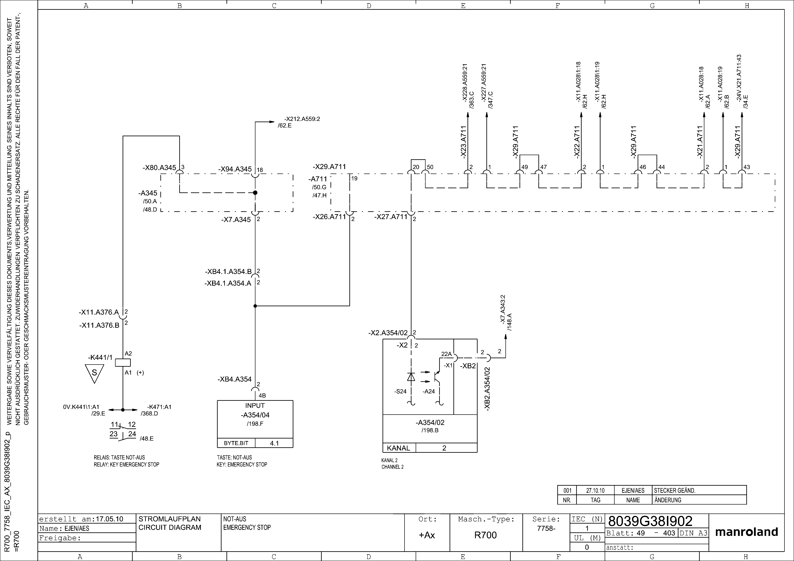

# +Ax — Sheet 49 of 403 — NOT AUS

**EMERGENCY STOP**

> Part of the manroland **R700** printing press IEC/UL circuit diagrams.
> Drawing class: **Stromlaufplan / Circuit diagram** (DIN A3).
> Document `+Ax` covers the **Central control console** machine section.

## At a glance

| Field | Value |
|---|---|
| Document | `+Ax`  (8039G38I902) |
| Sheet | **49** of 403 |
| Section (DE) | NOT AUS |
| Section (EN) | EMERGENCY STOP |
| Section type | CIRCUIT — Circuit diagram |
| Machine type | `R700` |
| Series | `7758` |
| Created | 17.05.10 |
| Replaces | — |
| Columns used | A, B, C, D, E, F, G, H |
| Path numbers | — |
| Labels on sheet | 115 |
| Cross-refs out | 18 |
| Cross-refs in | 44 |

**Previous:** [+Ax sheet 48](SHEET_0048.md) · **Next:** [+Ax sheet 50](SHEET_0050.md) · **Document TOC:** [_TOC.md](_TOC.md)  (+Ax) · **Master TOC:** [all sheets](../_MASTER_TOC.md)

## Sheet image (300 DPI, exact vector render)



_Rendered directly from the PDF vector layer at 300 DPI (1-bit), no OCR and no resampling. Use it to confirm anything ambiguous in the text below._

## Cross-references on this sheet

Each entry is a wire leaving this sheet. The printed token is `/sheet.column`; the link resolves to that sheet inside the same document.

| Ref | Target sheet | Col | Path | Destination on target | Target section | From col |
|---|---|---|---|---|---|---|
| `/34.E` | [+Ax sheet 34](SHEET_0034.md) | E | — | 24V.X21.A711:43 | SPANNUNGSVERSORGUNG, SCHALTSCHRANKBELÜFTUNG | H |
| `/62.H` | [+Ax sheet 62](SHEET_0062.md) | H | — | X11.A028\1:18 | DRUCKLUFTANLAGE | F |
| `/62.H` | [+Ax sheet 62](SHEET_0062.md) | H | — | X11.A028\1:19 | DRUCKLUFTANLAGE | F |
| `/363.C` | [+Ax sheet 363](SHEET_0363.md) | C | — | X228.A559:21 | OPTION: LOGISTIK AUSLEGER | E |
| `/347.C` | [+Ax sheet 347](SHEET_0347.md) | C | — | X227.A559:21 | OPTION: LOGISTIK ANLEGER | E |
| `/62.A` | [+Ax sheet 62](SHEET_0062.md) | A | — | X11.A028:18 | DRUCKLUFTANLAGE | H |
| `/62.B` | [+Ax sheet 62](SHEET_0062.md) | B | — | X11.A028:19 | DRUCKLUFTANLAGE | H |
| `/62.E` | [+Ax sheet 62](SHEET_0062.md) | E | — | — | DRUCKLUFTANLAGE | C |
| `/50.G` | [+Ax sheet 50](SHEET_0050.md) | G | — | — | STOP SICHERN | C |
| `/47.H` | [+Ax sheet 47](SHEET_0047.md) | H | — | — | NOT AUS | C |
| `/50.A` | [+Ax sheet 50](SHEET_0050.md) | A | — | — | STOP SICHERN | B |
| `/48.D` | [+Ax sheet 48](SHEET_0048.md) | D | — | — | NOT AUS | B |
| `/148.A` | [+Ax sheet 148](SHEET_0148.md) | A | — | X7.A343:2 | ÜBERWACHUNGSRECHNER SICHERHEITSBUS | E |
| `/29.E` | [+Ax sheet 29](SHEET_0029.md) | E | — | 0V.K441\1:A1 | SPANNUNGSVERSORGUNG, SCHALTSCHRANKBELÜFTUNG | A |
| `/368.D` | [+Ax sheet 368](SHEET_0368.md) | D | — | — | OPTION: LOGISTIK AUSLEGER | B |
| `/198.F` | [+Ax sheet 198](SHEET_0198.md) | F | — | — | REFERENZMODUL | C |
| `/198.B` | [+Ax sheet 198](SHEET_0198.md) | B | — | — | REFERENZMODUL | E |
| `/48.E` | [+Ax sheet 48](SHEET_0048.md) | E | — | — | NOT AUS | B |

### Incoming references (sheets that point here)

Every other sheet that sends a wire to this one. `Back-ref` is the token printed on *that* sheet; `Path` is its line number.

| From sheet | Cols | Back-ref | Path | Refs | What continues there |
|---|---|---|---|---|---|
| [+Ax#29](SHEET_0029.md) | E | `/29.E` | — | 1 | — |
| [+Ax#34](SHEET_0034.md) | E | `/34.E` | — | 1 | — |
| [+Ax#47](SHEET_0047.md) | H | `/47.H` | — | 1 | A711 |
| [+Ax#48](SHEET_0048.md) | D, E | `/48.D`, `/48.E` | — | 2 | — |
| [+Ax#50](SHEET_0050.md) | A, G | `/50.A`, `/50.G` | — | 2 | A711 |
| [+Ax#62](SHEET_0062.md) | A, D, H | `/62.A`, `/62.D`, `/62.H` | — | 5 | X212.A559:2 |
| [+Ax#148](SHEET_0148.md) | A | `/148.A` | — | 1 | X7.A343:2 |
| [+Ax#198](SHEET_0198.md) | B, F | `/198.B`, `/198.F` | — | 2 | — |
| [+Ax#219](SHEET_0219.md) | C, E | `/219.C`, `/219.E` | — | 2 | — |
| [+Ax#228](SHEET_0228.md) | A, B, C | `/228.A`, `/228.B`, `/228.C` | — | 3 | — |
| [+Ax#235](SHEET_0235.md) | H | `/235.H` | — | 1 | — |
| [+Ax#247](SHEET_0247.md) | C, E | `/247.C`, `/247.E` | — | 2 | — |
| [+Ax#261](SHEET_0261.md) | G | `/261.G` | — | 2 | — |
| [+Ax#263](SHEET_0263.md) | F | `/263.F` | — | 2 | — |
| [+Ax#265](SHEET_0265.md) | E | `/265.E` | — | 2 | — |
| [+Ax#269](SHEET_0269.md) | H | `/269.H` | — | 1 | — |
| [+Ax#271](SHEET_0271.md) | A | `/271.A` | — | 1 | — |
| [+Ax#274](SHEET_0274.md) | A, B | `/274.A`, `/274.B` | — | 8 | — |
| [+Ax#286](SHEET_0286.md) | C | `/286.C` | — | 1 | — |
| [+Ax#289](SHEET_0289.md) | H | `/289.H` | — | 1 | — |
| [+Ax#347](SHEET_0347.md) | B | `/347.B` | — | 1 | — |
| [+Ax#363](SHEET_0363.md) | C | `/363.C` | — | 1 | X228.A559:21 |
| [+Ax#368](SHEET_0368.md) | C | `/368.C` | — | 1 | K471:A1 |


## Devices on this sheet

| Tag | Class | Class meaning (IEC) | Col | Sub | Terminal | Sign |
|---|---|---|---|---|---|---|
| `A2` | A | Baugruppe / assembly, module, PC board | A | — | — | — |
| `A1` | A | Baugruppe / assembly, module, PC board | A | — | — | — |
| `K441/1` | K | Relais / relay, contactor | A | 1 | — | — |
| `S24` | S | Schalter / switch | D | — | — | — |
| `A24` | A | Baugruppe / assembly, module, PC board | E | — | — | — |
| `X1` | X | Klemme / terminal, plug connector | E | — | — | — |
| `X2` | X | Klemme / terminal, plug connector | D | — | — | — |
| `XB2` | XB |  | E | — | — | — |
| `A354/02` | A | Baugruppe / assembly, module, PC board | E | 02 | — | — |
| `A354/04` | A | Baugruppe / assembly, module, PC board | C | 04 | — | — |
| `A345` | A | Baugruppe / assembly, module, PC board | B | — | — | — |
| `A711` | A | Baugruppe / assembly, module, PC board | C | — | — | — |
| `K471:A1` | K | Relais / relay, contactor | B | — | A1 | — |
| `X11.A376.A` | — | cross-device reference | A | — | — | — |
| `X11.A376.B` | — | cross-device reference | A | — | — | — |
| `XB4.1.A354.B` | — | cross-device reference | C | — | — | — |
| `XB4.1.A354.A` | — | cross-device reference | C | — | — | — |
| `4.1` | — | cross-device reference | C | — | — | — |
| `XB4.A354` | — | cross-device reference | C | — | — | — |
| `X80.A345` | — | cross-device reference | B | — | — | — |
| `X94.A345` | — | cross-device reference | C | — | — | — |
| `X7.A345` | — | cross-device reference | C | — | — | — |
| `X26.A711` | — | cross-device reference | D | — | — | — |
| `X27.A711` | — | cross-device reference | D | — | — | — |
| `X29.A711` | — | cross-device reference | H | — | — | — |
| `X21.A711` | — | cross-device reference | H | — | — | — |
| `X23.A711` | — | cross-device reference | E | — | — | — |
| `X29.A711` | — | cross-device reference | F | — | — | — |
| `X22.A711` | — | cross-device reference | F | — | — | — |
| `X29.A711` | — | cross-device reference | G | — | — | — |
| `NR.` | — | cross-device reference | F | — | — | — |
| `27.10.10` | — | cross-device reference | F | — | — | — |
| `X7.A343:2` | — | cross-device reference | E | — | 2 | — |
| `X212.A559:2` | — | cross-device reference | C | — | 2 | — |
| `X11.A028\1:19` | — | cross-device reference | F | — | 19 | — |
| `X11.A028:18` | — | cross-device reference | H | — | 18 | — |
| `X11.A028:19` | — | cross-device reference | H | — | 19 | — |
| `X11.A028\1:18` | — | cross-device reference | F | — | 18 | — |
| `X228.A559:21` | — | cross-device reference | E | — | 21 | — |
| `X227.A559:21` | — | cross-device reference | E | — | 21 | — |
| `X29.A711` | — | cross-device reference | D | — | — | — |

## Potentials / nets

| Potential | Count | Columns | Attached devices | Terminals |
|---|---|---|---|---|
| `0V` | 1 | A | `K441\1` | `A1` |
| `24V` | 1 | H | `A711`, `X21` | `43` |


A potential such as `L24+/4` or `M24+` is a named supply/return rail; every place it appears on this sheet is electrically common.

## Wire-end annotations (grouped as printed)

A wire that continues elsewhere is annotated with a small cluster: the destination description, the path/line number `#NN`, and the `/sheet.column` cross reference. Each row below is one such cluster exactly as it is grouped on the drawing.

| Col | Y | Path | Cross-ref | Text on the wire |
|---|---|---|---|---|
| H | 81.6 | — | `/34.E` | `24V.X21.A711:43` |
| F | 92.4 | — | `/62.H` | `X11.A028\1:18` |
| F | 92.4 | — | `/62.H` | `X11.A028\1:19` |
| E | 95.0 | — | `/363.C` | `X228.A559:21` |
| E | 95.0 | — | `/347.C` | `X227.A559:21` |
| H | 99.8 | — | `/62.A` | `X11.A028:18` |
| H | 99.8 | — | `/62.B` | `X11.A028:19` |
| C | 174.6 | — | — | `X212.A559:2` |
| C | 184.5 | — | `/62.E` | — |
| E | 187.9 | — | — | `X23.A711` |
| F | 187.9 | — | — | `X29.A711` |
| F | 187.9 | — | — | `X22.A711` |
| G | 187.9 | — | — | `X29.A711` |
| H | 187.9 | — | — | `X21.A711` |
| H | 187.9 | — | — | `X29.A711` |
| D | 245.5 | — | — | `X29.A711` |
| B | 246.9 | — | — | `X80.A345 3` |
| E | 246.9 | — | — | `20 50` |
| E | 246.9 | — | — | `2` |
| E | 246.9 | — | — | `1 49` |
| F | 246.9 | — | — | `47 2 1` |
| G | 246.9 | — | — | `46` |
| G | 246.9 | — | — | `44` |
| H | 246.9 | — | — | `2` |
| H | 246.9 | — | — | `1 43` |
| C | 249.0 | — | — | `X94.A345 18` |
| C | 263.9 | — | — | `A711` |
| D | 263.9 | — | — | `19` |
| C | 277.0 | — | `/50.G` | — |
| B | 285.2 | — | — | `A345` |
| C | 289.4 | — | `/47.H` | — |
| B | 298.2 | — | `/50.A`, `/48.D` | — |
| C | 320.6 | — | — | `X7.A345 2 X26.A711 2` |
| D | 320.6 | — | — | `X27.A711 2` |
| C | 402.8 | — | — | `XB4.1.A354.B 2` |
| C | 419.9 | — | — | `XB4.1.A354.A 2` |
| E | 442.5 | — | `/148.A` | `X7.A343:2` |
| A | 463.8 | — | — | `X11.A376.A 2` |
| A | 480.8 | — | — | `X11.A376.B 2` |
| D | 494.9 | — | — | `X2.A354/02 2` |
| D | 513.4 | — | — | `X2` |
| E | 514.8 | — | — | `2 2` |
| E | 523.3 | — | — | `2` |
| A | 526.8 | — | — | `A2` |
| E | 527.5 | — | — | `22A` |
| A | 531.8 | — | — | `K441/1` |
| E | 544.5 | — | — | `X1` |
| E | 544.6 | — | — | `XB2` |
| E | 550.8 | — | — | `XB2.A354/02` |
| A | 553.8 | — | — | `S (+)` |
| A | 555.1 | — | — | `A1` |
| C | 564.4 | — | — | `XB4.A354 2` |
| D | 583.5 | — | — | `S24 A24` |
| C | 589.9 | — | — | `4B` |
| C | 604.4 | — | — | `INPUT` |
| A | 606.9 | — | `/29.E` | `0V.K441\1:A1` |
| B | 606.9 | — | — | `K471:A1` |
| B | 616.8 | — | `/368.D` | — |
| C | 618.3 | — | — | `A354/04` |
| E | 629.6 | — | — | `A354/02` |
| C | 632.0 | — | `/198.F` | — |
| A | 632.4 | — | — | `23 11 12 24` |
| E | 642.0 | — | `/198.B` | — |
| B | 654.3 | — | `/48.E` | — |
| C | 661.1 | — | — | `BYTE.BIT 4.1` |
| E | 667.8 | — | — | `KANAL 2` |
| A | 683.8 | — | — | `RELAIS: TASTE NOT AUS RELAY: KEY EMERGENCY STOP` |
| C | 683.8 | — | — | `KEY: EMERGENCY STOP TASTE: NOT AUS` |
| D | 688.2 | — | — | `KANAL 2 CHANNEL 2` |
| G | 733.0 | — | — | `001 27.10.10 EJEN/AES STECKER GEÄND.` |
| G | 747.1 | — | — | `NR. TAG NAME ÄNDERUNG` |


## Reconstructed tables

This sheet carries tabular content (pin map / terminal assignment / index). The grid below was rebuilt from the drawing's own rule lines, so each row is exactly one physical row of the table.

### Table 1 — 8 data rows × 13 columns (at x=184.3, y=204.1)

| X80.A345 | 3 | X94.A345 | 18 | X29.A711 A711 /50.G | 19 |  | 20 50 |  | X23.A711 | 2 |  | 1 |
|---|---|---|---|---|---|---|---|---|---|---|---|---|
| `A345 /50.A /48.D` |  | `X7.A345 XB4.1.A354.B XB4.1.A354.A` | `2 2 2` | `/47.H X26.A711` | `2` | `X27.A711` | `2` |  |  |  |  |  |
| `2 2` |  |  |  |  |  | `X2.A354/02` | `2` |  |  |  |  | `X7.A343:2` |
| `A2 A1 (+)` |  | `XB4.A354` | `2 4B` |  |  | `X2 S24` | `2 A24` | `22A X1` |  | `XB2` | `2` | `2 XB2.A354/02` |
| `K471:A1 /368.D` |  | `INPUT` |  |  |  |  |  |  |  |  |  |  |
| `12 24` |  |  | `A354/04 /198.F` |  |  |  | `A354/02 /198.B` |  |  |  |  |  |
| `/48.E` |  |  |  |  |  |  |  |  |  |  |  |  |
|  |  | `BYTE.BIT` | `4.1` |  |  |  |  |  |  |  |  |  |
|  |  |  |  |  |  | `KANAL` |  | `2` |  |  |  |  |


## Notes and free text on this sheet

| Text | Col | Y (pt) |
|---|---|---|
| `RELAIS: TASTE NOT AUS` | A | 683.76 |
| `RELAY: KEY EMERGENCY STOP` | A | 694.4 |
| `KANAL 2` | D | 688.17 |
| `CHANNEL 2` | D | 698.12 |
| `22A` | E | 527.53 |
| `KANAL` | D | 667.86 |
| `X2.A354/02` | D | 494.95 |
| `XB2.A354/02` | E | 550.77 |
| `4B` | C | 589.88 |
| `INPUT` | C | 604.42 |
| `BYTE.BIT` | C | 661.67 |
| `TASTE: NOT AUS` | C | 683.76 |
| `KEY: EMERGENCY STOP` | C | 694.4 |
| `TAG` | F | 747.27 |
| `NAME` | G | 747.25 |
| `ÄNDERUNG` | G | 747.31 |
| `EJEN/AES` | G | 733.09 |
| `STECKER GEÄND.` | G | 733.12 |
| `S` | A | 553.84 |

## Complete label inventory (exact text from the drawing)

Every text object inside the drawing area of this sheet, in DIN reading order (column A→H, then top→bottom). This is the authoritative list: if a string is not here it is not printed on this sheet.

| Col | Y | X | Dir | Type | Text |
|---|---|---|---|---|---|
| A | 463.8 | 118.2 | → | device ref | `X11.A376.A` |
| A | 463.8 | 186.8 | → | number | `2` |
| A | 480.8 | 186.8 | → | number | `2` |
| A | 483.6 | 119.1 | → | device ref | `X11.A376.B` |
| A | 526.8 | 187.1 | → | device tag | `A2` |
| A | 531.8 | 132.1 | → | device tag | `K441/1` |
| A | 553.8 | 137.6 | → | text | `S` |
| A | 555.2 | 187.1 | → | device tag | `A1` |
| A | 606.9 | 94.7 | → | potential | `0V.K441\1:A1` |
| A | 616.8 | 137.2 | → | cross-reference | `/29.E` |
| A | 632.4 | 165.8 | → | number | `11` |
| A | 632.4 | 191.6 | → | number | `12` |
| A | 646.6 | 164.4 | → | number | `23` |
| A | 646.6 | 192.5 | → | number | `24` |
| A | 683.8 | 140.9 | → | text | `RELAIS: TASTE NOT AUS` |
| A | 694.4 | 140.9 | → | text | `RELAY: KEY EMERGENCY STOP` |
| B | 246.9 | 214.0 | → | device ref | `X80.A345` |
| B | 246.9 | 271.8 | → | number | `3` |
| B | 285.2 | 207.5 | → | device tag | `A345` |
| B | 298.2 | 214.6 | → | cross-reference | `/50.A` |
| B | 310.7 | 214.6 | → | cross-reference | `/48.D` |
| B | 555.2 | 204.9 | → | other | `(+)` |
| B | 606.9 | 220.8 | → | device tag | `K471:A1` |
| B | 616.8 | 211.2 | → | cross-reference | `/368.D` |
| B | 654.3 | 209.8 | → | cross-reference | `/48.E` |
| C | 174.6 | 426.3 | → | device ref | `X212.A559:2` |
| C | 184.5 | 416.7 | → | cross-reference | `/62.E` |
| C | 249.0 | 327.4 | → | device ref | `X94.A345` |
| C | 251.2 | 384.7 | → | number | `18` |
| C | 263.9 | 462.6 | → | device tag | `A711` |
| C | 277.0 | 468.0 | → | cross-reference | `/50.G` |
| C | 289.4 | 468.9 | → | cross-reference | `/47.H` |
| C | 324.9 | 331.9 | → | device ref | `X7.A345` |
| C | 324.9 | 385.2 | → | number | `2` |
| C | 402.8 | 307.6 | → | device ref | `XB4.1.A354.B` |
| C | 402.8 | 385.2 | → | number | `2` |
| C | 419.9 | 385.2 | → | number | `2` |
| C | 420.6 | 306.7 | → | device ref | `XB4.1.A354.A` |
| C | 564.4 | 326.3 | → | device ref | `XB4.A354` |
| C | 572.9 | 385.2 | → | number | `2` |
| C | 589.9 | 388.1 | → | text | `4B` |
| C | 604.4 | 367.8 | → | text | `INPUT` |
| C | 618.3 | 361.3 | → | device tag | `A354/04` |
| C | 632.0 | 370.3 | → | cross-reference | `/198.F` |
| C | 661.1 | 405.1 | → | device ref | `4.1` |
| C | 661.7 | 335.9 | → | text | `BYTE.BIT` |
| C | 683.8 | 325.7 | → | text | `TASTE: NOT AUS` |
| C | 694.4 | 325.1 | → | text | `KEY: EMERGENCY STOP` |
| D | 245.5 | 469.1 | → | device ref | `X29.A711` |
| D | 263.9 | 526.4 | → | number | `19` |
| D | 320.6 | 469.1 | → | device ref | `X26.A711` |
| D | 320.6 | 561.3 | → | device ref | `X27.A711` |
| D | 324.9 | 527.0 | → | number | `2` |
| D | 324.9 | 619.1 | → | number | `2` |
| D | 495.0 | 552.5 | → | text | `X2.A354/02` |
| D | 495.0 | 619.1 | → | number | `2` |
| D | 513.4 | 595.0 | → | device tag | `X2` |
| D | 583.5 | 591.3 | → | device tag | `S24` |
| D | 667.9 | 580.3 | → | text | `KANAL` |
| D | 688.2 | 572.0 | → | text | `KANAL 2` |
| D | 698.1 | 572.3 | → | text | `CHANNEL 2` |
| E | 95.0 | 693.4 | ↕ | device ref | `X228.A559:21` |
| E | 95.0 | 721.7 | ↕ | device ref | `X227.A559:21` |
| E | 137.2 | 703.3 | ↕ | cross-reference | `/363.C` |
| E | 137.2 | 731.6 | ↕ | cross-reference | `/347.C` |
| E | 187.9 | 690.5 | ↕ | device ref | `X23.A711` |
| E | 246.9 | 619.1 | → | number | `20` |
| E | 246.9 | 640.3 | → | number | `50` |
| E | 246.9 | 704.1 | → | number | `2` |
| E | 246.9 | 731.9 | → | number | `1` |
| E | 442.5 | 750.0 | ↕ | device ref | `X7.A343:2` |
| E | 470.6 | 759.9 | ↕ | cross-reference | `/148.A` |
| E | 514.8 | 621.9 | → | number | `2` |
| E | 523.3 | 746.9 | → | number | `2` |
| E | 524.7 | 721.1 | → | number | `2` |
| E | 527.5 | 661.9 | → | text | `22A` |
| E | 544.5 | 665.6 | → | device tag | `X1` |
| E | 544.6 | 690.0 | → | device tag | `XB2` |
| E | 550.8 | 726.0 | ↕ | text | `XB2.A354/02` |
| E | 583.5 | 633.8 | → | device tag | `A24` |
| E | 629.6 | 623.5 | → | device tag | `A354/02` |
| E | 642.0 | 632.3 | → | cross-reference | `/198.B` |
| E | 667.8 | 663.3 | → | number | `2` |
| F | 92.4 | 863.4 | ↕ | device ref | `X11.A028\1:18` |
| F | 92.4 | 891.8 | ↕ | device ref | `X11.A028\1:19` |
| F | 142.0 | 873.4 | ↕ | cross-reference | `/62.H` |
| F | 142.0 | 901.7 | ↕ | cross-reference | `/62.H` |
| F | 187.9 | 768.5 | ↕ | device ref | `X29.A711` |
| F | 187.9 | 860.6 | ↕ | device ref | `X22.A711` |
| F | 246.9 | 782.1 | → | number | `49` |
| F | 246.9 | 810.4 | → | number | `47` |
| F | 246.9 | 874.2 | → | number | `2` |
| F | 246.9 | 902.0 | → | number | `1` |
| F | 733.0 | 845.2 | → | number | `001` |
| F | 733.1 | 879.3 | → | device ref | `27.10.10` |
| F | 747.1 | 844.2 | → | device ref | `NR.` |
| F | 747.3 | 885.8 | → | text | `TAG` |
| G | 187.9 | 945.7 | ↕ | device ref | `X29.A711` |
| G | 246.9 | 959.2 | → | number | `46` |
| G | 246.9 | 987.6 | → | number | `44` |
| G | 733.1 | 932.4 | → | text | `EJEN/AES` |
| G | 733.1 | 980.9 | → | text | `STECKER GEÄND.` |
| G | 747.3 | 939.2 | → | text | `NAME` |
| G | 747.3 | 981.8 | → | text | `ÄNDERUNG` |
| H | 81.6 | 1104.4 | ↕ | potential | `24V.X21.A711:43` |
| H | 99.8 | 1047.7 | ↕ | device ref | `X11.A028:18` |
| H | 99.8 | 1076.0 | ↕ | device ref | `X11.A028:19` |
| H | 142.3 | 1057.6 | ↕ | cross-reference | `/62.A` |
| H | 142.3 | 1085.9 | ↕ | cross-reference | `/62.B` |
| H | 142.3 | 1114.3 | ↕ | cross-reference | `/34.E` |
| H | 187.9 | 1044.9 | ↕ | device ref | `X21.A711` |
| H | 187.9 | 1101.6 | ↕ | device ref | `X29.A711` |
| H | 246.9 | 1058.5 | → | number | `2` |
| H | 246.9 | 1086.2 | → | number | `1` |
| H | 246.9 | 1115.1 | → | number | `43` |

## Reading-order text block

The same content as a plain block, grouped by DIN column — convenient to paste or to match against a visual description.

```text
=== Column A ===
 463.8  118.2  devref       X11.A376.A
 463.8  186.8  numeric      2
 480.8  186.8  numeric      2
 483.6  119.1  devref       X11.A376.B
 526.8  187.1  devtag       A2
 531.8  132.1  devtag       K441/1
 553.8  137.6  text         S
 555.2  187.1  devtag       A1
 606.9   94.7  net          0V.K441\1:A1
 616.8  137.2  xref         /29.E
 632.4  165.8  numeric      11
 632.4  191.6  numeric      12
 646.6  164.4  numeric      23
 646.6  192.5  numeric      24
 683.8  140.9  text         RELAIS: TASTE NOT AUS
 694.4  140.9  text         RELAY: KEY EMERGENCY STOP
=== Column B ===
 246.9  214.0  devref       X80.A345
 246.9  271.8  numeric      3
 285.2  207.5  devtag       A345
 298.2  214.6  xref         /50.A
 310.7  214.6  xref         /48.D
 555.2  204.9  other        (+)
 606.9  220.8  devtag       K471:A1
 616.8  211.2  xref         /368.D
 654.3  209.8  xref         /48.E
=== Column C ===
 174.6  426.3  devref       X212.A559:2
 184.5  416.7  xref         /62.E
 249.0  327.4  devref       X94.A345
 251.2  384.7  numeric      18
 263.9  462.6  devtag       A711
 277.0  468.0  xref         /50.G
 289.4  468.9  xref         /47.H
 324.9  331.9  devref       X7.A345
 324.9  385.2  numeric      2
 402.8  307.6  devref       XB4.1.A354.B
 402.8  385.2  numeric      2
 419.9  385.2  numeric      2
 420.6  306.7  devref       XB4.1.A354.A
 564.4  326.3  devref       XB4.A354
 572.9  385.2  numeric      2
 589.9  388.1  text         4B
 604.4  367.8  text         INPUT
 618.3  361.3  devtag       A354/04
 632.0  370.3  xref         /198.F
 661.1  405.1  devref       4.1
 661.7  335.9  text         BYTE.BIT
 683.8  325.7  text         TASTE: NOT AUS
 694.4  325.1  text         KEY: EMERGENCY STOP
=== Column D ===
 245.5  469.1  devref       X29.A711
 263.9  526.4  numeric      19
 320.6  469.1  devref       X26.A711
 320.6  561.3  devref       X27.A711
 324.9  527.0  numeric      2
 324.9  619.1  numeric      2
 495.0  552.5  text         X2.A354/02
 495.0  619.1  numeric      2
 513.4  595.0  devtag       X2
 583.5  591.3  devtag       S24
 667.9  580.3  text         KANAL
 688.2  572.0  text         KANAL 2
 698.1  572.3  text         CHANNEL 2
=== Column E ===
  95.0  693.4  devref       X228.A559:21
  95.0  721.7  devref       X227.A559:21
 137.2  703.3  xref         /363.C
 137.2  731.6  xref         /347.C
 187.9  690.5  devref       X23.A711
 246.9  619.1  numeric      20
 246.9  640.3  numeric      50
 246.9  704.1  numeric      2
 246.9  731.9  numeric      1
 442.5  750.0  devref       X7.A343:2
 470.6  759.9  xref         /148.A
 514.8  621.9  numeric      2
 523.3  746.9  numeric      2
 524.7  721.1  numeric      2
 527.5  661.9  text         22A
 544.5  665.6  devtag       X1
 544.6  690.0  devtag       XB2
 550.8  726.0  text         XB2.A354/02
 583.5  633.8  devtag       A24
 629.6  623.5  devtag       A354/02
 642.0  632.3  xref         /198.B
 667.8  663.3  numeric      2
=== Column F ===
  92.4  863.4  devref       X11.A028\1:18
  92.4  891.8  devref       X11.A028\1:19
 142.0  873.4  xref         /62.H
 142.0  901.7  xref         /62.H
 187.9  768.5  devref       X29.A711
 187.9  860.6  devref       X22.A711
 246.9  782.1  numeric      49
 246.9  810.4  numeric      47
 246.9  874.2  numeric      2
 246.9  902.0  numeric      1
 733.0  845.2  numeric      001
 733.1  879.3  devref       27.10.10
 747.1  844.2  devref       NR.
 747.3  885.8  text         TAG
=== Column G ===
 187.9  945.7  devref       X29.A711
 246.9  959.2  numeric      46
 246.9  987.6  numeric      44
 733.1  932.4  text         EJEN/AES
 733.1  980.9  text         STECKER GEÄND.
 747.3  939.2  text         NAME
 747.3  981.8  text         ÄNDERUNG
=== Column H ===
  81.6 1104.4  net          24V.X21.A711:43
  99.8 1047.7  devref       X11.A028:18
  99.8 1076.0  devref       X11.A028:19
 142.3 1057.6  xref         /62.A
 142.3 1085.9  xref         /62.B
 142.3 1114.3  xref         /34.E
 187.9 1044.9  devref       X21.A711
 187.9 1101.6  devref       X29.A711
 246.9 1058.5  numeric      2
 246.9 1086.2  numeric      1
 246.9 1115.1  numeric      43
```

---
_Generated from the PDF vector text layer; no OCR. Source: `R700_7758_IEC_AX_8039G38I902_p`, sheet 49._
