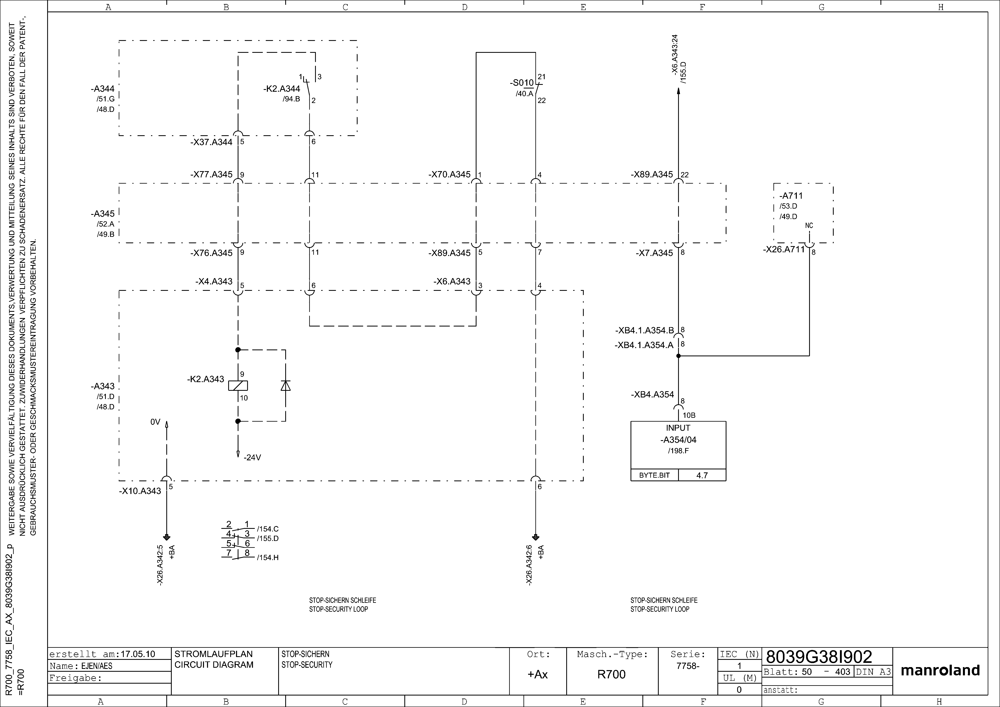

# +Ax — Sheet 50 of 403 — STOP SICHERN

**STOP SECURITY**

> Part of the manroland **R700** printing press IEC/UL circuit diagrams.
> Drawing class: **Stromlaufplan / Circuit diagram** (DIN A3).
> Document `+Ax` covers the **Central control console** machine section.

## At a glance

| Field | Value |
|---|---|
| Document | `+Ax`  (8039G38I902) |
| Sheet | **50** of 403 |
| Section (DE) | STOP SICHERN |
| Section (EN) | STOP SECURITY |
| Section type | CIRCUIT — Circuit diagram |
| Machine type | `R700` |
| Series | `7758` |
| Created | 17.05.10 |
| Replaces | — |
| Columns used | A, B, C, D, E, F, G |
| Path numbers | — |
| Labels on sheet | 90 |
| Cross-refs out | 15 |
| Cross-refs in | 37 |

**Previous:** [+Ax sheet 49](SHEET_0049.md) · **Next:** [+Ax sheet 51](SHEET_0051.md) · **Document TOC:** [_TOC.md](_TOC.md)  (+Ax) · **Master TOC:** [all sheets](../_MASTER_TOC.md)

## Sheet image (300 DPI, exact vector render)



_Rendered directly from the PDF vector layer at 300 DPI (1-bit), no OCR and no resampling. Use it to confirm anything ambiguous in the text below._

## Cross-references on this sheet

Each entry is a wire leaving this sheet. The printed token is `/sheet.column`; the link resolves to that sheet inside the same document.

| Ref | Target sheet | Col | Path | Destination on target | Target section | From col |
|---|---|---|---|---|---|---|
| `/155.D` | [+Ax sheet 155](SHEET_0155.md) | D | — | X6.A343:24 | ÜBERWACHUNGSRECHNER/ANSTEUERUNG NOT AUS | F |
| `/40.A` | [+Ax sheet 40](SHEET_0040.md) | A | — | — | HAUPTANTRIEB | E |
| `/94.B` | [+Ax sheet 94](SHEET_0094.md) | B | — | — | ANLEGER | C |
| `/51.G` | [+Ax sheet 51](SHEET_0051.md) | G | — | — | SIGNALGEBER: AKUSTISCHE WARNSIGNALE | A |
| `/48.D` | [+Ax sheet 48](SHEET_0048.md) | D | — | — | NOT AUS | A |
| `/53.D` | [+Ax sheet 53](SHEET_0053.md) | D | — | A711 | SIGNALGEBER: AKUSTISCHE WARNSIGNALE | G |
| `/49.D` | [+Ax sheet 49](SHEET_0049.md) | D | — | A711 | NOT AUS | G |
| `/52.A` | [+Ax sheet 52](SHEET_0052.md) | A | — | — | SIGNALGEBER: AKUSTISCHE WARNSIGNALE | A |
| `/49.B` | [+Ax sheet 49](SHEET_0049.md) | B | — | — | NOT AUS | A |
| `/51.D` | [+Ax sheet 51](SHEET_0051.md) | D | — | — | SIGNALGEBER: AKUSTISCHE WARNSIGNALE | A |
| `/48.D` | [+Ax sheet 48](SHEET_0048.md) | D | — | — | NOT AUS | A |
| `/198.F` | [+Ax sheet 198](SHEET_0198.md) | F | — | — | REFERENZMODUL | F |
| `/154.C` | [+Ax sheet 154](SHEET_0154.md) | C | — | — | ÜBERWACHUNGSRECHNER/ANSTEUERUNG NOT AUS | B |
| `/155.D` | [+Ax sheet 155](SHEET_0155.md) | D | — | — | ÜBERWACHUNGSRECHNER/ANSTEUERUNG NOT AUS | B |
| `/154.H` | [+Ax sheet 154](SHEET_0154.md) | H | — | — | ÜBERWACHUNGSRECHNER/ANSTEUERUNG NOT AUS | B |

### Incoming references (sheets that point here)

Every other sheet that sends a wire to this one. `Back-ref` is the token printed on *that* sheet; `Path` is its line number.

| From sheet | Cols | Back-ref | Path | Refs | What continues there |
|---|---|---|---|---|---|
| [+Ax#40](SHEET_0040.md) | A | `/40.A` | — | 1 | — |
| [+Ax#48](SHEET_0048.md) | D | `/48.D` | — | 2 | — |
| [+Ax#49](SHEET_0049.md) | B, C | `/49.B`, `/49.C` | — | 2 | — |
| [+Ax#51](SHEET_0051.md) | D, G | `/51.D`, `/51.G` | — | 2 | — |
| [+Ax#52](SHEET_0052.md) | A | `/52.A` | — | 1 | — |
| [+Ax#53](SHEET_0053.md) | D | `/53.D` | — | 1 | — |
| [+Ax#94](SHEET_0094.md) | B | `/94.B` | — | 1 | — |
| [+Ax#154](SHEET_0154.md) | C, H | `/154.C`, `/154.H` | — | 2 | — |
| [+Ax#155](SHEET_0155.md) | D | `/155.D` | — | 2 | — |
| [+Ax#198](SHEET_0198.md) | F | `/198.F` | — | 1 | — |
| [+Ax#226](SHEET_0226.md) | G | `/226.G` | — | 2 | — |
| [+Ax#228](SHEET_0228.md) | A, B, C | `/228.A`, `/228.B`, `/228.C` | — | 3 | — |
| [+Ax#233](SHEET_0233.md) | E | `/233.E` | — | 2 | — |
| [+Ax#235](SHEET_0235.md) | H | `/235.H` | — | 1 | — |
| [+Ax#243](SHEET_0243.md) | H | `/243.H` | — | 2 | — |
| [+Ax#269](SHEET_0269.md) | H | `/269.H` | — | 1 | — |
| [+Ax#279](SHEET_0279.md) | F | `/279.F` | — | 2 | — |
| [+Ax#285](SHEET_0285.md) | A, F, H | `/285.A`, `/285.F`, `/285.H` | — | 6 | — |
| [+Ax#289](SHEET_0289.md) | B | `/289.B` | — | 3 | — |


## Devices on this sheet

| Tag | Class | Class meaning (IEC) | Col | Sub | Terminal | Sign |
|---|---|---|---|---|---|---|
| `A344` | A | Baugruppe / assembly, module, PC board | A | — | — | — |
| `S010` | S | Schalter / switch | D | — | — | — |
| `A354/04` | A | Baugruppe / assembly, module, PC board | F | 04 | — | — |
| `A343` | A | Baugruppe / assembly, module, PC board | A | — | — | — |
| `A345` | A | Baugruppe / assembly, module, PC board | A | — | — | — |
| `A711` | A | Baugruppe / assembly, module, PC board | G | — | — | — |
| `X37.A344` | — | cross-device reference | B | — | — | — |
| `K2.A344` | — | cross-device reference | B | — | — | — |
| `X4.A343` | — | cross-device reference | B | — | — | — |
| `X6.A343` | — | cross-device reference | D | — | — | — |
| `X10.A343` | — | cross-device reference | A | — | — | — |
| `4.7` | — | cross-device reference | F | — | — | — |
| `XB4.A354` | — | cross-device reference | F | — | — | — |
| `X26.A342:5` | — | cross-device reference | A | — | 5 | — |
| `X26.A342:6` | — | cross-device reference | E | — | 6 | — |
| `K2.A343` | — | cross-device reference | B | — | — | — |
| `X7.A345` | — | cross-device reference | F | — | — | — |
| `X70.A345` | — | cross-device reference | D | — | — | — |
| `X89.A345` | — | cross-device reference | D | — | — | — |
| `X89.A345` | — | cross-device reference | F | — | — | — |
| `X77.A345` | — | cross-device reference | B | — | — | — |
| `X76.A345` | — | cross-device reference | B | — | — | — |
| `XB4.1.A354.B` | — | cross-device reference | F | — | — | — |
| `XB4.1.A354.A` | — | cross-device reference | F | — | — | — |
| `X26.A711` | — | cross-device reference | G | — | — | — |
| `X6.A343:24` | — | cross-device reference | F | — | 24 | — |

## Potentials / nets

| Potential | Count | Columns | Attached devices | Terminals |
|---|---|---|---|---|
| `0V` | 1 | A | — | — |
| `24V` | 1 | B | — | — |


A potential such as `L24+/4` or `M24+` is a named supply/return rail; every place it appears on this sheet is electrically common.

## Wire-end annotations (grouped as printed)

A wire that continues elsewhere is annotated with a small cluster: the destination description, the path/line number `#NN`, and the `/sheet.column` cross reference. Each row below is one such cluster exactly as it is grouped on the drawing.

| Col | Y | Path | Cross-ref | Text on the wire |
|---|---|---|---|---|
| F | 40.8 | — | `/155.D` | `X6.A343:24` |
| C | 87.5 | — | — | `K2.A344 3` |
| C | 87.5 | — | — | `1` |
| E | 87.5 | — | — | `21` |
| D | 93.8 | — | — | `S010` |
| A | 100.9 | — | — | `A344` |
| E | 107.6 | — | `/40.A` | — |
| A | 114.0 | — | `/51.G`, `/48.D` | — |
| C | 114.0 | — | `/94.B` | — |
| C | 115.8 | — | — | `2` |
| E | 115.8 | — | — | `22` |
| B | 164.7 | — | — | `X37.A344 5 6` |
| D | 203.0 | — | — | `X77.A345 9 X89.A345 22` |
| D | 203.0 | — | — | `X70.A345 1 4` |
| C | 204.4 | — | — | `11` |
| G | 228.5 | — | `/53.D`, `/49.D` | `A711` |
| A | 249.8 | — | — | `A345` |
| A | 262.8 | — | `/52.A`, `/49.B` | — |
| G | 265.6 | — | — | `NC` |
| G | 292.3 | — | — | `X26.A711 8` |
| B | 296.5 | — | — | `X76.A345 9` |
| C | 296.5 | — | — | `11` |
| D | 296.5 | — | — | `X89.A345 5 7` |
| F | 296.5 | — | — | `X7.A345 8` |
| C | 330.6 | — | — | `X4.A343 5 X6.A343 3 4` |
| C | 336.2 | — | — | `6` |
| F | 388.7 | — | — | `XB4.1.A354.B 8` |
| F | 405.7 | — | — | `XB4.1.A354.A 8` |
| B | 441.8 | — | — | `9` |
| B | 446.8 | — | — | `K2.A343` |
| C | 455.3 | — | — | `A343 XB4.A354 8` |
| A | 468.4 | — | `/51.D`, `/48.D` | — |
| B | 470.2 | — | — | `10` |
| F | 490.7 | — | — | `10B` |
| A | 498.1 | — | — | `0V` |
| F | 505.2 | — | — | `INPUT` |
| F | 519.0 | — | — | `A354/04` |
| F | 532.8 | — | `/198.F` | — |
| B | 540.6 | — | — | `24V` |
| F | 561.9 | — | — | `BYTE.BIT 4.7` |
| C | 575.8 | — | — | `X10.A343 5 6` |
| B | 619.6 | — | — | `2 4 5 7 1 3 8 6` |
| B | 626.0 | — | `/154.C`, `/155.D` | — |
| A | 648.9 | — | — | `X26.A342:5` |
| E | 648.9 | — | — | `X26.A342:6` |
| B | 649.1 | — | — | `+BA` |
| E | 649.1 | — | — | `+BA` |
| B | 660.0 | — | `/154.H` | — |
| C | 712.1 | — | — | `STOP SICHERN SCHLEIFE STOP SECURITY LOOP` |
| F | 712.1 | — | — | `STOP SICHERN SCHLEIFE STOP SECURITY LOOP` |


## Reconstructed tables

This sheet carries tabular content (pin map / terminal assignment / index). The grid below was rebuilt from the drawing's own rule lines, so each row is exactly one physical row of the table.

### Table 1 — 1 data rows × 4 columns (at x=198.4, y=62.4)

| X37.A344 X77.A345 X76.A345 X4.A343 | K2.A344 5 9 9 5 | 1 /94.B | 2 6 11 11 6 |
|---|---|---|---|
| `K2.A343` | `9 10` |  |  |


### Table 2 — 2 data rows × 2 columns (at x=751.2, y=423.8)

| XB4.A354 | 8 10B |
|---|---|
| `INPUT` | `A354/04 /198.F` |
| `BYTE.BIT` | `4.7` |


## Notes and free text on this sheet

| Text | Col | Y (pt) |
|---|---|---|
| `10B` | F | 490.68 |
| `INPUT` | F | 505.2 |
| `BYTE.BIT` | F | 562.45 |
| `STOP SICHERN SCHLEIFE` | F | 712.12 |
| `STOP SECURITY LOOP` | F | 722.76 |
| `+BA` | B | 649.13 |
| `+BA` | E | 649.13 |
| `STOP SICHERN SCHLEIFE` | C | 712.12 |
| `STOP SECURITY LOOP` | C | 722.76 |
| `NC` | G | 265.62 |

## Complete label inventory (exact text from the drawing)

Every text object inside the drawing area of this sheet, in DIN reading order (column A→H, then top→bottom). This is the authoritative list: if a string is not here it is not printed on this sheet.

| Col | Y | X | Dir | Type | Text |
|---|---|---|---|---|---|
| A | 100.9 | 108.3 | → | device tag | `A344` |
| A | 114.0 | 115.1 | → | cross-reference | `/51.G` |
| A | 126.4 | 115.4 | → | cross-reference | `/48.D` |
| A | 249.8 | 108.3 | → | device tag | `A345` |
| A | 262.8 | 115.4 | → | cross-reference | `/52.A` |
| A | 275.2 | 115.7 | → | cross-reference | `/49.B` |
| A | 455.3 | 108.3 | → | device tag | `A343` |
| A | 468.4 | 115.4 | → | cross-reference | `/51.D` |
| A | 480.8 | 115.4 | → | cross-reference | `/48.D` |
| A | 498.1 | 179.1 | → | potential | `0V` |
| A | 580.0 | 141.7 | → | device ref | `X10.A343` |
| A | 648.9 | 186.7 | ↕ | device ref | `X26.A342:5` |
| B | 100.9 | 313.5 | → | device ref | `K2.A344` |
| B | 164.7 | 226.8 | → | device ref | `X37.A344` |
| B | 164.7 | 286.0 | → | number | `5` |
| B | 203.0 | 226.8 | → | device ref | `X77.A345` |
| B | 204.4 | 286.0 | → | number | `9` |
| B | 296.5 | 226.8 | → | device ref | `X76.A345` |
| B | 296.5 | 286.0 | → | number | `9` |
| B | 330.5 | 232.7 | → | device ref | `X4.A343` |
| B | 336.2 | 286.0 | → | number | `5` |
| B | 441.8 | 286.0 | → | number | `9` |
| B | 446.8 | 222.8 | → | device ref | `K2.A343` |
| B | 470.2 | 285.4 | → | number | `10` |
| B | 540.6 | 290.3 | → | potential | `24V` |
| B | 575.8 | 201.0 | → | number | `5` |
| B | 619.6 | 269.6 | → | number | `2` |
| B | 619.6 | 290.8 | → | number | `1` |
| B | 626.0 | 306.1 | → | cross-reference | `/154.C` |
| B | 631.0 | 269.6 | → | number | `4` |
| B | 631.0 | 291.4 | → | number | `3` |
| B | 637.4 | 306.1 | → | cross-reference | `/155.D` |
| B | 642.3 | 269.6 | → | number | `5` |
| B | 642.3 | 291.7 | → | number | `6` |
| B | 649.1 | 200.8 | ↕ | text | `+BA` |
| B | 653.7 | 269.6 | → | number | `7` |
| B | 653.7 | 291.4 | → | number | `8` |
| B | 660.1 | 306.1 | → | cross-reference | `/154.H` |
| C | 87.5 | 355.5 | → | number | `1` |
| C | 87.5 | 378.1 | → | number | `3` |
| C | 114.0 | 336.8 | → | cross-reference | `/94.B` |
| C | 115.8 | 371.1 | → | number | `2` |
| C | 164.7 | 371.1 | → | number | `6` |
| C | 204.4 | 370.5 | → | number | `11` |
| C | 296.5 | 370.5 | → | number | `11` |
| C | 336.2 | 371.1 | → | number | `6` |
| C | 712.1 | 368.2 | → | text | `STOP SICHERN SCHLEIFE` |
| C | 722.8 | 368.2 | → | text | `STOP SECURITY LOOP` |
| D | 93.8 | 607.2 | → | device tag | `S010` |
| D | 203.0 | 510.2 | → | device ref | `X70.A345` |
| D | 204.4 | 568.9 | → | number | `1` |
| D | 296.5 | 510.2 | → | device ref | `X89.A345` |
| D | 296.5 | 569.5 | → | number | `5` |
| D | 330.5 | 516.2 | → | device ref | `X6.A343` |
| D | 336.2 | 569.5 | → | number | `3` |
| E | 87.5 | 640.3 | → | number | `21` |
| E | 107.6 | 614.3 | → | cross-reference | `/40.A` |
| E | 115.8 | 640.3 | → | number | `22` |
| E | 204.4 | 640.3 | → | number | `4` |
| E | 296.5 | 640.3 | → | number | `7` |
| E | 336.2 | 640.3 | → | number | `4` |
| E | 575.8 | 640.3 | → | number | `6` |
| E | 648.9 | 626.0 | ↕ | device ref | `X26.A342:6` |
| E | 649.1 | 640.2 | ↕ | text | `+BA` |
| F | 40.8 | 799.7 | ↕ | device ref | `X6.A343:24` |
| F | 73.4 | 809.6 | ↕ | cross-reference | `/155.D` |
| F | 203.0 | 751.2 | → | device ref | `X89.A345` |
| F | 204.4 | 810.4 | → | number | `22` |
| F | 296.5 | 757.1 | → | device ref | `X7.A345` |
| F | 296.5 | 810.4 | → | number | `8` |
| F | 388.7 | 732.8 | → | device ref | `XB4.1.A354.B` |
| F | 388.7 | 810.4 | → | number | `8` |
| F | 405.7 | 810.4 | → | number | `8` |
| F | 406.4 | 731.9 | → | device ref | `XB4.1.A354.A` |
| F | 465.2 | 751.5 | → | device ref | `XB4.A354` |
| F | 473.7 | 810.4 | → | number | `8` |
| F | 490.7 | 812.7 | → | text | `10B` |
| F | 505.2 | 793.0 | → | text | `INPUT` |
| F | 519.0 | 786.5 | → | device tag | `A354/04` |
| F | 532.8 | 795.5 | → | cross-reference | `/198.F` |
| F | 561.9 | 829.4 | → | device ref | `4.7` |
| F | 562.5 | 761.1 | → | text | `BYTE.BIT` |
| F | 712.1 | 750.9 | → | text | `STOP SICHERN SCHLEIFE` |
| F | 722.8 | 750.9 | → | text | `STOP SECURITY LOOP` |
| G | 228.5 | 928.1 | → | device tag | `A711` |
| G | 241.6 | 928.3 | → | cross-reference | `/53.D` |
| G | 254.0 | 928.3 | → | cross-reference | `/49.D` |
| G | 265.6 | 958.9 | → | text | `NC` |
| G | 292.3 | 908.5 | → | device ref | `X26.A711` |
| G | 296.5 | 966.3 | → | number | `8` |

## Reading-order text block

The same content as a plain block, grouped by DIN column — convenient to paste or to match against a visual description.

```text
=== Column A ===
 100.9  108.3  devtag       A344
 114.0  115.1  xref         /51.G
 126.4  115.4  xref         /48.D
 249.8  108.3  devtag       A345
 262.8  115.4  xref         /52.A
 275.2  115.7  xref         /49.B
 455.3  108.3  devtag       A343
 468.4  115.4  xref         /51.D
 480.8  115.4  xref         /48.D
 498.1  179.1  net          0V
 580.0  141.7  devref       X10.A343
 648.9  186.7  devref       X26.A342:5
=== Column B ===
 100.9  313.5  devref       K2.A344
 164.7  226.8  devref       X37.A344
 164.7  286.0  numeric      5
 203.0  226.8  devref       X77.A345
 204.4  286.0  numeric      9
 296.5  226.8  devref       X76.A345
 296.5  286.0  numeric      9
 330.5  232.7  devref       X4.A343
 336.2  286.0  numeric      5
 441.8  286.0  numeric      9
 446.8  222.8  devref       K2.A343
 470.2  285.4  numeric      10
 540.6  290.3  net          24V
 575.8  201.0  numeric      5
 619.6  269.6  numeric      2
 619.6  290.8  numeric      1
 626.0  306.1  xref         /154.C
 631.0  269.6  numeric      4
 631.0  291.4  numeric      3
 637.4  306.1  xref         /155.D
 642.3  269.6  numeric      5
 642.3  291.7  numeric      6
 649.1  200.8  text         +BA
 653.7  269.6  numeric      7
 653.7  291.4  numeric      8
 660.1  306.1  xref         /154.H
=== Column C ===
  87.5  355.5  numeric      1
  87.5  378.1  numeric      3
 114.0  336.8  xref         /94.B
 115.8  371.1  numeric      2
 164.7  371.1  numeric      6
 204.4  370.5  numeric      11
 296.5  370.5  numeric      11
 336.2  371.1  numeric      6
 712.1  368.2  text         STOP SICHERN SCHLEIFE
 722.8  368.2  text         STOP SECURITY LOOP
=== Column D ===
  93.8  607.2  devtag       S010
 203.0  510.2  devref       X70.A345
 204.4  568.9  numeric      1
 296.5  510.2  devref       X89.A345
 296.5  569.5  numeric      5
 330.5  516.2  devref       X6.A343
 336.2  569.5  numeric      3
=== Column E ===
  87.5  640.3  numeric      21
 107.6  614.3  xref         /40.A
 115.8  640.3  numeric      22
 204.4  640.3  numeric      4
 296.5  640.3  numeric      7
 336.2  640.3  numeric      4
 575.8  640.3  numeric      6
 648.9  626.0  devref       X26.A342:6
 649.1  640.2  text         +BA
=== Column F ===
  40.8  799.7  devref       X6.A343:24
  73.4  809.6  xref         /155.D
 203.0  751.2  devref       X89.A345
 204.4  810.4  numeric      22
 296.5  757.1  devref       X7.A345
 296.5  810.4  numeric      8
 388.7  732.8  devref       XB4.1.A354.B
 388.7  810.4  numeric      8
 405.7  810.4  numeric      8
 406.4  731.9  devref       XB4.1.A354.A
 465.2  751.5  devref       XB4.A354
 473.7  810.4  numeric      8
 490.7  812.7  text         10B
 505.2  793.0  text         INPUT
 519.0  786.5  devtag       A354/04
 532.8  795.5  xref         /198.F
 561.9  829.4  devref       4.7
 562.5  761.1  text         BYTE.BIT
 712.1  750.9  text         STOP SICHERN SCHLEIFE
 722.8  750.9  text         STOP SECURITY LOOP
=== Column G ===
 228.5  928.1  devtag       A711
 241.6  928.3  xref         /53.D
 254.0  928.3  xref         /49.D
 265.6  958.9  text         NC
 292.3  908.5  devref       X26.A711
 296.5  966.3  numeric      8
```

---
_Generated from the PDF vector text layer; no OCR. Source: `R700_7758_IEC_AX_8039G38I902_p`, sheet 50._
