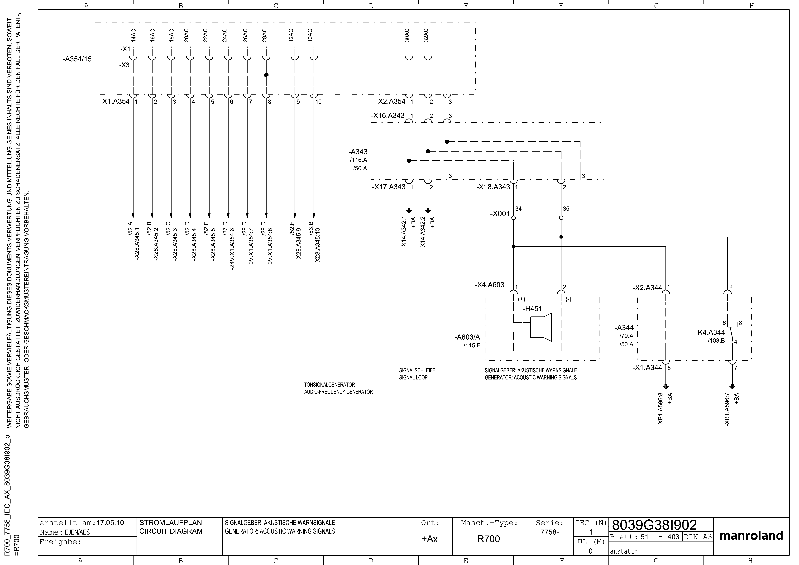

# +Ax — Sheet 51 of 403 — SIGNALGEBER: AKUSTISCHE WARNSIGNALE

**GENERATOR: ACOUSTIC WARNING SIGNALS**

> Part of the manroland **R700** printing press IEC/UL circuit diagrams.
> Drawing class: **Stromlaufplan / Circuit diagram** (DIN A3).
> Document `+Ax` covers the **Central control console** machine section.

## At a glance

| Field | Value |
|---|---|
| Document | `+Ax`  (8039G38I902) |
| Sheet | **51** of 403 |
| Section (DE) | SIGNALGEBER: AKUSTISCHE WARNSIGNALE |
| Section (EN) | GENERATOR: ACOUSTIC WARNING SIGNALS |
| Section type | CIRCUIT — Circuit diagram |
| Machine type | `R700` |
| Series | `7758` |
| Created | 17.05.10 |
| Replaces | — |
| Columns used | A, B, C, D, E, F, G, H |
| Path numbers | — |
| Labels on sheet | 104 |
| Cross-refs out | 16 |
| Cross-refs in | 42 |

**Previous:** [+Ax sheet 50](SHEET_0050.md) · **Next:** [+Ax sheet 52](SHEET_0052.md) · **Document TOC:** [_TOC.md](_TOC.md)  (+Ax) · **Master TOC:** [all sheets](../_MASTER_TOC.md)

## Sheet image (300 DPI, exact vector render)



_Rendered directly from the PDF vector layer at 300 DPI (1-bit), no OCR and no resampling. Use it to confirm anything ambiguous in the text below._

## Cross-references on this sheet

Each entry is a wire leaving this sheet. The printed token is `/sheet.column`; the link resolves to that sheet inside the same document.

| Ref | Target sheet | Col | Path | Destination on target | Target section | From col |
|---|---|---|---|---|---|---|
| `/116.A` | [+Ax sheet 116](SHEET_0116.md) | A | — | — | REALTIMERECHNER 20mA SCHLEIFE | D |
| `/50.A` | [+Ax sheet 50](SHEET_0050.md) | A | — | — | STOP SICHERN | D |
| `/52.E` | [+Ax sheet 52](SHEET_0052.md) | E | — | — | SIGNALGEBER: AKUSTISCHE WARNSIGNALE | B |
| `/52.B` | [+Ax sheet 52](SHEET_0052.md) | B | — | — | SIGNALGEBER: AKUSTISCHE WARNSIGNALE | B |
| `/52.C` | [+Ax sheet 52](SHEET_0052.md) | C | — | — | SIGNALGEBER: AKUSTISCHE WARNSIGNALE | B |
| `/52.D` | [+Ax sheet 52](SHEET_0052.md) | D | — | — | SIGNALGEBER: AKUSTISCHE WARNSIGNALE | B |
| `/27.D` | [+Ax sheet 27](SHEET_0027.md) | D | — | — | SPANNUNGSVERSORGUNG, SCHALTSCHRANKBELÜFTUNG | B |
| `/29.D` | [+Ax sheet 29](SHEET_0029.md) | D | — | — | SPANNUNGSVERSORGUNG, SCHALTSCHRANKBELÜFTUNG | C |
| `/29.D` | [+Ax sheet 29](SHEET_0029.md) | D | — | — | SPANNUNGSVERSORGUNG, SCHALTSCHRANKBELÜFTUNG | C |
| `/52.F` | [+Ax sheet 52](SHEET_0052.md) | F | — | — | SIGNALGEBER: AKUSTISCHE WARNSIGNALE | C |
| `/53.B` | [+Ax sheet 53](SHEET_0053.md) | B | — | — | SIGNALGEBER: AKUSTISCHE WARNSIGNALE | C |
| `/52.A` | [+Ax sheet 52](SHEET_0052.md) | A | — | — | SIGNALGEBER: AKUSTISCHE WARNSIGNALE | A |
| `/79.A` | [+Ax sheet 79](SHEET_0079.md) | A | — | — | ANLEGER | G |
| `/50.A` | [+Ax sheet 50](SHEET_0050.md) | A | — | — | STOP SICHERN | G |
| `/103.B` | [+Ax sheet 103](SHEET_0103.md) | B | — | — | ANLEGER | H |
| `/115.E` | [+Ax sheet 115](SHEET_0115.md) | E | — | — | HANDTERMINAL | E |

### Incoming references (sheets that point here)

Every other sheet that sends a wire to this one. `Back-ref` is the token printed on *that* sheet; `Path` is its line number.

| From sheet | Cols | Back-ref | Path | Refs | What continues there |
|---|---|---|---|---|---|
| [+Ax#27](SHEET_0027.md) | D | `/27.D` | — | 1 | 24V.X1.A354:6 |
| [+Ax#29](SHEET_0029.md) | D | `/29.D` | — | 2 | 0V.X1.A354:7; 0V.X1.A354:8 |
| [+Ax#50](SHEET_0050.md) | A | `/50.A` | — | 2 | — |
| [+Ax#52](SHEET_0052.md) | A, B, C, D, E, F | `/52.A`, `/52.B`, `/52.C`, `/52.D`, `/52.E`, `/52.F` | — | 6 | — |
| [+Ax#53](SHEET_0053.md) | A | `/53.A` | — | 1 | — |
| [+Ax#79](SHEET_0079.md) | A | `/79.A` | — | 1 | — |
| [+Ax#103](SHEET_0103.md) | B | `/103.B` | — | 1 | 4 |
| [+Ax#115](SHEET_0115.md) | E | `/115.E` | — | 1 | — |
| [+Ax#116](SHEET_0116.md) | A | `/116.A` | — | 1 | — |
| [+Ax#207](SHEET_0207.md) | F | `/207.F` | — | 2 | — |
| [+Ax#208](SHEET_0208.md) | B | `/208.B` | — | 10 | — |
| [+Ax#217](SHEET_0217.md) | G | `/217.G` | — | 2 | — |
| [+Ax#219](SHEET_0219.md) | H | `/219.H` | — | 3 | — |
| [+Ax#229](SHEET_0229.md) | D | `/229.D` | — | 2 | — |
| [+Ax#254](SHEET_0254.md) | B | `/254.B` | — | 3 | — |
| [+Ax#255](SHEET_0255.md) | A | `/255.A` | — | 2 | — |
| [+Ax#256](SHEET_0256.md) | C | `/256.C` | — | 2 | — |


## Devices on this sheet

| Tag | Class | Class meaning (IEC) | Col | Sub | Terminal | Sign |
|---|---|---|---|---|---|---|
| `A354/15` | A | Baugruppe / assembly, module, PC board | A | 15 | — | — |
| `A343` | A | Baugruppe / assembly, module, PC board | D | — | — | — |
| `X001` | X | Klemme / terminal, plug connector | E | — | — | — |
| `A344` | A | Baugruppe / assembly, module, PC board | G | — | — | — |
| `X1` | X | Klemme / terminal, plug connector | A | — | — | — |
| `X3` | X | Klemme / terminal, plug connector | A | — | — | — |
| `X1.A354` | — | cross-device reference | A | — | — | — |
| `X2.A354` | — | cross-device reference | D | — | — | — |
| `X16.A343` | — | cross-device reference | D | — | — | — |
| `X17.A343` | — | cross-device reference | D | — | — | — |
| `X18.A343` | — | cross-device reference | E | — | — | — |
| `X2.A344` | — | cross-device reference | G | — | — | — |
| `X1.A344` | — | cross-device reference | G | — | — | — |
| `K4.A344` | — | cross-device reference | H | — | — | — |
| `XB1.A596:8` | — | cross-device reference | G | — | 8 | — |
| `XB1.A596:7` | — | cross-device reference | H | — | 7 | — |
| `X4.A603` | — | cross-device reference | E | — | — | — |
| `X14.A342:1` | — | cross-device reference | D | — | 1 | — |
| `X14.A342:2` | — | cross-device reference | E | — | 2 | — |
| `X28.A345:10` | — | cross-device reference | C | — | 10 | — |
| `X28.A345:9` | — | cross-device reference | C | — | 9 | — |
| `X28.A345:5` | — | cross-device reference | B | — | 5 | — |
| `X28.A345:4` | — | cross-device reference | B | — | 4 | — |
| `X28.A345:3` | — | cross-device reference | B | — | 3 | — |
| `X28.A345:2` | — | cross-device reference | B | — | 2 | — |
| `X28.A345:1` | — | cross-device reference | B | — | 1 | — |

## Potentials / nets

| Potential | Count | Columns | Attached devices | Terminals |
|---|---|---|---|---|
| `0V` | 2 | C | `A354`, `X1` | `7`, `8` |
| `24V` | 1 | C | `A354`, `X1` | `6` |
| `H451` | 1 | F | — | — |


A potential such as `L24+/4` or `M24+` is a named supply/return rail; every place it appears on this sheet is electrically common.

## Wire-end annotations (grouped as printed)

A wire that continues elsewhere is annotated with a small cluster: the destination description, the path/line number `#NN`, and the `/sheet.column` cross reference. Each row below is one such cluster exactly as it is grouped on the drawing.

| Col | Y | Path | Cross-ref | Text on the wire |
|---|---|---|---|---|
| B | 42.2 | — | — | `20AC` |
| B | 42.2 | — | — | `22AC` |
| B | 42.2 | — | — | `24AC` |
| C | 42.2 | — | — | `26AC` |
| C | 42.2 | — | — | `28AC` |
| D | 42.2 | — | — | `30AC` |
| E | 42.2 | — | — | `32AC` |
| B | 42.8 | — | — | `14AC` |
| B | 42.8 | — | — | `16AC` |
| B | 42.8 | — | — | `18AC` |
| C | 42.8 | — | — | `12AC` |
| C | 42.8 | — | — | `10AC` |
| A | 68.6 | — | — | `X1` |
| A | 83.2 | — | — | `A354/15` |
| A | 92.4 | — | — | `X3` |
| C | 146.3 | — | — | `X1.A354 1 2 3 4 5 6 7 8 9 10 X2.A354 1 2 3` |
| D | 167.6 | — | — | `X16.A343 1 2 3` |
| D | 221.4 | — | — | `A343` |
| D | 234.5 | — | `/116.A` | — |
| D | 246.9 | — | `/50.A` | — |
| E | 258.3 | — | — | `3` |
| F | 258.3 | — | — | `3` |
| D | 273.9 | — | — | `X17.A343 1 2` |
| E | 273.9 | — | — | `X18.A343 1` |
| F | 275.3 | — | — | `2` |
| E | 307.2 | — | — | `X001 34` |
| F | 307.2 | — | — | `35` |
| D | 321.4 | — | — | `X14.A342:1` |
| E | 322.6 | — | — | `X14.A342:2` |
| D | 323.1 | — | — | `+BA` |
| E | 323.1 | — | — | `+BA` |
| B | 329.7 | — | `/52.E` | — |
| B | 329.9 | — | `/52.B` | — |
| B | 329.9 | — | `/52.C` | — |
| B | 329.9 | — | `/52.D` | — |
| B | 329.9 | — | `/27.D` | — |
| C | 329.9 | — | `/29.D` | — |
| C | 329.9 | — | `/29.D` | — |
| C | 329.9 | — | `/52.F` | — |
| C | 329.9 | — | `/53.B` | — |
| A | 330.2 | — | `/52.A` | — |
| B | 338.5 | — | — | `X28.A345:1` |
| B | 339.6 | — | — | `X28.A345:2` |
| B | 339.9 | — | — | `X28.A345:3` |
| B | 339.9 | — | — | `X28.A345:4` |
| B | 339.9 | — | — | `X28.A345:5` |
| C | 339.9 | — | — | `24V.X1.A354:6` |
| C | 339.9 | — | — | `0V.X1.A354:7` |
| C | 339.9 | — | — | `0V.X1.A354:8` |
| C | 339.9 | — | — | `X28.A345:9` |
| C | 339.9 | — | — | `X28.A345:10` |
| F | 419.8 | — | — | `X4.A603 1 2` |
| G | 424.1 | — | — | `X2.A344 1` |
| H | 424.1 | — | — | `2` |
| F | 441.8 | — | — | `(+) H451 ( )` |
| H | 477.2 | — | — | `K4.A344 8` |
| H | 477.2 | — | — | `6` |
| G | 483.6 | — | — | `A344` |
| G | 496.7 | — | `/79.A`, `/50.A` | — |
| E | 497.8 | — | — | `A603/A` |
| H | 503.8 | — | `/103.B` | — |
| H | 505.6 | — | — | `4` |
| E | 510.9 | — | `/115.E` | — |
| G | 543.1 | — | — | `X1.A344 8` |
| H | 544.6 | — | — | `7` |
| D | 549.1 | — | — | `SIGNALSCHLEIFE SIGNAL LOOP` |
| F | 549.1 | — | — | `SIGNALGEBER: AKUSTISCHE WARNSIGNALE GENERATOR: ACOUSTIC WARNING SIGNALS` |
| D | 570.4 | — | — | `TONSIGNALGENERATOR AUDIO FREQUENCY GENERATOR` |
| G | 585.1 | — | — | `XB1.A596:8` |
| H | 585.1 | — | — | `XB1.A596:7` |
| G | 585.4 | — | — | `+BA` |
| H | 585.4 | — | — | `+BA` |


## Reconstructed tables

This sheet carries tabular content (pin map / terminal assignment / index). The grid below was rebuilt from the drawing's own rule lines, so each row is exactly one physical row of the table.

### Table 1 — 2 data rows × 5 columns (at x=609.4, y=83.6)

| 1 1 | 2 2 | 3 3 |  |  |
|---|---|---|---|---|
| `1 X14.A342:2 +BA` | `2 +BA` | `3 X18.A343 X001` | `1 34` |  |
|  |  | `X4.A603 A603/A /115.E` | `1 (+)` | `H451` |


### Table 2 — 2 data rows × 1 columns (at x=836.2, y=83.6)

| C1 |
|---|
| `2 35` |
| `2 ( )` |


## Notes and free text on this sheet

| Text | Col | Y (pt) |
|---|---|---|
| `TONSIGNALGENERATOR` | D | 570.4 |
| `AUDIO FREQUENCY GENERATOR` | D | 581.04 |
| `A603/A` | E | 497.8 |
| `SIGNALGEBER: AKUSTISCHE WARNSIGNALE` | F | 549.11 |
| `GENERATOR: ACOUSTIC WARNING SIGNALS` | F | 559.76 |
| `+BA` | G | 585.36 |
| `+BA` | H | 585.36 |
| `+BA` | D | 323.15 |
| `+BA` | E | 323.15 |
| `14AC` | B | 42.8 |
| `16AC` | B | 42.8 |
| `24AC` | B | 42.24 |
| `22AC` | B | 42.24 |
| `20AC` | B | 42.24 |
| `18AC` | B | 42.8 |
| `26AC` | C | 42.24 |
| `28AC` | C | 42.24 |
| `30AC` | D | 42.24 |
| `32AC` | E | 42.24 |
| `10AC` | C | 42.8 |
| `12AC` | C | 42.8 |
| `SIGNALSCHLEIFE` | D | 549.12 |
| `SIGNAL LOOP` | D | 559.76 |

## Complete label inventory (exact text from the drawing)

Every text object inside the drawing area of this sheet, in DIN reading order (column A→H, then top→bottom). This is the authoritative list: if a string is not here it is not printed on this sheet.

| Col | Y | X | Dir | Type | Text |
|---|---|---|---|---|---|
| A | 68.6 | 179.4 | → | device tag | `X1` |
| A | 83.2 | 93.5 | → | device tag | `A354/15` |
| A | 92.4 | 177.7 | → | device tag | `X3` |
| A | 146.3 | 149.1 | → | device ref | `X1.A354` |
| A | 330.2 | 190.2 | ↕ | cross-reference | `/52.A` |
| B | 42.2 | 274.3 | ↕ | text | `20AC` |
| B | 42.2 | 302.6 | ↕ | text | `22AC` |
| B | 42.2 | 331.0 | ↕ | text | `24AC` |
| B | 42.8 | 195.4 | ↕ | text | `14AC` |
| B | 42.8 | 223.7 | ↕ | text | `16AC` |
| B | 42.8 | 252.1 | ↕ | text | `18AC` |
| B | 147.7 | 200.4 | → | number | `1` |
| B | 147.7 | 229.3 | → | number | `2` |
| B | 147.7 | 257.7 | → | number | `3` |
| B | 147.7 | 286.0 | → | number | `4` |
| B | 147.7 | 314.4 | → | number | `5` |
| B | 329.7 | 303.6 | ↕ | cross-reference | `/52.E` |
| B | 330.0 | 218.5 | ↕ | cross-reference | `/52.B` |
| B | 330.0 | 246.9 | ↕ | cross-reference | `/52.C` |
| B | 330.0 | 275.2 | ↕ | cross-reference | `/52.D` |
| B | 330.0 | 331.9 | ↕ | cross-reference | `/27.D` |
| B | 338.5 | 200.1 | ↕ | device ref | `X28.A345:1` |
| B | 339.6 | 228.5 | ↕ | device ref | `X28.A345:2` |
| B | 339.9 | 256.8 | ↕ | device ref | `X28.A345:3` |
| B | 339.9 | 285.2 | ↕ | device ref | `X28.A345:4` |
| B | 339.9 | 313.5 | ↕ | device ref | `X28.A345:5` |
| C | 42.2 | 362.2 | ↕ | text | `26AC` |
| C | 42.2 | 390.5 | ↕ | text | `28AC` |
| C | 42.8 | 430.2 | ↕ | text | `12AC` |
| C | 42.8 | 458.5 | ↕ | text | `10AC` |
| C | 147.7 | 342.7 | → | number | `6` |
| C | 147.7 | 371.1 | → | number | `7` |
| C | 147.7 | 399.4 | → | number | `8` |
| C | 147.7 | 441.9 | → | number | `9` |
| C | 147.7 | 469.7 | → | number | `10` |
| C | 330.0 | 360.3 | ↕ | cross-reference | `/29.D` |
| C | 330.0 | 388.6 | ↕ | cross-reference | `/29.D` |
| C | 330.0 | 431.1 | ↕ | cross-reference | `/52.F` |
| C | 330.0 | 459.5 | ↕ | cross-reference | `/53.B` |
| C | 339.9 | 341.9 | ↕ | potential | `24V.X1.A354:6` |
| C | 339.9 | 370.2 | ↕ | potential | `0V.X1.A354:7` |
| C | 339.9 | 398.5 | ↕ | potential | `0V.X1.A354:8` |
| C | 339.9 | 441.1 | ↕ | device ref | `X28.A345:9` |
| C | 339.9 | 469.4 | ↕ | device ref | `X28.A345:10` |
| D | 42.2 | 603.1 | ↕ | text | `30AC` |
| D | 146.3 | 560.1 | → | device ref | `X2.A354` |
| D | 147.7 | 611.4 | → | number | `1` |
| D | 167.5 | 552.8 | → | device ref | `X16.A343` |
| D | 169.0 | 611.4 | → | number | `1` |
| D | 221.4 | 519.3 | → | device tag | `A343` |
| D | 234.5 | 521.6 | → | cross-reference | `/116.A` |
| D | 246.9 | 526.4 | → | cross-reference | `/50.A` |
| D | 273.8 | 554.2 | → | device ref | `X17.A343` |
| D | 275.3 | 611.4 | → | number | `1` |
| D | 321.4 | 597.7 | ↕ | device ref | `X14.A342:1` |
| D | 323.2 | 611.8 | ↕ | text | `+BA` |
| D | 549.1 | 595.0 | → | text | `SIGNALSCHLEIFE` |
| D | 559.8 | 595.0 | → | text | `SIGNAL LOOP` |
| D | 570.4 | 453.3 | → | text | `TONSIGNALGENERATOR` |
| D | 581.0 | 453.5 | → | text | `AUDIO FREQUENCY GENERATOR` |
| E | 42.2 | 631.5 | ↕ | text | `32AC` |
| E | 147.7 | 640.3 | → | number | `2` |
| E | 147.7 | 668.7 | → | number | `3` |
| E | 169.0 | 640.3 | → | number | `2` |
| E | 169.0 | 668.7 | → | number | `3` |
| E | 258.3 | 668.7 | → | number | `3` |
| E | 273.8 | 710.1 | → | device ref | `X18.A343` |
| E | 275.3 | 640.3 | → | number | `2` |
| E | 313.3 | 730.5 | → | device tag | `X001` |
| E | 322.6 | 626.0 | ↕ | device ref | `X14.A342:2` |
| E | 323.2 | 640.2 | ↕ | text | `+BA` |
| E | 419.8 | 707.5 | → | device ref | `X4.A603` |
| E | 497.8 | 677.2 | → | text | `A603/A` |
| E | 510.9 | 690.8 | → | cross-reference | `/115.E` |
| F | 258.3 | 867.1 | → | number | `3` |
| F | 275.3 | 767.3 | → | number | `1` |
| F | 275.3 | 838.8 | → | number | `2` |
| F | 307.2 | 767.9 | → | number | `34` |
| F | 307.2 | 838.8 | → | number | `35` |
| F | 424.1 | 767.3 | → | number | `1` |
| F | 424.1 | 838.8 | → | number | `2` |
| F | 441.8 | 771.9 | → | other | `(+)` |
| F | 441.9 | 842.7 | → | other | `( )` |
| F | 455.3 | 779.2 | → | potential | `H451` |
| F | 549.1 | 722.6 | → | text | `SIGNALGEBER: AKUSTISCHE WARNSIGNALE` |
| F | 559.8 | 722.6 | → | text | `GENERATOR: ACOUSTIC WARNING SIGNALS` |
| G | 424.1 | 942.8 | → | device ref | `X2.A344` |
| G | 424.1 | 994.1 | → | number | `1` |
| G | 483.6 | 916.2 | → | device tag | `A344` |
| G | 496.7 | 923.2 | → | cross-reference | `/79.A` |
| G | 509.1 | 923.2 | → | cross-reference | `/50.A` |
| G | 543.1 | 942.8 | → | device ref | `X1.A344` |
| G | 544.6 | 994.7 | → | number | `8` |
| G | 585.1 | 980.4 | ↕ | device ref | `XB1.A596:8` |
| G | 585.4 | 994.5 | ↕ | text | `+BA` |
| H | 424.1 | 1086.8 | → | number | `2` |
| H | 477.3 | 1076.9 | → | number | `6` |
| H | 477.3 | 1101.0 | → | number | `8` |
| H | 490.7 | 1036.3 | → | device ref | `K4.A344` |
| H | 503.8 | 1054.8 | → | cross-reference | `/103.B` |
| H | 505.6 | 1093.9 | → | number | `4` |
| H | 544.6 | 1093.9 | → | number | `7` |
| H | 585.1 | 1079.6 | ↕ | device ref | `XB1.A596:7` |
| H | 585.4 | 1093.7 | ↕ | text | `+BA` |

## Reading-order text block

The same content as a plain block, grouped by DIN column — convenient to paste or to match against a visual description.

```text
=== Column A ===
  68.6  179.4  devtag       X1
  83.2   93.5  devtag       A354/15
  92.4  177.7  devtag       X3
 146.3  149.1  devref       X1.A354
 330.2  190.2  xref         /52.A
=== Column B ===
  42.2  274.3  text         20AC
  42.2  302.6  text         22AC
  42.2  331.0  text         24AC
  42.8  195.4  text         14AC
  42.8  223.7  text         16AC
  42.8  252.1  text         18AC
 147.7  200.4  numeric      1
 147.7  229.3  numeric      2
 147.7  257.7  numeric      3
 147.7  286.0  numeric      4
 147.7  314.4  numeric      5
 329.7  303.6  xref         /52.E
 330.0  218.5  xref         /52.B
 330.0  246.9  xref         /52.C
 330.0  275.2  xref         /52.D
 330.0  331.9  xref         /27.D
 338.5  200.1  devref       X28.A345:1
 339.6  228.5  devref       X28.A345:2
 339.9  256.8  devref       X28.A345:3
 339.9  285.2  devref       X28.A345:4
 339.9  313.5  devref       X28.A345:5
=== Column C ===
  42.2  362.2  text         26AC
  42.2  390.5  text         28AC
  42.8  430.2  text         12AC
  42.8  458.5  text         10AC
 147.7  342.7  numeric      6
 147.7  371.1  numeric      7
 147.7  399.4  numeric      8
 147.7  441.9  numeric      9
 147.7  469.7  numeric      10
 330.0  360.3  xref         /29.D
 330.0  388.6  xref         /29.D
 330.0  431.1  xref         /52.F
 330.0  459.5  xref         /53.B
 339.9  341.9  net          24V.X1.A354:6
 339.9  370.2  net          0V.X1.A354:7
 339.9  398.5  net          0V.X1.A354:8
 339.9  441.1  devref       X28.A345:9
 339.9  469.4  devref       X28.A345:10
=== Column D ===
  42.2  603.1  text         30AC
 146.3  560.1  devref       X2.A354
 147.7  611.4  numeric      1
 167.5  552.8  devref       X16.A343
 169.0  611.4  numeric      1
 221.4  519.3  devtag       A343
 234.5  521.6  xref         /116.A
 246.9  526.4  xref         /50.A
 273.8  554.2  devref       X17.A343
 275.3  611.4  numeric      1
 321.4  597.7  devref       X14.A342:1
 323.2  611.8  text         +BA
 549.1  595.0  text         SIGNALSCHLEIFE
 559.8  595.0  text         SIGNAL LOOP
 570.4  453.3  text         TONSIGNALGENERATOR
 581.0  453.5  text         AUDIO FREQUENCY GENERATOR
=== Column E ===
  42.2  631.5  text         32AC
 147.7  640.3  numeric      2
 147.7  668.7  numeric      3
 169.0  640.3  numeric      2
 169.0  668.7  numeric      3
 258.3  668.7  numeric      3
 273.8  710.1  devref       X18.A343
 275.3  640.3  numeric      2
 313.3  730.5  devtag       X001
 322.6  626.0  devref       X14.A342:2
 323.2  640.2  text         +BA
 419.8  707.5  devref       X4.A603
 497.8  677.2  text         A603/A
 510.9  690.8  xref         /115.E
=== Column F ===
 258.3  867.1  numeric      3
 275.3  767.3  numeric      1
 275.3  838.8  numeric      2
 307.2  767.9  numeric      34
 307.2  838.8  numeric      35
 424.1  767.3  numeric      1
 424.1  838.8  numeric      2
 441.8  771.9  other        (+)
 441.9  842.7  other        ( )
 455.3  779.2  net          H451
 549.1  722.6  text         SIGNALGEBER: AKUSTISCHE WARNSIGNALE
 559.8  722.6  text         GENERATOR: ACOUSTIC WARNING SIGNALS
=== Column G ===
 424.1  942.8  devref       X2.A344
 424.1  994.1  numeric      1
 483.6  916.2  devtag       A344
 496.7  923.2  xref         /79.A
 509.1  923.2  xref         /50.A
 543.1  942.8  devref       X1.A344
 544.6  994.7  numeric      8
 585.1  980.4  devref       XB1.A596:8
 585.4  994.5  text         +BA
=== Column H ===
 424.1 1086.8  numeric      2
 477.3 1076.9  numeric      6
 477.3 1101.0  numeric      8
 490.7 1036.3  devref       K4.A344
 503.8 1054.8  xref         /103.B
 505.6 1093.9  numeric      4
 544.6 1093.9  numeric      7
 585.1 1079.6  devref       XB1.A596:7
 585.4 1093.7  text         +BA
```

---
_Generated from the PDF vector text layer; no OCR. Source: `R700_7758_IEC_AX_8039G38I902_p`, sheet 51._
