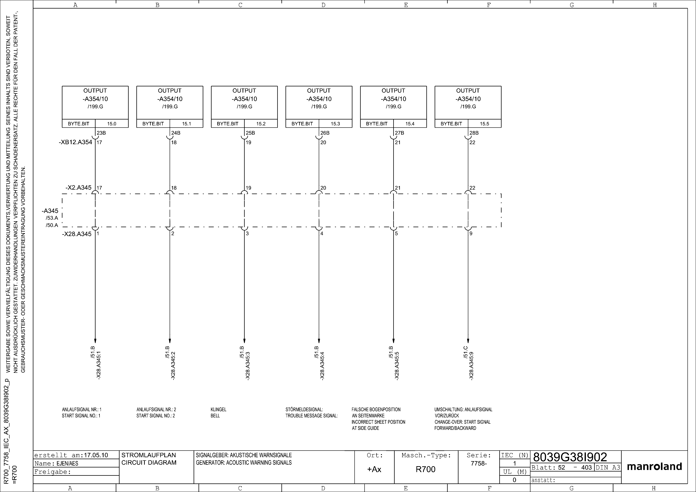

# +Ax — Sheet 52 of 403 — SIGNALGEBER: AKUSTISCHE WARNSIGNALE

**GENERATOR: ACOUSTIC WARNING SIGNALS**

> Part of the manroland **R700** printing press IEC/UL circuit diagrams.
> Drawing class: **Stromlaufplan / Circuit diagram** (DIN A3).
> Document `+Ax` covers the **Central control console** machine section.

## At a glance

| Field | Value |
|---|---|
| Document | `+Ax`  (8039G38I902) |
| Sheet | **52** of 403 |
| Section (DE) | SIGNALGEBER: AKUSTISCHE WARNSIGNALE |
| Section (EN) | GENERATOR: ACOUSTIC WARNING SIGNALS |
| Section type | CIRCUIT — Circuit diagram |
| Machine type | `R700` |
| Series | `7758` |
| Created | 17.05.10 |
| Replaces | — |
| Columns used | A, B, C, D, E, F |
| Path numbers | — |
| Labels on sheet | 88 |
| Cross-refs out | 14 |
| Cross-refs in | 32 |

**Previous:** [+Ax sheet 51](SHEET_0051.md) · **Next:** [+Ax sheet 53](SHEET_0053.md) · **Document TOC:** [_TOC.md](_TOC.md)  (+Ax) · **Master TOC:** [all sheets](../_MASTER_TOC.md)

## Sheet image (300 DPI, exact vector render)



_Rendered directly from the PDF vector layer at 300 DPI (1-bit), no OCR and no resampling. Use it to confirm anything ambiguous in the text below._

## Cross-references on this sheet

Each entry is a wire leaving this sheet. The printed token is `/sheet.column`; the link resolves to that sheet inside the same document.

| Ref | Target sheet | Col | Path | Destination on target | Target section | From col |
|---|---|---|---|---|---|---|
| `/199.G` | [+Ax sheet 199](SHEET_0199.md) | G | — | — | REFERENZMODUL | A |
| `/199.G` | [+Ax sheet 199](SHEET_0199.md) | G | — | — | REFERENZMODUL | B |
| `/199.G` | [+Ax sheet 199](SHEET_0199.md) | G | — | — | REFERENZMODUL | C |
| `/199.G` | [+Ax sheet 199](SHEET_0199.md) | G | — | — | REFERENZMODUL | D |
| `/199.G` | [+Ax sheet 199](SHEET_0199.md) | G | — | — | REFERENZMODUL | E |
| `/199.G` | [+Ax sheet 199](SHEET_0199.md) | G | — | — | REFERENZMODUL | F |
| `/53.A` | [+Ax sheet 53](SHEET_0053.md) | A | — | — | SIGNALGEBER: AKUSTISCHE WARNSIGNALE | A |
| `/50.A` | [+Ax sheet 50](SHEET_0050.md) | A | — | — | STOP SICHERN | A |
| `/51.B` | [+Ax sheet 51](SHEET_0051.md) | B | — | — | SIGNALGEBER: AKUSTISCHE WARNSIGNALE | A |
| `/51.B` | [+Ax sheet 51](SHEET_0051.md) | B | — | — | SIGNALGEBER: AKUSTISCHE WARNSIGNALE | B |
| `/51.B` | [+Ax sheet 51](SHEET_0051.md) | B | — | — | SIGNALGEBER: AKUSTISCHE WARNSIGNALE | C |
| `/51.B` | [+Ax sheet 51](SHEET_0051.md) | B | — | — | SIGNALGEBER: AKUSTISCHE WARNSIGNALE | D |
| `/51.B` | [+Ax sheet 51](SHEET_0051.md) | B | — | — | SIGNALGEBER: AKUSTISCHE WARNSIGNALE | E |
| `/51.C` | [+Ax sheet 51](SHEET_0051.md) | C | — | — | SIGNALGEBER: AKUSTISCHE WARNSIGNALE | F |

### Incoming references (sheets that point here)

Every other sheet that sends a wire to this one. `Back-ref` is the token printed on *that* sheet; `Path` is its line number.

| From sheet | Cols | Back-ref | Path | Refs | What continues there |
|---|---|---|---|---|---|
| [+Ax#50](SHEET_0050.md) | A | `/50.A` | — | 1 | — |
| [+Ax#51](SHEET_0051.md) | A, B, C | `/51.A`, `/51.B`, `/51.C` | — | 6 | — |
| [+Ax#53](SHEET_0053.md) | A | `/53.A` | — | 1 | — |
| [+Ax#199](SHEET_0199.md) | G | `/199.G` | — | 6 | — |
| [+Ax#217](SHEET_0217.md) | H | `/217.H` | — | 6 | — |
| [+Ax#248](SHEET_0248.md) | F | `/248.F` | — | 6 | — |
| [+Ax#272](SHEET_0272.md) | A | `/272.A` | — | 6 | — |


## Devices on this sheet

| Tag | Class | Class meaning (IEC) | Col | Sub | Terminal | Sign |
|---|---|---|---|---|---|---|
| `A354/10` | A | Baugruppe / assembly, module, PC board | A | 10 | — | — |
| `A354/10` | A | Baugruppe / assembly, module, PC board | B | 10 | — | — |
| `A354/10` | A | Baugruppe / assembly, module, PC board | C | 10 | — | — |
| `A354/10` | A | Baugruppe / assembly, module, PC board | D | 10 | — | — |
| `A354/10` | A | Baugruppe / assembly, module, PC board | E | 10 | — | — |
| `A345` | A | Baugruppe / assembly, module, PC board | A | — | — | — |
| `A354/10` | A | Baugruppe / assembly, module, PC board | F | 10 | — | — |
| `XB12.A354` | — | cross-device reference | A | — | — | — |
| `X2.A345` | — | cross-device reference | A | — | — | — |
| `15.0` | — | cross-device reference | A | — | — | — |
| `15.1` | — | cross-device reference | B | — | — | — |
| `15.2` | — | cross-device reference | C | — | — | — |
| `15.3` | — | cross-device reference | D | — | — | — |
| `15.4` | — | cross-device reference | E | — | — | — |
| `X28.A345` | — | cross-device reference | A | — | — | — |
| `15.5` | — | cross-device reference | F | — | — | — |
| `X28.A345:9` | — | cross-device reference | F | — | 9 | — |
| `X28.A345:5` | — | cross-device reference | E | — | 5 | — |
| `X28.A345:4` | — | cross-device reference | D | — | 4 | — |
| `X28.A345:3` | — | cross-device reference | C | — | 3 | — |
| `X28.A345:2` | — | cross-device reference | B | — | 2 | — |
| `X28.A345:1` | — | cross-device reference | A | — | 1 | — |

## Potentials / nets

_No named potentials on this sheet._

## Wire-end annotations (grouped as printed)

A wire that continues elsewhere is annotated with a small cluster: the destination description, the path/line number `#NN`, and the `/sheet.column` cross reference. Each row below is one such cluster exactly as it is grouped on the drawing.

| Col | Y | Path | Cross-ref | Text on the wire |
|---|---|---|---|---|
| A | 150.8 | — | — | `OUTPUT` |
| B | 150.8 | — | — | `OUTPUT` |
| C | 150.8 | — | — | `OUTPUT` |
| D | 150.8 | — | — | `OUTPUT` |
| E | 150.8 | — | — | `OUTPUT` |
| F | 150.8 | — | — | `OUTPUT` |
| A | 164.7 | — | — | `A354/10` |
| B | 164.7 | — | — | `A354/10` |
| C | 164.7 | — | — | `A354/10` |
| D | 164.7 | — | — | `A354/10` |
| E | 164.7 | — | — | `A354/10` |
| F | 164.7 | — | — | `A354/10` |
| A | 178.5 | — | `/199.G` | — |
| B | 178.5 | — | `/199.G` | — |
| C | 178.5 | — | `/199.G` | — |
| D | 178.5 | — | `/199.G` | — |
| E | 178.5 | — | `/199.G` | — |
| F | 178.5 | — | `/199.G` | — |
| A | 208.1 | — | — | `BYTE.BIT 15.0` |
| B | 208.1 | — | — | `BYTE.BIT 15.1` |
| C | 208.1 | — | — | `BYTE.BIT 15.2` |
| D | 208.1 | — | — | `BYTE.BIT 15.3` |
| E | 208.1 | — | — | `BYTE.BIT 15.4` |
| F | 208.1 | — | — | `BYTE.BIT 15.5` |
| A | 223.5 | — | — | `23B` |
| B | 223.5 | — | — | `24B` |
| C | 223.5 | — | — | `25B` |
| D | 223.5 | — | — | `26B` |
| E | 223.5 | — | — | `27B` |
| F | 223.5 | — | — | `28B` |
| A | 238.4 | — | — | `XB12.A354 17` |
| B | 239.8 | — | — | `18` |
| C | 239.8 | — | — | `19` |
| D | 239.8 | — | — | `20` |
| E | 239.8 | — | — | `21` |
| F | 239.8 | — | — | `22` |
| A | 316.4 | — | — | `X2.A345 17` |
| B | 317.8 | — | — | `18` |
| C | 317.8 | — | — | `19` |
| D | 317.8 | — | — | `20` |
| E | 317.8 | — | — | `21` |
| F | 317.8 | — | — | `22` |
| A | 356.1 | — | — | `A345` |
| A | 369.1 | — | `/53.A`, `/50.A` | — |
| C | 395.7 | — | — | `X28.A345 1 2 3 4 5` |
| F | 395.8 | — | — | `9` |
| A | 592.2 | — | `/51.B` | — |
| B | 592.2 | — | `/51.B` | — |
| C | 592.2 | — | `/51.B` | — |
| D | 592.2 | — | `/51.B` | — |
| E | 592.2 | — | `/51.B` | — |
| F | 592.2 | — | `/51.C` | — |
| A | 600.7 | — | — | `X28.A345:1` |
| B | 601.8 | — | — | `X28.A345:2` |
| C | 602.1 | — | — | `X28.A345:3` |
| D | 602.1 | — | — | `X28.A345:4` |
| E | 602.1 | — | — | `X28.A345:5` |
| F | 602.1 | — | — | `X28.A345:9` |
| A | 697.9 | — | — | `START SIGNAL NO.: 1 ANLAUFSIGNAL NR.: 1` |
| C | 697.9 | — | — | `KLINGEL BELL` |
| E | 697.9 | — | — | `FALSCHE BOGENPOSITION` |
| B | 698.0 | — | — | `START SIGNAL NO.: 2 ANLAUFSIGNAL NR.: 2` |
| D | 698.0 | — | — | `STÖRMELDESIGNAL: TROUBLE MESSAGE SIGNAL:` |
| F | 698.0 | — | — | `UMSCHALTUNG: ANLAUFSIGNAL` |
| E | 708.6 | — | — | `INCORRECT SHEET POSITION AN SEITENMARKE` |
| F | 708.6 | — | — | `FORWARD/BACKWARD CHANGE OVER: START SIGNAL VOR/ZURÜCK` |
| E | 729.8 | — | — | `AT SIDE GUIDE` |


## Reconstructed tables

This sheet carries tabular content (pin map / terminal assignment / index). The grid below was rebuilt from the drawing's own rule lines, so each row is exactly one physical row of the table.

### Table 1 — 1 data rows × 2 columns (at x=106.3, y=147.4)

| OUTPUT | A354/10 /199.G |
|---|---|
| `BYTE.BIT` | `15.0` |


### Table 2 — 1 data rows × 2 columns (at x=233.9, y=147.4)

| OUTPUT | A354/10 /199.G |
|---|---|
| `BYTE.BIT` | `15.1` |


### Table 3 — 1 data rows × 2 columns (at x=361.4, y=147.4)

| OUTPUT | A354/10 /199.G |
|---|---|
| `BYTE.BIT` | `15.2` |


### Table 4 — 1 data rows × 2 columns (at x=489.0, y=147.4)

| OUTPUT | A354/10 /199.G |
|---|---|
| `BYTE.BIT` | `15.3` |


### Table 5 — 1 data rows × 2 columns (at x=616.5, y=147.4)

| OUTPUT | A354/10 /199.G |
|---|---|
| `BYTE.BIT` | `15.4` |


### Table 6 — 1 data rows × 2 columns (at x=744.1, y=147.4)

| OUTPUT | A354/10 /199.G |
|---|---|
| `BYTE.BIT` | `15.5` |


## Notes and free text on this sheet

| Text | Col | Y (pt) |
|---|---|---|
| `23B` | A | 223.52 |
| `OUTPUT` | A | 150.85 |
| `BYTE.BIT` | A | 208.12 |
| `ANLAUFSIGNAL NR.: 1` | A | 697.94 |
| `START SIGNAL NO.: 1` | A | 708.55 |
| `24B` | B | 223.52 |
| `OUTPUT` | B | 150.85 |
| `BYTE.BIT` | B | 208.12 |
| `ANLAUFSIGNAL NR.: 2` | B | 697.95 |
| `START SIGNAL NO.: 2` | B | 708.57 |
| `25B` | C | 223.52 |
| `OUTPUT` | C | 150.85 |
| `BYTE.BIT` | C | 208.12 |
| `KLINGEL` | C | 697.93 |
| `BELL` | C | 708.53 |
| `26B` | D | 223.52 |
| `OUTPUT` | D | 150.85 |
| `BYTE.BIT` | D | 208.12 |
| `STÖRMELDESIGNAL:` | D | 697.95 |
| `TROUBLE MESSAGE SIGNAL:` | D | 708.57 |
| `27B` | E | 223.52 |
| `OUTPUT` | E | 150.85 |
| `BYTE.BIT` | E | 208.12 |
| `FALSCHE BOGENPOSITION` | E | 697.94 |
| `AN SEITENMARKE` | E | 708.58 |
| `INCORRECT SHEET POSITION` | E | 719.21 |
| `AT SIDE GUIDE` | E | 729.83 |
| `28B` | F | 223.52 |
| `OUTPUT` | F | 150.85 |
| `BYTE.BIT` | F | 208.12 |
| `UMSCHALTUNG: ANLAUFSIGNAL` | F | 697.96 |
| `VOR/ZURÜCK` | E | 708.61 |
| `CHANGE OVER: START SIGNAL` | F | 719.22 |
| `FORWARD/BACKWARD` | F | 729.81 |

## Complete label inventory (exact text from the drawing)

Every text object inside the drawing area of this sheet, in DIN reading order (column A→H, then top→bottom). This is the authoritative list: if a string is not here it is not printed on this sheet.

| Col | Y | X | Dir | Type | Text |
|---|---|---|---|---|---|
| A | 150.9 | 142.7 | → | text | `OUTPUT` |
| A | 164.7 | 141.6 | → | device tag | `A354/10` |
| A | 178.5 | 150.1 | → | cross-reference | `/199.G` |
| A | 208.1 | 116.2 | → | text | `BYTE.BIT` |
| A | 208.2 | 183.1 | → | device ref | `15.0` |
| A | 223.5 | 165.5 | → | text | `23B` |
| A | 238.4 | 100.6 | → | device ref | `XB12.A354` |
| A | 239.9 | 165.0 | → | number | `17` |
| A | 316.4 | 112.3 | → | device ref | `X2.A345` |
| A | 317.8 | 165.0 | → | number | `17` |
| A | 356.1 | 71.4 | → | device tag | `A345` |
| A | 369.1 | 78.5 | → | cross-reference | `/53.A` |
| A | 381.5 | 78.5 | → | cross-reference | `/50.A` |
| A | 395.7 | 106.3 | → | device ref | `X28.A345` |
| A | 395.8 | 165.0 | → | number | `1` |
| A | 592.2 | 154.7 | ↕ | cross-reference | `/51.B` |
| A | 600.7 | 164.7 | ↕ | device ref | `X28.A345:1` |
| A | 697.9 | 106.3 | → | text | `ANLAUFSIGNAL NR.: 1` |
| A | 708.6 | 106.0 | → | text | `START SIGNAL NO.: 1` |
| B | 150.9 | 270.3 | → | text | `OUTPUT` |
| B | 164.7 | 269.1 | → | device tag | `A354/10` |
| B | 178.5 | 277.7 | → | cross-reference | `/199.G` |
| B | 208.1 | 243.8 | → | text | `BYTE.BIT` |
| B | 208.2 | 311.2 | → | device ref | `15.1` |
| B | 223.5 | 293.1 | → | text | `24B` |
| B | 239.9 | 292.5 | → | number | `18` |
| B | 317.8 | 292.5 | → | number | `18` |
| B | 395.8 | 293.1 | → | number | `2` |
| B | 592.2 | 282.3 | ↕ | cross-reference | `/51.B` |
| B | 601.8 | 292.3 | ↕ | device ref | `X28.A345:2` |
| B | 698.0 | 233.9 | → | text | `ANLAUFSIGNAL NR.: 2` |
| B | 708.6 | 233.6 | → | text | `START SIGNAL NO.: 2` |
| C | 150.9 | 397.8 | → | text | `OUTPUT` |
| C | 164.7 | 396.7 | → | device tag | `A354/10` |
| C | 178.5 | 405.2 | → | cross-reference | `/199.G` |
| C | 208.1 | 371.3 | → | text | `BYTE.BIT` |
| C | 208.2 | 438.4 | → | device ref | `15.2` |
| C | 223.5 | 420.7 | → | text | `25B` |
| C | 239.9 | 420.1 | → | number | `19` |
| C | 317.8 | 420.1 | → | number | `19` |
| C | 395.8 | 420.7 | → | number | `3` |
| C | 592.2 | 409.9 | ↕ | cross-reference | `/51.B` |
| C | 602.1 | 419.8 | ↕ | device ref | `X28.A345:3` |
| C | 697.9 | 360.6 | → | text | `KLINGEL` |
| C | 708.5 | 360.6 | → | text | `BELL` |
| D | 150.9 | 525.4 | → | text | `OUTPUT` |
| D | 164.7 | 524.3 | → | device tag | `A354/10` |
| D | 178.5 | 532.8 | → | cross-reference | `/199.G` |
| D | 208.1 | 498.9 | → | text | `BYTE.BIT` |
| D | 208.2 | 565.8 | → | device ref | `15.3` |
| D | 223.5 | 548.2 | → | text | `26B` |
| D | 239.9 | 548.2 | → | number | `20` |
| D | 317.8 | 548.2 | → | number | `20` |
| D | 395.8 | 548.2 | → | number | `4` |
| D | 592.2 | 537.4 | ↕ | cross-reference | `/51.B` |
| D | 602.1 | 547.4 | ↕ | device ref | `X28.A345:4` |
| D | 698.0 | 488.7 | → | text | `STÖRMELDESIGNAL:` |
| D | 708.6 | 488.7 | → | text | `TROUBLE MESSAGE SIGNAL:` |
| E | 150.9 | 653.0 | → | text | `OUTPUT` |
| E | 164.7 | 651.8 | → | device tag | `A354/10` |
| E | 178.5 | 660.3 | → | cross-reference | `/199.G` |
| E | 208.1 | 626.5 | → | text | `BYTE.BIT` |
| E | 208.2 | 693.4 | → | device ref | `15.4` |
| E | 223.5 | 675.8 | → | text | `27B` |
| E | 239.9 | 675.8 | → | number | `21` |
| E | 317.8 | 675.8 | → | number | `21` |
| E | 395.8 | 675.8 | → | number | `5` |
| E | 592.2 | 665.0 | ↕ | cross-reference | `/51.B` |
| E | 602.1 | 674.9 | ↕ | device ref | `X28.A345:5` |
| E | 697.9 | 601.5 | → | text | `FALSCHE BOGENPOSITION` |
| E | 708.6 | 602.4 | → | text | `AN SEITENMARKE` |
| E | 708.6 | 744.1 | → | text | `VOR/ZURÜCK` |
| E | 719.2 | 601.5 | → | text | `INCORRECT SHEET POSITION` |
| E | 729.8 | 602.4 | → | text | `AT SIDE GUIDE` |
| F | 150.9 | 780.5 | → | text | `OUTPUT` |
| F | 164.7 | 779.4 | → | device tag | `A354/10` |
| F | 178.5 | 787.9 | → | cross-reference | `/199.G` |
| F | 208.1 | 754.0 | → | text | `BYTE.BIT` |
| F | 208.2 | 820.9 | → | device ref | `15.5` |
| F | 223.5 | 803.3 | → | text | `28B` |
| F | 239.9 | 803.3 | → | number | `22` |
| F | 317.8 | 803.3 | → | number | `22` |
| F | 395.8 | 803.3 | → | number | `9` |
| F | 592.2 | 792.6 | ↕ | cross-reference | `/51.C` |
| F | 602.1 | 802.5 | ↕ | device ref | `X28.A345:9` |
| F | 698.0 | 743.2 | → | text | `UMSCHALTUNG: ANLAUFSIGNAL` |
| F | 719.2 | 743.8 | → | text | `CHANGE OVER: START SIGNAL` |
| F | 729.8 | 743.2 | → | text | `FORWARD/BACKWARD` |

## Reading-order text block

The same content as a plain block, grouped by DIN column — convenient to paste or to match against a visual description.

```text
=== Column A ===
 150.9  142.7  text         OUTPUT
 164.7  141.6  devtag       A354/10
 178.5  150.1  xref         /199.G
 208.1  116.2  text         BYTE.BIT
 208.2  183.1  devref       15.0
 223.5  165.5  text         23B
 238.4  100.6  devref       XB12.A354
 239.9  165.0  numeric      17
 316.4  112.3  devref       X2.A345
 317.8  165.0  numeric      17
 356.1   71.4  devtag       A345
 369.1   78.5  xref         /53.A
 381.5   78.5  xref         /50.A
 395.7  106.3  devref       X28.A345
 395.8  165.0  numeric      1
 592.2  154.7  xref         /51.B
 600.7  164.7  devref       X28.A345:1
 697.9  106.3  text         ANLAUFSIGNAL NR.: 1
 708.6  106.0  text         START SIGNAL NO.: 1
=== Column B ===
 150.9  270.3  text         OUTPUT
 164.7  269.1  devtag       A354/10
 178.5  277.7  xref         /199.G
 208.1  243.8  text         BYTE.BIT
 208.2  311.2  devref       15.1
 223.5  293.1  text         24B
 239.9  292.5  numeric      18
 317.8  292.5  numeric      18
 395.8  293.1  numeric      2
 592.2  282.3  xref         /51.B
 601.8  292.3  devref       X28.A345:2
 698.0  233.9  text         ANLAUFSIGNAL NR.: 2
 708.6  233.6  text         START SIGNAL NO.: 2
=== Column C ===
 150.9  397.8  text         OUTPUT
 164.7  396.7  devtag       A354/10
 178.5  405.2  xref         /199.G
 208.1  371.3  text         BYTE.BIT
 208.2  438.4  devref       15.2
 223.5  420.7  text         25B
 239.9  420.1  numeric      19
 317.8  420.1  numeric      19
 395.8  420.7  numeric      3
 592.2  409.9  xref         /51.B
 602.1  419.8  devref       X28.A345:3
 697.9  360.6  text         KLINGEL
 708.5  360.6  text         BELL
=== Column D ===
 150.9  525.4  text         OUTPUT
 164.7  524.3  devtag       A354/10
 178.5  532.8  xref         /199.G
 208.1  498.9  text         BYTE.BIT
 208.2  565.8  devref       15.3
 223.5  548.2  text         26B
 239.9  548.2  numeric      20
 317.8  548.2  numeric      20
 395.8  548.2  numeric      4
 592.2  537.4  xref         /51.B
 602.1  547.4  devref       X28.A345:4
 698.0  488.7  text         STÖRMELDESIGNAL:
 708.6  488.7  text         TROUBLE MESSAGE SIGNAL:
=== Column E ===
 150.9  653.0  text         OUTPUT
 164.7  651.8  devtag       A354/10
 178.5  660.3  xref         /199.G
 208.1  626.5  text         BYTE.BIT
 208.2  693.4  devref       15.4
 223.5  675.8  text         27B
 239.9  675.8  numeric      21
 317.8  675.8  numeric      21
 395.8  675.8  numeric      5
 592.2  665.0  xref         /51.B
 602.1  674.9  devref       X28.A345:5
 697.9  601.5  text         FALSCHE BOGENPOSITION
 708.6  602.4  text         AN SEITENMARKE
 708.6  744.1  text         VOR/ZURÜCK
 719.2  601.5  text         INCORRECT SHEET POSITION
 729.8  602.4  text         AT SIDE GUIDE
=== Column F ===
 150.9  780.5  text         OUTPUT
 164.7  779.4  devtag       A354/10
 178.5  787.9  xref         /199.G
 208.1  754.0  text         BYTE.BIT
 208.2  820.9  devref       15.5
 223.5  803.3  text         28B
 239.9  803.3  numeric      22
 317.8  803.3  numeric      22
 395.8  803.3  numeric      9
 592.2  792.6  xref         /51.C
 602.1  802.5  devref       X28.A345:9
 698.0  743.2  text         UMSCHALTUNG: ANLAUFSIGNAL
 719.2  743.8  text         CHANGE OVER: START SIGNAL
 729.8  743.2  text         FORWARD/BACKWARD
```

---
_Generated from the PDF vector text layer; no OCR. Source: `R700_7758_IEC_AX_8039G38I902_p`, sheet 52._
